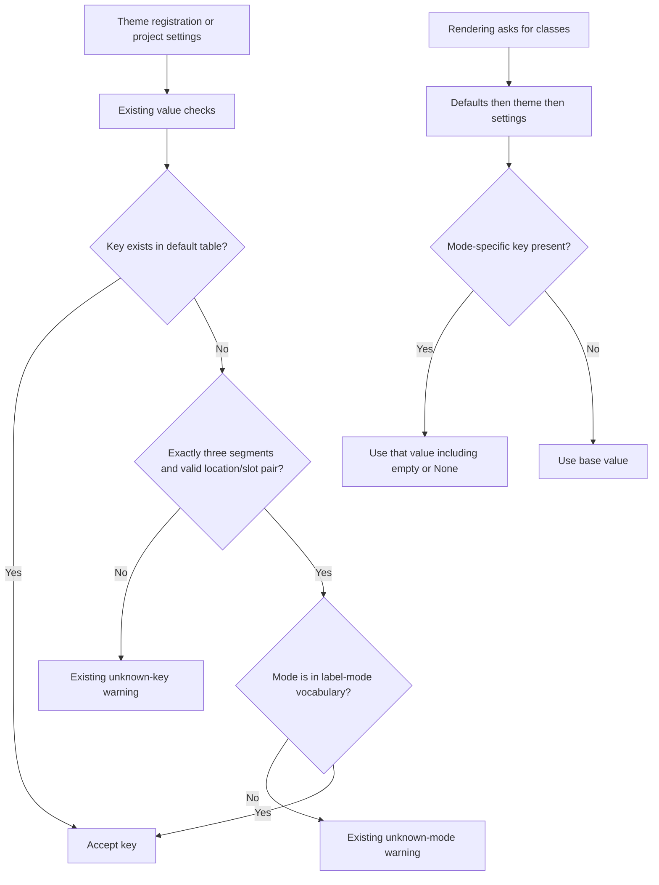

# Phase 02: Form key grammar - Research

**Researched:** 2026-10-26
**Domain:** Django class-key validation and documentation contracts
**Confidence:** MEDIUM

<user_constraints>
## User Constraints (from CONTEXT.md)

The following decisions and deferred scope are copied verbatim from the phase context.
[CITED: .planning/phases/02-form-key-grammar/02-CONTEXT.md]

<!-- DATA_95fe27c1_START -->
### Locked Decisions

### Form kinds and modes
- **D-01:** Choose Option A: retain `form:<kind>` and accept `form:<kind>:<mode>`. Preserve all shipped form
  keys and the crispy adapters' `slot=` usage. Option B (variants everywhere) was considered and rejected after
  a comparison of consistency, independent role styling, theme maintenance, and migration costs.
- **D-02:** The five form kinds are `submit`, `cancel`, `delete`, `filter-submit`, and `filter-reset`.
  Every kind accepts all three modes: `icon`, `both`, and `label`. Do not restrict modes by kind.
- **D-03:** Context/list/card action keys retain variants as their second segment. Form keys use kinds.
  Structural and utility slots do not accept mode suffixes. In particular, `form:submitt:icon` and
  `form:container:icon` remain invalid; choosing kinds does not admit `form:primary:icon`.
- **D-04:** Keep existing mode-key lookup semantics: a present mode-specific key overrides its base key;
  otherwise the base key applies. No new mode keys need to be shipped in the default table. Existing explicit
  `None`/empty-value behavior is preserved.

### Validation feedback
- **D-05:** Retain W362 as a warning and preserve the existing diagnostic distinction. Unknown keys such as
  `form:submitt:icon` report an unknown key and point to the buttons documentation. A known kind with an invalid
  mode, such as `form:submit:iconn`, identifies that mode and lists `both`, `icon`, and `label`.
- **D-06:** Do not add form-specific guidance, lists of kinds in warnings, or new structural-slot explanations
  to diagnostics. The documented grammar supplies that guidance.
- **D-07:** Missing icons do not make a class key invalid. The form rendering checks in Phase 6 handle that concern.

### Documentation
- **D-08:** `docs/reference/buttons.md#the-class-table` is the canonical grammar explanation. Add a compact table
  distinguishing variants, form kinds, and structural slots, valid/invalid key examples, and one form-mode
  fallback example. The user selected this over a minimal paragraph without examples.
- **D-09:** Correct the quoted default-key count and test it against `len(DEFAULT_BUTTON_CLASSES)` (KEYS-04).
  Addressable mode keys are not default-table entries; do not include their possible combinations in the count.
  Determine the actual count from the current table rather than copying the source proposal's historical number.

### Carried-forward constraints
- **D-10:** E108 and `default_label_mode()` continue to follow button-data/label-mode `LOCATIONS`, not the
  class-key variant-location set. `form` does not join those locations until Phase 6. Preserve the Phase 1
  invariant tying `LABEL_MODE_DEFAULTS` to button-data locations.
- **D-11:** Keep rendered output and goldens unchanged. Follow the project CHANGELOG rule for public-surface
  changes; any Breaking entry also requires a migration-guide update.

### Agent's Discretion
- No product decision was explicitly delegated. Exact helper placement, test organization, and documentation
  wording are implementation details within the locked grammar, diagnostics, and phase boundary.

### Deferred Ideas (OUT OF SCOPE)

None added. Form-button rendering and missing-icon checks remain in the already-planned Phase 6.
Variants everywhere and enhanced form-specific warnings were rejected, not deferred.
<!-- DATA_95fe27c1_END -->
</user_constraints>

## Summary

Implement this as a validation-and-documentation change. Keep the existing resolver and defaults untouched;
introduce two explicit immutable grammar sets in the class-table module, and extend its shape recognizer to
accept form kinds. The current recognizer uses the button-data location set; the resolver already selects a
mode-specific entry by presence. [VERIFIED: src/crud_views/lib/button_classes.py:136-147,207-229]

The measured default count is **70**, and both documented claims still say **64**. Correct the canonical count
and remove the redundant numeric claim; test the remaining count against the live default table. The existing
completeness test already states `assert len(EXPECTED_KEYS) == 70`.
[VERIFIED: tests/test1/test_button_classes.py:83-85; Python runtime count probe, 2026-10-26]
The outdated prose is `The default table has 64 keys` and `the count stays 64`.
[VERIFIED: docs/reference/buttons.md:115-118]

**Primary recommendation:** Extend the existing two-stage shape/mode validator; do not change rendering,
default keys, crispy adapters, label-mode floors, or button-data locations. This implements the locked boundary.
[VERIFIED: .planning/phases/02-form-key-grammar/02-CONTEXT.md:8-14,20-64]

## Architectural Responsibility Map

The following task allocation follows the existing module boundaries, not a new service architecture.
[VERIFIED: src/crud_views/lib/button_classes.py:127-147,207-294; src/crud_views/checks.py:404-407;
src/crud_views/lib/crispy/buttons.py:8-30]

| Capability | Primary tier | Secondary tier | Rationale |
|---|---|---|---|
| Class-key shape and mode checks | Backend configuration checks | Documentation | Extend existing check helper |
| Layer merge and mode fallback | Backend rendering utility | Django template tags | Existing implementation already supports the requested lookup |
| Button-data location and floor defaults | Backend view normalization | Settings checks | Keep separate from styling grammar |
| Default-count contract | Repository tests | Reference documentation | Compare prose integer against the actual table |
| Form HTML, browser behavior, persistence | Outside phase | — | Locked Phase 6 boundary |

## Project Constraints (from AGENTS.md)

These are repository directives; preserve them in the implementation plan.
[VERIFIED: AGENTS.md:15-47,89-105]

- Use the existing task workflows for environment setup, matrix tests, formatting, linting, build, docs, and version
  management; direct pytest from the repository root is supported. For this environment use `.venv/bin/` executables.
- Keep the existing fixture conventions: `cv_<model>`, `user_<model>_<permission>`,
  `client_user_<model>_<permission>`. [VERIFIED: AGENTS.md:93-93]
- Preserve class-attribute prefix `cv_` and workflow-method prefix `wf_`.
  [VERIFIED: AGENTS.md:97-100]
- Preserve view keys `list`, `detail`, `create`, `update`, `delete`, `workflow`, `manage` and permission mapping
  `list/detail→view, create→add, update→change, delete→delete`. [VERIFIED: AGENTS.md:98-99]
- Use 120-column lines and double quotes; preserve Hatchling and bump-my-version conventions.
  The commit hook runs `ruff-format`. [VERIFIED: AGENTS.md:47-47,101-104]
- A newly added `### Breaking` changelog entry requires a migration-guide companion.
  [VERIFIED: AGENTS.md:105-105]

Additional project constraints: public changes need a changelog entry; before pushing, run Python tests,
JavaScript tests, strict docs build, Ruff lint and format checks. Do not introduce downstream-project names.
The task delegation forbids source edits, branch switches, and commits during this research.
[CITED: .planning/PROJECT.md#constraints; task delegation]

The configured nested Claude instructions file was not present when probed; the root AGENTS.md resolves to
CLAUDE.md. No project skills directories or configured researcher skills were returned by discovery.
[VERIFIED: filesystem discovery and agent-skills query, 2026-10-26]

<phase_requirements>
## Phase Requirements

Descriptions below reproduce the requirement text; supporting recommendations follow in this document.
[CITED: .planning/REQUIREMENTS.md#class-key-grammar-plan-1c]

| ID | Description | Research support |
|---|---|---|
| KEYS-01 | Maintainer decides the `form:*` second-segment grammar (A: `form:<kind>:<mode>`, B: variants everywhere) during phase discussion; the rule is written in `docs/reference/buttons.md#the-class-table` | Option A is locked; compact grammar table plus accepted/rejected examples |
| KEYS-02 | W362 accepts mode keys for form buttons per the chosen grammar and rejects malformed ones (e.g. `form:submitt:icon`, `form:container:icon`) | Extend shape helper; retain warning branches; exercise both configuration layers |
| KEYS-03 | `LOCATIONS` is split into explicit sets (e.g. `VARIANT_LOCATIONS`, `FORM_KINDS`) so adding `"form"` to the button-data locations cannot loosen W362 | Independent sets in class-table module plus simulated future-location regression |
| KEYS-04 | A test parses the key count quoted in `buttons.md` and asserts it equals the size of `DEFAULT_BUTTON_CLASSES` | Parse exactly one canonical count and compare with live defaults |
</phase_requirements>

## Standard Stack

Use existing dependencies. Versions below are installed-environment observations, not upgrade recommendations
or claims about the latest registry release. No dependency installation is part of this phase.
[VERIFIED: importlib.metadata and executable version probes, 2026-10-26]

| Component | Observed version | Use |
|---|---|---|
| Python | 3.12.3 | Existing interpreter and standard-library string/set operations |
| Django | 5.2.14 | Existing warning objects and settings overrides |
| pytest | 9.1.1 | Parametrized grammar and documentation-contract tests |
| pytest-django | 4.14.0 | Existing configured Django test session |
| MkDocs | 1.6.1 | Strict documentation build |
| Ruff | 0.16.10 | Local lint/format executable; see environment caveat |

The project declares `requires-python = ">=3.12"`, `"django (>=4.2.0)"` and the existing test dependencies;
pytest configuration is `addopts = "--strict-markers"`.
[VERIFIED: pyproject.toml:25-35,70-83,129-130]

### Package Legitimacy Audit

Not applicable: no new package and no installation or upgrade recommendation. Retain the dependency manifest
and lockfile. Registry freshness and publish-date lookup would not establish anything needed for this change.
[CITED: task scope; .planning/phases/02-form-key-grammar/02-CONTEXT.md#phase-boundary]

## Architecture Patterns

### System Architecture Diagram

This is the recommended validation flow, extending the existing branching structure.
[VERIFIED: src/crud_views/lib/button_classes.py:241-294]



### Component Responsibilities and Proposed Edit Surface

File names below identify files opened during research; this table proposes edits, not newly generated paths.

| Component | Proposed work |
|---|---|
| `src/crud_views/lib/button_classes.py` | Add immutable grammar sets; extend helper/docstrings; retain local imports and diagnostics |
| `tests/test1/test_button_classes_checks.py` | All form kinds/modes and both layers; malformed keys; warning feedback; future-location isolation |
| `tests/test1/test_button_classes.py` | Form lookup fallback contract, documentation-count guard, import regression |
| `docs/reference/buttons.md` | Grammar table/examples, fallback example, count correction, W362 reference wording |
| `CHANGELOG.md` | Non-breaking entry describing newly accepted form mode keys |
| Existing label-mode, crispy, golden tests | Run as regression coverage; no behavior change proposed |

### Pattern 1: Explicit grammar ownership

Define the proposed `VARIANT_LOCATIONS` and `FORM_KINDS` beside the class-table helpers in the existing module.
Do not alias the variant-location set to button-data `LOCATIONS` or derive it from all default-table prefixes.
This is an implementation recommendation within the locked discretion, not a claim that the new symbols already exist.
The current coupling is the exact condition
`if len(parts) == 3 and parts[0] in LOCATIONS and parts[1] in VARIANTS:`.
[VERIFIED: src/crud_views/lib/button_classes.py:213-220]

Authoritative vocabularies, quoted verbatim:

<!-- DATA_c3af71d2_START -->
- `LOCATIONS = frozenset({"context", "list", "card"})`.
  [VERIFIED: src/crud_views/lib/view/button_data.py:12-12]
- `PRIMARY = "primary"`; `SECONDARY = "secondary"`; `TERTIARY = "tertiary"`; `DANGER = "danger"`;
  `VARIANTS: frozenset[str] = frozenset(variant.value for variant in Variant)`.
  [VERIFIED: src/crud_views/lib/view/variant.py:9-15]
- `LABEL = "label"`; `ICON = "icon"`; `BOTH = "both"`;
  `LABEL_MODES: frozenset[str] = frozenset(mode.value for mode in LabelMode)`.
  [VERIFIED: src/crud_views/lib/view/label_mode.py:15-20]
- `"form:submit": "btn btn-primary"`, `"form:cancel": "btn btn-secondary"`,
  `"form:delete": "btn btn-primary"`, `"form:filter-submit": "btn btn-primary"`,
  `"form:filter-reset": "btn btn-secondary"`.
  [VERIFIED: src/crud_views/lib/button_classes.py:56-60]
<!-- DATA_c3af71d2_END -->

Use those five suffixes as the explicit form-kind allow-list. Keep the existing variant and label-mode
vocabularies imported locally. The helper should first reject non-strings, then require exactly three segments,
then accept either an action-location/variant pair or a form/kind pair; return the mode unchanged so the next
stage distinguishes malformed keys from malformed modes. Do not normalize spelling, case, or whitespace.
[VERIFIED: src/crud_views/lib/button_classes.py:207-229,274-292; locked D-02,D-03,D-05]

Keeping the sets in the class-table module avoids importing the view package at module import time.
The existing AST guard explicitly checks this boundary, and the bare-settings runtime probe succeeded:
`bare_settings_import OK`. [VERIFIED: tests/test1/test_button_classes.py:212-223; runtime probe, 2026-10-26]

### Pattern 2: Preserve diagnostics and value validation independently

Retain these exact existing diagnostics, with the same warning class and ID:

<!-- DATA_76bd19a4_START -->
`f"Button class {key!r} has an unknown label mode {parts[2]!r}."`
`hint=f"Use one of {sorted(LABEL_MODES)}."`
`id="crud_views.W362"`

`f"Button class {key!r} is not a known key (typo?)."`
`hint="See the buttons documentation page for the list of keys."`
`id="crud_views.W362"`
<!-- DATA_76bd19a4_END -->

[VERIFIED: src/crud_views/lib/button_classes.py:277-291]

A valid form-mode key with a non-string value should continue to receive only
`id="crud_views.E361"`, whose value rule is `value is not None and not isinstance(value, str)`.
[VERIFIED: src/crud_views/lib/button_classes.py:241-248]
Test the warning severity as well as ID, message and hint. Django treats warning and error levels differently,
so changing the object type is observable behavior.
[CITED: https://docs.djangoproject.com/en/5.2/ref/checks/#checkmessage]

### Pattern 3: Keep style grammar separate from rendering eligibility

The existing floor map is
`LABEL_MODE_DEFAULTS: Mapping[str, str] = MappingProxyType({"context": "icon", "list": "icon", "card": "both"})`.
Its accessor imports button-data locations locally.
[VERIFIED: src/crud_views/lib/view/label_mode.py:23-23,84-99]
The setting check imports the same location set and uses `id="crud_views.E108"`.
[VERIFIED: src/crud_views/lib/settings.py:100-111,144-173]

Preserve existing tests that reject a form floor and that compare default-map keys with button-data locations.
The former includes `({"form": "both"}, [_key_msg("form", E108_LOCATIONS, "both")])`;
the latter asserts `assert set(LABEL_MODE_DEFAULTS) == LOCATIONS`.
[VERIFIED: tests/test1/test_action_label_mode_config.py:318-342;
tests/test1/test_label_mode.py:66-67]

Add a separate regression that temporarily widens button-data locations with the form location, invokes the
class-key check, and confirms every variant-shaped form key remains unknown. Make this test fail if the
implementation returns to using button-data locations for variant validation. Do not call the floor resolver
for the newly monkeypatched location, because this test deliberately does not add a floor.

### Pattern 4: Documentation as a narrow executable contract

Keep one canonical sentence containing the default count; remove the repeated numeric claim.
Use a narrow regex for that sentence and assert exactly one match before comparing with the actual table size.
Do not count Markdown table rows: the docs group multiple keys into individual rows.
[VERIFIED: docs/reference/buttons.md:64-71,113-118]

Add the requested compact grammar table with three rows: action variants, form kinds, structural/utility slots.
Give all required valid/invalid examples from the locked context and one presence-based fallback example.
Update the system-check table too: its current W362 row says only `location:variant:mode`.
[VERIFIED: docs/reference/buttons.md:449-449; locked D-08]

State clearly that accepted form class keys are available to a caller supplying a mode; this phase does not
make crispy form buttons choose a mode. The adapter currently calls
`self.field_classes = get_button_class(*(slot or self.slot).split(":", 1))`.
[VERIFIED: src/crud_views/lib/crispy/buttons.py:16-18]

## Don't Hand-Roll

| Problem | Do not build | Use instead |
|---|---|---|
| Mode lookup | Another resolver, mode cache, truthiness fallback | Existing presence-based resolver |
| Mode or variant vocabulary | Duplicated string lists in the validator | Existing local imports |
| Grammar | General parser framework or permissive prefix rule | Three segments plus explicit finite allow-lists |
| Feedback | New diagnostic IDs or form-specific wording | Existing two warning branches |
| Documentation freshness | Generated-doc framework | A focused count-parsing test |

These recommendations follow the existing helpers and the locked phase scope.
[VERIFIED: src/crud_views/lib/button_classes.py:136-147,207-294; locked D-04 through D-09]

## Runtime State Inventory

This is a narrow validator refactor, with no public-name rename or stored-schema migration.
The inventory below is a scope assessment; no deployed environment was inspected.
[CITED: .planning/phases/02-form-key-grammar/02-CONTEXT.md#phase-boundary]

| Category | Items found / scope | Action |
|---|---|---|
| Stored data | No renamed public key or persisted schema in the proposed change | No data migration |
| Live service config | Existing theme registrations and project settings remain compatible; deployed values not inspected | No remote configuration edit |
| OS-registered state | No renamed service, executable, or registration in scope | No re-registration |
| Secrets/env vars | Existing setting names are preserved; secrets not inspected | No key rotation or variable rename |
| Build artifacts / installed packages | Package code must be updated through the normal deployment process | Ordinary release/deployment only |

The relevant live in-process state is `_THEME_BUTTON_CLASSES` and the merged table cache; registration and settings
changes already reset that cache. Preserve the existing registry-isolation fixtures.
[VERIFIED: src/crud_views/lib/button_classes.py:104-133;
tests/test1/test_button_classes_checks.py:11-18]

## Common Pitfalls

1. **Accepting all three-part keys below a known prefix.** This admits typos and structural slots.
   Validate the location/slot pair before checking the mode. The current split between those stages is useful.
   [VERIFIED: src/crud_views/lib/button_classes.py:207-229,274-292]
2. **Importing view constants at module scope.** This breaks the intended bare-settings boundary.
   Keep imports local and run a fresh interpreter smoke test, not just pytest after Django has initialized.
   [VERIFIED: src/crud_views/lib/button_classes.py:210-214;
   tests/test1/test_button_classes.py:212-223]
3. **Using truthiness for fallback.** Explicit empty strings and None must not fall back.
   Also preserve the fact that a theme mode entry wins over a settings base entry.
   [VERIFIED: src/crud_views/lib/button_classes.py:139-147;
   tests/test1/test_button_classes.py:174-193]
4. **Testing only one form kind or only settings.** Exercise all fifteen kind/mode combinations in both settings
   and theme registration. The current acceptance test already exercises both sources.
   [VERIFIED: tests/test1/test_button_classes_checks.py:63-68; locked D-02]
5. **Adding accepted mode keys to defaults.** This changes the shipped-key contract and count without need.
   Keep the complete default table unchanged. [CITED: locked D-04,D-09]
6. **Overstating UI support.** Grammar acceptance does not implement form-mode rendering or icon checks.
   Preserve the crispy adapter and avoid documenting form floors as usable now.
   [VERIFIED: src/crud_views/lib/crispy/buttons.py:16-30; locked D-07,D-10]
7. **Fixing only the first stale number.** Both count claims must be addressed.
   [VERIFIED: docs/reference/buttons.md:115-118]

## Code Examples

The following is a proposed implementation sketch, not existing code. Its vocabulary is sourced from the
verbatim declarations above; symbol placement is an implementation recommendation.

```python
# In the class-table module, independent of button_data.LOCATIONS:
VARIANT_LOCATIONS = frozenset({"context", "list", "card"})
FORM_KINDS = frozenset({"submit", "cancel", "delete", "filter-submit", "filter-reset"})

def _action_key_parts(key: str) -> tuple[str, str, str] | None:
    from .view.variant import VARIANTS

    if not isinstance(key, str):
        return None
    parts = key.split(":")
    if len(parts) != 3:
        return None
    location, slot, mode = parts
    if (location in VARIANT_LOCATIONS and slot in VARIANTS) or (
        location == "form" and slot in FORM_KINDS
    ):
        return location, slot, mode
    return None
```

Keep `_is_action_mode_key()` as the mode-membership stage and update both helper docstrings to use slot/variant-or-kind
terminology. The original mode stage is `return parts is not None and parts[2] in LABEL_MODES`.
[VERIFIED: src/crud_views/lib/button_classes.py:224-229]

A minimal count guard can extend the existing completeness test. Proposed test logic:

```python
# buttons_text is read from the canonical buttons reference document.
matches = re.findall(r"The default table has (\d+) keys\b", buttons_text)
assert len(matches) == 1
assert int(matches[0]) == len(DEFAULT_BUTTON_CLASSES)
```

Use the existing docs-test project-root pattern `ROOT = Path(__file__).resolve().parents[2]` and
`BUTTONS_MD = DOCS / "reference" / "buttons.md"`, with `DOCS = ROOT / "docs"`.
[VERIFIED: tests/test1/test_label_mode_docs.py:13-17]
This is a read-path reference from existing tests, not a claim about a filesystem creation operation.

## State of the Art

For this repository the relevant transition is from action-only mode-key validation to explicit action/form
families. No framework upgrade, new rendering pattern, or migration is needed.
[VERIFIED: src/crud_views/lib/button_classes.py:207-229; locked D-01,D-11]

## Environment Availability

These are actual local observations, not statements about other supported matrix environments.
[VERIFIED: executable, metadata, and test probes, 2026-10-26]

| Dependency | Available | Observed version | Planning consequence |
|---|---|---|---|
| Project Python | Yes | 3.12.3 | Use `.venv/bin/python` |
| pytest and Django | Yes | 9.1.1 / 5.2.14 | Existing tests run without setup changes |
| pytest-django | Yes | 4.14.0 | Existing in-memory test configuration |
| MkDocs | Yes | 1.6.1 | Use `.venv/bin/mkdocs` |
| Ruff | Yes | 0.16.10 | Installed version predates the manifest range |
| Node / Vitest | Yes | 20.20.2 / 4.1.10 | Existing direct Vitest runner available |

The manifest explicitly requires `"ruff>=0.17,<0.18"`; the installed executable reports `ruff 0.16.10`.
This is a positively verified mismatch, not an absence-based compatibility claim.
[VERIFIED: pyproject.toml:60-62; Ruff version probe, 2026-10-26]
Use the project's approved environment synchronization before treating its final Ruff gate as matching the manifest;
do not change dependency constraints in this phase.

**Missing dependencies with no fallback:** none identified for implementation or focused tests.
**Matrix limitation:** this research exercised the active Python/Django environment only.
[CITED: local probes and test runs, 2026-10-26]

## Validation Architecture

### Test Framework

| Property | Value |
|---|---|
| Framework | pytest 9.1.1 with pytest-django 4.14.0 |
| Configuration | Existing pyproject pytest options and test-project conftest |
| Quick command | `.venv/bin/pytest tests/test1/test_button_classes.py tests/test1/test_button_classes_checks.py tests/test1/test_label_mode.py tests/test1/test_action_label_mode_config.py -q` |
| Full suite | `.venv/bin/pytest tests -n auto` |
| Import smoke | `.venv/bin/python -c 'from django.conf import settings; settings.configure(); import crud_views.lib.button_classes'` |

Versions and commands are grounded in successful local focused runs; the configuration is
`addopts = "--strict-markers"` and Django settings are configured by `pytest_configure()`.
[VERIFIED: pyproject.toml:129-130; tests/test1/conftest.py:35-43; local probes, 2026-10-26]

### Phase Requirements → Test Map

Commands target existing files. Proposed new test cases belong in these files and do not require a new framework.

| Req ID | Behavior | Type | Automated command | File exists? |
|---|---|---|---|---|
| KEYS-01 | Compact grammar, required examples, no implied form rendering support | Docs build plus manual content review | `.venv/bin/mkdocs build --strict` | Yes |
| KEYS-02 | Five kinds × three modes × settings/theme; existing variants; malformed shape and bad-mode diagnostic distinction; non-string key/value safety | Unit/check integration | `.venv/bin/pytest tests/test1/test_button_classes_checks.py -q` | Yes; add cases |
| KEYS-03 | Independent class-key sets, simulated future button-data location, untouched floor semantics and import safety | Unit and fresh-process smoke | `.venv/bin/pytest tests/test1/test_button_classes.py tests/test1/test_button_classes_checks.py tests/test1/test_label_mode.py tests/test1/test_action_label_mode_config.py -q` | Yes; add isolation case |
| KEYS-04 | Exactly one canonical count parsed and compared with defaults | Documentation contract | `.venv/bin/pytest tests/test1/test_button_classes.py -q` | Yes; add count guard |

The documentation prose review is manual because a clean build does not establish semantic accuracy.
Keep the explicitly requested numeric contract automated; do not add a broad prose-matching framework.

### Required Regression Cases

- Move `"form:submit:icon"` out of the current rejection list.
  [VERIFIED: tests/test1/test_button_classes_checks.py:71-90]
- Cover each locked valid form combination independently in both layers. Derive cases from an independently
  specified expected five-kind vocabulary, or assert the new constant equals that vocabulary first; otherwise
  a missing kind could silently remove its own test case.
- Reject the locked examples and all action variants under the form prefix; reject missing/extra segments,
  unknown kinds, utility suffixes, invalid/empty modes and non-string keys. Assert the correct diagnostic branch.
- Check valid form-mode values of None and empty string, and a non-string value receiving only the value error.
- Exercise form mode override, absent mode fallback, explicit empty/None suppression, and settings-base versus
  theme-mode precedence through the existing resolver.
- Keep existing location/default invariants, floor form rejection, and dynamic-location E108 regression.
  [VERIFIED: tests/test1/test_action_label_mode_config.py:318-371;
  tests/test1/test_label_mode.py:66-67,136-141]
- Preserve the existing AST import guard and add a subprocess smoke if the edit creates a new import path.

### Sampling Rate and Gates

- Per task: quick command above; existing focused tests finish well below 30 seconds locally.
- Per wave: run the full Python suite, then relevant docs and formatting gates.
- Phase gate: all required checks green, no golden changes, and the canonical grammar reviewed against D-01–D-11.
- Before push: also run `node node_modules/vitest/vitest.mjs run`, `.venv/bin/mkdocs build --strict`,
  `.venv/bin/ruff check .` and `.venv/bin/ruff format --check .`, subject to the Ruff version caveat.

The phase-specific rendering regression command is:

```bash
.venv/bin/pytest tests/test1/test_button_classes_templates.py tests/test1/test_crispy_buttons.py tests/test1/test_action_menus_golden.py tests/test1/test_label_mode_docs.py -q
```

Do not enable golden regeneration; inspect the final diff to confirm no templates or golden files changed.
[CITED: locked D-11; .planning/PROJECT.md#constraints]

### Baseline Evidence

- Class-table resolution/checks plus label-mode floor tests: **132 passed in 0.24s**.
- Action-mode configuration, class-template contract, crispy buttons, action-menu goldens, docs contracts:
  **112 passed in 3.19s**.
- Bare-settings import/count/lookup probe: `default_count 70`, `bare_settings_import OK`,
  `form_submit_mode_fallback btn btn-primary`.
[VERIFIED: executed local commands, 2026-10-26]

An exploratory command used a nonexistent label-mode-checks filename and collected no tests; it was corrected
to the actual action-label-mode configuration test file. It is not part of the successful baseline.
[VERIFIED: local command output, 2026-10-26]

### Wave 0 Gaps

No framework, fixture, or dependency setup is needed. Add the grammar acceptance/rejection matrix, future-location
isolation case, form fallback cases and count guard during implementation. Existing tests provide the registry
snapshot/restore fixture and Django configuration.
[VERIFIED: tests/test1/test_button_classes_checks.py:11-18,63-109;
tests/test1/test_button_classes.py:73-85,167-223; tests/test1/conftest.py:35-43]

## Security Domain

This phase validates developer-supplied styling configuration. Preserve the existing output-escaping behavior
and warning severity; do not introduce template evaluation, request input handling, or new authentication flows.
The current tag test proves escaping for hostile class-string characters.
[VERIFIED: tests/test1/test_button_classes.py:154-159; locked phase boundary]

### Applicable ASVS Categories

The following uses the **ASVS 4.x category names used by the research template**, not current-version numbering.
The official ASVS overview identifies 5.0.0 as the current release; do not label the legacy category numbers as 5.0.
[CITED: https://asvs.owasp.org/;
https://owasp.org/www-project-developer-guide/assets/exports/OWASP_Developer_Guide.pdf]

| ASVS 4.x category | Applies to this change? | Standard control / scope |
|---|---|---|
| V2 Authentication | No new surface | Preserve existing authentication behavior |
| V3 Session Management | No new surface | No session changes |
| V4 Access Control | No new surface | No permission changes |
| V5 Validation, Sanitization and Encoding | Yes | Explicit finite vocabularies, defensive type check, existing escaped template output |
| V6 Stored Cryptography | No new surface | No cryptographic operations |

Applicability is a scope assessment grounded in the proposed validator-only change, not a compliance certification.
[CITED: locked phase boundary; ASVS sources above]

| Threat pattern | STRIDE | Mitigation |
|---|---|---|
| Malformed configuration crashes checks | Denial of service | Type/segment checks and non-string regression |
| Future location additions silently broaden grammar | Tampering/configuration drift | Independent allow-lists plus simulated future-location test |
| Class strings accidentally rendered unescaped | Tampering | Preserve current template path and existing escaping regression |

These are review targets derived from the existing parser and escape test.
[VERIFIED: src/crud_views/lib/button_classes.py:216-220;
tests/test1/test_button_classes_checks.py:105-109; tests/test1/test_button_classes.py:154-159]

## Assumptions Log

No unverified product decisions are required. Proposed helper placement and test organization are recommendations
within the explicitly allowed implementation discretion. Deployed configuration and the full supported version
matrix were not inspected; no compatibility claim is based on their absence.
[CITED: locked Agent's Discretion; local test scope]

| # | Assumed claim | Risk |
|---|---|---|
| — | None used to lock a product decision | — |

## Open Questions

No product question remains: the context supersedes older roadmap/state wording that still calls Option A versus B
open. Resolve the local Ruff version mismatch through the normal environment workflow before the final lint gate.
[CITED: .planning/phases/02-form-key-grammar/02-CONTEXT.md#implementation-decisions;
VERIFIED: pyproject.toml:60-62; local Ruff probe]

## Sources

### Repository source of truth

- Class-table implementation, shape checker, lookup, settings checks, vocabularies, crispy adapter, and test files
  cited inline were opened this session; discrete declarations are quoted above.
- Phase context and canonical source-plan sections define scope; the context's locked choice takes precedence.
- Successful Python probes and focused pytest runs establish the observed baseline.

### Official documentation

- [Django 5.2 system checks](https://docs.djangoproject.com/en/5.2/ref/checks/) — warning/error distinction.
- [OWASP ASVS overview](https://asvs.owasp.org/) — current standard version.
- [OWASP Developer Guide](https://owasp.org/www-project-developer-guide/assets/exports/OWASP_Developer_Guide.pdf)
  — legacy ASVS category mapping used by the requested template.

### Research method and confidence

The research-plan seam selected `websearch` for the two external questions. The confidence seam returned
`"confidence": "MEDIUM"` for `--provider websearch --verified`. Repository findings instead carry direct source
and test evidence; the seam has no local-code authority classification (a local-provider probe returns LOW).
Do not mistake that unsupported provider category for uncertainty about a read declaration or successful test.
[VERIFIED: research-plan and classify-confidence command outputs, 2026-10-26]

No knowledge graph was available from the graph status query. Research-cache writes were omitted to honor the
delegated one-artifact write scope; no fetched content was executed.
[VERIFIED: graphify status output; task delegation]

## Metadata

**Confidence:** MEDIUM overall under the provider seam; implementation evidence is direct repository reads and tests.
**Standard stack:** Existing installed dependencies, observed versions; no package selection.
**Architecture:** Existing code plus locked decisions; recommended edit boundary is explicit.
**Pitfalls:** Supported by existing regression tests and the present coupling.
**Research date:** 2026-10-26.
**Revalidate:** When the class table, button-data locations, or dependency environment changes; before Phase 6.
**Commit:** Intentionally omitted by task delegation.
