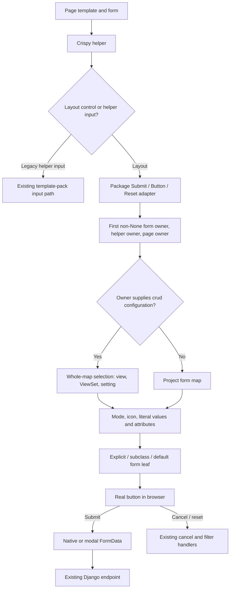

# Phase 6: Form-button leaf - Research

**Researched:** 2026-10-27
**Domain:** Django crispy layout adapters, literal escaping, ownership and accessible form controls
**Confidence:** MEDIUM

<user_constraints>
## User Constraints (from CONTEXT.md)

Source: phase context, copied verbatim below. These are locked instructions, not newly inferred findings.

<!-- DATA_a839c271_START -->
## Implementation Decisions

### Custom filter helpers
- **D-01:** Existing custom helpers that use `add_input(Submit(...))` retain their existing rendering. Do not
  automatically relocate those controls or globally override crispy templates. Document migration to layout
  `FormActions` to opt into the new leaf, icons, and label modes. Hidden sort/order inputs retain their path.
- **D-02:** This compatibility limitation is documentation-only: no new system-check or runtime warning for
  legacy `add_input()` placement. This does not suppress existing or required configuration diagnostics.
- **D-03:** Preserve the documented `ListViewFilterFormHelper` subclass pattern that declares only filter
  fields in a class-level `layout`. The base helper appends Apply/Reset after those fields, exactly once per
  form. Repeated instantiation/rendering must not accumulate controls in a shared layout.
- **D-04:** Add a filter-helper `get_form_actions()` hook following `CrispyFormMixin`, allowing subclasses to
  replace or omit the default actions. The default returns the Apply/Reset actions through `FormActions`.
  Exact representation of an omitted action group is an implementation detail to document and test.

### Custom button templates
- **D-05:** Honor explicit `template=` on the package's `Submit`, `Button`, and `Reset` adapters. Render custom
  templates with the normalized form-button context and document migration from crispy's old context.
- **D-06:** Expose the new `cv_*` button contract, without a legacy crispy `input` object. Existing custom
  templates must migrate references such as `input.value` to `cv_value`. Preserve the required escaped
  extra-attribute support; this decision does not remove that support.
- **D-07:** Preserve subclass template attributes. Precedence is explicit `template=` argument, then the
  subclass's `template` attribute, then the bundled `crud_views/tags/button/form.html` default.
- **D-08:** Preserve crispy's `%s` template-pack substitution in template names, for example
  `%s/buttons/submit.html`. These templates still consume the new form-button context.

### Which view controls a form
- **D-09:** Resolve ownership in this order: `form.cv_view`, helper `view`, page-context `view`. Explicit form
  ownership wins over an enclosing page, including an embedded form whose owner differs from the page.
- **D-10:** With no owner, render standalone buttons using `CRUD_VIEWS_FORM_ACTIONS_LABEL_MODE` for the kind,
  then the form label-mode floor. Do not require a crud_views view merely to render a button.
- **D-11:** An explicit ordinary Django view without crud_views configuration stops the owner lookup. Use
  project settings/defaults instead of borrowing a lower-priority helper/page view. This qualifies D-10:
  select the owner first, then determine whether it supplies crud_views configuration.
- **D-12:** Different form/helper/page view references produce no conflict warning or error. Apply the stated
  precedence quietly; embedded forms with different owners are valid.

### Carried-forward requirements and constraints
- **D-13:** Add `form` to button-data locations and the lazy defaults with the package floor `label`.
  Preserve Phase 2's finite `FORM_KINDS` and `form:<kind>:<mode>` grammar independently of variant locations.
  Form mode maps on settings, ViewSet, and view follow existing whole-map selection semantics; do not confuse
  these with the per-key merge of `CRUD_VIEWS_LABEL_MODE_DEFAULTS`.
- **D-14:** Use the new form leaf and normalized contract from FORM-02/03: `cv_type`, `cv_name`, `cv_value`,
  `cv_id`, cancel-only `cv_cancel_url`, and kind in `cv_key`. Add `form:hidden-label` and `form:icon-host`.
  Preserve host and inline icon behavior. Icon mode has hidden text, title, and `data-cv-tooltip="form"`;
  both shows icon plus text; label shows text. Preserve constructor arguments and appended `css_class`.
- **D-15:** Values and labels are escaped literal text, never evaluated as Django templates. Cover markup,
  attribute-breaking strings, and `{{ request.user }}` in both body and value attribute. Record the DOM,
  value-templating, and custom-template-context changes in CHANGELOG Breaking and `docs/migrating-1.0.md`.
- **D-16:** Preserve required icon mappings: submit/save, delete/delete, cancel/cancel,
  filter-submit/filter, filter-reset/filter-reset; workflow submit uses workflow. Per-form `submit_icon`
  wins. Extend E210/E211/W291 and W292 as specified; missing-icon icon-only rendering raises in strict mode,
  otherwise logs and falls back to the label. No-warning choices D-02/D-12 do not weaken these checks.
- **D-17:** Commit before-change goldens before implementation; preserve default names, values, IDs and
  classes while changing element type. Keep delete POST data and `filter-button-reset`. The example enables
  form `both`. Preserve project quality gates and record downstream-theme follow-up in acceptance without
  editing a downstream repository. Follow the project rule against downstream project names in new files.

### Agent's Discretion and Required Research
- No additional product choice was explicitly delegated. Helper placement, test organization, and precise
  documentation wording remain implementation choices within these decisions.
- Resolve a shared `LEAF_KEYS` versus separate form-key set in the required design/spec; preserve the public
  form contract and avoid adding irrelevant action-only fields. Do not ask the user to choose internal sets.
- Verify the lowest supported crispy versions and the `add_input()` versus layout rendering paths. Determine
  the appropriate floor-validation session within current support constraints; do not silently raise floors.
- Verify the roadmap's Django 6.0 `format_html` concern precisely and jsdom `SubmitEvent.submitter` support.
  These are investigation tasks, not findings established by this discussion.
- Define the hook's omission behavior, isolate mutable subclass layouts, and ensure controls are added once.
  Establish the safe normalization and extra-attribute contract before implementation.
- Treat an absent/None view reference as no owner and proceed to the next source; an actual ordinary view
  object is the explicit owner described in D-11. This is an implementation interpretation of ownership,
  not an additional user-selected API.


## Deferred Ideas

None added. Automatic migration of legacy helper inputs, legacy-placement warnings, rejecting template
overrides, retaining crispy's `input` object, dropping template-pack substitution, and warning on differing
owners were rejected, not deferred. The stability freeze and downstream-theme implementation remain outside
this phase. Required design/spec and compatibility investigation remain Phase 6 work.

<!-- DATA_a839c271_END -->
</user_constraints>

## Summary

Use thin crispy layout adapters plus a dedicated form leaf. Preserve constructor behavior, choose the form's owner
before resolving any configuration, and normalize literal text at the rendering boundary. Extend the existing mode
resolver and class grammar without reusing action-only URL/modal fields. These are recommendations implementing
D-01 through D-17, not additional product decisions. [CITED: 06-CONTEXT.md, Implementation Decisions]

Two integration hazards were reproduced during recovery: passing a form into crispy replaces a subclass's declared
layout, and helper `view=None` shadows the enclosing page view during real crispy rendering. A render method that
merely calls `context.get("view")` therefore violates the required fallback. [VERIFIED: recovery execution of
/tmp/phase06-probe.py with Django 5.2.14, django-crispy-forms 2.6, crispy-bootstrap5 2026.3]

**Primary recommendation:** Put the required design/spec first, then commit baseline goldens alone, implement the
normalizer/adapter and filter-helper lifecycle together, and prove the behavior through real crispy templates and
existing browser handlers. [CITED: 06-CONTEXT.md, D-17 and Phase Boundary]

## Architectural Responsibility Map

Recommended ownership, derived from the locked form-button scope. [CITED: 06-CONTEXT.md, D-01–D-17]

| Capability | Primary tier | Secondary tier | Responsibility |
|---|---|---|---|
| Owner selection, mode and icon resolution | Django server | crispy adapter | Resolve once before rendering |
| Escaped leaf contract and attributes | Django server | template leaf | Treat labels/values as literal data |
| Filter fields and action layout lifecycle | Django server | helper subclass | Isolate layouts and append once |
| Cancel/reset/native and modal submission | Browser | Django endpoint | Preserve existing names/values and handlers |
| Configuration diagnostics | Django system checks | runtime normalizer | Static checks plus runtime fallback |
| Persistence | Existing application models | — | No schema change proposed |

## Project Constraints (from AGENTS.md)

The supplied AGENTS instructions reproduce the repository's CLAUDE.md. Apply the following directives.
[CITED: CLAUDE.md, Development Commands, Testing, Conventions]

- Keep view configuration attributes prefixed `cv_`, workflow transition methods prefixed `wf_`, and the
  established CRUD operation keys and permission mapping.
- Use existing pytest fixtures: ViewSet, permission-user and logged-in-client fixture conventions.
- Format Python with double quotes and 120-character lines; retain hatchling and bump-my-version conventions.
- Run applicable pytest and nox checks, plus the pre-commit formatter. Use the documented task commands when needed.
- Pair every Breaking changelog entry with the migration guide until the first stable release.

Additional project directives require unchanged unrelated goldens, the full Python/JS/docs/lint gates before push,
and no downstream project names in new files. Record downstream follow-up generically in the acceptance artifact.
[CITED: .planning/PROJECT.md, Constraints; 06-CONTEXT.md, D-17]

<phase_requirements>
## Phase Requirements

Descriptions follow the requirements document; the downstream name is generalized to honor project hygiene.
Research-support cells identify planned coverage.
[CITED: .planning/REQUIREMENTS.md, Form-button leaf]

<!-- DATA_f920a67c_START -->
| ID | Description | Research Support |
|---|---|---|
| FORM-01 | Golden of today's form-button markup is committed before any change, so the PR shows the diff | Baseline-only commit before product edits |
| FORM-02 | `"form"` is a button-data location; `cv_button_data(ctx, "form")` provides `cv_type`, `cv_name`, `cv_value`, `cv_id`, `cv_cancel_url` (cancel only); `cv_key` is the kind | Separate form contract and early form branch |
| FORM-03 | New leaf `crud_views/tags/button/form.html` renders the three label-mode bodies with classes from `` | Dedicated leaf with existing mode/class helpers |
| FORM-04 | Class keys `form:hidden-label` (default `visually-hidden`) and `form:icon-host` exist, so icon-only form buttons keep an accessible hidden label and host-placed icon libraries render | Hidden-label and host/inline icon regression cases |
| FORM-05 | crispy `Submit` / `Button` / `Reset` keep their constructor signature and render through the leaf; `css_class` is still appended; extra kwargs render as attributes | Adapter/template/attribute compatibility contract |
| FORM-06 | With nothing configured, form buttons render as `<button type="…">` with the same text, classes, `name`, `value`, `id`; POST data unchanged | Default DOM, payload and JS regression coverage |
| FORM-07 | Button values/labels are rendered as autoescaped plain text, never evaluated as a Django template; a label containing `<b>` renders escaped (button text and `value` attribute tested) | Literal boundary including SafeString and template syntax |
| FORM-08 | List filter Apply/Reset move from `helper.add_input()` into a layout `FormActions`, so they render through the leaf; `#filter-button-reset` id preserved; hidden sort/order inputs unchanged | Isolated helper lifecycle, omission and hidden inputs |
| FORM-09 | Icons `save`, `cancel`, `filter-reset` exist in `DEFAULT_ICONS` and `BOOTSTRAP_ICONS`; submit→`save`, delete→`delete`, cancel→`cancel`, filter-submit→`filter`, filter-reset→`filter-reset`; workflow submit uses `workflow`; per-form `submit_icon` wins | Semantic kinds and workflow/per-form precedence |
| FORM-10 | `CRUD_VIEWS_LABEL_MODE_DEFAULTS = {"form": "both"}` shows icon + text on save, delete, cancel and both filter buttons; `{"form": "icon"}` uses the hidden label with `title` and `data-cv-tooltip="form"` | Three-mode rendering with project floor |
| FORM-11 | Setting → ViewSet `form_actions_label_mode` → view `cv_form_actions_label_mode` per-key maps resolve like the context/list maps | Owner selection separated from whole-map selection |
| FORM-12 | Checks E210/E211/W291 cover form label-mode maps; W292 reports icon-only form buttons without an icon; strict mode raises at render, otherwise logs and renders the label | Static diagnostics plus runtime strict/log policy |
| FORM-13 | CHANGELOG `### Breaking` (`<input>` → `<button>`, no template evaluation of values) and `docs/migrating-1.0.md` "Form buttons" section; example project enables `both` for submit, delete, cancel; downstream-theme follow-up written into the acceptance note | Paired docs, example and generic downstream acceptance note |
<!-- DATA_f920a67c_END -->
</phase_requirements>

## Standard Stack

Retain the installed ecosystem; no new production dependency or floor increase is recommended. This is a compatibility
phase, so these are declared bounds and observed versions, not claims that installed versions are latest.
[VERIFIED: pyproject.toml:25-35; recovery importlib.metadata and Node package metadata probes]

<!-- DATA_c4f29a80_START -->
Declared dependency evidence, verbatim:
`requires-python = ">=3.12"`
`"django (>=4.2.0)"`
`"django-crispy-forms (>=2.0)"`
`"crispy-bootstrap5 (>=2023.10)"`
<!-- DATA_c4f29a80_END -->

| Component | Declared floor / range | Observed local version | Use |
|---|---|---|---|
| Python | >=3.12 | 3.12.3 | Existing runtime |
| Django | >=4.2.0 | 5.2.14 | Templates, escaping, checks |
| django-crispy-forms | >=2.0 | 2.6 | Layout adapters and helper lifecycle |
| crispy-bootstrap5 | >=2023.10 | 2026.3 | Existing template pack |
| pytest | Existing test dependency | 9.1.1 | Python regressions |
| jsdom | ^30.1.2 | 29.1.1 | Browser API regression tests |
| Vitest | ^5.0.3 | 4.1.10 | Existing JS harness |

JS declaration evidence, verbatim: `"jsdom": "^30.1.2"`, `"vitest": "^5.0.3"`, `"node": ">=20"`.
[VERIFIED: package.json:15-21]

**Installation:** No new package installation belongs in implementation. Keep dependency changes separate from the
feature. Reconcile the JS environment against the repository lockfile before final acceptance; the observed versions
do not satisfy the manifest ranges. [VERIFIED: package.json:15-21 and recovery Node metadata probe]

**Package Legitimacy Audit:** Not applicable to new dependencies: none proposed or installed in this research.
The isolated floor-validation session uses existing declared dependencies. If planning introduces any new package,
run the required legitimacy gate before recommending its installation.

## Package Legitimacy Audit

Added during planning on 2026-10-27 for **restoration of existing declared test dependencies only**.
No production package adoption or dependency-floor change is authorized by this audit. Each Python name below
already occurs in pyproject.toml base dependencies or the polymorphic/workflow/ordered/test extras used by nox;
the official PyPI JSON endpoint returned the matching canonical name and project URLs during planning.
The four central runtime/tool identities were also inspected on their primary PyPI pages. Registry existence
establishes package identity, not security review of every release or transitive dependency.

| Package | Version / scope | Status | Evidence |
|---|---|---|---|
| crispy-bootstrap5 | 2023.10 floor | [VERIFIED] | Existing declaration; [official PyPI project](https://pypi.org/project/crispy-bootstrap5/) |
| cssselect | Existing pyproject.toml constraint | [VERIFIED] | Existing declaration; [official PyPI project](https://pypi.org/project/cssselect/) |
| django | 4.2 and 6.0 validation lines | [VERIFIED] | Existing declaration; [official PyPI project](https://pypi.org/project/django/) |
| django-crispy-forms | 2.0 floor | [VERIFIED] | Existing declaration; [official PyPI project](https://pypi.org/project/django-crispy-forms/) |
| django-filter | Existing pyproject.toml constraint | [VERIFIED] | Existing declaration; [official PyPI project](https://pypi.org/project/django-filter/) |
| django-fsm-2 | Existing pyproject.toml constraint | [VERIFIED] | Existing declaration; [official PyPI project](https://pypi.org/project/django-fsm-2/) |
| django-fsm-2-admin | Existing pyproject.toml constraint | [VERIFIED] | Existing declaration; [official PyPI project](https://pypi.org/project/django-fsm-2-admin/) |
| django-guardian | Existing pyproject.toml constraint | [VERIFIED] | Existing declaration; [official PyPI project](https://pypi.org/project/django-guardian/) |
| django-ordered-model | Existing pyproject.toml constraint | [VERIFIED] | Existing declaration; [official PyPI project](https://pypi.org/project/django-ordered-model/) |
| django-pipeline | Existing pyproject.toml constraint | [VERIFIED] | Existing declaration; [official PyPI project](https://pypi.org/project/django-pipeline/) |
| django-polymorphic | Existing pyproject.toml constraint | [VERIFIED] | Existing declaration; [official PyPI project](https://pypi.org/project/django-polymorphic/) |
| django-tables2 | Existing pyproject.toml constraint | [VERIFIED] | Existing declaration; [official PyPI project](https://pypi.org/project/django-tables2/) |
| lxml | Existing pyproject.toml constraint | [VERIFIED] | Existing declaration; [official PyPI project](https://pypi.org/project/lxml/) |
| nox | Existing pyproject.toml constraint | [VERIFIED] | Existing declaration; [official PyPI project](https://pypi.org/project/nox/) |
| polib | Existing pyproject.toml constraint | [VERIFIED] | Existing declaration; [official PyPI project](https://pypi.org/project/polib/) |
| pydantic | Existing pyproject.toml constraint | [VERIFIED] | Existing declaration; [official PyPI project](https://pypi.org/project/pydantic/) |
| pytest | Existing pyproject.toml constraint | [VERIFIED] | Existing declaration; [official PyPI project](https://pypi.org/project/pytest/) |
| pytest-cov | Existing pyproject.toml constraint | [VERIFIED] | Existing declaration; [official PyPI project](https://pypi.org/project/pytest-cov/) |
| pytest-django | Existing pyproject.toml constraint | [VERIFIED] | Existing declaration; [official PyPI project](https://pypi.org/project/pytest-django/) |
| pytest-mock | Existing pyproject.toml constraint | [VERIFIED] | Existing declaration; [official PyPI project](https://pypi.org/project/pytest-mock/) |
| pytest-random-order | Existing pyproject.toml constraint | [VERIFIED] | Existing declaration; [official PyPI project](https://pypi.org/project/pytest-random-order/) |
| pytest-xdist | Existing pyproject.toml constraint | [VERIFIED] | Existing declaration; [official PyPI project](https://pypi.org/project/pytest-xdist/) |
| python-box | Existing pyproject.toml constraint | [VERIFIED] | Existing declaration; [official PyPI project](https://pypi.org/project/python-box/) |
| typing-extensions | Existing pyproject.toml constraint | [VERIFIED] | Existing declaration; [official PyPI project](https://pypi.org/project/typing-extensions/) |
| jquery | 3.7.1 locked | [VERIFIED] | Existing package.json and package-lock.json; registry.npmjs.org URL and integrity |
| jsdom | 30.1.2 locked | [VERIFIED] | Existing package.json and package-lock.json; registry.npmjs.org URL and integrity |
| vitest | 5.0.3 locked | [VERIFIED] | Existing package.json and package-lock.json; registry.npmjs.org URL and integrity |
| npm transitive dependency graph | Exact package-lock.json set only | [VERIFIED] | Every locked package has a registry.npmjs.org source and integrity; restore with npm ci, never a new resolution |

Use these packages only through the existing declaration/lock or the explicit oldest-crispy session pins.
Before installation, recheck the audit against the checkout's manifests. Any newly proposed package or
changed source must get its own legitimacy audit; [ASSUMED]/[SUS] requires a blocking human checkpoint and
[SLOP] is forbidden. This audit does not authorize executing arbitrary lifecycle scripts from a new package.

The lock specifies Node requirements beyond the observed Node 20 runtime: jsdom 30.1.2 requires
`^22.22.2 || ^24.15.0 || >=26.0.0`; vitest 5.0.3 requires
`^22.12.0 || ^24.0.0 || >=26.0.0`. Use an isolated compatible runtime for acceptance rather than changing
the project's declared Node floor or downgrading locked packages. Record both the runtime and package
versions; old node_modules results do not certify the lock-backed environment.

## Architecture Patterns

### Data flow

Recommended implementation flow, based on D-01, D-09–D-16. [CITED: 06-CONTEXT.md, Implementation Decisions]



### Contract and finite vocabularies

Keep the existing action key set intact and introduce a separate form contract set. Share internal normalization
helpers where useful, but do not force forms through action URL/modal branches. Make this the design/spec's explicit
internal-set decision. [CITED: 06-CONTEXT.md, Agent's Discretion; source plan 2, design points 1–2]

<!-- DATA_d72c186b_START -->
Current values, verbatim:
`LOCATIONS = frozenset({"context", "list", "card"})`
`KINDS = frozenset({"action", "menu-item"})`
`FORM_KINDS: frozenset[str] = frozenset({"submit", "cancel", "delete", "filter-submit", "filter-reset"})`
`VARIANT_LOCATIONS: frozenset[str] = frozenset({"context", "list", "card"})`
`LABEL = "label"`, `ICON = "icon"`, `BOTH = "both"`
<!-- DATA_d72c186b_END -->
[VERIFIED: src/crud_views/lib/view/button_data.py:12-14;
src/crud_views/lib/button_classes.py:209-210; src/crud_views/lib/view/label_mode.py:12-17]

The existing action contract explicitly contains `"cv_href"`, `"cv_submit_target"`, `"cv_modal"`, and
`"cv_active"`. Exclude these from the proposed form result. Add the fields listed verbatim in D-14, and keep the
cancel URL absent for other kinds. Adding the form location must not widen the finite class grammar.
[VERIFIED: src/crud_views/lib/view/button_data.py:16-38; CITED: 06-CONTEXT.md, D-13–D-14]

Proposed component allocation:

| Component | Change |
|---|---|
| Existing button-data and label-mode modules | Form contract, lazy floor, common icon/mode policy |
| Existing settings, ViewSet and CrudView | Form map, resolver and checks |
| Existing crispy button adapters | Literal render, owner selection, explicit-template precedence |
| Existing crispy form and workflow forms | Semantic icon defaults and per-form override |
| Existing filter helper | Instance layout isolation, action hook and fallback fields |
| New form leaf named in D-14 | Accessible three-mode button markup |
| Existing icon/class tables | Required form keys and icon names |
| Existing Python/JS tests and docs | Compatibility, migration and full-render coverage |

These are proposed edits, not claims that the new form leaf or form-map attributes already exist.
[CITED: 06-CONTEXT.md, Integration Points]

### Preserve owner identity before configuration

Implement owner selection as the first non-None reference in the locked order. Do not test truthiness or continue
searching because an ordinary Django view lacks crud configuration. Once selected, an ordinary owner uses project
form settings and the floor. Preserve the existing public resolver seam so subclasses are honored.
[CITED: 06-CONTEXT.md, D-09–D-12]

A real crispy render with helper `view=None` produced this recovery output:
<!-- DATA_e6a03d91_START -->
`view_at_render None layers ['ABSENT', 'PAGE_OWNER', 'ABSENT', None, 'ABSENT']`
<!-- DATA_e6a03d91_END -->
[VERIFIED: recovery execution of /tmp/phase06-probe.py]

Capture the page owner before helper-context overlay when under package control. For standalone helper rendering,
recover the appropriate lower context layer without flattening it away first; test absent/None helper owners,
ordinary owners, embedded owners and nested context pushes. Do not simply use the final flattened context's view.
The exact capture/recovery helper belongs in the required spec. [CITED: 06-CONTEXT.md, D-09–D-12;
VERIFIED: recovery crispy-context probe]

The existing first-map resolver returns a view map whenever it is not None, then a ViewSet map, then settings.
Preserve empty-map selection: a missing kind in the selected map falls to the form floor, not into a lower map.
[VERIFIED: src/crud_views/lib/view/base.py:263-272, 323-328; CITED: 06-CONTEXT.md, D-13]

### Literal text and extra attributes

Never call the inherited value-rendering method. The installed crispy BaseInput implementation compiles its value
as a Django template before rendering; overriding only its template cannot meet literal-value requirements.
[VERIFIED: recovery inspect.getsource(BaseInput.render)]

Use Django's unconditional escaping at the output boundary for label, value, title, name, ID, cancel URL and
string-valued extra attrs. Autoescape and conditional escaping respect safe strings; plain `str()` does not
necessarily remove that trust marker. Recovery reproduced `SafeString_str SafeString forced_escape &lt;b&gt;`.
[CITED: https://docs.djangoproject.com/en/6.0/ref/utils/#django.utils.html.escape;
VERIFIED: recovery escaping probe]

Prefer raw literal values in the normalized contract, with safety markers removed deliberately and tested, or a
single documented unconditional-escape boundary before rendering. Do not escape once during normalization and again
unconditionally inside the leaf. Explicit custom templates receive the same literal-data contract. Never expose the
legacy input object. [CITED: 06-CONTEXT.md, D-05–D-06 and D-15]

Retain raw extra kwargs until safe serialization. Preserve crispy underscore-to-hyphen names and boolean attribute
semantics; consume reserved button fields once so there are no duplicate type/name/value/id/class/cancel attributes.
Specify that kwargs names are developer-authored HTML attribute names, not an untrusted-user-key API. Add malicious
plain and safe-string attribute values to the tests. The precise reserved-key collision policy is a design task,
not a currently verified public behavior. [CITED: 06-CONTEXT.md, D-06 and Required Research]

Use explicit template, then subclass template, then bundled default; preserve template-pack interpolation. The
installed BaseInput constructor retains the class template when no explicit template is passed. Introduce the
package default at the correct adapter class level so an inherited upstream template does not accidentally win.
[VERIFIED: recovery inspect.getsource(BaseInput.__init__); CITED: 06-CONTEXT.md, D-05–D-08]

### Filter-helper lifecycle

Preserve the configured helper's constructor calling convention. Current code calls
`self.formhelper_class(request=self.request, view=self)`; the base helper accepts
`def __init__(self, view, request, form=None):`. Do not add a required form argument to all custom constructors.
[VERIFIED: src/crud_views/lib/views/mixins.py:315-320; src/crud_views/lib/views/list.py:65-66]

Deep-copy the declared field layout before mutation. Avoid passing the form through FormHelper initialization when
preserving a declared layout: the installed initializer unconditionally builds a new default layout when a form is
supplied. Prepare a truthy layout for crispy dispatch; when no declared layout exists, derive default fields from
the actual form at render time, before appending actions. A render-layout override alone is insufficient if crispy
never calls it because the helper still has no layout. [VERIFIED: recovery FormHelper source inspection;
CITED: 06-CONTEXT.md, D-03–D-04]

Recommend `get_form_actions() -> FormActions | None`: None omits the group; an empty FormActions remains an explicit
empty group. Append a returned group exactly once, using isolated instance state. Repeated renders of one helper and
two instances of one helper subclass must preserve field order and action count. This is an implementation proposal
for the spec, not a new user decision. [CITED: 06-CONTEXT.md, D-03–D-04 and Required Research]

Keep sort/order controls on helper inputs. Preserve legacy custom add_input controls without warnings; offer a
documentation recipe for moving them into a layout. The installed pack directly includes its base-input template
inside the helper-input loop, whereas layout rendering invokes the adapter. [VERIFIED: recovery read of installed
crispy-bootstrap5 inputs.html; CITED: 06-CONTEXT.md, D-01–D-02]

### Static and runtime diagnostics

Reuse existing map-shape, invalid-mode and unknown-kind check helpers. Existing IDs are
`id="E210"`, `id="E211"`, `id="W291"`, `id="W292"`.
[VERIFIED: src/crud_views/lib/view/label_mode.py:44-50;
src/crud_views/lib/view/action_menu.py:46-71; src/crud_views/lib/view/buttons.py:432-439]

Extend static missing-icon checks to statically knowable package form defaults and resolved modes. Do not instantiate
request-dependent custom forms during checks or assume arbitrary hooks can be determined statically. Use runtime
validation for dynamic icon overrides; malformed maps should report their own diagnostics without crashing the
missing-icon check. Existing context checks already skip custom/dynamic cases and catch invalid-floor exceptions.
[VERIFIED: src/crud_views/lib/view/buttons.py:387-429; CITED: 06-CONTEXT.md, D-16]

## Don't Hand-Roll

| Problem | Use | Reason |
|---|---|---|
| HTML escaping | Django escape/template machinery | Enforce the documented unconditional literal boundary |
| Attribute serialization | Existing crispy/Django serializer after value normalization | Preserve names and booleans |
| Mode/class policy | Existing resolver, finite grammar and class-table helpers | Avoid split behavior |
| Filter layout | FormHelper/Layout/FormActions and deepcopy | Preserve helper extension points |
| Button submit data | Native FormData with submitter | Preserve the clicked button's name/value |
| Missing icon fallback | Existing strict/log policy | Static checks cannot cover dynamic rendering |

Recommendations implement D-01–D-16. Existing modal submission already uses
`body: new FormData(form, submitter || undefined)`.
[VERIFIED: src/crud_views/static/crud_views/js/modal.js:75-83]

## Common Pitfalls

1. **Testing only direct adapter.render calls.** This misses helper-input bypass and page-view shadowing. Add real
   crispy-template tests for both placement paths. [VERIFIED: recovery installed pack read and context probe]
2. **Appending actions to a class layout.** This leaks controls between instances. Deep-copy and test repeated
   construction and rendering. [CITED: 06-CONTEXT.md, D-03]
3. **Calling FormHelper(form) to fix missing fields.** This replaces a declared layout. Prepare isolated field
   layout and no-layout fallback deliberately. [VERIFIED: recovery FormHelper source inspection and probe]
4. **Using conditional escaping for literal SafeString data.** The trust flag bypasses escaping. Include malicious
   safe strings in body, value, title and extra attributes. [CITED: Django utils documentation above]
5. **Reusing the complete action normalizer for forms.** It derives action/modal attributes and can require object
   data that standalone forms lack. Branch early into a separate form contract.
   [VERIFIED: src/crud_views/lib/view/button_data.py:116-144]
6. **Inferring kind from submitted name.** Cancel and filter reset share a name, while an existing delete hook can
   choose another slot. Preserve semantic slot selection independently of the submit payload.
   [VERIFIED: src/crud_views/lib/crispy/form.py:75-79,123-130;
   src/crud_views/lib/crispy/buttons.py:21-30; CITED: D-14 and D-17]
7. **Reporting inherited tests as new-feature acceptance.** The prior seven-test floor runs exercised the existing
   wrappers, not the future leaf. Repeat expanded coverage after implementation. [ASSUMED: inherited probe report]

## Code Examples

Examples below are implementation guidance; they do not assert that proposed project APIs already exist.

### Force escaping even for explicitly safe input

Django documents unconditional escape and conditional-escape behavior; use the former at the selected literal
boundary. [CITED: https://docs.djangoproject.com/en/6.0/ref/utils/#django.utils.html.escape]

```python
from django.utils.html import escape
from django.utils.safestring import mark_safe

literal = mark_safe("<b>{{ request.user }}</b>")
escaped_for_html = escape(literal)
assert str(escaped_for_html) == "&lt;b&gt;{{ request.user }}&lt;/b&gt;"
```

Do not pass escaped_for_html through another unconditional escape. Preserve the browser's decoded value as the
original literal string. [CITED: Django utils documentation above]

### Owner selection pseudocode

This intentionally leaves page-context recovery to the spec, because crispy context overlay must be handled before
this selection. Proposed behavior follows D-09–D-12. [CITED: 06-CONTEXT.md]

```python
def first_owner(form_owner, helper_owner, recovered_page_owner):
    for candidate in (form_owner, helper_owner, recovered_page_owner):
        if candidate is not None:
            return candidate
    return None
```

Only after selecting the owner should configuration support be inspected.

## State of the Art

| Misleading assumption | Established finding | Planning consequence |
|---|---|---|
| Django removed format_html in 6.0 | Only calls without args/kwargs were removed | Keep valid utility calls; use literal escaping here |
| Changing the crispy template removes value evaluation | BaseInput.render evaluates value first | Override rendering, not just template |
| Local JS packages match the manifest | Both observed versions differ | Reconcile before acceptance |
| Passing form into a helper preserves its declared layout | Installed initializer replaces it | Explicitly preserve the class layout |

Sources: [CITED: https://docs.djangoproject.com/en/6.0/releases/6.0/#features-removed-in-6-0];
[VERIFIED: recovery BaseInput/FormHelper inspection and Node package probes].
Django's release page dates the release December 3, 2025. This recovery does not infer unsupported versions from
missing classifiers or absence of metadata.

## Runtime State Inventory

This is a rendering migration. The scope below describes what planning must preserve, not a claim to have audited
downstream installations. [CITED: 06-CONTEXT.md, Phase Boundary and D-17]

| Category | Evidence / boundary | Required action |
|---|---|---|
| Stored data | No schema/data migration is proposed; request payload preservation is explicit | Preserve posted names/values and GET hidden values; no database conversion |
| Live service config | External service configurations were not inspected | No external update in scope; document consumer template migration |
| OS-registered state | OS registrations were not inspected; scope is package rendering | No service/task rename proposed |
| Secrets/env vars | Secret stores were not inspected; no secret-name changes proposed | Preserve existing configuration; document new optional form-map setting |
| Build artifacts | Installed crispy/JS versions differ from newest declarations; copied templates can retain old markup | Rebuild package/static assets through normal release workflow; update selectors and copied overrides |

The absence of a migration task is a scope decision, not proof that every consumer has no persisted customization.

## Environment Availability

Observed during recovery; no environment mutation was performed. [VERIFIED: runtime/package/version probes]

| Dependency | Available | Version | Implication |
|---|---|---|---|
| Python | Yes | 3.12.3 | Existing pytest environment |
| Django / crispy | Yes | See Standard Stack | Suitable for development probes |
| Node | Yes | 20.20.2 | Existing JS runner |
| Vitest / jsdom | Yes | 4.1.10 / 29.1.1 | Manifest discrepancy remains |
| uv / npm / task | Yes | Versions not queried | Existing tools located on PATH |
| Context7 MCP / ctx7 CLI | Not available in this recovery | — | Used fresh research-cache hits and primary web docs |
| Knowledge graph | No graph reported | — | Source reads used instead |

No runtime needed for implementation is missing. Floor-environment recreation and JS version reconciliation remain
validation work, not permission requests. [VERIFIED: recovery availability probes and graphify status]

## Validation Architecture

Validation and security are enabled in project configuration. [CITED: .planning/config.json, workflow]

### Test Framework

| Property | Value |
|---|---|
| Python framework | pytest 9.1.1 observed, existing Django configuration |
| JS framework | Vitest 4.1.10 with jsdom 29.1.1 observed |
| Config | Existing pyproject pytest settings and vitest.config.js |
| Quick Python | `pytest tests/test1/test_crispy_buttons.py tests/test1/test_button_data.py -q` |
| Quick JS | `npm test -- tests/js/modal.test.js tests/js/viewset.test.js tests/js/list.filter.test.js` |
| Full Python | `pytest tests -n auto` |
| Full JS | `npm test` |

Vitest configuration evidence: `environment: "jsdom"`, `include: ["tests/js/**/*.test.js"]`,
`setupFiles: ["tests/js/helpers/setup.js"]`. [VERIFIED: vitest.config.js:4-7]
Commands are proposed checks using the existing harness; recovery did not time them or run the full suites.

### Phase Requirements → Test Map

All rows are proposed validation work for the requirements below; existing files are extension points, not completed
coverage. [CITED: .planning/REQUIREMENTS.md, FORM-01–FORM-13]

| Req ID | Behavior | Test type | Automated command / target | Coverage work |
|---|---|---|---|---|
| FORM-01 | Baseline before markup change | Golden/history | Golden fixture test, then inspect baseline-only commit | New baselines |
| FORM-02 | Form contract and cancel-only URL | Unit | `pytest tests/test1/test_button_data.py -q` | Extend |
| FORM-03 | Leaf modes and class resolution | Render | `pytest tests/test1/test_button_leaves.py -q` | Extend |
| FORM-04 | Hidden label and inline/host icons | Render | `pytest tests/test1/test_button_leaves.py tests/test1/test_button_classes.py -q` | Extend |
| FORM-05 | Constructor/templates/attrs/CSS | Integration | `pytest tests/test1/test_crispy_buttons.py -q` | Extend |
| FORM-06 | Names/values/IDs, native and modal POST | Integration + JS | Quick Python/JS commands above; existing delete tests | Extend |
| FORM-07 | Literal markup and template syntax | Render/security | `pytest tests/test1/test_crispy_buttons.py -q` | New parameterized cases |
| FORM-08 | Filter layout, hook, hidden values/reset | Integration + JS | `pytest tests/test1/test_filter.py -q`; quick JS | Extend |
| FORM-09 | Registry and workflow/override icons | Unit + render | Crispy tests plus icon registry tests | Extend |
| FORM-10 | Both/icon/project floor, accessible text | Render | Crispy and button-leaf tests | Extend |
| FORM-11 | Whole-map precedence and owners | Unit + integration | `pytest tests/test1/test_action_label_mode_config.py -q`; crispy tests | Extend |
| FORM-12 | Checks and strict/log fallback | Unit + checks | Label-mode/config/button check suites | Extend |
| FORM-13 | Paired migration/docs/example | Docs + acceptance | `mkdocs build --strict`; example smoke and written review | Add acceptance note |

### Wave 0 Gaps and required cases

- Commit baseline-only goldens for create, update, delete, workflow, and filter forms before product edits.
- Build a real `` render fixture; direct adapter tests alone do not prove integration.
- Cover all template choices: explicit argument, subclass attribute, bundled default, and template-pack substitution.
  Assert the custom context has normalized fields and no legacy input alias.
- Cover owners: form vs helper vs page, absent/None references, explicit ordinary view, embedded form, and standalone.
- Cover class layout, no class layout, explicit form argument, two helper instances, repeated render, replacement
  actions, omission, and legacy add_input placement without new warnings.
- Cover plain strings, SafeString, lazy translated values, quotes/angles/ampersands, and literal Django syntax.
  Assert parsed DOM body/value and lack of injected nodes/attributes, not only escaped substrings.
- Cover custom CSS and attrs, reserved attrs without duplicates, semantic slot differing from submitted name,
  reset ID, hidden sort/order/direction, clicked submitter payload, and existing cancel navigation.
- Cover static missing-icon checks plus dynamic strict/log fallback. Preserve malformed-map diagnostics.
- Add an isolated lowest-crispy session using the declared floors and supported Python/Django combinations.
  Do not replace the existing matrix or raise floors.
- Reconcile JS lockfile/runtime and exercise native SubmitEvent and FormData behavior without polyfilling away failures.

These cases derive from D-01–D-17 and the reproduced integration hazards.
[CITED: 06-CONTEXT.md; VERIFIED: recovery crispy-context/layout probes]

**Inherited evidence, not newly run acceptance:** Previous researcher/cache reports seven existing crispy-button tests
passing with Python 3.12, Django 4.2.30 and Django 6.0.9, each with crispy 2.0 / bootstrap5 2023.10; it also reports
83 existing JS handler tests passing and native submitter/FormData probes on installed jsdom 29.1.1. No captured
test log was recovered, and these pre-feature tests do not establish future compatibility.
[ASSUMED: inherited research-store digests, keys listed under Sources]

**Sampling:** Run the relevant quick shard for each task commit; full Python/JS suites after each integrated wave.
Before phase completion, run the isolated crispy-floor session, docs strict build, ruff check and format check.
Perform browser acceptance for icon/text modes, cancel, reset and modal submit. These are planned gates;
no timing claim is made. [CITED: .planning/PROJECT.md, Quality gates; 06-CONTEXT.md, D-17]

## Security Domain

Use ASVS 5.0 terminology: the generic research template's older category numbering must not be relabeled as 5.0.
OWASP's current index places encoding, validation and frontend security in V1/V2/V3, authentication/session/
authorization in V6/V7/V8, and cryptography in V11.
[CITED: https://cheatsheetseries.owasp.org/IndexASVS.html]

| ASVS 5.0 category | Applicability to proposed phase | Control / test |
|---|---|---|
| V1 Encoding and Sanitization | Direct | Literal values, unconditional escape boundary, no template compilation |
| V2 Validation and Business Logic | Direct | Finite kinds/modes and malformed-map checks |
| V3 Web Frontend Security | Direct | No injected markup/attrs; native form behavior and existing CSRF path |
| V6 Authentication | No new authentication design | Preserve existing view behavior |
| V7 Session Management | No new session design | Preserve existing form/filter behavior |
| V8 Authorization | Regression boundary | Existing permission/delete endpoints remain authoritative |
| V11 Cryptography | No cryptography added | No custom cryptography |

Applicability is a scope recommendation based on FORM-01–FORM-13. The standard recommends safe APIs and encoding
appropriate to the interpreter. [CITED: https://github.com/OWASP/ASVS/blob/master/5.0/en/0x10-V1-Encoding-and-Sanitization.md]

| Threat | STRIDE | Planned mitigation |
|---|---|---|
| Label/value or attribute injection | Tampering / information disclosure | Parameterized malicious literals and SafeString tests |
| Template evaluation of label data | Information disclosure | Never compile value as Template |
| Wrong submitter changes action payload | Tampering | Real button native/modal payload regression |
| Cross-form owner leakage | Tampering | Owner precedence through real crispy rendering |
| Hidden controls disappear on filter submit | Tampering | Verify original sort/order/direction remain |

These are design threat hypotheses to test, not reports of newly exploited vulnerabilities.
[CITED: 06-CONTEXT.md, D-09–D-17]

## Assumptions Log

| # | Claim | Section | Risk / disposition |
|---|---|---|---|
| A1 | Prior floor environments passed seven existing tests each | Validation / Pitfalls | Inherited report only; repeat expanded feature suite |
| A2 | Prior JS suite passed 83 tests and native submitter probes succeeded | Validation | Inherited report only; rerun after environment reconciliation |

No product choice depends on treating these inherited results as proven acceptance. Internal implementation proposals
are expressly delegated design work; the required spec must settle them before implementation.

## Open Questions

1. **Design/spec still required.** Context explicitly says discussion is not the spec. Write the required design
   before code, settling separate form keys, owner capture/recovery, exact omission behavior, escaping boundary,
   reserved-attribute collisions, icon precedence and static-check reach. [CITED: 06-CONTEXT.md, Phase Boundary]
2. **JS environment discrepancy.** Installed versions and manifest ranges disagree. Inspect the lockfile and restore
   the intended test environment without silently changing dependency declarations.
   [VERIFIED: package.json:18-21 and recovery package probe]
3. **Floor acceptance still needs expanded tests.** Prior runs are useful feasibility evidence, not a substitute
   for running the new feature suite on the declared floors. [ASSUMED: inherited floor report]
4. **Exact no-layout and context-recovery lifecycle.** The proposed strategy addresses observed hazards, but prove
   it with real crispy rendering across supported floors before finalizing the implementation.
   [VERIFIED: recovery layout/context probes; CITED: D-03, D-09]

## Sources

### Primary sources read in recovery

- Repository CLAUDE.md, project constraints, phase context, requirements, roadmap phase 6 and source plan 2.
- Source definitions cited inline: button adapters, form mixin, filter helper and caller, mode resolver, normalizer,
  finite grammar, diagnostics, action leaf and modal submitter handling.
- Installed crispy FormHelper/BaseInput and template-pack inputs template, read through Python inspection.
- [Django utilities](https://docs.djangoproject.com/en/6.0/ref/utils/): escaping and safe-string boundaries.
- [Django 6.0 release notes](https://docs.djangoproject.com/en/6.0/releases/6.0/): exact format_html change.
- [Crispy helper API](https://django-crispy-forms.readthedocs.io/en/latest/api_helpers.html): helper/layout API.
- [OWASP ASVS index](https://cheatsheetseries.owasp.org/IndexASVS.html) and V1 chapter: current category mapping.

### Inherited cache evidence

Fresh hits were reused via research-plan/research-store; the recovery did not repeat the earlier broad research.
All three entries reported MEDIUM confidence, consistent with
`classify-confidence --provider websearch --verified` returning MEDIUM.

- Crispy/floor digest: `0590a815ba273abb7d4f11c1a4414bbc01563db2ee6daffaee1e6e04a4c71320`
- Django digest: `bc83c4955b98da58cd795feb81b20e8862e689ca9045472ec25154a7b54e4591`
- jsdom digest: `583304d0e2b7f15015b488418d3e6e3672dbc639ef9c25b9a45cbac9022cbaf9`

The recovery independently reran only the small existing layout/context/escaping probe in the current environment.
It did not rerun the inherited pytest floor sessions or the JS suite. File creation used apply_patch because this
runtime exposes no dedicated Write tool.

## Metadata

| Area | Confidence | Basis |
|---|---|---|
| Stack | MEDIUM | Declared floors and installed versions checked; floor runs inherited |
| Architecture | MEDIUM | Locked decisions and source reads; lifecycle design still requires integration tests |
| Pitfalls | MEDIUM | Key layout/context hazards reproduced; floor behavior not fully rerun |
| Security guidance | MEDIUM | Official Django/OWASP sources; implementation pending |

**Research date:** 2026-10-27
**Valid until:** Recheck dependency/environment facts at execution; architectural findings remain tied to this source state.

