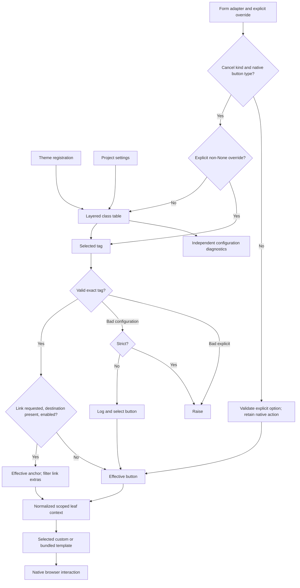

# Phase 6.1: Cancel form button as a link - Research

**Researched:** 2026-10-28
**Domain:** Django/crispy form adapter normalization, native HTML navigation, theme contracts
**Confidence:** MEDIUM (external-source tier from the GSD confidence seam; local findings grounded below)

<user_constraints>
## User Constraints (from CONTEXT.md)

The following decisions and discretion/deferred sections are copied verbatim. [VERIFIED: .planning/phases/06.1-cancel-form-button-as-a-link/06.1-CONTEXT.md:19-75,143-147]

<!-- DATA_7f29a8c1_START -->
### Locked Decisions

### Invalid tag values
- **D-01:** Unsupported explicit `tag=` values raise an error. Invalid theme/project tag configuration is diagnosed;
  rendering raises in strict mode and otherwise logs and falls back to `button` when that configuration is used.
- **D-02:** `None` means inherit/default. `Button(tag=None)` uses the class-table choice; a resolved class-table
  value of `None` uses `button`. Empty strings are invalid tag values.
- **D-03:** Accept exactly `button` and `a`. Do not strip whitespace or normalize capitalization.
- **D-04:** Validate the selected tag even when there is no cancel URL. A fallback to button for a missing URL must
  not hide an invalid selected tag. D-12 distinguishes selected configuration from overridden configuration.

### Link attributes
- **D-05:** The cancel URL wins over an extra `href`. In link rendering, discard that extra attribute and render
  exactly one `href` from the cancel destination.
- **D-06:** A cancel control with `disabled=True` remains a native disabled button even when its selected tag is
  `a`. Do not render a disabled-looking anchor or an enabled link in this case.
- **D-07:** Link rendering drops button-only attributes, including `form`, `formaction`, and `formnovalidate`.
  Preserve link-compatible extras such as `target`, `rel`, `aria-*`, and `data-*`, subject to the reserved
  attributes in D-15. Do not reject button-only extras or pass them through onto the anchor.
- **D-08:** An empty cancel URL (`""`) counts as missing and keeps the control a button. Do not render `href=""`.

### Override boundaries
- **D-09:** An explicit `tag="a"` on a non-cancel control, such as an ordinary Submit or Reset, raises an error.
  Do not silently ignore it or turn other form actions into links.
- **D-10:** `cv_tag` exposes the final effective tag after fallback rules, including `button` for disabled controls
  or missing/empty cancel URLs. Custom templates can use it directly without reimplementing tag resolution.
- **D-11:** Non-cancel controls accept an explicit `tag="button"`; reject `tag="a"`, not all explicit tag options.
- **D-12:** A valid explicit tag wins during rendering even if `form:cancel-tag` is invalid. Configuration checks
  still report the invalid setting, but the overridden value must not cause this control's render to fail.

### Carried-forward scope and compatibility
- **D-13:** Add `form:cancel-tag`, default `button`, through the existing class table. Support theme registration
  through `register_button_classes()` and project overrides through `CRUD_VIEWS_BUTTON_CLASSES`; recognize the
  exact key in W362 validation without loosening the finite form-kind/mode grammar.
- **D-14:** Explicit `Button(tag=...)` overrides the class table. A cancel control with a URL, selected tag `a`,
  and no disabled state renders a native anchor. Missing/empty URLs and disabled controls use the button fallback.
  Native link navigation must work without JavaScript and support opening in another tab.
- **D-15:** The anchor retains the control's id, classes, label mode, icon, and applicable extra attributes. It
  omits `name`, `value`, `type`, and `data-cv-cancel-url`. Preserve existing escaping, attribute-alias precedence,
  generated icon-mode title/tooltip precedence, and icon-host behavior.
- **D-16:** Add `cv_tag` to `FORM_LEAF_KEYS` and document it, the class key, and the per-button override. Existing
  custom templates remain usable. Preserve Phase 6 template precedence (explicit argument, subclass template,
  bundled leaf), template-pack substitution, scoped normalized context, and literal escaped values. Do not remove
  existing context fields merely because the bundled anchor omits their corresponding HTML attributes.
- **D-17:** Unconfigured forms retain existing button markup and behavior; `viewset.js` stays unchanged. Preserve
  Phase 6 ownership, label-mode resolution, and legacy helper-input compatibility. This phase does not migrate
  `add_input()` controls or replace crispy templates globally.
- **D-18:** Update public references and CHANGELOG for the new surface. Any Breaking entry must also update
  `docs/migrating-1.0.md`. Phase 7 must include the new class key, tag override, and `cv_tag` contract in its freeze.

### Agent's Discretion and Planning Notes

- No additional product choices were delegated. Internal helper placement, diagnostic IDs, test organization,
  and precise documentation wording are implementation choices within these decisions.
- Define the complete button-only attribute set using HTML semantics; the examples in D-07 are not exhaustive.
  Keep filtering scoped to actual link output so existing button output remains compatible.
- Reconcile D-09 with the existing distinction between adapter class, native button type, and semantic slot;
  preserve submit/reset semantics and do not infer permission to turn arbitrary controls into navigation links.
- Verify the selected-tag validation and effective-tag fallback separately. Prove explicit override precedence
  alongside configuration diagnostics, and preserve default goldens and custom-template context compatibility.

### Deferred Ideas (OUT OF SCOPE)

None added. General-purpose link rendering for non-cancel controls, automatic legacy-input migration, and
JavaScript changes are outside this phase. Theme-surface classification remains Phase 7 work.
<!-- DATA_7f29a8c1_END -->
</user_constraints>


## Summary

Implement this as a small extension of the existing form normalizer and bundled leaf. Keep tag configuration in
the adapter, selection/validation/fallback in normalization, and HTML presentation in the leaf. The existing
adapter already forwards its native type separately from the slot-derived kind; the class registry already merges
defaults, theme and settings; the normalizer already owns literal values and reserved attributes. These are the
correct seams to extend. [VERIFIED: src/crud_views/lib/crispy/buttons.py:128-174; src/crud_views/lib/button_classes.py:122-152; src/crud_views/lib/view/button_data.py:215-307]

The central implementation risk is conflating three decisions: whether a control is eligible for cancel navigation,
whether its selected tag is valid, and whether that valid selection can actually render as a link. Resolve those
in that order. A valid explicit override bypasses the table during rendering; diagnostics independently inspect
the configured table. Only an enabled eligible cancel with a nonempty normalized destination becomes an anchor.
These are implementation recommendations derived from D-01–D-14, including the explicit requirement to preserve
submit/reset semantics. [VERIFIED: .planning/phases/06.1-cancel-form-button-as-a-link/06.1-CONTEXT.md:19-53,67-75]

**Primary recommendation:** centralize the effective-tag decision in the existing form normalization path, extend
the existing leaf in place, and leave the existing button branch byte-identical. [VERIFIED: context D-10,D-16,D-17 above]

## Architectural Responsibility Map

Prescriptive ownership derived from the current adapter → normalizer → template flow and locked decisions.
[VERIFIED: src/crud_views/lib/crispy/buttons.py:151-174; context D-13–D-17 above]

| Capability | Primary Tier | Secondary Tier | Rationale |
|---|---|---|---|
| Theme/project tag registration and diagnostics | Python configuration/server startup | Renderer | Reuse the layered table and system-check entry point. |
| Explicit override capture | Python form adapter | Normalizer | Consume the keyword as configuration, never an extra HTML attribute. |
| Eligibility, selected-tag validation, effective fallback | Frontend server (Django normalization) | — | Custom templates must receive the resolved result. |
| Reserved attributes and literal escaping | Frontend server | Django template engine | Normalize once before either output branch. |
| Presentation and accessibility | Django leaf | Browser | Share the existing classes, icons and label-mode body. |
| Navigation/new-tab behavior | Browser | Server-generated destination | Native anchor behavior; no new JavaScript handler. |
| Destination choice | Existing view/form hooks | URL routing | Do not change origin selection or destination generation. |

## Scope Coverage

The roadmap explicitly says `**Requirements**: TBD`. The labels below refer to roadmap success-criterion numbers,
not newly invented requirement IDs. Existing completed FORM contracts remain regression constraints.
[VERIFIED: .planning/ROADMAP.md:309-326; .planning/REQUIREMENTS.md, Form-button leaf section]

| Roadmap criterion | Required work | Decisions covered |
|---|---|---|
| 1 — class-table option | Exact structural key, raw value validation, theme/settings precedence, finite grammar tests | D-01–D-03, D-12–D-13 |
| 2 — override and fallback | Keyword capture, eligibility, validation before fallback, disabled/URL handling | D-01–D-04, D-06, D-08–D-12, D-14 |
| 3 — native link | Anchor attributes/body, escaping, class/icon modes, browser navigation | D-05–D-08, D-14–D-15 |
| 4 — public contract and compatibility | Add effective tag, preserve existing context/templates/default bytes, docs and freeze handoff | D-10, D-16–D-18 |

## Project Constraints (from AGENTS.md)

AGENTS.md resolves to CLAUDE.md in this checkout. There is no separate .claude/CLAUDE.md or project-local skills
directory at either discovery location; the configured researcher skill query returned no entries. The graph status
command returned `"exists": false`, so no semantic graph evidence was used. [VERIFIED: initial filesystem discovery,
agent-skills query and graphify status, 2026-10-28]

Actionable repository directives to preserve:

- Use the repository's documented development, test, lint, build and docs workflows; quick iteration runs pytest
  against repository tests. The pre-commit hook formats Python. [VERIFIED: CLAUDE.md:15-47]
- Keep view attributes prefixed `cv_`; view keys are `list`, `detail`, `create`, `update`, `delete`, `workflow`,
  `manage`. Permission mapping is `list/detail→view, create→add, update→change, delete→delete`; workflow transitions
  use `wf_`. [VERIFIED: CLAUDE.md:97-100]
- Use 120-character Python lines and double quotes; preserve hatchling and bump-my-version conventions. Do not
  change packaging/versioning for this feature. [VERIFIED: CLAUDE.md:101-104]
- Keep fixture conventions `cv_<model>`, `user_<model>_<permission>`,
  `client_user_<model>_<permission>`. [VERIFIED: CLAUDE.md:89-93]
- Add a CHANGELOG entry for public changes; any new `### Breaking` entry requires the paired migration update.
  [VERIFIED: CLAUDE.md:105; .planning/PROJECT.md:82-83]
- Keep unconfigured golden bytes, avoid downstream project names in new prose, and retain the Python/Django support
  matrix. Before push run the documented pytest, vitest, strict docs and Ruff gates.
  [VERIFIED: .planning/PROJECT.md:74-85]

These instructions include this literal command/value evidence:
<!-- DATA_47e28d15_START -->
`pytest tests`; `task test`; `task format`; `task check`; `task build`; `task docs`; `task bump-patch`;
`pytest tests -n auto`; `mkdocs build --strict`; `ruff check`; `ruff format --check`.
<!-- DATA_47e28d15_END -->
[VERIFIED: CLAUDE.md:19-44; .planning/PROJECT.md:80-81]

## Standard Stack

Retain the current dependencies and declared floors. This phase needs no installation, package upgrade, lockfile
change or browser framework. The installed versions below were read using importlib.metadata; latest version and
publish timestamps were checked using the canonical PyPI JSON API. The registry results matched the installed
versions for all four rows. This records the research environment, not a support-floor change.
[VERIFIED: local metadata/PyPI API probe, 2026-10-28; pyproject.toml:25-35,70-83]

| Existing component | Installed / registry latest | Latest published (UTC) | Role |
|---|---|---|---|
| Django | 6.1.2 | 2026-10-06 12:53 | Existing templates, escaping, flatatt, system checks |
| django-crispy-forms | 2.7 | 2026-07-29 11:12 | Existing layout adapters and template selection |
| crispy-bootstrap5 | 2026.9 | 2026-09-02 20:40 | Existing pack wrappers and legacy inputs |
| pytest | 9.2.0 | 2026-10-27 21:30 | Existing tests |

Manifest/floor values, quoted verbatim:
<!-- DATA_21b743d9_START -->
`"django (>=4.2.0)"`, `"django-crispy-forms (>=2.0)"`, `"crispy-bootstrap5 (>=2023.10)"`;
`CRISPY_FLOOR = {"django-crispy-forms": "2.0", "crispy-bootstrap5": "2023.10"}`.
<!-- DATA_21b743d9_END -->
[VERIFIED: pyproject.toml:27,33-34; noxfile.py:22-24]

**Installation:** none. Package Legitimacy Audit is not required for retained dependencies because this phase
does not install external packages. Do not convert the observed latest versions into new pins.
Recommendation grounded in the existing implementation and scope. [VERIFIED: context D-13–D-17 above]

**Alternatives:** no replacement stack is needed. Global crispy-template replacement, handwritten HTML generation,
and a navigation script contradict the selected integration or duplicate existing infrastructure.
[VERIFIED: context D-14,D-16,D-17 above]

## Architecture Patterns

### System Architecture Diagram

This is the recommended implementation flow, derived from the locked decisions and existing normalization boundary.
[VERIFIED: context D-01–D-17 above; src/crud_views/lib/crispy/buttons.py:151-174]



### Component Responsibilities and Source-of-Truth Evidence

The paths here identify files read during this research; they are edit targets, not claims about scripts creating
new directories. New helpers should remain private within the existing modules. No new package/module hierarchy
is necessary. [VERIFIED: files and functions cited below]

| Existing component | Responsibility / recommendation | Literal evidence from current source |
|---|---|---|
| `src/crud_views/lib/button_classes.py` | Add exact structural key and domain validation; read raw merged table for tag selection. | `classes = {**DEFAULT_BUTTON_CLASSES, **_THEME_BUTTON_CLASSES, **_settings_layer()}` [VERIFIED: src/crud_views/lib/button_classes.py:132-152] |
| `src/crud_views/lib/crispy/buttons.py` | Consume/store tag keyword; pass intent without mutating public native type, template or extras. | `"cv_key": kind` and `"cv_type": self.input_type` [VERIFIED: src/crud_views/lib/crispy/buttons.py:151-164] |
| `src/crud_views/lib/view/button_data.py` | Validate/resolve effective tag, preserve data keys, filter only actual link output. | `FORM_TYPES = frozenset({"submit", "button", "reset"})` [VERIFIED: src/crud_views/lib/view/button_data.py:69-70] |
| `src/crud_views/templates/crud_views/tags/button/form.html` | Add link branch; keep button opening/body/closing bytes unchanged for defaults. | `<button type="{{ cv_type }}" name="{{ cv_name }}" value="{{ cv_value }}" id="{{ cv_id }}"` [VERIFIED: src/crud_views/templates/crud_views/tags/button/form.html:1-2] |
| `src/crud_views/lib/crispy/form.py` | Existing destination hook; use it unchanged, including per-form override recipe. | `"name": "reset"`, `"value": context["cv_action_label"]`, `"data_cv_cancel_url": url` [VERIFIED: src/crud_views/lib/crispy/form.py:67-84] |
| `src/crud_views/static/crud_views/js/viewset.js` | Keep unchanged; links must omit its selector attribute. | `const el = e.target.closest("[data-cv-cancel-url]");` [VERIFIED: src/crud_views/static/crud_views/js/viewset.js:37-44] |

### Pattern 1: Separate native action from semantic kind

The present adapter chooses kind from the slot and native type from crispy independently. Its class defaults are:
<!-- DATA_d17a620e_START -->
`class Submit(_TableClassMixin, layout.Submit):` / `slot = "form:submit"`;
`class Button(_TableClassMixin, layout.Button):` / `slot = "form:cancel"`;
`class Reset(_TableClassMixin, layout.Reset):` / `slot = "form:filter-reset"`.
`FORM_KINDS: frozenset[str] = frozenset({"submit", "cancel", "delete", "filter-submit", "filter-reset"})`.
<!-- DATA_d17a620e_END -->
[VERIFIED: src/crud_views/lib/crispy/buttons.py:177-186; src/crud_views/lib/button_classes.py:212-213]

Recommended eligibility is semantic cancel **and** native button type. Do not infer cancel from the submitted name,
the presence of a URL, a CSS class, or exact adapter class identity. This protects native submit/reset behavior
even with a cancel styling slot, supports genuine Button subclasses, and rejects a Button re-slotted to an action
kind. For noneligible controls: explicit link request raises, explicit button is valid, inherited configuration
does not turn them into links. This is an implementation interpretation of D-09/D-11 and the explicit instruction
to preserve submit/reset semantics, not an additional public product choice.
[VERIFIED: context D-09,D-11 and Planning Notes above; src/crud_views/lib/crispy/buttons.py:139-164]

Test the cross-product of adapter, native type, slot, and explicit/inherited tag. A reset control named “cancel”
is still reset; a cancel control named “reset” is still cancel. Do not reject previously valid slot/native-type
combinations merely because they are ineligible for link output.
[VERIFIED: src/crud_views/lib/crispy/buttons.py:139-164; docs/reference/buttons.md:413-422; context D-17 above]

### Pattern 2: Selection, validation and fallback are distinct

Use raw table access, not the CSS accessor: the latter collapses every non-string into an empty string. For tags,
None is valid inheritance/default while an empty string is invalid. Existing strictness is evaluated at call time:
<!-- DATA_1c84fa3b_START -->
`return value if isinstance(value, str) else ""`;
`return bool(getattr(settings, "CRUD_VIEWS_STRICT", settings.DEBUG))`.
<!-- DATA_1c84fa3b_END -->
[VERIFIED: src/crud_views/lib/button_classes.py:141-152; src/crud_views/lib/exceptions.py:32-36]

Recommended sequence:

1. Validate native type/kind using existing guards.
2. For eligible controls, select explicit non-None intent first; otherwise read the raw merged class-table value.
   Table None selects the default. Do not access or validate overridden configuration in this render path.
3. Validate exact string membership. Reject explicit invalid values regardless of strictness. A selected invalid
   configured value raises in strict mode, or logs and selects button otherwise.
4. Normalize extras and destination aliases, then calculate disabled state and missing/empty destination.
5. Set effective tag to link only when selected link, enabled and destination present; otherwise button.
6. Filter extras only when effective tag is link. Return the existing fields plus effective tag.
7. Render the selected custom/bundled template with only this normalized dictionary.

[VERIFIED: context D-01–D-17 above; src/crud_views/lib/view/button_data.py:215-307]

Guard non-string inputs before set membership so list/dict mistakes produce the intended configuration/ValueError
path, not a hashability TypeError. Do not normalize whitespace/case. Include invalid selected values even when
disabled or destination absent; include explicit valid overrides over invalid strict configuration.
[VERIFIED: context D-01–D-04,D-12 above]

Configuration checks should validate the selected merged table value independently of a particular form render.
Add one narrowly scoped tag-value diagnostic alongside existing class-table diagnostics, reusing the existing
non-string type diagnostic if appropriate and avoiding duplicate messages. Diagnostic ID selection is internal
discretion; do not silently change the existing IDs:
<!-- DATA_75a36d9c_START -->
`id="crud_views.E361"`; `id="crud_views.E363"`; `id="crud_views.E364"`; `id="crud_views.W362"`.
<!-- DATA_75a36d9c_END -->
[VERIFIED: src/crud_views/lib/button_classes.py:251-302; context Planning Notes above]

Adding the exact default-table key automatically makes the existing W362 membership branch accept it. Keep
the form-kind vocabulary unchanged; reject mode-suffixed or pluralized variants of the new structural key.
The count guard currently says `assert len(EXPECTED_KEYS) == 73`; the one new key makes the expected count 74.
Update the documentation count and exhaustive key set together.
[VERIFIED: src/crud_views/lib/button_classes.py:212-239,284-302; tests/test1/test_button_classes.py:92-94;
docs/reference/buttons.md:146-150; context D-13 above]

### Pattern 3: Presence-based disabled fallback and scoped attribute filtering

Django flatatt emits a boolean True as a bare attribute and omits False/None; other values are quoted. The local
probe produced the following output, matching Django's official source:
<!-- DATA_c81e462a_START -->
`True -> ' disabled'`
`False -> ''`
`None -> ''`
`'' -> ' disabled=""'`
`0 -> ' disabled="0"'`
`'false' -> ' disabled="false"'`
<!-- DATA_c81e462a_END -->
[CITED: https://raw.githubusercontent.com/django/django/stable/6.0.x/django/forms/utils.py]
[VERIFIED: installed Django 6.1.2 flatatt execution, 2026-10-28]

HTML boolean attributes depend on presence. Therefore determine disabled fallback using the same emission
semantics, not Python truthiness: present except False/None means disabled. Preserve the original serialized
attribute on the fallback button. This covers required disabled=True and avoids enabling controls represented
by an empty disabled string. Do not use aria-disabled as a substitute.
[CITED: https://html.spec.whatwg.org/multipage/common-microsyntaxes.html#boolean-attributes]
[VERIFIED: context D-06,D-15,D-17 above]

WHATWG's current button-specific list yields this complete removal set for anchor output:
<!-- DATA_084ad2c9_START -->
`command`, `commandfor`, `disabled`, `form`, `formaction`, `formenctype`, `formmethod`,
`formnovalidate`, `formtarget`, `name`, `popovertarget`, `popovertargetaction`, `type`, `value`.
<!-- DATA_084ad2c9_END -->
Also remove extra href and the cancel-navigation marker. Keep global attributes (including autofocus), target,
rel, aria and other data attributes. Anchor type has a different HTML meaning, but D-15 explicitly omits it here.
[CITED: https://html.spec.whatwg.org/multipage/form-elements.html#the-button-element]
[CITED: https://html.spec.whatwg.org/multipage/text-level-semantics.html#the-a-element]
[VERIFIED: context D-05,D-07,D-15 above]

Run alias normalization before filtering. Existing code replaces underscores with hyphens, with the hyphen spelling
winning in either input order; it does not rewrite case. Retain this rule. For the new anchor-removal membership
check, use case-insensitive comparison so alternate-case href or button-only attributes cannot leak into native
HTML; do not change the generic button serializer or alias precedence.
[VERIFIED: src/crud_views/lib/view/button_data.py:196-205; context D-05,D-07,D-15,D-17 above]

Destination handling must preserve the existing conversion: absent, None or False means missing; the empty
normalized string additionally prevents link output. Do not strip, URL-encode again, or treat the extra href as a
fallback destination. In particular, a winning empty hyphenated alias must not resurrect the losing underscore
URL. Preserve existing button output for these cases, including its historical cancel marker behavior.
[VERIFIED: src/crud_views/lib/view/button_data.py:208-212,268-280;
tests/test1/test_button_data.py:673-698; context D-05,D-08,D-15,D-17 above]

### Pattern 4: Additive custom-template contract

Preserve these existing keys exactly; only the effective tag is newly added:
<!-- DATA_b5914fc8_START -->
`"cv_location"`, `"cv_key"`, `"cv_type"`, `"cv_name"`, `"cv_value"`, `"cv_label"`, `"cv_id"`,
`"cv_label_mode"`, `"cv_icon"`, `"cv_icon_class"`, `"cv_icon_inline"`, `"cv_css_class"`,
`"cv_flat_attrs"`, `"cv_title"`, `"cv_cancel_url"`.
<!-- DATA_b5914fc8_END -->
[VERIFIED: src/crud_views/lib/view/button_data.py:49-67; context D-10,D-16 above]

Preserve optional presence of title and cancel URL. On link output retain native type/name/value and cancel URL
in context even though the bundled anchor omits corresponding HTML attributes. Old button-only custom templates
remain renderable; custom templates that want native links branch on effective tag. Never bypass custom template
selection to force the bundled anchor. Existing tests already exercise explicit > subclass > bundled selection,
pack substitution, and absence of outer-context leakage.
[VERIFIED: src/crud_views/lib/view/button_data.py:287-307; src/crud_views/lib/crispy/buttons.py:166-174;
tests/test1/test_crispy_buttons.py:386-425; context D-16 above]

Consume the tag keyword before constructing both private extras and crispy's legacy flat attributes. Keep
resolution per render so shared adapters and deep-copied filter layouts do not cache a previous theme choice.
Do not add eager imports from the view package to the publicly importable adapter module.
[VERIFIED: src/crud_views/lib/crispy/buttons.py:128-174; tests/test1/test_crispy_buttons.py:623-635;
.planning/phases/06-form-button-leaf/06-SPEC.md, Import safety; context D-17 above]

### Anti-Patterns to Avoid

| Anti-pattern | Consequence | Required replacement |
|---|---|---|
| `tag or default` | Empty explicit tag becomes silently valid | Identity check for None, then exact validation (D-02). |
| Validate table before checking explicit option | Overridden invalid table still breaks rendering | Explicit-first selection (D-12). |
| URL/disabled early return | Invalid selected configuration is hidden | Validate selected tag first (D-04). |
| Slot-only or class-name-only eligibility | Native actions become links or subclasses are excluded | Semantic kind plus native type. |
| `bool(disabled)` | An empty-string disabled attribute becomes an enabled link | Match serializer presence semantics. |
| Reuse action normalization wholesale | Imports unrelated action context and policies | Extend the form normalizer only (D-16). |
| Apply anchor filtering to every control | Changes default/custom button markup | Filter only effective anchor output (D-17). |
| Remove old context fields | Breaks user templates | Add effective tag while retaining fields (D-16). |
| Keep cancel JS marker on anchor | Existing handler prevents browser default | Omit marker and let native navigation occur (D-15). |

[VERIFIED: source boundaries and decision citations in Patterns 1–4 above;
src/crud_views/static/crud_views/js/viewset.js:37-44]

## Don't Hand-Roll

| Problem | Don't Build | Use Instead | Evidence |
|---|---|---|---|
| Attribute escaping | String concatenation or safe-marking arbitrary values | Existing literal conversion + Django flatatt + template autoescape | Existing normalizer: lines 185-212,268-301 |
| New-tab/keyboard navigation | JS click emulation | Native anchor with destination | WHATWG anchor semantics; D-14 |
| Theme precedence/cache lifecycle | Second registry | Existing raw merged class table and reset hooks | button_classes.py:110-138 |
| Template precedence/pack substitution | Parallel template resolver | Existing adapter get_template_name call | buttons.py:166-174; crispy official source |
| Accessible labels/icons | Separate cancel presentation system | Existing label-mode body, host icon resolution, title precedence | button_data.py:244-306; form leaf |
| Test framework | New browser/package harness | Existing pytest/lxml and vitest/jsdom plus a browser acceptance check | Existing tests cited in validation section |

[VERIFIED: cited repository implementations; context D-14–D-17 above]
[CITED: https://django-crispy-forms.readthedocs.io/en/latest/_modules/layout.html]
[CITED: https://html.spec.whatwg.org/multipage/text-level-semantics.html#the-a-element]

## Common Pitfalls

1. **Old contract assertions intentionally contradict the feature.** The existing test explicitly says
   `assert "cv_tag" not in FORM_LEAF_KEYS`, and the reference calls it action-only. Update those precise exclusions
   and the contract set, without weakening checks for all other action-only fields.
   [VERIFIED: tests/test1/test_button_data.py:460-484; docs/reference/buttons.md:473-477]

2. **Default markup whitespace is acceptance data.** The bundled leaf is two lines with a fixed newline before
   class; changing indentation while adding conditionals can change golden bytes. Run the existing raw golden
   comparisons unchanged, and use separate assertions/fixtures for opt-in link output.
   [VERIFIED: src/crud_views/templates/crud_views/tags/button/form.html:1-2;
   tests/test1/test_form_buttons_golden.py:266-285; context D-17 above]

3. **HTML parsing can conceal duplicate attributes.** Check the raw anchor opening tag for exactly one destination
   before asserting parsed values, following the existing raw-opening-tag collision test pattern.
   [VERIFIED: tests/test1/test_crispy_buttons.py:466-504; context D-05 above]

4. **Presentation parity needs every mode and icon placement.** Add anchor coverage for label, both and icon;
   title/tooltip collisions; inline icons; host classes; disabled fallback; explicit missing icon policy.
   Keep class resolution based on semantic kind, not output element.
   [VERIFIED: src/crud_views/lib/view/button_data.py:244-306;
   tests/test1/test_crispy_buttons.py:1075-1151; context D-15,D-17 above]

5. **The documentation contains two now-invalid generalizations.** Amend the claim that the table cannot configure
   an element, and the claim that form templates never receive a tag. The existing custom-template recipe is a
   submit-only example and can remain useful; explain the optional branch for cancel-capable overrides.
   [VERIFIED: docs/reference/buttons.md:152-158,473-499; docs/reference/theme.md:136-189]

6. **A JS selector filter can silently run fewer files than requested.** The research probe passed a second,
   nonexistent test filename to vitest; it reported only one matching file, the viewset suite. The grounded command
   below names only the existing file. Do not report this as browser or separate form-button-suite acceptance.
   [VERIFIED: research vitest output, 2026-10-28: `Test Files  1 passed (1)`, `Tests  37 passed (37)`]

## Code Examples

These are proposed implementation sketches, not claims that the new API is already implemented. Their public
tokens come from the locked context and the native-type evidence above. Keep helpers private.
[VERIFIED: context D-01–D-17 above; src/crud_views/lib/view/button_data.py:69-70]

### Eligibility and final tag, after selected-tag validation

```python
# Proposed placement: existing form normalizer; selected_tag has already been validated.
eligible = key == "cancel" and button_type == "button"
disabled = "disabled" in attrs and attrs["disabled"] is not False and attrs["disabled"] is not None
effective_tag = "a" if eligible and selected_tag == "a" and cancel_url and not disabled else "button"
# Retain cv_type, cv_name, cv_value and cancel-only cv_cancel_url in the returned data.
data["cv_tag"] = effective_tag
```

This sketch assumes attrs has already followed existing alias normalization; apply the recommended
case-insensitive reserved-name comparison during link filtering. The snippet must not be moved ahead of
explicit option validation or used to silently accept an explicit link request on a noneligible control.
[VERIFIED: context D-04,D-09,D-10,D-15 above]

### Theme and form override documentation recipe

```python
# New opt-in surface required by D-13/D-14:
register_button_classes({"form:cancel-tag": "a"})

# A project may use the same exact key:
CRUD_VIEWS_BUTTON_CLASSES = {"form:cancel-tag": "a"}

# One cancel opts back into the original markup:
Button("reset", "Cancel", tag="button", data_cv_cancel_url=cancel_url)
```

Recipe literal tokens `"reset"` and `"Cancel"` match the existing form hook and destination context; the new tag
configuration is prescribed by D-13/D-14. [VERIFIED: src/crud_views/lib/crispy/form.py:77-84;
src/crud_views/lib/view/base.py:804-811; context D-13,D-14 above]

## State of the Art

| Existing state | Planned additive state | Compatibility impact |
|---|---|---|
| Form leaf always emits native button | Eligible cancel may emit native anchor | Opt-in only; default bytes remain fixed. |
| Form context excludes effective tag | Form context adds effective tag | Retain all previous fields and custom template precedence. |
| Class registry includes structural keys but no cancel element selector | One exact structural selector | No broadened form-kind/mode grammar. |
| Cancel navigation uses existing delegated marker handler | Anchors use browser navigation | Button handler remains unchanged. |

[VERIFIED: src/crud_views/templates/crud_views/tags/button/form.html:1-2;
src/crud_views/lib/view/button_data.py:49-70; src/crud_views/lib/button_classes.py:15-100,212-239;
src/crud_views/static/crud_views/js/viewset.js:37-44; context D-13–D-17 above]

No dependency deprecation or stack migration is part of this phase. No Runtime State Inventory is needed:
this is an additive rendering feature with no rename, stored-data migration, service reconfiguration or artifact
identity change in its defined scope. [VERIFIED: .planning/ROADMAP.md:311-326; context D-13–D-18 above]

## Assumptions Log

No training-only claims are used to lock a product decision. Recommended implementation details are explicitly
identified as recommendations and traced to the locked context and source. No package availability or compatibility
claim rests on missing metadata. [VERIFIED: source/probe evidence recorded in this document]

| # | Claim tagged ASSUMED | Section | Risk if Wrong |
|---|---|---|---|
| — | None | — | — |

## Open Questions

- **Requirement identifiers:** still TBD; use roadmap criterion numbers and decision IDs in plans until the
  orchestrator assigns identifiers. Do not invent a parallel requirement taxonomy.
  [VERIFIED: .planning/ROADMAP.md:314]
- **Diagnostic identifier and helper placement:** internal implementation choices, not unresolved product scope.
  Pick the next appropriate free diagnostic after checking the current tree; preserve existing diagnostics.
  [VERIFIED: context Planning Notes above]
- **Actual browser acceptance:** not performed during research. Implementation acceptance must cover navigation
  with scripts disabled, opening a separate tab, and native disabled fallback. Automated markup/JS assertions
  supplement this check; they do not claim to prove a browser created another tab.
  [VERIFIED: context D-06,D-14 above; research activity record]
- **Custom raw destination trust:** existing hooks can supply arbitrary destination strings; normalizer escaping
  is not URL-scheme validation. Preserve the existing routing boundary and document that applications supply
  trusted navigation destinations. Do not add a new origin/URL policy under this tag-only phase.
  [VERIFIED: src/crud_views/lib/crispy/form.py:67-84; src/crud_views/lib/view/button_data.py:208-212,275;
  src/crud_views/lib/view/base.py:720-759,804-811]
  [CITED: https://raw.githubusercontent.com/OWASP/ASVS/v5.0.0/5.0/en/0x10-V1-Encoding-and-Sanitization.md]

## Environment Availability

All observations are from this research session; no fresh install was performed.
[VERIFIED: metadata, executable and JS-wrapper probes, 2026-10-28]

| Dependency | Available | Observed version | Use / fallback |
|---|---|---|---|
| Project Python | Yes | 3.12.3 | Use the existing virtualenv executable. |
| Django/crispy/pack | Yes | 6.1.2 / 2.7 / 2026.9 | Installed environment for focused tests. |
| pytest / lxml | Yes | 9.2.0 / 6.1.3 | Existing rendering/DOM test infrastructure. |
| Ruff | Yes | 0.17.3 | Matches the manifest `ruff>=0.17,<0.18`. |
| uv / nox | Yes | nox lists floor sessions | Use existing floor workflow if needed at phase gate. |
| Recorded Node / npm | Yes | 24.21.0 / 11.19.0 | Existing checked JS wrapper verified both. |
| vitest / jsdom / jquery | Yes | 5.0.3 / 30.1.2 / 3.7.1 | Wrapper confirmed lock and installed engines. |
| Context7 / ctx7 / Jina | No callable tool/CLI found | — | Official sources through built-in web lookup. |
| Live browser acceptance | Not exercised | — | End-of-phase manual acceptance; no new framework required. |

[VERIFIED: pyproject.toml:60-61 for `"ruff>=0.17,<0.18"`; tool observations above]

Missing dependencies blocking planning: none. Floor sessions are defined and listable; they were not run during
this research, so no new floor-compatibility claim is made. [VERIFIED: nox session listing; noxfile.py:96-106]

## Validation Architecture

Nyquist and security are enabled in project config:
<!-- DATA_23c7a6ed_START -->
`"nyquist_validation": true`; `"security_enforcement": true`; `"security_asvs_level": 1`.
<!-- DATA_23c7a6ed_END -->
[VERIFIED: .planning/config.json, workflow section, read during initialization]

### Test Framework

| Property | Value |
|---|---|
| Framework | Existing pytest 9.2.0 / pytest-django / lxml; existing vitest 5.0.3 |
| Configuration | pyproject.toml pytest options; tests/test1/conftest.py configures Django; existing vitest config |
| Quick render/normalizer run | `.venv/bin/pytest tests/test1/test_button_data.py tests/test1/test_crispy_buttons.py -q` |
| Focused phase gate | Six-file Python command below; JS viewset command below |
| Full Python suite | `.venv/bin/pytest tests -n auto` |
| Full JS suite | `bash .planning/phases/06-form-button-leaf/06-js-verify.sh` |
| Existing floor session | `.venv/bin/nox -s crispy_floor` |

Commands are proposed invocations of the existing test files/framework, not claims about a newly created file.
Framework settings include `addopts = "--strict-markers"` and `CRUD_VIEWS_STRICT=True`.
[VERIFIED: pyproject.toml:129-130; tests/test1/conftest.py:35-42; noxfile.py:96-106;
.planning/phases/06-form-button-leaf/06-js-verify.sh:4-12]

### Roadmap Criteria → Test Map

All new behavior assertions remain to be written. Existing files are sufficient; use parameterized extensions
rather than installing a framework. Commands are scoped to run below 30 seconds on the observed environment;
the measured six-file baseline took 19.21 seconds.
[VERIFIED: baseline execution below; context D-01–D-18 above]

| Criterion / decisions | Behavior | Type | Automated command | Existing destination |
|---|---|---|---|---|
| 1; D-01–D-03,D-12,D-13 | Default/theme/settings, invalid values, check severity, exact grammar/count | Unit/checks | `.venv/bin/pytest tests/test1/test_button_classes.py tests/test1/test_button_classes_checks.py -q` | Yes |
| 2; D-01–D-04,D-06,D-08–D-14 | Explicit/inherited validation, eligibility, URL and disabled fallback, no mutation | Unit + adapter integration | `.venv/bin/pytest tests/test1/test_button_data.py tests/test1/test_crispy_buttons.py -q` | Yes |
| 3; D-05–D-08,D-15 | One href, full attribute filtering, alias order, escaping, all modes/icons | Rendering integration | `.venv/bin/pytest tests/test1/test_crispy_buttons.py -q` | Yes |
| 3; D-14,D-17 | Link click is not intercepted; fallback cancel handler still works | JS regression | `bash .planning/phases/06-form-button-leaf/06-js-verify.sh tests/js/viewset.test.js` | Yes |
| 4; D-10,D-16,D-17 | Context presence, custom templates, pack substitution, old goldens | Integration/golden | `.venv/bin/pytest tests/test1/test_form_buttons_golden.py tests/test1/test_form_button_docs.py -q` | Yes |
| 4; D-18 | Published recipes execute; documentation contract matches source | Docs integration | `.venv/bin/pytest tests/test1/test_form_button_docs.py tests/test1/test_button_classes.py -q` | Yes |
| 3; D-06,D-14 | Native no-JS navigation, new tab, disabled cannot activate | Manual browser | End-of-phase UAT; browser navigation is not proven by a mocked location setter | Planned |
| Regression; D-17 | Early imports still work | Subprocess regression | `.venv/bin/pytest tests/test1/test_import_safety.py -q` | Yes |

### Minimum New Assertion Matrix

- **Selection:** omitted/None, each valid tag, invalid string/empty/whitespace/case/non-string; both strictness modes;
  project-over-theme; explicit-over-invalid-config; invalid-selected-config with missing URL and disabled state.
- **Eligibility:** ordinary Submit/Reset, Button in another kind, native submit/reset in cancel slot, and a Button
  subclass; explicit button accepted everywhere; explicit link rejected for noneligible controls.
- **Destination/disabled:** absent/None/False/empty versus nonempty destination, both alias input orders, winning
  empty alias, disabled True/False/None plus emitted empty-string disabled.
- **Attributes:** every listed button-only attribute dropped on link and retained by fallback/default button;
  extra href discarded; raw opening-tag uniqueness; generated id/classes; compatible target/rel/aria/data;
  alias collisions; hostile and marked-safe strings; lazy text.
- **Presentation/context:** three modes, inline and host icons, title/tooltip collision precedence, retained
  type/name/value/cancel URL fields, effective tag on every form kind, custom template selection and scoped
  context; shared/deepcopied adapters across setting changes.
- **Integration:** real create/update/delete/workflow cancel links and unchanged submitted actions; filter
  Apply/Reset remain native actions; legacy helper-input rendering stays pack-owned without migration or warnings.
- **Compatibility:** existing default goldens unchanged, JS source unchanged, import-safety tests, executable docs
  recipes, count/grammar guards, and new public names carried into Phase 7.

[VERIFIED: context D-01–D-18 above; existing test boundaries cited in the Test Map]

### Sampling Rate and Phase Gate

Run the relevant quick shard after each implementation task; run the six-file suite and JS viewset shard after
the integration wave. At phase completion run full Python/JS, docs and Ruff gates from the project contract.
Use the existing floor session for dependency compatibility; if new behavior is kept in the existing adapter and
normalizer test files, that session already collects it. Do not regenerate goldens to make failures disappear.
[VERIFIED: .planning/PROJECT.md:74-85; noxfile.py:28-52,96-106;
tests/test1/test_form_buttons_golden.py:266-285]

### Wave 0 Gaps

No framework/config installation gap. Add the new behavior cases to the existing files and update the obsolete
form-contract exclusion plus exact class-table count. If a separate new test module is chosen instead, include it
in the floor-session test list explicitly. No new product behavior was implemented during research.
[VERIFIED: tests/test1/test_button_data.py:460-484; tests/test1/test_button_classes.py:92-94;
noxfile.py:28-52; research activity record]

### Baseline Evidence

Executed:
```bash
.venv/bin/pytest tests/test1/test_button_data.py tests/test1/test_crispy_buttons.py tests/test1/test_button_classes.py tests/test1/test_button_classes_checks.py tests/test1/test_form_buttons_golden.py tests/test1/test_form_button_docs.py -q
```

Result: **1115 passed in 19.21s**. The JS wrapper verified runtime/lock/engines and the existing viewset shard
reported **37 passed**, one test file. These establish the starting state only; they do not test the unimplemented
new API. [VERIFIED: executed test output, 2026-10-28]

## Security Domain

Use ASVS **5.0.0** terminology: the supplied generic research template's older V2-authentication/V3-session
numbering is not the current standard's chapter mapping. This phase's applicable controls are output
encoding, input validation and frontend rendering. This is a scoped research mapping, not an ASVS certification.
[CITED: https://asvs.owasp.org/]
[CITED: https://raw.githubusercontent.com/OWASP/ASVS/v5.0.0/5.0/en/0x10-V1-Encoding-and-Sanitization.md]
[CITED: https://raw.githubusercontent.com/OWASP/ASVS/v5.0.0/5.0/en/0x11-V2-Validation-and-Business-Logic.md]
[CITED: https://raw.githubusercontent.com/OWASP/ASVS/v5.0.0/5.0/en/0x12-V3-Web-Frontend-Security.md]

| Applicable ASVS category | Phase application | Standard control / boundary |
|---|---|---|
| V1 Encoding and Sanitization | Yes | Keep literal text, quoted HTML attributes, autoescape and flatatt; no safe-marking untrusted text. |
| V2 Validation and Business Logic | Yes | Exact finite tag validation on server; explicit provenance and correct fallback order. |
| V3 Web Frontend Security | Yes | Native semantic element, no script-based navigation addition; hostile values remain text. |
| Authentication/session/access-control domains | No changed implementation in scope | Preserve existing destination/view permission and request handling. |
| Cryptography domain | No changed implementation in scope | No new crypto, credentials or storage. |

Applicability is the researcher's scope assessment from the locked phase boundary.
[VERIFIED: .planning/ROADMAP.md:311-326; context D-01–D-18 above]

| Threat pattern | STRIDE | Mitigation |
|---|---|---|
| Injected markup in label/URL/extra values | Tampering | Existing literal conversion, autoescaping and flatatt; extend hostile-value tests to anchors. |
| Conflicting href supplies a different destination | Tampering | Discard extra href; emit exactly one authoritative cancel destination. |
| Invalid tag configuration becomes raw element text | Tampering | Only exact allowed tags reach presentation. |
| Disabled button becomes enabled link | Elevation of privilege / behavioral bypass | Presence-based fallback to native disabled button. |
| Caller treats HTML escaping as URL-scheme validation | Tampering | Preserve server-generated destination boundary; document custom destination trust. |

[VERIFIED: src/crud_views/lib/view/button_data.py:185-212,268-307;
src/crud_views/lib/view/base.py:720-759,804-811; context D-01–D-07,D-15 above]
[CITED: https://raw.githubusercontent.com/OWASP/ASVS/v5.0.0/5.0/en/0x10-V1-Encoding-and-Sanitization.md]

## Sources

### Local primary evidence

All source excerpts were opened/read with numbered shell reads in this session; this runtime exposes no separate
Read/Write tool, so file creation uses the available apply_patch tool. Source values and scope decisions are quoted
beside their claims. [VERIFIED: research tool history]

- Phase 6.1 context, four roadmap criteria, requirements, state and project constraints.
- Phase 6 context/spec and public button/theme/migration references.
- Adapter, normalizer, registry, form hooks, leaf and existing navigation handler.
- Focused Python test files, import safety, JS viewset tests, nox floor configuration, and JS runtime wrapper.

### Official external sources (MEDIUM from the confidence seam)

- [WHATWG button](https://html.spec.whatwg.org/multipage/form-elements.html#the-button-element): content attributes.
- [WHATWG anchor](https://html.spec.whatwg.org/multipage/text-level-semantics.html#the-a-element): native link semantics.
- [WHATWG booleans](https://html.spec.whatwg.org/multipage/common-microsyntaxes.html#boolean-attributes): presence rule.
- [Django official flatatt source](https://raw.githubusercontent.com/django/django/stable/6.0.x/django/forms/utils.py):
  escaping/boolean serialization; cross-checked against the installed function.
- [crispy official source](https://django-crispy-forms.readthedocs.io/en/latest/_modules/layout.html): native types,
  template precedence and pack substitution.
- [OWASP ASVS](https://asvs.owasp.org/) and the linked official v5.0.0 chapters above: applicable security categories.
- [Django PyPI](https://pypi.org/pypi/Django/json),
  [crispy PyPI](https://pypi.org/pypi/django-crispy-forms/json),
  [Bootstrap pack PyPI](https://pypi.org/pypi/crispy-bootstrap5/json),
  [pytest PyPI](https://pypi.org/pypi/pytest/json): registry version/publish timestamps.

The research-plan seam selected Context7 for documentation and Jina for URL extraction. Neither provider nor the
ctx7 CLI was available; built-in web lookup fetched official sources. The confidence seam returned MEDIUM for
`--provider websearch --verified`; digests were cached with that provider and tier. Failed Django documentation URLs
were replaced with the official source repository, not treated as evidence of missing functionality.
[VERIFIED: research-plan, tool discovery, web lookup, classify-confidence and research-store calls, 2026-10-28]

## Metadata

| Area | Confidence | Basis |
|---|---|---|
| Standard stack | MEDIUM | Installed metadata and registry observations; no dependency change proposed. |
| Architecture | MEDIUM | Source-of-truth reads plus locked decisions; implementation interpretation stated explicitly. |
| HTML and escaping | MEDIUM | Primary WHATWG/Django source, with local serialization probe. |
| Validation | MEDIUM | Focused baseline passes; new API, floor rerun and real-browser acceptance remain execution work. |

**Research date:** 2026-10-28
**Recheck trigger:** source/context changes or implementation beginning more than 30 days later; recheck browser
attribute inventory against the living standard if delayed. This is a planning recommendation, not an externally
mandated retention or validity policy.

