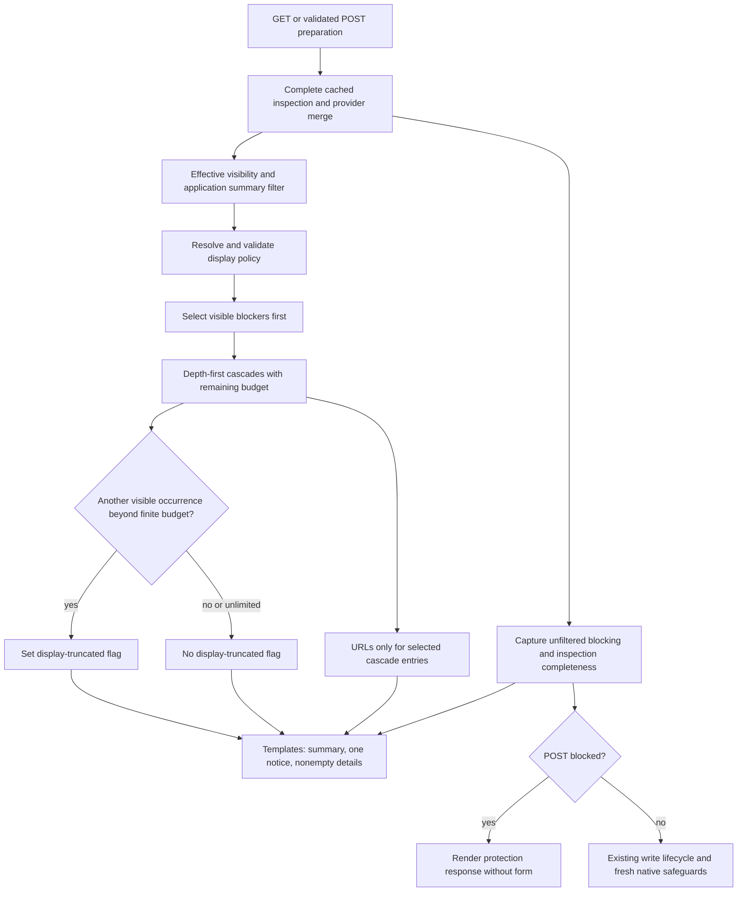

# Phase 06.10: Simplify protected-object previews and cap total displayed objects - Research

**Researched:** 2026-11-04
**Domain:** Django deletion-preview selection, rendering, configuration and regression preservation
**Confidence:** MEDIUM overall; direct source reads and limited runtime probes below distinguish observed behavior from implementation recommendations.

<user_constraints>
## User Constraints (from CONTEXT.md)

The following decisions and implementation latitude are copied verbatim from the phase context. They are the authority over earlier protected-link requirements and issue #316's finite-only wording. [VERIFIED: 06.10-CONTEXT.md:20-110]

<!-- DATA_a43c18f9_START -->
## Implementation Decisions

### Configuration — explicitly selected

- **D-01:** Use project setting `CRUD_VIEWS_DELETE_PREVIEW_LIMIT` and per-view attribute `cv_delete_preview_limit`.
  Resolution order is an explicit per-view value, the project setting, then package default **50**. A shared base
  view may supply the per-view policy; no additional ViewSet configuration layer was selected.
- **D-02:** A positive integer applies that limit. Explicit `None` at either configuration level means unlimited
  display. An unspecified per-view override inherits the project setting and must remain distinguishable from
  explicit `None`. The user expressly selected this amendment after initially selecting finite-only values.
- **D-03:** Zero, negative numbers and invalid types raise a clear configuration error. Do not silently disable
  the cap or fall back for invalid configuration. `cv_show_related_objects` retains control of preview visibility.
  The representation of an unspecified override and the existing validation/check integration are planning work.
- **D-04:** Unlimited display can produce long pages and optional cascade-link work for every visible entry.
  Document this tradeoff. Neither a finite limit nor `None` changes complete inspection or write-time safeguards;
  the display cap makes no promise of bounded full-graph memory, visibility-filtering cost or total query cost.

### Shared budget and selection — explicitly selected

- **D-05:** For a finite value, apply one budget across protected and cascade sections, all model groups and all
  nesting levels. Filter visibility before selection; select entries before optional URL generation and
  presentation work. A template-only slice after preparing every object's presentation is insufficient.
- **D-06:** Visible protected blockers receive the budget first, in their existing order. Cascade entries use
  any remaining slots. Do not reserve half the budget for each section or introduce per-group limits.
- **D-07:** Traverse cascade entries depth-first in their existing order. Displayed ancestors consume slots.
  A large first branch may exhaust the budget before later branches; breadth-first selection was not selected.
- **D-08:** Every displayed occurrence consumes a slot, even if the same object appears elsewhere in the preview.
  Do not introduce deduplication. Keep the deletion target as the cascade-tree root when visible and selected;
  its displayed occurrence consumes a slot like any other object. Do not exempt it from the limit.
- **D-09:** Omit hidden rows and promote permitted children in their existing order. Do not retain `(restricted)`
  placeholders or introduce new hidden-object counts. Hidden-only branches show no rows and consume no budget.
  Apply this presentation rule with both finite and unlimited display; existing summary policy is D-12.

### Protected context and preserved behavior — explicitly selected and carried forward

- **D-10:** Keep `protected_objects` as ordered structured entries with exactly `obj` and `url`, always setting
  `url=None`. Existing copied blocker templates keep using `item.obj`; no entry-shape migration is required.
  Retain the shared alert and independently overridable blocker body, with escaping and plain-text labels.
  No parallel legacy collection or replacement protected-link authorization framework is needed.
- **D-11:** Remove `_cv_get_protected_object_url` and support code exclusively owned by destination certification
  after auditing callers. Do not construct synthetic destination requests/views for protected presentation.
  Preserve `cv_get_related_object_url()` and supported overrides for displayed cascade entries, including their
  existing ordinary full-page navigation from pages and modals. This phase does not fix #312 or redesign URLs.

### Summaries and truncation — explicitly selected

- **D-12:** Preserve existing per-model summary totals independently of displayed labels. The current policy may
  expose model names/aggregate counts even when individual labels are hidden; application filtering hooks retain
  their existing ability to redact summaries. Do not replace totals with displayed counts or hide summaries just
  because the cap is reached. Distinguish these summaries from the capped detail selection and add no new omitted
  or hidden-object counts. This qualifies the roadmap's general no-count-leak wording: existing policy is retained.
- **D-13:** Use the translated notice: **"This preview is shortened. Additional objects are not shown."**
  Show it only when the finite cap actually omits visible entries. Hidden objects alone do not trigger it, nor
  does merely reaching the limit without another visible entry. `None` causes no cap-related truncation notice.
  Do not compute exact omitted totals just to support the notice.
- **D-14:** Show one shared truncation notice above the object lists while keeping the blocked-deletion warning
  prominent. Do not repeat the notice per model, section or branch. Display truncation is distinct from
  `delete_preview_incomplete`; preserve the existing independent inspection-completeness warning.
- **D-15:** Omit empty cascade-detail headings/lists, including when protected blockers consume the budget.
  Keep existing summaries and the shared truncation notice where applicable. Do not add a separate empty-detail
  explanation. Keep the existing generic warning when protected blockers exist but no labels may be shown.

### Preservation and acceptance — carried forward from the issue and prior phases

- **D-16:** Compute blocking independently of displayed selection. Hidden blockers and blockers beyond the cap
  still prevent deletion, including real core/Guardian requests, and retain whole-form omission as appropriate.
  Preserve preview-disabled limited context, escaping, permissions, transaction behavior, write-time protection,
  custom protection errors and successful-delete redirects. Do not add Cancel controls to blocked pages.
- **D-17:** Keep complete inspection and provider/filter contracts; do not redesign deletion collection.
  Preserve the maintainability rule: a bounded, understandable change whose behavior the developer can explain,
  debug and own. No new request simulation, destination-policy framework, general resolver or checker cache.
- **D-18:** Test below, at and well above finite limits, mixed sections/models/depth, hidden rows, repeated entries,
  the target root, precedence, explicit `None`, invalid values and cap-independent blocking. Count actual optional
  hook invocations/queries for selected cascade entries rather than checking truncated HTML alone. Record
  before/after measurements separating inspection, visibility filtering and presentation; demonstrate removal of
  per-blocker destination-adapter cost without claiming constant total query cost.
- **D-19:** Verify stock and copied/custom templates on full pages and modals, preserving prior stock/custom
  fixture-based acceptance scope. Update the delete reference, relevant examples and copied-template guidance,
  including the new truncation notice. Document changed behavior under Breaking and in `docs/migrating-1.0.md`;
  preserving the entry shape does not eliminate behavior/template migration needs. Hand final configuration and
  context/template names to Phase 7. Use multicore pytest for broad runs and report actual verification limits.

### Implementation latitude

No "you decide" answer was given. Research/planning determines the smallest implementation, validation integration,
new truncation-context name, template placement and test organization within these decisions. Do not re-ask the
settled choices or invent a public abstraction merely to accommodate unsupported cases. Existing system checks and
settings distinguish raw validation from coercion; ensure invalid values cannot accidentally become valid limits.

<!-- DATA_a43c18f9_END -->

<!-- DATA_4bd8e129_START -->
## Deferred Ideas

None added. #312, #314, the retired integrated URL/access phase, inspection redesign, pagination, lazy loading and
a show-all endpoint remain outside this phase. The selected `None` configuration is in scope and adds no endpoint.

<!-- DATA_4bd8e129_END -->
</user_constraints>

## Summary

Implement this in the existing delete view's presentation preparation and its templates. The current pipeline already captures blocking before filtering, then prepares protected entries, all cascade URLs, and the cascade display tree. Preserve inspection and provider/filter interfaces; replace only the preparation stage with protected-first selection and a depth-first cascade selector. [VERIFIED: src/crud_views/lib/views/delete.py:432-459]

Remove the private protected-destination adapter and its exclusive imports. Keep Guardian projection and cancel-policy helpers: they are also used by ordinary visibility filtering and cancellation. Keep the cascade URL hook and plain structured blocker entries. The most consequential integration work is updating copied recipes, browser acceptance, examples, and old adapter-specific tests without deleting write/visibility regressions. [VERIFIED: src/crud_views/lib/views/delete.py:192-372; src/crud_views_guardian/lib/views.py:44-61; src/crud_views/lib/view/base.py:849-884; tests/browser/protected-delete.cjs:185-231]

**Primary recommendation:** use one private, request-local selection operation; allocate only selected entries, detect overflow with one additional visible occurrence, and generate URLs only for selected cascade occurrences. This is a recommendation within the context's implementation latitude, not a newly locked public API.

## Architectural Responsibility Map

Recommended allocation, grounded in the current server-rendered pipeline. [VERIFIED: src/crud_views/lib/views/delete.py:432-499; src/crud_views/templates/crud_views/view_delete.content.html:4-24]

| Capability | Primary Tier | Secondary Tier | Rationale |
|---|---|---|---|
| Complete inspection, providers and native write protection | API/backend | Database | Keep current authority and transactions intact |
| Visibility filtering | API/backend | Guardian/Django permission backends | Select only after the effective core/Guardian/application filter |
| Shared display budget and overflow flag | API/backend | — | Must precede optional per-entry work |
| Plain blockers, cascade links, one notice and summaries | Frontend server/templates | Browser | Render the prepared contract; never enforce the cap only in HTML |
| Cascade activation from page/modal | Browser | Existing detail endpoint | Preserve ordinary navigation and destination request authorization |

<phase_requirements>
## Phase Requirements

The roadmap currently says **"Requirements: TBD (derive from #316 during planning)"**. The following IDs are proposals for the planner to add, not existing requirement definitions. No requirements file was edited. [VERIFIED: .planning/ROADMAP.md:891-920]

| Proposed ID | Proposed obligation | Research support / decisions |
|---|---|---|
| DPV-01 | Remove protected destination certification; preserve ordered escaped obj/url entries with null URLs and existing cascade hook behavior | Ownership audit; D-10, D-11, D-17 |
| DPV-02 | Default 50; explicit per-view then project setting; explicit None unlimited, unset inherits; reject invalid raw values | Settings/check integration; D-01–D-04 |
| DPV-03 | One protected-first budget, depth-first cascade order, every occurrence/root counts; promote visible descendants of hidden rows; select before URLs | Selection algorithm; D-05–D-09 |
| DPV-04 | Keep full summaries and redaction, truthful single translated overflow notice, separate incomplete warning, no empty cascade detail frame | Template/recipe audit; D-12–D-15 |
| DPV-05 | Preserve complete inspection/provider/filter/write contracts, visibility and whole-form blocking across core/Guardian/preview-off/page/modal | Existing preservation suite; D-16–D-18 |
| DPV-06 | Execute measurements and stock/copied page/modal acceptance; publish paired Breaking/migration guidance, examples and Phase 7 surface handoff | Measurement/browser/docs seams; D-18–D-19 |

Historical requirements explicitly say **"PDL-01"** for certified blocker destinations and **"PDL-04"** for protected full-page links; those portions are intentionally superseded. Retain the filtering, structured context, customization, migration, navigation of remaining cascade links and verification obligations of **"PDL-02"**, **"PDL-03"**, **"PDL-05"**, **"PDL-06"**. Mark supersession, rather than describing the old link guarantees as still current. [VERIFIED: .planning/REQUIREMENTS.md:191-201]
</phase_requirements>

## Project Constraints (from AGENTS.md)

The supplied AGENTS instructions and local CLAUDE guidance require: developer explainability/maintainability; the simplest bounded solution; preservation of proven paths; accounting for query and cognitive costs; explicit unsupported cases; no speculative framework. Source directives also require multicore broad pytest, **"cv_"** attributes, **"wf_"** workflow methods, **"120"** line length and **"double quotes"**, hatchling builds, bump-my-version synchronization, and paired Breaking/migration changes before 1.0. Follow existing fixture conventions and permission mappings rather than changing them in this phase. [VERIFIED: CLAUDE.md:17-29,108-130]

Use existing task commands for setup/testing/format/build/docs where needed; pre-commit formats Python. Do not switch branches or stage unrelated edits. The latter two constraints are explicit task authorization boundaries. Project quality gates additionally require pytest, Vitest, strict MkDocs, Ruff lint and format before push; public-surface changes require documentation. [VERIFIED: CLAUDE.md:31-63; .planning/PROJECT.md:90-109]

## Standard Stack

Retain the installed/project stack; install no new dependency and do not upgrade packages for this phase. The table reports local runtime observations, not recommended latest versions or publish-date claims. Declared dependency examples read verbatim: **"django (>=4.2.0)"**, **"pydantic (>=2.2.1)"**, **"django-guardian>=2.4"**. [VERIFIED: pyproject.toml:25-35,52-54]

| Existing component | Observed version | Role |
|---|---|---|
| Python | 3.12.3 | Local runtime |
| Django | 6.1.2 in editable development environment | Views, templates, checks, ORM |
| Django supported-series environments | 4.2.30 / 5.2.18 / 6.0.9 | Cached environments; use current source explicitly |
| Pydantic | 2.14.1 | Existing settings model |
| django-guardian | 3.5.2 | Existing per-object visibility |
| pytest / pytest-django / pytest-xdist | 9.2.0 / 4.14.0 / 3.8.0 | Existing Python verification |
| Node / installed Vitest | 24.21.0 / 5.0.3 | Existing JavaScript verification |

[VERIFIED: runtime version probes on 2026-11-04, importlib.metadata and executable version output]

No package installation is proposed; registry currency and Package Legitimacy Audit are therefore not applicable. Existing development versions are not a substitute for supported-series test evidence. Repository matrix declares **'DJANGO_VERSIONS = ["4.2", "5.2", "6.0"]'**; the development Django runtime is outside that declared list. [VERIFIED: noxfile.py:1-18]

## Architecture Patterns

### Data flow

Recommended flow preserving current authority:



### Component responsibilities and ownership audit

| Source seam | Preserve / change |
|---|---|
| DeleteView private protected adapter | Remove entire method; currently constructs a copied GET, resolves and initializes a detail view, fetches identity, projects Guardian actor and evaluates availability |
| DeleteView imports | Adapter-only: re, copy, getattr_static, unquote, urlsplit, PermissionRequiredMixin, PermissionDenied, Http404, QueryDict, Resolver404, get_script_prefix, resolve, SingleObjectMixin. Keep signature, ImproperlyConfigured, NoReverseMatch, reverse and normal lifecycle imports |
| Existing cascade URL method | Preserve implementation and application overrides, including existing route-selection limitations |
| Existing visibility hooks | Preserve complete RelatedObjects input and effective override dispatch; do not chain core model permission filtering after Guardian |
| Display-tree builder / context preparation | Replace uncapped preparation with selection; eliminate hidden display nodes; preserve visible children/order |
| Guardian projection and cancel helpers | Keep shared machinery; removal of an adapter call does not imply ownership of its dependencies |

Audit evidence: adapter definition and exclusive import usage were read and searched across source/tests/examples/docs; only context preparation calls it in product code. Shared Guardian **"tree=_filter_tree(related.tree, permitted)"**, **"summary=related.summary"**, and **"protected=[obj for obj in related.protected if obj.pk in permitted(obj._meta.model, using=obj._state.db)]"** remain live. Cancel uses **"target._cv_cancel_target_available(user, obj, owner)"** independently. [VERIFIED: src/crud_views/lib/views/delete.py:1-32,192-372,446-458; src/crud_views_guardian/lib/views.py:53-61; src/crud_views/lib/view/base.py:875-878]

Do not remove _PermittedPks, its actor/database checks, _guardian_inactive_actor, cancel-parent lookup or cancel availability implementations. They support retained per-object filtering and real view gates/cancel behavior. Do not remove _walk_nested merely as presumed adapter support: it currently serves cascade preparation and inspection/database test assertions. [VERIFIED: src/crud_views_guardian/lib/views.py:64-214; src/crud_views_guardian/lib/mixins.py:45-49,124-129,247-260; src/crud_views/lib/views/delete.py:374-380,451-458; tests/test1/test_delete_inspection.py:397-446]

### Configuration recommendation

Use a private sentinel for the view's unspecified default, ordinary attribute inheritance for shared base views, and a raw settings field with default 50. Explicit None must never pass through a truthiness fallback. The existing sentinel precedent is **"_UNSET = object()"**; settings already use **"header_level: Any"** and validate with **"type(self.header_level) is not int"** to reject coercible values. Do not import the label-mode sentinel into delete policy; use a local private sentinel with one purpose. [VERIFIED: src/crud_views/lib/view/label_mode.py:30-31; src/crud_views/lib/settings.py:51-53,240-251]

Recommend retaining the normal startup-captured settings model semantics. Test its raw setting field directly, plus a fresh-import/subprocess startup setting case if testing Django configuration loading; an ordinary override_settings call does not rebuild class-definition defaults. The fixture itself documents **"settings are read at import, so patch the model"**. This is preferable to introducing a new live-settings contract for one limit. [VERIFIED: src/crud_views/lib/settings.py:13-14,23-53; tests/test1/conftest.py:891-897]

Add the raw predicate to the existing settings check_messages path and the per-view checks path, with a runtime ImproperlyConfigured guard for the resolved limit. Accept only None or a genuine positive int; reject booleans, floats, numeric strings, containers and nonpositive integers. Reject invalid project configuration in settings checks even if a particular view overrides it. Do not copy the label-mode warning-and-fallback policy: D-03 forbids fallback for this configuration. Declare the new cv attribute on DeleteView so it enters the existing attribute vocabulary. Allocate unused diagnostic IDs after scanning current checks; do not reuse old IDs. [VERIFIED: src/crud_views/checks.py:22-31; src/crud_views/lib/views/delete.py:85-126; src/crud_views/lib/check.py:281-305; 06.10-CONTEXT.md:25-36]

System checks alone are insufficient at request time because Django does not run them in its production WSGI request stack. [CITED: https://docs.djangoproject.com/en/5.2/topics/checks/]

### Selection recommendation

Use one private selector over the already-filtered data. Keep all state local to a single call. Return selected protected entries, selected cascade tree and one boolean; no shared budget object, deduplication set, destination cache, replacement provider type or public selector API.

1. Select the protected prefix up to the finite budget; each entry remains exactly obj/url with null URL. Unlimited selects all.
2. Walk the alternating instance/nested-list cascade representation in existing depth-first order. Recognize a following child list as belonging to the preceding item. Preserve support for standalone nested sequences already handled by the builder.
3. A hidden None item does not consume a slot: recursively append its selected children at the current level.
4. For a visible occurrence, consume one slot before any optional URL call or allocation of its displayed node. A selected ancestor precedes its children. Repeated occurrences and the visible target root each consume slots.
5. On encountering a visible occurrence with no remaining slot, set truncation and stop selection. If protected overflow already proves truncation and leaves no slots, cascade selection can be skipped. If exactly all protected slots were used, inspect filtered cascade traversal only until another visible occurrence or exhaustion.
6. Unlimited uses the same hidden-node promotion but never sets cap truncation. Do not stringify omitted objects, call their URL hooks, construct their display dictionaries or compute exact omitted counts.

This recommendation follows the inspected tree encoding and locked decisions. Existing encoding literally builds **"result = [self.rows[key]]"**, then **"result.append(children)"**; current display rows are **'{"obj": item, "url": url, "children": children}'**. [VERIFIED: src/crud_views/lib/deletion.py:154-164; src/crud_views/lib/views/delete.py:382-401; 06.10-CONTEXT.md:38-52]

A small selector that produces a bounded tree followed by a selected-only URL pass is easiest to measure independently. An implementation may instead resolve the URL immediately after assigning the slot, provided visibility, ordering and selected-only calls are proven. Do not retain the old full-tree URL pass. These are implementation recommendations, not new user decisions.

### Templates and consumer audit

Current context names read verbatim are **"delete_preview_incomplete"**, **"has_protected_objects"**, **"related_summary"**, **"related_summary_items"**, **"protected_objects"**, **"related_objects"**. Preserve their authority and preview-enabled exposure. Recommend the new boolean name **delete_preview_truncated**, present only when detailed preview is enabled; this is a proposed name for planner/UI contract agreement, not an existing value. [VERIFIED: src/crud_views/lib/views/delete.py:439-458]

Place the single translated notice before the first object list in the shared related-objects snippet, keeping the blocked warning visually prominent. Keep summary and cascade-detail guards separate: summary rendering must survive exhaustion and detail rendering must require a nonempty selected tree. Also inspect the outer include guard: a custom filter may redact summary while leaving a visible selected tree or truncation; the include must not silently suppress the only remaining details/notice. Preserve the custom-protection-error branch and independent incompleteness warning. [VERIFIED: src/crud_views/templates/crud_views/snippets/delete/related_objects.html:3-23; src/crud_views/templates/crud_views/view_delete.content.html:4-24; 06.10-CONTEXT.md:67-88]

The protected leaf already encloses output in **""**, and renders **"{{ item.obj }}"** when URL is false. Keep that escaping and independently overridable body. Simplifying the stock body to text-only is appropriate; existing copied if-url/else bodies remain compatible because URLs are null. The tree leaf's **"<em>(restricted)</em>"** is obsolete under D-09. Remove that presentation branch once the selector guarantees only visible rows. [VERIFIED: src/crud_views/templates/crud_views/snippets/delete/protected_objects.html:1; src/crud_views/templates/crud_views/snippets/delete/related_objects_tree.html:1-16]

Update the three executable migration fences together. Their literal marker pattern is **'<!-- protected-delete-recipe: {name} -->'**, iterated for **'("content", "related", "body")'**. Python and browser consumers validate exact bytes/hashes, not just similar text. Update the new notice in German source/compiled catalogs using the existing polib workflow; preserve the existing byte comparison test. [VERIFIED: tests/test1/test_delete_migration_docs.py:41-55; docs/migrating-1.0.md:970-1045; tests/browser/protected-delete.cjs:23-39; tests/test1/test_delete_inspection.py:890-905]

Also update the Library Contract teaching tests/views/guidance and relevant Delete demo instructions. Retain Contract models, detail views, grants and seed behavior: those are runnable examples, not exclusively owned adapter machinery. Preserve the unprotected Library cascade navigation test. [VERIFIED: examples/bootstrap5/library/tests.py:144-217,239-297]

The browser harness explicitly targets **'.alert-danger a[href="'**-based protected navigation and its evidence validator requires navigation outcomes. Migrate its contract tests, server scenarios, screenshots and acceptance evidence to plain blockers plus capped/unlimited states; retain full-page cascade navigation from page/modal on the existing fixture infrastructure. Do not mark historical protected-anchor reports as current evidence. [VERIFIED: tests/browser/protected-delete.cjs:41-77,185-231; tests/browser/protected_delete_server.py:90-134]

## Don't Hand-Roll

| Problem | Use instead | Reason |
|---|---|---|
| Protected destination authorization | No destination link/check | D-11 intentionally removes this work |
| Permission projection/cache | Existing effective filter and Guardian projection | Retains object/global/database semantics |
| Write protection | Existing inspection and execution lifecycle | Display selection must not become authority |
| Escaping, translation, alert frame | Existing Django template escaping, i18n, cv_alert | Retains theme customization and translation seams |
| Complex budget framework | Small local selector and strict predicate | Enough to express the locked policy |

These recommendations are supported by the preserved seams above and D-10–D-17. [VERIFIED: 06.10-CONTEXT.md:54-91]

## Runtime State Inventory

This is a presentation refactor, not a persisted-name migration. Scope of inspection is repository code, docs and local verification fixtures; production services or consumer deployments were not inspected. Do not infer that external copies do not exist.

| Category | Observed evidence / action |
|---|---|
| Stored data | Selector changes request context only; keep database deletion code and fixture models. No schema/data migration is proposed. [VERIFIED: src/crud_views/lib/views/delete.py:432-459,498-499] |
| Live service config | No external-service edit is part of the locked scope. Consumer template copies require published migration guidance; deployed copies are not observable here. [VERIFIED: 06.10-CONTEXT.md:97-101] |
| OS-registered state | No service/task registration is part of this change. Browser server ownership/cleanup already lives in the harness and must stay. [VERIFIED: tests/browser/protected-delete.cjs:80-109] |
| Secrets/env vars | No secret rotation or rename. Browser fixture configuration reads **"CV_CANCEL_PYTHON"**, **"CV_CANCEL_PLAYWRIGHT"**, **"CV_CANCEL_CHROMIUM"**, **"CV_CANCEL_ASSETS_DIR"**; preserve these existing variables. [VERIFIED: tests/browser/protected-delete.cjs:122-128] |
| Build artifacts / installed packages | Cached nox package is stale relative to checkout; use source on PYTHONPATH or reinstall current package in the environment. German compiled catalog must be regenerated with its source. [VERIFIED: runtime import-path/failure probes; tests/test1/test_delete_inspection.py:890-905] |

## Common Pitfalls

- **Slicing after URLs:** the old context loop calls the hook for every visible cascade occurrence before building the display tree. Selection must precede that loop. [VERIFIED: src/crud_views/lib/views/delete.py:451-458]
- **Conflating unset and None:** use identity against a private sentinel; never truthiness or None-as-inheritance. [VERIFIED: 06.10-CONTEXT.md:25-36]
- **Counting only leaves or distinct objects:** both ancestors and repeated occurrences consume budget, including the target. [VERIFIED: 06.10-CONTEXT.md:45-49]
- **Hidden placeholders leak shape:** promote children and count none of the hidden ancestors. No new hidden counts. [VERIFIED: 06.10-CONTEXT.md:50-52]
- **At-cap false notice:** exact exhaustion without another visible occurrence is not truncation. Hidden-only remainder does not trigger it. [VERIFIED: 06.10-CONTEXT.md:72-78]
- **Truncating summaries or blockers:** retain filtered summary policy and pre-filter boolean; a selected empty list does not authorize deletion. [VERIFIED: src/crud_views/lib/views/delete.py:439-445,475-481]
- **Deleting all old link tests:** remove adapter-only certification cases, but keep/rewrite escaping, visibility, unsupported-provider, alias routing, transaction, modal and blocked-write tests. Shared fixtures imported by other modules need a caller audit before removal. [VERIFIED: tests/test1/test_delete_databases.py:11-20; tests/test1/test_delete_inspection.py:23-45]
- **Overstating performance:** full inspection and full filtering still run, and selected __str__ / custom URL hooks may query arbitrarily. The limit bounds selected occurrences, not total queries or graph memory. [VERIFIED: docs/reference/delete_view.md:239-255; 06.10-CONTEXT.md:34-36]
- **Claiming supported-runtime results from stale installed code:** cached nox tools import their installed distribution unless directed to current source. The positive probe below demonstrates the correction. [VERIFIED: runtime probes on 2026-11-04]

## Code Examples

Source-grounded contracts (verbatim source, not proposed code):

<!-- DATA_f73c24e0_START -->
```python
class RelatedObjects(NamedTuple):
    tree: list
    summary: dict[str, int]
    protected: list
```
<!-- DATA_f73c24e0_END -->

[VERIFIED: src/crud_views/lib/deletion.py:30-33]

<!-- DATA_7a3f29bd_START -->
```python
context["has_protected_objects"] = bool(related.protected)
if self.cv_show_related_objects:
    related = self.cv_filter_related_objects(self.request.user, related)
    context["related_summary"] = related.summary
```
<!-- DATA_7a3f29bd_END -->

[VERIFIED: src/crud_views/lib/views/delete.py:441-444]

Recommended selector test example, symbolic rather than an existing fixture: a visible root with a hidden child whose two children are visible, followed by another visible sibling, should select root then first promoted grandchild at a cascade budget of two. The second grandchild proves truncation; no URL hook runs for it or the later sibling. Add a second case where that remainder is entirely hidden: the notice must be absent. This is a proposed test of D-07–D-09/D-13, not a claim about existing test coverage.

## Measurement Plan and Observed Baseline

Before deleting adapter tests, retain their observed baseline in the phase evidence. Measure inspection, effective visibility filter, selection/URL preparation and template rendering separately. Use the existing real-fixture adapter probe and CaptureQueriesContext across both configured database aliases; warm permission/content-type caches consistently and clear inspection cache by using a fresh view for each inspection sample. [VERIFIED: tests/test1/test_delete_databases.py:220-296; src/crud_views/lib/views/delete.py:175-186]

Observed current-source development run:
```text
protected adapter guardian=False excess=False: {0: 0, 1: 1, 4: 4, 8: 8}
protected adapter guardian=True excess=False: {0: 0, 1: 8, 4: 32, 8: 64}
4 passed, 9503 deselected in 3.90s
```
[VERIFIED: 2026-11-04 command: .venv/bin/pytest tests -k protected_adapter_query_budget -s -q]

That run also exercised two deliberately quadratic negative controls. It used serial execution solely for this tiny four-case measurement to expose captured print output; the broad-entry parallel baseline separately passed four cases in 4.98 seconds. No full-suite result is claimed.

After change, prove zero blocker destination construction/queries and zero blocker calls to the shared URL hook, even with linking enabled. Keep a selected-cascade hook that deliberately performs a known query so measured calls/query delta equal selected occurrences; include repeat occurrences, hidden rows, empty protected overflow, exact-at-limit and unlimited. Prove no presentation work for omitted entries with a raising URL hook or label spy. Record real core/Guardian before/after component costs, not only fabricated RelatedObjects inputs. Synthetic trees are appropriate for the selection combinatorics, real requests for blocking/filtering/measurement. These are proposed acceptance tasks under D-18.

## Environment Availability

| Dependency | Availability observation | Execution implication |
|---|---|---|
| Editable development Python | Python 3.12.3; Django 6.1.2; imports current src | Ready for local checks; not declared-series coverage |
| Cached supported-series Python | Django 4.2.30, 5.2.18, 6.0.9 importable | Add PYTHONPATH=src:. or refresh install; only 5.2 probe executed |
| pytest plugins | Installed versions in Standard Stack | Existing framework; no install needed |
| Ruff / MkDocs | 0.17.3 / 1.6.1 | Available; no lint/docs build run in research |
| Browser prerequisites | Cached Playwright package and Chromium binary found; existing loadAssets validated 12 cached assets | Browser run still required after harness update; no browser launch claimed |
| Node / Vitest | Node available; installed Vitest 5.0.3 while manifest says **"^5.0.5"** | Record actual runtime; reconcile normal install if needed, do not claim manifest/runtime parity |
| Default shell python/pytest | Bare commands not on PATH | Use explicit environment executable |

[VERIFIED: 2026-11-04 environment probes; package.json:10-25; tests/browser/protected-delete.cjs:122-137]

No missing dependency currently prevents writing plans. Browser package presence is readiness evidence only, not proof that the updated scenario passes. No new service, database server, package download or external application is required by the proposed implementation.

## Validation Architecture

Validation is enabled: **"nyquist_validation": true** and **"security_enforcement": true**. [VERIFIED: .planning/config.json:22-54]

### Framework, initialization and commands

| Property | Value |
|---|---|
| Framework | Existing pytest, pytest-django, pytest-xdist; observed versions above |
| Pytest configuration | pyproject.toml, **'addopts = "--strict-markers"'** [VERIFIED: pyproject.toml:145-146] |
| Actual Django bootstrap | tests/test1/conftest.py pytest_configure configures settings and calls django.setup; root tests/conftest.py is empty [VERIFIED: tests/test1/conftest.py:43-140; file-content read of tests/conftest.py] |
| Core models/views | tests/test1/app/models.py and app/views.py, imported by existing delete tests; reuse their Publisher/Book/Contract fixtures [VERIFIED: tests/test1/test_delete.py:20-22,37-49; tests/test1/test_delete_databases.py:14-15] |
| Shared database routing | tests/test1/conftest.py database_routes; transactional tests use **'databases=["default", "shard"]'** [VERIFIED: tests/test1/conftest.py:143-176; tests/test1/test_delete_databases.py:20-21] |
| Quick development command | .venv/bin/pytest tests -n 4 -k 'delete_preview_limit or delete_preview_selection or delete_preview_truncation' |
| Preserved deletion suite | .venv/bin/pytest tests -n 4 -k 'delete or cancel or form_frame' |
| Full Python gate | .venv/bin/pytest tests -n 4 |
| Supported-series source command | PYTHONPATH=src:. .nox/tests-3-12-django-5-2/bin/pytest tests -n 4 -k delete |
| Examples | From examples/bootstrap5: ../../.venv/bin/pytest -n 4 library/tests.py delete_demo/tests.py; local pytest.ini selects project.settings [VERIFIED: examples/bootstrap5/pytest.ini:1-5] |
| Browser harness unit tests | node --test tests/browser/protected-delete.test.cjs tests/browser/cancel-navigation.test.cjs |
| Browser execution | Existing protected-delete harness with validated asset directory, after updating scenarios; require fresh source/recipe identity |

Quick-test names in the command are a proposed naming convention; they do not exist yet. Ensure the command selects cases after adding tests. Expected under-30-second focused feedback is a planning target, not measured new-test performance. [ASSUMED]

Historical STATE records scoped initialization problems. Current probes did **not** reproduce them: single-file delete collection found 258 tests, migration-doc collection 48, and the four-file combined collection 640. Retain tests-root commands for consistency; report future collection failures accurately rather than inserting an ad hoc settings bootstrap. [VERIFIED: .planning/STATE.md:43-55; 2026-11-04 collection probes]

A real cached-environment failure occurred without source override:
```text
KeyError: 'form:actions'
ModuleNotFoundError: No module named 'crud_views.lib.view.cancel'
18 errors in 4.14s
```
The runtime imported the old installed package. Corrected command:
```bash
PYTHONPATH=src:. .nox/tests-3-12-django-5-2/bin/pytest tests -n 4 -k protected_adapter_query_budget -q
```
Result: **4 passed in 4.97s**. This is limited supported-series adapter-baseline evidence, not a full matrix result. [VERIFIED: 2026-11-04 runtime/import-path/test probes]

### Requirement → test map

Commands below are proposed after adding the named tests; file targets identify existing suites to extend, not preexisting complete coverage.

| Proposed requirement | Behavior / test type | Target and runnable command | Readiness |
|---|---|---|---|
| DPV-01 | Plain protected shape, no adapter/hook work; real requests | test_delete.py, test_guardian_delete.py; .venv/bin/pytest tests -n 4 -k 'protected and delete' | Existing fixtures; revise link-specific assertions |
| DPV-02 | Raw configuration, unset/base inheritance, finite/None precedence, startup/runtime diagnostics; unit | test_settings_checks.py plus proposed test_delete_preview_limit.py; .venv/bin/pytest tests -n 4 -k delete_preview_limit | New cases required |
| DPV-03 | Mixed protected/tree/models, deep-first branch, repeated entries/root, hidden promotion, zero remaining; unit | Proposed test_delete_preview_limit.py; .venv/bin/pytest tests -n 4 -k delete_preview_selection | New selector cases |
| DPV-04 | Below/at/over cap, hidden-only remainder, unlimited, one notice, redacted summaries, no empty detail, independent incomplete; render/request | test_delete.py and test_delete_migration_docs.py; .venv/bin/pytest tests -n 4 -k delete_preview_truncation | New cases plus recipe updates |
| DPV-05 | Core/Guardian GET/confirmed POST, beyond-cap/hidden blockers, preview disabled, providers, race/backstop, aliases/transactions; integration | Existing delete/Guardian/inspection/database/provenance suites; .venv/bin/pytest tests -n 4 -k delete | Preserve existing regressions and add cap cases |
| DPV-06 | Real query counters, selected-only hook calls, docs/locale/example/browser contracts | test_delete_databases.py, migration docs and existing browser/example harness | Baseline captured; after-change evidence required |

### Sampling and Wave 0 gaps

- Per task: focused tests-root selection; per wave: relevant combined deletion/form/cancel suites. Phase gate: full Python multicore suite, existing JavaScript suite, lint/format, strict docs, examples and updated stock/copied page/modal acceptance. This follows project quality and D-19 scope. [VERIFIED: .planning/PROJECT.md:104-107; 06.10-CONTEXT.md:97-101]
- Add selector/configuration tests; no new framework/config is needed.
- Add settings check tests against raw values and effective view validation, including shared base inheritance and an invalid value under non-strict operation.
- Preserve real core/Guardian fixtures while retiring destination-only certification matrices. Capture baseline before their deletion.
- Update executable copied recipes, German catalog checks and browser evidence-validator tests alongside rendering changes.
- Supported-series matrix beyond the limited 5.2 baseline and all browser/UI/new-feature verification remain unperformed in research.

## Security Domain

Use versioned ASVS terminology. The official current source identifies ASVS 5.0.0; its chapter numbering differs from the generic older research template. The mappings below are a scoped test design, not an ASVS compliance certification. [CITED: https://asvs.owasp.org/]

| ASVS 5.0.0 category | Applicability / recommended preservation |
|---|---|
| V1 Encoding and Sanitization | Preserve template escaping for blocker/cascade names and URLs; no raw HTML concatenation [CITED: https://raw.githubusercontent.com/OWASP/ASVS/v5.0.0/5.0/en/0x10-V1-Encoding-and-Sanitization.md] |
| V2 Validation and Business Logic | Strict limit configuration; retain confirmation/protection/transaction order; the display limit is not enforcement [CITED: https://raw.githubusercontent.com/OWASP/ASVS/v5.0.0/5.0/en/0x11-V2-Validation-and-Business-Logic.md] |
| V8 Authorization | Preserve effective core/Guardian label filtering and actual delete authorization; never bypass filters to fill a page [CITED: https://raw.githubusercontent.com/OWASP/ASVS/v5.0.0/5.0/en/0x17-V8-Authorization.md] |
| Authentication/session/cryptography | No new mechanism proposed; preserve existing authenticated request, CSRF and cancellation contracts rather than expanding this phase |

| Threat | STRIDE | Scoped mitigation / regression |
|---|---|---|
| Hidden label or placeholder disclosure | Information disclosure | Select after filter, promote children, no hidden/omitted totals; retain explicitly accepted existing summary policy |
| Cap mistaken for deletion authority | Tampering / elevation | Pre-filter blocking flag and unchanged write adapter; real POST tests |
| Label markup injection | Tampering | Explicit autoescape, ordinary template encoding; stock/custom outer-autoescape-off cases |
| Per-blocker destination amplification | Denial of service | Remove adapter; selected-only cascade hooks, document remaining full-graph costs |

These threat mitigations are implementation recommendations grounded in D-04/D-09/D-12/D-16 and the verified view/template seams, not a new security architecture.

## State of the Art

| Previous behavior | Required next behavior | Authority |
|---|---|---|
| Protected URLs certified via synthetic destination | Plain structured blockers, no certification | D-10/D-11 |
| All permitted details prepared | One shared finite default, explicit unlimited override | D-01–D-08 |
| Restricted placeholder rows | Hidden rows omitted, children promoted | D-09 |
| Inspection-incomplete warning only | Separate single truthful display-truncation notice | D-13/D-14 |

[VERIFIED: 06.10-CONTEXT.md:25-78]
No dependency modernization or URL-helper rollout is part of this transition.

## Assumptions Log

| ID | Assumption | Risk if wrong / disposition |
|---|---|---|
| A1 | Proposed focused new tests can run in under 30 seconds | Measure at implementation; reduce focused selection if needed. Not a locked performance requirement |

All proposed helper names, test organization and template placement are recommendations within granted implementation latitude. They are not represented as verified existing APIs or additional user decisions.

## Open Questions

No user policy question remains: all D-01–D-19 choices are settled. Planner should finalize the proposed truncation-context name, unused diagnostic IDs and exact task grouping, then hand those names to Phase 7. Browser acceptance and after-change component measurements are execution work, not missing research permission. [VERIFIED: 06.10-CONTEXT.md:97-108]

## Sources and Metadata

Primary source reads: phase CONTEXT/ROADMAP/REQUIREMENTS/STATE/PROJECT, CLAUDE, maintainer retirement decision, prior 06.7/06.8/06.9 contexts; deletion view/inspector/Guardian/settings/check source; templates, executable migration recipes, relevant tests and browser harness. Specific line citations above identify the observed contracts. GitHub issue #316 was fetched via gh; its finite-only proposal is superseded by D-02. [CITED: https://github.com/jacob-consulting/django-crud-views/issues/316]

Documentation lookup: research-plan seam selected jina for the Django/OWASP URLs; that MCP and ctx7 CLI were unavailable, so official pages were fetched with the web fallback. classify-confidence returned MEDIUM for verified websearch and jina; the cached digests retain that tier. No package legitimacy claim or unrun test result is inferred from registry metadata.

**Confidence breakdown:** existing stack/architecture/pitfalls are grounded in direct source inspection and limited runtime probes; external documentation is MEDIUM via the confidence seam. New implementation and full supported-matrix behavior remain to be verified.
**Research date:** 2026-11-04.
**Validity:** re-read cited source after code changes; do not reuse historical runtime/browser evidence as new-phase acceptance.

