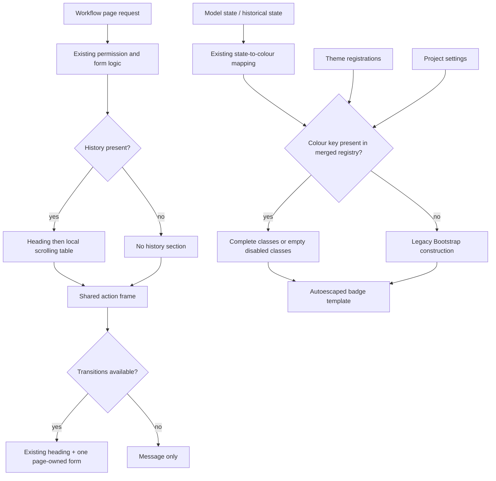

# Phase 06.12: Workflow presentation — Research

**Researched:** 2026-11-05
**Domain:** Django workflow presentation, class registry, reference-theme adoption
**Confidence:** MEDIUM overall; implementation findings grounded in opened source and a passing focused baseline.

<user_constraints>
## User Constraints (from CONTEXT.md)

The following decision and deferred sections are copied verbatim. The context's “Planning details left open” is the implementation-discretion section. Source: phase context, read this session.

<!-- DATA_8e72c410_START -->
## Implementation Decisions

### Badge customization

- **D-01:** Use per-colour registry entries containing complete class strings. Do not introduce a colour-pattern
  setting or generic formatting framework. A theme can map success to `badge bg-success-lt`, for example.
- **D-02:** For a colour without a registered entry, preserve existing Bootstrap class construction. An
  unregistered `purple` produces `badge rounded-pill text-bg-purple`; do not substitute `STATE_BADGE_DEFAULT`
  merely because the colour lacks a registry entry. Themes may explicitly register custom colours.
- **D-03:** Explicit empty/disabled entries follow existing registry conventions: remove classes while keeping
  the badge text. A present empty entry must not trigger the missing-entry Bootstrap fallback.
- **D-04 (carried forward):** Preserve `BadgeEnum`, `STATE_BADGES`, `STATE_BADGE_DEFAULT`, and model APIs.
  Existing state-to-colour fallback remains intact. Current and historical badges share the new hook, labels
  stay escaped, and project settings override theme defaults through the existing registry precedence.

### Action framing

- **D-05:** Put the existing “Workflow Action” heading and the actionable form together inside the shared
  `crud_views/snippets/form_frame.html` frame, using `cv_form_body`. The stock frame remains undecorated.
- **D-06:** With no available transitions, put the existing no-transitions message inside the frame. Render
  neither an empty form nor the “Workflow Action” heading in that state; preserve the heading's current condition.
- **D-07 (carried forward):** Keep history separate from the action frame. Preserve page-owned form/CSRF behavior,
  crispy rendering, validation errors, and submit ownership; introduce no nested forms or duplicate controls.
  Existing theme frame behavior, including its modal handling, remains owned by that frame override.

### History presentation

- **D-08:** Preserve history-first, actions-below ordering. Hide the entire history section when there are no entries.
- **D-09:** Provide separate registry entries for history wrapper and table classes. Stock classes are
  `table-responsive` on the wrapper and `table` on the table; themes can replace them independently.
- **D-10:** Wrap only the table. Keep the history heading outside the scrolling wrapper and place the horizontal
  scrollbar immediately below the table. Preserve semantic table markup and normal full-width layout.

### Downstream acceptance and delivery

- **D-11:** Phase completion requires browser verification against both stock Bootstrap and the actual Tabler
  reference theme, alongside upstream regression tests. Upstream theme fixtures alone are insufficient.
  Include the 390 px viewport case: wide history scrolls locally without widening the page, while a normal
  table retains full width. Cover the scoped badge, form, and empty/error presentation states in both themes.
- **D-12:** Deliver the focused reference-theme adaptation as part of the phase. Replace its copied workflow
  badge template with registry entries, remove the now-obsolete workflow overflow workaround, and update
  affected theme tests. A temporary adaptation with follow-up instructions is insufficient. Preserve unrelated
  companion changes; this decision authorizes the scoped local adaptation, not publication or pushing.
- **D-13 (carried forward):** Update workflow/theme documentation with the badge recipe and shared-frame
  participation, add a changelog entry, and pair any Breaking entry with `docs/migrating-1.0.md`.
  Use bounded multicore pytest for broad regression checks and update goldens only for intentional output changes.
  Hand the settled public keys/template contracts to Phase 7.

### Planning details left open

The user did not delegate any selected discussion area with a “you decide” answer. Ordinary implementation
details remain for research/planning: exact registry key spellings, narrowly scoped resolver placement,
class-key validation for custom colours, template composition, and test/browser harness organization.
Choose the smallest traceable solution consistent with D-01–D-13. Avoid additional abstractions, queries,
or compatibility changes without a demonstrated need. Do not reopen the rejected colour-pattern approach.

## Deferred Ideas

None — discussion stayed within phase scope. Workflow permission and validation/execution work remain separate
issues, not implied prerequisites or extra tasks for this presentation phase.
<!-- DATA_8e72c410_END -->
</user_constraints>

## Project Constraints (from AGENTS.md)

The root guidance is supplied through AGENTS.md/CLAUDE.md. These directives constrain the plan:
[VERIFIED: CLAUDE.md:17-30, 106-124]

- Developer maintainability is a hard constraint: choose the smallest bounded implementation, preserve working paths, document unsupported cases, and avoid hidden state, extra queries, broad abstractions, or unjustified cross-cutting changes.
- Use bounded multicore pytest for broad verification; serial execution needs a concrete reason. Do not interrupt a running check just to change workers.
- Follow existing fixture naming: `cv_<model>`, `user_<model>_<permission>`, `client_user_<model>_<permission>`.
- Preserve `cv_` view attributes and `wf_` transition methods; retain existing CRUD view keys and permission mapping.
- Use 120-character lines, double quotes, the existing Hatchling build, and existing bump-my-version version synchronization.
- Run the repository's Ruff formatting hook when committing.
- A `### Breaking` changelog entry must also update `docs/migrating-1.0.md`; ordinary public changes still need changelog documentation.
- Preserve unrelated work, including the companion's already-modified findings report. Research inspected the companion read-only; execution owns only the scoped adaptation authorized by D-12.
[VERIFIED: git status --short in both checkouts, 2026-11-05]

Keep public documentation examples generic; the project hygiene rule says “No downstream project names in any file”.
The phase context necessarily names the reference checkout for delivery; avoid propagating that name into new public recipes.
[VERIFIED: .planning/PROJECT.md:100-111]

## Summary

Use the existing layered registry and Django inheritance. The registry already merges package defaults, theme
registrations, then settings, and normalizes disabled values to an empty string. Its merged dictionary preserves
membership, which is the needed distinction between an absent custom colour and an explicitly disabled colour.
[VERIFIED: src/crud_views/lib/button_classes.py:140-170]

Current and historical state badges already converge on one request-free renderer. The action template already
owns the choices/empty branches and form. The history template owns its heading and semantic table. These are
three small seams; leave permission, transition execution, database access, and modal routing untouched.
[VERIFIED: src/crud_views_workflow/lib/mixins.py:37-46,64-82]
[VERIFIED: src/crud_views_workflow/templates/crud_views_workflow/view_workflow.action.html:5-18]
[VERIFIED: src/crud_views_workflow/templates/crud_views_workflow/view_workflow.history.html:3-44]

**Primary recommendation:** let the installed workflow app contribute eight complete badge-class defaults and
two history defaults below the existing theme/settings layers; keep the core-only defaults unchanged. Resolve
badge membership at the existing workflow renderer, extend the shared frame around the action branch, and deliver
the real reference-theme cleanup before both-theme browser acceptance. This is the implementation recommendation
derived from D-01–D-13, not an additional locked product decision.

## Architectural Responsibility Map

| Capability | Primary tier | Secondary tier | Rationale / evidence |
|---|---|---|---|
| State-to-colour selection | Model presentation method | Registry | Preserve existing model fallback; apply theme classes afterward. [VERIFIED: src/crud_views_workflow/lib/mixins.py:37-46] |
| Theme/project precedence | Shared Python registry | Installed-app defaults and theme startup | Preserve existing theme/settings order and insert app defaults below both. [VERIFIED: src/crud_views/lib/button_classes.py:129-170] |
| Form ownership and errors | Django page templates | Existing crispy renderer | Keep the existing form, CSRF and renderer together inside the frame. [VERIFIED: src/crud_views_workflow/templates/crud_views_workflow/view_workflow.action.html:5-18] |
| History scrolling | Browser CSS/layout | Django history template | A responsive wrapper owns overflow, table owns tabular layout. [CITED: https://getbootstrap.com/docs/5.3/content/tables/#responsive-tables] |
| Reference-theme appearance | Theme class registration and frame override | Upstream templates | The actual theme already registers classes and owns page/card versus modal decoration. [VERIFIED: ../tabler-test/src/crud_views_tabler/apps.py:15-34] [VERIFIED: ../tabler-test/src/crud_views_tabler/templates/crud_views/snippets/form_frame.html:1-6] |
| Authorization/execution/history persistence | Existing backend | — | Outside this phase per D-04/D-07 and boundary; preserve existing enforcement. [VERIFIED: src/crud_views_workflow/lib/views.py:85-135] |

## Standard Stack

Retain installed dependencies; this phase needs no installation or dependency upgrade. These are **observed local
versions**, not claims about newest registry releases. Existing declarations include
`"django (>=4.2.0)"`, `"django-crispy-forms (>=2.0)"`, `"crispy-bootstrap5 (>=2023.10)"`,
and `"django-fsm-2>=4.0.0"`.
[VERIFIED: pyproject.toml:25-42]

| Existing component | Observed version | Use |
|---|---|---|
| Python / Django upstream baseline | 3.12.3 / 5.2.18 | Source-loaded regression run |
| pytest / pytest-xdist | 9.2.0 / 3.8.0 | Four-worker focused and broad checks |
| django-crispy-forms / crispy-bootstrap5 | 2.7 / 2026.9 | Preserve existing form renderer |
| django-fsm-2 | 4.3.0 in baseline nox environment | Existing workflow fixtures only |
| Reference-theme Python / Django | 3.14.7 / 6.1.2 | Actual companion test and browser runtime |
| Node / cached Playwright / Chromium | 24.21.0 / 1.64.1 / 149.0.7827.55 | Existing browser tooling |

[VERIFIED: interpreter/importlib.metadata, node and Chromium version probes, 2026-11-05]

**Installation / Package Legitimacy Audit:** not applicable; recommend no new packages. Do not run an automatic
environment sync just to execute this phase. Registry publish dates are not needed for a no-upgrade source change.
Retain the supported upstream Django test matrix declared as `DJANGO_VERSIONS = ["4.2", "5.2", "6.0"]`;
the actual companion's 6.1.2 run is additional consumer evidence, not a replacement for that matrix.
[VERIFIED: noxfile.py:3-19]

## Architecture Patterns

### System Architecture Diagram

Recommended flow, preserving existing responsibilities:



The diagram's request path describes the full page. Supported modals retain the existing generic custom-form
content branch; do not reroute them through the full-page workflow history/action path.
[VERIFIED: src/crud_views/lib/views/form.py:18-20]
[VERIFIED: tests/test1/test_theme_form_requests.py:49-65,166-197]

### Component responsibilities and proposed public spellings

The following names are **proposals**, to be settled in the plan and handed to Phase 7. They are not existing keys.

| Proposal | Owner / change | Why |
|---|---|---|
| `workflow:badge-<colour>` | Workflow-owned mapping contributed by its installed AppConfig | Two segments; full strings; no formatter |
| `workflow:history-wrapper` | Default `table-responsive`; history template consumes via existing tag | Independent overflow decoration |
| `workflow:history-table` | Default `table`; history template consumes via existing tag | Independent table decoration |
| `badge_class` | Add resolved classes to badge context while retaining existing values | Preserve legacy copied-template context |

The existing vocabulary is verbatim:
<!-- DATA_3b98a672_START -->
```python
PRIMARY = "primary"
SECONDARY = "secondary"
SUCCESS = "success"
DANGER = "danger"
WARNING = "warning"
INFO = "info"
LIGHT = "light"
DARK = "dark"
```
<!-- DATA_3b98a672_END -->
[VERIFIED: src/crud_views_workflow/lib/enums.py:15-22]

Use explicit complete strings in a small workflow-owned mapping. Do not put these ten entries in the core
`DEFAULT_BUTTON_CLASSES`, mutate that constant from `ready()`, or call the theme-registration API for app defaults.
The core registry deliberately delays view imports until checks run; app contributions must also remain free of
model imports. [VERIFIED: src/crud_views/lib/button_classes.py:256-262]

**Narrow custom-key grammar:** recognize only the proposed badge prefix followed by one nonempty colour segment
without colon or whitespace. Do not normalize the colour, admit unrelated workflow keys, or expand action-mode
grammar. Exact two-part spelling is useful because the existing checker applies special semantics to keys ending
in `:icon-host` and `:container-single`; `workflow:badge-icon-host` does not accidentally enter those branches.
The exception belongs next to the checker's known-key acceptance, leaving value validation intact.
[VERIFIED: src/crud_views/lib/button_classes.py:291-335]
This is a planning recommendation, not an existing validation contract.

### App-owned defaults: amended implementation direction

**User steering during planning:** workflow's class entries should belong to the workflow app and contribute
only while that app is installed. This supersedes the earlier research suggestion to add ten entries directly
to core defaults. The exact contribution API below remains a proposal, not a user-locked spelling.

The current APIs are distinct: `register_assets(key, js=(), css=(), emit=True)` registers asset bundles;
`register_button_classes(classes)` updates `_THEME_BUTTON_CLASSES`. Neither is an app-default contribution
API. Workflow's current `ready()` imports its checks only.
[VERIFIED: src/crud_views/lib/assets.py:56-68]
[VERIFIED: src/crud_views/lib/button_classes.py:140-156]
[VERIFIED: src/crud_views_workflow/apps.py:4-10]

**Recommended smallest bounded seam:** put the literal mapping in a workflow-owned, import-safe module and
expose it as one declarative AppConfig mapping attribute (proposed name:
`crud_views_button_class_defaults`). Add a small core getter for effective defaults that reads this attribute
from active Django app configs, then overlays the existing theme and project layers. This avoids a second
mutable app-registration store, duplicate-ready registration, an uninstall API, callback discovery, or importing
the optional extension from core. Do not conflate this with the JS/CSS asset registry.

Proposed layer order:

```text
core DEFAULT_BUTTON_CLASSES + installed app defaults
    < theme register_button_classes(...)
    < CRUD_VIEWS_BUTTON_CLASSES settings
```

Workflow contributes only its ten disjoint keys. Keep contribution data immutable by convention and read it
without mutating the source mapping. Reject an app contribution that overwrites a core/another app default
rather than defining registration-order precedence; accepting generic core overrides is unnecessary for this
phase. Theme/project overrides remain the supported restyling mechanism. No lifecycle or per-request registration.

**Why startup order need not decide precedence:** Django populates all AppConfigs and sets
`self.apps_ready = True` before importing models and invoking any `app_config.ready()`. Thus declarative
mapping attributes can be read independently of which theme ready hook runs first. Guard pre-apps-ready access,
because `get_app_configs()` checks readiness. Do not cache a pre-ready core-only result for use after setup.
[VERIFIED: .nox/tests-3-12-django-5-2/lib/python3.12/site-packages/django/apps/registry.py:112-148]

**Cache/lifecycle rule:** bind the effective-default snapshot and resolved cache to the active app-config mapping
identity. Recompute when Django replaces/restores that mapping; retain existing explicit invalidation for
theme/settings changes and also handle `setting_changed` for `INSTALLED_APPS`. Avoid rescanning every installed
app on every ordinary class lookup. A small snapshot keyed by registry identity is enough; no receiver-based
contribution replay is needed. This matters during test setup itself: `override_settings` repopulates the registry
*before* emitting setting_changed, and restores the old registry on exit. Merely clearing contributions in that
signal would discard new registrations and would not reconstruct old ones.
[VERIFIED: .nox/tests-3-12-django-5-2/lib/python3.12/site-packages/django/apps/registry.py:339-368]
[VERIFIED: .nox/tests-3-12-django-5-2/lib/python3.12/site-packages/django/test/utils.py:482-520]

**Preserve special resolution:** `_heading_class()` currently scans
`(_settings_layer(), _THEME_BUTTON_CLASSES, DEFAULT_BUTTON_CLASSES)`.
Use effective defaults for its final layer without flattening away settings/theme specificity. The new workflow
mapping contributes no heading keys, so existing heading output and precedence tests must remain unchanged.
[VERIFIED: src/crud_views/lib/button_classes.py:189-200]

**Checks and inventory:** accept exact effective-default keys in the known-key check; retain normal value checks.
Keep the custom-colour exception narrowly scoped to the proposed workflow badge family and active only when
workflow defaults are contributed. A bounded family check is sufficient; do not add arbitrary provider callbacks
or a general schema-registration system. With no workflow app, core defaults remain 88 and workflow keys are
not silently made core-valid. Explicit user/theme values still obey existing registry storage behavior; validity
and optional defaults are separate concerns.
[VERIFIED: src/crud_views/lib/button_classes.py:291-335]

Test assumptions needing adjustment are concrete:
`assert bc.get_button_classes() == bc.DEFAULT_BUTTON_CLASSES` conflates effective and core defaults, and
`assert sorted(set(pairs) - set(DEFAULT_BUTTON_CLASSES)) == []` scans templates in all shipped apps.
Update those to the relevant installed-app defaults or an explicit union for the all-packages static scan; retain
the existing core inventory and core sentinel tests.
[VERIFIED: tests/test1/test_button_classes_checks.py:257-261]
[VERIFIED: tests/test1/test_button_classes_templates.py:51-57]

**Focused acceptance additions:** bare-settings core import; no-workflow installed set; workflow installed;
theme ready before/after workflow config order; settings including empty/None over theme; warm cache then
installed-app removal/restoration; repeat population; valid custom colours only while the family is active;
core collisions rejected; unchanged heading specificity. Use small source-loaded registry tests and subprocess
setup probes where app/model import isolation requires them. No broad test rerun was performed for this amendment.

### Pattern 1: Presence-aware badge styling

The renderer currently passes exactly `{"state": state, "name": name, "class": klass}` to
`"crud_views_workflow/badge.html"`; preserve those values and that override name. Current and historical
badges both call the renderer.
[VERIFIED: src/crud_views_workflow/lib/mixins.py:37-46,64-82]

Keep the state fallback unchanged: `klass = self.STATE_BADGES.get(state, self.STATE_BADGE_DEFAULT)`.
Then use registry membership, not `get_button_class(...) or fallback`. For a present key, use
the existing getter to normalize `None` and invalid types to empty; the existing checker still reports invalid types.
[VERIFIED: src/crud_views_workflow/lib/mixins.py:37-42]
[VERIFIED: src/crud_views/lib/button_classes.py:159-170,291-299]

Smallest compatibility-preserving approach: use a missing-only sentinel in the new context variable and retain
legacy class construction in the leaf's missing branch. A present registry `None` becomes an empty string
**before** it reaches the template. This also lets direct legacy rendering with the original three context values
retain stock output. Existing copied overrides may keep using their original colour context and ignore the new
hook until their author adopts it. Test that behavior explicitly rather than changing the meaning of `class`.

The current leaf is verbatim:
<!-- DATA_67a4ed30_START -->
```django
<span class="badge rounded-pill text-bg-{{ class }}">{{ name }}</span>
```
<!-- DATA_67a4ed30_END -->
[VERIFIED: src/crud_views_workflow/templates/crud_views_workflow/badge.html:1]

### Pattern 2: Inherit the frame around both action branches

Put `` first, retain loads, then wrap the existing
choices/empty branch in ``. The existing update content demonstrates this exact
inheritance seam. Keep workflow's current implicit form target and attributes; do not copy update's action or
multipart attributes into it.
[VERIFIED: src/crud_views/templates/crud_views/view_update.content.html:1-12]
[VERIFIED: src/crud_views_workflow/templates/crud_views_workflow/view_workflow.action.html:5-18]

The stock frame is exactly ``.
The theme frame checks `request.headers.x_cv_modal != "true"` and surrounds ordinary pages with
`<div class="card"><div class="card-body">`. Preserve frame ownership of this behavior.
[VERIFIED: src/crud_views/templates/crud_views/snippets/form_frame.html:1]
[VERIFIED: ../tabler-test/src/crud_views_tabler/templates/crud_views/snippets/form_frame.html:2-6]

Django requires extends to be the first template tag. Labels and class strings should remain ordinary template
variables with autoescaping enabled.
[CITED: https://docs.djangoproject.com/en/5.2/ref/templates/language/]

### Pattern 3: Table-only wrapper

Inside the existing history-present condition, retain the heading, then add a single div around the table.
Read both proposed classes with `cv_button_class`; it already returns autoescaped classes. Keep the table,
thead, tbody, column scopes, column classes and content. Leave the actions after the history include.
[VERIFIED: src/crud_views/templatetags/crud_views.py:664-667]
[VERIFIED: src/crud_views_workflow/templates/crud_views_workflow/view_workflow.history.html:3-44]
[VERIFIED: src/crud_views_workflow/templates/crud_views_workflow/view_workflow.content.html:3-5]

Do not change the existing repeated evaluation of workflow_data in this presentation phase. Performance or
query restructuring is outside the locked boundary; the wrapper does not require additional reads.
[VERIFIED: src/crud_views_workflow/templates/crud_views_workflow/view_workflow.history.html:3,18]
[VERIFIED: src/crud_views_workflow/lib/mixins.py:64-82]

## Don't Hand-Roll

| Problem | Do not build | Use |
|---|---|---|
| Theme precedence and disabled semantics | Workflow registry/cache/settings framework | Existing registry membership + normalized getter |
| Responsive history | JavaScript sizing or whole-page overflow fix | Table-only responsive wrapper |
| Form decoration | Workflow-specific card template | Shared frame inheritance |
| Escaping | HTML string interpolation or safe-marked labels/classes | Existing autoescaped leaf |
| Browser proof | New generalized evidence/provenance framework | Small owned fixture, focused assertions, measurements and screenshots |

Recommendations follow D-01, D-05, D-09–D-12 and the source seams above. Bootstrap documents local wrapping and
warns that responsive tables clip vertical overflow; keeping headings/actions outside also avoids that clipping.
[CITED: https://getbootstrap.com/docs/5.3/content/tables/#responsive-tables]

## Runtime State Inventory

This is a small presentation refactor and companion template retirement, not a data migration. Inventory scope
is the local development/test environment; no claim is made about uninspected deployments.

| Category | Items found / inspection | Required action |
|---|---|---|
| Stored data | Existing workflow history is read into presentation dictionaries; execution writes unchanged workflow records. [VERIFIED: src/crud_views_workflow/lib/mixins.py:52-82] [VERIFIED: src/crud_views_workflow/lib/views.py:119-135] | No data migration. Browser fixtures use owned temporary data. |
| Live service config | Theme class registration comes from app ready; no live service change is needed for these local hooks. External deployments were not inspected. [VERIFIED: ../tabler-test/src/crud_views_tabler/apps.py:15-34] | No service configuration task; restart only an owned test server when needed. |
| OS-registered state | No renamed service/process identifier is proposed; external OS registrations were not audited. | No OS migration in scope. |
| Secrets/env vars | Keep `CRUD_VIEWS_BUTTON_CLASSES` unchanged; no secret names change. [VERIFIED: src/crud_views/lib/button_classes.py:134-147] | Test overrides only; no application secret edits. |
| Build artifacts / installed packages | Cached nox package is stale unless source path is explicit: first probe produced 568 setup errors; source-loaded rerun passed 568. [VERIFIED: baseline command results, 2026-11-05] | Use explicit source imports; no package reinstall required for local acceptance. Remove the copied theme leaf from source; ensure tests resolve the upstream leaf. |

## Common Pitfalls

1. **Absent equals empty by accident.** The getter returns `""` for both missing and disabled values.
   Membership must precede normalization; test unregistered custom colour, registered custom colour, empty and
   None separately in theme and settings layers.
   [VERIFIED: src/crud_views/lib/button_classes.py:159-170]

2. **Changing the legacy context meaning.** Replacing the existing colour under `class` with a full CSS
   string breaks copied leaves such as the actual theme's `badge bg-{{ class }}-lt`. Retain the colour
   and add the new context field instead.
   [VERIFIED: ../tabler-test/src/crud_views_tabler/templates/crud_views_workflow/badge.html:1-3]

3. **Confusing core and effective defaults.** Core defaults and docs are tested as an exact set and count:
   `assert len(EXPECTED_KEYS) == 88`; docs contain `The default table has 88 keys`.
   Keep that core inventory at 88; document ten optional workflow defaults separately (98 effective defaults when
   installed). Tests comparing the resolved map to the core constant must instead use effective defaults, while
   core-only inventory/sentinel assertions stay core-only.
   [VERIFIED: tests/test1/test_button_classes.py:108-120]
   [VERIFIED: docs/reference/buttons.md:154-166]

4. **Accidentally rewriting modal behavior.** Existing tests explicitly require modal generic content and
   preserve a form even with no choices; full pages require the message without any form/token.
   D-06 concerns the action template being framed; do not silently reinterpret it as a modal redesign.
   [VERIFIED: tests/test1/test_theme_form_requests.py:49-65,166-197]
   [VERIFIED: docs/reference/theme.md:335-341,423-424]

5. **Testing only parsed forms.** HTML parsers can repair nested forms; reuse the existing raw-markup scanner
   plus DOM ownership checks. Scope CSRF counts to the owned form, allowing independent sibling forms.
   [VERIFIED: tests/test1/test_theme_form_requests.py:69-85,180-188]

6. **Deleting the copied badge without enabling fallback discovery.** The companion test settings' complete
   INSTALLED_APPS list currently contains the theme and core but not the workflow app. Its current badge test
   renders the copied leaf directly and asserts the theme origin. Update that fixture/setup and assertion so
   the upstream workflow leaf is actually discoverable after deletion.
   [VERIFIED: ../tabler-test/tests/crud_views_tabler/settings.py:9-25]
   [VERIFIED: ../tabler-test/tests/crud_views_tabler/test_theme.py:807-812]

7. **Reusing a historical harness as if it were generic.** The old theme-adoption runner pins a prior phase
   manifest and exact runtime/source identity. Reuse small fixture ideas, not the old delivery protocol or its
   baseline mutation machinery.
   [VERIFIED: tests/browser/theme-adoption.cjs:10-42]
   [VERIFIED: tests/browser/theme_adoption_server.py:396-414]

## Code Examples

These are **proposed edits**, not existing public values. The chosen new context/key spellings remain planning
choices. They use existing functions and the original context values verified above.

```python
# Inside the existing get_state_badge(), after its unchanged state-to-colour selection:
slot = f"badge-{klass}"
key = f"workflow:{slot}"
badge_class = get_button_class("workflow", slot) if key in get_button_classes() else None
# Keep state, name and class unchanged; add badge_class to render_to_string's context.
```

```django
<span class="badge rounded-pill text-bg-{{ class }}{{ badge_class }}">{{ name }}</span>
```

Registered None is normalized to an empty string; only absent registration/legacy direct context reaches the
legacy branch. Keep the final rendered HTML's existing safe-string behavior; do not mark the input label or
class string safe. These recommendations use the existing normalization and render boundary.
[VERIFIED: src/crud_views/lib/button_classes.py:159-170]
[VERIFIED: src/crud_views_workflow/lib/mixins.py:37-42]

Proposed history composition:
```django

    
    <div class="">
        <table class="">
            {# retain the existing complete table contents #}
        </table>
    </div>

```

Proposed frame integration:
```django



    {# move the existing full choices/else block here unchanged #}

```

The quoted existing values are `"Workflow History"`, `"crud_views/snippets/form_frame.html"`,
and `cv_form_body`; the other names in these sketches are explicitly proposed above.
[VERIFIED: src/crud_views_workflow/templates/crud_views_workflow/view_workflow.history.html:3-6]
[VERIFIED: src/crud_views/templates/crud_views/view_update.content.html:1-4]

## Reference-theme delivery

Deliver scoped source changes locally before final browser evidence:

- Add the eight badge mappings to the existing theme class table, keeping the theme's complete light-badge classes.
- Delete the copied workflow badge leaf; test model rendering through the upstream leaf and its resolved template origin.
- Remove only the old bare-table overflow CSS block; replace its obsolete CSS-shape test with resulting history behavior.
- Update test settings narrowly if needed to load the upstream workflow templates.
- Add action-frame, empty-message and independent history-class tests.
- Preserve the already-modified findings report and all unrelated companion changes; do not push or publish.

These targets correspond to the actual registration and tests:
[VERIFIED: ../tabler-test/src/crud_views_tabler/buttons.py:1-48]
[VERIFIED: ../tabler-test/src/crud_views_tabler/apps.py:15-34]
[VERIFIED: ../tabler-test/tests/crud_views_tabler/test_theme.py:664-674,807-812]

The exact obsolete CSS selector is `.page-body > .container-xl:has(> table.table)`, with
`overflow-x: auto;` inside a phone media query. Remove that bounded block, not other overflow/typeahead fixes.
[VERIFIED: ../tabler-test/src/crud_views_tabler/static/crud_views_tabler/crud_views_tabler.css:76-83]

## State of the Art

This is an adoption of existing project mechanisms, not an ecosystem migration.

| Current local behavior | Phase target | Evidence |
|---|---|---|
| Solid badge classes embedded in leaf | Registry-selected complete strings, legacy missing-colour fallback | Badge leaf and D-01–D-04 |
| Workflow action bypasses shared frame | Existing conditional body inherits frame | Action leaf and D-05–D-07 |
| Bare history table | Independent wrapper/table classes | History leaf and D-08–D-10 |
| Copied reference-theme badge and broad overflow fix | Theme registration plus upstream rendering | Companion sources and D-12 |

[VERIFIED: src/crud_views_workflow/templates/crud_views_workflow/badge.html:1]
[VERIFIED: src/crud_views_workflow/templates/crud_views_workflow/view_workflow.action.html:1-18]
[VERIFIED: src/crud_views_workflow/templates/crud_views_workflow/view_workflow.history.html:3-44]

## Assumptions Log

No unverified compatibility or dependency claim is used to lock the plan. New names and test organization in this
report are recommendations in the context's explicitly open implementation-detail area, not claims of existing
APIs. Browser layout is an acceptance result still to be measured, not an assumed pass.

## Open Questions

1. **Final public spellings:** settle the proposed contribution seam, ten keys and additive context name during planning, then keep
   them consistent in implementation, docs, checker grammar and Phase 7 handoff.
2. **Dedicated requirement IDs:** roadmap currently says `**Requirements**: TBD`. Do not claim THEME-01/03/06
   are new Phase 06.12 requirements; they are already completed compatibility contracts. Use decision IDs and
   issue acceptance criteria until the orchestrator records formal phase requirements.
   [VERIFIED: .planning/ROADMAP.md:934-955]
   [VERIFIED: .planning/REQUIREMENTS.md:160-165,288-293]
3. **Visual result:** verify actual both-theme layout after adaptation. No browser acceptance was performed
   during research. Failure of real theme layout must be fixed before completion under D-11/D-12.

## Environment Availability

| Dependency | Observed availability | Fallback / planning action |
|---|---|---|
| Source-loaded upstream Django 5.2 | Available; focused run passes | Use explicit PYTHONPATH |
| Cached Django 4.2 / 6.0 | Available, reported 4.2.30 / 6.0.9 | Reuse cached interpreters for focused compatibility checks |
| Actual reference-theme interpreter | Available, Python 3.14.7 / Django 6.1.2 | Invoke absolute interpreter; avoid unnecessary sync |
| Cached browser automation | Playwright 1.64.1 / Chromium 149 available | Existing local cache; no package install |
| uv / task / Node | Available | Existing commands |
| Context7 MCP / ctx7 CLI | Neither discovered | Official documentation accessed through web tool |
| Knowledge graph | init/status returned exists=false | Direct source inspection |

[VERIFIED: tool discovery, command/version probes and graphify status, 2026-11-05]

The upstream .venv currently reports Django 6.1.2, so invoking it is not equivalent to running the declared
upstream compatibility matrix. Cached nox binaries exist but need source-path precedence for this checkout.
[VERIFIED: importlib.metadata probes and baseline commands, 2026-11-05]

## Validation Architecture

### Test framework and working commands

Configuration uses `[tool.pytest.ini_options]` with `addopts = "--strict-markers"`.
[VERIFIED: pyproject.toml:145-146]

**Measured focused baseline:**
```bash
PYTHONPATH=src:. .nox/tests-3-12-django-5-2/bin/python -m pytest tests/test1/test_workflow.py tests/test1/test_button_classes.py tests/test1/test_button_classes_checks.py tests/test1/test_theme_form_requests.py -n 4 -q --tb=short
```

Result: `568 passed in 12.37s`. Without PYTHONPATH, the same selection produced
`568 errors in 2.97s` with this failing output:
<!-- DATA_a5e8b901_START -->
```text
tests/test1/conftest.py:28:
AttributeError: module 'crud_views.lib.view.label_mode' has no attribute '_THEME_LABEL_MODE_DEFAULTS'
```
<!-- DATA_a5e8b901_END -->
[VERIFIED: actual baseline execution, 2026-11-05]
This is a stale-import failure, not a Django compatibility conclusion.

**Broad upstream command:**
```bash
PYTHONPATH=src:. .nox/tests-3-12-django-5-2/bin/python -m pytest tests -n 4
```

**Actual companion regression command, from its root:**
```bash
PYTHONPATH=/home/alex/projects/alex/django-crud-views/src:/home/alex/projects/alex/tabler-test/src:. /home/alex/projects/alex/tabler-test/.venv/bin/python -m pytest tests/crud_views_tabler --ds tests.crud_views_tabler.settings -n 4
```

These command paths were probed, not newly created. The companion command follows its existing task's explicit
settings selection; the four-worker addition follows project guidance. Broad and companion commands are
execution recommendations, not reported passes.
[VERIFIED: ../tabler-test/Taskfile.yaml:76-82]
[VERIFIED: interpreter availability probes, 2026-11-05]

### Acceptance-to-test map

No authoritative phase requirement IDs exist yet; these rows map locked decisions.

| Decision / acceptance | Behavior | Tests / command | Gap |
|---|---|---|---|
| D-01–D-04 | Eight defaults, state fallback, custom missing versus registered, empty/None, project precedence, escaping, old override context, current/history parity | Focused baseline above; extend workflow and registry tests | Add explicit new-hook cases |
| D-01–D-03 | Custom-key grammar, malformed keys, invalid values; installed-app contribution lifecycle and precedence | Existing class-check suite | Add optional defaults and app-registry restoration cases; preserve core count |
| D-05–D-07 | Heading + one form inside frame; framed message-only branch; errors, CSRF, control ownership; modal branch unchanged | Extend form-frame, theme-form-ownership, theme-form-requests tests | Assert frame wrapping rather than only response status |
| D-08–D-10 | Heading outside wrapper; table only inside; empty-history omission; independent empty/custom classes | Workflow template tests using real renderer and DOM | New structural assertions |
| D-11 | Stock and real adapted theme; wide/normal table at 390 px; normal desktop; choices, no choices, history, no history, invalid POST | Focused browser fixture/runner, proposed in plan | Browser scenario not yet implemented |
| D-12 | Actual badge override deletion, registration, CSS workaround removal, upstream leaf origin | Companion test command above | Update existing old-behavior assertions and test app setup |
| D-13 | Recipe, count, form-frame text, changelog and conditional migration pair | Include theme_adoption_docs, form_buttons_golden and heading tests | Update executable workflow recipe; inspect intentional golden diffs |

Existing documentation tests execute the copied workflow-action recipe for both branches, so updating the
published recipe must preserve its ability to compile/render with the existing fixtures.
[VERIFIED: tests/test1/test_theme_adoption_docs.py:145-154]

### Browser design and measurements

Use a small isolated server and temporary database, with one process per theme to avoid global registry leakage.
Import the actual companion source and its frame/classes for the theme run; source copies with patched workflow
markup cannot satisfy D-12. Reuse the owned-server and temporary-database patterns without importing old
phase-specific source-patching machinery.
[VERIFIED: tests/browser/theme_adoption_server.py:396-414]
[VERIFIED: tests/browser/action-tooltips.cjs:60-94]

For each theme:

- At 390 px, deliberately wide real history must have wrapper scrollWidth greater than clientWidth; document
  width must stay within viewport width (allow only rounding tolerance). Set wrapper scrollLeft and verify it moves.
- The heading and action frame must be outside that wrapper. Inspect normal table width against its content
  container so a shrink-to-content workaround cannot pass.
- Exercise ordinary choices, terminal state, absent history and invalid submitted form. Verify actual frame
  ancestry, one owned form/token/submit set, errors and no nested raw form markup.
- Confirm theme classes and template origins; verify the badge leaf is upstream after deletion and the form
  frame is the theme override.
- Save a small readable measurement report and screenshots for normal and wide history in each theme.
  Include the actual command/runtime and changed-source revision; no generalized evidence schema is needed.

These are prescriptive acceptance checks derived from D-11/D-12, not results already obtained.

### Sampling rate and Wave 0

- Per implementation task: focused tests touching its behavior; the measured core selection is under 30 seconds.
- Per integration wave: combined focused workflow/registry/form/docs tests with four workers.
- Phase gate: broad upstream regression, focused supported-version checks, real companion regression,
  both-theme browser verification, Ruff, and strict documentation build. Do not imply unrun matrix combinations passed.
- Wave 0 gaps: focused browser fixture/scenarios; new badge/custom-key and history structural assertions.
  Reuse existing pytest and browser packages; no framework installation task.

## Security Domain

Security enforcement is enabled in config. Use version-qualified ASVS names; ASVS 5.0's numbering differs
from older template examples.
[VERIFIED: .planning/config.json: workflow.security_enforcement = true]
[CITED: https://cornucopia.owasp.org/taxonomy/asvs-5.0]

| ASVS 5.0 category | Applicability | Phase control |
|---|---|---|
| V1 Encoding and Sanitization | Direct | Preserve template autoescaping of labels, custom colour text and class attributes; test hostile quotes/HTML |
| V3 Web Frontend Security | Direct | Preserve CSRF ownership and form submission semantics; no new JS injection path |
| V6 Authentication / V7 Session Management | Regression only | Existing authenticated request fixtures; no session changes |
| V8 Authorization | Regression only | Existing workflow permission/execution checks; badge presentation never grants transitions |
| V11 Cryptography | No new primitive | Do not introduce cryptography |

Category names: [CITED: https://cornucopia.owasp.org/taxonomy/asvs-5.0]
Existing permission check: `if not self.object.workflow_has_transition(self.request.user, transition):`
raises `SuspiciousOperation`; keep it unchanged.
[VERIFIED: src/crud_views_workflow/lib/views.py:97-103]

| Threat | STRIDE | Mitigation |
|---|---|---|
| Label/class text becomes markup | Tampering | Ordinary autoescaped variables; do not safe-mark inputs |
| Duplicate/nested forms alter submitted controls | Tampering | Existing renderer/owner boundary and raw-form + DOM tests |
| Theme change accidentally bypasses authorization | Elevation of privilege | Keep view/mixin enforcement unchanged and rerun request regressions |

These controls are scoped recommendations grounded in the existing renderer and form boundary.
[VERIFIED: src/crud_views_workflow/lib/mixins.py:37-42]
[VERIFIED: tests/test1/test_theme_form_requests.py:69-85,166-197]

## Sources

- Primary local source: opened registry, workflow mixin/enums/templates, shared frame, form request tests,
  core docs and actual reference-theme files cited inline.
- Source issue #319: fetched through authenticated GitHub CLI; later context D-11/D-12 strengthens the issue's
  optional downstream check into required both-theme verification and delivered local adaptation.
  [CITED: https://github.com/jacob-consulting/django-crud-views/issues/319]
- [Django 5.2 template language](https://docs.djangoproject.com/en/5.2/ref/templates/language/) — inheritance and escaping.
- [Bootstrap 5.3 tables](https://getbootstrap.com/docs/5.3/content/tables/#responsive-tables) — responsive wrapper.
- [OWASP ASVS 5.0 taxonomy](https://cornucopia.owasp.org/taxonomy/asvs-5.0) — category numbering.

Research-plan selected Context7 for docs; neither the MCP nor CLI was available, so official pages were fetched
with the web tool. The confidence seam returned MEDIUM for websearch with official verification. Digests were
cached in an isolated temporary research directory, keeping the agent's repository write scope to this report.
[VERIFIED: research-plan, tool discovery, classify-confidence and research-store commands, 2026-11-05]

## Metadata

| Area | Confidence | Basis |
|---|---|---|
| Existing stack / seams | MEDIUM | Source opened and runtime versions probed; focused baseline passes |
| Recommended architecture | MEDIUM | Direct composition of existing mechanisms; final public names are planning choices |
| Pitfalls / compatibility | MEDIUM | Source and tests reveal fallback, modal, registry and stale-import traps |
| Browser acceptance | Pending | Requires final adapted-source run under both themes |

**Research date:** 2026-11-05  
**Recheck:** when source or companion work changes; otherwise within 30 days.  
**Git handling:** report written; commit left to the orchestrator so unrelated concurrent work stays untouched.

