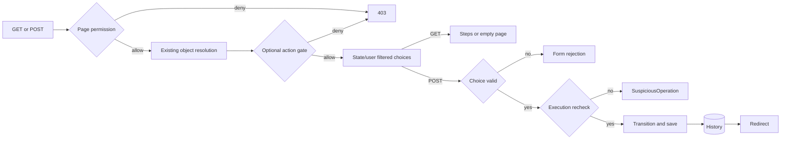

# Phase 06.13: Workflow permissions — opt-in per-transition access — Research

**Researched:** 2026-11-05
**Domain:** Existing Django workflow authorization, documentation, isolated regression tests
**Confidence:** MEDIUM (official-source fallback tier returned by the research seam; implementation tests not run)

<user_constraints>
## User Constraints (from CONTEXT.md)

<!-- DATA_61f3b0aa_START -->
## Implementation Decisions

### Existing permission behavior

- **D-01:** Preserve `WorkflowViewPermissionRequired.cv_permission = "change"` and its existing coverage.
  The recipe explicitly opts into `cv_permission = "view"`; do not introduce an automatic any-transition gate.
- **D-02:** Restricted transitions have explicit django-fsm `permission=` rules. Include ordinary change
  permission and a dedicated step permission on two transitions available from the same source state.
  Lowering the page permission alone does not add transition restrictions.
- **D-03:** Dedicated step permission never substitutes for page permission or applicable object/parent access
  checks. Explain those layers separately and retain application-specific checks when applying the recipe.
- **D-04:** Preserve both submitted-choice validation and the execution-time `workflow_has_transition` recheck.
  Action rendering and earlier choice construction do not establish authorization to execute a transition.

### Two distinct no-permitted-steps variants

- **D-05:** Show the basic view-gated recipe first, without the optional action-enabled hook. A user satisfying
  page and applicable object/parent checks can GET the workflow page with HTTP 200 and see the existing
  no-steps message. Attempted transitions must not change state or history when none are permitted.
- **D-06:** Explain a separate optional classmethod `cv_action_enabled(cls, user, obj=None)` returning
  `obj is None or obj.workflow_has_any_possible_transition(user)`, together with
  `cv_inaccessible_actions = "disable"`. When the hook returns false, the workflow action renders disabled
  on a page rendering that action, and direct GET and POST return HTTP 403 for an authenticated user.
  A user with a permitted step still passes this hook.
- **D-07:** Explicitly distinguish the page permission gate, optional action-enabled request gate, state/user
  transition filtering, submitted-choice validation, and execution-time recheck. Disabled rendering alone is
  not authorization, but the server also enforces `cv_action_enabled`. Do not promise an accessible empty page
  and a disabled action from this same hook; do not bypass or change `has_permission()` to achieve that.

### Recipe and regression coverage

- **D-08:** Provide a self-contained example in `docs/reference/workflow_view.md`, including model permissions,
  transitions, form, ViewSet, view, and URL configuration. Follow existing documentation conventions where
  practical. Present the complete basic recipe before the separate optional hook variant.
- **D-09:** Preserve existing Campaign behavior and default-permission tests. Use a bounded opt-in
  fixture/example for the two differently permissioned transitions; forbidden-choice coverage must demonstrate
  permission filtering rather than simply submitting a transition unavailable from the current state.
- **D-10:** Prove a user with view permission plus only the dedicated step permission can GET and POST the
  permitted transition, changing state and recording history. The other role's same-source transition is not
  offered; forged POSTs are rejected without state/history changes. A user lacking page permission cannot
  GET or POST even when a transition rule would permit them.
- **D-11:** Cover both no-steps variants independently: HTTP 200 and the empty message without the hook;
  a disabled rendered action and HTTP 403 on direct GET/POST with the hook. Verify unchanged state/history
  for rejected attempts and successful access through the hook when a permitted step exists.
- **D-12:** Test the execution-time recheck independently of choice validation: arrange for a valid offered
  choice to fail `workflow_has_transition` when execution is attempted, then verify rejection without state
  or history changes. The implementer chooses the smallest reliable test technique.
- **D-13:** Run focused tests and appropriate broader regression checks, using multicore pytest for broad
  selections. Validate documentation and add a documentation changelog entry. Report actual coverage and
  runtime limits; this discussion does not establish test or implementation acceptance.

### Maintainability and delegated details

- **D-14:** Use the smallest understandable solution with current hooks. No broader permission abstraction,
  unrelated refactor, Guardian integration mode, execution helper, refusal-message API, presentation-only
  action hook, default-permission change, or workflow execution redesign belongs here.
- **D-15:** The issue explicitly delegates example names, fixture organization, and the smallest reliable
  execution-time recheck test to the implementer. These are not unresolved product decisions. Preserve
  repository hygiene, including avoiding downstream project names in repository files.

<!-- DATA_61f3b0aa_END -->

### Implementer discretion

The source has no separate discretion section; D-15 above delegates names, fixture organization, and the execution-time recheck technique. No product decision remains open. [VERIFIED: phase CONTEXT.md, D-15]

<!-- DATA_8bf104d2_START -->
## Deferred Ideas

No new ideas were added. Workflow presentation remains separate Phase 06.12 work; finding 7's workflow
validation/execution design remains outside this phase. The updated issue's exclusions are binding.

<!-- DATA_8bf104d2_END -->
</user_constraints>

## Summary

Deliver a documentation recipe, isolated regression tests, and a documentation changelog entry. Preserve the existing Campaign fixture and default permission gate. The current default is literally `cv_permission = "change"`; the view recipe explicitly selects `"view"`. [VERIFIED: src/crud_views_workflow/lib/views.py:146-147; phase CONTEXT.md, D-01, D-08–D-15]

The critical distinction is between two configurations: the basic recipe admits a page viewer with no permitted transitions, while the optional action hook denies that viewer's direct requests as well as disabling the action elsewhere. The request implementation first calls `super().has_permission()`, then `cv_get_action_object()`, then `cv_action_enabled(self.request.user, obj)`. An execution recheck occurs after form validation and before the transition method/save/history creation. [VERIFIED: src/crud_views/lib/view/base.py:1077-1087; src/crud_views/lib/views/mixins.py:33-60; src/crud_views_workflow/lib/views.py:85-129]

**Primary recommendation:** Add one small opt-in test model with two differently permissioned transitions sharing a source state; exercise ordinary and hook-enabled views through real client requests, then document the same configuration. This is a proposed implementation within D-09/D-15, not an existing fixture claim. [VERIFIED: phase CONTEXT.md, D-09–D-15]

## Architectural Responsibility Map

| Capability | Primary tier | Secondary tier | Grounding |
|---|---|---|---|
| Page permission and optional action gate | Django backend view | Existing application object/parent policy | `has_permission()` checks permission, resolves the action object, then checks the hook. [VERIFIED: src/crud_views/lib/view/base.py:1077-1087] |
| State/user transition filtering | Model integration | django-fsm-2 | `workflow_get_possible_transitions(user)` consumes `get_available_user_state_transitions(user)`. [VERIFIED: src/crud_views_workflow/lib/mixins.py:94-106] |
| Submitted-choice validation | Backend form | Django ChoiceField | Field defined as `transition = ChoiceField(` with `choices=()`, then assigned `transition.choices = choices`. [VERIFIED: src/crud_views_workflow/lib/forms.py:24-30,46-60] |
| Execution authorization and persistence | Backend workflow view | Database transaction/history | Recheck precedes method call, save, and history creation. [VERIFIED: src/crud_views_workflow/lib/views.py:97-129] |
| Disabled action and empty-page message | Server templates | Browser displays result | No client authorization logic is needed. Existing action rendering and request enforcement are distinct. [VERIFIED: src/crud_views/lib/view/base.py:762-785,1077-1087; src/crud_views_workflow/templates/crud_views_workflow/view_workflow.action.html:6-19] |

## Project Constraints (from AGENTS.md)

- Preserve understandable, bounded, opt-in designs; protect proven paths and avoid hidden state, extra abstractions, and added runtime/query costs. Document unsupported cases. [VERIFIED: AGENTS.md:15-30]
- Broad tests use multicore pytest; bounded workers are appropriate on shared resources. Serial execution requires a tiny-selection or isolation reason. [VERIFIED: AGENTS.md:110-112]
- Preserve fixture conventions `cv_<model>`, `user_<model>_<permission>`, `client_user_<model>_<permission>`; view attributes use `cv_`, transitions use `wf_`. View keys are `list`, `detail`, `create`, `update`, `delete`, `workflow`, `manage`; keep established permission mapping. [VERIFIED: AGENTS.md:116-123]
- Use 120-character lines, double quotes, existing hatchling/bump-my-version setup. A new `### Breaking` entry also requires migration documentation; this phase instead adds a documentation entry. Ruff formatting runs on commit. [VERIFIED: AGENTS.md:64,124-128; phase CONTEXT.md, D-13]
- Existing commands: `task dev`, `task test`, `task format`, `task check`, `task build`, `task docs`, `task bump-patch`. No setup/version change is needed here. After shipping, refresh codebase maps before subsequent work. [VERIFIED: AGENTS.md:32-68; phase CONTEXT.md, Phase Boundary]
- Avoid downstream project names. No production changes, repository cache edits, or commits by this researcher. [VERIFIED: phase CONTEXT.md, D-15; orchestrator assignment]

## Phase Requirements

The roadmap says `**Requirements**: TBD (derive from issue #320 during planning)`; no phase-specific IDs were supplied. Derive IDs from D-01–D-15 and map them to the Validation Architecture below. Do not reuse unrelated completed requirements. [VERIFIED: .planning/ROADMAP.md:934-964; phase CONTEXT.md, Implementation Decisions]

## Standard Stack

**Use the installed project stack; add no external dependency or version upgrade.** This is a test/documentation phase. Package-registry currency and a package-install legitimacy gate are therefore not applicable; the following versions are observed installed versions, not latest-release or universal-compatibility claims. [VERIFIED: phase CONTEXT.md, Phase Boundary and D-14; read-only environment metadata probe, 2026-11-05]

| Component | Observed version / declaration | Use |
|---|---|---|
| Python | 3.12.3 in all five inspected environments; project declares `requires-python = ">=3.12"` | Existing test runtime. [VERIFIED: metadata probe; pyproject.toml:25] |
| Django | 4.2.30, 5.2.18, 6.0.9 in existing nox environments | Exercise the three configured series. Nox declares `DJANGO_VERSIONS = ["4.2", "5.2", "6.0"]`. [VERIFIED: metadata probe; noxfile.py:3-19] |
| django-fsm-2 | Installed 4.2.4 or 4.3.0; dependency `"django-fsm-2>=4.0.0"` | Existing transition permission API. [VERIFIED: metadata probe; pyproject.toml:39-42] [CITED: https://github.com/django-commons/django-fsm-2#permissions] |
| pytest / pytest-django / pytest-xdist | 9.2.0 / 4.14.0 / 3.8.0 | Existing test/client/database and parallel test infrastructure. [VERIFIED: metadata probe; pyproject.toml:70-83] |
| MkDocs / Ruff | 1.6.1 / 0.17.3 in default environment | Documentation build and scoped style checks. [VERIFIED: executable version probes, 2026-11-05] |

**Installation:** none. Existing package metadata points to django-commons/django-fsm-2; the workflow reference's opening link currently points to the older viewflow repository. Use the current official django-fsm-2 permission documentation for new links. [VERIFIED: installed django-fsm-2 Project-URL metadata; docs/reference/workflow_view.md:3] [CITED: https://github.com/django-commons/django-fsm-2]

## Architecture Patterns

### System architecture diagram

This is existing processing, not a proposed component redesign. [VERIFIED: src/crud_views/lib/view/base.py:1077-1087; src/crud_views/lib/views/mixins.py:33-60; src/crud_views_workflow/lib/views.py:75-129]



### Component responsibilities and proposed changes

| Component | Existing reference | Proposed change |
|---|---|---|
| Model fixture | Campaign implementation, tests/test1/app/models.py:103-165 | Add one independent concrete workflow model; do not subclass or edit Campaign transitions. |
| View/form fixture | Campaign form/view, tests/test1/app/views.py:593-634 | Add explicit opt-in ViewSet and basic workflow view; optional variant can be isolated monkeypatching of that new view. |
| URL registration | tests/test1/app/urls.py:35-47 | Register the new ViewSet alongside existing ones. |
| Test scenarios | tests/test1/test_workflow.py:438-725 | Add a clearly bounded test module or section with local role fixtures. |
| Disabled action DOM assertions | tests/test1/test_inaccessible_actions_context.py:43-65 | Reuse structural assertions on the workflow control rendered by a permitted sibling page. |
| Documentation | docs/reference/workflow_view.md:134-158 | Add a complete opt-in section after the default gate explanation. |
| Changelog | Existing `### Docs` convention, CHANGELOG.md:1456-1458 | Add documentation entry under Unreleased, not under the historical release. |

These are recommended edit locations, not newly created files. Source counterparts were opened during research. [VERIFIED: cited files and ranges above]

### Fixture shape: deliberately independent and minimal

**Recommended design (delegated by D-15):** use a neutral model such as `WorkflowRequest` and a dedicated permission such as `process_workflowrequest`. These are proposed names, not claims about existing symbols. Define an initial state and two terminal states, with both methods available from the initial state. Give one transition ordinary model change permission and the other only the dedicated permission. Use explicit string permissions for this example; callable/object-specific policies can remain explanatory text. Existing official API accepts a permission string or a callable receiving instance and user. [VERIFIED: phase CONTEXT.md, D-02, D-09, D-15] [CITED: https://github.com/django-commons/django-fsm-2#permissions]

Use a fresh concrete model in the installed test app, not a dynamic model/table created inside individual tests and not mutations to FSM metadata. The test app is explicitly installed as `"tests.test1.app"`, and its AppConfig declares `name = "tests.test1.app"`. Define custom permission in model Meta and grant it by content type plus codename; keep role grants fixed before the first permission lookup. [VERIFIED: tests/test1/conftest.py:51-72; tests/test1/app/apps.py:4-6] [CITED: https://docs.djangoproject.com/en/5.2/topics/auth/customizing/#custom-permissions] [CITED: https://docs.djangoproject.com/en/5.2/topics/auth/default/#permission-caching]

Create four actor configurations: page view plus dedicated step, page view plus ordinary change, page view only, and dedicated step only without page view. None should be a superuser. Verify the first actor lacks change permission explicitly; demonstrate that both transitions are available by state independently of user filtering. This proves the omitted choice is permission-related. [VERIFIED: phase CONTEXT.md, D-02, D-09–D-11]

For optional behavior, prefer a fixture-scoped monkeypatch of only the new workflow view's classmethod and inaccessible-action policy. Existing tests already use this exact isolation mechanism for hooks and policy. The hook's positive request path should also be exercised, preferably GET and successful POST. [VERIFIED: tests/test1/test_action_enabled.py:45-64; tests/test1/test_inaccessible_actions_context.py:58-65; phase CONTEXT.md, D-11]

### Complete documentation recipe checklist

Write the complete basic recipe first, then the optional hook as an edit to its view. [VERIFIED: phase CONTEXT.md, D-08]

1. Declare a neutral app label, full model imports, state choices, mixin, state field, badges, string representation, custom Meta permission, and two explicit same-source permissioned transitions. Methods must accept `by` and `comment`: execution calls `wf_method(by=self.request.user, comment=comment)`. [VERIFIED: src/crud_views_workflow/lib/views.py:109-110; docs/reference/workflow_view.md:44-102]
2. Explain consumer app migrations and permission grants. Custom Meta permissions are created during migrate; declaring them alone does not enforce access. No repository production migration is required. [CITED: https://docs.djangoproject.com/en/5.2/topics/auth/customizing/#custom-permissions] [VERIFIED: phase CONTEXT.md, Integration Points]
3. Include form, ViewSet, and workflow view imports/configuration. Follow `class Meta(WorkflowForm.Meta)`; set the model and `cv_permission = "view"`, retaining CrispyViewMixin and existing MessageMixin conventions. Public exports include `"WorkflowForm"`, `"WorkflowModelMixin"`, `"WorkflowViewPermissionRequired"`, `"BadgeEnum"`. [VERIFIED: tests/test1/app/views.py:626-634; src/crud_views_workflow/lib/__init__.py:15-30; phase CONTEXT.md, D-01]
4. Define the actual list/detail destinations used by navigation and success redirects, following the Campaign fixture. Defaults literally include `cv_home_key: str | None = "list"`, `cv_success_key: str | None = "list"`, `cv_cancel_key: str | None = "list"`. A workflow-only definition is insufficient without explicitly correcting all such references. [VERIFIED: src/crud_views/lib/view/base.py:104-108; tests/test1/app/views.py:601-634]
5. Show URL imports and ViewSet registration after view definitions; include the app URL configuration at project level. Explain ordinary installed-app/base-template prerequisites. Existing registration is `urlpatterns += cv_campaign.urlpatterns`. [VERIFIED: tests/test1/app/urls.py:35-47; tests/test1/project/urls.py:1-6; docs/reference/workflow_view.md:12-35,127-132]
6. Explain page gate, optional request gate, state/user filtering, choice validation, execution recheck, and retained application object/parent policy separately. The example does not demonstrate Guardian or replace application access checks. Describe both no-step variants and show the optional hook in the original view rather than registering a second same-key class. [VERIFIED: phase CONTEXT.md, D-03–D-08, D-14]

### Gate outcomes and observable assertions

| Scenario | Observable result | Evidence |
|---|---|---|
| Basic viewer plus permitted step | GET 200; authorized transition offered; POST redirects and creates one matching history record | Existing success test uses `assert response.status_code == 302`. [VERIFIED: tests/test1/test_workflow.py:461-472; src/crud_views_workflow/lib/views.py:105-129] |
| Forged other-role same-source step | Form invalid; ordinary full-page response 200; field error; no state/history delta | Current unavailable-choice test asserts `assert response.status_code == 200`; new fixture must isolate permissions rather than wrong state. [VERIFIED: tests/test1/test_workflow.py:581-594; phase CONTEXT.md, D-09–D-10] |
| Step allowed but no page permission | Authenticated GET/POST 403; no state/history delta | Existing default tests assert `assert response.status_code == 403`. [VERIFIED: tests/test1/test_workflow.py:698-717; src/crud_views/lib/view/base.py:1077-1087] |
| Basic viewer, no steps | GET 200 and exact existing message; forged POST cannot write | Literal message: `There are no workflow steps available from the current state.` [VERIFIED: src/crud_views_workflow/templates/crud_views_workflow/view_workflow.action.html:17-19; phase CONTEXT.md, D-05] |
| Optional hook, no steps | Sibling page shows disabled control; direct GET/POST 403; no state/history delta | Existing rendering uses `"disable"`, `"state"` and a missing href. [VERIFIED: tests/test1/test_inaccessible_actions_context.py:58-65; src/crud_views/lib/view/base.py:1077-1087] |
| Offered choice denied at execution | SuspiciousOperation; full request becomes bad request; no state/history delta | Literal `raise SuspiciousOperation(f"Invalid transition {transition}")`. [VERIFIED: src/crud_views_workflow/lib/views.py:97-99] [CITED: https://docs.djangoproject.com/en/5.2/ref/exceptions/#suspiciousoperation] |

Record object state and its scoped history before every rejection, refetch the object afterward, and compare both. Prefer `get_workflow_info_queryset()`, which scopes by object key and content type, over a global count or key-only filter. For success, inspect transition, old/new state, requesting user, and object association as well as count. Scope “no writes” to transition object/history; test-client authentication/session activity is not excluded by this contract. [VERIFIED: src/crud_views_workflow/lib/mixins.py:62-72; src/crud_views_workflow/models.py:7-17; phase CONTEXT.md, D-10–D-12]

## Don't Hand-Roll

| Problem | Use existing mechanism | Reason |
|---|---|---|
| Per-step permission filtering | django-fsm permission metadata and existing model helper | Existing helper already filters current state/user. [VERIFIED: src/crud_views_workflow/lib/mixins.py:94-106] |
| Submitted transition allowlist | Existing WorkflowForm ChoiceField | Dynamic offered choices already reach normal form validation. [VERIFIED: src/crud_views_workflow/lib/forms.py:24-30,46-60] |
| Request rejection for disabled action | Existing permission mixin and optional hook | Do not override has_permission or invent a presentation-only hook. [VERIFIED: src/crud_views/lib/view/base.py:1077-1087; phase CONTEXT.md, D-07, D-14] |
| Execution helper or transactional redesign | Existing workflow view | Recheck and persistence already have the required order. [VERIFIED: src/crud_views_workflow/lib/views.py:97-129] |
| Fixture isolation | New small model plus fixture-scoped monkeypatch | Avoid changing existing Campaign's observable behavior. [VERIFIED: phase CONTEXT.md, D-09, D-15; tests/test1/test_action_enabled.py:45-57] |

## Common Pitfalls

- **Wrong-state tests do not prove permission filtering.** The old test posts `"wf_done"`, described as “only available from ACTIVE, not NEW”. Use two same-source transitions with different role rules. [VERIFIED: tests/test1/test_workflow.py:581-594]
- **Optional hook is not presentation-only.** Test direct GET/POST as well as the disabled control on an accessible sibling page. [VERIFIED: src/crud_views/lib/view/base.py:1077-1087; phase CONTEXT.md, D-06]
- **Do not empty choices to test execution denial.** Patch only `workflow_has_transition`, observe its call, and preserve a valid offered choice. [VERIFIED: src/crud_views_workflow/lib/mixins.py:94-122; src/crud_views_workflow/lib/views.py:97-99]
- **Avoid grant changes on cached users.** Create fixed roles before permission checks; Django documents cached permission behavior. The monkeypatch test proves the separate execution gate, not concurrent revocation, row locking, or race safety. [CITED: https://docs.djangoproject.com/en/5.2/topics/auth/default/#permission-caching] [VERIFIED: phase CONTEXT.md, D-12–D-15]
- **Use current source in nox environments.** The unmodified nox Python imports site-packages; the probe with `PYTHONPATH=src` imports this workspace. [VERIFIED: import-location probe, 2026-11-05]

## Code Examples

### Optional hook, separate from the complete basic recipe

This is the exact delegated configuration, inserted into the previously defined opt-in view; it is not a second simultaneously registered class. Values quoted verbatim from D-06 are `obj is None or obj.workflow_has_any_possible_transition(user)` and `cv_inaccessible_actions = "disable"`. [VERIFIED: phase CONTEXT.md, D-06]

```python
cv_inaccessible_actions = "disable"

@classmethod
def cv_action_enabled(cls, user, obj=None):
    return obj is None or obj.workflow_has_any_possible_transition(user)
```

### Execution recheck test technique

**Recommended algorithm:** First GET with the permitted actor, assert the expected choice exists, and bind the real form with valid payload to establish valid choice validation. Record persisted state/history. Replace only the new model's `workflow_has_transition` using a fixture-scoped spy returning false; POST the same payload through the basic view. Assert the spy was called with the object's identity, actor identity, and chosen method, then assert HTTP 400 and no persisted deltas. The independent form precondition plus spy establishes that a valid choice reached the execution gate. This uses the caller's delegated technique choice. [VERIFIED: phase CONTEXT.md, D-12, D-15; src/crud_views_workflow/lib/views.py:97-99; src/crud_views_workflow/lib/mixins.py:115-122] [CITED: https://docs.djangoproject.com/en/5.2/ref/exceptions/#suspiciousoperation]

A simpler spy is sufficient; do not add timing, threads, permission-cache surgery, a second transition engine, or production hooks. Optionally assert no transition method invocation, but state/history and an observed recheck call are the essential acceptance evidence. [VERIFIED: phase CONTEXT.md, D-12, D-14–D-15]

### Disabled control assertion

Reuse the structure of the existing DOM test; it checks the selected control's `"data-cv-disabled"` value equals `"state"` and that `"href"` is absent. Existing permission-disabled tests also assert `btn.tag == "button"` and `btn.get("disabled") is not None`. Apply these to the workflow control on a permitted sibling page and assert that page remains accessible. [VERIFIED: tests/test1/test_inaccessible_actions_context.py:43-65]

## State of the Art

The reference currently describes the default gate; this phase documents existing opt-in behavior. Corrected D-05–D-07 overrides roadmap wording describing disabled buttons only as presentation. No dependency or execution architecture change is needed. [VERIFIED: docs/reference/workflow_view.md:134-158; .planning/ROADMAP.md:934-960; phase CONTEXT.md, D-05–D-07, D-14]

## Environment Availability

Observed via metadata/import probes only; no tests or docs build were run in this research. These are actual environment observations, not package support promises. [VERIFIED: read-only probes, 2026-11-05]

| Environment / tool | Available | Observed versions | Recommended use |
|---|---|---|---|
| .nox/tests-3-12-django-5-2/bin/python | yes | Python 3.12.3; Django 5.2.18; FSM 4.3.0 | Primary focused/broad run with PYTHONPATH=src |
| .nox/tests-3-12-django-4-2/bin/python | yes | Python 3.12.3; Django 4.2.30; FSM 4.2.4 | Oldest configured Django series |
| .nox/crispy_floor-3-12-django-6-0/bin/python | yes | Python 3.12.3; Django 6.0.9; FSM 4.3.0 | Newest configured Django series; report its floor environment accurately |
| .nox/crispy_floor-3-12-django-4-2/bin/python | yes | Python 3.12.3; Django 4.2.30; FSM 4.2.4 | Available extra floor environment; no need to duplicate identical checks without reason |
| .venv/bin/python | yes | Python 3.12.3; Django 6.1.2; FSM 4.2.4 | Supplemental only; not evidence for configured Django 6.0 |
| .venv/bin/mkdocs, .venv/bin/ruff | yes | 1.6.1, 0.17.3 | Docs/style checks |

No external service is required for the proposed tests; current test settings define SQLite `"NAME": ":memory:"`. Availability of other Python versions was not audited; do not claim the full nox matrix was covered. [VERIFIED: tests/test1/conftest.py:99-107; noxfile.py:3-19; environment probe scope]

## Validation Architecture

Enabled by configuration: `"nyquist_validation": true`. [VERIFIED: .planning/config.json:20-25]

### Test framework

Existing pytest configuration is `addopts = "--strict-markers"`; pytest-django settings initialize via `pytest_configure()`, and xdist is already installed. [VERIFIED: pyproject.toml:145-146; tests/test1/conftest.py:43-133; metadata probe]

**Proposed focused module:** tests/test1/test_workflow_permissions.py. This is a new recommended artifact name delegated by D-15, not an existing path claim. Commands below become runnable after that module is created. If a bounded section in the existing module is chosen instead, update the test selection accordingly. [VERIFIED: phase CONTEXT.md, D-15]

```bash
# Quick selection; run an individual new test serially only when startup dominates.
PYTHONPATH=src .nox/tests-3-12-django-5-2/bin/python -m pytest tests/test1/test_workflow_permissions.py -q -n 2

# Broader workflow/action regressions, bounded multicore.
PYTHONPATH=src .nox/tests-3-12-django-5-2/bin/python -m pytest tests/test1/test_workflow_permissions.py tests/test1/test_workflow.py tests/test1/test_action_enabled.py tests/test1/test_inaccessible_actions_context.py tests/test1/test_theme_adoption_docs.py -q -n 4

# Full suite for integration effects of shared test model/view/URL additions.
PYTHONPATH=src .nox/tests-3-12-django-5-2/bin/python -m pytest tests -q -n 4

# Cross-series focused compatibility; run sequentially with workers inside each run.
PYTHONPATH=src .nox/tests-3-12-django-4-2/bin/python -m pytest tests/test1/test_workflow_permissions.py tests/test1/test_workflow.py -q -n 4
PYTHONPATH=src .nox/crispy_floor-3-12-django-6-0/bin/python -m pytest tests/test1/test_workflow_permissions.py tests/test1/test_workflow.py -q -n 4

# Keep build artifacts outside the source tree.
.venv/bin/mkdocs build --strict --site-dir /tmp/dcv-phase0613-docs
```

These are proposed validation commands using probed environments and observed existing regression modules. No runtime-duration guarantee is established; individual targeted tests should be the under-30-second feedback unit, and actual durations belong in the execution report. Existing `task test` starts the broader configured nox matrix and is not required merely to discover these existing environments. [VERIFIED: environment probes; noxfile.py:3-19; AGENTS.md:38-42,110-112]

### Phase decisions → test map

| Decision | Behavior | Test kind | Proposed focused selection | Existing coverage |
|---|---|---|---|---|
| D-01 | Default change gate unchanged | Integration | existing workflow permission tests | Yes: tests/test1/test_workflow.py:690-725 |
| D-02, D-09–D-10 | Two same-source different permissions; view+step GET/POST succeeds | Integration | new module, `-k permitted_step` | Wave 0 gap |
| D-09–D-10 | Omitted forbidden choice and forged POST leaves state/history | Integration | new module, `-k forbidden_step` | Wave 0 gap; old wrong-state test is insufficient |
| D-03, D-10 | Step without page permission GET/POST denied | Integration | new module, `-k page_permission` | Wave 0 gap |
| D-05, D-11 | Basic no-step page/message plus rejected POST | Integration | new module, `-k basic_empty` | Wave 0 gap; terminal-state legacy coverage exists |
| D-06–D-07, D-11 | Optional disabled control/direct denial/positive permitted path | Integration + parsed HTML | new module, `-k optional_hook` | Wave 0 gap; core hook infrastructure already tested |
| D-04, D-12 | Valid choice independently denied at execution | Integration | new module, `-k execution_recheck` | Wave 0 gap |
| D-08, D-13 | Complete recipe and accurate changelog | Docs build plus recipe review | MkDocs command above; compile new Python fences | New doc validation needed |

Selections and names in this table are recommendations; exact names are delegated. Existing coverage references are from opened test sources. [VERIFIED: phase CONTEXT.md, D-15; tests/test1/test_workflow.py:438-725; tests/test1/test_action_enabled.py:45-64]

### Sampling and Wave 0 gaps

- Per meaningful task: affected focused tests and scoped Ruff check/format-check of changed Python files. Per wave: broader selection above. Phase gate: full integration suite plus cross-series focused checks and strict docs build; report actual results and pre-existing failures precisely. [VERIFIED: phase CONTEXT.md, D-13; AGENTS.md:110-125]
- Create only the isolated opt-in model/views/URL wiring and local user fixtures required by the tests; no framework installation. [VERIFIED: phase CONTEXT.md, D-09, D-14–D-15; existing stack probes]
- Verify the custom permission exists after test database setup before depending on it. Do not introduce a production migration. [CITED: https://docs.djangoproject.com/en/5.2/topics/auth/customizing/#custom-permissions] [VERIFIED: phase CONTEXT.md, Integration Points]
- Review/compile new documentation code blocks and compare their permissions, model/form references, destinations, and hook behavior with the executable fixture. A strict MkDocs build validates rendering/links, not Django execution. Prefer extending existing recipe-test techniques only as needed; avoid a generalized docs execution framework for this one recipe. [VERIFIED: tests/test1/test_theme_adoption_docs.py:183-224,249-307; phase CONTEXT.md, D-08, D-14]

## Security Domain

Configuration explicitly sets `"security_enforcement": true` and `"security_asvs_level": 1`. This is targeted authorization evidence, not a compliance claim. [VERIFIED: .planning/config.json:48-50]

Use the research template's **ASVS 4.0.3 numbering**, explicitly versioned: V2 Authentication and V3 Session Management remain existing Django infrastructure; V4 Access Control and V5 Validation are this phase's focus; V6 Stored Cryptography has no new implementation. OWASP lists these category names for 4.0.3; do not conflate them with ASVS 5 numbering. [CITED: https://devguide.owasp.org/en/06-verification/01-guides/03-asvs/] [VERIFIED: tests/test1/conftest.py:73-80; phase CONTEXT.md, D-01–D-14]

| Threat / STRIDE | Regression evidence |
|---|---|
| Other-role method name / elevation of privilege | Same-source forged POST rejected by choice validation; no object/history delta. |
| Direct request bypass / elevation of privilege | Disabled control plus independent GET/POST denial. |
| Previously offered choice treated as authority / tampering | Valid choice reaches execution recheck and is rejected before writes. |
| False successful history / repudiation | Scoped history and object state unchanged on every rejection. |

These are the settled acceptance threats, bounded to the existing view/form/model paths. [VERIFIED: phase CONTEXT.md, D-04, D-09–D-12]

## Assumptions Log

No new product assumptions require confirmation. Proposed names, fixture layout, spy technique, and validation selections are implementation recommendations explicitly delegated by D-15. Compatibility beyond the observed runtimes, live permission-revocation races, and application-specific object policies are not claimed. [VERIFIED: phase CONTEXT.md, D-03, D-12–D-15; environment probe scope]

## Open Questions

No outstanding user choice. Execution must establish test results, custom permission creation in the new fixture, and full recipe correctness; this research establishes source behavior and a concrete validation plan, not acceptance. [VERIFIED: phase CONTEXT.md, D-13, D-15]

## Sources

- Local sources opened with numbered file reads: workflow views/mixins/forms/models; core permission and form-processing mixins; Campaign model/view/URL/user fixtures; workflow/action-enabled/inaccessible-action tests; package/test configuration; documentation reference; changelog. Exact source ranges accompany findings above.
- [Settled issue #320](https://github.com/jacob-consulting/django-crud-views/issues/320), reloaded read-only with updatedAt `2026-11-05T20:58:41Z`; CONTEXT.md is the authoritative local copy of locked decisions.
- [django-fsm-2 permissions and model helpers](https://github.com/django-commons/django-fsm-2#permissions), official repository corroborated with installed package Project-URL metadata and local library source.
- [Django custom permissions](https://docs.djangoproject.com/en/5.2/topics/auth/customizing/#custom-permissions).
- [Django permission caching](https://docs.djangoproject.com/en/5.2/topics/auth/default/#permission-caching).
- [Django SuspiciousOperation handling](https://docs.djangoproject.com/en/5.2/ref/exceptions/#suspiciousoperation).
- [OWASP ASVS versioned category reference](https://devguide.owasp.org/en/06-verification/01-guides/03-asvs/).

## Metadata

**Research provider:** research-plan seam requested Context7 for both library questions; no Context7 MCP or ctx7 CLI was available. Used built-in web lookup of official sources. `query classify-confidence --provider websearch --verified` returned `"confidence": "MEDIUM"`; this is the report tier. Direct local source observations retain explicit provenance tags, while installed-version probes do not establish runtime compatibility. [VERIFIED: research-plan, tool discovery, command availability and classify-confidence output]

**Confidence breakdown:** stack MEDIUM (installed metadata and official docs; no install recommendation); architecture MEDIUM (source-grounded gate sequence, not executed here); pitfalls MEDIUM (source and established test patterns). No graph was available: graph status returned `"exists": false`. No configured researcher skills were returned. Project skill directories were not present in the discovery probe. [VERIFIED: init/graph/agent-skills/discovery probes]

**Write scope:** only this research artifact; repository cache writes and commits were intentionally omitted because the orchestrator assigned sole ownership of this file and owns commits. No runtime-state inventory is needed: this phase is documentation/tests, not a rename, migration, or production refactor. [VERIFIED: orchestrator assignment; phase CONTEXT.md, Phase Boundary]

**Validity:** re-read cited local sources if implementation changes before planning/execution. [VERIFIED: scope of source-grounded observations]

