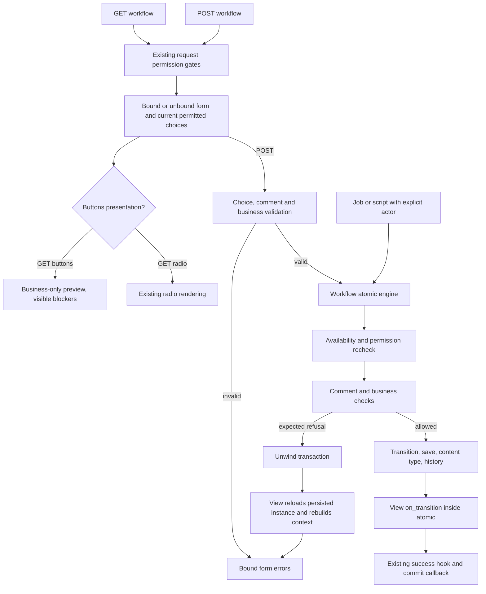

# Phase 06.13.1: Workflow validation and execution - Research

**Researched:** 2026-11-06
**Domain:** Django workflow validation, transaction lifecycle, server-rendered forms
**Confidence:** MEDIUM (official documentation cross-checked against installed source and focused regressions)

<user_constraints>
## User Constraints (from CONTEXT.md)

The following decisions and delegated responsibilities are copied verbatim from the phase context. [VERIFIED: 06.13.1-CONTEXT.md:23-113]

<!-- DATA_Q7m2V8kL_START -->
### Business-check inputs and presentation

- **D-01:** Business checks inspect existing model data only. Required-comment validation remains separate.
  Comment-dependent custom business rules are deferred. An initially empty required comment must not
  disable an otherwise available action.
- **D-02:** Show all blocker messages reported by the hook, preserving their order. Support Django
  `ValidationError` with a single message or list of messages. Do not invent a general error framework
  or promise support for field-keyed error dictionaries in this hook.
- **D-03:** Existing radio forms keep their presentation and show business errors after submission.
  Do not add pre-submit blocker displays or disable radio choices. Pre-submit disabled actions and
  visible explanations belong to the opt-in button presentation. Business validation applies to both modes.

### Public API

- **D-04:** Select presentation per view with `cv_transition_presentation = "buttons"`; default is `"radio"`.
  Applications can retain existing `WorkflowForm` subclasses. Do not require a separate buttons-form subclass
  or add a global setting as the selected opt-in mechanism.
- **D-05:** Export a standalone `run_transition(object, name, *, user, comment=None)` from
  `crud_views_workflow.lib`. Require an explicit actor and return the created `WorkflowInfo`.
  Do not add a parallel model execution method. Internal module placement and any necessary bounded
  transaction integration are planning details, not permission to change this public calling shape silently.
- **D-06:** The public model hook is `workflow_check_transition(self, name, *, user)` with a no-op default.
  It returns normally when allowed and raises `ValidationError` for business blockers. It has **no comment
  argument**. This deliberately supersedes the issue's proposed `comment=None` hook parameter, matching D-01.
  The hook must be side-effect-free and inexpensive; it may run repeatedly.

### Refusal and exception behavior

- **D-07:** The helper raises Django `SuspiciousOperation` for unknown, wrong-state, or unauthorized
  transitions. Preserve the view's existing execution-time security response. Do not add a new public
  `WorkflowTransitionUnavailable` exception. Check availability/permission before business validation;
  unauthorized actions must not expose blocker text. Existing form choice validation remains in force.
- **D-08:** Expected business-hook and required-comment refusals use `ValidationError`.
  In either presentation, attach all business-blocker messages to the `transition` field and missing-comment
  errors to `comment`. Use this placement both during form validation and for later execution-time refusals.
- **D-09:** Only errors originating from the business hook and comment checks become user-facing form errors.
  Exceptions from the transition method, object save, history creation, or `on_transition` propagate after
  rollback, **including `ValidationError` originating from those other operations**. A broad catch around
  execution that treats every `ValidationError` as a business refusal violates this decision. Research must
  identify a small, explicit way to preserve error origin without introducing a broad exception framework.
- **D-10:** On expected execution-time refusal, roll back before redisplaying the bound form. Preserve the
  entered comment, show relevant field errors, and produce no success redirect/message, state/history writes,
  or success commit callback. Rebuild rendering context from persisted state where necessary; database rollback
  alone does not restore mutated Python attributes. Account for protected FSM fields when reloading.

### Inherited issue requirements and prior decisions

- **D-11:** Preserve #320 / Phase 06.13 permission semantics: default page permission remains `change`,
  explicit per-transition rules remain independent, and page/parent/object gates stay at the request boundary.
  Re-run the opt-in permission regressions against the helper-integrated view. Preserve both basic no-steps
  behavior and optional `cv_action_enabled` request enforcement; do not impose an automatic any-step page gate.
- **D-12:** Buttons submit the chosen method name as `transition`, with no conflicting radio/hidden transition
  input or generic submit. Unknown or omitted names never select an implicit default or invoke arbitrary methods.
  State/permission-unavailable transitions remain omitted; business-blocked offered transitions remain visible
  and disabled. Existing FSM conditions retain their filtering semantics.
- **D-13:** Reuse #319's shared workflow form frame and established form ownership/theme conventions.
  Add `custom["help_text"]` support, separate from business-blocker messages. General transition guidance
  appears above the action group; comment help remains with the comment field. Required-comment buttons show
  an asterisk plus an accessible equivalent and a legend only when needed. Hide the visible comment wrapper
  when all offered transitions use `NONE`. Escape and translate visible text, use unique description IDs and
  accessible associations, and preserve no-transitions and normal/modal behavior. No workflow-specific JS is
  required. Do not adopt new `icon`/`variant` metadata APIs as part of this issue.
- **D-14:** The shared helper normalizes comments consistently (trim strings; empty becomes `None`), enforces
  `WorkflowComment`/`COMMENT_DEFAULT`, checks current availability/permission and business blockers before
  execution, calls the existing `by=user, comment=comment` transition convention, saves the object, and records
  complete `WorkflowInfo` including old/new state, actor, comment, return data, content type and stringified PK.
  The view uses the helper; form validation is not the only enforcement point.
- **D-15:** Preserve `on_transition` inside the rollback boundary and `context["workflow_info"]` for successful
  `cv_on_commit` callbacks. The workflow's own atomic boundary still applies when `cv_atomic=False`.
  Existing transaction semantics must not weaken as execution is extracted.
- **D-16:** The hook/persistence/history guarantees apply to the supported form/helper paths. Direct calls to
  decorated model transition methods do not automatically invoke the new hook, save the object, or record history.
  Document this boundary. Do not claim protection from concurrent stale-object transitions or external side effects.
- **D-17:** Keep implementation bounded and maintainable. Preserve proven paths, avoid unrelated core form-view
  refactors, and document unsupported cases. Add reference documentation and changelog entries; any Breaking
  entry before 1.0 also requires `docs/migrating-1.0.md`. Settle new public theme contracts before Phase 7's freeze.

### Research and planning responsibilities

- Resolve database-alias support by inspecting current `cv_get_db_alias()`, save, content-type, history, actor
  relations, and routed transaction tests. Keep participating writes on one supported transaction/database;
  document unsupported routing configurations. No cross-database atomicity or broad routing framework is authorized.
  The user selected discussion areas 1–3; no specific alias API or default-only restriction was approved.
- Determine the smallest workflow-specific recovery path for late refusals and the error-origin mechanism for D-09.
  If implementation requires changing a locked public contract, surface that conflict rather than silently expanding it.
- Internal module layout, template/context names, theme integration, test fixture organization, and database mechanics
  remain research/planning work. These are not new user decisions recorded by this discussion.
- Verify all issue acceptance criteria: `clean()` inheritance; valid, missing, invalid, forged and unavailable choices;
  initial/POST/late blockers; comment normalization/requirements; helper parity; full history identity; rollback/error
  origin/callback behavior; both presentations and custom forms; accessible escaped rendering and no-JS browser flow.
  Use multicore pytest for broad checks and report actual coverage and limitations.
<!-- DATA_Q7m2V8kL_END -->

### Deferred Ideas (OUT OF SCOPE)

<!-- DATA_T4p9N2rX_START -->
- Comment-dependent custom business rules, including their preview/submission semantics.
- Retain issue exclusions: concurrency control, cross-database atomicity, seed-history backdating, arbitrary direct-call
  enforcement, default-permission changes and a general action/validation framework are not part of this phase.
<!-- DATA_T4p9N2rX_END -->

[VERIFIED: 06.13.1-CONTEXT.md:207-211]
</user_constraints>

## Summary

Keep this change in the workflow extension. Extract the current write sequence into one internal engine, expose the exact locked public wrapper, and use a private expected-refusal subtype only around business/comment validation. Integrate the engine from the workflow view with an internal alias and callback so the existing transition hook stays inside the workflow transaction. This follows the existing write placement and avoids changing generic form processing. The current sequence is `cv_form_valid(context)` → `cv_form_valid_hook(context)` → `transaction.on_commit(...)`, followed unconditionally by a success redirect if processing returns. [VERIFIED: src/crud_views/lib/views/mixins.py:33-60]

Implement buttons through the form/widget rendering seam, preserving the existing field validation and form subclass constructor. Full-page and modal workflow rendering use different bodies, so a full-page-only template change is insufficient. The existing tests explicitly retain those branches, and the current action frame uses `cv_form_body` and `cv_render_form`. [VERIFIED: tests/test1/test_theme_form_requests.py:49-65] [VERIFIED: src/crud_views_workflow/templates/crud_views_workflow/view_workflow.action.html:1-19]

**Primary recommendation:** one workflow-specific engine, one private refusal type, one workflow-specific POST recovery branch, and an opt-in transition widget/layout using the existing owning form. These are planning recommendations, not shipped APIs.

## Architectural Responsibility Map

| Capability | Primary tier | Secondary tier | Planning responsibility |
|---|---|---|---|
| Page, parent, object and optional action gates | Django request boundary | Model permission rules | Preserve existing request authorization; helper does not recreate a request. |
| Availability, comment policy, business blockers | Model/service layer | Django form | Enforce in helper even if form validation was bypassed. |
| State/history and follow-up rollback | ORM transaction on one database | View callback | Bind every participating write and hook to the selected connection. |
| Errors and transition buttons | Server-rendered form | Browser native submission | Render current permitted choices; browser submits the chosen button name/value. |
| Success side effects | Existing commit hook | Application | Keep registration after successful workflow processing. |

The boundaries above derive from D-07–D-16 and the existing lifecycle. [VERIFIED: 06.13.1-CONTEXT.md:49-95] [VERIFIED: src/crud_views/lib/views/mixins.py:33-60]

## Project Constraints (from AGENTS.md)

The user-supplied AGENTS instructions mirror the repository CLAUDE guidance. Preserve proven paths, prefer the simplest bounded opt-in solution, and account for extra queries and cognitive cost. Use `cv_` for view attributes, `wf_` for transition methods, double quotes and a 120-character line length. Keep fixture naming consistent with the existing viewset/user/client conventions. Broad pytest runs use multicore workers; serial is justified only for tiny/debug selections. Build/version tooling stays unchanged. Public changes need changelog entries; `### Breaking` before 1.0 also requires migration documentation. After shipping, refresh codebase maps before later work. [VERIFIED: CLAUDE.md:15-27,64-68,110-128]

Project planning additionally requires preserving default rendering except intentional changes, no downstream project names in delivered files, and Python/JS/docs/lint gates before push. This research does not authorize pushing or implementation. [VERIFIED: .planning/PROJECT.md, Constraints]

## Phase Requirements

The roadmap currently says `**Requirements**: TBD`; no new authoritative requirement IDs were provided. Use D-01–D-17 and issue acceptance criteria for traceability until the orchestrator assigns IDs. Existing permission-phase IDs are regression obligations, not new phase IDs. [VERIFIED: .planning/ROADMAP.md:976-989]

## Standard Stack

Reuse the installed stack; no new dependency or upgrade is required by the recommended design. These are observed installed versions, not new version pins. [VERIFIED: 2026-11-06 importlib.metadata probe]

| Component | Installed | Registry observation, 2026-11-06 | Role |
|---|---|---|---|
| Django | 5.2.18 | Latest overall 6.1.3, published 2026-11-03; do not upgrade this phase | Forms, routing, transactions, content types |
| django-fsm-2 | 4.3.0 | 4.3.0, published 2026-10-28 | State/condition/permission filtering and transition metadata |
| django-crispy-forms | 2.7 | 2.7, published 2026-07-29 | Existing field/layout rendering |
| crispy-bootstrap5 | 2026.9 | 2026.9, published 2026-09-02 | Existing stock renderer |
| pytest | 9.2.0 | 9.2.0, published 2026-10-27 | Existing test runner |
| pytest-django / pytest-xdist | 4.14.0 / 3.8.0 | No upgrade proposed | ORM fixtures / four-worker execution |

Registry observations came from PyPI JSON responses; package names are already declared dependencies, not new install recommendations. Declared examples are `"django (>=4.2.0)"`, `"django-crispy-forms (>=2.0)"`, `"crispy-bootstrap5 (>=2023.10)"`, and `"django-fsm-2>=4.0.0"`. [VERIFIED: pyproject.toml:26-42] [VERIFIED: PyPI JSON API and installed metadata probes, 2026-11-06]

**Installation:** none. Package legitimacy audit is not triggered because no external package installation is planned. If a later plan adds one, run the legitimacy gate before approving it.

## Architecture Patterns

### Data flow



This diagram is a proposed implementation of the locked contract; it does not imply that standalone calls execute view hooks. [VERIFIED: 06.13.1-CONTEXT.md:40-47,85-95]

### Component responsibilities

| Component | Recommendation |
|---|---|
| Workflow model mixin | Add the no-op business hook; preserve the existing three-item availability tuple and form kwargs mapping. |
| New private workflow execution module | Own normalization, comment policy, expected-refusal marker and a single execution engine. Import history/content-type models lazily where needed. |
| Public workflow exports | Expose the exact locked wrapper through the existing lazy export mechanism. |
| Workflow form | Return cleaned data, apply business checking with existing owner context, retain field validation and custom fields. |
| Workflow view | Select presentation, pass internal execution integration, catch only expected refusal after unwind, rebuild context. |
| Workflow widget/template leaf | Render button choices, descriptions and blockers without introducing another form or conflicting inputs. |
| Existing test/browser infrastructure | Extend with negative and routed cases; do not retrofit permission semantics into Campaign. |

Existing source anchors: `actions.append((transition.name, label, comment))`; `kwargs["choices"] = choices`; `kwargs["transition_comments"] = transition_comments`. Preserve those shapes. [VERIFIED: src/crud_views_workflow/lib/mixins.py:94-122]

### Pattern 1: preserve origin using a private ValidationError subtype

Create a private subtype carrying the target field and original message list. Mint it only in a narrow `except ValidationError` around the business hook, and directly in the required-comment check. Do not put the transition method, save, content-type lookup, history creation or callback inside that catch. The public helper still raises a Django ValidationError subclass; applications do not import the private type. Catch only this private marker in the workflow POST recovery branch. This is the smallest recommended mechanism satisfying D-08/D-09. [VERIFIED: 06.13.1-CONTEXT.md:55-66]

Keep unsupported dictionary-shaped hook errors out of the friendly path: reject them clearly as hook misconfiguration, rather than flattening field names into invented messages. Preserve single/list ordering and parameter interpolation using Django ValidationError machinery. Django accepts ValidationError in `add_error` and removes that field from cleaned data, so do not read an errored field afterward without checking it. [CITED: https://docs.djangoproject.com/en/5.2/ref/forms/validation/]

Add an explicit negative test at each execution stage raising an ordinary ValidationError; all must propagate, roll back, and avoid friendly refusal handling. Keep the private marker internal and ensure wrapping occurs only at the hook/comment origin, not around the entire shared engine. [VERIFIED: 06.13.1-CONTEXT.md:58-66]

### Pattern 2: fixed public wrapper, private transaction integration

Keep the exact public signature `run_transition(object, name, *, user, comment=None)`. Internally delegate to one engine that accepts a selected database and an optional view callback. The view delegates to that same engine with its selected alias and a small callback invoking `on_transition`; there must be no second implementation of the transition/save/history sequence. Do not add public `using`, `on_transition`, context objects, or ambient ContextVar routing. Private engine parameters are explicitly within delegated planning scope. [VERIFIED: 06.13.1-CONTEXT.md:40-43,90-109]

Retain `object.workflow_has_transition(user, name)` as the execution recheck, before business validation and before unrestricted `getattr`. The existing permission test patches this method after proving a valid form and requires one execution-time call and HTTP `400`. Do not add an earlier form call to this same recheck that changes the tested late-revocation behavior. Use the form's current offered-choice collection for normal form eligibility, then this method inside execution. [VERIFIED: tests/test1/test_workflow_permissions.py:229-254; exact values `assert calls == [(obj.pk, actor.pk, "wf_process")]` and `assert response.status_code == 400`]

### Pattern 3: one supported database, with explicit limits

The generic alias selector is `return router.db_for_write(self.cv_viewset.model)`. The workflow currently opens `transaction.atomic(using=self.cv_get_db_alias())` but saves with `self.object.save()` and creates history/content type through unbound managers. Therefore merely extracting the current block would retain a routing gap. [VERIFIED: src/crud_views/lib/view/base.py:278-291] [VERIFIED: src/crud_views_workflow/lib/views.py:105-129]

Recommended bounded policy:

1. Standalone calls derive their alias from Django's write router with the instance hint. View calls preserve the selected view alias, pin it for engine/boundary/callback use, and supply it privately.
2. Support an already-persisted object and actor on that selected database, with history/content types available there. Validate unsupported split routing and actor mismatch before executing the transition. Do not silently substitute a same-PK user from another database or copy a loaded object onto another alias.
3. Explicitly bind object save, history manager and content-type manager to the selected connection. Keep content-type creation inside atomic. Use the manager-method binding API for `get_for_model`, not a QuerySet that loses custom manager methods.
4. Keep `on_transition` inside that atomic block even when the generic outer transaction is disabled. Application transition/hook writes must honor the same routing; external effects and other database writes are outside the guarantee.
5. Inspect and minimally align history readback with the same policy so a successful shard transition is visible on that object's next page. Do not leave history writes on one database while reading through a different default manager.

These are recommendations within the delegated database mechanics scope, not claims of arbitrary router support. Django documents per-connection transactions, manager database binding and the lack of cross-database FK support. Content-type IDs can differ between databases. [CITED: https://docs.djangoproject.com/en/5.2/topics/db/multi-db/] [CITED: https://docs.djangoproject.com/en/5.2/topics/db/transactions/]

The current workflow routed-atomic regression only observes the default alias, with `assert DEFAULT_DB_ALIAS in seen`; it does not prove a real second database succeeds or rolls back. Reuse the existing test databases `"default"` and `"shard"` and request-local routing fixture, then verify actual rows on both. Include colliding PKs to detect wrong actor/content-type identity. [VERIFIED: tests/test1/test_transactions.py:688-707] [VERIFIED: tests/test1/conftest.py:99-107,136-169]

### Pattern 4: unwind, then recover in WorkflowView.post

Adapt the small existing generic POST sequence in a workflow-specific override: load, build context, post hook, validate, then call `cv_form_valid_process`. Catch the private refusal around that call, after all nested atomics have unwound. Attach errors to the same bound form, reload a fresh persisted object on the selected database, rebuild object-derived context and button previews, call the invalid hook and invalid response. Preserve entered raw comment data; do not reconstruct it from cleaned data after errors. Skip valid hook, success message, callback registration and redirect. Leave generic core form processing unchanged. [VERIFIED: src/crud_views/lib/views/mixins.py:33-60,88-115,140-144]

A precedent for a local private-marker catch after the write lifecycle already exists in DeleteView. Follow its scope, not its deletion-specific state. [VERIFIED: src/crud_views/lib/views/delete.py:340-366; `except _NativeDeleteBlocked:`]

Reload by fetching a new instance through the authorized/scoped queryset on the pinned alias; replace `self.object` and rebuild context with the original bound form. Do not use plain `refresh_from_db()` on a potentially protected FSM instance and do not temporarily change protection on shared model fields. Django rollback does not reset Python attributes; django-fsm's protected descriptor rejects assignment. Installed-source inspection and a disposable probe produced `AttributeError: Direct state modification is not allowed`. [CITED: https://docs.djangoproject.com/en/5.2/topics/db/transactions/] [CITED: https://github.com/django-commons/django-fsm-2#protected-state-fields] [VERIFIED: installed django-fsm-2 4.3.0, FSMFieldDescriptor.__set__, lines 329-335; runtime probe 2026-11-06]

Do not fall back to an unrestricted manager if the scoped object disappears. Preserve ordinary missing-object/access handling. Clear old object-derived context and stale workflow-info keys rather than blending the failed context into fresh rendering. Caller-owned helper instances after unexpected failure remain the caller's responsibility; document reload requirements. [VERIFIED: 06.13.1-CONTEXT.md:63-66,93-95]

### Pattern 5: form compatibility and button rendering

Keep existing constructor kwargs unchanged. `WorkflowForm.__init__` currently requires `choices` and `transition_comments`, while its parent already receives `cv_view`. Use that existing owner context or post-construction private configuration for model/actor business validation; do not inject new required kwargs into every subclass. Preserve a subclass's `cleaned = super().clean()` behavior and its returned mapping. A form without an owning workflow object cannot establish business validation; document that unsupported context rather than silently claiming helper-equivalent enforcement. [VERIFIED: src/crud_views_workflow/lib/forms.py:46-70] [VERIFIED: src/crud_views/lib/crispy/form.py:40-42]

Prefer an opt-in ChoiceField widget/template that renders each choice as a submit button, retaining the field as the server allowlist. This preserves custom form fields and the normal crispy rendering boundary in both page/modal paths. Suppress only the default generic workflow submit in button mode; preserve Cancel and legitimate custom fields. Avoid deleting arbitrary layout nodes or replacing a subclass's entire helper. The helper is a fresh property value on every access, so mutating one temporary helper does not persist a layout change. [VERIFIED: src/crud_views/lib/crispy/form.py:44-69; `helper.layout = Layout(*fields, self.get_form_actions())`]

Build presentation from permitted metadata without changing the public tuple return shape. Render general guidance once above the group, per-action help separately from blocker lists, and required-comment legend only when an offered action needs it. Do not block buttons for empty initial comments. Keep the comment wrapper absent when all offered policies are NONE. Use owning form prefixes/field IDs plus a safe unique per-action suffix for description IDs; never derive IDs from translated labels. Preserve escaping for labels, comments, help and blockers. [VERIFIED: 06.13.1-CONTEXT.md:25-33,74-84] [CITED: https://docs.djangoproject.com/en/5.2/ref/forms/widgets/]

The enum is exactly `NONE = 0`, `OPTIONAL = 1`, `REQUIRED = 2`; the default is `COMMENT_DEFAULT: WorkflowComment = WorkflowComment.NONE`. Keep these meanings and normalize comments in the shared checks. [VERIFIED: src/crud_views_workflow/lib/enums.py:4-7] [VERIFIED: src/crud_views_workflow/lib/mixins.py:20-23]

Preserve full-page empty-state form omission and modal generic form behavior. Existing assertions require `422` for invalid modal POST and `200` for ordinary invalid POST. Do not redirect modal workflow rendering to the full-page history/action templates. [VERIFIED: tests/test1/test_theme_form_requests.py:166-197; `assert result.status_code == (422 if modal else 200)`]

## Don't Hand-Roll

| Problem | Use | Avoid |
|---|---|---|
| Transition security | Existing FSM state/condition/user filtering and workflow recheck | Arbitrary method dispatch from submitted strings |
| Form validation and messages | ChoiceField, ValidationError and add_error | Parallel error schema or manual form-error HTML |
| Rollback/callbacks | Django atomic and existing lifecycle hooks | Manual commit/rollback or success flags that still fall through |
| Presentation | Existing form ownership, widget/layout and class registry | Nested forms, a new JS submit protocol, global theme overrides |
| Recovery | Fresh scoped ORM fetch | Direct protected-state assignment or global descriptor toggling |

These reuse choices are grounded in the inspected implementation and locked boundaries. [VERIFIED: src/crud_views_workflow/lib/forms.py:24-39,46-70] [VERIFIED: src/crud_views_workflow/lib/views.py:97-135] [VERIFIED: 06.13.1-CONTEXT.md:74-109]

## Runtime State Inventory

This is a bounded extraction/refactor, not a rename. Inventory scope is repository and local test environment; no deployed services were inspected. [VERIFIED: task scope and local inspection, 2026-11-06]

| Category | Observed state | Required action |
|---|---|---|
| Stored data | History stores transition/state strings, actor FK, content-type FK and stringified object PK. [VERIFIED: src/crud_views_workflow/models.py:7-17] | Preserve schema and old history; no migration proposed. |
| Live service config | No renamed identifier or service deployment in this phase's locked scope. [VERIFIED: 06.13.1-CONTEXT.md:7-16,93-109] | No live-service mutation; deployed configuration remains uninspected. |
| OS-registered state | No renamed executable/service in the phase boundary. [VERIFIED: 06.13.1-CONTEXT.md:7-16] | None required; do not claim machine-wide audit. |
| Secrets/env vars | Presentation is per-view, with no global setting selected. [VERIFIED: 06.13.1-CONTEXT.md:37-39] | No secret/env rename. |
| Build artifacts | Current tests import working source using explicit PYTHONPATH. [VERIFIED: 312-test execution, 2026-11-06] | Final verification must use delivered source; no package reinstall required for this research. |

## Common Pitfalls

- **Friendly handling of every ValidationError:** masks defects in saves/transitions/history/hooks. Catch only the private marker minted by expected checks; negative-test each later stage. [VERIFIED: 06.13.1-CONTEXT.md:58-62]
- **Returning after add_error inside cv_form_valid:** still enters success hook/callback/redirect. Let the private marker unwind to workflow POST recovery. [VERIFIED: src/crud_views/lib/views/mixins.py:44-60]
- **Helper returns before on_transition is wrapped:** loses workflow atomicity with `cv_atomic=False`. Pass the callback privately into the engine's transaction. [VERIFIED: src/crud_views_workflow/lib/views.py:105-135]
- **Filtering blocked choices away:** loses explanations and changes forged POST into generic choice errors. Keep business-blocked permitted names in the allowlist. [VERIFIED: 06.13.1-CONTEXT.md:74-77]
- **Previewing radio mode:** adds unwanted work and presentation changes. Compute pre-submit blockers only for buttons. [VERIFIED: 06.13.1-CONTEXT.md:31-33]
- **Repeated business-check call-count tests:** rendering/form clean/execution can legitimately call the hook more than once. Assert security order and outcomes; use a phase-specific late-refusal trigger instead of brittle nth-call assumptions. [VERIFIED: 06.13.1-CONTEXT.md:44-47]
- **Passing new form kwargs:** breaks subclasses with explicit constructors. Retain owner-based wiring and add a regression subclass with the old signature and extra custom fields. [VERIFIED: src/crud_views_workflow/lib/forms.py:46-48] [VERIFIED: 06.13.1-CONTEXT.md:37-39]
- **History identity through default ContentType:** can associate a different content-type PK on another alias. Bind lookup and writes and test actual shard records. [CITED: https://docs.djangoproject.com/en/5.2/topics/db/multi-db/]
- **Default-only test called routed coverage:** the existing workflow atomic spy only checks a named default connection. Add real multi-database success and rollback tests. [VERIFIED: tests/test1/test_transactions.py:688-707]

## Code Examples

These are planning sketches, not shipped names or a complete patch. New private identifiers below are proposals. The public signature and field names are locked/source-grounded above.

```python
# Proposed private type; only expected checks may create it.
class _WorkflowRefusal(ValidationError):
    def __init__(self, field, error):
        self.field = field
        super().__init__(error)

# Catch only this call, not later mutation operations.
try:
    object.workflow_check_transition(name, user=user)
except ValidationError as error:
    if hasattr(error, "error_dict"):
        raise TypeError("Workflow business checks require message/list errors") from error
    raise _WorkflowRefusal("transition", error) from error
```

The proposed hook name/signature and exact field value `"transition"` are locked in D-06/D-08; dictionary rejection enforces D-02. [VERIFIED: 06.13.1-CONTEXT.md:28-30,44-47,55-57]

```python
# Proposed engine fragment, all within one transaction.atomic(using=alias).
object.save(using=alias)
content_type = ContentType.objects.db_manager(alias).get_for_model(object)
# Create WorkflowInfo through .objects.using(alias), retaining all existing fields.
# Invoke the optional private view callback before exiting the atomic block.
```

Manager database binding is Django's documented API. The current history construction is the field checklist: `transition`, `state_old`, `state_new`, `comment`, `user`, `data`, `workflow_object_pk`, `workflow_object_content_type`. Preserve `workflow_object_pk=str(self.object.pk)` and derive state after the decorated method. [CITED: https://docs.djangoproject.com/en/5.2/topics/db/multi-db/] [VERIFIED: src/crud_views_workflow/lib/views.py:107-129]

## State of the Art

No dependency upgrade or workflow engine replacement is needed. Current official django-fsm-2 documentation covers protected-state refresh through its optional FSMModelMixin, but requiring a new consumer base class is unnecessary for view recovery: fetch a fresh instance instead. Existing FSM conditions remain filtering predicates; this phase adds visible business refusal as a separate opt-in presentation concern. [CITED: https://github.com/django-commons/django-fsm-2#protected-state-fields] [VERIFIED: 06.13.1-CONTEXT.md:74-84]

## Environment Availability

| Dependency | Available observation | Fallback/action |
|---|---|---|
| Python test runtime | Python 3.12.3 / Django 5.2.18; focused test command below passed | Reuse existing nox environment |
| SQLite test databases | `"default"` and `"shard"`, both `":memory:"` | Use existing route fixture for real database tests |
| Node | v24.21.0 | Existing browser harness infrastructure |
| Cached Playwright | 1.64.1 | Reuse cached runtime; no installation proposed |
| Cached Chromium | Google Chrome for Testing 149.0.7827.55 | Browser binary available; browser acceptance not executed in research |
| Context7 | MCP not available; `ctx7` CLI lookup returned no executable | Official documentation via web fallback |

[VERIFIED: 2026-11-06 runtime/metadata/version probes] [VERIFIED: tests/test1/conftest.py:99-107]

No missing runtime blocks planning. A phase-specific browser fixture/scenario is still required; existing runtime availability is not UI acceptance. [VERIFIED: research scope and executed command inventory, 2026-11-06]

## Validation Architecture

### Test framework and proven commands

Framework: pytest 9.2.0, pytest-django 4.14.0, pytest-xdist 3.8.0. Configuration includes `addopts = "--strict-markers"`; Django setup is in the test conftest. [VERIFIED: installed metadata probe] [VERIFIED: pyproject.toml:145-146] [VERIFIED: tests/test1/conftest.py:43-133]

Executed in research, **312 passed in 14.49 seconds** with four workers:

```bash
PYTHONPATH=src:. .nox/tests-3-12-django-5-2/bin/pytest tests/test1/test_workflow.py tests/test1/test_workflow_permissions.py tests/test1/test_transactions.py tests/test1/test_theme_form_ownership.py tests/test1/test_theme_form_requests.py tests/test1/test_form_buttons_golden.py tests/test1/test_import_safety.py -n 4 -q
```

[VERIFIED: pytest execution output, 2026-11-06]

Use that proven under-30-second regression command during planning/execution. For the final phase gate, run the existing full-suite command with the same runtime and explicit source path:

```bash
PYTHONPATH=src:. .nox/tests-3-12-django-5-2/bin/pytest tests -n 4
```

The full suite was **not run in research**. Do not record it as passed. Include broader supported Django version checks, docs, formatting/lint and JS regressions at execution gate according to project policy; report the actual matrix exercised. [VERIFIED: research command inventory, 2026-11-06] [VERIFIED: .planning/PROJECT.md, Constraints]

### Phase behavior → test map

No requirement IDs have been invented. All new scenarios below are Wave 0/implementation work, not existing coverage claims.

| Trace | Behavior and meaningful failure direction | Type / location recommendation | Command |
|---|---|---|---|
| D-01–D-03, D-06, D-08 | clean return usable by subclass; ordered single/list blockers; custom fields/kwargs preserved; radio GET no previews; initial required comment does not block | Form + request, extend workflow tests | Proven focused command above |
| D-05, D-07, D-14 | Standalone success has exact signature, explicit actor, normalized comments, complete history; missing/unknown/arbitrary/wrong-state/forbidden names cannot dispatch | Helper unit/ORM, extend workflow tests | Proven focused command above |
| D-09, D-10, D-15 | Hook refusal before execution and late refusal after valid form; no state/history/message/redirect/callback; raw comment preserved; fresh protected-FSM context | Transaction + request, extend workflow/transaction tests | Proven focused command above |
| D-09, D-15 | Ordinary ValidationError and another exception separately from transition, save, history, on_transition; rollback with outer atomic on/off | Transaction, extend transaction tests | Proven focused command above |
| D-11 | Existing default change gate, per-step permissions, basic empty page and optional request denial, original execution recheck | Existing permission/workflow tests; rerun unchanged | Proven focused command above |
| D-12, D-13 | One submit value per clicked button; no duplicate input/generic submit; blocked forged POST rejected; conditions/permissions omitted; all-none wrapper absent | DOM/request + browser | Focused command for DOM; add bounded browser command |
| D-13 | Normal/modal invalid status, owning form/CSRF, custom frame, Cancel and custom fields, escaping/description IDs | Existing theme test extensions | Proven focused command above |
| Database scope | Actual shard success/rollback/readback; correct actor and content-type with colliding PKs; unsupported splits reject before transition | ORM multi-database tests using existing fixture | Proven focused command above |
| D-16, D-17 | Direct decorated calls remain outside helper guarantee; docs signature and boundaries; lazy import remains safe | Docs/import/source-linked examples | Focused command plus strict docs build |

### Browser/no-JS acceptance

Add a bounded disposable local fixture using existing browser harness conventions. Run a real browser context with JavaScript disabled for the complete normal page flow: select either of multiple actions, submit required/whitespace comment failures, display initial and late blockers, preserve comment on error, then execute an allowed step and verify server history. Test malicious label/help/blocker/comment text as text, disabled visible reasons, description associations, unique IDs, keyboard use and narrow layout. Test modal behavior separately with its existing JS lifecycle; do not claim no-JS modals. Scope browser assertions to the owning form so sibling forms do not contaminate control/CSRF counts. [VERIFIED: 06.13.1-CONTEXT.md:74-84,110-113] [VERIFIED: tests/test1/test_theme_form_requests.py:69-85]

### Wave 0 gaps and sampling

- Add focused helper/business/refusal/button scenarios to workflow tests; keep prior permission tests intact.
- Add a protected-FSM recovery fixture and true shard tests, including split-route pre-execution rejection.
- Add browser fixture/scenarios and runnable no-JS command; existing Python checks do not establish click/keyboard/overflow behavior.
- Per task: relevant focused selectors, widening to the proven command after integration. Per wave: the focused group plus newly added tests. Phase gate: full Python suite, relevant matrix, docs/JS/lint and recorded browser evidence.

These are plan obligations, not claims of completed implementation or verification.

## Security Domain

Security enforcement and Nyquist validation are enabled in config: `"security_enforcement": true`, `"security_asvs_level": 1`, `"nyquist_validation": true`. [VERIFIED: .planning/config.json:20-50]

Use ASVS **5.0.0** names rather than silently mixing the older template's category numbers. The official release is dated 2025-05-30. Applicable primary categories are V1 Encoding and Sanitization, V2 Validation and Business Logic, and V8 Authorization. Authentication/session behavior is inherited; no new cryptography is introduced. [CITED: https://asvs.owasp.org/] [CITED: https://raw.githubusercontent.com/OWASP/ASVS/v5.0.0/5.0/en/0x10-V1-Encoding-and-Sanitization.md] [CITED: https://raw.githubusercontent.com/OWASP/ASVS/v5.0.0/5.0/en/0x11-V2-Validation-and-Business-Logic.md] [CITED: https://raw.githubusercontent.com/OWASP/ASVS/v5.0.0/5.0/en/0x17-V8-Authorization.md]

| Threat | STRIDE | Planned control |
|---|---|---|
| Forged transition name / re-enabled disabled control | Tampering / privilege elevation | Choice allowlist plus execution-time state/user recheck before getattr/business hook |
| Unauthorized blocker disclosure | Information disclosure | Never preview or validate business rules for an unauthorized transition |
| Cross-database actor/history confusion | Spoofing / tampering | One selected database, explicit managers/save, actor consistency and split-route refusal |
| Partial state/history or false success | Tampering / repudiation | Workflow atomic engine, private expected-refusal origin and success-lifecycle bypass |
| HTML in labels/help/errors/comment | Tampering | Contextual Django escaping and malicious-string DOM tests |
| Cross-site workflow submission | Tampering | Existing page-owned CSRF token and middleware, preserve enforce-CSRF request tests |

These controls implement the phase scope; they are not a certification claim. Do not expand into concurrency controls, arbitrary direct-call enforcement or distributed transactions. [VERIFIED: 06.13.1-CONTEXT.md:93-109,207-211] [VERIFIED: tests/test1/test_theme_form_requests.py:172-197]

## Assumptions Log

No training-only factual claims are used as locked decisions. Internal type/module/widget choices above are explicit recommendations in delegated areas, not new public promises. No extra user confirmation is required for those bounded choices. [VERIFIED: 06.13.1-CONTEXT.md:100-109]

## Open Questions

1. **Exact private integration names and widget/class/template surface:** settle in plans and document before the theme freeze. Keep public signatures unchanged; no conflict currently requires reopening D-01–D-17.
2. **Precise unsupported-routing diagnostic:** choose an ordinary configuration/programmer-error exception and test it before transition side effects. It must not become a business error or invite cross-database copying.
3. **Forms with wholly custom helper/layout overrides:** preserve radio compatibility and custom fields; prove the supported button seam with at least one explicit constructor/clean/layout subclass. Document any override that bypasses the new widget/default action owner.
4. **Browser fixture command:** must be created in execution and reported honestly; available cached browser runtimes are confirmed, but no phase browser acceptance has run.

These are bounded planning details already delegated by the context, not missing product decisions. [VERIFIED: 06.13.1-CONTEXT.md:100-113]

## Sources

- Primary repository evidence: workflow forms/mixins/views/exports/history model; generic form lifecycle and alias selection; crispy form/action owner; page/modal theme tests; permission regression; transaction regression; project/context/roadmap/reference docs, all opened this session.
- Issue scope retrieved with gh: https://github.com/jacob-consulting/django-crud-views/issues/322 ; prior contracts https://github.com/jacob-consulting/django-crud-views/issues/319 and https://github.com/jacob-consulting/django-crud-views/issues/320 . Treat issue examples as subordinate to locked D-06.
- Official Django 5.2 documentation: transactions, multi-db, form validation, content types and widgets, linked inline.
- Official django-commons/django-fsm-2 documentation, cross-checked against installed 4.3.0 descriptor/filter/transition implementation.
- OWASP ASVS 5.0.0 release and official category files, linked inline.
- PyPI registry JSON and local installed metadata/version commands, 2026-11-06; no packages installed.

## Metadata

Research-plan seam selected Context7 for three questions; neither MCP nor CLI was available. Official web fallback was used and three source digests were cached. `classify-confidence --provider websearch --verified` returned `MEDIUM`; use that conservative overall tier. Local facts additionally carry exact source/test provenance. Graph status returned `exists: false`; no graph relationships were inferred. Configured researcher skills returned an empty list; no project-local skill directory was discovered. [VERIFIED: research/init/graph/agent-skills tool outputs, 2026-11-06]

| Area | Confidence | Evidence |
|---|---|---|
| Standard stack | MEDIUM | Installed metadata, declared dependencies, registry observations; no upgrade proposed |
| Architecture | MEDIUM | Current source, locked decisions, official docs; design not implemented yet |
| Pitfalls | MEDIUM | Source counterexamples, protected-field probe and 312 passing baseline tests |

**Valid until:** recheck after workflow/core lifecycle changes or dependency changes; otherwise 2026-12-06.
**Research only:** no production implementation, full suite, browser acceptance, deployment audit or expanded support guarantee is claimed.
