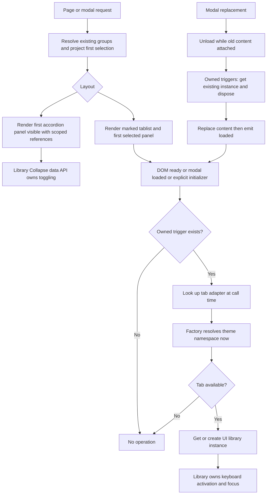

# Phase 06.17: Object-detail accordion initial state and tab adapters — Research

**Researched:** 2026-11-07
**Domain:** Django template presentation, Bootstrap-compatible adapters, real-browser lifecycle verification
**Confidence:** MEDIUM (official-document fallback tier returned by the research confidence seam)

<user_constraints>
## User Constraints (from CONTEXT.md)

The following three blocks are copied verbatim from the phase context. They are authoritative scope, not newly inferred requirements. [VERIFIED: 06.17-CONTEXT.md, Implementation Decisions and Deferred Ideas, read this session]

### Locked Decisions

<!-- DATA_7c1a29e0_START -->
### Accordion initial state — issue D15

- **D-01:** Server-render exactly the first accordion group open, reusing `presentation.selected` from
  the existing first-group projection. This is internal presentation data, not a configurable
  `selected` field on group configuration. Do not derive selection from an inner template loop.
- **D-02:** The selected button has expanded styling and `aria-expanded="true"`; its panel has the
  visible collapse state. Other buttons/panels retain collapsed styling and `aria-expanded="false"`.
  Preserve component-scoped IDs, `aria-controls`, `aria-labelledby`, and the shared-parent accordion.
- **D-03:** Opening another group closes the previous one; users can close the open group so all are
  collapsed. Apply the same initial state to full pages and newly loaded modal content. Do not add
  JavaScript solely to open the first panel. Independent components retain independent state.
- **D-04:** Preserve the standalone `render_group` one-group projection: its selected group starts
  open. Cover multiple groups, one group, and no groups without introducing invalid references.
- **D-05:** No configurable initial group, start-collapsed option, open-all mode, or persistence across
  reloads. Consumers put the most useful group first.

### Tab adapters — issue D17

- **D-06:** Expose `cv.adapters.tab.init(element)` and `cv.adapters.tab.dispose(element)` through the
  existing `cv.bootstrapAdapters(namespaceOrProvider)` factory. Stock Bootstrap keeps the existing
  default invocation. Compatible themes use the same factory with their namespace/provider.
- **D-07:** Resolve the namespace on every adapter call. Initialization uses
  `Tab.getOrCreateInstance(element)`; absent Tab is a no-op. Never call `show()` or take focus during
  initialization. Do not capture an unavailable component at asset-load time.
- **D-08:** Disposal uses `Tab.getInstance(element)?.dispose()`. An absent component/instance is a
  no-op. Never construct a tab instance during cleanup. Do not silently suppress errors thrown by a
  present theme adapter/component.
- **D-09:** Remove direct `globalThis.bootstrap` access from object-detail `tabs.js`; dispatch through
  the tab adapter. Do not add a hard-coded Tabler fallback, global Bootstrap alias, or namespace registry.
  Preserve existing adapter override and asset-loading conventions.

### Lifecycle, ownership, and accessibility

- **D-10:** Preserve public, repeat-safe `cv.initObjectDetailTabs(root=document)` for custom insertion.
  Initialize on DOM ready and `cv:modal:loaded`, including existing ready-document behavior. Dispose
  on `cv:modal:unload` while old content is still attached and before replacement; initialize new content.
- **D-11:** Target only triggers owned by marked `data-cv-od-tabs` tablists. Retain root-element handling
  and nested-tablist boundaries. Unmarked/native layouts must not initialize/dispose unrelated tabs;
  no owned triggers remains a no-op. Repeated initialization must not duplicate handlers.
- **D-12:** Keep keyboard navigation, activation, and panel switching owned by the UI library; add no
  custom key handler. Preserve initial first-tab selection, focus behavior, and panel `tabindex`
  conventions. Missing-Tab no-op compatibility does not promise keyboard-operable fallback tabs.

### Acceptance, documentation, and scope limits

- **D-13:** Verify server-rendered accordion classes/ARIA, references, multiple/single/empty groups,
  standalone rendering, and independent component identity/state. Real browser coverage must show
  switching closes the prior panel and closing all is possible on pages and modal content.
- **D-14:** Test factory defaults, supplied objects/providers, late namespace resolution, missing Tab,
  repeat initialization, cleanup without construction, error propagation, and dispatch only to owned
  triggers. Preserve no-op, nested boundaries, and unrelated library tabs.
- **D-15:** Prove compatibility with a Bootstrap-compatible namespace named `tabler` and **no
  `globalThis.bootstrap`**. A real Bootstrap component exposed under that name is sufficient;
  no new Tabler dependency or downstream theme release/adoption commit is required. Clicking alone
  is insufficient because the existing data API can hide missing initialization.
- **D-16:** Real browser acceptance covers ArrowUp/ArrowDown wrapping and Home/End activation for
  stock vertical tabs, consistent ARIA and tab stops, no focus stealing on insertion, page/modal
  lifecycles, old-instance disposal before replacement, new-content initialization, and repeat safety.
- **D-17:** Update the adapter contract/factory examples, object-detail layout docs, and copied
  accordion recipes. Document custom theme adapters and retain the custom-insertion initializer recipe.
  Record the changed accordion default and copied-template migration in both `CHANGELOG.md` and
  `docs/migrating-1.0.md`; document custom-adapter migration needed for the new tab entry.
- **D-18:** Run focused JavaScript, rendering/accessibility, browser, and relevant documentation checks.
  Use multicore pytest for broad Python runs. Report actual verification limits; source assertions or
  jsdom mocks do not establish real-library keyboard/modal acceptance.
- **D-19:** Developer maintainability is a hard constraint: extend the existing factory and lifecycle
  with the smallest bounded change. No replacement of Bootstrap data attributes, accordion JS rewrite,
  generic tab framework, layout redesign, second adapter lifecycle, or changes to other adapters.
- **D-20:** Phase 06.16 precedes this for scheduling only; no hard dependency on #327 or #329. Preserve
  its value-rendering contracts and Phase 06.15 group selection without adopting unrelated work.
  Downstream application changes are not completion requirements. Finish before Phase 7 freezes the
  affected surface. Requirement IDs remain to be assigned during planning.
<!-- DATA_7c1a29e0_END -->

### Builder Discretion

<!-- DATA_f81b326a_START -->
Choose minimal helper placement, fixtures, browser harness reuse, and test organization. Follow existing
override/loading conventions and document supported limits. Do not reopen initial accordion selection,
open-all, persistence, adapter shape, keyboard ownership, or modal lifecycle. Ask only if new code
evidence reveals a material conflict, naming the evidence and affected decision.
<!-- DATA_f81b326a_END -->

### Deferred Ideas (OUT OF SCOPE)

<!-- DATA_93d2b6f1_START -->
- #329 header-icon suppression remains separate. #327 value rendering was completed in Phase 06.16.
- Configurable accordion selection, start-collapsed/open-all modes, persistence, custom keyboard behavior,
  and generic tab/theme frameworks were rejected for this scope, not promised as future deliverables.
- No pending todos matched. No new capability was added during this handoff.
<!-- DATA_93d2b6f1_END -->
</user_constraints>

## Summary

Use the existing first-group projection, change the accordion group template's three initial-state attributes/classes, add one tab entry to the existing adapter factory, and replace the two direct component lookups in the object-detail initializer. The existing projection already uses `index == 0`; the tab initializer already owns traversal and page/modal lifecycle. Preserve those paths. [VERIFIED: src/crud_views_object_detail/lib/presentation.py:55-82, `index == 0`; src/crud_views_object_detail/static/crud_views_object_detail/js/tabs.js:14-57]

The larger planning obligation is acceptance evidence and migration documentation. Existing browser acceptance assumes initially collapsed accordions and preflights the Bootstrap global. It renders accordion fixtures on expanded pages, while modal content remains vertical tabs. Extend that harness rather than creating another browser system. Existing copied-template tests also assert the old collapsed state. [VERIFIED: tests/browser/presentation.cjs:94-109,241-250, `globalThis.bootstrap?.Tab.VERSION === '5.3.3'` and `'second-accordion-stays-collapsed'`; tests/browser/presentation_server.py:150-164, `context["object_detail_layout"] = "native" if native_theme.get() else "tabs-vertical"`; tests/test1/test_presentation_migration_docs.py:69-77, `assert control.get("aria-expanded") == "false"`]

**Primary recommendation:** keep production work to the template, existing adapter factory, and existing initializer; spend the remaining work on focused regression coverage, bounded fixture extensions, and executable migration recipes. This follows D-01, D-06, D-09, D-13–D-19. [CITED: 06.17-CONTEXT.md#implementation-decisions]

## Architectural Responsibility Map

| Capability | Primary tier | Secondary tier | Rationale / source |
|---|---|---|---|
| First accordion group, IDs, ARIA | Django server rendering | Browser Collapse component | Server already projects first-group selection; library owns subsequent transitions. [VERIFIED: presentation.py:55-82, `index == 0`; CITED: https://getbootstrap.com/docs/5.3/components/accordion/] |
| Namespace/component resolution | Browser adapter factory | Theme wiring | Existing factory resolves providers at call time. [VERIFIED: src/crud_views/static/crud_views/js/adapters.js:7-8,67-124] |
| Owned-trigger discovery and insertion lifecycle | Browser object-detail script | Core modal events | Preserve ownership traversal and existing hooks. [VERIFIED: src/crud_views_object_detail/static/crud_views_object_detail/js/tabs.js:14-57] |
| Keyboard activation and tab state | UI library | Server initial markup | Constructor installs keyboard handling; activation changes ARIA/focus. [CITED: https://github.com/twbs/bootstrap/blob/v5.3.3/js/src/tab.js] |
| Disposal before replacement | Core modal emitter, object-detail subscriber | Tab adapter | Unload precedes replacement; loaded follows it. [VERIFIED: src/crud_views/static/crud_views/js/modal.js:90-96, `els.content.innerHTML = html;`] |
| Proof and copied-template migration | Existing test harnesses and docs | Disposable loopback fixture | Scope explicitly requires browser and copied-recipe verification. [CITED: 06.17-CONTEXT.md, D-13–D-18] |

## Project Constraints (from AGENTS.md)

AGENTS.md is the repository's CLAUDE.md symlink, read this session. Apply these actionable directives:

- Keep the solution understandable, bounded, explainable and maintainable by the developer. Preserve proven paths; avoid additional abstractions, hidden state, extra queries and cross-cutting changes without demonstrated need. Document unsupported cases. [VERIFIED: CLAUDE.md:15-30]
- Use multicore pytest for broad runs; a bounded worker count is permitted when sharing resources. Explain serial exceptions and do not interrupt an already-running verification merely to change worker count. [VERIFIED: CLAUDE.md:129-135]
- Preserve naming conventions: quoted source values are `cv_`, `list`, `detail`, `create`, `update`, `delete`, `workflow`, `manage`, and workflow prefix `wf_`; fixture conventions use `cv_<model>`, `user_<model>_<permission>`, `client_user_<model>_<permission>`. [VERIFIED: CLAUDE.md:135-142]
- Keep double quotes and 120-character Python formatting; use existing Ruff tooling, hatchling build, bump-my-version version management, and existing ruff-format commit hook. No version bump is needed merely to plan this phase. [VERIFIED: CLAUDE.md:34-61,143-146; CITED: 06.17-CONTEXT.md, D-19]
- Pair a `### Breaking` changelog entry with the migration guide until 1.0.0. [VERIFIED: CLAUDE.md:147, `### Breaking` and `docs/migrating-1.0.md`]
- After a ship workflow, refresh codebase maps before subsequent work. If a phase worktree is requested, use the documented workspace workflow and phase-number branch convention, reusing an existing worktree when possible. This research does not create or switch branches. [VERIFIED: CLAUDE.md, GSD Workflow section; CITED: parent research assignment]
- Preserve existing permission mappings and sibling-aware ViewSet behavior; this presentation phase has no permission, resolver or value-rendering change. [VERIFIED: CLAUDE.md:141, `list/detail→view, create→add, update→change, delete→delete`; CITED: 06.17-CONTEXT.md, D-19–D-20]

No project skill directories or configured researcher skill entries were returned by the discovery commands. The graph status reported no graph, so no semantic graph evidence is used. These are session observations, not promises about other environments. [VERIFIED: session skill discovery, agent-skills and graphify status outputs]

<phase_requirements>
## Phase Requirements

The roadmap currently says `**Requirements**: TBD`. Assign IDs during planning; do not silently reuse completed prior-phase IDs. [VERIFIED: .planning/ROADMAP.md:1103-1111, `**Requirements**: TBD`]

| Acceptance group, pending assigned ID | Research support |
|---|---|
| D-01–D-05, D-13: first-open accordion | Existing immutable first-group projection; template-only initial state; page/modal browser toggling |
| D-06–D-09, D-14: tab factory | Existing provider resolution and shallow merge; constructor-free cleanup; present errors propagate |
| D-10–D-12, D-15–D-16: ownership/lifecycle/accessibility | Keep traversal, events and initializer; extend real-browser fixtures for alternate namespace, cleanup and focus |
| D-17–D-20: docs/regression/bounded scope | Executable copied recipes, adapter-map migration, multicore commands, paired release/migration notes |

These acceptance groups are derived directly from the copied decisions above; their eventual IDs belong to the planner. [CITED: 06.17-CONTEXT.md]
</phase_requirements>

## Standard Stack

**Use the existing stack; install no new package.** No Tabler dependency or dependency upgrade is required by this phase. [CITED: 06.17-CONTEXT.md, D-15 and D-19]

| Existing component | Observed version | Role / provenance |
|---|---|---|
| Bootstrap fixture assets | 5.3.3 | Real Tab/Collapse components. Source declares `bootstrap@5.3.3`; browser asset gate passed. [VERIFIED: tests/test1/app/templates/app/base.html:13-19; session browser receipt] |
| Python / Django | 3.12.3 / 5.2.18 | Working nox environment, importing current source. [VERIFIED: session import probe and browser receipt] |
| pytest / pytest-xdist | 9.2.0 / 3.8.0 | Rendering, identity, docs and asset tests with four workers. [VERIFIED: session import probe and 165-test run] |
| Node | 24.21.0 | Existing JS and browser commands executed successfully. [VERIFIED: session node version and test outputs] |
| Vitest / jsdom | 5.0.3 / 30.1.2 installed | Existing unit harness. Manifest asks for newer patch floors; do not describe installed versions as the manifest's resolved latest. [VERIFIED: package.json and session package.json probes] |
| Playwright / Chromium | 1.64.1 / 149.0.7827.55 | Cached existing browser runtime, eight baseline cases passed. [VERIFIED: session browser receipt] |
| MkDocs | 1.6.1 | Strict docs build executed successfully. [VERIFIED: session version/build outputs] |

These are **tested installed/pinned versions**, not claims that they are the latest releases. Registry/package-legitimacy installation gates are not applicable because the recommendation installs nothing. Any later dependency installation is a scope change requiring the normal legitimacy gate first. [CITED: parent bounded assignment; 06.17-CONTEXT.md, D-15, D-19]

## Architecture Patterns

### System Architecture Diagram



The flow preserves existing server projection, owned-trigger discovery and modal event ordering; only the adapter dispatch and initial accordion state change. [VERIFIED: presentation.py:55-82; tabs.js:14-57; modal.js:90-96; CITED: 06.17-CONTEXT.md]

### Component Responsibilities

File names below identify existing source read this session, not proposed new architecture.

| Existing seam | Planned responsibility |
|---|---|
| Accordion group template | Use selected flag for button collapsed class, expanded ARIA, panel show class; preserve all other markup. |
| Core adapters factory | Add tab init/dispose alongside existing adapters; reuse component/provider helper and default merge. |
| Object-detail tab script | Replace component access with adapter dispatch; retain root/nested ownership, repeat setup guard, public initializer and event hooks. |
| Presentation/templatetag Python | Preserve projection and standalone path; tests protect them without a new Python API. |
| Presentation browser harness/server/templates | Add bounded accordion modal fixture and alternate-namespace scenario; extend assertions without changing production contracts. |
| JS, rendering and copied-doc tests | Extend existing suites; no second test framework. |

Sources: [VERIFIED: src/crud_views_object_detail/templates/crud_views_object_detail/layouts/accordion/group.html:1-33; src/crud_views/static/crud_views/js/adapters.js:7-8,67-124; src/crud_views_object_detail/static/crud_views_object_detail/js/tabs.js:5-57; src/crud_views_object_detail/templatetags/crud_views_object_detail.py:48-69; tests/browser/presentation_server.py:97-165]

### Pattern 1: selection is projection, not mutable configuration

The projection's verbatim constructor is:
<!-- DATA_a2c9763f_START -->
```python
entries.append(GroupPresentation(group, f"{base}-{suffix}-control", f"{base}-{suffix}-panel", index == 0))
```
<!-- DATA_a2c9763f_END -->
[VERIFIED: src/crud_views_object_detail/lib/presentation.py:71]

Standalone rendering uses `presentation = _project_component([group], scope=scope).groups[0]`; it does not create an enclosing component. Preserve the conditional parent attribute so standalone rendering never references an absent accordion root. Empty group lists generate no group controls/panels. [VERIFIED: src/crud_views_object_detail/templatetags/crud_views_object_detail.py:39-43,61-68; accordion/group.html:18, `data-bs-parent="#{{ component.id }}"`; accordion/object_detail.html:3-5, ``]

### Pattern 2: preserve adapter override semantics

The source factory retains early overrides through:
<!-- DATA_409aa83f_START -->
```javascript
cv.adapters = Object.assign(cv.bootstrapAdapters(() => globalThis.bootstrap), cv.adapters || {});
```
<!-- DATA_409aa83f_END -->
[VERIFIED: src/crud_views/static/crud_views/js/adapters.js:124]

Keep this shallow, per-adapter merge. A post-load whole-map replacement discards defaults; it will not acquire the new tab entry automatically. Update the complete-map recipe and tell compatible themes to take the tab entry from the same factory. Early partial maps and individual-entry overrides must keep working. [VERIFIED: docs/reference/javascript.md:53-84; adapters.js:124]

**Delegated implementation recommendation:** model missing adapter-entry handling on the existing tooltip initializer: if the tab adapter entry itself is absent, return without library access. If present, call its required init/dispose methods directly and let errors propagate. Require both methods in the documented custom-tab contract; distinguish missing adapter/map, missing Tab component, missing instance, and a broken present adapter in tests. This bounded choice preserves harmless omitted adapters without inventing fallbacks or silently hiding actual failures. [VERIFIED: src/crud_views/static/crud_views/js/tooltip.js:20-29, `const tooltip = globalThis.cv?.adapters?.tooltip;` and `if (!tooltip) {`; CITED: 06.17-CONTEXT.md, D-07–D-09, delegated helper choices]

Document that a missing entry yields no object-detail initialization/cleanup, **not functional keyboard fallback**. An explicit late adapter replacement needs the existing public initializer to initialize already inserted content; do not add polling or another readiness event. [CITED: 06.17-CONTEXT.md, D-10, D-12, D-17, D-19]

### Pattern 3: retain lifecycle and ownership boundary

The selector definitions are exactly:
<!-- DATA_cb098e24_START -->
```javascript
const ownedList = "[data-cv-od-tabs]";
const tablist = '[data-cv-od-tabs], [role="tablist"], .nav, .list-group';
const trigger = '[data-bs-toggle="tab"], [data-bs-toggle="pill"], [data-bs-toggle="list"]';
```
<!-- DATA_cb098e24_END -->
[VERIFIED: src/crud_views_object_detail/static/crud_views_object_detail/js/tabs.js:10-12]

Preserve inclusion of a marked root itself and the nearest-tablist comparison. Keep the no-owned-trigger return before adapter lookup. Do not flatten nested tablists or initialize every Bootstrap trigger in the document. Browser evidence should keep unrelated instances untouched; unit tests should assert exactly which elements reach the adapter. [VERIFIED: tabs.js:14-27,36-40; CITED: 06.17-CONTEXT.md, D-11, D-14]

## Don't Hand-Roll

| Problem | Don't build | Use instead / rationale |
|---|---|---|
| First accordion visibility | JS opening pass, extra selected configuration | Existing server projection and template conditions; locked D-01–D-05. |
| Namespace variants | Global alias, fallback chain or registry | Existing factory and provider function; locked D-06–D-09. |
| Tab accessibility | Custom key handling or focus manager | Real library initialization; locked D-12 and official Tab source. |
| Cleanup | New instance registry or second lifecycle | Existing unload event plus library getInstance/dispose; locked D-08, D-10. |
| Browser infrastructure | New dependency stack or downstream deployment | Existing disposable server and cached real browser; D-15 permits exposing real Bootstrap as tabler. |
| Copied recipe checks | Text-only assertions for behavior | Existing docs fence extraction and real template render pipeline. |

[CITED: 06.17-CONTEXT.md; https://github.com/twbs/bootstrap/blob/v5.3.3/js/src/tab.js; https://github.com/twbs/bootstrap/blob/v5.3.3/js/src/base-component.js]
[VERIFIED: tests/test1/test_presentation_migration_docs.py:26-77]

## Runtime State Inventory

This is a bounded adapter refactor plus presentation/default migration, not a stored-data or package rename. Inventory is limited to the owned repository and disposable harness; no downstream systems were inspected. [CITED: parent assignment; 06.17-CONTEXT.md, D-19–D-20]

| Category | Items found / evidence | Required action |
|---|---|---|
| Stored data | No persistent data field changes in the affected template/JS/projection seams. Harness creates `tempfile.TemporaryDirectory(prefix="dcv-presentation-")` and a disposable database. [VERIFIED: tests/browser/presentation_server.py:45-48] | No data migration. Preserve fixture cleanup. |
| Live service config | No external service change in locked scope; downstream theme adoption explicitly excluded. External deployed configuration not audited. [CITED: D-15, D-20] | Document custom adapter migration; no remote patch. |
| OS-registered state | No OS registration in the affected source; browser harness starts its own subprocess and reaps it. This is not a machine-wide service audit. [VERIFIED: presentation.cjs:405-409,450-467] | Preserve owned subprocess cleanup and reserved-port checks. |
| Secrets/env vars | Harness runtime selection and port variables remain unchanged; no secret names are being renamed. [VERIFIED: presentation.cjs:2,14,396-407, `CV_PRESENTATION_PORT`, `CV_FOCUS_NODE`, `CV_FOCUS_PYTHON`, `CV_FOCUS_PLAYWRIGHT`, `CV_FOCUS_CHROMIUM`] | Pass explicit interpreter when needed. No credential operation. |
| Build artifacts / copied assets | Consumers may have copied accordion templates and manually assembled adapter maps. Both are explicit migration targets. Existing bundling supports registered extension scripts. [VERIFIED: docs/reference/javascript.md:59-71; object_detail_layout_packs.md:111-125,189-208; assets.md:68-129] | Update copied recipes and rebuild consumer bundles through normal deployment; no repository-wide artifact rename or downstream delivery requirement. |

## Common Pitfalls

1. **Clicking does not prove initialization.** Bootstrap's click data API creates tab instances itself; its window-load hook initializes active tabs. Therefore even first-keyboard behavior on an ordinary initial page can hide some missing initialization. Assert an instance for **every** owned trigger, including inactive ones, before any interaction, and exercise inserted modal/custom content before clicking. [CITED: https://github.com/twbs/bootstrap/blob/v5.3.3/js/src/tab.js]

2. **The old browser accordion loop will close the first panel.** It currently clicks every control then waits for that panel to be shown. Change it to verify initial first-open state, open a different panel, verify previous closes, close the selected panel, and verify all collapsed. Confirm sibling accordion state independently. [VERIFIED: tests/browser/presentation.cjs:241-250]

3. **Modal accordion coverage does not exist merely because page accordions exist.** Expanded stock page markup renders two accordions, but the view's selected layout is vertical tabs. Add an explicit fixture route/query choice that carries accordion content through the real modal response. Retain tab fixtures and their current coverage. [VERIFIED: tests/browser/templates/presentation/stock.html:12-18; presentation_server.py:97-103,150-164, `cv_object_detail_layout = "tabs-vertical"`]

4. **Removing the global too late is weak evidence.** Arrange the alternate namespace before object-detail initialization; keep the Bootstrap global absent through page/modal interactions. Assert the real constructor's version through the selected namespace and retain CDN integrity checks. Bootstrap's own data API listeners remain legitimate library behavior. [CITED: D-15; VERIFIED: presentation.cjs:65-116, `globalThis.bootstrap?.Tab.VERSION === '5.3.3'`]

5. **Disposal after detachment misses the lifecycle contract.** Observe disposal with old trigger references while connected, then assert getInstance returns null on those old elements after replacement and that new elements have instances. Use test-local observing wrappers that delegate to real methods, not mocks replacing the component. [VERIFIED: src/crud_views/static/crud_views/js/modal.js:90-96; CITED: D-08, D-10, D-16]

6. **Broad ownership guarantees apply to our dispatcher.** Keep direct calls restricted to owned triggers. Bootstrap's internal child discovery is its own behavior; do not promise arbitrary nested library layouts are supported or rewrite its implementation. Test the existing nearest-tablist boundary and unrelated library instances. [VERIFIED: tabs.js:14-20; CITED: https://github.com/twbs/bootstrap/blob/v5.3.3/js/src/tab.js; D-11, D-19]

7. **Direct OD file pytest selection fails before collection.** The direct command reproduced:
<!-- DATA_e492d501_START -->
```text
django.core.exceptions.ImproperlyConfigured: Requested setting USE_I18N, but settings are not configured.
```
<!-- DATA_e492d501_END -->
Use parent-directory collection with filename-family selection, verified below. Do not change production code or conftest to fix a research command. [VERIFIED: session failed command; tests/test1/od/conftest.py:1-5; tests/test1/conftest.py:43-51]

8. **Old explicit rendering assertions must be updated deliberately.** Identity tests require every accordion button collapsed and every panel hidden; the icon-host test also includes the collapsed class for a single group. Update their intended state expectations while preserving escaping, icon ownership and ID assertions. [VERIFIED: tests/test1/od/test_object_detail_identity.py:85-88,104-120, `{"accordion-button", "collapsed"}`, `assert control.get("aria-expanded") == "false"`, `assert "show" not in panel.classes`]

9. **Do not overwrite historical browser evidence.** The harness default output still targets Phase 06.5. Always supply an explicit phase-local output during execution. Research baseline used a temporary output. Output is created by `fs.mkdirSync(path.dirname(output), {recursive: true});` then `fs.writeFileSync(output, JSON.stringify(report, null, 2) + '\\n');`. [VERIFIED: tests/browser/presentation.cjs:31,470-477]

## Code Examples

These are implementation prescriptions derived from the locked decisions, not claims that the new adapter already exists.

### Minimal factory entry

Use the existing component helper with the same per-call namespace resolution:
<!-- DATA_a915d0b4_START -->
```javascript
tab: {
    init(el) { component(ns, "Tab")?.getOrCreateInstance(el); },
    dispose(el) { component(ns, "Tab")?.getInstance(el)?.dispose(); },
},
```
<!-- DATA_a915d0b4_END -->
New entry/method names are quoted verbatim in scope: `cv.adapters.tab.init(element)`, `cv.adapters.tab.dispose(element)`, `Tab.getOrCreateInstance(element)`, `Tab.getInstance(element)?.dispose()`. [CITED: 06.17-CONTEXT.md, D-06–D-08; VERIFIED: src/crud_views/static/crud_views/js/adapters.js:7-8, `function component(ns, name)`]

Do not catch component or provider errors. Optional chaining is only on absent component/instance, not a catch around present behavior. [CITED: D-07–D-08]

### Initial accordion state

Replace only the relevant attribute fragments with the following proposed expressions:
<!-- DATA_f3810e9c_START -->
```django
class="accordion-button collapsed {{ icon.host_class }}"
aria-expanded="truefalse"
class="accordion-collapse collapse show"
```
<!-- DATA_f3810e9c_END -->
Existing literal sources are `accordion-button collapsed`, `aria-expanded="false"`, `accordion-collapse collapse`, and `presentation.selected`; the new visible class is the documented Bootstrap `show`. [VERIFIED: accordion/group.html:5-16; src/crud_views_object_detail/templates/crud_views_object_detail/layouts/tabs-vertical/group.html:2; CITED: https://getbootstrap.com/docs/5.3/components/accordion/; D-01–D-02]

### Theme integration

Retain the exact public recipe:
<!-- DATA_5c10d8a3_START -->
```javascript
Object.assign(cv.adapters, cv.bootstrapAdapters(() => globalThis.tabler));
```
<!-- DATA_5c10d8a3_END -->
[VERIFIED: docs/reference/javascript.md:82-84]

For a complete map replacement, add the factory's tab entry alongside existing entries, or provide both methods on a custom tab adapter. Keep custom insertion documented through `cv.initObjectDetailTabs(root=document)`. [CITED: D-06, D-10, D-17; VERIFIED: docs/reference/javascript.md:59-71; object_detail_layout_packs.md:119-125]

## State of the Art

| Existing behavior | Phase target | Why |
|---|---|---|
| Accordion initially collapsed | Server-selected first group open | Settled default change D-01–D-05 |
| Direct Bootstrap Tab lookup in extension | Existing factory's tab adapter | Settled namespace boundary D-06–D-09 |
| Four-entry documented factory | Include tab entry and migration for complete map replacements | Settled public documentation D-17 |
| Existing eight tab browser cases | Preserve them and add accordion/alternate-namespace/disposal assertions | Acceptance D-13–D-16 |

This is a project contract change, not a library-version migration. Existing behavior was read from the source and docs cited above; targets come from the locked context. [VERIFIED: adapters.js:67-124; tabs.js:29-47; accordion/group.html:5-18; CITED: 06.17-CONTEXT.md]

## Environment Availability

All probes below ran in this checkout on the research date. The successful browser baseline proves its loopback server, authenticated fixture, cached browser and required CDN assets were available together at that time. [VERIFIED: session /tmp/phase0617-browser-baseline.json]

| Dependency | Available | Observed location / fallback |
|---|---|---|
| Current-source Python tests | Yes | Interpreter used in commands below; source forced by PYTHONPATH. |
| JS unit harness | Yes | Existing local Vitest installation; no npx download. |
| Real browser | Yes | Harness auto-discovered cached Playwright and Chromium; overrides available through existing environment variables. |
| CDN Bootstrap/jQuery/font assets | Yes during baseline | Asset/SRI gate passed; a later network failure must be reported as infrastructure failure, never replaced with mock acceptance. |
| Strict docs builder | Yes | Existing virtualenv MkDocs, explicit command below. |
| Context7 MCP / ctx7 CLI | Not found | Used official Bootstrap/OWASP web sources; no installation needed. |

[VERIFIED: session executable/package probes, browser receipt and documentation build; tests/browser/presentation.cjs:38-52,65-116,396-403]

The browser receipt reports Playwright at `/home/alex/.npm/_npx/e41f203b7505f1fb/node_modules/playwright` and Chromium at `/home/alex/.cache/ms-playwright/chromium-1228/chrome-linux64/chrome`. These are observed cache locations, not repository-created paths or portable installation contracts; prefer harness discovery or explicit overrides rather than embedding them in production. [VERIFIED: session browser runtime receipt]

**Missing dependencies with no fallback:** none for the scoped checks executed. **Missing with fallback:** documentation lookup provider only. Full supported Python/Django matrix and other browsers were not executed during research. [VERIFIED: session command history]

## Validation Architecture

### Test Framework

| Property | Value |
|---|---|
| Python harness | pytest 9.2.0, xdist 3.8.0; parent conftest configures Django |
| JS harness | Existing Vitest 5.0.3 with jsdom 30.1.2 |
| Browser harness | Existing Node/Playwright driver and disposable Django server |
| Docs | Existing executable fence tests plus strict MkDocs |
| Configuration | Existing pyproject pytest settings and Vitest configuration, preserved |

[VERIFIED: session runtime probes; tests/test1/conftest.py:43-51; pyproject.toml:145-146; vitest.config.js, `environment: "jsdom"`, `include: ["tests/js/**/*.test.js"]`]

### Verified Baseline Commands

Run from the repository root. These exact commands passed against current source during research; they prove harness availability and existing behavior, not the future change.

```bash
node node_modules/vitest/vitest.mjs run tests/js/adapters.test.js tests/js/object-detail-tabs.test.js
```
Result: **58 passed**, two files, 1.31 seconds; existing Vite config-loader warning is nonfatal. [VERIFIED: session output]

```bash
PYTHONPATH="$PWD/src" .nox/tests-3-12-django-5-2/bin/python -m pytest tests/test1 -k 'test_layout_packs or test_layout_a11y or test_object_detail_identity or test_presentation_assets or test_presentation_migration_docs' -n 4 -q
```
Result: **165 passed**, 5.63 seconds. Four workers bound shared resource use. [VERIFIED: session output]

```bash
CV_FOCUS_PYTHON="$PWD/.nox/tests-3-12-django-5-2/bin/python" node --test tests/browser/presentation-config.test.cjs
```
Result: **14 passed**, including both launchers' reserved/invalid-port rejection. [VERIFIED: session output]

```bash
CV_FOCUS_PYTHON="$PWD/.nox/tests-3-12-django-5-2/bin/python" node tests/browser/presentation.cjs --case tabs --output /tmp/phase0617-browser-baseline.json
```
Result: **8 real browser cases passed**; browser closed, fixture exited with code zero, subprocess reaped. Current-source package path confirmed by harness. This baseline does not claim new accordion, alternate-namespace or disposal-observer acceptance. [VERIFIED: session browser receipt]

```bash
PYTHONPATH="$PWD/src" .venv/bin/mkdocs build --strict --site-dir /tmp/phase0617-docs-baseline
```
Result: strict build passed in 1.23 seconds. [VERIFIED: session output]

### Phase Requirements → Test Map

IDs await planning. Each row traces to locked decisions rather than inventing requirements.

| Pending requirement group | Behavior | Test type | Command / existing test seam |
|---|---|---|---|
| D-01–D-05 | Exactly first group open, one/zero groups, standalone, independent IDs/state | Rendering/accessibility | Verified Python command; extend layout/identity/a11y suites |
| D-06–D-09, D-14 | Default/object/provider namespaces; delayed resolution; absent map/component/instance; errors; override merge | JS unit | Verified focused JS command; extend adapters suite |
| D-10–D-12, D-14 | Owned roots/nesting, no-op, public repeat init, loaded/unload dispatch | JS unit/integration | Same JS command; extend object-detail tab suite |
| D-13, D-15–D-16 | Page/modal toggling; real alternate namespace; keyboard/ARIA/focus; disposal before replacement | Real browser | Extend existing harness, then run all cases with phase-local output |
| D-17 | Correct copied recipe and complete-map migration | Executable docs | Verified Python copied-recipe selection; JS executes relevant factory snippets |
| D-18–D-20 | Existing regressions and scoped source binding | Suite / docs | Broad commands below and strict docs |

[CITED: 06.17-CONTEXT.md; VERIFIED: tests/js/object-detail-tabs.test.js; tests/js/adapters.test.js; tests/test1/test_presentation_migration_docs.py:26-77; tests/browser/presentation.cjs:140-253]

### Browser Extension Acceptance

Prescribe these bounded additions; they are still to be implemented:

1. Parameterize the real namespace scenario and make preflight verify that selected real component, preserving asset status/hash/SRI checks. Establish the alternate namespace before initializer dispatch and verify the Bootstrap global is absent throughout.
2. Check all owned instances before interaction, including inactive tabs. Verify one navigation action after repeated initialization produces one expected activation; a three-tab fixture can make unintended multiple moves easier to observe.
3. Before/after initializer calls, compare active element and selection. On inserted modal content distinguish the existing modal shell's focus policy from tab initialization; observe that the initializer itself does not take focus.
4. Wrap the real disposal method in test code to record connected old elements; keep old references through real HTTP replacement. Check their instances gone, new instances present, and page siblings/unrelated tabs retained.
5. Add accordion page/modal layout fixtures and assert initial first-open, switch closes previous, selected close permits all collapsed, and independent sibling state. Wait for transition completion, not merely a click or early class update.
6. Keep existing tab panel-stop/links cases, empty/native no-ops, reserved-port safety, source hashes, console errors and subprocess cleanup. Update exact case counts only after adding concrete cases.

[CITED: D-13–D-16; https://github.com/twbs/bootstrap/blob/v5.3.3/js/src/tab.js; https://getbootstrap.com/docs/5.3/components/accordion/; VERIFIED: presentation.cjs:118-198,377-477]

### Sampling Rate and Phase Gate

- Per relevant task: focused JS and/or Python command above (both under 30 seconds observed).
- Per wave: run the broader affected suites; retain four workers for Python when sharing this machine.
- Before phase verification: full JS suite, full Python suite with source binding, extended browser all-cases receipt, executable docs and strict docs.

Broader commands are executable with the observed installed runtime but **were not run during research**:
```bash
node node_modules/vitest/vitest.mjs run
PYTHONPATH="$PWD/src" .nox/tests-3-12-django-5-2/bin/python -m pytest tests -n 4 -q
CV_FOCUS_PYTHON="$PWD/.nox/tests-3-12-django-5-2/bin/python" node tests/browser/presentation.cjs --case all --output .planning/phases/06.17-object-detail-open-the-first-accordion-group-and-initialize/06.17-browser-results.json
```
The final output path is a **proposed phase-local artifact**, created by the existing output writer; it is not claimed to exist yet. [VERIFIED: presentation.cjs:29-31,470-477, `'tabs'`, `'all'`, `fs.writeFileSync(output, JSON.stringify(report, null, 2) + '\\n');`; CITED: D-18]

### Wave 0 Gaps

No framework installation required. Extend existing tests for:
- all first-open accordion states, including copied recipes and standalone groups;
- factory tab entry and missing-map/component/instance distinctions;
- owned adapter dispatch and visible present-adapter errors;
- real alternate-namespace preflight/initialization/cleanup;
- actual modal accordion response;
- observable disposal while attached and repeat safety;
- adapter-before-initialization asset order and complete-map docs migration.

These are acceptance gaps in the inspected baseline, not newly added product scope. [VERIFIED: existing suites and harness cited above; CITED: D-13–D-18]

## Security Domain

Security enforcement is enabled in project workflow configuration. Use current ASVS category names with an explicit version: the generic older V2-authentication/V3-session table would mislabel ASVS 5.0.0, whose V3 is Web Frontend Security. [VERIFIED: .planning/config.json, `"security_enforcement": true`; CITED: https://asvs.owasp.org/; https://raw.githubusercontent.com/OWASP/ASVS/v5.0.0/5.0/en/0x12-V3-Web-Frontend-Security.md]

| Applicable control area | Applies to this phase | Standard control |
|---|---|---|
| ASVS 5.0.0 V3 Web Frontend Security, text rendering | Yes | Preserve Django escaping and existing hostile-title/value/attribute tests; do not add JS HTML rendering. |
| External asset integrity | Existing fixture behavior | Retain versioned assets and SRI preflight; no new CDN/package. This is existing harness protection, not a claim of whole-application ASVS certification. |
| Authentication, session management, authorization | No new control in this scoped change | Preserve existing authenticated view fixture and permission code; do not treat visibility as authorization. |
| Cryptography | No new crypto operation | Reuse existing libraries and transport; no custom crypto. |

[CITED: OWASP V3 source above; 06.17-CONTEXT.md, D-19–D-20; VERIFIED: tests/test1/od/test_object_detail_identity.py:71-93; tests/test1/test_presentation_migration_docs.py:40-105; tests/browser/presentation.cjs:65-116]

| Threat | STRIDE | Bounded mitigation |
|---|---|---|
| Hostile titles/classes become markup | Tampering | Keep autoescape, escaped copied recipes and existing hostile-context assertions. |
| Broad dispatcher modifies unrelated components | Tampering / availability | Preserve nearest-list ownership and no-op outside marked triggers. |
| Repeated setup or leaked detached handlers | Availability | Existing guard, repeat-safe getOrCreateInstance, getInstance-only disposal, real replacement checks. |
| Hidden adapter errors imply false acceptance | Availability | Propagate present-adapter errors; browser receipt requires no page/console errors. |

[VERIFIED: tabs.js:5-57; presentation.cjs:437-439; CITED: 06.17-CONTEXT.md, D-08, D-11, D-14, D-16]

## Assumptions Log

No new product assumptions are required: the implementation prescriptions stay within the settled decisions and explicitly delegated test/helper choices. Source and runtime observations are tagged above. No claim of deployed downstream behavior, latest dependency versions, cross-browser certification, assistive-technology acceptance, full-matrix success or future CDN availability is made. [CITED: 06.17-CONTEXT.md; VERIFIED: session command history]

| # | Claim needing user confirmation | Risk |
|---|---|---|
| — | None identified within settled scope | No additional approval checkpoint is proposed. |

## Open Questions

1. **Requirement IDs:** planner assigns IDs to the acceptance groups; current roadmap intentionally says TBD. [VERIFIED: .planning/ROADMAP.md:1109, `**Requirements**: TBD`]
2. **Execution evidence:** new browser cases and future implementation tests remain pending. The baseline establishes available infrastructure only. [VERIFIED: session outputs]
3. **Missing adapter entry:** use the documented no-op-at-absent-entry recommendation above, require both methods when present, and lock it through tests/docs as a routine delegated implementation detail. No material conflict with settled decisions was found. [CITED: D-07–D-09, D-17, builder discretion; VERIFIED: tooltip.js:20-29]

## Sources

### Primary repository and runtime evidence

- Phase context, roadmap Phase 06.17, PROJECT, REQUIREMENTS, STATE, CLAUDE/AGENTS, prior Phase 06.16 context and maintainability decision note: scope and constraints.
- Source files, docs and tests cited at each finding were opened with numbered output this session; the available filesystem tool is shell reading rather than a dedicated Read tool.
- Session commands and temporary browser receipt: installed versions, current-source binding, 58 JS / 165 Python / 14 Node harness checks / 8 browser cases / strict docs baseline.

### Official external references (MEDIUM provider tier)

- https://github.com/jacob-consulting/django-crud-views/issues/328 — authoritative settled handoff; read using authenticated GitHub CLI after web retrieval.
- https://getbootstrap.com/docs/5.3/components/navs-tabs/ — supported public tab operations and accessibility guidance.
- https://getbootstrap.com/docs/5.3/components/accordion/ — initial show state, parent behavior, transition completion.
- https://github.com/twbs/bootstrap/blob/v5.3.3/js/src/tab.js — version-matched constructor, key handler, click/load data API.
- https://github.com/twbs/bootstrap/blob/v5.3.3/js/src/base-component.js — stored instance identity and disposal.
- https://asvs.owasp.org/ — current version and category-version reference guidance.
- https://raw.githubusercontent.com/OWASP/ASVS/v5.0.0/5.0/en/0x12-V3-Web-Frontend-Security.md — actual browser control category.

### Research lookup limitations

Research-plan returned Context7 for Bootstrap questions and websearch for security. Neither Context7 tools nor ctx7 CLI were available, so official web documentation and tagged upstream source were fetched directly. The confidence seam returned MEDIUM for websearch with official verification; digests were cached with that tier. Unrecognized codebase/webfetch provider labels return LOW in this installed seam, so they were not used to inflate external authority. Local direct source and test observations retain explicit factual provenance rather than pretending to be registry-backed package confidence. No package installation was proposed or performed. [VERIFIED: session research-plan, classify-confidence and research-store outputs]

## Metadata

| Area | Confidence | Reason |
|---|---|---|
| Existing stack | MEDIUM | Working installed runtime verified; no latest-version or full-matrix claim |
| Architecture | MEDIUM | Direct source reads plus locked decisions; new implementation still pending |
| Pitfalls | MEDIUM | Existing test failure reproduced; browser baseline and version-matched library source checked |

**Research date:** 2026-11-07
**Revalidate:** before execution if affected source, dependency environment or harness changes; external runtime/cache availability is session-local.
**Files changed by this task:** this research document only; production/tests and branch remain unchanged.

