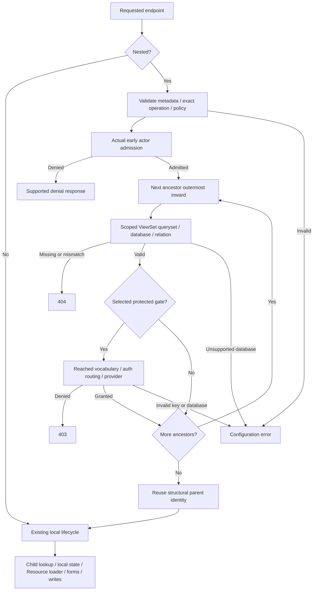

# Phase 06.18: Ancestor authorization for nested ViewSets - Research

**Researched:** 2026-11-07
**Domain:** Django CBV lifecycle, nested ORM authorization, Guardian extension, strict configuration
**Confidence:** MEDIUM overall; source-read findings distinguished from implementation recommendations.

<user_constraints>
## User Constraints (from CONTEXT.md)

The following sections are copied verbatim from the approved context. The context calls its locked section “Implementation Decisions”; builder discretion is included within that section rather than a separate discretion heading. [CITED: .planning/phases/06.18-ancestor-authorization-for-nested-viewsets/06.18-CONTEXT.md]

<!-- DATA_7f39a2c1_START -->
## Implementation Decisions

### Shared scope and ownership — D-01–D-05, D-10, D-19, D-21, D-29/D-39, D-52

- Both plain and permission-required nested endpoints participate. Ancestor success never waives a local
  gate; local success never waives ancestry. A plain child may deliberately have no local permission gate.
- Validate all declared FK and supported M2M relationships in either cascade mode, including create and
  unprotected ancestors. Unexpressible/ambiguous relationships are configuration errors, not exemptions.
- Resources may be leaves beneath ORM ancestors. Authorize the ORM chain before Resource loading; the
  application retains responsibility for scoping Resource collection/object loading from URL kwargs.
  A Resource parent is invalid. Top-level endpoints retain their existing path without ancestor work.
- Authorization covers the URL path, not every membership or write effect. Shared-object edits, ordinary
  deletion and valid editable-parent FK moves keep their normal semantics; destination authorization,
  field pinning and domain restrictions remain application-owned. This boundary needs tests in both modes.

### Public API and configuration scopes — D-06–D-07, D-14, D-16–D-18, D-26, D-33, D-35–D-37, D-41

- Export `AncestorPolicy` and `AncestorPermissions` from `crud_views.lib.viewset`. Give each ViewSet a fresh
  default `ancestor_policy`. These are typed validated configuration values, without execution methods,
  actor/grant/object state, or mutation during resolution. Core must work without Guardian installed.
- `AncestorPermissions` requires complete named string fields `nearest` and `higher`. Resolve each through
  the selected ancestor's permission map. Overrides replace a whole pair; no partial merge or None sentinel.
- Exact policy fields/defaults: `provider=None`, `accept_global_perms=False`, `cascade=None`, `read=None`,
  `write=None`, and a fresh empty `actions` dictionary keyed by the exact registered endpoint key.
- Provider/fallback describe the owning ViewSet when it is an ancestor. Cascade/read/write/actions describe
  requests targeting the owning ViewSet, independently of ancestor request settings.
- Global settings are `CRUD_VIEWS_ANCESTOR_PERMISSION_CASCADE=True`,
  `CRUD_VIEWS_ANCESTOR_READ_PERMISSIONS={"nearest": "view", "higher": "view"}`, and
  `CRUD_VIEWS_ANCESTOR_WRITE_PERMISSIONS={"nearest": "change", "higher": "view"}`.
  Settings accept complete mappings without a ViewSet import. No global provider/fallback/actions map.

### Providers and cascade — D-03, D-06–D-10, D-15, D-18, D-20–D-21, D-26, D-41

- Core defaults to model permissions; Guardian defaults to strict object permissions. `provider=None` means
  the class default. Only explicit `provider="none"` skips that level's permission gate.
- A none level remains subject to existence/relationship checks and does not consume the nearest-protected
  position. Full cascade checks all protected ancestors; nearest-only checks the nearest protected one.
  Denial never tries a farther ancestor as a substitute. All-none chains still validate relationships.
- Requested ViewSet cascade overrides the global in either direction. Ancestor cascade cannot stop a
  descendant's traversal. Neither mode is a total opt-out or a legacy execution mode.
- Guardian uses its content-type semantics and direct/group grants. Ancestor `accept_global_perms=True`
  permits the required model grant OR object grant. Endpoint `cv_guardian_accept_global_perms` remains
  separate; neither flag defaults or overrides the other. Preserve backend superuser semantics, subject
  to the explicit inactive-actor denial.

### Operation classification — D-05, D-11–D-17, D-27, D-31, D-45–D-46, D-48–D-49

- Read defaults to view/view; Write to change/view. Opening create/update/delete forms is already Write;
  HTTP method does not classify the operation. Child deletion requires nearest ancestor change by default.
- Use the finite family table in v2: list/card/detail/rich detail/polymorphic detail, built-in child redirect
  and manage are Read; create/update/delete/polymorphic creation/type selection/ordered actions are Write.
  Formset fragments inherit the owning editor's operation. Preserve subclasses and renamed registered keys.
- Generic actions, object/no-object custom forms, workflow and other unclassified nested endpoints require
  exact action entries, including all-none chains and both modes. A key named detail or local view permission
  does not classify an arbitrary action. Top-level custom endpoints need no declaration.
- Exact registered action entries replace the family pair. Card/list navigation aliasing remains unchanged,
  but alias existence is not literal registration. Card-only accepts card and rejects unregistered list;
  when both exist their overrides stay independent. Registration as list is valid when actually literal.
- Nested manage requires ancestry plus its unchanged local settings/group gate. Child redirect authorizes
  before lookup/redirect; its destination independently authorizes its own request.

### Validation and structural safety — D-07, D-17, D-28, D-29/D-39, D-33, D-36, D-44, D-47–D-48, D-51, D-53

- Reject unknown fields/providers, coerced boolean inputs, incomplete pairs, None components, empty or
  whitespace-padded permission keys, invalid action pairs and explicit incomplete global mappings.
- Reject Guardian provider on core ViewSet and true fallback on a non-Guardian provider. On top-level
  ViewSets reject non-None cascade/read/write and nonempty actions; explicit None/empty defaults remain valid.
- Construction-time constraints use Pydantic validation and must fail before registry insertion or automatic
  manage-view creation. Failed declarations leave existing entries intact and allow corrected-name retry.
- Check action registration after registry completion, with runtime guards. Preserve valid forward parent
  references until ancestry is needed. Detect cycles/missing references before unsafe URL construction or
  other supported walks; system checks alone run too late for URLconf import.
- Structural checks query no model, ContentType, Permission or grant tables. Selected permission vocabulary
  resolves only at a reached gate. Missing keys and database errors never become weaker fallback or success.
  Use Django system-check errors and `ImproperlyConfigured` guards at the stages specified by v2.

### Request sequence and responses — D-03–D-05, D-10, D-15, D-30, D-32, D-42–D-43, D-51

1. Validate static policy, operation and ancestry; choose protected levels without object/permission queries.
2. Apply protected ancestry's actor rules and preserve actual endpoint early admission denials, including
   all-none ancestry. Do not call child/state-loading permission hooks to discover actor admission.
3. Resolve ancestors outermost inward through their ViewSet querysets; validate existence and relationship.
4. Immediately evaluate each reached selected permission gate before resolving any deeper ancestor.
5. Continue remaining endpoint-local permissions, child lookup, state, Resource loading, forms/fragments,
   hooks and writes only after ancestry succeeds.

- Protected ancestry gives anonymous actors the requested endpoint's supported response, defaulting to login
  redirect even for plain views without AccessMixin. Preserve configured Guardian anonymous 403/404 behavior.
  Protected ancestry denies authenticated inactive actors, including inactive superusers, with 403.
- Active authenticated ancestor denial yields 403. Reached missing/excluded/mismatched ancestors yield 404.
  An outer denied gate prevents deeper queryset calls. Nearest-only still validates higher existence/relations.
- Preserve genuine endpoint early denials even for all-none, without adding restrictions to public plain,
  anonymous-permitting backend or public-manage paths. PermissionRequiredMixin inheritance alone does not
  establish actual anonymous admission. Never dispatch an ancestor view or execute its state hooks.

### Querysets, identity, database and cost — D-02–D-03, D-16, D-20–D-22, D-25, D-32, D-51

- Call `ancestor_viewset.get_queryset(view=requested_child_view)` with the real child view/request/kwargs.
  Resolve each configured ancestor URL PK; preserve manager/ViewSet scope and validate relationships.
  Never retry excluded rows through an unfiltered manager or inherit ancestor endpoint queryset overrides.
- Reuse the resolved immediate structural parent's model/PK/database identity for create attachment,
  parent-state checks and supported request helpers, even when that parent is none and a farther one gates.
- Wave one supports default only for nested ORM ancestors, ORM child data and relevant auth records.
  Reached nondefault queryset/router selections fail without stripping/overriding `.using(...)` or rerouting.
  Explicit default works. Top-level database behavior and application-owned Resource loading stay unchanged.
- Use request-local state; no persistent access/object/ancestry cache. Reuse resolved objects/checkers where
  practical while retaining independent local gates. Revocation must apply on the next request.
- Measure one-/three-level plain and Guardian list/object/create paths against baseline in both modes.
  Explain repeated work; no invented fixed budget. Top-level does no ancestor work; nearest-only performs
  no higher permission evaluation, while full relationship/visibility reads remain necessary.

### Migration, helpers and diagnostics — D-19, D-21–D-22, D-28, D-34, D-40–D-41, D-45, D-49–D-52

- Remove `cv_guardian_parent_permission` and `cv_guardian_parent_create_permission`; reject explicit constructor
  and subclass declarations, even old defaults/None. Do not mistake removed framework defaults for user use.
  No silent translation, second traversal implementation or invented nested-create model-add fallback.
- Explain core-parent model versus Guardian-parent object defaults and both possible access changes.
  Retaining object protection requires a Guardian parent. Explain fallback independence across descendants.
- Migrate existing immediate-parent helper checks using that parent's provider/fallback and the target
  operation's nearest requirement. None skips only its gate, retaining actor/state/custom denials; rendering
  does not traverse farther. Preserve unavailable/False behavior when context cannot be established, and
  surface invalid configuration. Do not guess an M2M parent from ambiguous child-only input.
- Supported request helpers reuse resolved parent identity. Outside requests, retain existing bounded
  immediate-parent resolution without new full-chain navigation queries. Visible links may lead to denial.
- Manage reports declared ancestor policy/depth/requirements/fallback separately from local Guardian flags
  and their remaining applicability. Preserve child-object composition guards, list filtering, local options,
  parent state, create attachment and other unaffected endpoint behavior.
- Update feature/configuration/Guardian/manage guidance and generic examples, plus `CHANGELOG.md` Breaking
  and `docs/migrating-1.0.md`. Cover custom pairs, provider/fallback/manage changes, queryset/default-DB,
  Resource scoping, mutation and visibility limits. No identifying downstream application details.

### Acceptance and delegated implementation choices — D-02, D-22, D-24–D-25, D-38 and v2 acceptance matrix

- Carry every v2 acceptance row into traceable requirements/plans. Assign requirement IDs during planning;
  preserve observable negative cases and ordering assertions, not just successful-response tests.
- Use existing fixtures and behavioral regressions; isolate global registry mutations. Broad Python checks
  use multicore pytest. Report actual framework/runtime coverage and remaining evidence limits.
- The builder chooses private module layout, validator arrangement, finite family-recognition mechanics,
  small shared metadata walks/provider helpers, lifecycle bridges, request-local storage, fixtures, test
  organization and unused actionable check IDs. Investigate supported MROs before selecting an entry point.
- Maintainability is a hard constraint. No public backend/operation plugin registry, graph framework or
  replacement router. Do not ask again about approved defaults/scope/order; ask only if new evidence creates
  a genuine conflict, identifying its effective rule and original D-ID.
- No downstream adoption or external repository edits are added by this discussion. No detailed plan,
  implementation, release claim or executable feature verification is produced here.

<!-- DATA_7f39a2c1_END -->

### Deferred Ideas (OUT OF SCOPE)

<!-- DATA_8d42e9a7_START -->
## Deferred and Unsupported Work

- Full ancestor-aware navigation/buttons/breadcrumbs/cancel/child-tab visibility; only the required existing
  immediate-parent consumer migration is included.
- Grant assignment/synchronization, membership repair, destination-parent authorization, automatic FK pinning,
  all-membership traversal and generic mutation-policy engines.
- Resource ancestors, inferred ambiguous ORM relationships, generic Resource membership APIs and nondefault
  or cross-database nested ORM/auth support.
- Per-view traversal flags, public provider/operation plugin registries, dispatched ancestor endpoints,
  replacement routing and persistent authorization/ancestry caches.
- Separate custom-form documentation cleanup, broad manage exposure redesign and unrelated review findings.
- No pending todos matched, and no new deferred idea or capability was introduced by this handoff.

<!-- DATA_8d42e9a7_END -->
</user_constraints>

## Project Constraints (from AGENTS.md)

These directives come from the working-tree CLAUDE.md (AGENTS.md is its symlink), read in this session; preserve the user's existing edits. [VERIFIED: CLAUDE.md, session file read and symlink inspection]

- Developer maintainability is a hard constraint: prefer bounded solutions, preserve proven paths, keep additions self-contained where possible, and account for cognitive/runtime/query cost. Narrow complexity rather than justify it solely with coverage.
- Keep core/extension ownership and existing ViewSet/CrudView registration, permission, parent, settings and template conventions.
- CrudView public attributes use the `cv_` prefix; maintain established CRUD operation keys and permission mapping. Workflow methods use `wf_`.
- Use double quotes, 120-column Ruff formatting, hatchling packaging, and existing bump-my-version synchronization.
- Broad pytest runs use multicore execution; bounded workers are appropriate when shared. A tiny targeted selection may run serially with a stated reason. Do not interrupt a running check just to change workers.
- Preserve fixture conventions for ViewSets, users and logged-in clients; use existing in-memory test project.
- Pair any Breaking changelog entry with migration guidance before 1.0.
- After a ship run, refresh codebase maps. If later asked for a phase worktree, use the documented GSD workspace convention, checking existing worktrees first. This research creates no worktree and performs no ship.
- Development entry points are `task dev`, `task test`, `task format`, `task check`, `task build`, `task docs` and targeted pytest. Pre-commit runs Ruff formatting.

The quoted project values are `cv_`, `wf_`, `list`, `detail`, `create`, `update`, `delete`, `workflow`, `manage` and the mapping “list/detail→view, create→add, update→change, delete→delete”. [CITED: CLAUDE.md, Conventions and Testing]

## Summary

Use one request-local ancestor engine with small explicit lifecycle bridges, a database-free metadata walk, and an extension-owned Guardian provider. The source already has the needed concepts; the difficult work is preserving ordering, actual actor admission, scoped identity, and local gates across different MROs. A guard only in core dispatch runs too late for core permission-required and manage views; Guardian also has its own earlier dispatch. [VERIFIED: src/crud_views/lib/view/base.py:262-267,1055-1087; src/crud_views/lib/views/manage.py:10-39; src/crud_views_guardian/lib/mixins.py:321-336]

Keep construction validation before registry insertion. The core registration validator writes to the registry and creates the manage class, while Guardian overrides that validator and calls it. Validation bolted on as a later after-validator can leave failed declarations registered. Place owning-policy validation explicitly before those side effects and cover both constructor and subclass declarations. [VERIFIED: src/crud_views/lib/viewset/__init__.py:125-158; src/crud_views_guardian/lib/viewset.py:41-77]

The approved specification supplies the behavior; no new dependency, product decision, provider registry, navigation redesign or database migration is recommended. Existing requirements about the old parent-None fields and local fallback are preservation/migration context, not a second ancestor implementation. [CITED: superpowers/notes/2026-11-07-ancestor-authorization-design-v2.md:430-526; .planning/REQUIREMENTS.md:71-95]

**Primary recommendation:** Plan the metadata/configuration foundation, one interleaved request engine, the lifecycle/provider/helper integration, and acceptance/publication evidence as distinct bounded deliverables.

## Architectural Responsibility Map

Proposed allocation under the locked contract. [CITED: superpowers/notes/2026-11-07-ancestor-authorization-design-v2.md:39-71,314-406,528-584]

| Capability | Primary tier | Secondary tier | Rationale |
|---|---|---|---|
| Policy parsing, registration safety, finite operation classification | Python configuration/backend | Django checks | No request or grant state; construction and completed-registry stages differ |
| Cycle-safe metadata and relationship validation | Backend | Django model metadata | Shared small walk; no queries during structural checks |
| Actor admission and selected ancestor gates | Backend request lifecycle | Django auth / Guardian | Enforce before child/state/form/Resource work |
| Scoped ancestor lookup and identity reuse | Backend | ORM/storage | ViewSet queryset owns visibility; request owns resolved objects |
| Endpoint-local permissions and mutation | Existing backend views | ORM/storage | Ancestor success never waives child checks |
| Manage diagnostics and bounded existing helper migration | Server rendering | Backend policy helpers | Show configuration; do not claim full-chain visibility |
| Resource membership/loading | Application loader | External storage/service | Framework gates ORM ancestry; application scopes leaf data |

## Standard Stack

Retain declared dependencies; no installations or upgrades are part of this phase. Versions below distinguish declared constraints and observed environments rather than claiming latest releases. [VERIFIED: pyproject.toml:25-34,52-54,70-82; session importlib.metadata probes]

| Component | Declared / observed | Use |
|---|---|---|
| Django | Literal declaration `"django (>=4.2.0)"`; cached 4.2.30 / 5.2.18 / 6.0.9; default venv 6.1.2 | Existing CBVs, ORM, checks, auth, response handling |
| Pydantic | Literal declaration `"pydantic (>=2.2.1)"`; default venv 2.14.1 | Strict policy/pair values and pre-registration validation |
| Guardian, optional extension | Literal declaration `"django-guardian>=2.4"`; default venv 3.5.2 | Existing object checker, content-type semantics, group grants |
| pytest and plugins | Literal test dependencies `"pytest"`, `"pytest-django"`, `"pytest-xdist"`; observed 9.2.0 / 4.14.0 / 3.8.0 | Behavioral, ordering, routing, regression evidence |

Source for quoted declarations: [VERIFIED: pyproject.toml:25-34,52-54,70-82]. Observed runtime versions are from the executed metadata probes, not dependency pins. Publication dates/latest registry versions were deliberately not used to propose an unrelated upgrade.

### Package Legitimacy Audit

Not applicable: no new external packages recommended or installed. Existing dependency use is not a fresh package recommendation. If execution adds a dependency, perform the required PyPI legitimacy gate first.

### External documentation findings

- Django's normal lifecycle creates an instance, calls setup, then dispatches. Installed source confirmed that a response returned from setup is ignored. Keep the existing lifecycle rather than copying `as_view()`. [CITED: https://docs.djangoproject.com/en/5.2/ref/class-based-views/base/; VERIFIED: installed django.views.generic.base.View.as_view, inspect.getsource probe]
- Pydantic strict mode rejects coercion; use strict booleans and reject extras on the two new policy models. A subclass overriding a model validator replaces the base validator of that name, so place side-effect-sensitive validation deliberately. [CITED: https://docs.pydantic.dev/latest/concepts/strict_mode/; https://docs.pydantic.dev/latest/concepts/validators/; https://docs.pydantic.dev/latest/api/config/]
- Guardian checkers cache results on the checker instance; scope reuse to a request and use fresh requests for revocation evidence. [CITED: https://django-guardian.readthedocs.io/en/stable/api/core/]
- Explicit database selection takes precedence over router selection. Inspect the selected queryset alias, preserve it until rejection, and do not force default. [CITED: https://docs.djangoproject.com/en/5.2/topics/db/multi-db/]

## Architecture Patterns

### System Architecture Diagram

Proposed data flow implements the locked order. [CITED: superpowers/notes/2026-11-07-ancestor-authorization-design-v2.md:314-367]



### Component responsibilities and suggested files

All filenames in this table are suggested edit targets, not claims about new files already created. Existing source findings are cited in the following pattern sections.

| Responsibility | Suggested file(s) | Scope |
|---|---|---|
| Dependency-light policy values | New `src/crud_views/lib/ancestor_policy.py` | Pair/policy schema shared with settings without importing ViewSet |
| Pure metadata walk, operation selection, orchestration | New `src/crud_views/lib/ancestors.py` | Small helpers; avoid one class per algorithm stage |
| Public exports, registry-safe owning validation, URL walks | `src/crud_views/lib/viewset/__init__.py`; `parentviewset.py` | Preserve registration semantics and forward references |
| Global defaults / validation | `src/crud_views/lib/settings.py` | Validate supplied defaults explicitly; avoid unintentional setting refresh redesign |
| Plain/core permission bridges and parent reuse | `src/crud_views/lib/view/base.py` | Shared idempotent guard and actual early actor adapter |
| Manage bridge and declared diagnostics | `src/crud_views/lib/views/manage.py` and existing manage templates | Preserve local settings/group gate |
| Guardian provider and legacy migration | `src/crud_views_guardian/lib/viewset.py`, `mixins.py`, `views.py`; optional small extension-private helper | Object provider stays outside core; local guards retained |
| Scoped parent rendering reuse | Existing create, cancel and Guardian context helper sites | Reuse already-resolved identities, no new full-chain rendering |
| Static checks | `src/crud_views/checks.py` and Guardian checks | Completed-registry errors with matching runtime guards |
| Shipped family declarations if using private markers | Core built-in family modules and polymorphic selector | One finite private classification, no public plugin registry |
| Behavioral fixtures and regressions | Existing test modules plus new `tests/test1/test_ancestor_*.py` | Snapshot/restore registry, both depths, query-order spies |
| Publication | Feature/configuration/Guardian/manage/Resource docs, examples, changelog, migration guide | Generic examples and explicit breaking boundaries |

### Pattern 1: One idempotent guard, explicit dispatch bridges

Recommended implementation: one private guard stores successful completion and resolved ancestors on the view instance. Invoke it before normal processing in core CrudView dispatch, core CrudViewPermissionRequiredMixin dispatch, ManageView dispatch, and GuardianParentPermissionMixin dispatch. Every bridge returns a denial response immediately; an already successful guard is a no-op. Retain existing cancel restoration/modal response code and cooperative super calls. Do not duplicate traversal or replace Django's factory. This is a recommendation derived from the observed MRO, not an implemented API. [VERIFIED: src/crud_views/lib/view/base.py:262-267,1055-1087; src/crud_views/lib/views/manage.py:10-39; src/crud_views_guardian/lib/mixins.py:321-344]

Runtime MRO inspection confirmed the core permission dispatch precedes CrudView, manage has its own PermissionRequiredMixin first, and shipped Guardian views put GuardianParentPermissionMixin first. ResourceViewMixin supplies loaders but no earlier dispatch; formset fragments load objects in GET after dispatch. [VERIFIED: session MRO probe; src/crud_views/lib/resource.py:135-166; src/crud_views/lib/formsets/mixins.py:37-78]

Separate static validation, early actor admission, and remaining local work:
- Selected protected ancestry rejects anonymous/inactive before ancestor lookup, honoring endpoint Guardian denial behavior or Django AccessMixin/default login response.
- With all-none ancestry, Guardian retains its explicit actor denial; core performs only its actual model permission admission for anonymous/inactive actors without calling the state-loading core has_permission implementation. An anonymous-permitting backend remains permitted.
- Manage's early path must inspect its real public/debug/group admission policy rather than treating PermissionRequiredMixin inheritance as authentication.
- Active authenticated local permission/state checks remain after ancestry. Do not pre-run all local has_permission methods; custom child-loading methods are not admission probes.
- Keep top-level early return before ancestor classification or data/permission work.

These are required outcomes; small private admission adapters are the recommended means. [CITED: superpowers/notes/2026-11-07-ancestor-authorization-design-v2.md:319-353; VERIFIED: src/crud_views/lib/views/manage.py:30-39; src/crud_views_guardian/lib/mixins.py:51-60,131-140,327-344]

### Pattern 2: Pure metadata walk and strict pre-registration validation

Use a finite visited-identity walk returning the declared parent edges. Reuse it in URL building, parent-argument/attribute helpers and queryset ancestry iteration. Convert missing-reference and cycle failures to actionable configuration errors at use time, not when constructing a child with a valid future parent. Validate actual URLconf construction, not merely dispatch/check calls. Existing walks are unbounded while loops. [VERIFIED: src/crud_views/lib/viewset/__init__.py:236-279,291-304,362-434; src/crud_views/lib/viewset/parentviewset.py:47-66]

The relationship metadata is explicitly:
<!-- DATA_9c83b6e1_START -->
`name: str`
`attribute: str | None = None`
`pk_name: str | None = None`
`many_to_many_through_attribute: str | None = (` … `None` … `)`
<!-- DATA_9c83b6e1_END -->
Use these declarations, not model-name inference. [VERIFIED: src/crud_views/lib/viewset/parentviewset.py:13-21]

Validate the two policy models strictly; do not globally make ViewSet extras forbidden as an unrelated API change. Place owning-class/provider/top-level validation at the beginning of registration or an earlier guaranteed stage. Extend the existing before-validator pattern to detect removed constructor keys and explicit subclass declarations, including inherited user declarations and annotated Pydantic field defaults. Remove framework defaults first so detection does not reject every Guardian instance. Add a subclass regression proving ValidationError before registry/manage mutation. [VERIFIED: src/crud_views/lib/viewset/__init__.py:125-158; src/crud_views_guardian/lib/viewset.py:38-77; CITED: https://docs.pydantic.dev/latest/concepts/validators/]

Settings are captured in class defaults and then a singleton is built. Ensure new setting defaults themselves are validated (for example explicit model validation or validated fields), rather than relying on validators that only run on constructor input. Test fresh import/subprocess invalid settings and patch the singleton for request policy tests. [VERIFIED: src/crud_views/lib/settings.py:13-31,350; CITED: https://docs.pydantic.dev/latest/api/config/]

Do not touch `permissions` during static validation: core and Guardian permission maps query ContentType/Permission. Literal required failures from the spec are `ValidationError` for construction and `ImproperlyConfigured` for reached/runtime structure; error IDs are delegated implementation choices and must be selected after checking the current registry. [VERIFIED: src/crud_views/lib/viewset/__init__.py:436-476; src/crud_views_guardian/lib/viewset.py:79-106; CITED: superpowers/notes/2026-11-07-ancestor-authorization-design-v2.md:271-310]

### Pattern 3: Scoped top-down resolution, interleaved gates

Select protected positions from metadata before data access, then resolve outermost inward. At each level call its ViewSet queryset with the actual child view, add the configured ancestor PK and explicit relationship constraint, validate its selected database, fetch, then immediately check that level if selected. A denied outer level must prevent even calling the deeper ViewSet queryset. No ancestor endpoint instance is needed. [CITED: superpowers/notes/2026-11-07-ancestor-authorization-design-v2.md:314-406]

Existing base ViewSet querysets already filter all ancestor URL arguments; retain that behavior, but verify relationship membership independently so an override returning unscoped rows cannot waive ancestry. Check relation metadata with Django's model fields, including the reverse relation and declared through collection for supported M2M. Do not infer a through route that the existing metadata cannot express. At a Resource edge stop ORM relationship validation at its ORM parent and let the Resource loader scope its leaf. [VERIFIED: src/crud_views/lib/viewset/__init__.py:281-316; src/crud_views/lib/resource.py:106-127,135-166; CITED: superpowers/notes/2026-11-07-ancestor-authorization-design-v2.md:46-61,373-404]

For leaf ORM object lookup, preserve existing queryset scoping and explicitly test custom queryset overrides cannot produce a wrong-parent object. Validate the reached child object against declared parent metadata before its state/hooks/write path. Collection scoping must remain in the applicable queryset pipeline; create validates existing ancestors before attaching its not-yet-created leaf. This is an integration requirement, not a reason to preload the child during ancestry. [CITED: superpowers/notes/2026-11-07-ancestor-authorization-design-v2.md:41-59,319-332,605-609]

The resolved immediate structural parent is distinct from the nearest protected ancestor. Store and reuse it in cv_get_parent_object, create attachment, state adapters and supported rendering/cancel helpers. Existing create binds FK before save or calls the declared M2M collection with through defaults; preserve both paths. [VERIFIED: src/crud_views/lib/view/base.py:1028-1040; src/crud_views/lib/views/create.py:84-113]

### Pattern 4: Reached database validation at actual consumers

The contract's only supported nested alias is `default`; explicit `.using("default")` is valid. Reject nondefault selections when their path is reached, with no rerouting. [CITED: superpowers/notes/2026-11-07-ancestor-authorization-design-v2.md:398-404]

Plan checks at:
1. Each resolved ancestor queryset before evaluation; check its effective alias, not just router.db_for_read(model).
2. Reached permission vocabulary/provider paths before ContentType, Permission, user/group joins and generic/direct Guardian grant queries.
3. Actual child querysets before their evaluation, including supplied querysets and supported overrides; checking only ViewSet.get_queryset misses view-level overrides.
4. Nested child write routing/transaction paths and relation attachments with relevant instance hints; checking only read selection misses router-only writes.
5. Existing local Guardian gates/filters on nested requests after ancestors succeed. All-none ancestry skips ancestor permission evaluation but does not exempt reached local ORM/auth consumers.

This is the recommended coverage decomposition; do not front-load every DB check into static validation because that would change failure order. Test superuser and fallback shortcuts, cached permission vocabulary, direct-grant models, colliding row IDs, and actual parent/actor identity. [CITED: superpowers/notes/2026-11-07-ancestor-authorization-design-v2.md:268-286,319-367,398-404; VERIFIED: src/crud_views/lib/view/base.py:278-291; src/crud_views/lib/views/mixins.py:33-60; src/crud_views_guardian/lib/views.py:84-134]

Existing delete projection route checking is a useful inventory of auth/join tables, but its “hide labels on mismatch” result is wrong for this feature. Reuse a small factual route enumeration if beneficial; do not import the delete preview subsystem into ancestor policy or copy the whole projection engine. [VERIFIED: src/crud_views_guardian/lib/views.py:64-134]

### Pattern 5: Finite families without optional-package coupling

Prefer a small private family marker on shipped core classes plus the exceptional polymorphic selector, inherited by ordinary subclasses; alternatively a finite lazy class table is acceptable if optional imports remain safe. Do not use Django generic DetailView as the Read family: CustomFormView uses it, and WorkflowView derives from CustomFormView. Core-specific DetailView inheritance correctly includes rich and polymorphic detail. Card and polymorphic type selection require explicit classification. [VERIFIED: src/crud_views/lib/views/form.py:1-10; src/crud_views_workflow/lib/views.py:19-26; src/crud_views_object_detail/lib/views.py:1-11; src/crud_views_polymorphic/lib/detail.py:1-12; src/crud_views/lib/views/card.py:17-24; src/crud_views_polymorphic/lib/create_select.py:28-35]

Literal key evidence: `cv_key = "card"` and `cv_key = "create_select"`. Read/write decisions must be independent of these strings, HTTP method and local permission keys. Exact overrides consult literal registration; use `is_view_registered`/the registry rather than alias-resolving `get_view_class` for existence validation. The existing alias code explicitly tests `key == "list"` and falls back to `self._views["card"]`; preserve it for navigation. [VERIFIED: src/crud_views/lib/views/card.py:21-24; src/crud_views_polymorphic/lib/create_select.py:33-35; src/crud_views/lib/viewset/__init__.py:336-343]

### Pattern 6: Guardian provider and bounded helper migration

Use the selected ancestor's own permission map and extension-owned checker. Ancestor global fallback explicitly checks the model grant without an object, then object permission; do not mutate the local view flag or strict ViewSet query helper. Keep inactive handling ahead of superuser shortcuts. [VERIFIED: src/crud_views_guardian/lib/mixins.py:62-72; src/crud_views_guardian/lib/viewset.py:79-98,122-142; CITED: superpowers/notes/2026-11-07-ancestor-authorization-design-v2.md:151-194]

Existing legacy fields are verbatim `cv_guardian_parent_permission: str | None = "view"` and `cv_guardian_parent_create_permission: str | None = None`. Remove them and their old request traversal; retain the Guardian parent mixin's independent actor/composition and nested-create state responsibility as a narrow bridge if that is the smallest change. Nested create must still bypass child model-add while using the actual parent for state. [VERIFIED: src/crud_views_guardian/lib/viewset.py:38-39; src/crud_views_guardian/lib/mixins.py:293-336,384-396; CITED: superpowers/notes/2026-11-07-ancestor-authorization-design-v2.md:551-562]

Migrate every old consumer: child-list links, create context, cv_create_has_access/cv_has_access, cancel availability, manage policy data, applicability, and config template. Their immediate-parent helper uses that parent's provider/fallback and the target's nearest requirement, even when farther ancestry would deny the eventual request. None skips only the gate; retain actor/state/custom checks. Preserve ambiguous-M2M unavailable behavior and expose invalid config. [VERIFIED: src/crud_views_guardian/lib/mixins.py:146-215,261-291,346-382; src/crud_views_guardian/lib/views.py:275-387,393-418,474-485; src/crud_views_guardian/templates/crud_views/snippets/guardian/config_table.html:7-24; CITED: superpowers/notes/2026-11-07-ancestor-authorization-design-v2.md:502-524]

Preserve composition error `"crud_views_guardian.E001"` and local object/queryset gates; plain children participate through core and need no weakened Guardian composition. [VERIFIED: src/crud_views_guardian/checks.py:7-28; src/crud_views_guardian/lib/mixins.py:293-319]

## Don't Hand-Roll

Recommendations implementing the locked bounded design. [CITED: superpowers/notes/2026-11-07-ancestor-authorization-design-v2.md:528-584]

| Problem | Don't build | Use instead |
|---|---|---|
| Request entry | Replacement as_view factory, setup-return redirect, metaclass dispatch rewriting | Small cooperative bridges and one request-local guard |
| Permission semantics | Custom grant SQL or duplicate Guardian semantics | Existing permission maps and Guardian checker |
| Policy parsing | Ad hoc truthiness / partial dictionary merging | Strict typed complete pairs |
| Ancestry | Graph framework, persistent ancestry cache, guessed relations | Shared finite metadata walk |
| UI access | Full-chain breadcrumb/button traversal | Bounded migration of current immediate-parent consumers |
| Mutation isolation | Destination authorization or automatic FK pinning | Existing local forms/domain restrictions, documented boundary |
| Database safety | Force-default queries or shard lookup fallback | Validate the actual reached selection and fail |

## Runtime State Inventory

This is an API migration, not a project rename. The following inventories bound what research could observe; no production services/accounts were inspected.

| Category | Items found / evidence | Action required |
|---|---|---|
| Stored data | Permission rows/grants are consumed through existing maps/checkers; no renamed persisted key is specified. [VERIFIED: src/crud_views/lib/viewset/__init__.py:436-476; src/crud_views_guardian/lib/mixins.py:362-382] | Code/config migration; no data migration prescribed. Do not assign or synchronize grants automatically. |
| Live service config | No deployment inspection was authorized/performed. [ASSUMED] Downstream declarations may use removed fields. | Publish migration guidance; external deployment changes remain maintainer-owned. |
| OS-registered state | No OS registration change is identified in the locked API scope. [CITED: superpowers/notes/2026-11-07-ancestor-authorization-design-v2.md:430-526] | None in phase; do not infer that external machines were audited. |
| Secrets/env vars | New configuration comprises public policy/settings; no secret rotation or secret-name change specified. [CITED: superpowers/notes/2026-11-07-ancestor-authorization-design-v2.md:73-149] | Update project settings/docs only; no secrets inspection. |
| Build artifacts / installed package | Cached nox environments install package copies through session.install; source edits alone do not prove those copies changed. [VERIFIED: noxfile.py:13-19] | Reinstall through nox or run with explicit source path and verify imported package location. |

## Common Pitfalls

| Pitfall | Prevention / observable warning |
|---|---|
| Ancestor guard runs after child/state loads | Event spies across all supported MROs; denial must leave later spies untouched. [VERIFIED: src/crud_views/lib/view/base.py:1077-1087] |
| Whole ancestry loaded before first denial | Spy deeper ViewSet.get_queryset itself, not only SQL count. [CITED: v2:324-335] |
| All-none treated as “skip engine” or “force login” | Preserve static declarations, visibility/relations and actual endpoint actor admission. [CITED: v2:338-353] |
| Guardian nested create gains child-add gate | Preserve existing bypass and parent state after shared ancestry. [VERIFIED: src/crud_views_guardian/lib/mixins.py:321-325,389-396] |
| Validation succeeds after poisoned registry | Snapshot registry and generated manage entries before each invalid constructor/subclass; retry same name. [CITED: v2:300-309] |
| Global settings silently coerce/default | Exercise supplied strings/numbers/partial mappings in fresh settings initialization, not only policy constructors. [CITED: v2:271-276] |
| FK relation compared against wrong protected level | None immediate parent remains attachment/state parent; test explicit URL/FK names and UUIDs. [CITED: v2:393-396] |
| Only child queryset or only parent manager is checked | Test scoped ancestor exclusion, custom child queryset, metadata mismatch and M2M shared membership separately. [CITED: v2:373-406,605-609] |
| False DB safety from forcing default | Colliding PKs plus spies on both aliases and hinted write router rejection. [CITED: v2:398-404,609] |
| Hidden full-chain rendering queries | Keep helpers bounded; distinguish navigation visibility from request access. [CITED: v2:502-518] |
| Legacy assertions blindly changed to grant more | Preserve independent controls; map each changed expectation to provider/default/custom declaration migration. [CITED: v2:430-484] |

Here and below, “v2” abbreviates the fully read canonical `superpowers/notes/2026-11-07-ancestor-authorization-design-v2.md`, not the historical decision ledger.

## Code Examples

### Actual scoped queryset seam

The existing delegation is verbatim:
<!-- DATA_26b8f59c_START -->
```python
def get_queryset(self):
    return self.cv_viewset.get_queryset(view=self)
```
<!-- DATA_26b8f59c_END -->
[VERIFIED: src/crud_views/lib/view/base.py:249-250]

For ancestor resolution, invoke that ancestor's ViewSet method with the same child instance; do not call an ancestor view. The approved call is verbatim `ancestor_viewset.get_queryset(view=requested_child_view)`. [VERIFIED: superpowers/notes/2026-11-07-ancestor-authorization-design-v2.md:373-385]

### Actual independent model fallback

The existing fallback/checker sequence is verbatim:
<!-- DATA_c174a95e_START -->
```python
if self.cv_guardian_accept_global_perms and user.has_perm(perm):
    return True
from guardian.core import ObjectPermissionChecker

checker = ObjectPermissionChecker(user)
return checker.has_perm(perm.split(".")[1], obj)
```
<!-- DATA_c174a95e_END -->
[VERIFIED: src/crud_views_guardian/lib/mixins.py:67-72]

Adapt its source of fallback to the ancestor policy inside the extension provider; leave the quoted local view flag's independent gate intact. Check reached routing before either shortcut. [CITED: v2:165-169,398-404,472-484]

### Approved future declaration

This is specification, not a currently implemented API. Verbatim:
<!-- DATA_fa6c3402_START -->
```python
CRUD_VIEWS_ANCESTOR_PERMISSION_CASCADE = True
CRUD_VIEWS_ANCESTOR_READ_PERMISSIONS = {"nearest": "view", "higher": "view"}
CRUD_VIEWS_ANCESTOR_WRITE_PERMISSIONS = {"nearest": "change", "higher": "view"}
```
<!-- DATA_fa6c3402_END -->
[VERIFIED: superpowers/notes/2026-11-07-ancestor-authorization-design-v2.md:103-109]

## State of the Art

This phase modernizes the package's own authorization contract; it does not require a framework upgrade. [CITED: v2:430-526]

| Current source approach | Required phase approach | Impact |
|---|---|---|
| Guardian-only immediate parent object gate | Shared ancestry for plain/core/Guardian with parent-owned provider | Both access grants and denials can change |
| Local Guardian fallback also used on parent | Independent ancestor fallback | Deliberate migration per ancestor |
| Loose queryset-only assumptions | Explicit scoped existence/relationship checks in both depths | Missing/excluded/mismatched ancestors reliably deny |
| Unbounded parent loops | Shared cycle-safe walk | URL import can fail usefully before checks |
| Parent policy inferred from old keys | Complete exact nested action declaration when unclassified | Custom nested endpoints need migration |

Source evidence: [VERIFIED: src/crud_views_guardian/lib/mixins.py:346-396; src/crud_views/lib/viewset/__init__.py:236-304,362-434]; required replacements: [CITED: v2:198-250,266-310,430-526].

<phase_requirements>
## Phase Requirements

Requirement IDs were unassigned in the research invocation. The following **proposed** groups are planner inputs, not edits to REQUIREMENTS.md and not replacements for any acceptance row. Preserve all original negative/order cases when assigning final IDs. [CITED: phase task; CONTEXT.md Acceptance and delegated implementation choices]

| Proposed ID | Bounded requirement grouping | Acceptance rows owned |
|---|---|---|
| ANCE-01 | Strict policy/settings, provider ownership, transactional registration, removed declarations | Construction failures; Top-level policy; static part of Validation timing |
| ANCE-02 | Safe ancestry metadata and bounded URL/helper walks | URL construction safety; relationship structural failures |
| ANCE-03 | Exact operation/cascade selection and finite shipped families | Selection and precedence; Requirements; Finite families; Custom declarations; Exact keys |
| ANCE-04 | Shared request entry, actual actor admission, interleaved providers, independent local gates | Independent gates; Actor and provider behavior; Early actor order; Interleaved enforcement; Downstream work; reached vocabulary timing |
| ANCE-05 | Scoped ORM/FK/M2M/Resource ancestry and parent identity | Relationships and creates; Resource leaves; Queryset scope; Parent identity |
| ANCE-06 | Reached default-database boundary across nested ORM/auth consumers | Database boundary |
| ANCE-07 | Guardian local/helper migration, manage and redirect integration | Manage; Redirect; Migration; Helpers and diagnostics |
| ANCE-08 | Mutation scope, performance/revocation, release documentation and preservation gates | Mutation boundary; Performance and revocation; Release documentation |
</phase_requirements>

### Complete acceptance ledger

The canonical table below is copied verbatim to prevent losing cases during planning. Its provenance is the fully read v2 acceptance section; the proposed ownership table above and validation map below supply implementation/test grouping. [VERIFIED: superpowers/notes/2026-11-07-ancestor-authorization-design-v2.md:594-621]

<!-- DATA_b830ad47_START -->
| Area | Required evidence |
| --- | --- |
| Independent gates | Guardian ancestor denial cannot be bypassed by a plain child or global child grant; local child denial still denies after ancestor success; deliberately absent child gate is supported |
| Selection and precedence | Full and nearest-only modes, both global/ViewSet override directions, ancestor cascade unable to stop descendants, none-middle and all-none chains; denied nearest never tries farther grants |
| Requirements | Default Read/Write, create/update/delete GET as Write, configurable `change/change` and `view/view`, deletion using parent change, exact action overrides |
| Finite families | Every listed family, permission variant, normal subclass and renamed key; Card, polymorphic selection, ordered actions, rich detail, owning-editor fragments, and misleading generic keys |
| Custom declarations | Missing entries fail checks and runtime for core/Guardian in both modes, including all-none; complete entries work; top-level custom actions need no entry |
| Actor and provider behavior | Anonymous default redirect and configured 403/404, inactive actors including superusers, active superusers, group grants, model provider, strict Guardian and explicit fallback |
| Early actor order | All-none chains with existing actor denial return the same supported result for valid/missing/mismatched ancestry without ancestor lookup. Public plain and supported anonymous-permitting backend/manage paths gain no login requirement |
| Interleaved enforcement | Outer permission denial prevents deeper lookup/queryset calls, even when deeper data is missing. Observe execution order across plain, core permission-required, Guardian, manage, Resource and extension compositions |
| Downstream work | Reached ancestor denial prevents remaining local permission work, child lookup, state hooks, Resource loaders, form/fragment processing, side effects and writes; success still reaches independent local gates |
| Relationships and creates | Int/UUID PKs, explicit URL/FK names, multi-level mismatch/404 including create before attachment; supported M2M membership; structural parent remains distinct from nearest protected ancestor |
| Resource leaves | Existing list/detail scoping under one/multiple ORM ancestors in both modes, independent local gates and application membership; Resource ancestors fail clearly; top-level behavior unchanged |
| Queryset scope | Soft-delete/tenant/manager exclusions despite a valid grant, no unfiltered retry, both modes and none ancestors, actual child view/request/kwargs, ancestor endpoint queryset overrides not invoked |
| Parent identity | Create attachment, state checks and supported request helpers reuse the same resolved model/PK/database identity, including a none immediate parent |
| Database boundary | Default and explicit `.using("default")` work; reached nondefault queryset/router selections for nested ORM/auth paths fail without rerouting. Overlapping PKs on default/shard expose fallback errors; top-level behavior remains intact |
| Construction failures | New decidable invalid declarations leave registry/manage state untouched and allow corrected-name retry; constructor and subclass removed fields, class/provider/fallback errors and top-level ineffective settings included; no permission-table queries |
| Validation timing | Nested action-key checks wait for completed registration; missing selected permission keys fail only at the reached gate; static errors have runtime guards and do not depend on migrated tables |
| URL construction safety | Actual `urlpatterns`/URLconf self-cycle, two-ViewSet cycle and missing-reference failures are bounded/actionable without DB queries; valid child-before-parent generates URLs after registration; checks/request and relevant helper walks remain safe |
| Top-level policy | Reject both explicit cascade booleans, non-None Read/Write and nonempty actions before registration. Omitted/explicit None/empty defaults work; globals add no ancestry; valid provider/fallback still govern descendant requests |
| Exact keys | Card-only accepts `card`, rejects unregistered `list`; both keys stay independent; Card actually registered as `list` is valid. Navigation fallback uses actual target policy; adding a real List does not retarget Card's entry |
| Manage | Core/Guardian nested manage need ancestry plus unchanged local gate; public settings/group membership cannot bypass; local denial after ancestor success, reached 404, both modes/all-none covered; top-level unchanged |
| Redirect | Built-in Read works without action entry; explicit pair overrides; denial precedes lookup/redirect; allowed redirect's destination can independently deny; arbitrary redirects gain no built-in exemption |
| Migration | Core-parent object-only/model-only outcomes and Guardian-parent migration; fallback independence both directions/across descendants; removed fields error; nested create/local list/object/state behavior retained |
| Helpers and diagnostics | Immediate-parent policy/nearest pair, none skips only that gate, unavailable context retains existing False behavior, invalid configuration surfaces, no new full-chain rendering checks, ancestor/local fallback displayed independently including create applicability |
| Mutation boundary | Both modes: shared-M2M edit visible through other parent, valid editable-parent FK move not automatically blocked/authorized, ordinary delete retained; document an application-owned restriction and no all-membership traversal |
| Performance and revocation | Measured one-/three-level comparisons, no top-level ancestor queries, no higher permission checks nearest-only, explained duplicate work, grants revoked before next request take effect |
| Release documentation | Breaking changelog and `docs/migrating-1.0.md` with explicit custom-key complete-pair example, built-in/top-level exceptions and check/runtime failures; provider, fallback, manage, queryset/DB, Resource, mutation and UI boundaries documented |
<!-- DATA_b830ad47_END -->

## Environment Availability

All entries are observations from this research session, not matrix-support promises. [VERIFIED: executed command/importlib.metadata probes]

| Dependency | Available | Observed version | Planning action |
|---|---|---|---|
| Python default venv | Yes | 3.12.3 | Use explicit interpreter |
| Default venv Django | Yes | 6.1.2 | Do not call this supported-series coverage |
| Cached Django environments | Yes | 4.2.30 / 5.2.18 / 6.0.9 | Verify source import and execute focused matrix |
| pytest / pytest-django / xdist | Yes | 9.2.0 / 4.14.0 / 3.8.0 in default venv | Use bounded workers |
| Ruff | Yes | 0.17.3 | Scoped lint plus format checks |
| uv / task | Yes | Presence checked; versions not queried | Existing setup/matrix commands |
| SQLite test databases | Configured | Backend-provided | Use existing default/shard fixture |
| Context7 MCP / ctx7 CLI | Not available in this session | — | Official documentation via web tool used |

The test configuration declares verbatim `"default"` and `"shard"` with `"ENGINE": "django.db.backends.sqlite3"` and `"NAME": ":memory:"`. Its request-local router fixture clears ContentType caches. [VERIFIED: tests/test1/conftest.py:99-108,136-169]

**Missing dependencies with no fallback:** None identified for the proposed implementation.
**Missing dependencies with fallback:** Documentation provider fallback was used. Other Python runtimes were not probed; do not claim full Python coverage.

## Validation Architecture

Nyquist and security are enabled: literal `"nyquist_validation": true` and `"security_enforcement": true`. [VERIFIED: .planning/config.json:24,48]

### Test framework and commands

Proposed commands use current source explicitly. Before cached-environment verification, print Python/Django versions and `crud_views.__file__`; source-path selection avoids silently exercising an older installed wheel. [VERIFIED: noxfile.py:13-19; session cached-environment version probes]

| Property | Value |
|---|---|
| Framework | Existing pytest + pytest-django + pytest-xdist |
| Configuration | Existing pyproject pytest strict markers, test1 pytest_configure in-memory setup |
| Quick baseline, executed | `.venv/bin/python -m pytest tests/test1/test_viewset_registry.py tests/test1/test_guardian_composition.py tests/test1/test_nested_viewset.py -n 2 -q` |
| Baseline result | **37 passed in 4.11s**, Python 3.12.3 / Django 6.1.2; verifies existing test infrastructure only |
| Proposed quick phase command | `PYTHONPATH=src .nox/tests-3-12-django-5-2/bin/python -m pytest tests/test1/test_ancestor_*.py -n 4 -q` |
| Proposed full suite | `PYTHONPATH=src .nox/tests-3-12-django-5-2/bin/python -m pytest tests -n 4 -q` |
| Existing matrix runner | `task test`; report actual completed sessions and skips |

Baseline evidence: [VERIFIED: session pytest result, 37 passed]. Existing infrastructure: [VERIFIED: tests/test1/conftest.py:43-133; noxfile.py:3-19; pyproject.toml pytest settings, session source read]. Proposed test files do not yet exist; commands targeting them become runnable as execution creates them.

### Phase requirements → test map

These are proposed file names, test selectors and commands; they are not unverified assertions that tests already exist. Test each file with `PYTHONPATH=src .nox/tests-3-12-django-5-2/bin/python -m pytest <file> -n 2 -q`. Keep per-task selections small enough for a roughly 30-second feedback target; measure rather than promise duration.

| Proposed ID | Proposed behavioral module | Test type | Required observable assertions |
|---|---|---|---|
| ANCE-01 | `tests/test1/test_ancestor_policy.py` | Unit + import integration | Strict field/pair/global values; fresh defaults; owning provider/fallback; constructor/subclass removal; unchanged registry/manage after failure; corrected-name retry; zero database access |
| ANCE-02 | `tests/test1/test_ancestor_structure.py` | Unit + URL integration | Self/two-node cycles; missing parent; forward reference completes; actual urlpatterns; every supported walk bounded; unsupported relation and Resource parent failures |
| ANCE-03 | `tests/test1/test_ancestor_operations.py` | Parameterized unit/request | All finite families + variants/subclasses/renames; misleading keys; card alias matrix; exact overrides; incomplete custom actions both modes/all-none; selected gate order |
| ANCE-04 | `tests/test1/test_ancestor_authorization.py` | Request integration | Actual anonymous/inactive admission; configured redirect/403/404; groups/superusers/fallback; active local denial after ancestry; interleaving and no downstream calls |
| ANCE-05 | `tests/test1/test_ancestor_resolution.py` | ORM/Resource integration | Explicit PK/FK, UUID, deep FK/M2M mismatch, scoped exclusions, actual child context, no ancestor endpoint override, same structural parent for attachment/state/helpers |
| ANCE-06 | `tests/test1/test_ancestor_databases.py` | Two-DB integration | Effective queryset alias + routers + hints; auth joins/generic/direct grants; default works; colliding PKs never reroute; writes/local gates/default-all-none; early failure hides later invalid DB |
| ANCE-07 | `tests/test1/test_ancestor_integration.py` | Request/render integration | Manage settings/group independence; redirect before lookup; destination independently denies; Guardian composition/state/list/object retained; bounded helpers + separate diagnostics |
| ANCE-08 | `tests/test1/test_ancestor_boundaries.py` and `test_ancestor_docs.py` | Mutation/query/docs integration | Shared edits, editable FK moves, ordinary delete; immediate next-request revocation; measured depth/provider costs; executable generic migration examples |

### Wave 0 gaps and fixture strategy

- Add registry snapshot/restore fixture for all dynamic configurations, including cached URL properties and permission vocabulary where tests mutate declarations. Reuse the existing router fixture instead of inventing another routing harness. [VERIFIED: tests/test1/test_viewset_registry.py:13-20; tests/test1/conftest.py:136-169; CITED: v2:623-629]
- Capture pre-change one-/three-level baseline query observations before production edits. Cover plain/Guardian list/object/create, cold versus warm permission vocabulary, and record which failing legacy configurations cannot supply a like-for-like baseline. Do not make a fabricated query ceiling a requirement. [CITED: v2:573-584]
- Create explicit event spies for ancestor queryset entry, permission-map access, provider gate, local permission/state, child lookup, Resource loader, formset construction, post hook, writes and commit callbacks. Assert forbidden calls are absent after denial; response-only assertions are insufficient. [CITED: v2:596-620]
- Reuse Publisher/Book/BookNote for deep FK, Author UUID, Genre declared M2M and Resource fixtures; add only missing bounded chain models/fixtures. Existing Genre declaration is verbatim `parent=ParentViewSet(name="publisher", attribute="publishers", many_to_many_through_attribute="genres")`. [VERIFIED: tests/test1/app/views.py:454-458]
- Parameterize independent dimensions carefully: exhaustive small policy truth tables, representative composition/order cross-products, and focused regression controls. Do not build one unreadable Cartesian-product test or assertions of private helper internals. [CITED: v2:590-592]
- Add subprocess/core-only import and settings checks to prove Guardian optionality and strict settings defaults without migrated tables. Keep known Guardian composition failures as tests, not exemptions. [CITED: v2:75-78,268-310,557-566]

### Sampling and preservation

Per task: its small new test module plus directly affected regression modules. Per wave: all new ancestor tests plus authorization/fragment/Guardian/Resource/manage/nesting/create-state/cancel regressions. Phase gate: full source suite, focused Django 4.2/5.2/6.0 runs, scoped Ruff, strict docs build and generic example checks. These are proposed execution gates, not checks already run.

Useful existing regression selection:
```bash
PYTHONPATH=src .nox/tests-3-12-django-5-2/bin/python -m pytest \
  tests/test1/test_authorization_matrix.py \
  tests/test1/test_fragment_authorization.py \
  tests/test1/test_guardian_policy.py \
  tests/test1/test_guardian_parent_none.py \
  tests/test1/test_guardian_composition.py \
  tests/test1/test_guardian_inactive.py \
  tests/test1/test_guardian_content_types.py \
  tests/test1/test_guardian_child_link_visibility.py \
  tests/test1/test_cancel_permissions.py \
  tests/test1/test_core_nested_create_state.py \
  tests/test1/test_nested_viewset.py \
  tests/test1/test_viewset_registry.py \
  tests/test1/test_manage.py \
  tests/test1/test_resource_views.py -n 4 -q
```

The paths above are suggested executable selections discovered from the repository and indexed in the locked context; they are not newly created artifacts. [CITED: .planning/phases/06.18-ancestor-authorization-for-nested-viewsets/06.18-CONTEXT.md, Existing Code Insights]

For the cached supported-version replay:
```bash
PYTHONPATH=src .nox/tests-3-12-django-4-2/bin/python -m pytest tests/test1/test_ancestor_*.py -n 4 -q
PYTHONPATH=src .nox/crispy_floor-3-12-django-6-0/bin/python -m pytest tests/test1/test_ancestor_*.py -n 4 -q
```

The latter uses a crispy-floor environment; record its dependency versions or prefer the ordinary nox session after setup. Do not represent this as the full supported Python matrix. [VERIFIED: noxfile.py:104-114; session environment probes]

## Security Domain

Use **ASVS 4.0.3 terminology** for the requested template category labels. The official site now offers ASVS 5.0.0; do not label the old V2/V3/V4 headings as 5.0 categories. This is a scoped engineering mapping, not certification. [CITED: https://asvs.owasp.org/; https://raw.githubusercontent.com/OWASP/ASVS/v4.0.3/4.0/en/0x12-V4-Access-Control.md]

| ASVS 4.0.3 category | Applies | Planned control |
|---|---|---|
| V2 Authentication | Yes, admission integration | Preserve backend semantics and configured denial; explicit protected inactive denial |
| V3 Session Management | Preservation only | Keep existing middleware/login behavior; add no session cache |
| V4 Access Control | Yes, primary | Trusted server enforcement; independent ancestor/local gates; least privilege; no object-ID bypass |
| V5 Validation, Sanitization and Encoding | Yes | Strict policy/pair shape; exact action keys; declared metadata and safe structural errors |
| V6 Stored Cryptography | No new primitive | Preserve existing framework cryptography; no new cryptographic feature |

Application mapping is derived from the locked controls. [CITED: v2:266-406,573-584]

| Threat | STRIDE | Mitigation and test |
|---|---|---|
| Forge ancestor URL identity or join another parent's child | Elevation of privilege / tampering | Scoped lookup + explicit relationship membership; mismatched FK/M2M 404 |
| Public/plain child bypasses parent | Elevation of privilege | Shared guard participates independently of local gate |
| Denied outer ancestor leaks deeper lookup/state | Information disclosure | Interleave and spy that deeper work never occurs |
| Stale permission grants allow later request | Elevation of privilege | Request-local checkers; revoke and perform a fresh request |
| Cross-database colliding identity authorizes wrong row | Elevation of privilege / tampering | Reject reached nondefault routes and preserve actual selections |
| Cycle hangs URL import | Denial of service | Bounded visited metadata walk before urlpatterns traversal |
| Misconfiguration weakens policy | Elevation of privilege | Strict construction/check/runtime errors; no swallowed DB/config failures |

Threat scenarios derive directly from v2 acceptance, not hypothetical additional compliance scope. [CITED: v2:596-621]

## Assumptions Log

| # | Claim | Section | Risk if wrong |
|---|---|---|---|
| A1 | External downstream declarations may still use removed fields; no external deployment was inspected. [ASSUMED] | Runtime State Inventory | Maintainer must inventory their deployment when adopting; generic migration documentation remains required regardless |

A1 does not gate this repository's plan: external adoption is explicitly outside scope. Private module names, bridge arrangement, fixture organization and proposed requirement IDs are recommendations within delegated implementation discretion, not newly locked product assumptions. [CITED: v2:568-571; phase task]

## Open Questions

No unresolved product choices or contradiction with v2 was found. Do not reopen approved defaults, operation scope, ordering or database exclusions.

Execution must resolve and report these technical evidence limits:
1. Prove the chosen bridge on every shipped MRO and known supported composition, including actual anonymous-permitting core backend and public manage. A custom dispatch that bypasses the cooperative entry point remains unsupported under the approved contract. [CITED: v2:350-353,564-566]
2. Verify the minimal route-validation coverage for auth joins/direct Guardian tables and supported custom child querysets before claiming the default-DB boundary complete. Existing delete route checks provide a concrete starting inventory, not automatic proof. [VERIFIED: src/crud_views_guardian/lib/views.py:84-134]
3. Measure actual query deltas and confirm supported-version source imports. No performance target or compatibility result was inferred from absent metadata. [CITED: v2:573-584]

## Sources

### Primary repository sources, read this session

- Canonical v2 specification, all 708 lines; context constraints and acceptance ledger.
- CLAUDE.md; phase CONTEXT.md; relevant REQUIREMENTS.md and STATE.md; config.json.
- Core ViewSet/ParentViewSet, CrudView/permission mixin/metaclass, settings, Resource, create/form/action/card/child/manage/formsets.
- Guardian ViewSet/mixins/views/checks/config template; polymorphic selector/detail, rich detail and workflow source.
- pyproject.toml, noxfile.py, registry fixture/tests, test settings and router, declared Genre relation.
- Runtime MRO/source/metadata probes and baseline pytest output.

Repository claims above use source ranges; code/data quotes are verbatim. New file names and requirement IDs are explicitly proposals.

### Official external references, MEDIUM confidence

- [Django CBV lifecycle](https://docs.djangoproject.com/en/5.2/ref/class-based-views/base/)
- [Django permission mixins](https://docs.djangoproject.com/en/5.2/topics/auth/default/)
- [Django multiple databases](https://docs.djangoproject.com/en/5.2/topics/db/multi-db/)
- [Pydantic strict mode](https://docs.pydantic.dev/latest/concepts/strict_mode/), [validators](https://docs.pydantic.dev/latest/concepts/validators/), [configuration](https://docs.pydantic.dev/latest/api/config/)
- [Guardian ObjectPermissionChecker](https://django-guardian.readthedocs.io/en/stable/api/core/)
- [OWASP current ASVS overview](https://asvs.owasp.org/) and [versioned ASVS 4.0.3 access control](https://raw.githubusercontent.com/OWASP/ASVS/v4.0.3/4.0/en/0x12-V4-Access-Control.md)

Research-plan selected Context7 for library questions, but no MCP tool or ctx7 CLI was available. Used official-site web fallback and cached five digests. The classifier for `websearch --verified` returned `MEDIUM`; unsupported provider IDs initially returned LOW and were not used to inflate confidence. No graph was available according to graphify status. [VERIFIED: session research-plan, classify-confidence, research-store and graphify tool outputs]

## Metadata

| Area | Confidence | Basis / limit |
|---|---|---|
| Existing stack and code seams | HIGH source observation | Opened source and runtime MRO; no new package recommendation |
| Recommended architecture | MEDIUM | Locked contract + observed MRO; bridges not implemented/proven yet |
| Pitfalls and acceptance coverage | HIGH specification/source observation | Every canonical acceptance row preserved; negative cases mapped |
| External API guidance | MEDIUM | Official-site fallback, tier returned by classifier |
| Performance and supported matrix | Not established for new feature | Baseline infrastructure only; execute measurements and matrix later |

**Research date:** 2026-11-07
**Review freshness:** Recheck if phase context, dispatch/permission MRO, settings or Guardian routing change.
**Production changes:** None.
**Research verification:** 37 existing tests passed; no feature-completion claim.

