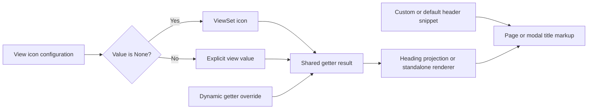

# Phase 06.23: Explicit header-icon suppression with Icon constants — Research

**Researched:** 2026-11-10
**Domain:** Existing Django view configuration and heading rendering
**Confidence:** MEDIUM overall; implementation evidence is directly read source and a passing baseline, not a new stack recommendation.

<user_constraints>
## User Constraints (from CONTEXT.md)

Verbatim settled decisions and discretion, from `06.23-CONTEXT.md:16-32,66-68`. [VERIFIED: .planning/phases/06.23-explicit-header-icon-suppression-with-icon-constants-329/06.23-CONTEXT.md:16-32]

<!-- DATA_f1a87c32_START -->
### Public API and rendering
- **D-01:** Export `Icon` from `crud_views.lib.icons` with plain constants `VIEWSET_DEFAULT = None` and `NONE = ""`. Keep primitive `str | None` types; no enum, sentinel or normalization framework.
- **D-02:** `cv_icon_header` inherits the ViewSet icon only when its value is `None`. Omitted/default and `Icon.VIEWSET_DEFAULT` inherit; `""` and `Icon.NONE` suppress a non-empty inherited icon.
- **D-03:** Custom `cv_header_template` and `cv_header_template_code` do not automatically suppress the icon. Explicit suppression preserves the custom content.
- **D-04:** The shared decision applies to rendered page headers and supported modal/theme headers. Verify actual markup, not only getter results.
- **D-05:** Preserve explicit semantic icon names, registered prefixes and raw CSS-class icons, plus existing `cv_get_header_icon()` overrides returning `None` for dynamic suppression.
- **D-06:** Keep current icon type/prefix validation; constants are accepted through their primitive values and unrelated invalid values remain invalid.
- **D-07:** `Icon.VIEWSET_DEFAULT` means inheritance only in the `cv_icon_header` context. Do not add inheritance semantics to group icons or the general registry.

### Compatibility, docs and scope
- **D-08:** Deliberately change empty-string semantics from inheritance to suppression. Document migration to `None` or `Icon.VIEWSET_DEFAULT` for callers needing inheritance, in both a `### Breaking` changelog entry and `docs/migrating-1.0.md`. No deprecation cycle or compatibility flag.
- **D-09:** Document the constants, full inheritance/suppression table, custom-header example and method-override recipe; clarify generic “None means no icon” wording where it hides view-level inheritance.
- **D-10:** No new project setting, boolean flag, header-template redesign, action-icon change or icon-registry refactor. Downstream edits/releases are not required for completion; #327/#328 stay separate.
- **D-11:** Focused header/icon regression and documentation checks must pass. Broad pytest runs use multiple workers.

### the agent's Discretion
Helper/constant placement within the named module, annotations/docstrings, fixtures, test organization and documentation placement are delegated. Keep the smallest bounded change that proves all acceptance criteria. No further product decisions are needed unless current code exposes a concrete conflict.

### Deferred Ideas
No new deferrals. Explicit scope exclusions are D-10; related #327/#328 work remains independent.
<!-- DATA_f1a87c32_END -->
</user_constraints>

## Summary

Change the inheritance decision in the existing getter and add the two plain constants. The current expression is `icon = view_icon or self.cv_viewset.icon_header`; both configuration fields already declare `str | None` with a default of `None`. Return `str | None` from the getter and fall back only on identity with `None`. [VERIFIED: src/crud_views/lib/view/base.py:157-159,557-560] [VERIFIED: src/crud_views/lib/viewset/__init__.py:83-83]

No renderer or template redesign is needed: icon resolution already returns no icon for empty strings, while both modern heading projection and the standalone header tag consume the getter. Custom heading content is rendered separately. Tests must exercise the real getter because existing heading tests replace it with mocks or lambdas. [VERIFIED: src/crud_views/lib/icons.py:186-206,231-245] [VERIFIED: src/crud_views/templatetags/crud_views.py:330-366] [VERIFIED: src/crud_views/lib/view/base.py:562-568] [VERIFIED: tests/test1/test_heading_icons.py:22-35,174-199]

**Primary recommendation:** Plan two small sequential work units: constants/getter plus rendered regressions; then reference/migration documentation plus its checks. Keep production behavior changes confined to the constants module and getter; explanatory docstrings/hints may be clarified without altering validation.

## Architectural Responsibility Map

| Capability | Primary tier | Secondary tier | Recommendation and evidence |
|---|---|---|---|
| Per-view inheritance decision | Python/Django view | ViewSet configuration | Keep in `cv_get_header_icon`; current fallback is there. [VERIFIED: src/crud_views/lib/view/base.py:557-560] |
| Icon projection and escaping | Django template rendering | Existing icon registry | Reuse heading projection and renderer. [VERIFIED: src/crud_views/templatetags/crud_views.py:357-366] |
| Header content | Django snippet rendering | Application template | Keep independent from icon selection. [VERIFIED: src/crud_views/lib/view/base.py:525-540,562-568] |
| Configuration diagnostics | Django system checks | Primitive value helpers | Preserve existing checks. [VERIFIED: src/crud_views/checks.py:559-594] |

## Project Constraints (from AGENTS.md)

`AGENTS.md` resolves to `CLAUDE.md` in this checkout (readlink inspection). Apply its actionable directives: simplest bounded maintainable change; preserve proven code paths; prefer self-contained additions; avoid hidden state, cross-cutting abstractions and extra queries; document unsupported cases. [VERIFIED: CLAUDE.md:15-30]

- Use existing development commands: `task dev`, `task test`, multicore `pytest tests -n auto` or bounded workers, `task format`, `task check`, `task build`, `task docs`; pre-commit runs Ruff formatting. Tiny selections may run serial with a reason. [VERIFIED: CLAUDE.md]
- Keep view attributes prefixed `cv_`; retain CRUD view keys, permission mapping and workflow method conventions. Fixtures follow `cv_<model>`, `user_<model>_<permission>`, `client_user_<model>_<permission>`. Use 120-character lines and double quotes. Preserve Hatchling and bump-my-version configuration. Pair any `### Breaking` entry with migration guidance until 1.0. [VERIFIED: CLAUDE.md]
- After shipping, refresh codebase maps. If a phase worktree is requested, use the documented GSD workspace convention, check existing worktrees, preserve the phase in the branch name, replace dots with hyphens in workspace names, and work from the repository subfolder. These lifecycle steps are outside this research deliverable. [VERIFIED: CLAUDE.md]

## Standard Stack

Use the installed project stack; no dependency additions, upgrades or registry installation audit are needed for this phase (D-10 and parent scope). These are **observed local versions**, not claims about latest releases or the supported-version matrix. [VERIFIED: local `.venv/bin/python` importlib.metadata probe, 2026-11-10]

| Component | Observed version | Use |
|---|---|---|
| Python | 3.12.3 | Existing runtime |
| Django | 6.1.2 | Views, templates, checks and test client |
| pytest / pytest-xdist | 9.2.0 / 3.8.0 | Existing test runner and multicore execution |
| lxml | 6.1.3 | Scope markup assertions to the title |
| MkDocs | 1.6.1 | Strict documentation build |

The project declares `requires-python = ">=3.12"` and `"django (>=4.2.0)"`; retain them. A passing local run does not certify the whole Django/Python matrix. [VERIFIED: pyproject.toml:25-27]

## Architecture Patterns



The diagram prescribes the settled change; the independent content and icon branches are already present. [VERIFIED: src/crud_views/lib/view/base.py:557-568] [VERIFIED: src/crud_views/templatetags/crud_views.py:330-366]

### Component responsibilities and real render paths

| Component | Evidence | Planning consequence |
|---|---|---|
| Getter | `view_icon = self.cv_icon_header`; `icon = view_icon or self.cv_viewset.icon_header`. [VERIFIED: src/crud_views/lib/view/base.py:557-560] | Replace only the fallback condition; annotate the nullable return accurately. |
| Test application page | `` inside `data-test-page-title`. [VERIFIED: tests/test1/app/templates/app/crud_views.html:14-21] | Exercise an actual client response and isolate that heading. |
| Shipped modal | `` and ``. [VERIFIED: src/crud_views/templates/crud_views/modal/content.html:1-9] | Exercise the modal response with the real view. |
| Bootstrap example/theme contract | `location="page"`, `title_icon.host_class`, `title_icon.inline_html` and the visible-title block. [VERIFIED: examples/bootstrap5/project/templates/project/crud_views.html:17-23] | Reuse `example_title_source()` to render the actual example fragment, without loading the whole demo application. |
| Legacy standalone tag | `return render_icon(view.cv_get_header_icon())`. [VERIFIED: src/crud_views/templatetags/crud_views.py:330-333] | Include one focused suppression assertion; no new semantics. |

### Fixtures and test organization

Extend the existing heading/icon test modules or add one focused suppression module; do not introduce a general test harness. The author ViewSet already sets `icon_header="fa-regular fa-user"`; use `AuthorListView`, `client_user_author_view` and its real page response. The modal ViewSet is constructed without an explicit icon, so monkeypatch a non-empty icon before asserting suppression. Use `AuthorModalDetailView`, `client_user_author_modal` and `author_douglas_adams`. [VERIFIED: tests/test1/app/views.py:53-66,913-929] [VERIFIED: tests/test1/conftest.py:181-206,232-235,781-800]

The existing modal request recipe is `headers={"X-CV-Modal": "true"}`; the page request recipe is `.get("/author/")`. Reuse these source-grounded routes or reverse the existing ViewSet route. [VERIFIED: tests/test1/test_heading_level.py:111-114] [VERIFIED: tests/test1/test_heading_icons.py:192-195]

For custom content, parameterize the template-file and template-code mechanisms, ensuring the competing code attribute is unset when testing the file mechanism: `render_snippet` explicitly checks `if template_code:` before `elif template:`. Use Django's existing in-memory template loader in the configured backend for file snippets; a separate local Engine alone does not replace the backend used by `render_to_string`. [VERIFIED: src/crud_views/lib/view/base.py:525-537] [CITED: https://docs.djangoproject.com/en/5.2/ref/templates/api/]

Keep the real getter and real header property in these tests. Check inheritance and suppression with visible custom content, and inspect both inline icon elements and host icon classes. Existing host-library test configuration is `{"host": {"renderer": "font", "placement": "host", "class": "icon-{name}"}}`; reuse it with `"host:edit"`. [VERIFIED: tests/test1/test_heading_icons.py:19-22,75-89]

## Don't Hand-Roll

| Problem | Use instead | Why |
|---|---|---|
| Icon disabling | Existing primitive values and renderer | `_icon_str` already strips strings and returns `None` for empty values. [VERIFIED: src/crud_views/lib/icons.py:186-206] |
| Validation | Existing `is_icon_value` and `check_icons` | `return value is None or isinstance(value, str)` already admits both constants. [VERIFIED: src/crud_views/lib/icons.py:318-320] |
| Host vs inline markup | Existing heading projection | Projection already separates `host_class` and `inline_html`. [VERIFIED: src/crud_views/templatetags/crud_views.py:348-366] |
| Theme integration | Existing getter/template contract | Page and modal templates consume the getter; no theme-specific inheritance layer. [VERIFIED: docs/reference/templates.md:68-104] |

## Common Pitfalls

1. **Testing only the renderer or mocking the getter.** Existing empty-heading tests prove rendering, not inheritance. New tests must set the view attribute against a non-empty ViewSet icon. [VERIFIED: tests/test1/test_heading_icons.py:22-35,86-89,174-185]
2. **Treating absence of any page icon as suppression.** Page actions can legitimately contain icons. Assert within the title, and distinguish host classes from child elements. Existing tests use `"[data-test-page-title]"` and inspect heading children/classes. [VERIFIED: tests/test1/test_heading_icons.py:193-212]
3. **Making custom templates suppress implicitly.** Header content and icon selection are independent; both file and code branches need tests with inheritance and explicit suppression. [VERIFIED: src/crud_views/lib/view/base.py:525-540,557-568]
4. **Relaxing validation because invalid values render nothing.** Preserve `"crud_views.E356"` for invalid types and `"crud_views.W353"` for unregistered view prefixes. Rendering tolerance is not accepted configuration. [VERIFIED: src/crud_views/checks.py:567-593]
5. **Leaking test registrations.** The metaclass registers when class-body `cv_viewset` is supplied; existing check probes clean up with `_REGISTRY.pop(name, None)`. Prefer monkeypatching existing fixtures, or retain that cleanup for temporary registered probes. [VERIFIED: src/crud_views/lib/view/meta.py:15-28] [VERIFIED: tests/test1/test_icons_checks.py:88-110,126-145]
6. **Documentation accidentally broadens None semantics.** Current icon reference says “An empty, whitespace-only or `None` value renders nothing”; qualify this as resolved-value behavior and explain view inheritance separately. The shared hint currently says `"Use a semantic name, 'prefix:name', a raw CSS class, or None for no icon."`; clarify its context if changed, retaining diagnostic IDs. [VERIFIED: docs/reference/icons.md:18-32] [VERIFIED: src/crud_views/lib/icons.py:315-320]

## Code Examples

The following is the **required proposed change**, not a claim that `Icon` already exists. Values are copied from the settled API: `VIEWSET_DEFAULT = None`, `NONE = ""`; the fallback rule explicitly says “only when the view value is `None`.” [VERIFIED: .planning/phases/06.23-explicit-header-icon-suppression-with-icon-constants-329/06.23-CONTEXT.md:108-146]

```python
class Icon:
    VIEWSET_DEFAULT = None
    NONE = ""


def cv_get_header_icon(self) -> str | None:
    view_icon = self.cv_icon_header
    return self.cv_viewset.icon_header if view_icon is None else view_icon
```

Preserve the full issue examples in the documentation: public import; the object-detail customer view with its custom header and explicit suppression; all five attribute forms; and a getter override returning `None`. Cross-link the icon reference from the header reference; add the breaking entry and migration from empty string to `None`/the inheritance constant. These examples and compatibility requirements are already captured verbatim in context. [VERIFIED: .planning/phases/06.23-explicit-header-icon-suppression-with-icon-constants-329/06.23-CONTEXT.md:117-175]

## State of the Art

| Existing behavior | Required behavior | Scope |
|---|---|---|
| Truthy-or fallback makes empty string inherit. [VERIFIED: src/crud_views/lib/view/base.py:557-560] | None-only fallback makes empty string suppress. | Deliberate pre-1.0 breaking change; no compatibility switch. [VERIFIED: .planning/phases/06.23-explicit-header-icon-suppression-with-icon-constants-329/06.23-CONTEXT.md:169-175] |

## Environment Availability

The local interpreter, pytest/xdist, lxml and MkDocs are available with the versions listed above. Both ordinary import and `PYTHONPATH=src` import resolved `crud_views` to this checkout during the probe. Keep the explicit source override in plan commands because prior phase worktrees recorded non-editable installs. [VERIFIED: local import/version probes, 2026-11-10] [VERIFIED: .planning/STATE.md:43-48]

A bare `from crud_views.lib.view import CrudView` probe fails before settings initialization:

```text
django.core.exceptions.ImproperlyConfigured: Requested setting INSTALLED_APPS, but settings are not configured.
```

Use pytest under the existing test subtree: its `pytest_configure()` calls `settings.configure(...)` and `django.setup()`, including in-memory SQLite. Do not invent a settings module for one-off tests. [VERIFIED: local import probe, 2026-11-10] [VERIFIED: tests/test1/conftest.py:43-44,99-108,133-133]

No external running service is required by the proposed change. No installation step is planned. Context7 tools/CLI were unavailable; official Django documentation was fetched via web fallback. [VERIFIED: research tool discovery and command availability probes, 2026-11-10]

<phase_requirements>
## Phase Requirements

Descriptions below are copied from the requirement definitions; the support column prescribes focused coverage. [VERIFIED: .planning/REQUIREMENTS.md:303-311]

| ID | Description | Research support |
|---|---|---|
| HDRI-01 | Public `from crud_views.lib.icons import Icon` works; `Icon.VIEWSET_DEFAULT is None` and `Icon.NONE == ""`, as plain constants. | Public import/identity/type assertions alongside icon tests. |
| HDRI-02 | Omitted, `None` and `Icon.VIEWSET_DEFAULT` view settings inherit a configured ViewSet header icon. | Separate omitted case, then explicit primitive/constant cases using real getter. |
| HDRI-03 | `""` and `Icon.NONE` suppress a non-empty ViewSet icon in actual rendered headers. | Client-rendered page and modal heading assertions; non-empty parent fixture required. |
| HDRI-04 | Explicit view icons override the ViewSet icon in existing supported semantic, registered-prefix and raw CSS-class formats. | Reuse `"detail"`, `"fas:pen"`, `"raw-icon"`, plus `"host:edit"` placement coverage from existing heading tests. |
| HDRI-05 | Custom template and template-code headers retain inheritance by default; explicit suppression removes the icon while preserving custom content. | Two custom-header mechanisms × inherited/suppressed values; assert visible custom markup survives. |
| HDRI-06 | Existing `cv_get_header_icon()` overrides returning `None` remain effective; supported modal and shared theme header rendering uses the same decision. | Dynamic override plus actual modal and example title fragment, and standalone tag smoke. |
| HDRI-07 | Existing icon type/prefix validation accepts the primitive constants and still rejects unrelated invalid values without relaxed validation. | Existing `check_icons` harness, primitive constants, non-string type and unregistered prefix controls. |
| HDRI-08 | Icon/header references document all agreed examples and the context-specific meaning of `None`; paired Breaking changelog and migration guidance explain empty-string suppression and migration to `None`/`Icon.VIEWSET_DEFAULT` for inheritance. | Reference recipe check, manual acceptance-table review, strict docs build. |
| HDRI-09 | Focused header/icon regressions and appropriate documentation checks pass; broad pytest runs use multiple workers. | Focused existing baseline and phase additions, then multicore regression gate. |

Explicit format values above are existing examples: `"detail"`, `"fas:pen"`, `"raw-icon"`, `"host:edit"`. [VERIFIED: tests/test1/test_heading_icons.py:75-83,100-113,174-177]
</phase_requirements>

## Validation Architecture

Nyquist and security are enabled: `"nyquist_validation": true`, `"security_enforcement": true`. [VERIFIED: .planning/config.json]

### Test framework and sampling

Use existing pytest configuration (`addopts = "--strict-markers"`) and Django setup. No framework/configuration installation is needed. [VERIFIED: pyproject.toml:145-146] [VERIFIED: tests/test1/conftest.py:43-133]

**Quick baseline command, actually executed:**

```bash
PYTHONPATH=src .venv/bin/python -m pytest tests/test1/test_heading_icons.py tests/test1/test_icons_checks.py tests/test1/test_icons_registry.py tests/test1/test_heading_docs.py -n 4 -q
```

Result: `289 passed in 5.24s`. This is pre-change regression evidence, not acceptance of the new behavior. [VERIFIED: local pytest run, 2026-11-10]

The strict MkDocs baseline also passed in 1.30 seconds, using a temporary site output directory outside the checkout. [VERIFIED: local `mkdocs build --strict` run, 2026-11-10]

**Recommended per-task:** run the affected test module with four workers, or a tiny named selection serially when worker startup dominates. Include new suppression cases in the quick command if placed in a new file.

| Requirements | Test type | Proposed automated scope | Existing support / gap |
|---|---|---|---|
| HDRI-01 | Unit | Public import and exact primitive assertions in icon registry tests | Add assertions |
| HDRI-02–04 | Unit + rendered integration | Heading tests with real attributes and inherited icon | Existing fixtures; add parameter cases |
| HDRI-05 | Rendered integration | Heading tests using both real custom snippet mechanisms | Add file-loader fixture and content assertions |
| HDRI-06 | Integration + template rendering | Modal client request, example fragment, getter override, standalone tag | Existing render helpers; replace mocks only in new cases |
| HDRI-07 | Unit/system-check | Icon-check module with constants and invalid controls | Existing invalid probes; add constants |
| HDRI-08 | Documentation + recipe smoke | Existing heading-doc module plus a focused public example check; strict MkDocs | Add check that actually imports/uses constants, avoid brittle whole-prose snapshots |
| HDRI-09 | Regression | Quick command above, then full suite | Baseline passes; rerun after implementation |

**Recommended wave/phase gate:**

```bash
PYTHONPATH=src .venv/bin/python -m pytest tests -n 4 -q
PYTHONPATH=src .venv/bin/python -m mkdocs build --strict
```

Also run Ruff check/format-check on changed Python files. The full suite is a phase gate, not a sub-30-second task feedback promise. Existing documentation tests compile published heading recipes and validate heading table defaults; preserve their section anchors and examples. [VERIFIED: tests/test1/test_heading_docs.py:19-34,46-72,76-105]

### Wave 0 gaps

- Add acceptance cases to existing modules (or one focused suppression module); no infrastructure gap.
- Supply a custom-header file through the existing Django backend's test loader, and a non-empty modal ViewSet icon.
- Keep nine acceptance rows as the review checklist; do not multiply every case across every view/layout.

## Security Domain

Use ASVS **4.x numbering** for compatibility with the GSD category template: V2 authentication, V3 sessions, V4 access control, V5 validation/sanitization/encoding, V6 stored cryptography. OWASP's current ASVS 5 uses different numbering, including V1 encoding/sanitization; do not silently label 4.x categories as 5.x. [CITED: https://devguide.owasp.org/en/03-requirements/05-asvs/] [CITED: https://github.com/OWASP/ASVS/blob/master/5.0/docs_en/OWASP_Application_Security_Verification_Standard_5.0.0_en.csv]

| Category | Applies to this change | Control |
|---|---|---|
| V2 / V3 / V4 / V6 | No new behavior planned | Keep this phase restricted to display configuration (D-10). |
| V5 | Yes | Retain primitive validation and existing escaped icon rendering; preserve hostile-title/class tests. |

Relevant threat: changing HTML projection can turn title/class input into markup (Tampering). Retain `format_html` for icon classes and existing hostile-heading tests. Suppression must preserve the custom content rather than bypass its current rendering. [VERIFIED: src/crud_views/lib/icons.py:213-228] [VERIFIED: tests/test1/test_heading_icons.py:125-138,215-239]

## Assumptions Log

No unresolved product or dependency assumptions are needed. Implementation/test organization recommendations are delegated choices, not new locked decisions. The local test result establishes only the observed environment; no unexecuted version-matrix result is claimed.

## Open Questions

None blocking planning. External downstream themes are outside completion scope; certify the shipped modal, test host, example fragment and documented shared contract, not an unavailable downstream installation. [VERIFIED: .planning/phases/06.23-explicit-header-icon-suppression-with-icon-constants-329/06.23-CONTEXT.md:149-167]

## Sources and Metadata

- Local source files, fixtures, context, requirements and project guidance cited inline were opened during this session; source quotations identify exact primitive values and diagnostic IDs.
- Official Django template API: Engine/loaders, Context/render and callable template variables. [CITED: https://docs.djangoproject.com/en/5.2/ref/templates/api/]
- Official OWASP developer guide and ASVS primary repository: category/version distinction, output-encoding control. [CITED: https://devguide.owasp.org/en/03-requirements/05-asvs/] [CITED: https://github.com/OWASP/ASVS/blob/master/5.0/docs_en/OWASP_Application_Security_Verification_Standard_5.0.0_en.csv]
- Research-plan seam selected Context7 and web search; Context7 was unavailable, so official-source web fallback was used. Cross-checked web confidence seam returned `MEDIUM`; raw unrecognized `codebase` provider returned `LOW`, so this document does not claim a seam-generated HIGH tier. Cached official-source digests use `MEDIUM`. [VERIFIED: research-plan/classify-confidence/research-store tool outputs, 2026-11-10]
- Graph status reported `"exists": false`; no graph relationships were used. [VERIFIED: graphify status, 2026-11-10]

**Confidence breakdown:** stack MEDIUM (observed installed versions, no upgrades); architecture MEDIUM (direct source plus passing rendered baseline); pitfalls MEDIUM (existing fixture/mocking evidence and reproduced import failure). Recheck source pointers if the checkout changes. No implementation or full-suite run is claimed by this research.
