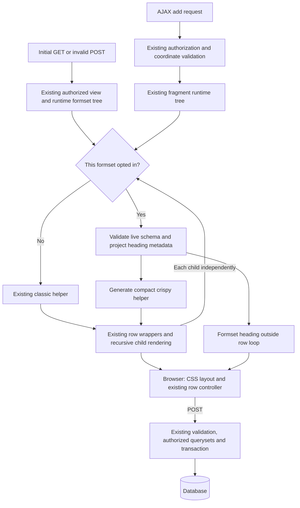

# Phase 06.24: Opt-in compact formsets — Research

**Researched:** 2026-11-10
**Domain:** Django inline formset presentation, crispy helpers, responsive CSS and existing AJAX lifecycle
**Confidence:** MEDIUM — official-document lookup tier returned by the research seam; direct source/probe evidence is identified separately.

<user_constraints>
## User Constraints (from CONTEXT.md)

Source: approved phase context, copied verbatim below. [VERIFIED: 06.24-CONTEXT.md, Implementation Decisions and Deferred Ideas sections]

<!-- DATA_7cb08f25_START -->
### Adoption and public declaration — approved

- **D-01:** Add optional `FormSet.compact_layout`. Absent/`None` keeps the classic implementation, custom crispy
  helper layouts and `form_show_labels` behavior unchanged. No default switch or automatic migration.
- **D-02:** Each formset opts in independently, including children. Support compact/compact, compact/classic and
  classic/compact compositions on the same page and inside a nested hierarchy.
- **D-03:** The approved API shape is `CompactLayout(columns=[CompactColumn("field", span=N), ...], controls_span=N)`
  on `FormSet`; export the declarations from `crud_views.lib.formsets`. Column order and spans are explicit and use
  the existing 12-column convention. The planner settles the concrete class representation and validation rules.
- **D-04:** For compact rendering, this declaration replaces `get_helper_layout_fields()`; do not require a second
  crispy row definition containing the same fields. Do not infer columns from arbitrary crispy layout objects.
- **D-05:** Forms retain ownership of fields, widgets, labels, help text, required state and validation. Use form
  field labels for desktop headings and mobile labels, including request-time constructor changes and translation.
  Do not add a separate label dictionary. Rows within a compact formset must share their schema and heading labels.
- **D-06:** Compact mode determines responsive label visibility. `form_show_labels` governs the classic path;
  it must not suppress compact mode's headings or mobile labels.

### Desktop, mobile and nesting — approved

- **D-07:** Shared desktop headings belong to the formset, independently of its first data row. Deleting or moving
  that row does not remove the headings. Headings, field columns and the controls area align.
- **D-08:** Mobile uses option B: every row becomes a card with full-width labelled fields. Retain a programmatic
  label for each input at every width; a shared visual heading is not a substitute for that association.
- **D-09:** Parent fields and child formsets remain in one visible parent group. On desktop each child formset has
  its own column headings; on mobile its rows are smaller nested cards with subtle borders/backgrounds and small
  insets. Do not accumulate a full grid-column offset at every compact nesting level.
- **D-10:** Children stay expanded. No accordion, sticky headings, computed summaries or configurable mobile
  variants. Use the existing supported recursive nesting mechanism; verify a grandchild example rather than
  hard-coding a two-level renderer. Do not invent an arbitrary-depth guarantee or a new global depth limit.
- **D-11:** Field errors stay with fields, non-field row errors with the row, and formset errors with their formset.
  Help text and required indicators remain available. Responsive styling must not hide errors or help text.
- **D-12:** Controls act on their containing row/formset and use the existing control system and capability flags.
  The mockup's separate bottom Add buttons, numbered summaries and disabled controls are illustrative only;
  they do not authorize a new control API, row-summary mechanism or changed lifecycle.

### Preservation and delivery — locked by the handover

- **D-13:** Preserve management/identity fields, prefixes, existing AJAX fragment authorization, row-added events,
  queryset authorization, validation, deletion/order policy, transactions and saving. Do not add database queries
  merely to generate headings or impose new work on classic rendering.
- **D-14:** Initial pages, invalid POST redisplays and AJAX row fragments must select the same layout per formset.
  Preserve DOM contracts needed by current JavaScript, including `div.cv-formset-row`, `.cv-formset-form`,
  `.cv-formset-content` and identity/control attributes. Do not port the JavaScript away from jQuery in this phase.
- **D-15:** Compact rows are an ordered list of named form fields plus a controls area. Arbitrary crispy objects,
  custom HTML cells, multiple row layouts, per-row conditional columns and mixed polymorphic schemas are excluded.
  Unsupported configurations must be explicit; do not silently guess a rendering or discard required data.
- **D-16:** Document supported declarations/widgets, precedence, independent nested adoption and exclusions with a
  runnable example. Add an additive changelog entry. No breaking change or migration requirement is intended.
- **D-17:** Verify rendered browser behavior, dynamic row operations and relevant existing regressions. For broad
  pytest runs use multiple workers. Do not treat source syntax or HTTP 200 alone as proof of visible rendering.
- **D-18:** Issue #346 (legend hooks) remains separate; reuse it if available without duplicating its work. Downstream
  theme adoption is follow-up work, not a completion gate. Settle this phase before Phase 7 freezes the new surface.

### Researcher / planner discretion — delegated, not additional user-selected decisions

- Concrete declaration classes, module organization, default argument details and validation timing/messages.
  Reject invalid spans, duplicate/missing field names and arrangements that cannot fit one 12-column row.
- Explicit handling of omitted visible fields and hidden fields. Do not silently drop required data. Preserve
  hidden PK/FK, ORDER, DELETE and management fields without displaying them as ordinary compact columns.
- Supported widget boundary: the required initial case is standard text/number/date inputs and single selects,
  including model choice selects. Assess checkboxes, radio groups, multiwidgets, files and custom templates;
  document or reject unsupported cases instead of expanding the feature to support everything.
- Source of uniform header metadata for initial/empty formsets and added rows, respecting constructor labels,
  lazy translation and the no-extra-query constraint. Do not execute arbitrary crispy layouts to infer headings.
- Exact breakpoint, CSS/classes/template seams and card styling. Align bundled Bootstrap behavior with the
  existing `md` convention, reuse established theme mechanisms and scope CSS to compact markup. The mockup is
  a layout reference, not an exact color/font specification or a mandate for another styling registry.
- Preserve existing zero-row/add limitations; do not invent a new empty-formset recovery feature here. Verify and
  document the supported empty/extra/no-control cases.
- Test fixtures, file organization and documentation placement. Prefer existing formset examples and restoring
  test fixtures over unrelated model/ViewSet changes. Research must flag concrete conflicts with approved scope,
  rather than silently resolve them by broadening behavior.

## Deferred Ideas / Exclusions

- Legend hooks: separate issue #346, not folded into this phase.
- jQuery removal: existing issue #210, not part of presentation work.
- Downstream Tabler adoption: follow-up after upstream support is available.
- Arbitrary crispy inference, heterogeneous schemas, conditional columns, collapsing children, sticky headings,
  automatic summaries and new empty-state controls: excluded; no promise to implement them in a later phase.

No pending todos matched this phase, and no new capabilities were added during context capture.
<!-- DATA_7cb08f25_END -->
</user_constraints>

## Summary

Use two small immutable declarations and a compact-only crispy helper builder. Branch before consulting the classic helper, then retain the current recursive template, controls, identity payloads and backend lifecycle. The existing row helper dispatch and nested rendering already provide the necessary seams; a second formset renderer or JavaScript engine would add unnecessary maintenance cost. [VERIFIED: src/crud_views/lib/formsets/render_tree.py:84-92; src/crud_views/templates/crud_views/formsets/formset.html:31-50] This recommendation implements the approved bounded scope. [CITED: https://github.com/jacob-consulting/django-crud-views/issues/347]

The most consequential finding is that headings must not be sourced indiscriminately from Django's empty form. It constructs a form and calls inline field augmentation, which can clear an unsaved parent's default primary key. A real probe reproduced that mutation. Reuse existing runtime forms whenever there are rows; use one narrowly documented metadata-only form construction for a genuinely empty compact formset. Do not evaluate choices, render widgets, resolve arbitrary helpers or mutate the live formset for headings. [VERIFIED: installed Django forms/formsets.py:258-270 and forms/models.py:1184-1222; metadata probe below]

**Primary recommendation:** preserve the classic branch byte-for-byte where feasible; add one compact declaration-to-helper path, one formset-owned heading projection and compact-scoped CSS. The implementation recommendations below settle delegated technical choices; they are not new user decisions. [CITED: https://github.com/jacob-consulting/django-crud-views/issues/347]

## Architectural Responsibility Map

This is the recommended responsibility split under the approved presentation-only boundary. [CITED: https://github.com/jacob-consulting/django-crud-views/issues/347]

| Capability | Primary tier | Secondary tier | Responsibility |
| --- | --- | --- | --- |
| Validate declaration and supported row schema | Django backend | — | Reject configuration errors before rendering |
| Resolve request-specific heading metadata | Django server rendering | Form constructor | Read the same form-owned labels as the rows |
| Render fields, errors, hidden identities and controls | Django server rendering | crispy template pack | Generate existing form markup through a generated helper |
| Shared headings, mobile cards and nested insets | Browser CSS | Django markup | Responsive visual presentation only |
| Add/delete/order and row-added lifecycle | Existing browser controller | Existing authorized fragment endpoint | Consume unchanged row identities and DOM contracts |
| Queryset authorization, validation, transactions and persistence | Existing backend | Database | Remain outside the new presentation branch |

## Project Constraints (from AGENTS.md)

The repository's AGENTS.md points to CLAUDE.md; the supplied user instructions match the file read for this research. The following actionable directives govern planning. [VERIFIED: CLAUDE.md:17-32,36-61,63-83,129-147]

- Prefer the simplest bounded solution; preserve proven paths and document unsupported cases. Keep additions opt-in and self-contained. Account for hidden state, abstractions and extra queries.
- Use multicore pytest for broad runs; a bounded four-worker command is appropriate here. Explain any serial exception.
- Preserve fixture naming conventions for ViewSets, users and logged-in clients.
- Keep view attributes prefixed with `cv_`, existing CRUD permission mapping, and workflow transition naming.
- Use 120-character Python lines and double quotes. Retain hatchling and bump-my-version.
- A future breaking changelog entry must be paired with migration documentation; this phase is intended to be additive.
- After shipping, refresh codebase maps. If a phase worktree is requested, use the documented GSD workspace convention and check for an existing one first.
- This research assignment authorizes only this research artifact: no implementation, branch changes or commits, and preserve concurrent planning edits.

## Phase Requirements

No new requirement IDs were supplied: the roadmap says `**Requirements**: TBD`. Use issue acceptance groups 1–8 and D-01–D-18 as the planning traceability keys; do not manufacture new requirement IDs or claim completed preservation requirements as new phase requirements. [VERIFIED: .planning/ROADMAP.md:1618-1640] Existing formset, conditional, lifecycle and theme requirements remain regression obligations. [VERIFIED: .planning/REQUIREMENTS.md:133-164]

## Standard Stack

Keep the installed project stack and its existing dependency floors; no dependency installation or upgrade is recommended. Manifest declarations read verbatim: `"django (>=4.2.0)"`, `"pydantic (>=2.2.1)"`, `"django-crispy-forms (>=2.0)"`, `"crispy-bootstrap5 (>=2023.10)"`. [VERIFIED: pyproject.toml:25-35]

| Component | Observed version / policy | Use |
| --- | --- | --- |
| Python dataclasses | Python 3.12.3 in current venv | Immutable compact declarations with explicit validation |
| Django | Current venv 6.1.2; existing matrix environments 4.2.30, 5.2.19, 6.0.10 | Real forms, BoundFields, formsets and request rendering |
| Pydantic | 2.14.1 installed | Existing FormSet integration, instance-type guard |
| django-crispy-forms | 2.7 installed; retain 2.0 floor | Generated helper, field layout and hidden fields |
| crispy-bootstrap5 | 2026.9 installed; retain 2023.10 floor | Current field/error/help rendering |
| Bootstrap CSS | Existing browser fixture explicitly requests 5.3.3 | Existing md grid convention; no new CSS framework |
| pytest / pytest-xdist | 9.2.0 / 3.8.0 installed | Python validation and request regressions |
| Vitest / jQuery | Observed Vitest run 5.0.3; retain existing dependencies | Existing unit and actual-fragment integration harness |
| Playwright / Chromium | 1.64.1 / 149.0.7827.55 available | Real layout, keyboard and dynamic request verification |

Versions above are observed environment values, not a claim that they are latest registry releases. [VERIFIED: 2026-11-10 importlib.metadata, interpreter, browser and test-command probes] The matrix source contains `DJANGO_VERSIONS = ["4.2", "5.2", "6.0"]`; the current venv alone does not prove supported-series compatibility. [VERIFIED: noxfile.py:3-19] The browser fixture requests `https://cdn.jsdelivr.net/npm/bootstrap@5.3.3/dist/css/bootstrap.min.css`. [VERIFIED: tests/browser/templates/conditional_formsets/page.html:8-10]

Dataclasses supply generated initialization and frozen instances but do not validate type annotations by themselves. Use explicit post-initialization checks; normalize the accepted columns sequence into a tuple so frozen configuration does not contain a mutable caller-owned list. [CITED: https://docs.python.org/3/library/dataclasses.html] Pydantic integrates standard dataclasses, so test the FormSet boundary as well as direct constructors; reject dictionary/coercion shortcuts at that boundary if only declaration instances are documented. [CITED: https://docs.pydantic.dev/latest/concepts/dataclasses/]

### Package Legitimacy Audit

Not applicable: this phase adds no external package and proposes no installation. Package names above come from the opened project manifest and official documentation; no npm-registry verification claim is made. Latest release dates do not drive this change. Retain the declared floors and prove behavior in the existing matrix. [VERIFIED: pyproject.toml:25-35; noxfile.py:22-24,104-114]

## Architecture Patterns

### System Architecture Diagram

Recommended data flow, preserving the existing initial/fragment construction and validation boundaries. [VERIFIED: src/crud_views/lib/formsets/formsets.py:121-274,523-544; src/crud_views/lib/formsets/mixins.py:37-78]



### Component Responsibilities

Existing source files below were opened; these are modification targets, not claims that research created them. New filenames are proposed targets, not existing interfaces. [VERIFIED: source reads listed in Sources]

| Component | Bounded change |
| --- | --- |
| Proposed `src/crud_views/lib/formsets/compact.py` | Declarations, declaration validation and compact-only projection/helper functions |
| Existing declaration module and package exports | Optional compact field, instance-type check, public exports |
| Existing runtime render tree | Select generated helper before classic helper; runtime-only heading metadata |
| Existing recursive formset template | Compact branch around presentation, shared heading outside row iteration |
| Proposed heading include | Simple escaped field labels and span classes; independently overridable |
| Existing formset CSS | Direct compact hooks for labels/cards/insets, without ancestor-wide classic effects |
| Existing controls/template tag/JS | Reuse; avoid changes unless a demonstrated compact defect requires a minimal fix |
| Existing reference docs and example | Opt-in recipe and explicit limits; additive changelog |

### 1. Declaration contract and validation

Recommended delegated decisions, grounded in the explicit API/maintainability boundary. [CITED: https://github.com/jacob-consulting/django-crud-views/issues/347]

- Implement frozen standard dataclasses `CompactColumn` and `CompactLayout`. Keep the field name positional; require `span` and `controls_span` explicitly. Accept list/tuple columns, normalize to a tuple, and reject arbitrary crispy objects or mappings.
- Require nonempty exact field names, with no leading/trailing whitespace; reject duplicates. Require actual integers, excluding booleans, in the inclusive 1–12 range. Require at least one column and total column spans plus controls span at most 12. An underfilled row leaves trailing space; do not stretch or infer extra widths.
- Reserve controls width even when capability flags yield no buttons, so heading/row alignment is deterministic. Do not interpret controls span as a new capability setting.
- Raise descriptive declaration errors at construction. Validate field existence, omissions, widget shape and labels against request-time forms, not class base fields. Include the formset key and offending field in runtime configuration errors.
- All ordinary visible fields must appear exactly once, even optional or disabled ones. Hidden fields remain outside the compact column list; explicitly reject a hidden/identity/control field named as a column. Hidden user fields remain rendered automatically.
- Reject heterogeneous/polymorphic formsets for compact mode initially. Reject row-dependent visible schemas or heading labels. Preserve classic polymorphic behavior through the unchanged branch.
- Test direct declarations and FormSet-wrapped declarations, including copying/cloning, to catch Pydantic coercion or loss of immutable values.

### 2. Reuse crispy; bypass arbitrary classic helpers

The current helper enables `helper.form_tag = False`, `helper.disable_csrf = True`, `helper.render_hidden_fields = True`, and reads `helper.form_show_labels = self.formset.form_show_labels`. It then invokes the subclass row-layout method. [VERIFIED: src/crud_views/lib/formsets/inline_formset.py:56-74] The current runtime chooses `self.form.helper` for polymorphic rows and otherwise `self.parent.instance.helper`. [VERIFIED: src/crud_views/lib/formsets/render_tree.py:84-92]

Recommendation: branch in that runtime helper selection before either existing property is accessed. The compact builder creates a fresh nonwrapping helper, forces labels on, generates field columns in declared order, adds the existing FormControl in its reserved column and includes only present policy fields as hidden inputs. Classic custom helper overrides must remain untouched and must never run merely to infer compact layout. [CITED: https://github.com/jacob-consulting/django-crud-views/issues/347]

Retain crispy's field templates, help/error rendering, and hidden-field fallback. The relevant helper controls are documented; duplicating all field markup would unnecessarily widen the compatibility surface. [CITED: https://django-crispy-forms.readthedocs.io/en/latest/form_helper.html] The existing hidden layout uses `Field("ORDER", type="hidden")` and `Field("DELETE", type="hidden")`. [VERIFIED: src/crud_views/lib/formsets/inline_formset.py:76-82] However, compact generation must check actual field presence: DELETE can be absent on extra rows. Existing controls already use ``. [VERIFIED: src/crud_views/templates/crud_views/formsets/control.html:19-29]

Crispy's hidden-field rendering excludes fields already rendered, while its hidden Field adapter replaces the widget on the form instance. Validate/project ordinary columns before helper rendering and exclude policy fields by role, not by their current widget visibility. [VERIFIED: installed crispy_forms/helper.py:266-286 and crispy_forms/utils.py:79-105]

### 3. Heading metadata: reuse, isolate, and bound side effects

Existing initial construction materializes every row before yielding its runtime formset; fragments similarly construct rows before rendering. Reuse the first already-constructed row for headings, but render the heading outside all rows. Compare the remaining existing rows' declared field names, effective labels and required state against the baseline without rendering widgets or comparing choice values. [VERIFIED: src/crud_views/lib/formsets/formsets.py:162-197,227-274]

Recommended empty-formset strategy:

1. Only if compact is selected and there are genuinely no runtime rows, construct one metadata-only form using the formset's form class and `get_form_kwargs(None)`.
2. Do not call `empty_form`, `add_fields`, `_construct_form`, helpers, validation, media or widget rendering for metadata. Do not pass the actual parent as this form's model instance.
3. Read BoundField labels and field properties only; cache this projection on the request-local runtime node. Never cache translated strings on global declarations.
4. State the support boundary: constructors/kwargs used for metadata must be query-free and provide index-independent fields and heading labels. Custom `add_fields()` logic that introduces or changes compact columns is unsupported. Constructor-owned labels remain supported.
5. Validate equivalent supported schemas on normal GET, invalid POST, zero rows and AJAX fragments. A fragment cannot compare against a previous page's in-memory labels without extra protocol/state; uniformity across request paths remains a documented application contract.

The formset forwards the current view through `kwargs["cv_view"] = self.formset.cv_view`, so the normal kwargs hook is the correct source for request context. [VERIFIED: src/crud_views/lib/formsets/inline_formset.py:96-99] Django documents the None-index convention. [CITED: https://docs.djangoproject.com/en/5.2/topics/forms/formsets/]

**Positive falsification probe:** using standalone in-memory Django models, a UUID-default parent, and an explicitly empty child queryset, compare Django's empty form with direct metadata form construction. Observed on the installed Django 6.1.2:

```text
empty_form_mutated_parent_pk: True queries: 0
bare_metadata_preserved_parent_pk: True label: Title queries: 0
```

[VERIFIED: 2026-11-10 standalone runtime probe; installed Django forms/models.py:1206-1222] The first exploratory probe omitted the empty queryset and failed on a nonexistent probe table; it was not counted as mutation evidence. The corrected probe above isolates the mutation without database access.

**Limit:** this probe establishes the behavior for ordinary forms, not arbitrary application constructors. A constructor can issue queries itself; a generic no-query guarantee for all Python constructors is not implementable by simply choosing a form API. Keep query-free metadata construction an explicit compact support condition and add query-attribution tests. Do not add global SQL interception or silently fall back to stale class labels. [VERIFIED: src/crud_views/lib/formsets/inline_formset.py:96-99; installed Django forms/formsets.py:258-270] This is the only substantial compatibility boundary to call out prominently in the implementation plan.

### 4. Initial widget boundary

Recommended supported contract for the first release, using the issue's explicit authority to narrow unsupported cases. [CITED: https://github.com/jacob-consulting/django-crud-views/issues/347]

| Widget shape | Recommendation | Reason / validation |
| --- | --- | --- |
| Standard text, number and date input | Support | One input, one ordinary associated label |
| Standard single Select, including ModelChoiceField | Support | Read metadata without enumerating choices; normal row render still owns choices |
| Attributes on those stock widgets, including small input classes | Support | Preserve form-owned widget attributes |
| Checkbox, radio/checkbox groups, SelectMultiple | Reject initially | Different label/group structure; no need to expand the initial scope |
| MultiWidget, including split date/time | Reject | Multiple input IDs and group labels require a separate contract |
| File/ClearableFileInput, password and custom widget templates | Reject initially | Separate lifecycle/markup behaviors outside the demonstrated need |
| Textarea and other unlisted widgets | Reject initially | Make the allowlist explicit rather than implying all single-value controls work |
| HiddenInput/identity fields | Preserve outside columns | Not subject to ordinary visible-column rendering |

Prefer an explicit small allowlist of stock widget types and stock template identities. Document subclasses/custom templates as unsupported rather than claiming that a base-class check proves identical markup. Reject before rendering with the formset/field named. This avoids speculative support while leaving classic rendering as the escape hatch. The installed Bootstrap pack actually has separate branches for checkbox, radio/multi-select groups, files and ordinary fields, corroborating the markup distinction. [VERIFIED: installed crispy_bootstrap5/templates/bootstrap5/field.html:3-63]

### 5. Responsive markup, nesting and accessibility

Use Bootstrap's md threshold: desktop at 768px and above, mobile below it. [CITED: https://getbootstrap.com/docs/5.3/layout/breakpoints/] Existing column helpers emit the literal class family illustrated by `css_class = "col-md-1"`, `css_class = "col-md-2"` and `css_class = "col-md-12"`. [VERIFIED: src/crud_views/lib/crispy/table.py:4-9,48-49]

Keep a label for every input. On desktop visually clip only the compact field labels; do not use display:none, visibility:hidden or aria-hidden on them. On mobile remove clipping and present full-width fields. Label for/id associations must remain unique after AJAX insertion. [CITED: https://www.w3.org/WAI/tutorials/forms/labels/] Give heading cells the same spans/gutters as field cells and the same inner padding as the corresponding row. Put visible required indicators beside heading labels because desktop row labels are clipped. Do not duplicate input elements for desktop/mobile. [CITED: https://github.com/jacob-consulting/django-crud-views/issues/347]

Recommended CSS hooks are per-formset/per-row tokens, applied only on compact nodes, and a label class set by the generated helper. Never use a broad descendant rule such as “all labels inside any compact ancestor”: that would hide labels in a classic child. Child cards need small local padding/insets, not compounded grid offsets. Existing classic nesting computes `return 11 if self.level > 0 else 12` and `return 1 if self.level > 0 else 0`; bypass that offset only for a compact node. Preserve it on classic children, even inside compact parents. [VERIFIED: src/crud_views/lib/formsets/render_tree.py:155-173]

Do not add table/grid ARIA roles: these remain ordinary forms with explicit labels and existing fieldset/legend grouping. Shared visual headings do not require interactive-grid semantics. Give every compact parent row a visible boundary encompassing its children, and every child its own heading and error region. Use top-aligned field/control columns; errors and long help text must grow within their own cells without shifting unrelated input baselines. [CITED: https://github.com/jacob-consulting/django-crud-views/issues/347]

### 6. Preserve the JavaScript and fragment contract

Literal selector/event contract: `content: "div.cv-formset-content"`, `row: "div.cv-formset-row"`, `row_added: "cv:formset:row-added"`. Identity attributes are `"cv-data-formset-prefix"`, `"cv-data-formset-form-prefix"`, `"cv-data-formset"` and `"cv-data-formset-form"`. [VERIFIED: src/crud_views/static/crud_views/js/formset.js:34-50] The existing row template includes `<div class="cv-formset-form">` and nested children inside the owning row. [VERIFIED: src/crud_views/templates/crud_views/formsets/formset.html:35-50]

Place shared headings inside the formset content before the row loop, never inside a row. Preserve direct sibling insertion: JS calls `insertAdjacentHTML("afterend", html)` or `insertAdjacentHTML("beforebegin", html)`. [VERIFIED: src/crud_views/static/crud_views/js/formset.js:355-370] A top-level fragment suppresses the outer wrapper via `render_rows_only=level == 0`; it must also suppress the shared heading. Nested formsets arriving inside a new parent keep their wrappers, management controls and their own headings. [VERIFIED: src/crud_views/lib/formsets/formsets.py:227-248]

Do not add extra events for nested inserted rows: the existing event contract intentionally lets the parent event contain nested rows. [VERIFIED: src/crud_views/static/crud_views/js/formset.js:387-393] Preserve context transport in the existing inclusion tag rather than introducing another recursive tag with different form-button ownership. [VERIFIED: src/crud_views/templatetags/crud_views_formsets.py:6-13]

### 7. Empty and control-free states

The existing AJAX path contains `form = formset_instance.forms[0]`, and Add lives in a row. Therefore distinguish “zero initial rows with an extra row” from “zero total rows”; do not advertise recovery from a completely empty formset. [VERIFIED: src/crud_views/lib/formsets/formsets.py:237-248; src/crud_views/templates/crud_views/formsets/control.html:19-23]

- Zero initial rows plus an extra row: render one set of headings, the ordinary blank row and existing controls.
- Zero total rows: render wrapper, management/errors and headings from the bounded metadata form; no new Add control.
- Existing data with extra=0: existing rows can render compactly, but the current AJAX factory still assumes a generated form. Keep that limitation explicit.
- All row capabilities disabled: preserve empty reserved controls width; no inferred Add permission or new UI.
- Deletion/reordering of the first row must leave heading identity and position unchanged.

These are recommended tests/documentation of the current lifecycle, not a change to add policy. [CITED: https://github.com/jacob-consulting/django-crud-views/issues/347]

## Don't Hand-Roll

| Problem | Do not build | Reuse |
| --- | --- | --- |
| Field, help and error HTML | A second form/widget renderer | Generated crispy helper and existing template pack |
| Row addition/deletion/order | New compact controllers | Existing controller and capability projection |
| Hidden identity handling | Manually reconstructed PK/FK values | Existing bound forms and hidden-field rendering |
| Form ownership and CSRF | Nested forms or per-row CSRF tokens | Current page-owned form and nonwrapping helpers |
| Theme controls | New style registry | Existing FormControl and button class mechanism |
| Uniform columns | Crispy layout introspection | Explicit declaration and request-time field validation |

These recommendations follow the approved preservation boundary and the already-read helper/control implementations. [CITED: https://github.com/jacob-consulting/django-crud-views/issues/347] [VERIFIED: src/crud_views/lib/formsets/inline_formset.py:56-86; src/crud_views/templates/crud_views/formsets/control.html:3-33]

## Common Pitfalls

1. **Hidden fields classified after rendering.** Crispy can mutate ORDER/DELETE widgets while rendering. Build/validate column metadata first, exclude lifecycle roles explicitly, and test repeat rendering. [VERIFIED: installed crispy_forms/utils.py:79-91]
2. **Labels cached globally.** Request-specific labels belong on runtime forms; the declaration tree is deep-copied for each view, but adding global metadata caches would bypass that boundary. Keep metadata on runtime nodes. [VERIFIED: src/crud_views/lib/formsets/formsets.py:539-544]
3. **Classic children styled accidentally.** A compact ancestor selector can match a classic child. Use exact compact row/label hooks and mixed-composition screenshots. [CITED: https://github.com/jacob-consulting/django-crud-views/issues/347]
4. **Required native attributes forced onto extra rows.** Django deliberately disables native required attributes for formset forms; preserve that behavior and show the required marker separately. [VERIFIED: installed Django forms/formsets.py:219-245]
5. **Crispy silently ignores a missing configured field.** Its render utility may warn rather than raise according to the silent-failure setting. Validate compact fields yourself before invoking it. [VERIFIED: installed crispy_forms/utils.py:93-105]
6. **Browser harness omits the changed stylesheet.** The opened harness head loads Bootstrap/scripts but does not include the formset stylesheet. Explicitly load it in the compact fixture and assert a computed compact style before accepting screenshots. [VERIFIED: tests/browser/templates/conditional_formsets/page.html:1-24]
7. **A green current venv hides compatibility gaps.** It currently contains Django 6.1.2, while the explicit matrix is 4.2/5.2/6.0. Replay the focused compact suite on existing series and crispy-floor environments. [VERIFIED: environment probes; noxfile.py:3-19,22-24]
8. **Grandchild scope silently becomes a new model feature.** Prefer a local browser/test model in an isolated fixture if existing production examples stop at two formset levels; no production-model redesign is required. Existing test fixture documents `Publisher → books (Book) → notes (BookNote)` across lines 2–6. [VERIFIED: tests/test1/app/views_formset.py:1-8]

## Code Examples

The public API below is an implementation target, not a claim that compact declarations already exist. It uses the approved constructor shape. The fixture's existing field name is verbatim `fields = ["title"]`. [VERIFIED: tests/test1/app/views_formset.py:45-48] The compact names and configuration come from the approved issue. [CITED: https://github.com/jacob-consulting/django-crud-views/issues/347]

```python
# Proposed public usage after implementation:
from crud_views.lib.formsets import CompactColumn, CompactLayout, FormSet

books = FormSet(
    klass=BookFormSet,  # Existing application's factory; no duplicate crispy row layout.
    compact_layout=CompactLayout(
        columns=[CompactColumn("title", span=8)],
        controls_span=4,
    ),
)
```

Metadata-only algorithm, deliberately pseudocode so it is not mistaken for a second form constructor API:

```text
if compact is absent:
    return through the unchanged classic path
if the runtime node already has forms:
    read heading metadata from its first form
    validate every existing row against that schema
else:
    construct one detached metadata form using get_form_kwargs(None)
    read labels and field properties without add_fields or widget rendering
render heading outside rows; build each helper from the same declaration
```

The algorithm is the research recommendation derived from the existing form construction and the positive mutation probe above. [VERIFIED: src/crud_views/lib/formsets/formsets.py:162-197,227-274; metadata probe]

## State of the Art

No ecosystem migration is needed. Existing crispy helper configuration and Django's runtime form APIs cover the bounded feature; preserve project dependency floors. Bootstrap's current documented md default matches the existing column class family. [CITED: https://django-crispy-forms.readthedocs.io/en/latest/form_helper.html] [CITED: https://getbootstrap.com/docs/5.3/layout/breakpoints/]

| Existing mechanism | Compact addition | Impact |
| --- | --- | --- |
| Per-row custom crispy layout | Explicit columns generate a helper only when opted in | Classic path remains available |
| Formset-wide label visibility | Compact-responsive labels plus formset-owned headings | A real label persists for each input |
| Nested full-column offset | Small inset on compact nodes | Classic children retain current layout |

This table describes the approved change, not a deprecation claim. [CITED: https://github.com/jacob-consulting/django-crud-views/issues/347]

## Environment Availability

| Dependency | Available | Observed | Execution guidance |
| --- | --- | --- | --- |
| Python + Django test environment | Yes | 3.12.3 / 6.1.2 | Use explicit venv launcher and PYTHONPATH |
| Supported-series nox environments | Yes | 4.2.30 / 5.2.19 / 6.0.10 | Focused compatibility replay |
| Node / npm / node_modules | Yes | 24.21.0 / 11.19.0 / present | Existing Vitest commands |
| Playwright / Chromium | Yes | 1.64.1 / 149.0.7827.55 | Explicit harness overrides, no runtime downloads |
| MkDocs | Yes | 1.6.1 | Strict documentation build |
| Context7 MCP/CLI | Not exposed / not found | No version observation | Official documentation via built-in web tool |

[VERIFIED: 2026-11-10 availability/version probes and tool discovery] No execution dependency was identified as blocking. Network-loaded Bootstrap in the existing browser fixture should be checked for successful loading; use an existing local asset or a scoped test fixture if CDN loading fails. Do not accept an unstyled page as proof of responsive correctness. [VERIFIED: tests/browser/templates/conditional_formsets/page.html:8-10]

## Validation Architecture

Nyquist is enabled in project configuration. [VERIFIED: .planning/config.json, workflow entry `"nyquist_validation": true`]

### Test Framework

| Property | Value |
| --- | --- |
| Frameworks | Existing pytest + xdist, Vitest/jsdom, real Playwright Chromium |
| Python configuration | Opened pyproject declares `addopts = "--strict-markers"` |
| JS configuration | Opened Vitest configs select existing unit/integration directories |
| Quick new suite (proposed filename) | `PYTHONPATH=src .venv/bin/python -m pytest tests/test1/test_formsets_compact.py -n 4 -q` |
| Existing focused smoke | `PYTHONPATH=src .venv/bin/python -m pytest tests/test1/test_formsets_ergonomics.py tests/test1/test_formsets_controls.py tests/test1/test_formsets.py -n 4 -q` |
| Full Python gate | `PYTHONPATH=src .venv/bin/python -m pytest tests -n 4 -q` |
| JS unit gate | `npm test -- --run tests/js/formset.test.js` |
| Real fragment gate | `CV_FRAGMENT_PYTHON="$PWD/.venv/bin/python" npm run test:integration -- --run tests/js-integration/formset.test.js` |
| Docs gate | `PYTHONPATH=src .venv/bin/python -m mkdocs build --strict` |

[VERIFIED: pyproject.toml:145-146; opened vitest.config.js and vitest.integration.config.js; tests/js-integration/formset.test.js:91-109] Commands for new coverage are proposed commands, not claims those tests exist or pass.

### Acceptance → Test Map

New requirement IDs remain TBD. The keys below are issue acceptance groups and decisions, not invented requirement IDs. [CITED: https://github.com/jacob-consulting/django-crud-views/issues/347]

| Scope | Behavior to pin | Test kind / command | Exists? |
| --- | --- | --- | --- |
| Group 1 / D-01,02,06 | Classic missing/None path, custom helper call counts, no compact computation/query; mixed-child CSS isolation | Python compact suite + browser | New cases |
| Group 2 / D-03–05,15 | Strict spans/names/types, immutable columns, direct and Pydantic construction, missing/omitted/unsupported fields, request labels and translation | Python compact suite | New cases |
| Group 3 / D-07–11 | Shared headings, aligned columns/controls, unique label IDs, required/help/error display, no mobile overflow | Real Chromium at phone and desktop widths | Harness exists; add cases |
| Group 4 / D-02,09,10 | All three mixed nesting combinations, siblings with distinct layouts, grandchild grouping | Python rendering + real Chromium | Base two-level fixture exists |
| Group 5 / D-12–14 | Parent/child AJAX additions, exact parent ownership, delete/un-delete, order, invalid POST, row-added event, POST/save | Existing fragment integration expanded for compact + browser | Harness exists; add cases |
| Group 6 / D-13–15 | Empty initial vs total forms, no-control rows, hidden PK/FK/order/delete, absent extra DELETE, zero-query metadata and UUID parent preservation | Python compact suite with query capture and real DOM form data | New cases |
| Group 7 / D-16,18 | Runnable recipe, unsupported boundary, label precedence and independent adoption | Executed docs fence or equivalent recipe test; strict docs build | New recipe |
| Group 8 / D-17 | Existing formset authorization, identity, save, ownership and JS lifecycle regressions | Focused formset modules, full suite, JS gates | Existing suites |

Recommended focused Python suite should stay below 30 seconds by splitting pure declaration tests, rendering and HTTP cases if needed; measure its actual duration after creation. Browser and full-suite gates are longer integration gates, not per-edit quick checks. [Recommendation grounded in existing 3.09-second focused baseline below]

### Essential Assertions

- Install a helper that raises if called: compact succeeds, classic still exercises its own helper. Assert classic never constructs metadata.
- Snapshot constructor/kwargs call counts: nonempty headings do not construct another form; zero-total case constructs exactly one metadata form per runtime projection.
- Query-capture heading projection separately from widget rendering. Model-choice dropdown rendering may legitimately query; heading lookup must not evaluate its queryset.
- Preserve an unsaved UUID parent's identity in the zero-row path; prove no add_fields hook or validation runs for metadata.
- Test ordinary hidden fields plus generated identity/policy fields appear once in submitted FormData, including DELETE absence on extra rows.
- Assert hidden-field errors remain discoverable; if the default pack does not expose them, add a compact-only error presentation without changing validation.
- Test labels in two translation contexts and constructor-supplied labels; reject heterogeneous labels/required metadata in actual rows.
- Browser-check 390px, 767px, 768px and a desktop width; verify computed styles, accessible names, no overflow, and comparable heading/input/control x positions.
- Browser-check first-row deletion/reordering leaves the shared heading outside every row and still visible.
- Run genuine AJAX + POST round trips, not mocked HTML alone; preserve prefix ownership, management totals and database results.
- Include a rendered eight-column cupping-shaped demo as well as nesting; a one-field fixture cannot establish the motivating compact-density behavior.

These are proposed validation tasks implementing the eight issue acceptance groups and addressing the inspected failure mechanisms. [CITED: https://github.com/jacob-consulting/django-crud-views/issues/347] [VERIFIED: source/probe evidence above]

### Sampling Rate

- Per task: focused new tests plus directly affected existing suites.
- Per wave: relevant formset Python and JS regressions with four Python workers.
- Final phase gate: full Python suite, focused 4.2/5.2/6.0 and crispy-floor replay, JS unit/integration checks, Ruff for touched code, strict docs build, rendered browser evidence.

### Wave 0 Gaps

- Proposed new compact test module and restoring opt-in fixtures.
- Scoped third-level fixture; avoid unrelated production models.
- Browser fixture must load formset CSS and provide representative multi-column widgets.
- Browser command/output routing for this phase, with explicit interpreter/Playwright/Chromium paths. Existing harness defaults reference historical phase outputs; do not overwrite those evidence files.
- Add compact cases to the existing fragment driver instead of creating an independent lifecycle harness.

The existing harness declares historical default output and runtime paths; supply its documented overrides or factor a small reusable runner. [VERIFIED: tests/browser/conditional-formsets.cjs:10-28,123-130]

### Baseline Executed During Research

- Existing focused Python smoke command above: **33 passed in 3.09s**, four workers.
- Existing JS formset unit command above: **62 passed**, one file, 1.48s.
- Standalone metadata mutation/isolation probe: output recorded above.
- No compact implementation or compact tests exist yet; no browser acceptance, full regression run or docs build was claimed.

[VERIFIED: command outputs captured 2026-11-10]

## Security Domain

Security enforcement is enabled. The config contains `"security_enforcement": true` and `"security_asvs_level": 1`. [VERIFIED: .planning/config.json, workflow security entries] Use ASVS **5.0.0** naming, rather than copying the older category numbers from a generic research template; the official project identifies this release and publication date. [CITED: https://asvs.owasp.org/]

| ASVS 5 category | Applies | Phase control |
| --- | --- | --- |
| V1 Encoding and Sanitization | Yes | Django escaping for plain labels, headings, errors and attribute values; no new mark_safe/string HTML building |
| V2 Validation and Business Logic | Yes | Strict compact config; preserve server formset policies and management validation |
| V6 Authentication | Preservation | Existing page and AJAX gates; no new credential mechanism |
| V7 Session Management | Preservation | Existing page-owned CSRF/session flow; no nested forms or tokens |
| V8 Authorization | Preservation | Existing fragment ancestry and queryset checks; presentation never grants access |
| Cryptographic implementation | No new mechanism | No custom crypto work in this phase |

Category names were checked in official release sources. [CITED: https://raw.githubusercontent.com/OWASP/ASVS/v5.0.0/5.0/en/0x10-V1-Encoding-and-Sanitization.md] [CITED: https://raw.githubusercontent.com/OWASP/ASVS/v5.0.0/5.0/en/0x11-V2-Validation-and-Business-Logic.md] [CITED: https://raw.githubusercontent.com/OWASP/ASVS/v5.0.0/5.0/en/0x15-V6-Authentication.md] [CITED: https://raw.githubusercontent.com/OWASP/ASVS/v5.0.0/5.0/en/0x16-V7-Session-Management.md] [CITED: https://raw.githubusercontent.com/OWASP/ASVS/v5.0.0/5.0/en/0x17-V8-Authorization.md]

| Threat | STRIDE | Required mitigation/check |
| --- | --- | --- |
| Label/title injection into headings | Tampering | Escaped template variables; hostile text regression |
| Hidden identity fields lost or duplicated | Tampering | Render once; real POST identity/queryset regression |
| Unauthorized fragment rendered through a new shortcut | Elevation of privilege | Keep existing authorized endpoint and coordinate validation |
| Heading code evaluates model-choice queryset | Information disclosure / excess work | Read metadata only; query attribution test |
| Compact CSS disables/hides errors or native controls | Tampering / integrity | Error visibility, accessibility and genuine FormData checks |

The existing endpoint resolves/authorizes the target and validates fragment coordinates before rendering; preserve this order. [VERIFIED: src/crud_views/lib/formsets/mixins.py:37-78]

## Assumptions Log

No unverified package, compatibility, policy or performance fact is used as a locked decision. Proposed implementation choices are explicitly identified as recommendations under delegated discretion. The constructor query-free/index-independent boundary is a proposed support rule, not a claim that all existing application constructors satisfy it.

| # | Claim requiring confirmation | Section | Risk |
| --- | --- | --- | --- |
| — | None asserted as fact without evidence | — | Implementation tests must still prove the proposed design |

## Open Questions / Planning Risks

1. **Zero-row metadata boundary:** spell out the query-free constructor and no custom add_fields metadata rule in plan/docs. The probe verifies the proposed ordinary path, not all downstream Python code. This is a delegated technical support boundary, not a blocker requiring another user discussion.
2. **Widget exactness:** choose and pin the small stock allowlist; test rejection before rendering. No broad subclass/custom-template support should be implied.
3. **Hidden-field error display:** explicitly test it in the current and floor pack; add compact-only exposure if needed. Validation/persistence must stay unchanged.
4. **Floor compatibility:** the current venv is beyond the project test matrix. Use the already-available supported-series/floor environments; do not infer compatibility from successful import or current-only tests.
5. **Legend hooks:** the inspected formset template currently renders a direct legend. Recheck before implementation in case separate issue #346 lands; do not add its API in this phase. [VERIFIED: src/crud_views/templates/crud_views/formsets/formset.html:15-20]

## Sources

### Directly inspected repository evidence

- CLAUDE.md, phase CONTEXT and visual references; issue #347 fetched through authenticated GitHub CLI.
- FormSet declaration/initialization/fragment methods; XForm/XFormSet; InlineFormSet helpers; existing recursive templates and inclusion tag.
- Formset JavaScript selectors/insertion/event/control behavior and stylesheet.
- Formset Python fixtures/tests; JS unit and actual-fragment integration tests; browser runner/server/page.
- pyproject, noxfile, Vitest configs, reference formset/button docs and existing requirements/state.
- Installed Django formset/model source and crispy helper/field templates; observed versions and executable metadata probe.

### Official documentation consulted (MEDIUM provider confidence)

- https://docs.djangoproject.com/en/5.2/topics/forms/formsets/ — None-index kwargs, empty form and formset lifecycle.
- https://django-crispy-forms.readthedocs.io/en/latest/form_helper.html — helper ownership and rendering flags.
- https://getbootstrap.com/docs/5.3/layout/breakpoints/ — md threshold.
- https://www.w3.org/WAI/tutorials/forms/labels/ — associated and visually hidden labels.
- https://docs.python.org/3/library/dataclasses.html — frozen dataclass behavior.
- https://docs.pydantic.dev/latest/concepts/dataclasses/ — dataclass integration.
- https://asvs.owasp.org/ and versioned official ASVS chapter sources linked above — category/version verification.

## Metadata

Research-plan seam executed with the project's disabled search-provider flags. It requested Context7 for library questions; neither a Context7 tool nor ctx7 CLI was available, so official pages were read with the built-in web provider. Four digests were cached. `classify-confidence --provider websearch --verified` returned **MEDIUM**. Direct local source/probe observations are tagged VERIFIED and are not claimed as registry legitimacy checks.

**Confidence breakdown:** stack MEDIUM (official docs plus observed installed versions); architecture MEDIUM (direct source inspection, unimplemented design); pitfalls MEDIUM (source-backed mechanisms and one positive falsification probe). No knowledge graph was available; no project-local skills were found and configured agent_skills was empty.

**Runtime State Inventory:** omitted because this is an additive presentation feature, not a rename/refactor/data migration.
**Research date:** 2026-11-10.
**Valid until:** recheck source line references after concurrent implementation changes; recheck external docs after 30 days.
**Git:** intentionally not committed, as directed by the research assignment.

