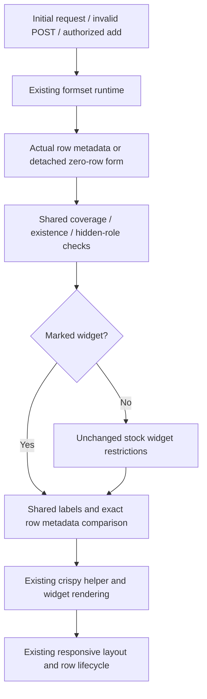

# Phase 06.25: Compact widget compatibility (#349) - Research

**Researched:** 2026-11-11
**Domain:** Django widget admission, compact formset metadata and regression evidence
**Confidence:** MEDIUM (official-documentation fallback classification; implementation seams directly inspected)

<user_constraints>
## User Constraints (from CONTEXT.md)

The following decisions, discretion and exclusions are copied verbatim from the phase context. [VERIFIED: .planning/phases/06.25-issue-349/06.25-CONTEXT.md]

<!-- DATA_71fb2a90_START -->
### Approved decisions carried forward from the maintainer discussion

- **D-01 — General explicit opt-in:** provide a compatibility marker mixin developers can add to widget classes.
  It is not restricted to Select or the four currently supported stock widget families.
- **D-02 — Developer-owned compatibility:** the marker expresses the developer's promise that the complete
  widget/template integration works with compact rendering. It supplies no rendering behavior and does not
  inspect or certify arbitrary overrides, HTML, CSS or JavaScript.
- **D-03 — Preserve defaults:** existing stock widgets continue to work; unmarked custom widgets retain the
  exact-stock allowlist and existing template/input-type/select-option checks. Django inheritance alone does
  not grant admission. Classic formsets retain their existing path.
- **D-04 — Separate checkbox support:** built-in CheckboxInput support and its desktop/mobile label fix belong
  in a separate issue. A developer may mark an adapted checkbox widget, but the marker alone does not fix it.
- **D-05 — Full widget-specific bypass:** marked widgets bypass widget type, template, input-type, option-template
  and multiple-selection restrictions. Preserve declared-field existence and coverage, hidden/identity/control
  exclusions, nonempty effective labels, and uniform row field types, widget types, labels and required state.
  Custom templates, radio groups and multiselects may pass admission without their output being certified.

### Delivery constraints from the approved handover

- Metadata projection must not render widgets or evaluate choices, including zero-total formsets. Preserve
  the detached metadata constructor, query boundary, actual widget-type comparison and existing lifecycle.
- No registry, adapter framework, HTML inspection, dependency additions, renderer changes, CSS or JavaScript
  changes. Keep the solution small and traceable under the developer-maintainability rule.
- Document associated accessible row labels or group semantics, shared desktop headings, mobile row labels,
  visible help/errors, necessary option labels, and correct prefixed IDs/names and dynamic-row initialization
  as the widget author's responsibilities. The marker guarantees neither equal heights nor valid markup.
- Demonstrate a marked Select preserving `data-beans` option attributes through initial rendering, invalid POST
  and authorized add/delete fragments. Verify headings, row-label association, help/errors and current prefixes.
- Cover a marked non-Select widget, a valid custom template, inherited marker semantics, the full marked
  admission boundary, unchanged unmarked rejections and all retained schema checks.
- Publish and execute a public-import recipe. Inspect the marked Select at desktop/mobile widths, including
  focus, errors and added rows; record actual observations rather than treating admission as visual evidence.
- Add an Unreleased changelog entry. This is additive: no new Breaking entry or migration requirement.
- Use multicore pytest for broad verification, plus appropriate changed-file lint/format checks.

### Researcher / planner discretion — existing delegated implementation proposals

- Working API: `CompactWidgetCompatible`, defined in `src/crud_views/lib/formsets/compact.py` and exported from
  `crud_views.lib.formsets`. Use an empty mixin with ordinary inherited `isinstance` semantics and a contract
  docstring. The source handover labels the concrete name/placement as bounded implementation proposals,
  not additional explicit maintainer decisions; no new API-selection question is needed.
- Guard only the existing widget-specific validation block in `_compact_schema`; keep shared checks outside
  the guard and `_CompactHeading.widget_type` equal to the actual widget type.
- Exact fixtures, private arrangement, documentation placement and verification commands are planning details.
  The existing two-task implementation plan is input to GSD planning, subordinate to D-01–D-05.
- Use an existing browser fixture or the downstream ProductSelect for the required visual observations.
  Do not expand this phase into downstream adoption or a new widget framework.

## Deferred Ideas

- Built-in CheckboxInput support and its compact label presentation fix; separate issue, not created here.
- Automatic widget compatibility discovery, output inspection, a registry/adapter framework and new stock
  widget support are outside this phase.
<!-- DATA_71fb2a90_END -->
</user_constraints>

## Summary

Implement one empty public marker and guard the existing widget-only validation block. The current function already separates field coverage/roles from widget restrictions and effective-label construction; projection compares complete heading records across rows. No renderer, template, persistence or browser-runtime redesign is needed. [VERIFIED: src/crud_views/lib/formsets/compact.py:61-121]

The planning effort belongs in regression coverage: prove the entire marked bypass, keep exact widget-type equality across rows, exercise detached zero-total metadata without rendering or choice iteration, and render a real marked Select through the existing authorized request path. Existing compact and executable-documentation tests passed during research: **88 passed in 2.88s**, four workers, before any implementation. [VERIFIED: research command `PYTHONPATH=src .venv/bin/python -m pytest tests/test1/test_formsets_compact.py tests/test1/test_formsets_compact_docs.py -n 4 -q`]

**Primary recommendation:** keep the two bounded implementation/documentation work units from the design input, but explicitly allocate the marked browser fixture and fresh visual evidence within their verification work. Do not treat schema admission or old browser evidence as proof of widget rendering. [VERIFIED: superpowers/specs/2026-11-11-compact-widget-compatibility-design.md, Scope and acceptance; phase context delivery constraints]

## Architectural Responsibility Map

| Capability | Primary Tier | Secondary Tier | Rationale / evidence |
|---|---|---|---|
| Marker admission and shared schema checks | Python server | — | Existing metadata functions own admission. [VERIFIED: src/crud_views/lib/formsets/compact.py:61-121] |
| Widget HTML, labels, help and errors | Server form/widget + crispy templates | Browser | Existing helper owns presentation; widget author owns custom integration. [VERIFIED: src/crud_views/lib/formsets/compact.py:124-147; phase context D-02] |
| Responsive headings/labels and added-row initialization | Existing browser CSS/JS | Server fragments | Preserve existing paths; verify the marked widget on them. [VERIFIED: phase context delivery constraints] |
| Choice lookup and validation | Existing Django field | Database when rendered/validated | Metadata projection must not consume choices. [VERIFIED: tests/test1/test_formsets_compact.py:802-833] |

## Project Constraints (from AGENTS.md)

The supplied AGENTS instructions and the local AGENTS symlink point to the repository guidance read as CLAUDE.md. Apply these directives during planning; the phase does not change the general view/workflow APIs. [VERIFIED: local `ls -ld AGENTS.md`; CLAUDE.md]

- Prefer the simplest bounded opt-in; preserve proven paths, document unsupported cases, and account for hidden state, query costs and developer ownership. [VERIFIED: CLAUDE.md:15-27]
- Broad pytest runs use multiple workers; serial is appropriate only for a tiny targeted selection or a concrete isolation constraint. Follow existing fixture naming. [VERIFIED: CLAUDE.md:127-135]
- Python line length is `120`; quote style is `double quotes`. The commit hook runs `ruff-format`. [VERIFIED: CLAUDE.md:64,143-144]
- Existing conventions remain: `cv_` view attributes, `wf_` transition methods, view keys `list`, `detail`, `create`, `update`, `delete`, `workflow`, `manage`; permissions map list/detail→view, create→add, update→change, delete→delete. [VERIFIED: CLAUDE.md:139-142]
- Use the existing hatchling build and bump-my-version release mechanism; no version bump is requested here. A new `### Breaking` changelog entry requires the migration guide to change, but this phase expressly requests an additive entry. [VERIFIED: CLAUDE.md:145-147; phase context delivery constraints]
- After shipping, refresh codebase maps. If a phase worktree is requested, use the existing workspace skill convention, inspect existing worktrees first, keep the dotted phase in the branch name, and carry uncommitted planning inputs deliberately. [VERIFIED: CLAUDE.md:66-83; phase context canonical references]

## Standard Stack

Reuse the installed project stack; install or upgrade nothing for this phase. Installed versions below are observations, not new minimum-version or compatibility claims. [VERIFIED: phase context no-dependency constraint; research `importlib.metadata.version()` probe]

| Component | Installed version | Role |
|---|---|---|
| Python | 3.12.3 | Existing interpreter; runtime probe |
| Django | 6.1.2 | Form/widget implementation; metadata probe |
| django-crispy-forms | 2.7 | Existing helper rendering; metadata probe |
| crispy-bootstrap5 | 2026.9 | Existing template pack; metadata probe |
| pytest / pytest-django / pytest-xdist | 9.2.0 / 4.14.0 / 3.8.0 | Existing integration/regression harness; metadata probe |
| Ruff | 0.17.3 | Existing changed-file lint/format checks; metadata probe |

All table versions: [VERIFIED: research interpreter and installed-distribution metadata probes, 2026-11-11]. Existing declared floors include verbatim `"django (>=4.2.0)"`, `"django-crispy-forms (>=2.0)"`, `"crispy-bootstrap5 (>=2023.10)"`; do not replace these with local installed versions. [VERIFIED: pyproject.toml:25-35]

**Package Legitimacy Audit:** Not applicable: no external package installation is proposed or authorized. Registry latest versions and publish dates are deliberately not used to introduce upgrades into this bounded change. [VERIFIED: phase context delivery constraints]

## Architecture Patterns



Diagram is the recommended implementation flow, grounded in the existing metadata/helper separation and approved bypass. [VERIFIED: src/crud_views/lib/formsets/compact.py:61-147; phase context D-05]

### Smallest source change and exact retained boundaries

1. Define the proposed marker with a contract docstring and no methods, hooks or state; explicitly re-export it beside the current compact declarations. Existing exports use verbatim `from .compact import CompactColumn as CompactColumn` and `from .compact import CompactLayout as CompactLayout`. [VERIFIED: src/crud_views/lib/formsets/__init__.py:1-2; phase context delegated proposal]
2. Guard **only** the current widget-validation statements at lines 83–90 with the ordinary negative marker-instance test. The stock tuple remains verbatim `supported = (widgets.TextInput, widgets.NumberInput, widgets.DateInput, widgets.Select)`. Keep exact-stock behavior unchanged for unmarked instances. [VERIFIED: src/crud_views/lib/formsets/compact.py:74-90]
3. Keep all shared checks before/after the guard. Role computation is verbatim `roles = {declaration.klass.model._meta.pk.name, declaration.klass.fk.name, "ORDER", "DELETE"}`; effective-label validation and the final heading construction stay outside. [VERIFIED: src/crud_views/lib/formsets/compact.py:64-94]
4. Keep the actual widget class in the heading: verbatim `headings.append(_CompactHeading(name, column.span, str(label), field.required, type(field), type(widget)))`. Marker inheritance grants admission, not permission to mix distinct widget subclasses across rows. [VERIFIED: src/crud_views/lib/formsets/compact.py:94,113-120]
5. Leave zero-total construction untouched: verbatim `kwargs = dict(instance.get_form_kwargs(None))` and `return _compact_schema(instance.form(**kwargs), declaration)`. Do not call empty-form augmentation, validation, rendering or a choice iterator to inspect compatibility. [VERIFIED: src/crud_views/lib/formsets/compact.py:102-112; tests/test1/test_formsets_compact.py:836-880]

### Component responsibilities and fixture reuse

| Surface | Planned responsibility | Existing anchor |
|---|---|---|
| Compact implementation and public exports | Empty marker + one guard | Functions/exports quoted above |
| Existing compact test module | Admission matrix, preserved schema, metadata, actual rendering and authorized fragments | `_runtime` constructs disposable configured forms; `compact_books` restores monkeypatched declarations. [VERIFIED: tests/test1/test_formsets_compact.py:346-361,651-662] |
| Existing compact docs test | Extract and execute a dedicated new recipe fence; assert public import and actual option attributes | Existing extraction selects one heading/fence and executes with a controlled test module namespace. [VERIFIED: tests/test1/test_formsets_compact_docs.py:19-35] |
| Formsets reference and Unreleased changelog | Separate stock support from developer-declared compatibility; additive entry | Existing reference currently rejects subclasses and custom templates. [VERIFIED: docs/reference/formsets.md:260-298; phase context delivery constraints] |
| Existing disposable browser server | Small marked Select fixture; actual desktop/mobile observations | Existing score form and nested editor are described below. [VERIFIED: tests/browser/conditional_formsets_server.py:237-256,400-428] |

### Regression design

Use a locally defined marked Select whose option hook calls super and adds the requested metadata. Use a known ordinary choice value in the public recipe so the example has no downstream model dependency. For the request tests, replace the existing title field with a compatible ChoiceField in a local form subclass, provide choices matching seeded rows, and monkeypatch the relevant declaration's formset factory so **initial GET, POST and fragment construction all use the same form**. Do not mutate only the initial row's widget and then claim fragment coverage. [VERIFIED: tests/test1/test_formsets_compact.py:346-361,651-698,275-343; planning recommendation grounded in these fixtures]

Cover the existing rejection matrix in marked and unmarked forms. Its literal cases are `"checkbox"`, `"radio"`, `"multiple"`, `"multiwidget"`, `"file"`, `"password"`, `"textarea"`, `"subclass"`, `"template"`, `"option"`, `"input_type"`, `"select_multiple"`. For marked versions this is **metadata admission only**; separately render the Select, Textarea and a valid custom-template example. Do not attempt to render every mismatched field/widget combination in the admission matrix. [VERIFIED: tests/test1/test_formsets_compact.py:726-770; phase context D-05]

Repeat retained rejection checks with marked widgets: missing declared fields, omitted visible fields including optional/disabled fields, hidden fields, identity/control roles, empty labels, and heterogeneous field type/widget type/label/required state. Include two different marked subclasses in separate rows. Existing heterogeneous cases are verbatim `"field_type", "widget_type", "required", "label", "missing", "extra"`; hidden/control cases are `"missing", "secret", "id", "publisher", "ORDER", "DELETE"`. [VERIFIED: tests/test1/test_formsets_compact.py:701-723,773-788]

For metadata tests, instrument a marked widget's render/option path to fail if invoked, and use a ModelChoice iterator that fails on evaluation during projection. Install sentinels after ordinary field construction where necessary to avoid testing Django's choice normalization instead of compact projection. Test both populated and zero-total formsets, preserving query capture and constructor counts. Keep a separate ordinary render assertion to demonstrate that actual rendering may query choices. [VERIFIED: tests/test1/test_formsets_compact.py:802-833,836-880; .venv/lib/python3.12/site-packages/django/forms/widgets.py:740-747,764-790; planning recommendation]

## Don't Hand-Roll

| Problem | Do not build | Use instead | Basis |
|---|---|---|---|
| Admission | Registry, adapters, HTML inspection, inferred compatibility | Empty inherited marker and existing schema checks | Locked D-01–D-05. [VERIFIED: phase context] |
| Option attributes | New package option-attribute API | Existing Django widget override | Django documents this hook explicitly. [CITED: https://docs.djangoproject.com/en/6.0/ref/forms/fields/#iterating-relationship-choices] |
| Label/help/error ownership | New rendering path | Existing compact helper and crispy templates | [VERIFIED: src/crud_views/lib/formsets/compact.py:124-147] |
| Add/delete semantics | New endpoint or row lifecycle | Authorized existing add request and existing deletion toggle | [VERIFIED: src/crud_views/static/crud_views/js/formset.js:340-370,452-486] |
| Browser proof | New permanent browser framework or rewritten evidence validator | Existing disposable host/runtime and focused fresh observations | [VERIFIED: tests/browser/conditional-formsets.cjs:150-187; phase context delegated browser reuse] |

## Common Pitfalls

### Partial bypass and overbroad bypass

Only skipping the class allowlist still rejects marked custom templates or selection behavior. Conversely, early-returning when marked skips shared role/label validation. Guard the full widget-only block and nothing else; preserve exact row comparisons. [VERIFIED: src/crud_views/lib/formsets/compact.py:70-94,113-120; phase context D-05]

### A locmem template test that uses the wrong renderer

Django's default form renderer uses a separate engine from the configured application template engines. Merely copying the existing heading-override test's locmem loader does not make a custom widget template visible. For the test only, bind the form's renderer to an engine containing that locmem template and ensure stock widget templates remain discoverable. One simple route is a locally configured TemplatesSetting renderer with the built-in widget template directory included. Do not change the package renderer. [CITED: https://docs.djangoproject.com/en/6.0/ref/forms/renderers/; VERIFIED: .venv/lib/python3.12/site-packages/django/forms/renderers.py:32-54,70-77; tests/test1/test_formsets_compact.py:137-158]

### Treating admission as visual certification

The installed crispy template's general label branch applies the helper label class, whereas its checkbox branch has its own label markup. A marker does not repair that branch; radio groups and multiselects also need author-owned semantics. Keep those cases in the admission matrix and document the presentation promise, without adding stock checkbox support. [VERIFIED: .venv/lib/python3.12/site-packages/crispy_bootstrap5/templates/bootstrap5/field.html:13-34; phase context D-02,D-04,D-05]

### Calling deletion a fragment request

Addition requests server HTML. Deletion toggles the existing row's deletion value and highlight; the widget remains in the row. Interpret the handover's add/delete-fragment wording as testing authorized added rows plus delete/unmark and POST redisplay on the existing lifecycle. Do not add a delete-fragment API. [VERIFIED: src/crud_views/static/crud_views/js/formset.js:340-370,452-486]

### Reusing stale Phase 06.24 browser output

The runner's capture destination is hard-coded, independently of its JSON output flag. The creation code is verbatim `const capturePath=\`${compactPhase}/browser-captures/${result.id}/${name}.png\`;` followed by `fs.mkdirSync(path.dirname(capturePath), {recursive:true});`; `compactPhase` is set to `'.planning/phases/06.24-opt-in-compact-formsets-shared-desktop-headings-and-nested-m'`. Running it with a new JSON `--output` still writes old-phase PNGs. Reuse its measurement logic, not its fixed artifact destination; do not overwrite historical proof or edit old phase reports. [VERIFIED: tests/browser/conditional-formsets.cjs:26-30,859-864]

## Code Examples

The implementation shape below is a **proposal**, not a claim that the API already exists. Its marker name and guard come from the delegated working proposal in the context. Existing data values are the source literals quoted above. [VERIFIED: phase context researcher/planner discretion]

<!-- DATA_81a9d3c2_START -->
```python
class CompactWidgetCompatible:
    """Developer promise that this widget integrates with compact formset rendering.

    Supplies no rendering behavior or output certification. Shared schema checks remain.
    """


# Inside _compact_schema, after shared field/role checks:
if not isinstance(widget, CompactWidgetCompatible):
    # Keep the entire current widget-only validation block here, unchanged.
    ...
# Keep effective labels and actual type(widget) heading construction outside.
```
<!-- DATA_81a9d3c2_END -->

For the recipe's option hook, preserve the existing downstream behavior: verbatim `option = super().create_option(name, value, label, selected, index, subindex, attrs)`, then `option["attrs"]["data-beans"] = "1"` for a selected known choice, then return the option. The downstream condition checks a model instance; the public example should use a self-contained ordinary choice instead. [VERIFIED: ../tabler-test/example/sales/forms.py:95-102; CITED: https://docs.djangoproject.com/en/6.0/ref/forms/fields/#iterating-relationship-choices]

## State of the Art

This phase extends an existing explicit contract, not a framework migration. Keep exact-stock default admission and add developer-owned explicit admission. Django already documents the option customization used by the motivating widget, so no dependency or framework replacement is required. [VERIFIED: phase context D-01–D-05; CITED: https://docs.djangoproject.com/en/6.0/ref/forms/fields/#iterating-relationship-choices]

## Environment Availability

| Dependency | Availability observed | Fallback / action |
|---|---|---|
| Project Python and pytest plugins | Available; compact baseline passes | Use existing environment |
| Existing crispy-floor environment | Available; Django 6.0.9 | Optional focused cross-version confirmation; no installation needed |
| Node | Available, v24.21.0 | Existing browser scripting runtime |
| Cached Playwright | Available, 1.64.1 | Reuse installed cache, do not download |
| Cached Chromium | Available, Google Chrome for Testing 149.0.7827.55 | Reuse installed binary |
| Context7 MCP / ctx7 CLI | Not available to this agent | Used official documentation through web fallback |

Availability and versions: [VERIFIED: research command/path probes, 2026-11-11]. File presence/version probes do **not** claim a browser run happened. No application database/service or downstream checkout adoption is needed for the recommended local fixture. [VERIFIED: tests/browser/conditional_formsets_server.py:21-25; phase context browser discretion]

**Missing blocking dependencies:** none identified for Python verification or the existing browser harness. Actual browser acceptance remains execution work. [VERIFIED: research runtime probes and baseline test result]

## Validation Architecture

Validation and security are enabled: verbatim `"nyquist_validation": true`, `"security_enforcement": true`, `"security_asvs_level": 1`. [VERIFIED: .planning/config.json:24,48-49]

### Test framework and commands

| Property | Value |
|---|---|
| Framework | Existing pytest 9.2.0, pytest-django 4.14.0, xdist 3.8.0 [VERIFIED: installed metadata probe] |
| Configuration | Existing project options contain `addopts = "--strict-markers"`; Django is configured by test conftest. [VERIFIED: pyproject.toml:145-146; tests/test1/conftest.py:43-104] |
| Quick command | `PYTHONPATH=src .venv/bin/python -m pytest tests/test1/test_formsets_compact.py tests/test1/test_formsets_compact_docs.py -n 4 -q` — baseline 88 passed in 2.88s [VERIFIED: research execution] |
| Full suite | `PYTHONPATH=src .venv/bin/python -m pytest tests -n 4 -q` — execution gate, not run during research |
| Lint/format | `.venv/bin/ruff check` and `.venv/bin/ruff format --check` with explicit changed Python files — execution gate |

Commands in this table are recommended execution commands; only the quick command was run in research.

### Phase acceptance → test map

There are no assigned requirement IDs yet: roadmap contains verbatim `**Requirements**: TBD`. Do not invent traceability IDs; use approved decision/acceptance labels until the orchestrator fills the roadmap. [VERIFIED: .planning/ROADMAP.md:1691-1699]

| Acceptance | Test type and target | Focused command suffix after `python -m pytest` | Existing coverage / gap |
|---|---|---|---|
| Public marker, inherited admission, full bypass, exact unmarked defaults | Unit/integration in existing compact module | `tests/test1/test_formsets_compact.py -k 'schema or public' -n 4 -q` | Existing stock/schema baseline; add marked cases |
| Shared hidden/role/coverage/label/row consistency | Integration in same module | `tests/test1/test_formsets_compact.py -k 'schema or label' -n 4 -q` | Extend retained checks with marked widgets |
| Query-free populated/zero-total metadata | Database query capture + render/iteration sentinels | `tests/test1/test_formsets_compact.py -k metadata -n 4 -q` | Existing detached/query tests; add marked sentinel cases |
| Real option metadata, errors, headings, prefixes, authorized added rows and deletion | Request/render integration | `tests/test1/test_formsets_compact.py -n 4 -q` | Extend local form/factory and existing authorized fixtures |
| Public copied recipe | Execute dedicated documentation fence and render result | `tests/test1/test_formsets_compact_docs.py -q` | New test in existing module; serial appropriate for tiny selection |
| Desktop/mobile visibility, keyboard focus, errors and added-row compatibility | Actual Chromium observations/screenshots | See procedure below | Fresh marked-widget browser proof required |

Existing anchors for the map: [VERIFIED: tests/test1/test_formsets_compact.py:275-361,629-638,651-788,802-880,944-982; tests/test1/test_formsets_compact_docs.py:19-75]. Proposed selectors match existing broad categories; the planner must include new named tests in those gates rather than relying on selection names alone.

### Browser evidence reuse without framework expansion

Use the existing disposable authenticated host. The score fixture already has a ModelChoice select, help text, nested siblings and parent/child rows: source literals include `"taster"`, `"scores"`, and `"compact-presentation"` / `"compact-lifecycle"`. A small test-fixture change can place a marked metadata-producing Select on that existing select, or add a local marked title-choice variant for the request path. Preserve existing unrelated scenarios. [VERIFIED: tests/browser/conditional_formsets_server.py:118-120,237-256,400-428,535-543]

Start the host using `PYTHONPATH=src:. CV_CONDITIONAL_PORT=8144 .venv/bin/python tests/browser/conditional_formsets_server.py`. The runner already uses this server and accepts an explicit Python override; its normal session signs in then discovers case URLs. Source literals are `path("signin/", signin)`, `path("cases/", lambda request: JsonResponse(cases, safe=False))`, and `path("compact/<str:mode>/<int:pk>/", edit)`. Use the returned case URL, not a guessed primary key. [VERIFIED: tests/browser/conditional-formsets.cjs:158-187; tests/browser/conditional_formsets_server.py:613-619]

Recommended procedure: use available browser tooling or a temporary phase-owned observation driver against that host, without modifying product JavaScript. Inspect widths **390 and 1280** and optionally both sides of the existing breakpoint. Existing runner literals are `const widths = [390, 767, 768, 1280];`; its measurements check label association/visibility, field/head alignment, focus and overflow. [VERIFIED: tests/browser/conditional-formsets.cjs:30,389-428,802-856]

Record the marked class actually used, page URL, interpreter/dependency versions, source revision or relevant hashes, viewport, screenshot location, and observations for: initial option metadata; one accessible label per Select; desktop shared heading/mobile row label; focus; visible help/owned errors after invalid POST; added row metadata/current prefixes; delete/unmark preserving heading ownership. Save new artifacts under this phase's evidence area, record actual observations, and leave old phase evidence alone. This is verification work, not authorization for downstream adoption, renderer changes or a generic browser framework. [VERIFIED: phase context delivery constraints and delegated browser reuse; planning recommendation]

### Sampling and Wave 0 gaps

- **Per task:** quick two-module suite; use serial only for the tiny recipe test.
- **Per wave:** quick suite plus changed-file lint/format; run broader tests when source/tests are complete.
- **Phase gate:** full multicore suite, passing new recipe, and fresh marked-widget desktop/mobile evidence.
- **Wave 0:** no framework/config installation. Add the marked fixtures and assertions to existing modules; choose and allocate the minimal browser fixture plus phase-owned evidence destination explicitly. Existing tests are the scaffold, not coverage of the new API. [VERIFIED: research baseline; phase context acceptance]

## Security Domain

Use version-labelled **ASVS 5.0.0**, published 30 May 2025; the generic older V2-authentication/V5-input-validation numbering is not the current standard's numbering. [CITED: https://asvs.owasp.org/; https://github.com/OWASP/ASVS/blob/master/5.0/docs_en/OWASP_Application_Security_Verification_Standard_5.0.0_en.csv]

| ASVS 5 category | Applicability and existing control |
|---|---|
| V1 Encoding and Sanitization | Preserve escaped labels/help and Django option-attribute rendering; never mark arbitrary application values safe to make a recipe pass. [VERIFIED: src/crud_views/lib/formsets/compact.py:133-137; tests/test1/test_formsets_compact.py:449-515] |
| V2 Validation and Business Logic | Shared schema and normal field validation remain authoritative. [VERIFIED: src/crud_views/lib/formsets/compact.py:64-94] |
| V6 Authentication / V7 Session Management / V8 Authorization | Existing authenticated request/fragment harness and Django middleware remain unchanged; exercise authorized fragments on the same route. [VERIFIED: tests/test1/conftest.py:73-80; tests/test1/test_formsets_compact.py:275-343] |
| V11 Cryptography | No new cryptographic feature within the approved marker-only scope. [VERIFIED: phase context boundary] |

Category names: [CITED: https://github.com/OWASP/ASVS/blob/master/5.0/docs_en/OWASP_Application_Security_Verification_Standard_5.0.0_en.csv]. Scope mapping is a planning recommendation, not a certification claim.

| Threat | STRIDE | Required bounded mitigation |
|---|---|---|
| Custom labels/help/option metadata interpreted as markup | Tampering | Preserve escaping; render the recipe with ordinary values using existing Django/crispy paths. [VERIFIED: src/crud_views/lib/formsets/compact.py:133-137] |
| Marker inadvertently bypasses row-role/schema checks | Tampering | Guard only widget checks; regression tests for marked hidden/identity/control fields and heterogeneous rows. [VERIFIED: src/crud_views/lib/formsets/compact.py:64-94,113-120] |
| Added widget fixture bypasses normal request authorization | Elevation of privilege | Reuse existing authenticated update/fragment fixtures; do not create a production shortcut route. [VERIFIED: tests/test1/test_formsets_compact.py:275-343] |

## Assumptions Log

No unverified product behavior is proposed as a locked decision. Recommendations above are implementation/test choices within the delegated scope. The marked API is not implemented yet, and fresh browser compatibility is an explicit execution obligation, not an assumed result.

| # | Claim | Section | Risk if wrong |
|---|---|---|---|
| — | No training-only factual claims used | — | — |

## Open Questions

- **No open behavior decision:** D-01–D-05 settle admission and developer responsibility. [VERIFIED: phase context; live issue #349 read with `gh issue view 349 --json title,body,comments`]
- **Planning allocation:** make the marked browser fixture and phase-owned observation output concrete; the old runner's output flag alone is insufficient. The reusable host/runtime is available, but this research did not run browser acceptance. [VERIFIED: tests/browser/conditional-formsets.cjs:26-30,859-864; runtime probes]
- **Traceability:** orchestrator/planner should replace the roadmap placeholder or explicitly map issue acceptance; requirement IDs have not been assigned. [VERIFIED: .planning/ROADMAP.md:1691-1699]

## Sources

- Local authoritative inputs read: phase context, canonical design and implementation-plan input; CLAUDE.md; project, requirements and current state; previous compact context; source/tests and installed Django/crispy sources cited inline. [VERIFIED: research file reads]
- Live authoritative issue: https://github.com/jacob-consulting/django-crud-views/issues/349 — confirmed approved D-01–D-05 and no open behavior decisions. [VERIFIED: `gh issue view 349 --json title,body,comments`]
- Official Django fields documentation — custom Select option metadata. [CITED: https://docs.djangoproject.com/en/6.0/ref/forms/fields/#iterating-relationship-choices]
- Official Django renderer documentation — independent default engine and configured-engine renderer. [CITED: https://docs.djangoproject.com/en/6.0/ref/forms/renderers/]
- Official OWASP ASVS site/source — version and category mapping. [CITED: https://asvs.owasp.org/; https://github.com/OWASP/ASVS/blob/master/5.0/docs_en/OWASP_Application_Security_Verification_Standard_5.0.0_en.csv]

## Metadata

- Research-plan seam selected Context7 for Django and websearch for ASVS. Context7 MCP/CLI were unavailable; official-documentation web fallback was used. `classify-confidence --provider websearch --verified` returned `MEDIUM`; both digests were cached with that tier. [VERIFIED: research-plan, provider discovery, classification and research-store outputs]
- Graph status returned `"exists": false`; no graph relationships were used. Agent-skills query returned no injected skills; no project skill directories were found. [VERIFIED: init/discovery commands]
- Standard stack: MEDIUM; existing declared dependencies and installed versions, no upgrade claims. Architecture: MEDIUM; direct local evidence plus approved design. Pitfalls: MEDIUM; installed source and official documentation cross-checks. Browser completion: deliberately not claimed.
- Research date: 2026-11-11. Re-read if compact validation, formset lifecycle or template-pack behavior changes; otherwise usable for planning this phase now.
