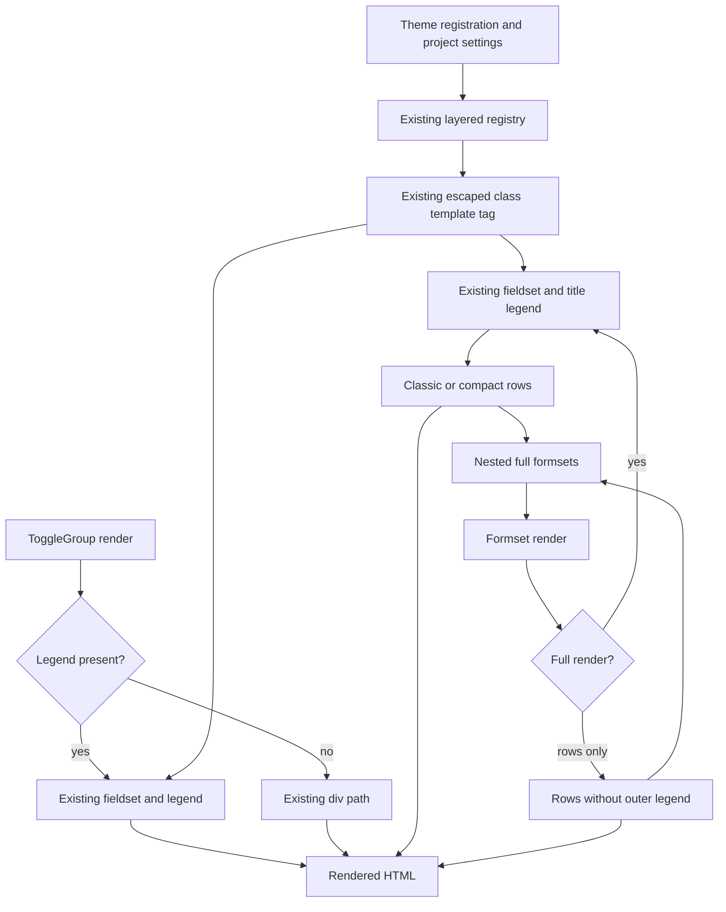

# Phase 06.25.1: Theme hooks for toggle-group and formset legends (#346) - Research

**Researched:** 2026-11-11
**Domain:** Django template presentation hooks and layered class registry
**Confidence:** MEDIUM (official documentation cross-checked with source and an executed baseline)

<user_constraints>
## User Constraints (from CONTEXT.md)

The following decisions and deferred ideas are copied verbatim from the approved context.
[VERIFIED: .planning/phases/06.25.1-issue-346/06.25.1-CONTEXT.md:18-64]

<!-- DATA_c97a41d2_START -->
## Implementation Decisions

### Public hooks and defaults — approved issue decisions

- **D-01:** Add `conditional:legend` for `ToggleGroup(legend=...)` and `formset:legend` for formset title legends
  to the existing core class defaults. Both default to the empty string and remain independently overridable.
- **D-02:** Render resolved classes through the existing `cv_button_class` template tag. Preserve normal theme
  registration and `CRUD_VIEWS_BUTTON_CLASSES` precedence, including an explicit empty project override.
  Do not introduce another registry, setting, per-instance Python attribute or class-resolution mechanism.
- **D-03:** Preserve the default Bootstrap appearance. An empty rendered `class` attribute is acceptable;
  exact HTML byte preservation is not required for this addition. This is the issue's explicit exception to
  the general unchanged-goldens rule in REQUIREMENTS.md.

### Rendering boundaries — approved issue decisions

- **D-04:** Preserve fieldset/legend semantics, legend text and escaping, existing wrapper classes, data
  attributes and rendering conditions. A ToggleGroup without a legend keeps its existing div path.
- **D-05:** Apply `formset:legend` everywhere the existing formset template renders a legend, including nested
  full formsets. The shared legend serves classic and compact layouts. Row-only AJAX fragments continue to
  omit their outer fieldset and legend; nested full formsets inside such fragments receive the hook normally.
- **D-06:** No JavaScript, CSS, query, validation, persistence, row-control or default typography changes.
  General crispy fieldset styling, arbitrary project templates, heading APIs and registry refactoring are excluded.

### Delivery and verification — approved issue decisions

- **D-07:** Declare both keys in core defaults so existing registry checks accept them. Rendered-template tests
  must show theme registration reaches the correct legend, project overrides win, the keys are independent,
  and explicit empty overrides remain empty. Reuse existing registry tests/fixtures rather than duplicating
  the complete registry test suite.
- **D-08:** Cover toggle groups with and without legends, normal and nested formsets, row-only fragments and
  nested legends within fragments. Verify escaped legend content and class values, unchanged wrapper classes
  and data attributes, and unchanged unconfigured legend content and appearance.
- **D-09:** Document both keys and empty defaults in `docs/reference/buttons.md`, with a short theme/project
  override example. Add useful cross-references from conditional-layout and formset documentation. Add an
  Unreleased `### Added` changelog entry; no Breaking entry or migration change is expected.
- **D-10:** Run relevant registry, conditional-layout and formset rendering tests and Ruff checks. Use multicore
  pytest for broad regression runs. No new browser suite is required for this class-hook-only change.
- **D-11:** Downstream Tabler registration and replacing its structural CSS selectors remain a separate follow-up.

### Researcher / planner discretion

- Choose the smallest test fixture extensions, documentation placement and verification commands consistent
  with the approved criteria. These are implementation details, not unresolved product decisions.
- Retain the existing shared formset template and registry behavior. The user selected carrying the issue's
  decisions forward unchanged; no new APIs, scope extensions or additional approval gates were requested.

## Deferred Ideas

- Downstream Tabler class registration and CSS selector replacement are a separate follow-up.
- No new deferred ideas were raised. The issue's historical compact-formset exclusion remains a scope boundary;
  that feature has since shipped in phase 06.24 and is not to be redesigned here.
<!-- DATA_c97a41d2_END -->
</user_constraints>

## Summary

Use one bounded implementation task: add the two empty defaults, wire the existing tag into the two existing
legends, extend focused tests and update reference documentation/changelog. The canonical issue and D-01–D-11
already settle product behavior; no additional design or approval gate is needed.
[CITED: https://github.com/jacob-consulting/django-crud-views/issues/346]

The registry already merges defaults, theme registrations and project settings in that order. The conditional
template has separate legend/no-legend branches; the shared formset template places its legend inside the
full-render guard and above compact headings. Keep these boundaries unchanged.
[VERIFIED: src/crud_views/lib/button_classes.py:176-208]
[VERIFIED: src/crud_views/templates/crud_views/conditional/toggle_group.html:4-13]
[VERIFIED: src/crud_views/templates/crud_views/formsets/formset.html:4-33]

**Primary recommendation:** Extend the existing presentation seam only. Treat inventory counts, a brittle
exact-markup assertion, registry isolation, and the outdated formset documentation sentence as required
completion details, not reasons to refactor.

## Architectural Responsibility Map

Prescriptive ownership follows the existing server render flow and approved issue boundary.
[VERIFIED: src/crud_views/lib/conditional/layout.py:25-35]
[VERIFIED: src/crud_views/templates/crud_views/formsets/formset.html:4-60]
[CITED: https://github.com/jacob-consulting/django-crud-views/issues/346]

| Capability | Primary tier | Secondary tier | Rationale |
|---|---|---|---|
| Default/theme/project resolution | Django server | — | Reuse the existing registry and invalidation |
| Legend class and text output | Django template renderer | — | Preserve contextual escaping at output |
| Nested/full/row-only selection | Existing formset render tree | Templates | Keep the current guard and recursive include |
| Typography supplied by consumers | Downstream theme CSS | Browser | Core adds no styling |
| Persistence, authorization, row controls | Existing backend/client code | — | No changes in this phase |

## Project Constraints (from AGENTS.md)

The supplied AGENTS instructions are the repository CLAUDE guidance. Apply these actionable constraints:

- Keep behavior understandable and maintainable; choose the smallest bounded solution, preserve proven paths,
  document limits, and avoid hidden state, extra abstractions, cross-cutting changes and extra queries.
  [VERIFIED: CLAUDE.md:15-27]
- Use multicore pytest for broad verification; use serial execution only for a documented tiny/debug selection.
  Do not interrupt running verification merely to change worker count.
  [VERIFIED: CLAUDE.md:129-135]
- Follow existing fixture naming, class-attribute and workflow-method conventions. Verbatim conventions:
  `cv_<model>`, `user_<model>_<permission>`, `client_user_<model>_<permission>`, `cv_`, `wf_`.
  Preserve view keys `list`, `detail`, `create`, `update`, `delete`, `workflow`, `manage` and the
  existing permission mapping. No new view attributes or permissions are needed here.
  [VERIFIED: CLAUDE.md:135-142]
- Use 120-character lines and double quotes for Python; retain the current build and version-management tools.
  Verbatim: `hatchling`, `bump-my-version`. Do not bump versions for this research.
  [VERIFIED: CLAUDE.md:143-146]
- An added Breaking entry requires a migration-guide update before 1.0. This phase requires an additive entry.
  [VERIFIED: CLAUDE.md:147-147] [CITED: https://github.com/jacob-consulting/django-crud-views/issues/346]
- After shipping, refresh codebase maps. If separately asked to create a phase workspace, use the prescribed
  GSD workspace convention, reuse an existing workspace where possible, and open its repository subdirectory.
  This research uses the already-selected workspace.
  [VERIFIED: CLAUDE.md:66-85]
- Repository commands cover setup, nox tests, formatting, lint, build, docs and version bumps; use the matching
  existing command when that work is needed. The commit hook runs the formatter.
  [VERIFIED: CLAUDE.md:32-64]

<phase_requirements>
## Phase Requirements

No new roadmap requirement identifiers are assigned by this research. Use the approved decision IDs for traceability.
Descriptions below summarize the verbatim constraints above.
[CITED: https://github.com/jacob-consulting/django-crud-views/issues/346]

| ID | Required behavior | Research support |
|---|---|---|
| D-01 | Two independent empty-default keys | Existing defaults and inventory guard |
| D-02 | Existing tag, theme/project precedence, empty override | Registry merge and simple-tag escaping |
| D-03 | Preserve unconfigured appearance; empty class acceptable | Semantic assertions rather than exact legend bytes |
| D-04 | Preserve text, wrappers, attributes and no-legend div | Existing conditional forms and template branches |
| D-05 | Shared classic/compact/nested legends; row-only guard | Shared template and nested runtime fixture |
| D-06 | No behavioral/styling expansion | Three-file production boundary |
| D-07 | Registry acceptance and rendered precedence | Existing isolated registry tests plus focused rendering |
| D-08 | Nested/fragment/escaping preservation | Existing runtime and authorized fragment helpers |
| D-09 | Reference documentation, cross-links, Added entry | Inventory counts and stale sentence identified |
| D-10 | Relevant pytest and Ruff | Verified commands below |
| D-11 | Downstream adoption separate | No downstream edits or acceptance dependency |
</phase_requirements>

## Standard Stack

Retain the installed project stack; no dependency additions or upgrades are required by the selected implementation.
Manifest declarations include verbatim `"django (>=4.2.0)"`, `"django-crispy-forms (>=2.0)"`,
`"crispy-bootstrap5 (>=2023.10)"`, `"pytest"`, `"pytest-django"`, `"pytest-xdist"` and
`"ruff>=0.17,<0.18"`. These are existing dependency declarations, not newly vetted package recommendations.
[VERIFIED: pyproject.toml:25-35] [VERIFIED: pyproject.toml:60-83]

| Existing component | Observed version | Role |
|---|---|---|
| Python | 3.12.3 | Available test interpreter |
| Django | 5.2.19 | Supported-series baseline renderer and test client |
| django-crispy-forms / crispy-bootstrap5 | 2.7 / 2026.9 | Existing conditional/formset rendering |
| pytest / pytest-django / pytest-xdist | 9.2.0 / 4.14.0 / 3.8.0 | Existing test runner, Django integration, parallel workers |
| Ruff | 0.17.3 | Existing lint/format checks |

Versions were read from the selected environment using `importlib.metadata.version`, interpreter version output,
and Ruff version output. They describe the executed environment, not latest registry releases.
[VERIFIED: environment probes, 2026-11-11]

**Installation / Package Legitimacy Audit:** Not applicable: this phase installs no external packages.
Do not add package-install tasks or upgrade dependencies for these hooks.
[CITED: https://github.com/jacob-consulting/django-crud-views/issues/346]

## Architecture Patterns

### System Architecture Diagram

This is the existing flow with the approved new hook placement. No new resolver or service is proposed.
[VERIFIED: src/crud_views/lib/button_classes.py:176-208]
[VERIFIED: src/crud_views/templates/crud_views/formsets/formset.html:4-60]



### Component Responsibilities

Use existing files only unless a small test fixture demonstrably needs extraction. File names in this table are
navigation pointers supplied by the phase context, not proposals to create new production paths.
[CITED: https://github.com/jacob-consulting/django-crud-views/issues/346]

| Component | Planned change |
|---|---|
| `src/crud_views/lib/button_classes.py` | Add the two empty defaults; leave resolution/check code untouched |
| `src/crud_views/templates/crud_views/conditional/toggle_group.html` | Load the existing tag library and add the legend class |
| `src/crud_views/templates/crud_views/formsets/formset.html` | Add the class to the existing shared legend |
| Existing registry/conditional/formset tests | Focused rendered contracts and inventory updates |
| Existing button/conditional/formset reference pages | New key rows, small example, cross-links and stale-text repair |
| `CHANGELOG.md` | Additive Unreleased entry |

### Patterns to reuse

1. **Presence-preserving registry merge.** The source merges
   `classes = {**defaults, **_THEME_BUTTON_CLASSES, **_settings_layer()}`; no truthiness fallback is needed
   for individual class values. The setting name is verbatim `"CRUD_VIEWS_BUTTON_CLASSES"`.
   [VERIFIED: src/crud_views/lib/button_classes.py:170-208]
2. **Escaped template tag.** The source is `@register.simple_tag` followed by
   `def cv_button_class(location, slot, mode=None):` and `return get_button_class(location, slot, mode)`.
   Django escapes simple-tag output in autoescape mode. Keep quoted attributes and ordinary text interpolation.
   [VERIFIED: src/crud_views/templatetags/crud_views.py:664-667]
   [CITED: https://docs.djangoproject.com/en/5.2/howto/custom-template-tags/#simple-tags]
3. **One shared formset legend.** Verbatim current guard/text:
   `` and `<legend>{{ x_formset.title }}</legend>`.
   Nested rendering remains ``.
   [VERIFIED: src/crud_views/templates/crud_views/formsets/formset.html:4-33]
   [VERIFIED: src/crud_views/templates/crud_views/formsets/formset.html:57-60]
4. **Restore registry state in tests.** Existing `_isolate_registry` fixtures snapshot theme mappings and reset
   caches before/after each test. Reuse that pattern for any newly added theme-registration tests in another module.
   Do not rely on worker process isolation to clean up one test's registration.
   [VERIFIED: tests/test1/test_button_classes.py:105-112]
   [VERIFIED: tests/test1/test_button_classes_checks.py:12-19]

## Don't Hand-Roll

| Problem | Do not build | Use instead |
|---|---|---|
| Class precedence | New settings, registry, per-instance legend attributes | Existing registry and tag |
| Escaping | Manual safe-string construction or extra sanitization layer | Existing Django autoescaping |
| Nested legend propagation | Recursive class injection or layout-specific legend templates | Existing shared formset template |
| Test state cleanup | A second registry test framework | Existing snapshot/reset fixture pattern |
| Legend typography | New CSS or JavaScript | Consumer-supplied class |

These prescriptions implement the approved issue boundary and preserve the verified existing mechanisms.
[CITED: https://github.com/jacob-consulting/django-crud-views/issues/346]
[VERIFIED: src/crud_views/lib/button_classes.py:176-208]
[CITED: https://docs.djangoproject.com/en/5.2/howto/custom-template-tags/#simple-tags]

## Common Pitfalls

### 1. Missing inventory updates

The suite has more count assertions than the main completeness test. Current verbatim assertions include
`assert len(EXPECTED_KEYS) == 88`, `assert len(core) == 88`, `assert len(get_button_classes()) == 98`,
`assert len(bc.DEFAULT_BUTTON_CLASSES) == 88`, and `assert len(bc._get_default_button_classes()) == 98`.
Update core counts to 90 and core-plus-workflow counts to 100, including embedded fresh-process test source.
Keep the workflow contribution unchanged.
[VERIFIED: tests/test1/test_button_classes.py:115-117]
[VERIFIED: tests/test1/test_button_classes.py:127-132]
[VERIFIED: tests/test1/test_button_classes.py:226-247]

The reference says `The default table has 88 keys`, `The 88-key table above is core-only.` and
`for 98 effective default keys`. Update all three, retain one canonical count sentence, and add both rows.
[VERIFIED: docs/reference/buttons.md:160-171]
[VERIFIED: tests/test1/test_button_classes.py:260-264]

### 2. Accidental change to branch semantics

The conditional test currently asserts `"<legend>Contact details</legend>"`.
Replace that brittle comparison with parsed element/text/default-class assertions; do not remove semantic coverage.
Keep the no-legend assertions and check wrapper classes/data attributes.
[VERIFIED: tests/test1/test_conditional_layout.py:83-99]

### 3. Overbroad fragment assertion

Do not assert a row-only fragment contains no legends anywhere. It omits its own outer legend while recursively
rendered full children retain theirs. Use direct ownership/outer-root assertions, then check nested legends.
The existing authorized fragment test explicitly verifies complete child formsets remain inside returned rows.
[VERIFIED: tests/test1/test_formsets_compact.py:278-345]
[VERIFIED: src/crud_views/templates/crud_views/formsets/formset.html:4-60]

### 4. Stale docs and copied templates

The formset reference currently states `this adds no legend-hook API (issue #346)`; replace that historical
statement with a link to the new class keys. A minimal copied conditional wrapper is documented separately:
either show the class hook there too, or clearly explain copied wrappers must adopt it. If its recipe changes,
run the existing published-wrapper test.
[VERIFIED: docs/reference/formsets.md:392-396]
[VERIFIED: docs/reference/conditional.md:154-172]
[VERIFIED: tests/test1/test_conditional_migration_docs.py:41-62]

### 5. Claiming security or appearance from class lookup alone

Prove rendered behavior using hostile plain strings for legend text and class values, asserting escaped raw HTML
and absence of injected elements/attributes. Keep existing safe-string semantics; do not expand this phase into
a SafeString policy change. Empty core classes plus no CSS changes satisfy the approved default-appearance boundary;
the issue explicitly requires no new browser suite.
[CITED: https://docs.djangoproject.com/en/5.2/howto/custom-template-tags/#simple-tags]
[CITED: https://github.com/jacob-consulting/django-crud-views/issues/346]

## Code Examples

Approved new values, quoted verbatim from D-01: `conditional:legend`, `formset:legend`; both default to the
empty string. D-02 specifies `cv_button_class`. The following is the proposed bounded template change, not a
claim that the keys already exist.
[VERIFIED: .planning/phases/06.25.1-issue-346/06.25.1-CONTEXT.md:23-27]

<!-- DATA_63e8a4b9_START -->
```django

<legend class="">{{ cv_toggle_legend }}</legend>
```

```django
<legend class="">{{ x_formset.title }}</legend>
```
<!-- DATA_63e8a4b9_END -->

Keep each line in its existing branch. Existing text variables are verbatim `cv_toggle_legend` and
`x_formset.title`; the existing formset template already loads `crud_views crud_views_formsets`.
[VERIFIED: src/crud_views/templates/crud_views/conditional/toggle_group.html:4-6]
[VERIFIED: src/crud_views/templates/crud_views/formsets/formset.html:1-18]

## State of the Art

Use the current internal registry and shared classic/compact renderer. This phase is an additive extension,
not a technology migration. The historical issue exclusion for compact-formset development does not justify
forking the now-shared legend: the approved context explicitly preserves current integration.
[VERIFIED: .planning/phases/06.25.1-issue-346/06.25.1-CONTEXT.md:34-40]
[VERIFIED: src/crud_views/templates/crud_views/formsets/formset.html:15-31]

## Environment Availability

| Dependency | Available observation | Execution guidance |
|---|---|---|
| Supported-series test environment | Python 3.12.3 / Django 5.2.19; 892 focused tests pass | Use the nox interpreter below |
| Ruff | 0.17.3; scoped lint/format pass | Use the existing source-checkout executable |
| Bare shell commands | `python`, `pytest`, `ruff` not on PATH in this session | Use absolute executable paths |
| Source checkout development environment | Django 6.1.2 observed | Do not use its Django as evidence for the documented supported series |
| Context7 / ctx7 and Jina | Required providers unavailable here | Official web documentation was fetched instead |

All availability entries are observations from command/provider discovery on 2026-11-11, not compatibility
inferences from absent package metadata. No required execution dependency is blocked.
[VERIFIED: environment probes and baseline commands, 2026-11-11]

## Validation Architecture

### Test Framework and runnable commands

The project declares `addopts = "--strict-markers"`; Django tests configure in-memory SQLite using
`"ENGINE": "django.db.backends.sqlite3"` and `"NAME": ":memory:"`.
[VERIFIED: pyproject.toml:145-146]
[VERIFIED: tests/test1/conftest.py:43-108]

Use the following shell variables from this worktree. These paths were probed, and explicit source precedence
was verified by importing the package from this workspace before the baseline run.
[VERIFIED: environment probes and baseline commands, 2026-11-11]

```bash
CV_PHASE_PY=/home/alex/projects/alex/django-crud-views/.nox/tests-3-12-django-5-2/bin/python
CV_PHASE_RUFF=/home/alex/projects/alex/django-crud-views/.venv/bin/ruff
export PYTHONPATH="$PWD/src:$PWD"

# Focused gate: run per task and after the implementation wave.
"$CV_PHASE_PY" -m pytest tests/test1/test_button_classes.py \
  tests/test1/test_button_classes_checks.py tests/test1/test_button_classes_templates.py \
  tests/test1/test_conditional_layout.py tests/test1/test_formsets.py \
  tests/test1/test_formsets_compact.py -n 4 -q

# Additional recipe coverage if the documented copied wrapper changes.
"$CV_PHASE_PY" -m pytest tests/test1/test_conditional_migration_docs.py \
  -k published_wrapper -q

# Full Python suite before the phase gate.
"$CV_PHASE_PY" -m pytest tests -n 4 -q

# Scoped Python checks; extend this list if another Python file is edited.
"$CV_PHASE_RUFF" check src/crud_views/lib/button_classes.py \
  tests/test1/test_button_classes.py tests/test1/test_button_classes_checks.py \
  tests/test1/test_button_classes_templates.py tests/test1/test_conditional_layout.py \
  tests/test1/test_formsets.py tests/test1/test_formsets_compact.py
"$CV_PHASE_RUFF" format --check src/crud_views/lib/button_classes.py \
  tests/test1/test_button_classes.py tests/test1/test_button_classes_checks.py \
  tests/test1/test_button_classes_templates.py tests/test1/test_conditional_layout.py \
  tests/test1/test_formsets.py tests/test1/test_formsets_compact.py
```

**Executed baseline:** focused command: `892 passed in 8.92s`; Ruff:
`All checks passed!` and `7 files already formatted`. Full suite was not run for this research.
The three-case documentation selection is intentionally serial because worker startup would dominate it.
[VERIFIED: baseline commands, 2026-11-11]

### Phase Requirements → Test Map

These are planned additions to existing modules; passing the baseline does not prove the new hooks.
Commands use the environment variables above.

| Decision | Focused behavior | Type | Selection | Infrastructure |
|---|---|---|---|---|
| D-01, D-07 | Defaults declared, counts updated, valid theme/project keys | Unit/check | `"$CV_PHASE_PY" -m pytest tests/test1/test_button_classes.py tests/test1/test_button_classes_checks.py -n 4 -q` | Existing modules |
| D-02, D-07 | Rendered theme, project, independent and explicit-empty classes | Template integration | `"$CV_PHASE_PY" -m pytest tests/test1/test_button_classes_templates.py -n 4 -q` | Existing module; add focused hook cases |
| D-03, D-04, D-08 | Default content, legend/div branch, text/class escaping and wrapper preservation | Template integration | `"$CV_PHASE_PY" -m pytest tests/test1/test_conditional_layout.py -n 4 -q` | Existing layout forms |
| D-05, D-08 | Classic/compact, nested full rendering, row-only outer omission and nested legends | Template integration | `"$CV_PHASE_PY" -m pytest tests/test1/test_formsets_compact.py tests/test1/test_formsets.py -n 4 -q` | Existing runtimes/client fixtures |
| D-09 | Inventory count, examples and cross-links | Existing doc guard + review | Registry command above; optional recipe command | Existing tests |
| D-06, D-10, D-11 | Bounded diff, existing regressions, Ruff, downstream untouched | Regression + diff review | Focused/full/Ruff commands above | Existing infrastructure |

### Fixture reuse and Wave 0 gaps

- Reuse conditional `_LayoutForm` and `_LegendLayoutForm` for actual crispy rendering; the latter already supplies
  a legend and the former proves the div path.
  [VERIFIED: tests/test1/test_conditional_layout.py:24-99]
- Reuse formset `_runtime` with `compact=True` / `compact=False`; its signature is
  `def _runtime(*, compact=True, form_class=None, parent=None, factory_attrs=None, **declaration_kwargs):`.
  Add nested children using the existing geometry-test arrangement, then set `node.render_rows_only = True`
  for the fragment variant. Parameterize only dimensions that expose a different contract.
  [VERIFIED: tests/test1/test_formsets_compact.py:154-186]
  [VERIFIED: tests/test1/test_formsets_compact.py:348-363]
- For a real authorized fragment smoke case, reuse `client_user_publisher_formset` and `browser_add_row`
  from the existing nested fragment test. A new grandchild model or browser harness is unnecessary.
  [VERIFIED: tests/test1/test_formsets_compact.py:278-345]
- Preserve the existing literal-key and sentinel guards; new defaults enter the sentinel map automatically.
  [VERIFIED: tests/test1/test_button_classes_templates.py:52-60]
  [VERIFIED: tests/test1/test_button_classes_templates.py:134-140]
- **Wave 0:** No framework/configuration installation gap. Add the bounded assertions in existing modules and
  reuse registry snapshot/reset cleanup where needed. Per-task and per-wave: focused gate. Phase gate: full
  Python suite plus scoped lint/format. No new browser suite.
  [CITED: https://github.com/jacob-consulting/django-crud-views/issues/346]

## Security Domain

Security review is enabled in project configuration. This phase's relevant boundary is HTML text/attribute
output encoding. OWASP ASVS 5.0.0 places this in V1 (1.2.1); the older V5 vocabulary in generic GSD templates
refers to ASVS 4.0.3, not the current category numbering.
[CITED: https://raw.githubusercontent.com/OWASP/ASVS/v5.0.0/5.0/en/0x10-V1-Encoding-and-Sanitization.md]
[CITED: https://raw.githubusercontent.com/OWASP/ASVS/v4.0.3/4.0/en/0x13-V5-Validation-Sanitization-Encoding.md]

| Security area | Applies to changed surface? | Standard control |
|---|---|---|
| Output encoding (ASVS 5 V1; historical V5) | Yes | Existing Django autoescaping for text and quoted class attributes |
| Authentication / session management | No new behavior | Preserve existing request gates |
| Access control | No new behavior | Exercise existing authorized fragment fixture |
| Cryptography | No new behavior | No cryptographic changes |

| Threat | STRIDE | Mitigation and verification |
|---|---|---|
| Legend text becomes executable markup | Tampering | Ordinary interpolation; hostile plain-string render test |
| Configured class breaks out of its attribute | Tampering | Existing simple tag in quoted attribute; assert no injected attribute/node |
| Registry leakage creates misleading tests | Tampering of test state | Snapshot/restore theme registration and invalidate cache |

These are scoped review/test recommendations grounded in the approved escaping requirement and Django's tag behavior.
[CITED: https://github.com/jacob-consulting/django-crud-views/issues/346]
[CITED: https://docs.djangoproject.com/en/5.2/howto/custom-template-tags/#simple-tags]

## Assumptions Log

No product assumptions requiring confirmation. All product decisions are already locked; recommendations above
are bounded fixture, documentation and verification choices delegated to the planner. No latest-version or
unexecuted support-matrix claim is made.
[CITED: https://github.com/jacob-consulting/django-crud-views/issues/346]

## Open Questions

None that block planning. Use one bounded implementation task. Full supported-matrix verification remains an
execution/release activity; the research baseline proves only the selected Python/Django environment.
[CITED: https://github.com/jacob-consulting/django-crud-views/issues/346]
[VERIFIED: baseline commands, 2026-11-11]

## Sources

- Canonical issue, read live with GitHub CLI: https://github.com/jacob-consulting/django-crud-views/issues/346
- Approved context: `06.25.1-CONTEXT.md`; project guidance: `CLAUDE.md`, requirements, state and project context.
- Source and test evidence: exact line citations throughout; files were opened this session, not inferred from grep.
- Official Django simple-tag behavior: https://docs.djangoproject.com/en/5.2/howto/custom-template-tags/#simple-tags
- Official ASVS versioned sources: links in Security Domain.
- Research seam selected Context7 and Jina, but discovery found neither provider and no ctx7 CLI. Official web
  lookup was used and the digests cached. The confidence seam returned MEDIUM for `websearch --verified`.
  Unsupported provider labels returned LOW and were not used to inflate confidence.
  [VERIFIED: research-plan, classify-confidence and research-store commands, 2026-11-11]
- Graph context was unavailable: the graph status command returned `"exists": false`. Project skill discovery
  and agent-skills bootstrap yielded no additional project research instructions.
  [VERIFIED: graphify status and bootstrap probes, 2026-11-11]

## Metadata

| Area | Confidence | Basis |
|---|---|---|
| Standard stack | MEDIUM | Existing manifest, observed environment, executed focused baseline |
| Architecture | MEDIUM | Opened production sources and locked issue decisions |
| Pitfalls | MEDIUM | Exact assertions/docs examined and current tests executed |

**Research date:** 2026-11-11.
**Refresh trigger:** Recheck source/inventory counts if another phase changes the registry or shared templates;
otherwise this bounded research remains applicable through planning.

