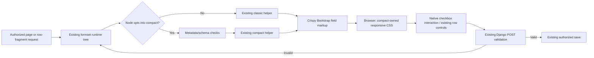

# Phase 06.26: Stock checkboxes in compact formsets (#351) - Research

**Researched:** 2026-11-11
**Domain:** Django formset widget admission and Bootstrap 5 checkbox presentation
**Confidence:** MEDIUM overall; source-grounded implementation seam, pending rendered acceptance

<user_constraints>
## User Constraints (from CONTEXT.md)

The following decision/discretion and deferred blocks are copied verbatim from the approved context. [VERIFIED: .planning/phases/06.26-issue-351/06.26-CONTEXT.md:20-70,147-152]

<!-- DATA_73d921af_START -->
## Implementation Decisions

### Approved maintainer decisions carried forward

- **D-01 — Pre-1.0 completeness:** support ordinary stock CheckboxInput before 1.0. This closes a basic widget
  gap; no particular downstream checkbox field motivates the work.
- **D-02 — Reuse crispy rendering:** admit the stock widget and apply narrowly scoped compact CSS to its
  existing label and necessary spacing. Verify the result in actual rendered output.
- **D-03 — No new template or widget class:** use Django's standard checkbox widget and crispy's existing field
  markup. Do not require a custom BooleanField, CheckboxInput subclass, compact checkbox field template or
  global crispy field-template override. The label issue belongs to crispy's surrounding markup.
- **D-04 — Existing compact label contract:** use shared desktop headings and correctly associated row labels,
  accessibly clipped on desktop and visible beside the checkbox on mobile with readable wrapping. Preserve
  form-owned labels, including constructor-assigned and translated labels, help, errors and required state.
- **D-05 — Bounded scope and verification:** cover ordinary single checkboxes, checked/unchecked submission,
  required and disabled fields, invalid redisplay and dynamically added rows. Other widget families remain out.
- **D-06 — GSD execution:** use GSD to plan and implement this issue. The prior interrupted direct preparation
  did not change product code or start an implementation plan. This context capture does not implement it.

### Delivery and preservation constraints from the handover

- Stock admission requires the exact CheckboxInput class, its standard template and input type. Preserve
  rejection of unmarked custom templates/input types, subclasses and unsupported families. Existing
  CompactWidgetCompatible opt-in remains governed by Phase 06.25; do not narrow or expand that contract.
- Scope CSS to compact-owned field cells. Verify classic siblings and children within compact parents, compact
  children within classic parents, and compact nesting. Ancestor-wide selectors must not restyle classic fields.
- Preserve shared schema checks, uniform metadata, query-free projection including zero-total formsets, hidden
  identity/ORDER/DELETE controls, prefixes, authorization, validation, saving and the existing formset lifecycle.
- Verify unique prefixed IDs/names and label associations for initial, nested and authorized dynamically added
  rows. Check delete/unmark and ordering where enabled; checkbox values must remain with their owning rows.
- Browser evidence at desktop and phone widths must demonstrate checked/unchecked, required and disabled
  states, long labels, readable help/errors and keyboard focus/activation without checkbox-specific overflow.
- Submission coverage must establish unchecked omission/False, checked True, required BooleanField validation,
  disabled-field semantics and submitted state/error preservation on invalid POST. Retain Django's behavior:
  a required BooleanField still requires a checked value.
- Update the supported-widget list and the deferred-checkbox caveat in docs/reference/formsets.md. Include a
  runnable example or fixture and an additive Unreleased changelog entry; no breaking API or migration is intended.
- Run focused Python/rendering and browser checks plus relevant formset regressions. Use multicore pytest for
  broad runs. Admission or source inspection alone cannot establish presentation correctness.
- If scoped CSS cannot satisfy the agreed behavior, record the concrete rendered limitation and bring that
  evidence back before replacing the selected approach with a template solution.

### Researcher / planner discretion

- Exact CSS selectors and spacing, fixture selection, test organization and documentation placement. Inspect
  installed crispy markup before choosing selectors; reuse existing fixtures and Bootstrap breakpoint behavior.
- The issue's detailed acceptance criteria are the proposed verification contract supporting the approved
  decisions. Individual selectors and test arrangements were not separately chosen by the maintainer.
- Keep the addition bounded and traceable. No renderer abstraction, adapter registry, dependency addition or
  unrelated formset refactoring is justified by this handover.
<!-- DATA_73d921af_END -->

<!-- DATA_a93f70c2_START -->
## Deferred Ideas

CheckboxSelectMultiple, radio groups, switches, additional stock widget families, generic widget adapters,
new JavaScript behavior and downstream theme adoption remain excluded. No new deferred work was introduced.
<!-- DATA_a93f70c2_END -->
</user_constraints>

## Summary

Add exact stock CheckboxInput to the existing supported tuple and extend compact-owned CSS to crispy's checkbox label and spacing. Keep the marker guard, schema projection, helper, shared templates and lifecycle unchanged. The current admission seam checks exact widget class, template and input type; the helper already renders fields through crispy and independently hides identity/control fields. [VERIFIED: src/crud_views/lib/formsets/compact.py:71-106,135-158]

The crucial compatibility finding is the extra checkbox wrapper and a spacing difference between the declared crispy floor and the active pack. Both versions omit helper.label_class from checkbox labels; the older pack adds a bottom-margin utility to the inner checkbox wrapper. Verify both layouts rather than assuming the existing outer margin rule reaches everything. [CITED: https://raw.githubusercontent.com/django-crispy-forms/crispy-bootstrap5/2023.10/crispy_bootstrap5/templates/bootstrap5/field.html] [VERIFIED: .venv/lib/python3.12/site-packages/crispy_bootstrap5/templates/bootstrap5/field.html:6-35]

**Primary recommendation:** Plan two bounded delivery units: admission/semantic/rendering regression coverage plus scoped CSS; then runnable browser fixture, rendered acceptance, documentation and additive release note. Use the existing test infrastructure. No behavior decision needs reopening; actual CSS feasibility remains an implementation validation gate under D-02/D-06. [VERIFIED: .planning/phases/06.26-issue-351/06.26-CONTEXT.md:25-70]

## Architectural Responsibility Map

Recommended ownership, grounded in existing helper dispatch and formset template composition. [VERIFIED: src/crud_views/lib/formsets/render_tree.py:87-118] [VERIFIED: src/crud_views/templates/crud_views/formsets/formset.html:35-60]

| Capability | Primary Tier | Secondary Tier | Rationale |
|---|---|---|---|
| Exact widget admission and uniform columns | Django server | — | Keep the metadata-only schema gate. |
| Boolean parsing, required/disabled handling, validation and saving | Django forms/backend | Database | Preserve existing field/formset behavior. |
| Associated row label, errors/help and prefixed inputs | Server-rendered crispy markup | Browser | Keep the upstream markup, not a second renderer. |
| Desktop clipping/mobile wrapping/spacing | Browser CSS | Static assets | This is presentation of existing elements. |
| Add/delete/unmark/order | Existing server and browser lifecycle | Database | Reuse existing fragments and row ownership unchanged. |
| Authorization and CSRF | Existing backend | Browser form submission | CSS admission must not influence access decisions. |

## Project Constraints (from AGENTS.md)

These are actionable project directives, not new phase decisions. [VERIFIED: AGENTS.md:17-27,34-68,70-87,129-147]

- Keep every change explainable and maintainable by the developer. Choose the simplest bounded solution; preserve proven paths, prefer opt-in additions, account for cognitive/runtime/query costs, and document unsupported cases.
- Use multicore pytest for broad runs. A bounded four-worker run fits this shared environment; serial execution is appropriate only for a tiny selection or a concrete isolation/debugging constraint.
- Keep established fixture naming and existing Django test configuration. Preserve class-attribute prefixes, operation keys, permission mapping and workflow prefixes when touching corresponding APIs.
- Follow the existing formatting/build/version conventions. Exact convention values are quoted below.
- After a ship workflow, refresh codebase maps before subsequent work.
- If later asked to create the phase worktree, use the GSD workspace workflow, check existing worktrees, retain the phase in the branch name and replace dots with hyphens in workspace names. Uncommitted source changes are not copied. This research does not create/change a branch.
- A newly added Breaking entry before 1.0 requires paired migration guidance; this issue requests an additive entry.
- Use the documented task commands when relevant; no setup, dependency or version bump is required by this phase.

<!-- DATA_3f91bd70_START -->
Exact conventions: `cv_`; `list`, `detail`, `create`, `update`, `delete`, `workflow`, `manage`; list/detail→view, create→add, update→change, delete→delete; `wf_`; line length `120`; quote style `double quotes`; build system `hatchling`; version management `bump-my-version`. Fixture prefixes: `cv_<model>`, `user_<model>_<permission>`, `client_user_<model>_<permission>`. [VERIFIED: AGENTS.md:135-147]
<!-- DATA_3f91bd70_END -->

## Scope and Existing Requirements

Use D-01–D-06 and issue #351 acceptance groups as this phase's traceability labels; the orchestrator supplied no phase requirement IDs. Do not repurpose completed requirements as new checkbox requirements. The existing authorization/formset/conditional lifecycle obligations remain preservation checks. [CITED: https://github.com/jacob-consulting/django-crud-views/issues/351] [VERIFIED: .planning/REQUIREMENTS.md:66-77,127-142]

The state file contains historical compact completion evidence; it is not evidence for this new checkbox behavior. The current research baseline is recorded below. [VERIFIED: .planning/STATE.md:40-68]

## Standard Stack

**Retain the declared dependencies.** The repository declares the following exact constraints and floor pins. [VERIFIED: pyproject.toml:25-35] [VERIFIED: noxfile.py:22-24]

<!-- DATA_18c94ea6_START -->
`requires-python = ">=3.12"`; `"django (>=4.2.0)"`; `"django-crispy-forms (>=2.0)"`; `"crispy-bootstrap5 (>=2023.10)"`.
`CRISPY_FLOOR = {"django-crispy-forms": "2.0", "crispy-bootstrap5": "2023.10"}`.
<!-- DATA_18c94ea6_END -->

| Component | Active environment | Declared/test boundary | Role |
|---|---|---|---|
| Django | 6.1.2 | Declared minimum above; nox series below | Native BooleanField/CheckboxInput and formsets |
| django-crispy-forms | 2.7 | Floor 2.0 | Existing helper/layout rendering |
| crispy-bootstrap5 | 2026.9 | Floor 2023.10 | Existing checkbox wrapper/label |
| pytest / pytest-xdist | 9.2.0 / 3.8.0 | Existing test extras | Python/render/request regressions |
| Bootstrap | Existing browser fixture requests 5.3.3 | Bundled Bootstrap theme acceptance only | Responsive grid/check styling |

Installed versions were read using importlib.metadata on 2026-11-11. Bootstrap's fixture reference is quoted exactly: `https://cdn.jsdelivr.net/npm/bootstrap@5.3.3/dist/css/bootstrap.min.css`. [VERIFIED: environment importlib.metadata probe, 2026-11-11] [VERIFIED: tests/browser/templates/conditional_formsets/page.html:8-12]

Registry currency was checked without installing: PyPI reports Django 6.1.3 uploaded 2026-11-03, django-crispy-forms 2.7 uploaded 2026-07-29, and crispy-bootstrap5 2026.9 uploaded 2026-09-02. These are observations, not an upgrade recommendation. [CITED: https://pypi.org/pypi/Django/json] [CITED: https://pypi.org/pypi/django-crispy-forms/json] [CITED: https://pypi.org/pypi/crispy-bootstrap5/json]

The source matrix is exactly `DJANGO_VERSIONS = ["4.2", "5.2", "6.0"]`, Python `["3.12", "3.13", "3.14", "3.15"]`, with an explicit Django 4.2/Python 3.14–3.15 skip. Do not call the active Django 6.1.2 run proof of the three declared test series. [VERIFIED: noxfile.py:3-19]

**Installation / Package Legitimacy Audit:** None. This phase requires no external package installation or dependency changes. The package legitimacy install gate is therefore not applicable. [VERIFIED: .planning/phases/06.26-issue-351/06.26-CONTEXT.md:63-70]

**Alternatives:** Dedicated checkbox templates, custom BooleanField/widget classes, renderer adapters and new JS are excluded by the approved decisions. [VERIFIED: .planning/phases/06.26-issue-351/06.26-CONTEXT.md:29-38,147-151]

## Architecture Patterns

### System Architecture Diagram

This diagram describes the existing flow and proposed CSS/admission integration; it is not a new architecture. [VERIFIED: src/crud_views/lib/formsets/render_tree.py:4-17,87-118] [VERIFIED: src/crud_views/templates/crud_views/formsets/formset.html:35-60]



### Component Responsibilities

| Surface | Planned responsibility |
|---|---|
| src/crud_views/lib/formsets/compact.py | Extend only the exact-stock tuple; retain shared checks and marker bypass. |
| src/crud_views/static/crud_views/css/formset.css | Compact-owned checkbox label clipping, mobile wrapping and only necessary spacing. |
| tests/test1/test_formsets_compact.py | Extend admission, schema, rendering, state and request checks; reuse helper fixtures. |
| tests/test1/test_formsets_compact_docs.py | Execute published checkbox usage if adding a code recipe. |
| tests/browser/conditional_formsets_server.py | Reuse the disposable authenticated host for an isolated checkbox case. |
| tests/browser/compact-widget-compatibility.cjs | Source pattern for focused runner; do not overwrite its Phase 06.25 evidence. |
| docs/reference/formsets.md and CHANGELOG.md | Update stock list, remove stale deferral, clarify marker/theme responsibility, additive release note. |

These are planning targets, not claims that new artifacts already exist. Existing source responsibilities were inspected in the files named above. [VERIFIED: src/crud_views/lib/formsets/compact.py:71-158] [VERIFIED: tests/test1/test_formsets_compact.py:348-363,654-704,846-941] [VERIFIED: tests/test1/test_formsets_compact_docs.py:19-75,78-130] [VERIFIED: tests/browser/conditional_formsets_server.py:21-24,417-449] [VERIFIED: tests/browser/compact-widget-compatibility.cjs:10-40,141-201] [VERIFIED: docs/reference/formsets.md:269-301]

### Pattern 1: Exact-stock admission, unchanged marker contract

The admission gate is already appropriately bounded. Add CheckboxInput to the tuple; do not replace exact type checking with isinstance, add a special BooleanField route or restrict the marker. The actual widget type remains part of row metadata. [VERIFIED: src/crud_views/lib/formsets/compact.py:84-105]

<!-- DATA_0cd196f2_START -->
```python
supported = (widgets.TextInput, widgets.NumberInput, widgets.DateInput, widgets.Select)
# Existing guard, retained:
if not isinstance(widget, CompactWidgetCompatible):
    if type(widget) not in supported or widget.template_name != type(widget).template_name:
        invalid(name, "unsupported compact widget or custom template")
    if widget.input_type != type(widget).input_type:
        invalid(name, "unsupported compact widget input type")
```
[VERIFIED: src/crud_views/lib/formsets/compact.py:84-97]
<!-- DATA_0cd196f2_END -->

Django's stock checkbox definition is `input_type = "checkbox"` and `template_name = "django/forms/widgets/checkbox.html"`. Keep normal widget attributes and Django parsing. [VERIFIED: .venv/lib/python3.12/site-packages/django/forms/widgets.py:692-723]

Replace the existing unmarked-stock-checkbox rejection case with positive ordinary BooleanField coverage. Add checkbox-specific negative cases for unmarked subclass, template replacement and input-type replacement; retain marked checkbox and other marked-family admission tests. The present tests explicitly include `"checkbox"` in both rejection and marker parameter sets. [VERIFIED: tests/test1/test_formsets_compact.py:846-941]

### Pattern 2: Style the owned field grid, not a compact ancestor

The helper's field grid uses `"cv-formset-compact-fields"`; the row label helper uses `"cv-formset-compact-label"`. Nested formsets are emitted after, outside the owning row's crispy form block. That gives a narrow boundary independent of classic/compact ancestors. [VERIFIED: src/crud_views/lib/formsets/compact.py:143-157] [VERIFIED: src/crud_views/templates/crud_views/formsets/formset.html:44-60]

Crispy's checkbox uses `"form-check-input"` and `"form-check-label"`, with a sibling associated label. Its wrapper is inside an outer margin wrapper and, because label_class is nonempty, an additional intermediary div. The floor adds `"mb-3"` to the inner `"form-check"`; the active version does not. [VERIFIED: .venv/lib/python3.12/site-packages/crispy_bootstrap5/templates/bootstrap5/field.html:6-35] [VERIFIED: .nox/crispy_floor-3-12-django-4-2/lib/python3.12/site-packages/crispy_bootstrap5/templates/bootstrap5/field.html:6-34]

Recommendation: target the stock single-checkbox branch through compact grid → own column → crispy wrappers → checkbox/associated label. Prefer an explicit owned chain over an ancestor-wide checkbox rule. Extend the existing desktop clipping declaration for this label; keep mobile label flow beside the native control. Normalize the inner margin only within that same ownership chain if measurements show it necessary. Do not remove Bootstrap's input/label relationship or hide the entire form-check wrapper. Bootstrap uses sibling selectors for checked/disabled states. [CITED: https://getbootstrap.com/docs/5.3/forms/checks-radios/]

Current CSS quotes: `.cv-formset-compact-fields > div > .mb-3`, `margin-bottom: 0 !important;`, `@media (max-width: 767.98px)`, `@media (min-width: 768px)`. Only the outer direct margin wrapper is currently targeted. [VERIFIED: src/crud_views/static/crud_views/css/formset.css:80-82,118-139]

Keep marked non-stock families author-owned; a selector must not become a claim of certification for arbitrary marked templates/groups. Check representative existing marker rendering as preservation. [VERIFIED: src/crud_views/lib/formsets/compact.py:14-21]

### Pattern 3: Reuse fixtures without inventing persistent product fields

Use local form subclasses with real BooleanFields for schema/HTML/invalid-redisplay tests. Reuse the existing runtime helper, nested declarations and authorized Publisher fragment fixtures. For actual boolean persistence use the existing schema-backed ConditionalPersistenceRecord under Profile, with a plain form selecting ordinary boolean fields; do not enable its conditional-group behavior merely because the fixture's name contains conditional. [VERIFIED: tests/test1/test_formsets_compact.py:207-363,654-704] [VERIFIED: tests/test1/test_conditional_persistence.py:53-74]

The existing model has exact definitions `active = models.BooleanField(default=False)`, `flag = models.BooleanField(default=True)`, and `parent = models.ForeignKey(Profile, on_delete=models.CASCADE, related_name="conditional_records")`. Avoid using the nullable checkbox-like field as the ordinary stock case. [VERIFIED: tests/test1/app/models.py:270-279]

For browser verification, extend the disposable host with an isolated checkbox case and reuse its auth, CSRF, fragments and cleanup. A test-host-only model/form extension is acceptable if it is simpler than wiring the existing model into that host. Do not modify the runnable questionnaire's production schema merely to manufacture a boolean: its existing compact forms select text/label fields. [VERIFIED: tests/browser/conditional_formsets_server.py:21-24,118-145,417-449,556-571] [VERIFIED: examples/bootstrap5/formsets/models.py:18-40] [VERIFIED: examples/bootstrap5/formsets/views.py:124-150]

### Anti-Patterns to Avoid

- Broad compact ancestor selectors that restyle classic nested checkboxes.
- Changing hidden deletion controls because they use a BooleanField internally.
- Adding a hidden false-value input, custom parsing, browser toggling JS or a renderer abstraction.
- Claiming persisted booleans from a form-only extra field that the model never saves.
- Replacing the whole browser harness or copying historical pass counts as new evidence.

These are implementation guardrails derived from the approved scope and existing rendering boundaries. [VERIFIED: .planning/phases/06.26-issue-351/06.26-CONTEXT.md:42-70] [VERIFIED: src/crud_views/templates/crud_views/formsets/formset.html:44-60]

## Don't Hand-Roll

| Problem | Don't build | Use instead | Source |
|---|---|---|---|
| Omitted checkbox handling | Hidden false-input or POST coercion | Django CheckboxInput | [VERIFIED: .venv/lib/python3.12/site-packages/django/forms/widgets.py:713-728] |
| Required/disabled semantics | New validators or JS enforcement | BooleanField and Field.disabled | [CITED: https://docs.djangoproject.com/en/6.0/ref/forms/fields/] |
| Label/help/error markup | Checkbox field template | Existing crispy field branch | [CITED: https://raw.githubusercontent.com/django-crispy-forms/crispy-bootstrap5/2023.10/crispy_bootstrap5/templates/bootstrap5/field.html] |
| Accessible desktop hiding | display:none or aria-hidden | Existing clipping pattern | [VERIFIED: src/crud_views/static/crud_views/css/formset.css:124-139] |
| Dynamic rows / permissions | Checkbox-specific AJAX or event layer | Existing formset lifecycle | [VERIFIED: .planning/phases/06.26-issue-351/06.26-CONTEXT.md:47-50] |
| Browser host | New server/test framework | Existing disposable authenticated host | [VERIFIED: tests/browser/compact-widget-compatibility.cjs:51-101] |

## Common Pitfalls

1. **Admission-only success:** the label will still be visible on desktop because crispy's checkbox label omits helper.label_class. Verify computed CSS and the accessible label association. [VERIFIED: .venv/lib/python3.12/site-packages/crispy_bootstrap5/templates/bootstrap5/field.html:26-35]
2. **Dependency-floor spacing:** the older inner margin survives the current outer-only reset. Measure both pack versions. Do not infer support from installed metadata alone. [VERIFIED: .nox/crispy_floor-3-12-django-4-2/lib/python3.12/site-packages/crispy_bootstrap5/templates/bootstrap5/field.html:6-12] [VERIFIED: src/crud_views/static/crud_views/css/formset.css:80-82]
3. **Incorrect required assertion:** Django formsets set `"use_required_attribute": False` to avoid incorrect browser validation of optional/deleted rows. Prove required-field server rejection on a persisted or otherwise nonempty row, plus heading/label indicators; do not require an HTML required attribute or force it on. Blank permitted extra rows remain permitted. [VERIFIED: .venv/lib/python3.12/site-packages/django/forms/formsets.py:219-245]
4. **Disabled-payload false confidence:** form_payload implements checked omission but does not skip disabled controls. Explicitly remove disabled names for a browser-equivalent request, then test forged submitted values separately. Keep the helper unchanged unless an independent need justifies a broader fix. [VERIFIED: tests/lib/helper/forms.py:15-37]
5. **Query boundary widening:** don't render widgets or call empty_form to obtain headings. Keep detached zero-total construction and existing side-effect/choice-iteration tripwires. [VERIFIED: src/crud_views/lib/formsets/compact.py:109-132] [VERIFIED: tests/test1/test_formsets_compact.py:1105-1198]
6. **Historical browser files overwritten:** the marked-widget runner hardcodes its previous phase output and capture root; the older runner also hardcodes a prior compact capture root even when JSON output is overridden. Make a phase-local runner/output arrangement before replaying; retain prior evidence. Exact existing values: `const phase = '.planning/phases/06.25-issue-349';`, `const output = \`${phase}/06.25-browser-results.json\`;`; capture creation uses `await page.screenshot({path:file,fullPage:true});`. [VERIFIED: tests/browser/compact-widget-compatibility.cjs:10-11,135-139,199-201] [VERIFIED: tests/browser/conditional-formsets.cjs:26-30,859-862]
7. **Old runner case-list failure:** adding the checkbox case unconditionally breaks the marked runner's exact legacy case IDs. Isolate case registration behind a fixture-specific opt-in or update only a deliberate shared contract. [VERIFIED: tests/browser/compact-widget-compatibility.cjs:55-56,80-85] [VERIFIED: tests/browser/conditional_formsets_server.py:556-559]

## Code Examples

Existing Django behavior to preserve: missing checkbox data produces False, disabled fields clean their trusted initial value, and a required BooleanField rejects False. [CITED: https://docs.djangoproject.com/en/6.0/ref/forms/fields/] [VERIFIED: .venv/lib/python3.12/site-packages/django/forms/widgets.py:713-728] [VERIFIED: .venv/lib/python3.12/site-packages/django/forms/fields.py:271-273,805-829]

<!-- DATA_8c105a73_START -->
```python
# Excerpts from installed Django; use these behaviors, do not copy into product code.
if name not in data:
    return False

value = bf.initial if self.disabled else bf.data
return self.clean(value)

if not value and self.required:
    raise ValidationError(self.error_messages["required"], code="required")
```
<!-- DATA_8c105a73_END -->

Existing clipping declarations to reuse on the scoped checkbox label, inside the established desktop media query: [VERIFIED: src/crud_views/static/crud_views/css/formset.css:124-139]

<!-- DATA_f1528db3_START -->
```css
position: absolute;
width: 1px;
height: 1px;
padding: 0;
margin: -1px;
overflow: hidden;
clip: rect(0, 0, 0, 0);
white-space: nowrap;
border: 0;
```
<!-- DATA_f1528db3_END -->

Do not hide help/errors along with the label. The upstream branch keeps them after the associated label. [VERIFIED: .venv/lib/python3.12/site-packages/crispy_bootstrap5/templates/bootstrap5/field.html:32-35]

## State of the Art

| Existing boundary | This phase | Implication |
|---|---|---|
| Stock checkbox rejected; marker may admit custom widgets | Exact stock checkbox admitted | Remove only the stock checkbox rejection, retain custom-family responsibility. |
| Ordinary compact labels use helper class; checkbox label does not | Scoped CSS reaches existing checkbox label | No new public template/widget API. |
| Crispy floor inner wrapper has extra margin | Verify floor and active output | Avoid version-specific spacing assumptions. |

Sources: current exact tuple, guard and helper; floor/current pack source; approved D-01–D-05. [VERIFIED: src/crud_views/lib/formsets/compact.py:84-105,135-157] [VERIFIED: .nox/crispy_floor-3-12-django-4-2/lib/python3.12/site-packages/crispy_bootstrap5/templates/bootstrap5/field.html:6-34] [VERIFIED: .planning/phases/06.26-issue-351/06.26-CONTEXT.md:25-36]

No dependency migration or deprecation is proposed.

## Environment Availability

Availability/version observations were made in this session. Paths below are observed tool locations, not portable installation requirements. [VERIFIED: environment executable/importlib.metadata probes, 2026-11-11]

| Dependency | Available | Observed version / coverage | Fallback |
|---|---|---|---|
| Active Python | Yes | 3.12.3; active Django 6.1.2 | Use declared-series nox environments below |
| Cached nox Django 4.2 / 5.2 / 6.0 | Yes | 4.2.30 / 5.2.19 / 6.0.10 | Recreate via existing nox configuration if needed |
| Cached crispy floors | Yes | crispy 2.0 / pack 2023.10; Django 4.2.30 and 6.0.9 | Existing nox crispy_floor sessions |
| Node | Yes | v24.21.0 | Existing supported Node runtime |
| Playwright / Chromium | Yes | 1.64.1 / Chrome for Testing 149.0.7827.55 | Explicit existing harness runtime env overrides |
| uv / task | Yes | Executables located; versions not needed for this no-install phase | Direct existing Python/Node commands |
| Context7 MCP / ctx7 CLI | Unavailable | Tool discovery and command lookup | Official docs/source via built-in web |
| Browser CDN assets | Not browser-probed in research | Fixture requests external Bootstrap/icons | Verify asset loading during acceptance; never treat missing CSS as a pass |

Runtime overrides quoted from the existing harness: `CV_FOCUS_PYTHON`, `CV_FOCUS_PLAYWRIGHT`, `CV_FOCUS_CHROMIUM`, `CV_CONDITIONAL_PORT`. [VERIFIED: tests/browser/compact-widget-compatibility.cjs:12-17] No external service is required for Python tests; browser fixtures create disposable SQLite/media using `tempfile.TemporaryDirectory(prefix="dcv-064-browser-")`. [VERIFIED: tests/browser/conditional_formsets_server.py:21-24]

**Blocking missing dependencies:** none identified for planning. Browser asset delivery remains a runtime check, not an assumed success.

## Validation Architecture

Enabled config values are exactly `"nyquist_validation": true` and `"security_enforcement": true`. [VERIFIED: .planning/config.json:24-24,48-50]

### Test Framework and Baseline

Existing pytest/pytest-django/xdist plus lxml rendering tests are sufficient. Existing pytest configuration is `addopts = "--strict-markers"`. [VERIFIED: pyproject.toml:70-83,145-146]

**Executed research baseline:** the following command passed **127 tests in 3.61s** in the active environment. The same selection passed **127 tests in 2.46s** with the cached Django 4.2 / crispy-floor interpreter. This is baseline preservation evidence only, before checkbox support. [VERIFIED: pytest command outputs, 2026-11-11]

```bash
PYTHONPATH=src .venv/bin/python -m pytest tests/test1/test_formsets_compact.py tests/test1/test_formsets_compact_docs.py -n 4 -q
PYTHONPATH=src .nox/crispy_floor-3-12-django-4-2/bin/python -m pytest tests/test1/test_formsets_compact.py tests/test1/test_formsets_compact_docs.py -n 4 -q
```

These are executable local recipes, not required persistent artifact paths. PYTHONPATH makes the checkout source explicit; inspect actual versions before using cached environments.

### Phase Acceptance → Test Map

No new phase IDs were supplied; these labels refer to the locked decisions and issue acceptance groups. Commands select existing files now and will include added tests there after implementation.

| Scope | Behavior | Type | Command / gate | Existing coverage |
|---|---|---|---|---|
| D-01/D-03, admission | Ordinary stock positive; custom template/type/subclass negative; marker unchanged | Unit/runtime | Quick command above | Existing matrix; add checkbox positives/negatives |
| D-04, labels | Constructor/lazy translated labels, association, escaping, required indicators, own help/errors | Rendering | Quick command above | Existing text/marked-widget patterns; extend for checkbox |
| D-05, semantics | Checked True; omission False; required rejection; disabled trusted value; invalid state/error redisplay | Bound formset + HTTP/persistence | Quick command above | Add real BooleanField/record cases |
| D-04/D-05, visuals | Shared headings, clipped desktop labels, phone labels beside checkbox, wrapping, focus/Space, help/errors | Real browser | New phase-local checkbox runner using existing host | Missing checkbox scenario |
| Preservation, nesting | Classic siblings/children, compact children in classic parent, nested compact rows, unique prefixed IDs/names | Rendering + browser | Quick selection plus new browser scenario | Existing composition fixtures; add checkbox controls |
| Preservation, lifecycle | Authorized added fragments, unauthorized denial, delete/unmark/order identity/value retention | HTTP + browser | Regression command below plus browser scenario | Existing fragment/lifecycle cases; extend row state |
| Preservation, metadata | Shared schema, hidden controls, zero-total query-free projection | Unit/runtime | Quick command above | Reuse existing side-effect tripwires |
| Delivery | Supported stock table/caveat, runnable fixture/recipe, additive release note | Executed docs + lint/build | Quick command and docs command below | Existing copied-recipe pattern |

Grounding: existing tests and browser assertions provide these reuse points. [VERIFIED: tests/test1/test_formsets_compact.py:84-138,165-345,403-448,654-704,846-941,1105-1198] [VERIFIED: tests/browser/conditional-formsets.cjs:54-60] [VERIFIED: tests/browser/compact-widget-compatibility.cjs:141-179] [VERIFIED: tests/test1/test_formsets_compact_docs.py:19-75]

### Reusable Commands

Relevant formset preservation, including authorization (use bounded multicore):

```bash
PYTHONPATH=src .venv/bin/python -m pytest tests/test1/test_formsets*.py tests/test1/test_formset_pk_boundary.py tests/test1/test_fragment_authorization.py -n 4 -q
```

Declared dependency boundary: rerun the focused command with each cached nox interpreter observed in the Environment section. Use the oldest and newest declared series with crispy floors, and all three declared Django series for focused checkbox tests. Direct cached Python execution avoids silently reinstalling/upgrading dependencies. Do not claim Python 3.13–3.15 coverage from these Python 3.12 environments. [VERIFIED: environment version probes, 2026-11-11] [VERIFIED: noxfile.py:3-24]

Full project gate after implementation, plus relevant JS preservation and docs:

```bash
PYTHONPATH=src .venv/bin/python -m pytest tests -n 4 -q
npm test -- tests/js/formset.test.js
npm run test:integration -- tests/js-integration/formset.test.js
.venv/bin/python -m mkdocs build --strict
```

The JS script definitions are exactly `"test": "vitest run"` and `"test:integration": "vitest run --config vitest.integration.config.js"`. [VERIFIED: package.json:10-13] Run scoped Ruff checks on changed Python files; avoid repository-wide auto-fix unrelated to this phase.

Existing browser replay recipe for preservation (the output below is deliberately temporary). **Before running it in implementation, arrange phase-local screenshot ownership too; the old runner hardcodes its capture directory.**

```bash
CV_FOCUS_NODE="$(command -v node)" CV_FOCUS_PYTHON="$PWD/.venv/bin/python" node tests/browser/conditional-formsets.cjs --case compact-lifecycle --output /tmp/06.26-compact-lifecycle.json
CV_FOCUS_NODE="$(command -v node)" CV_FOCUS_PYTHON="$PWD/.venv/bin/python" node tests/browser/conditional-formsets.cjs --case compact-presentation --output /tmp/06.26-compact-presentation.json
```

The supported existing switches are `--case`, `--output`; existing cases include `'compact-lifecycle'`, `'compact-presentation'`. The runner sets the child Python import path to the checkout. [VERIFIED: tests/browser/conditional-formsets.cjs:19-30,54-60,158-165] The planner must make the new checkbox command/output explicit in its plan; no new runnable file is claimed by this research.

### Required Browser Evidence

Plan and retain actual measurements/screenshots, not only HTTP status or source matching:

1. **Widths:** phone 390 and desktop 1280; include breakpoint checks at 767/768 when validating the new CSS. Those are the existing harness widths `[390, 767, 768, 1280]`. [VERIFIED: tests/browser/conditional-formsets.cjs:29-30]
2. **States:** initial checked and unchecked, optional, required, disabled true/false, invalid POST preserving submitted checkbox state with owned error, and authorized added rows. Verify long constructor/lazy labels, help/error wrapping and no checkbox-specific overflow.
3. **Accessibility:** exactly one correctly associated label per input, unique full prefixed ID/name, accessible checkbox name, desktop clipping without display:none/aria-hidden, mobile label beside control, visible focus, Tab/Shift+Tab, Space changes checked state, disabled controls cannot activate.
4. **Isolation:** checkbox-bearing classic siblings and children remain visible/unchanged at desktop; compact inside classic and compact inside compact get only their own responsive treatment.
5. **Lifecycle:** real fragment response, added row state, delete/unmark, reorder retaining values with original row identities, real successful POST and refreshed model boolean. Required-row validation must run on a nonempty/persisted row.
6. **Provenance:** record exact runtime versions including crispy-bootstrap5, source hashes, command/env, asset URLs/loading, request status, assertions, screenshot hashes and server/temp cleanup. Run both current pack and floor pack for the new visual branch. Leave subjective human review pending until actually reviewed.

Items 2–6 are required acceptance work derived from the approved handover; research does not claim to have executed it. [VERIFIED: .planning/phases/06.26-issue-351/06.26-CONTEXT.md:45-61] The previous focused runner already records versions/source hashes and cleanup, so extend that pattern. [VERIFIED: tests/browser/compact-widget-compatibility.cjs:36-40,95-101,183-201]

### Sampling Rate and Wave 0 Gaps

- Per implementation task: quick compact/docs selection; add a tiny selected regression only when narrowing a failure.
- Per wave: affected formset regressions plus relevant JS preservation when fixture/lifecycle assumptions change.
- Phase gate: full suite, focused declared-series/floor checks, rendered checkbox acceptance, docs/lint and actual human visual review.
- Wave 0 gaps: checkbox-bearing form/record fixtures; focused browser case/runner with phase-local output; assertions for checkbox-specific semantics, nested isolation and both pack wrapper variants. No framework install is needed.

## Security Domain

Use the GSD template's **ASVS 4.0.3** category vocabulary explicitly; do not imply it is current ASVS numbering. OWASP publishes ASVS 5.0.0 as the current stable release. This is a scoped threat mapping, not a compliance certification. [CITED: https://asvs.owasp.org/] Category definitions were checked against the official versioned standard below.

| ASVS 4.0.3 category | Applies here | Standard control / planning action |
|---|---|---|
| V2 Authentication | Preservation only | Existing authenticated request/fragment fixtures; no new login mechanism. |
| V3 Session Management | Preservation only | Retain session-based browser auth; no session changes. |
| V4 Access Control | Yes, preserved | Existing server fragment/row authorization and CSRF; add unauthorized-fragment regression. |
| V5 Validation, Sanitization and Encoding | Yes | Django BooleanField/disabled semantics; escaped form labels/help/errors. |
| V6 Stored Cryptography | No new work | No new cryptographic operation, secret or storage scheme. |

Category references: [CITED: https://raw.githubusercontent.com/OWASP/ASVS/v4.0.3/4.0/en/0x11-V2-Authentication.md] [CITED: https://raw.githubusercontent.com/OWASP/ASVS/v4.0.3/4.0/en/0x12-V3-Session-management.md] [CITED: https://raw.githubusercontent.com/OWASP/ASVS/v4.0.3/4.0/en/0x12-V4-Access-Control.md] [CITED: https://raw.githubusercontent.com/OWASP/ASVS/v4.0.3/4.0/en/0x13-V5-Validation-Sanitization-Encoding.md] [CITED: https://raw.githubusercontent.com/OWASP/ASVS/v4.0.3/4.0/en/0x14-V6-Cryptography.md]

| Threat | STRIDE | Mitigation to verify |
|---|---|---|
| Forged disabled/required checkbox data | Tampering | Native server validation; trusted initial disabled values, valid/invalid POST tests. |
| Cross-parent/unauthorized added row | Elevation of privilege | Existing fragment authorization and prefix/identity checks. |
| Label/help/error HTML injection | Tampering | Retain crispy/Django escaping and compact conditional_escape. |
| Misassociated duplicated row controls | Tampering | Unique full names/IDs, label association, reorder/add ownership tests. |

These are phase-specific threat hypotheses and prescribed mitigations, grounded in the existing preserved boundaries rather than a redesign. [VERIFIED: src/crud_views/lib/formsets/compact.py:143-157] [VERIFIED: .planning/phases/06.26-issue-351/06.26-CONTEXT.md:47-55] [CITED: https://docs.djangoproject.com/en/6.0/ref/forms/fields/]

## Assumptions Log

No unverified behavioral or compatibility assumption is promoted to a locked decision. Proposed selectors/fixture arrangements are recommendations within explicit planner discretion. Rendered sufficiency is deliberately unclaimed and must be tested; no user confirmation is required merely to choose a selector. [VERIFIED: .planning/phases/06.26-issue-351/06.26-CONTEXT.md:60-70]

| # | Claim | Section | Risk if wrong |
|---|---|---|---|
| — | No factual claim relies solely on training knowledge. | — | — |

## Open Questions

- **Does narrowly scoped CSS satisfy all agreed visual cases on both crispy versions?** Source inspection supports the planned approach, but this research ran no checkbox browser acceptance. Resolve during implementation with the required measurements; only return to the maintainer if a concrete limitation defeats the selected approach. [VERIFIED: .planning/phases/06.26-issue-351/06.26-CONTEXT.md:60-61]
- **Exact fixture and evidence layout:** settle in the plan, reusing existing runtime/browser patterns and isolating old case/evidence contracts. This is delegated implementation detail, not an open behavior decision. [VERIFIED: .planning/phases/06.26-issue-351/06.26-CONTEXT.md:63-70]

## Sources

### Primary inspected sources

- Approved phase context and live [issue #351](https://github.com/jacob-consulting/django-crud-views/issues/351); prior compact/marker contexts and maintainer bounded-design note.
- Source-of-truth compact module, CSS, runtime tree and shared template, with line citations above.
- Existing compact/docs tests, payload helper, test models and disposable browser runners/host.
- Installed Django and crispy-bootstrap5 sources, and cached crispy-floor source.
- [Django 6.0 fields](https://docs.djangoproject.com/en/6.0/ref/forms/fields/), [crispy-bootstrap5 2023.10 source](https://raw.githubusercontent.com/django-crispy-forms/crispy-bootstrap5/2023.10/crispy_bootstrap5/templates/bootstrap5/field.html), [Bootstrap checkbox docs](https://getbootstrap.com/docs/5.3/forms/checks-radios/) and [visually hidden helper](https://getbootstrap.com/docs/5.3/helpers/visually-hidden/).
- Official PyPI metadata and versioned OWASP source linked at the associated claims.

### Research Process / Confidence

The research-plan seam selected Context7 for three documentation questions. Neither Context7 MCP nor ctx7 was available, so official web/source lookup was used. The seam `query classify-confidence --provider websearch --verified` returned **MEDIUM**; all three digests were cached with that provider/tier. Local source and test observations are tagged VERIFIED with explicit evidence; no npm-registry verification or new-package legitimacy verdict is claimed. [VERIFIED: research-plan, tool-discovery, classify-confidence and research-store outputs, 2026-11-11]

Graph status returned no graph; project skill directories were absent and agent-skills self-load returned no configured entries. No graph-derived claim was used. [VERIFIED: graphify status, project directory discovery and agent-skills query outputs, 2026-11-11]

## Metadata

**Confidence breakdown:** Standard stack MEDIUM (declared constraints, installed/registry probes, official docs); architecture MEDIUM (source-grounded small seam, rendered acceptance pending); pitfalls MEDIUM (concrete source differences and passing current/floor baseline). Tiers follow the available research-provider seam rather than inventing unsupported compatibility confidence.

**Research date:** 2026-11-11.
**Validity policy:** Recheck when dependencies, compact markup/CSS or the locked issue scope change; recheck external dependency currency after seven days. This is a research maintenance recommendation, not a compatibility guarantee.

