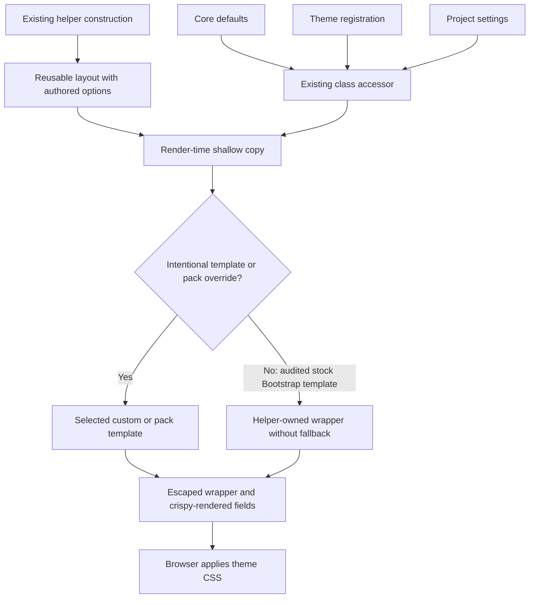

# Phase 06.29: Themeable column helpers (#356) - Research

**Researched:** 2026-11-12
**Domain:** Django crispy layout rendering and the existing theme class registry
**Confidence:** MEDIUM overall; direct repository observations and executed baseline checks are identified separately.

<user_constraints>
## User Constraints (from CONTEXT.md)

The following block is copied verbatim from the approved context, including locked decisions, acceptance criteria,
project constraints, and delegated discretion. [VERIFIED: 06.29-CONTEXT.md:20-81]

<!-- DATA_e7392a6c_START -->
## Implementation Decisions

### Approved issue decisions — preserve D-01–D-07 identifiers

- **D-01 — Reuse the established theme API:** Add `form:column-1` … `form:column-12` to core class defaults.
  Use `register_button_classes()` for themes and `CRUD_VIEWS_BUTTON_CLASSES` for project overrides. Preserve
  existing per-key precedence and validation. An explicit empty string or `None` suppresses that key's classes;
  unconfigured widths retain their defaults. These are utility keys, not new form-button kinds or mode keys.
- **D-02 — Preserve defaults:** Each helper defaults to `col-md-N`. Keep public helper names, import paths,
  calling conventions, and unconfigured Bootstrap output and behavior. Preserve normal crispy field rendering,
  IDs, additional attributes, and supported template customization.
- **D-03 — Complete class strings:** Themes configure the whole class string, including multiple responsive
  classes or another class vocabulary. Do not add a separate breakpoint setting or require twelve subclasses.
- **D-04 — Resolve when rendered:** Layouts created before theme registration must use the configured classes
  when rendered. Rendering must not accumulate classes, mutate reusable layouts, or leak state between uses.
- **D-05 — Preserve additive extras:** Caller `css_class` remains additional to the resolved registry classes.
  `Column6("name", css_class="extra")` keeps `extra`, including with empty or `None` registry values.
- **D-06 — Address the implicit Bootstrap fallback:** The stock rendering of these helpers must not inject
  `col-md` when configured classes omit the substring `col`, or when the configured value is empty. Preserve
  intentional template overrides; custom templates remain responsible for classes they explicitly emit.
- **D-07 — Bounded scope:** Include these helpers, their rendering, documentation, and regression coverage.
  Row layout remains owned by the crispy template pack. Exclude row keys, changing plain crispy `Column`,
  compact-formset grid redesign, renaming the class registry, a new responsive-layout API, and broader pack changes.

### Acceptance criteria carried from the approved handover

1. All twelve keys are core defaults, accepted by existing registry checks, and documented with their semantics.
2. All twelve unconfigured helpers retain the existing Bootstrap classes and layout behavior.
3. Individual theme overrides, including multiple responsive classes, leave other widths at their defaults.
4. Project settings override theme registration per key using existing precedence.
5. Empty strings and `None` suppress configured classes while retaining explicit caller extras.
6. Stock helper output does not reintroduce `col-md` for non-Bootstrap or empty classes.
7. Additive caller classes, IDs, attributes, fields, and template overrides continue to work.
8. Layouts constructed before registration render current configuration; repeated use does not accumulate
   classes or leak rendering state.
9. Built-in delete-confirmation and classic formset-control columns receive the same theme behavior while
   preserving their existing additional classes.
10. Focused rendered-output tests establish these behaviors. Documentation includes theme registration and
    project override examples, including the boundary between column classes and the rest of a theme's grid.

### Existing project constraints

- Developer maintainability is a hard constraint: use a small, traceable solution with explicit limits.
  Preserve working paths and template ownership. Do not globally replace crispy pack templates to solve this.
- Preserve normal escaping for configured classes and existing field content; reuse registry isolation fixtures.
- Keep class inventories and their executable documentation checks consistent with the twelve new keys.
- Every public-surface change gets a changelog entry. This is intended to be additive; if a concrete breaking
  incompatibility is discovered, report it before changing the contract. A Breaking entry requires migration docs.
- Broad pytest verification uses multiple workers. Record actual dependency and browser evidence limits;
  source inspection and rendered HTML tests do not establish browser appearance by themselves.

### Researcher / planner discretion

Choose the smallest internal base-class and rendering/template mechanism, test organization, and documentation
placement that meet the decisions. Check supported dependency versions and existing subclass customization.
Do not silently discard explicit subclass-authored classes or template overrides. Exact compatibility mechanics
are research work, not an invitation to redesign the public API or ask the user to choose internal abstractions.

The approved handover delegates these implementation details. No new requirement for a demo application,
downstream migration, new browser suite, or dependency addition was introduced by this discussion. Select
verification proportionate to the actual rendering changes. Bring back evidence only if the bounded approach
cannot satisfy the approved behavior.
<!-- DATA_e7392a6c_END -->

### Deferred Ideas (OUT OF SCOPE)

<!-- DATA_b49f15d3_START -->
None newly proposed. Row configuration, a broader grid API, compact-formset changes, and downstream adoption
remain excluded; their exclusion does not create additional backlog commitments. No pending todos matched.
<!-- DATA_b49f15d3_END -->

[VERIFIED: 06.29-CONTEXT.md:162-163]
</user_constraints>

## Summary

Use the existing class accessor and one small private base for the twelve public helpers. Keep resolution at render
time and put resolved classes on a shallow copy. Preserve explicit subclass-authored classes as authored overrides;
constructor classes remain additive to the registry for ordinary helpers. This is a recommendation within delegated
discretion, grounded in crispy's existing constructor contract and the project's copied-render precedent.
[VERIFIED: src/crud_views/lib/crispy/actions.py:41-58]
[CITED: https://django-crispy-forms.readthedocs.io/en/latest/layouts.html]

The important boundary is template selection. The stock Bootstrap column template injects an unwanted class for
non-Bootstrap or empty configuration. Select a helper-owned leaf only for the audited installed Bootstrap column
template; preserve intentional explicit templates, project/theme overrides of the same template name, and other
packs. Avoid global pack overrides, HTML postprocessing, or a generic renderer framework. This recommendation
preserves D-06 and D-07. [CITED: https://github.com/jacob-consulting/django-crud-views/issues/356]

The existing registry/check/documentation baseline passed on the installed current environment and both existing
crispy-floor environments: 729 tests per environment. These are pre-change baseline results, not evidence that the
new feature is implemented. No browser verification occurred. [VERIFIED: research commands, 2026-11-12]

**Primary recommendation:** one bounded rendering/registry change with focused regression coverage, then synchronized
reference documentation and executable inventory checks; extend the existing floor-test selection.

## Architectural Responsibility Map

This is the recommended assignment, derived from the approved helper-only scope.
[CITED: https://github.com/jacob-consulting/django-crud-views/issues/356]

| Capability | Primary Tier | Secondary Tier | Rationale |
|---|---|---|---|
| Defaults, theme registration, project precedence | API/backend configuration | — | Reuse the existing registry accessor |
| Resolve width classes and preserve authored extras | Django server rendering | — | Layout construction may precede app registration |
| Wrapper markup and class escaping | Django template rendering | — | Helper leaf or intentional custom template owns output |
| Grid appearance and responsive behavior | Browser/CSS | Theme assets and active pack | Column strings alone do not define a complete grid |
| Data persistence and authorization | Existing application layers | — | No new responsibilities in this phase |

## Project Constraints (from AGENTS.md)

The user supplied the repository instructions as AGENTS.md guidance; the on-disk guidance read was CLAUDE.md.
These directives constrain planning:

- Keep the solution understandable, traceable, bounded, and maintainable; preserve working paths unless a concrete
  requirement justifies changing them. Account for hidden state, extra abstractions, runtime costs, and queries.
  [VERIFIED: CLAUDE.md:15-30]
- Use multicore broad pytest runs; a bounded worker count is appropriate in this shared workspace. Explain serial
  runs when needed, and do not interrupt existing verification just to change worker count.
  [VERIFIED: CLAUDE.md:129-135]
- Preserve fixture naming conventions, quoted verbatim: `cv_<model>`, `user_<model>_<permission>`,
  `client_user_<model>_<permission>`. [VERIFIED: CLAUDE.md:135]
- Keep CrudView attributes prefixed `cv_`, workflow methods prefixed `wf_`, double quotes, and 120-character lines.
  Preserve existing CRUD/permission semantics. Do not rename unrelated APIs.
  [VERIFIED: CLAUDE.md:139-146]
- Use the existing build/version tools; no version bump is needed for this research. The guide names `hatchling`
  and `bump-my-version`. A `### Breaking` changelog entry must also update migration guidance before 1.0.0.
  [VERIFIED: CLAUDE.md:145-147]
- After a future ship run, refresh codebase maps. Reuse the existing assigned worktree rather than create another;
  no shipping or workspace creation belongs to this phase research. [VERIFIED: CLAUDE.md:63-85]
- The project requires a changelog entry for public-surface changes, preserves unconfigured rendering, forbids
  downstream project names in deliverables, and lists pytest, JavaScript, strict docs, lint, and formatting gates
  before push. [VERIFIED: .planning/PROJECT.md, Constraints section]
- The global pack override prohibition is explicit: “Overriding crispy-bootstrap5 templates globally”.
  [VERIFIED: .planning/REQUIREMENTS.md:334-346]

## Phase Requirements

No dedicated Phase 06.29 requirement IDs were supplied by the roadmap. Use the existing D-01–D-07 identifiers and
the ten context acceptance criteria for traceability; do not silently invent approved requirement IDs.
The phase roadmap requires completion before Phase 7 and names Phase 6 as the dependency.
[VERIFIED: .planning/ROADMAP.md:1737-1745; quoted values: “Phase 6”, “Phase 7”]

| Approved decision | Required behavior | Research support |
|---|---|---|
| D-01, D-03 | Twelve complete class strings; existing precedence and checks | Existing accessor and default-key membership checks |
| D-02, D-05 | Default output, authored classes, attrs, fields and templates survive | Crispy constructor/render audit and template compatibility cases |
| D-04 | Late registration and repeat-safe reusable layouts | Copied render projection; registry isolation fixtures |
| D-06 | No implicit Bootstrap fallback in stock helper output | Floor/current template audit and failing replacement probe |
| D-07 | Helpers, docs, tests only | Local bridge and existing floor harness; no row/plain-column changes |

These descriptions summarize the verbatim approved constraints above.
[CITED: https://github.com/jacob-consulting/django-crud-views/issues/356]

## Standard Stack

Use existing dependencies; no new library, install step, or dependency-floor change is recommended.

| Component | Declared or observed version | Purpose and evidence |
|---|---|---|
| Django | Declared `"django (>=4.2.0)"`; observed 4.2.30, 6.0.9, 6.1.2 | Existing template renderer; declaration read in pyproject |
| django-crispy-forms | Declared `"django-crispy-forms (>=2.0)"`; observed 2.0 and 2.7 | Preserve Column/Div construction and field rendering |
| crispy-bootstrap5 | Declared `"crispy-bootstrap5 (>=2023.10)"`; observed 2023.10 and 2026.9 | Audit the stock wrapper fallback at floor/current |
| Python standard library copy | No external dependency | Shallow render projection, as in existing action groups |
| pytest / pytest-xdist | Observed 9.2.0 / 3.8.0 in the source development environment | Existing test runner and bounded multicore checks |

Dependency declarations: [VERIFIED: pyproject.toml:25-35].
Installed versions: [VERIFIED: importlib.metadata probes in the three environments, 2026-11-12].
Copied-render precedent: [VERIFIED: src/crud_views/lib/crispy/actions.py:3,48-58].

PyPI JSON metadata reports django-crispy-forms 2.7 published 2026-07-29T11:12:11Z and crispy-bootstrap5 2026.9
published 2026-09-02T20:40:22Z; these match the inspected development environment. This is a currency observation,
not a recommendation to upgrade the project. Package identity was cross-checked through the official project
documentation/source links. [CITED: https://pypi.org/pypi/django-crispy-forms/json]
[CITED: https://pypi.org/pypi/crispy-bootstrap5/json]

### Package Legitimacy Audit

Not applicable: this phase adds no external package and research installed nothing. Do not add an install checkpoint
or package audit task merely to retain existing dependencies. No package receives a registry-legitimacy VERIFIED tag.

## Architecture Patterns

### System Architecture Diagram

Recommended data flow:



### Component Responsibilities

These are source locations to modify or reuse, not claims that new files already exist.

| Source component | Planning action |
|---|---|
| Existing class defaults | Add twelve literal, reviewable entries; reuse accessor/check behavior |
| Existing column helpers | Share a small private base; retain all public classes and exports |
| New helper-owned leaf (name chosen during implementation) | Keep existing wrapper/field/attribute semantics; remove only the implicit fallback |
| Existing registry/check tests | Add accepted utility keys, bad-value and mode-suffix coverage; update inventories |
| Focused new column test module | Render real fields, prove class/template ownership and repeated use |
| Existing docs and executable doc tests | Publish all defaults, registration/settings examples and limits |
| Existing nox crispy-floor list | Include the new focused column tests |

Grounding: helpers are twelve thin subclasses with defaults quoted verbatim:
`"col-md-1"`, `"col-md-2"`, `"col-md-3"`, `"col-md-4"`, `"col-md-5"`, `"col-md-6"`,
`"col-md-7"`, `"col-md-8"`, `"col-md-9"`, `"col-md-10"`, `"col-md-11"`, `"col-md-12"`.
[VERIFIED: src/crud_views/lib/crispy/table.py:1-49]
The public exports are `"Column1"`, `"Column2"`, `"Column3"`, `"Column4"`, `"Column5"`, `"Column6"`,
`"Column7"`, `"Column8"`, `"Column9"`, `"Column10"`, `"Column11"`, `"Column12"`.
[VERIFIED: src/crud_views/lib/crispy/__init__.py:18-31]

### Pattern 1: Reuse per-key resolution without new parsing

The merge is literally `{**defaults, **_THEME_BUTTON_CLASSES, **_settings_layer()}`; lookup returns a string or
`""`. Registration and setting changes invalidate the existing cache. Do not pre-resolve values in class bodies
or constructors. [VERIFIED: src/crud_views/lib/button_classes.py:172-210]

Known default membership is already accepted by checks; adding defaults requires no new width grammar.
The relevant existing error is `"crud_views.E361"` for a non-string non-None value. Utility keys must not be added
to `FORM_KINDS`, whose exact values remain `{"submit", "cancel", "delete", "filter-submit", "filter-reset"}`.
[VERIFIED: src/crud_views/lib/button_classes.py:284-285,332-339,374-389]

### Pattern 2: Authored classes remain distinguishable from helper defaults

The floor and current Div implementations append constructor classes to a class-level default; explicit subclass
classes therefore replace the inherited width today. A direct probe produced `authored extra` for a subclass
declaring its own class string. [CITED: https://raw.githubusercontent.com/django-crispy-forms/django-crispy-forms/2.0/crispy_forms/layout.py]
[VERIFIED: local render/subclass probe, 2026-11-12]

Recommended policy:

| Construction/customization | Resolution policy |
|---|---|
| Ordinary helper or subclass with no authored class override | Current registry width classes plus constructor extras |
| Subclass explicitly declaring classes, including an inherited custom intermediate subclass | Preserve that complete authored class default plus constructor extras |
| Explicit empty/None subclass class declaration | Preserve its deliberate suppression of the inherited default |
| Explicit template argument or subclass template | Render that template with resolved/authored classes |
| Normal post-construction authored class changes | Do not silently overwrite them with a captured constructor snapshot |

Implement this with small explicit state at construction and a render-time copy. If retaining class-level Bootstrap
defaults for compatibility, identify whether the class declaration comes from a built-in helper or an authored
subclass; merely comparing strings loses the distinction when the same string is explicitly redeclared.
Prefer a short MRO walk or equally direct ownership check over descriptors or metaclasses. Keep the class extras
separate from the replaceable built-in width. Do not remove tokens with broad string replacement.

The final row is a defensive preservation recommendation: do not promise support for arbitrary descriptors or custom
render implementations. Add a small regression for ordinary instance attribute assignment if the implementation
captures initial values. This remains within the context's delegated preservation work, not a new responsive API.

### Pattern 3: Narrow template bridge

The floor and current stock template branch tests the substring `col`, not a CSS token boundary. Replacing the
Python classes alone produced `col-md span-6 extra` in an actual floor render. The original column remained
`col-md-6 extra` after copying. [CITED: https://raw.githubusercontent.com/django-crispy-forms/crispy-bootstrap5/2023.10/crispy_bootstrap5/templates/bootstrap5/layout/column.html]
[VERIFIED: local render probe, 2026-11-12]

Recommended selection sequence:

1. Ask the object's normal template-name hook for its template.
2. Preserve an intentional constructor/subclass template selection and other template packs.
3. Resolve the default name through Django's loader. A project override can use exactly the same name; a string
   comparison alone cannot distinguish it from the installed stock template.
4. For the audited installed stock Bootstrap column source, use the helper-owned leaf without implicit classes.
   Compare resolved origin with the installed distribution's template location, and keep the audit small and
   explicit. A source-shape/full-source check protects custom or changed pack markup from being silently replaced.
5. Delegate fields and flat attributes to crispy; only the copy's effective class/template differs.

The existing action bridge demonstrates installed-origin plus audited-source discrimination and shallow copies;
reuse that principle, not its action-specific markup or a new generic bridge framework.
[VERIFIED: src/crud_views/lib/crispy/actions.py:25-58]

Keep the leaf's whitespace identical to the existing stock column output under defaults, or prove byte parity using
the unmodified crispy Column configured with each default. Do not mark configured class strings safe. Treat an
unrecognized future stock template as a compatibility boundary to detect with tests, rather than rewriting HTML.

### Anti-patterns to Avoid

- Resolving registry classes at import or construction time violates the approved late-registration behavior.
- Mutating and restoring the original object in a try/finally introduces avoidable shared rendering state.
- Assigning a fixed helper template globally bypasses project overrides and other packs.
- Faking containment with a string subclass, inserting a dummy class containing “col”, or stripping HTML after
  rendering conceals the real fallback and makes debugging harder.
- Copying all crispy Div/Column rendering code creates a second field/attribute rendering implementation.
- Expanding row or compact formset behavior exceeds the approved boundary.

These are design recommendations implementing D-02, D-04, D-06 and D-07.
[CITED: https://github.com/jacob-consulting/django-crud-views/issues/356]

## Don't Hand-Roll

| Problem | Don't build | Use instead |
|---|---|---|
| Theme precedence and cache invalidation | Another registry/cache | Existing class accessor |
| Field rendering, errors and arbitrary attributes | Python HTML concatenation or replacement parser | Existing crispy render path and Django templates |
| Reusable object isolation | Deep clone framework or temporary original-object mutation | A shallow render projection |
| Grid completeness | Breakpoint generator, row API or CSS framework adapter | Complete configured class strings and existing theme ownership |
| Dependency-floor verification | New matrix tooling | Existing nox crispy-floor session |

Recommendations grounded in the sources in Architecture Patterns and the approved bounded scope.

## Runtime State Inventory

This is an internal helper refactor, not a rename or persisted-data migration. The following inventory answers the
five categories explicitly; it does not claim to have audited inaccessible downstream deployments.

| Category | Items found / evidence | Action |
|---|---|---|
| Stored data | Helper classes and registry lookup operate on Python objects; no persistent write occurs in the inspected helper or registry paths | No data migration |
| Live service config | Theme registration and project settings supply the existing mapping; external deployments were not inspected | Document optional per-key configuration, no mandatory service migration |
| OS-registered state | No OS registration operation in the inspected rendering/registry code | No task/service re-registration |
| Secrets/env vars | Existing Django setting `"CRUD_VIEWS_BUTTON_CLASSES"` remains the same name | No rename or secret change |
| Build artifacts | Public helper imports and package identity remain; deployed installations require their normal package update | Normal build/install during release, no special artifact migration |

[VERIFIED: src/crud_views/lib/crispy/table.py:1-49; src/crud_views/lib/button_classes.py:129-210]
Scope limitation: downstream state is deliberately not investigated or changed.

## Common Pitfalls

### 1. Missing inventory updates

The current executable assertions literally contain `assert len(EXPECTED_KEYS) == 90`,
`assert len(bc.DEFAULT_BUTTON_CLASSES) == 90`, and `assert len(bc._get_default_button_classes()) == 100`.
Adding twelve entries implies 102 core and 112 with the existing workflow contribution. Update subprocess assertions
as well as the obvious top-level inventory and documentation prose.
[VERIFIED: tests/test1/test_button_classes.py:117-124,246-268]
[VERIFIED: tests/test1/test_theme_adoption_docs.py:227-235]

### 2. Losing built-in consumers

Delete confirmation contains `Row(Column12("confirm"))`. Classic formset controls return
`Column4(self.form_control, css_class="text-end")` and
`Column2(self.form_control, css_class="text-end")`. These call sites should need no production edits; prove their
rendered classes change and their explicit extra survives. Do not redesign their controls.
[VERIFIED: src/crud_views/lib/crispy/form.py:162-170]
[VERIFIED: src/crud_views/lib/formsets/inline_formset.py:84-94]

### 3. Confusing custom templates with stock fallback

A constructor template, class template, overridden template-name method, same-name project loader override, or
non-Bootstrap pack must retain ownership of emitted markup. Test each relevant branch; include a custom template
that deliberately emits its own fixed class to show the boundary. Existing action tests exercise origin
discrimination and provide a local test pattern. [VERIFIED: tests/test1/test_theme_action_groups.py:133-150]
[CITED: https://django-crispy-forms.readthedocs.io/en/latest/layouts.html]

### 4. Overstating evidence

The source development environment uses Django 6.1.2; the declared nox series are exactly
`DJANGO_VERSIONS = ["4.2", "5.2", "6.0"]`. Its green result cannot replace supported-series checks.
The floor environments supplied real 4.2 and 6.0 baseline evidence; 5.2 and browser appearance were not tested here.
[VERIFIED: noxfile.py:3-19; research version probes and test outputs, 2026-11-12]

## Code Examples

### Approved public configuration

This is the approved issue recipe, not a claim that the new keys already work.

<!-- DATA_6c0d39a8_START -->
```python
from crud_views.lib.button_classes import register_button_classes

register_button_classes({
    "form:column-6": "col-12 col-lg-6",
})
```
<!-- DATA_6c0d39a8_END -->

[CITED: https://github.com/jacob-consulting/django-crud-views/issues/356]

### Existing copied-render precedent

Verbatim excerpt; keep the principle but do not turn an action-specific group implementation into the column API.

<!-- DATA_c87b231f_START -->
```python
rendered = copy(self)
location, slot = self._cv_class_key.split(":", 1)
extra = get_button_class(location, slot)
rendered.css_class = " ".join(value for value in (self.css_class, extra) if value)
```
<!-- DATA_c87b231f_END -->

[VERIFIED: src/crud_views/lib/crispy/actions.py:49-52]

## State of the Art

Use the class-table reference as the canonical twelve-key inventory. Add a short theme registration example,
a project-settings example, explicit empty/None semantics, additive constructor extras, render-time lookup, and
the boundary that rows and arbitrary custom templates remain theme/pack-owned. Cross-link the layout reference
and revise the tutorial's hard-coded-shortcut description. Preserve authored-subclass precedence in the wording.

The current tutorial literally describes “thin” Column subclasses with
`col-md-2`, `col-md-4`, `col-md-6`; the layout reference lists only selected widths. The default-count prose and
workflow totals are executable contracts. [VERIFIED: docs/getting_started/tutorial-3-forms.md:22-27]
[VERIFIED: docs/reference/create_view.md:86-93; docs/reference/buttons.md:162-173]
Existing theme recipe tests execute published Python and render the result; extend those patterns.
[VERIFIED: tests/test1/test_theme_adoption_docs.py:28-41,56-70]

| Existing approach | Approved new approach | Change boundary |
|---|---|---|
| Width class fixed on each subclass | Registry width resolved per render | Only these twelve helpers |
| Stock fallback may inject Bootstrap class | Stock helper leaf respects the resolved string | Intentional custom templates retain ownership |
| Docs call helpers Bootstrap shortcuts | Docs describe Bootstrap defaults plus theme keys | No arbitrary-framework compatibility claim |

[CITED: https://github.com/jacob-consulting/django-crud-views/issues/356]

## Environment Availability

All environments below were used read-only with bytecode disabled and the worktree source explicitly on PYTHONPATH.
The listed paths are observed local environment locations, not portable project requirements.
[VERIFIED: research environment probes and test commands, 2026-11-12]

| Dependency/environment | Available | Observed versions | Use |
|---|---|---|---|
| Worktree-local virtualenv | No local .venv found | — | Use existing source environments without modifying them |
| Source development .venv | Yes | Python 3.12; Django 6.1.2; crispy 2.7; Bootstrap pack 2026.9 | Current crispy exploratory baseline |
| Source nox crispy floor / Django 4.2 | Yes | Django 4.2.30; crispy 2.0; Bootstrap pack 2023.10 | Declared-floor baseline |
| Source nox crispy floor / Django 6.0 | Yes | Django 6.0.9; crispy 2.0; Bootstrap pack 2023.10 | Declared-floor baseline |
| Context7 MCP / ctx7 CLI | Not available to this agent | — | Official docs/source fetched with web fallback |
| uv | Available | Version not probed | No installation required during research |
| Knowledge graph | Status reports no graph | — | Source reads used instead |

No dependency installation or product-code change was made. No external service is required by the proposed feature.
The environments provide a usable execution fallback; full supported-matrix coverage remains an execution concern.

## Validation Architecture

Enabled: `"nyquist_validation": true`. [VERIFIED: .planning/config.json:20-24]

### Test Framework

| Property | Value |
|---|---|
| Framework | Existing pytest 9.2.0, pytest-django, pytest-xdist; lxml HTML assertions |
| Config | Existing pyproject pytest options and test project's pytest_configure |
| Quick run | New column module plus registry/check tests, bounded two workers |
| Full suite | `PYTHONDONTWRITEBYTECODE=1 PYTHONPATH=src <python> -m pytest tests -n 2 -p no:cacheprovider` |
| Floor gate | Add focused column tests to existing nox crispy-floor test list; retain existing deselection policy |

Observed tool version: [VERIFIED: importlib.metadata probes, 2026-11-12].
Existing test configuration: [VERIFIED: pyproject.toml:145-146; tests/test1/conftest.py:43-133].
Existing floor pins are exactly `{"django-crispy-forms": "2.0", "crispy-bootstrap5": "2023.10"}`.
[VERIFIED: noxfile.py:22-60,103-114]

### Reproduced baseline command

Run from this worktree. This exact command completed successfully:

```bash
PYTHONDONTWRITEBYTECODE=1 PYTHONPATH=src \
  /home/alex/projects/alex/django-crud-views/.nox/crispy_floor-3-12-django-4-2/bin/python \
  -m pytest tests/test1/test_button_classes.py tests/test1/test_button_classes_checks.py \
  tests/test1/test_theme_adoption_docs.py -n 2 -q -p no:cacheprovider
```

[VERIFIED: research execution, 2026-11-12; output: `729 passed in 4.00s`]

The same selection using the source nox Django 6.0 Python produced `729 passed in 3.82s`; using the source .venv
Python produced `729 passed in 4.26s`. Both floor version probes printed this worktree's source package location.
[VERIFIED: research execution, 2026-11-12]

### Phase Requirements → Test Map

The proposed new test filename below is an implementation recommendation, not an existing artifact.
Let **C** mean `pytest tests/test1/test_crispy_columns.py -n 2 -q`,
**R** mean `pytest tests/test1/test_button_classes.py tests/test1/test_button_classes_checks.py -n 2 -q`,
and **D** mean `pytest tests/test1/test_theme_adoption_docs.py -n 2 -q`.
Run them through the environment prefix above. Existing R+D takes approximately four seconds; new-test timing
must be measured after implementation. [VERIFIED: research baseline outputs, 2026-11-12]

| Decision / acceptance | Behavior | Type | Automated command | Exists? |
|---|---|---|---|---|
| D-01 / AC1 | All twelve defaults; accepted keys; invalid types and mode-suffix rejection | Unit/check | R | Existing files, extend |
| D-02 / AC2 | All widths preserve stock default HTML/fields | Render | C | Wave 0 |
| D-01,D-03 / AC3–4 | Theme partial override, responsive string, per-key project precedence | Render + unit | C + R | Wave 0 + extend |
| D-05,D-06 / AC5–6 | Empty/None and non-col strings, with/without caller extras | Render | C | Wave 0 |
| D-02 / AC7 | css_id, arbitrary attrs, field errors/values and escaping | Render | C | Wave 0 |
| D-02 / AC7 | Explicit subclass classes, inherited custom classes, custom templates and packs | Render | C | Wave 0 |
| D-04 / AC8 | Construct before registration; repeated renders/settings transitions; original state unchanged | Render | C | Wave 0 |
| D-02,D-05 / AC9 | Delete confirmation and classic control columns, preserving extra classes | Integration render | C plus existing delete/formset regressions | Extend |
| D-07 / AC10 | Both public recipes execute; inventories and prose agree | Docs executable | D + R | Existing files, extend |

### Sampling Rate

- Per task: targeted C/R/D selection as applicable; use two workers for the combined selection.
- Per wave: affected rendering/CRUD/formset regressions and existing floor checks.
- Phase gate: multicore full Python suite, scoped lint/format, strict docs build, and remaining applicable repository
  gates before shipping. Record versions and failures rather than treating source inspection as runtime coverage.
- Browser: no new browser suite or downstream demonstration is mandated by the approved context. Rendered HTML
  establishes classes and ownership, not viewport appearance.

These are validation recommendations honoring the existing project gates and approved proportionality boundary.
[VERIFIED: CLAUDE.md:129-147; 06.29-CONTEXT.md:60-81]

### Wave 0 Gaps

- Create focused column render tests using the existing Django setup and registry isolation fixture pattern.
- Include hostile quoted class/ID/attribute strings; assert no new executable attribute or element appears.
- Add explicit custom-template and same-name loader-override fixtures; use existing template-loader test patterns.
- Add new coverage to the existing crispy-floor test list.
- Update 90/100 inventories and their executable documentation checks to the derived 102/112 totals.
- No framework installation, new database, browser harness, or general renderer infrastructure is needed.

## Security Domain

Enabled: `"security_enforcement": true`, `"security_asvs_level": 1`.
[VERIFIED: .planning/config.json:48-50]

The GSD category names below use ASVS 4.0.3 numbering deliberately. Current OWASP is 5.0.0; do not present legacy
category numbers as current. The relevant legacy requirement family is output encoding.
[CITED: https://asvs.owasp.org/]
[CITED: https://raw.githubusercontent.com/OWASP/ASVS/v4.0.3/4.0/en/0x13-V5-Validation-Sanitization-Encoding.md]

| ASVS category (4.0.3) | Applies to this change | Control |
|---|---|---|
| V2 Authentication | No new authentication behavior | Preserve existing form/view paths |
| V3 Session Management | No new session state | Keep render projection transient |
| V4 Access Control | No new authorization decision | Do not edit view/permission handlers |
| V5 Validation / encoding | Yes | Existing registry type checks, Django class/ID autoescape, crispy flat attributes |
| V6 Stored Cryptography | No new cryptographic operation | No new secret or crypto code |

This applicability assessment follows the helper-only scope and inspected render paths, not a new compliance claim.
[VERIFIED: src/crud_views/lib/crispy/table.py:1-49; src/crud_views/lib/button_classes.py:332-339]
[CITED: https://github.com/jacob-consulting/django-crud-views/issues/356]

| Threat pattern | STRIDE | Mitigation and test |
|---|---|---|
| Class/ID string breaks out into another HTML attribute | Tampering | Retain template escaping; hostile-input rendered assertion |
| Raw field content becomes newly trusted | Tampering | Keep crispy-rendered fields; do not mark classes or arbitrary values safe |
| Theme classes leak through repeated layout use | Tampering | Copy projection, fresh form instances, settings/registry cleanup and original-state assertions |

Recommendations grounded in existing renderer behavior and the encoding source above.

## Assumptions Log

No assumed dependency support claim or unapproved product requirement is used as a locked decision. Proposed
internal mechanisms are explicitly recommendations within the approved discretion. Unknown compatibility and
verification boundaries are listed below; they are not requests to reopen D-01–D-07.

## Open Questions and Evidence Limits

1. **Future or modified pack source:** audited floor/current source is known; arbitrary future source is not.
   Keep bridge detection explicit and regression-test its refusal to take ownership of custom markup.
2. **Full supported matrix:** only the two existing floor environments and current development environment were run.
   Execute the final change against supported environments during implementation; do not infer 5.2 evidence.
3. **Visual behavior:** no browser was run. Default byte parity plus parsed rendered classes is proportionate here;
   do not claim browser appearance or complete alternative-CSS-framework integration.
4. **Subclass and dynamic mutation details:** the contract is to preserve authored intent. Test ordinary subclass,
   inherited override, explicit empty/None, and instance-assignment behavior; avoid extending scope to arbitrary
   metaprogramming.
5. **No blocker:** the inspected APIs and existing test environments support planning a bounded solution. No new
   user decision is required by these findings.

## Sources and Provenance

- Approved issue #356, fetched through GitHub CLI; contextual decisions copied from the phase context.
  [CITED: https://github.com/jacob-consulting/django-crud-views/issues/356]
- Official crispy documentation and floor source, cross-checked against installed floor/current source.
  [CITED: https://django-crispy-forms.readthedocs.io/en/latest/layouts.html]
  [CITED: https://raw.githubusercontent.com/django-crispy-forms/django-crispy-forms/2.0/crispy_forms/layout.py]
- Official floor Bootstrap column template, cross-checked against installed 2023.10 and 2026.9.
  [CITED: https://raw.githubusercontent.com/django-crispy-forms/crispy-bootstrap5/2023.10/crispy_bootstrap5/templates/bootstrap5/layout/column.html]
- Repository source, tests, docs, guidance, planning context, and nox configuration were opened this session;
  line citations appear beside the relevant observations.
- Research-plan seam selected Context7 for documentation and websearch for security; neither Context7 MCP nor its
  CLI was available. Official web/source fallback was used. `classify-confidence --provider websearch --verified`
  returned `MEDIUM`; digests were cached with that tier. The unsupported provider id `webfetch` returned `LOW`
  and was not used to inflate confidence. [VERIFIED: research seam command outputs, 2026-11-12]
- No graph context was available; graph status reported `"exists": false`.
  [VERIFIED: graphify status command output, 2026-11-12]

## Metadata

**Confidence breakdown:** Standard stack MEDIUM (official sources plus inspected installed versions);
architecture MEDIUM (existing APIs and pattern, feature not implemented);
pitfalls MEDIUM (source findings plus actual fallback probe and baseline tests).

**Research date:** 2026-11-12
**Review by:** 2026-12-12, or earlier if crispy versions or template ownership change.
**Delivery boundary:** Research only; no implementation plans, dependency installs, or product edits.

