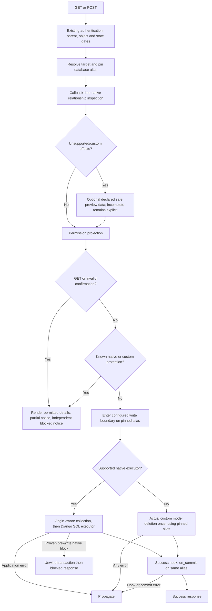

# Phase 06.3: Delete protection and write-boundary integrity — issue #282 - Research

**Researched:** 2026-10-30
**Domain:** Django deletion inspection, exception provenance, multi-database write lifecycle and Guardian policy
**Confidence:** MEDIUM
**Status:** Research complete; proposed architecture requires DEL-01 maintainer review before implementation.

<user_constraints>
## User Constraints (from CONTEXT.md)

The following decisions and discretion notes are copied verbatim. [VERIFIED: 06.3-CONTEXT.md:22-92]

<!-- DATA_a36f9c21_START -->
## Implementation Decisions

### Custom deletion behavior
- **D-01:** When custom deletion behavior cannot be safely inspected without executing deletion callbacks,
  show a partial preview and allow the existing confirmation path. Clearly explain the preview's limits.
  Custom deletion behavior runs only after valid confirmation and the applicable protection gates; known
  protection still blocks deletion. Unexpected application errors continue to propagate.
- **D-02:** Display safely inspected relationships plus an incomplete-preview notice. Preserve existing
  permission filtering and identify displayed counts as partial, rather than implying complete totals.
- **D-03:** Show the incomplete-inspection notice even when `cv_show_related_objects=False`. In that mode,
  show a short notice without relationship details so confirmation does not imply all effects were checked.
- **D-04:** Use the existing delete confirmation with the notice visible beside it. Do not add a second
  acknowledgement checkbox or another confirmation step for partial previews.

### Override compatibility
- **D-05:** Documented breaking changes to deletion override contracts are acceptable before 1.0 when needed
  for safety and clarity. Preserve compatible overrides where practical; do not weaken the safety guarantees
  to retain an incompatible contract. This is permission to propose a breaking design, not design approval.
- **D-06:** Require immediate migration for incompatible overrides. Provide clear diagnostics for detectable
  incompatibilities and document their replacements; do not provide a temporary legacy compatibility period.
- **D-07:** Provide a supported, documented extension contract through which applications can supply safe
  preview information about custom deletion effects without executing deletion callbacks. Preserve permission
  filtering. The contract's concrete hooks, result shape and completeness semantics require research/design.
- **D-08:** Ship worked, tested migration examples for an existing preview override, safe description of
  custom deletion effects, and copied templates that need the incomplete-preview notice. Pair every Breaking
  CHANGELOG entry with `docs/migrating-1.0.md`, as required by the repository.

### Guardian diagnostics
- **D-09:** Unknown permission keys raise a descriptive programming error identifying the invalid key and
  listing valid keys. Do not replace the error with an empty queryset and a warning.
- **D-10:** Validate permission keys consistently for inactive users too. Valid requests from inactive users
  still return no objects; the inactive-user shortcut must not hide a programming error in the permission key.
- **D-11:** Apply the same invalid-key diagnostic contract to `GuardianViewSet.assign_perm`, `remove_perm`
  and `get_objects_for_user`. Report invalid keys before any permission change.

### Carried-forward requirements and policy
- **D-12:** Preserve Phase 6.2's POST-only deletion, core/Guardian/polymorphic authorization, filtered protected
  labels, independent blocked notice, and coherent full-page/modal responses. Partial inspection is distinct
  from known protection; an incomplete notice must not suppress a known blocked-deletion notice or its gate.
- **D-13:** Preserve per-view Guardian global fallback and the independent strict ViewSet helper. The strict
  helper does not accept global model permissions; retain its object/group/active-superuser semantics and
  inactive-user denial. Review mutable `STRICT_HELPER_POLICY` against that existing contract rather than
  introducing a new policy option. Keep manage's effective-policy display and administrative access policy.
- **D-14:** Preserve DEL-02–DEL-04's safety obligations: real-preview GET, invalid confirmation and
  custom-protected POST execute no deletion callbacks, including SET/default factories. Failed valid POST
  respects the write boundary. Established native PROTECT/RESTRICT stays friendly, while unknown handlers,
  converters, model methods, hooks and commit callback failures propagate. Partial preview support does not
  authorize catching unexpected application failures and relabeling them as incomplete inspection.
- **D-15:** Retain the required evidence: nested cascades and stale previews, real commit/rollback in both
  atomic modes, colliding primary keys across two databases with protection on only one alias, instance-aware
  routing and transaction/commit-hook alignment. Reproduce on Django 4.2/6.0, add Django 5.2 coverage, replay
  deletion/transaction/authorization suites and re-review affected Phase 6.2 acceptance before closure.
- **D-16:** DEL-01 requires maintainer review of a detailed design/plan covering safe inspection, supported
  custom behavior, exception translation, routing and override compatibility together before implementation.
  GUA-01 remains bounded: reproduce actionable scenarios, fix/test confirmed defects and record explicit
  dispositions for IN-02/IN-03 and the residual AUTH-06 flag. A substantial policy redesign requires a separate
  scope decision; historical green suites do not establish coverage of the uncovered cases.

### Agent's Discretion and Planning Notes
- No further product choices were explicitly delegated. Internal helper placement, hook names, data shapes,
  exception classes, precise notice wording and test organization are research/planning responsibilities.
- Investigate how to distinguish supported safe inspection, declared custom preview information and unknown
  behavior without invoking deletion callbacks. Do not claim arbitrary application overrides are provably safe.
- Define the public extension and override migration together. Preserve compatible filtering hooks and ensure
  custom preview information does not bypass authorization, actual protection or the write lifecycle.
- Incomplete inspection is not a guarantee of complete deletion effects or a promise that deletion will succeed.
  Do not infer that an empty inspected protected list establishes complete inspection.
- Keep the incomplete-preview notice and partial-count wording consistent across full-page and modal rendering,
  including previews disabled. Final copy and localization follow existing repository patterns.
- The current source and docs are the remediation baseline, not proof that their stated guarantees hold.
  Research must revisit exception-origin classification rather than assuming another exclusion fixes CR-03.

<!-- DATA_a36f9c21_END -->

<!-- DATA_b48e0d72_START -->
## Deferred Ideas

None — discussion stayed within phase scope. Conditional/formset lifecycle work, presentation cleanup,
theme-adoption proposals and the final Phase 7 stability inventory remain outside this phase.

Rejected alternatives, not backlog: blocking all custom behavior solely because inspection is incomplete,
notice-only partial previews, hiding the incomplete notice when previews are disabled, extra acknowledgement,
temporary legacy compatibility, omitting a supported custom-preview contract, untested reference-only migration
guidance, warning-plus-empty-queryset handling of invalid keys, and inactive-user bypass of key validation.

<!-- DATA_b48e0d72_END -->
</user_constraints>

## Summary

The three deletion findings still reproduce on the current checkout with Django 4.2.30 and 6.0.9.
Real preview GET and invalid POST execute a SET factory; a nested converter's protection-shaped exception becomes
a normal blocked response; a protected default-database row falsely blocks an unrelated shard row with the same PK.
The mutable Guardian helper policy changes authority, and inactive users skip invalid-key validation.
These are fresh disposable in-memory probes, not inferred from historical green suites.
[VERIFIED: session probe /tmp/dcv063_probe.py; output reproduced below]

**Primary recommendation:** Plan an explicit callback-free inspection boundary, independent permission projection,
and origin-labelled native write collection using one resolved database alias. Do not add another metadata exclusion
to the current traceback classifier. Keep Django's SQL deletion executor and actual custom model deletion semantics.
The concrete adapter and override contracts below are proposals, not approved implementation decisions. [ASSUMED: A1]

Research and planning are authorized; DEL-01 is a hard dependency before production implementation, including
apparently separable Guardian fixes. Prepare the complete design, migration examples and test contracts first,
then obtain maintainer review of that concrete package. [VERIFIED: 06.3-CONTEXT.md:74-78]

## Architectural Responsibility Map

Recommended ownership; proposed implementation boundaries are subject to DEL-01. [ASSUMED: A1]

| Capability | Primary Tier | Secondary Tier | Rationale |
|---|---|---|---|
| Request authorization, confirmation and business protection | API/backend view | Django forms | Run before executable deletion |
| Callback-free graph inspection and completeness | API/backend inspector | Database queries | Reads supported relationships, records unsupported boundaries |
| Permission projection | API/backend core/Guardian filter | Permission backend | No unauthorized model instances in template context |
| Partial/blocked notices and form display | SSR templates | Browser modal adapter | Presentation consumes independent facts; cannot grant authority |
| Native collection provenance and custom deletion dispatch | API/backend write adapter | Django Collector | Only explicitly identified native protection becomes friendly |
| Transactions, SQL execution and commit callbacks | Database + backend lifecycle | Application hooks | All use the same request-scoped alias |
| Strict-helper diagnostics and policy | Guardian ViewSet helper | Manage projection | Validate keys first and prevent mutable display/config data changing authority |

## Project Constraints (from AGENTS.md)

The user supplied AGENTS.md instructions corresponding to the on-disk CLAUDE.md; no separate project skill or
AGENTS.md file was found by the scoped discovery command. The configured researcher agent-skills mapping returned
no skills. [VERIFIED: session discovery and agent-skills query]

- Preserve the ViewSet/metaclass registration architecture and cooperative core/Guardian composition.
  [VERIFIED: CLAUDE.md:39-58]
- Preserve the exact prefixes `cv_` and `wf_`; CRUD keys are `list`, `detail`, `create`, `update`,
  `delete`, `workflow`, `manage`. Permission mapping is “list/detail→view, create→add, update→change,
  delete→delete.” [VERIFIED: CLAUDE.md:97-100]
- Use 120-character lines and double quotes; keep hatchling and bump-my-version.
  [VERIFIED: CLAUDE.md:101-104]
- Follow the fixture naming convention `cv_<model>`, `user_<model>_<permission>`,
  `client_user_<model>_<permission>`. [VERIFIED: CLAUDE.md:93]
- Every Breaking entry requires the paired migration update before 1.0. The exact directive is:
  “Until 1.0.0 ships, a change that adds a `### Breaking` entry to `CHANGELOG.md` also updates
  `docs/migrating-1.0.md`.” [VERIFIED: CLAUDE.md:105]
- Use the existing pytest/nox and ruff workflows; preserve completed form/cancel and template contracts.
  The project quality gates include pytest, vitest, strict docs build and ruff before push.
  [VERIFIED: CLAUDE.md:20-37; .planning/PROJECT.md, Constraints]

<phase_requirements>
## Phase Requirements

Descriptions are copied from REQUIREMENTS.md. Research support is a planning recommendation. [ASSUMED: A1]

| ID | Description | Research Support |
|---|---|---|
| DEL-01 | Maintainer reviews detailed design/plan for safe protection inspection, supported custom behavior, exception translation, routing and override compatibility before implementation; architecture is not selected here. | Review deliverable and dependency gate |
| DEL-02 | Real-preview GET, invalid confirmation and custom-protected POST execute no deletion callbacks, including SET/default factories; failed valid POST preserves the write boundary. Database rollback alone is insufficient for external effects (CR-02; AUTH-01/03/07). | Inspection handler matrix, real-preview event tests |
| DEL-03 | Established native PROTECT/RESTRICT retains friendly handling; unknown custom handlers, converters, model methods, hooks and commit callbacks propagate. Nested cascades/stale previews and real commit/rollback evidence cover both atomic settings (CR-03; AUTH-01/07). | Explicit provenance, native/custom executor split, stale-preview controls |
| DEL-04 | Two-database tests with colliding PKs and protection on only one alias prove instance-aware inspection/deletion routing and alignment with transaction/commit hooks (CR-04; AUTH-01/03/07). | Alias contract and asymmetric two-database tests |
| DEL-05 | Core, Guardian and polymorphic authorization, filtered protected labels, independent blocked notice and coherent full-page/modal responses remain enforced (AUTH-03/07 preservation). | Projection invariant and response matrix |
| DEL-06 | Reproduce fixes on Django 4.2/6.0, add supported Django 5.2 coverage, rerun deletion/transaction/authorization suites, update deletion/override docs and changelog (Breaking paired with migrating-1.0.md), and re-review affected 6.2 acceptance before closure. | Environment gap, matrix commands, executable docs and acceptance reconciliation |
| GUA-01 | Perform a bounded review of AUTH-06 policy boundaries and findings IN-02 (mutable strict-helper policy) / IN-03 (unknown permission-key diagnostics). Record a concrete scenario and expected outcome for each actionable gap; fix and test confirmed defects, preserving named AUTH-06 behaviors. If no additional gap supports the unclassified detector flag, close that flag with a documented rationale. Record explicit dispositions for IN-02/IN-03 and replay the policy tests on cached Django 4.2/6.0. This task transfers unresolved review work, not completed AUTH-06 implementation; any substantial policy redesign requires a separate scope decision. | Fresh reproductions, shared key resolver, immutable policy, bounded review checklist |

Source: [VERIFIED: .planning/REQUIREMENTS.md:101-108]. AUTH-01/03/07 remain partial; the residual AUTH-06 flag
is review work, not a newly proven defect. [VERIFIED: .planning/REQUIREMENTS.md:79-111]
</phase_requirements>

## Standard Stack

Retain the existing stack and do not add a deletion library. The production dependency declaration includes
`"django (>=4.2.0)"`, `"django-guardian>=2.4"` and `"django-polymorphic (>=3.1.0)"`.
[VERIFIED: pyproject.toml:27-54]

| Component | Version observed / target | Purpose | Provenance |
|---|---|---|---|
| Django | Cached 4.2.30 and 6.0.9; add 5.2 test environment | ORM, transactions, forms, Collector SQL executor | [VERIFIED: session import/version probes] |
| django-guardian [WARNING: flagged as suspicious — verify before using.] | Installed 3.5.2 | Object/group permission projection and helpers | [VERIFIED: session metadata probe]; [CITED: https://django-guardian.readthedocs.io/en/stable/api/shortcuts/] |
| pytest [WARNING: flagged as suspicious — verify before using.] | Installed 9.2.0 | Existing regression runner | [VERIFIED: session metadata probe]; [CITED: https://docs.pytest.org/en/stable/getting-started.html] |
| pytest-django [WARNING: flagged as suspicious — verify before using.] | Installed 4.14.0 | Real transaction and multiple database tests | [VERIFIED: session metadata probe]; [CITED: https://pytest-django.readthedocs.io/en/latest/database.html] |
| Python / nox / uv | Python 3.12.3; nox 2026.10.20; uv executable found | Matrix environments | [VERIFIED: session executable/version probes] |

The configured matrix is exactly `DJANGO_VERSIONS = ["4.2", "5.2", "6.0"]` and
`python=["3.12", "3.13", "3.14", "3.15"]`; the nox code skips 4.2 on 3.14/3.15.
This reports repository behavior, not an independent upstream support assertion.
[VERIFIED: noxfile.py:3-11]

Registry check on 2026-10-30 returned latest Django 6.1.2 (published 2026-10-06), latest 5.2-series 5.2.18,
Guardian 3.5.2 (2026-10-20), pytest 9.2.0 (2026-10-27), pytest-django 4.14.0 (2026-08-10).
The main venv's Django 6.1.2 is outside this phase's selected matrix. Do not “upgrade to latest” for this work.
[VERIFIED: session PyPI JSON and installed-metadata probes]

### Package Legitimacy Audit

No production dependency addition is recommended. Preparing the missing 5.2 environment does install packages;
run its setup after the design review and the required package verification checkpoint.
The seam reports the following, which must not be silently relabelled OK. [ASSUMED: A6]

| Package | Registry | Published latest | Downloads | Source repository from seam | Verdict | Disposition |
|---|---|---|---|---|---|---|
| Django [WARNING: flagged as suspicious — verify before using.] | PyPI | 2026-10-06 | unknown | django/django | SUS | Existing installs usable; checkpoint before fresh install |
| django-guardian | PyPI | 2026-10-20 | unknown | django-guardian/django-guardian | SUS | Same |
| pytest | PyPI | 2026-10-27 | unknown | pytest-dev/pytest | SUS | Same |
| pytest-django | PyPI | 2026-08-10 | unknown | none returned | SUS | Same |

[VERIFIED: session `query package-legitimacy check --ecosystem pypi Django django-guardian pytest pytest-django`]

SUS reasons were “too-new” / “unknown-downloads”, and for pytest-django “no-repository”.
These are tool signals, not evidence of malicious packages or package founding dates. Official documentation
confirms the project identities. No package earned an OK verdict; none is labelled “VERIFIED: npm registry”.
No SLOP package was returned. The mandated `pip index versions` commands were attempted but failed with
`No module named pip`; direct PyPI JSON was used as a read-only registry fallback. No install occurred.
[VERIFIED: session gate and registry command output]

## Fresh Evidence and Failure Boundaries

Both cached environments ran the same disposable probe against current source, real in-memory tables and registered
request routes. The initial probe had one import-path setup failure; the corrected runs completed.
The output below is repeated on 4.2.30 and 6.0.9. [VERIFIED: session /tmp/dcv063_probe.py runs]

<!-- DATA_c59a1f83_START -->
```text
CR02 get 200 callbacks 1 rows 1
CR02 post 200 callbacks 2 rows 2
CR03 certified True
CR03 False 200 new side effects 1
CR03 certified True
CR03 True 200 new side effects 0
IN03 get_objects_for_user True KeyError 'veiw'
IN03 assign_perm True KeyError 'veiw'
IN03 remove_perm True KeyError 'veiw'
IN03 get_objects_for_user False returned []
IN03 assign_perm False KeyError 'veiw'
IN03 remove_perm False KeyError 'veiw'
IN02 strict count 0
IN02 mutated count 4
CR04 200 shard remains True
CR04 direct (1, {'app.Publisher': 1})
```
<!-- DATA_c59a1f83_END -->

Interpretation: CR02 uses real preview. CR03 deliberately substitutes stale preview only to isolate write-side
classification, with a nested ID converter and a pre-delete listener forcing row loading. Its converter exception
is hidden in both atomic modes; only the atomic mode rolls back the side-effect row. CR04 uses a protected default
row and unprotected shard row with identical PK. IN02 toggles the policy mapping then restores it. IN03's historical
AttributeError description is not the current observed exception; preserve the finding ID and correct its evidence.
[VERIFIED: session probe; src/crud_views/lib/views/delete.py:206-224,331-379;
src/crud_views_guardian/lib/viewset.py:77-108]

The existing Guardian policy module still passes: 47 tests on 4.2.30 in 5.33s and 47 on 6.0.9 in 9.46s.
These passing controls plus the failures above demonstrate missing coverage; they do not close GUA-01.
No full suite or 5.2 execution was performed in this research. [VERIFIED: session pytest runs]

## Architecture Patterns

### System Architecture Diagram

Proposed flow, not an implemented API. [ASSUMED: A1]



### 1. Replace executable preview traversal

Current source constructs `NestedObjects(using=using)` then calls `collector.collect([self.object])`.
Django's admin collector delegates to the executable Collector and catches protection-shaped exceptions.
Django SET invokes its callable during collection; SET_DEFAULT invokes the field default.
[VERIFIED: src/crud_views/lib/views/delete.py:212-224; installed Django 6.0.9 admin/utils.py:185-220]
[CITED: https://docs.djangoproject.com/en/4.2/_modules/django/db/models/deletion/]

Implement a dedicated inspection traversal over the ORM relationship metadata. Do not call on_delete handlers,
their deconstruct methods, field defaults, private bulk-related hooks, model.delete, delete signals or write hooks.
Use identity comparisons for supported built-ins; do not call arbitrary handler equality methods. [ASSUMED: A1]

| Relationship/effect | Proposed inspection behavior |
|---|---|
| Native CASCADE | Traverse related rows; record graph edges and deduplicate visited objects |
| Native PROTECT | Query related rows; retain blockers locally without executing PROTECT |
| Native RESTRICT | Record candidates; decide only after complete supported cascade closure |
| Native SET_NULL / DO_NOTHING | Do not follow as a deletion cascade; do not execute handler |
| SET closure, SET_DEFAULT, custom handler | Skip handler and factory; mark that boundary incomplete, retain other safe branches |
| Custom model.delete / private bulk relation hook | Mark uninspected effects; do not call it |
| Built-in generic relation / multi-table parents / auto-created through rows | Implement explicitly tested metadata traversal or mark unsupported; never silently claim completeness |
| Unexpected query/loader/converter/provider error | Propagate; do not convert an exception into an “incomplete” result |

All rows are proposed behavior requiring design review. [ASSUMED: A1]

RESTRICT is not PROTECT: a restricted object also collected for deletion through CASCADE need not block.
Retain whole-graph reconciliation, parent traversal, cycles, self-relations and diamond graphs.
Unknown branches make completeness conservative; do not infer certainty from an empty protected list.
[CITED: https://raw.githubusercontent.com/django/django/stable/5.2.x/django/db/models/deletion.py]
[ASSUMED: A1, recommended treatment of unknown branches]

“Callback-free” must have a bounded meaning: never execute deletion callbacks to inspect effects. Ordinary ORM reads
can invoke managers, converters and model initialization; rendering permitted model labels can invoke __str__.
Do not promise all application Python is side-effect-free. Avoid invoking unsupported special collection hooks,
and let unexpected read failures propagate. Review how unsupported loaders are identified without reintroducing
a purported proof of arbitrary-code purity. [VERIFIED: inspected Django Collector.related_objects and installed
ORM loading path; session CR03 probe] [ASSUMED: A1, contract wording]

### 2. Keep completeness outside the filterable display tuple

The current tuple definition is exactly `tree: list`, `summary: dict[str, int]`, `protected: list`.
Core and Guardian reconstruct this three-field tuple. [VERIFIED: src/crud_views/lib/views/delete.py:33-36,275-302;
src/crud_views_guardian/lib/views.py:48-56]

Prefer preserving that tuple for compatible display filters and introduce a separate inspection result containing
raw related data, completeness and private unsupported-boundary information. Compute blocked state before filtering.
A custom filter must not erase a known block or change completeness by reconstructing a tuple. [ASSUMED: A2]

Provide a new, explicitly read-only preview-provider hook which supplements the native inspection with model
instances/query results and coverage declarations for identified custom effects. The package merges and validates
the data, then applies core/Guardian filtering. Do not accept pre-rendered trusted HTML, arbitrary template context,
or an unrestricted boolean that can clear all unsupported boundaries. Provider errors propagate.
Only an explicitly identified boundary may be declared covered; a provider is application code under a documented
contract, not a sandbox. Prefer retaining an incomplete status whenever any boundary remains unknown.
[ASSUMED: A2]

Treat an override of the old collection hook as a detectable migration requirement before invoking it.
Document moving data additions to the safe-provider hook and display redaction to the existing filter hook.
Do not execute the legacy override once merely to discover whether it is safe. Add startup and runtime diagnostics
with replacement guidance; choose unused check IDs during implementation, not by inventing them here.
Preserve compatible filtering overrides and their three-field tuple behavior. [ASSUMED: A2]

The existing context assignments are `context["has_protected_objects"]`, `context["related_summary"]`,
`context["related_summary_items"]`, `context["protected_objects"]` and `context["related_objects"]`.
[VERIFIED: src/crud_views/lib/views/delete.py:309-325]

Add an independent completeness field at context assembly. It must be present with previews disabled, with known
protection, and with custom protection errors. Keep raw unsupported metadata and unfiltered protected instances
out of context. Partial summary wording must qualify counts; do not count SET-affected rows as deleted rows.
The existing template's custom-protection branch bypasses the related snippet, so merely adding a new notice to
the snippet would miss that combination. Plan full-page and modal assertions for every combination.
[VERIFIED: src/crud_views/templates/crud_views/view_delete.content.html:4-23]
[ASSUMED: A2, proposed context contract]

### 3. Establish provenance at the native operation, not after Django aggregation

Django Collector.collect catches ProtectedError around each on_delete invocation and constructs a new aggregated
exception. A native CASCADE can wrap a converter failure from a deeper traversal. Frame identity and exception
type therefore cannot prove native protection; the fresh CR03 probe falsifies the current check.
[CITED: https://raw.githubusercontent.com/django/django/stable/6.0.x/django/db/models/deletion.py]
[VERIFIED: session CR03 probe; src/crud_views/lib/views/delete.py:43-126]

Recommended design to review: a small, version-audited Collector collection adapter with explicit native
CASCADE/PROTECT/RESTRICT dispatch and origin-labelled blocked outcomes. Reuse Django's collection data structures,
batch helpers and final Collector.delete SQL/signal executor. Adapt the collection algorithm where necessary;
do not build a separate SQL deletion engine. [ASSUMED: A3]

Required adapter rules: [ASSUMED: A3]

1. Query evaluation happens outside any catch intended to classify native protection.
2. Record native blockers directly at recognized native branches; an unknown ProtectedError/RestrictedError is never
   caught by a broad parent aggregation handler. Only package-owned native outcomes can become friendly responses.
3. Collect/reconcile RESTRICT at the outer supported graph boundary. A blocker raised by a custom callback's unrelated
   deletion is an application failure, even if its inner cause is native PROTECT.
4. Mark entry into custom write callbacks. If they return and a later native block occurs, do not silently certify
   “nothing happened”; propagate the failure in that execution path, particularly with atomic disabled.
5. Translate only the private pre-write outcome after the configured atomic block unwinds. Do not catch protection
   errors around success hooks or on_commit.
6. Handle a stale preview by fresh write-side collection. Do not reuse a graph collected on GET as authorization or
   deletion instructions.
7. Do not monkeypatch global on_delete functions, field metadata or Django's Collector class in request handling.
   Cross-request mutation is not an acceptable provenance mechanism.

There is no collector-factory parameter in the inspected native Model.delete implementation: it constructs
Collector, collects, and deletes. Thus the plan must explicitly resolve the native/custom executor seam rather than
pretend a subclass alone intercepts ordinary Model.delete calls. [VERIFIED: installed Django 6.0.9
django/db/models/base.py:1291-1300]

For an exact native Model.delete target, the adapter may perform the equivalent native sequence itself.
For an application override, call the real bound method once with the chosen alias; do not bypass it and do not
translate its failures. This changes the old “always invoke Model.delete once” internal path and needs a precise
migration/test contract. Custom deletion remains permitted after confirmation. [ASSUMED: A3]

**Polymorphic review gate:** the installed PolymorphicModel has its own delete override, delegating to super and
supporting parent retention with content-type updates. It is not exact Model.delete.
[VERIFIED: installed polymorphic/models.py:244-282]
Do not silently route it through a plain-model executor. The design must either preserve it as a custom path
with safe inspection and propagation, or supply a narrowly audited adapter for its standard deletion semantics.
Prove actual Car/Vehicle deletion, parent rows and signal origin; method restriction tests alone are insufficient.
A custom-method path need not receive friendly translation of arbitrary override failures. [ASSUMED: A3]

This recommendation has a real maintenance cost: adapting collect creates a Django-internal compatibility surface.
Make parity cases and upstream source comparison part of the design. The alternative “safe preflight then catch all
delete errors” leaves the stale-race provenance gap. The alternative “propagate every protection error” sacrifices
the required native friendly backstop. Another loader allowlist does not establish an explicit origin boundary.
[ASSUMED: A3; alternatives assessed against DEL-03 and the fresh CR03 counterexample]

### 4. Pin one alias after resolving the authorized target

Current preview uses `router.db_for_write(self.object._meta.model)`; the common lifecycle uses
`router.db_for_write(self.cv_viewset.model)`; atomic and on_commit call the alias hook separately.
[VERIFIED: src/crud_views/lib/views/delete.py:212; src/crud_views/lib/view/base.py:233-246;
src/crud_views/lib/views/mixins.py:54-57]

Django's native deletion passes the actual class and instance hint; the base router uses a router decision first,
then the instance database, then default. Explicit using selects the deletion connection.
[CITED: https://docs.djangoproject.com/en/6.0/topics/db/multi-db/]
[VERIFIED: installed Django 6.0.9 django/db/models/base.py:1291-1300 and django/db/utils.py:220-240]

Recommended alias rule: resolve the documented override once after get_object; otherwise use the native
instance-aware router call. Pin that result per request and thread it through inspection, native/custom deletion,
transaction entry and commit registration. Do not choose _state.db before consulting a legitimate instance-aware
router, and do not let an untrusted request parameter choose the alias. [ASSUMED: A4]

Keep the change delete-scoped unless the plan explicitly proves shared create/update/resource lifecycle parity.
Do not repeatedly call an application alias hook that may change after delete clears the PK. Preserve cooperative
cv_get_atomic overrides; require them to use the pinned alias. Detect incompatible delete(using=...) overrides
before entering the write phase where practical. Explain the requirement for application side-effect queries to
use the same alias. The library cannot roll back another database or external I/O. [ASSUMED: A4]

Guardian preview permission caches currently key by model and query permitted PKs without the candidate's alias.
Two databases with colliding PKs can require alias-aware projection as well as alias-aware collection.
This is a source-grounded review concern, not a newly reproduced exploit in this research.
[VERIFIED: src/crud_views_guardian/lib/views.py:69-94]
For this phase's DEL-04/05 tests, explicitly establish the supported Guardian auth/content-type database topology;
test candidate selection and label authorization on the actual alias. Do not claim general cross-database Guardian
support from a core Publisher routing test. [ASSUMED: A4]

### 5. Bounded Guardian changes

The mutable mapping is exactly
`{"policy": "strict", "accept_global_perms": False, "use_groups": True}`.
The helper reads its flags on each call; manage copies it into context.
[VERIFIED: src/crud_views_guardian/lib/viewset.py:9-11,99-108;
src/crud_views_guardian/lib/views.py:286-297]

Make the shared policy immutable (for example MappingProxyType) and keep manage's ordinary copied mapping for
templates. The guarantee is prevention of accidental mutation, not resistance to arbitrary Python monkeypatching.
Test mutation rejection and mutation of the copied manage context independently; neither may grant global access.
Retain groups, active-superuser access, inactive denial and per-view fallback. [ASSUMED: A5]

Add one permission-key resolver used by all three helpers before inactive short-circuiting or calling Guardian.
Raise a descriptive programming error, preferably ValueError, including the invalid key and sorted actual configured
keys. Do not hardcode the usual CRUD list: ViewSet permissions may be customized. Assert no assign/remove call or
permission row change after invalid input. Keep valid inactive queries empty. [ASSUMED: A5]

Residual AUTH-06 review checklist: constructor and model_validate rejection of the removed key; per-view inheritance
and mixed flags; helper independence; group/object/active-superuser/inactive outcomes; manage applicability for plain,
create, nested parent-None, object, queryset and administrative views; mutations of displayed policy data.
Review the known proxy/base-content-type concern without assuming a repro, and record a separate disposition if
resolving it would require substantial policy redesign. Do not close the unidentified flag solely because the
47 existing policy cases pass. [ASSUMED: A5]
The unidentified flag has no acceptance predicate in the historical acceptance note.
[VERIFIED: 06.2-ACCEPTANCE.md, Open items]

## Don't Hand-Roll

Recommended constraints. [ASSUMED: A1-A5]

| Problem | Don't Build | Use Instead |
|---|---|---|
| SQL cascade execution and signal ordering | Independent delete SQL engine | Django Collector.delete |
| Transaction/commit semantics | Manual connection commit logic | transaction.atomic and transaction.on_commit with the pinned alias |
| Guardian grant semantics | Reimplemented object/group grants | Existing Guardian APIs and per-view policy |
| Confirmation and request authorization | New client acknowledgement protocol | Existing Django form and request gates |
| Application callback safety | Dry-run callbacks, rollbacks as a sandbox, traceback allowlist | Explicit supported inspection plus custom preview contract |
| Template secrecy | CSS hiding or unchecked HTML from providers | Server-side permission projection and existing escaped templates |

## Runtime State Inventory

This is an API/behavior refactor, not a rename of persisted identifiers. Inventory scope is the repository and
disposable test environments; production services were not connected. [VERIFIED: session scope]

| Category | Items found / observation | Required plan action |
|---|---|---|
| Stored data | Existing Django models and permission rows are used; no schema change proposed | [ASSUMED: A6] No production data migration expected; add independent test databases |
| Live service config | Not inspected; no live service configuration change requested | [ASSUMED: A6] No service patch planned; do not claim none exists |
| OS-registered state | Not inspected; no service/process rename proposed | [ASSUMED: A6] No registration change planned |
| Secrets/env vars | No secret values inspected; database aliases are application configuration | [ASSUMED: A6] No secret/key rename; document alias contract only |
| Build artifacts/installed packages | Cached nox envs install packages; source is forced with PYTHONPATH in replay | [VERIFIED: noxfile.py:13-19; session module imports] Reinstall for packaged matrix runs; rebuild translation catalogs if changed |

Immediate override migration is a code/template migration, distinct from data migration.
[VERIFIED: 06.3-CONTEXT.md:36-47]

## Common Pitfalls

- **RESTRICT treated as immediate PROTECT:** loses allowed cascade-closure behavior. Include diamond and mixed
  CASCADE/RESTRICT positive controls. [CITED: https://docs.djangoproject.com/en/4.2/_modules/django/db/models/deletion/]
- **No-op field-update collector:** too late to prevent SET/default factories; they run before add_field_update.
  [CITED: https://raw.githubusercontent.com/django/django/stable/5.2.x/django/db/models/deletion.py]
- **Callback exceptions become partial previews:** masks application faults. Incompleteness is an explicit metadata
  outcome, not an exception catch-all. [VERIFIED: 06.3-CONTEXT.md:65-69]
- **Filter resets completeness or protection:** the raw gate and display projection must be separate.
  [VERIFIED: 06.3-CONTEXT.md:58-60] [ASSUMED: A2, recommended structure]
- **False rollback evidence:** ordinary pytest database isolation can hide committed side effects. Use real
  transaction tests and external event lists. [CITED: https://pytest-django.readthedocs.io/en/latest/database.html]
- **Commit callback becomes “blocked”:** on_commit runs after commit and its failure cannot roll back that commit;
  with no transaction it executes immediately. Never include it in native-protection translation.
  [CITED: https://docs.djangoproject.com/en/6.0/topics/db/transactions/]
- **Preview-off hides uncertainty:** the notice must survive both absent details and known protection.
  [VERIFIED: 06.3-CONTEXT.md:29-34,58-60]
- **Cross-alias PK equality:** query results and permission caches must not conflate same-model same-PK instances
  from independent databases. [ASSUMED: A4; fresh CR04 demonstrates the blocking variant]
- **Green substituted-preview tests:** keep them for race/error isolation, but add independent tests through real
  inspection. Current _delete_probe substitutes an empty tuple. [VERIFIED: tests/test1/test_delete.py:789-796]

## Code Examples

Existing lifecycle pattern, quoted verbatim; retain its hook order while pinning the alias. [VERIFIED:
src/crud_views/lib/views/mixins.py:54-57]

<!-- DATA_d60b2a94_START -->
```python
with self.cv_get_atomic():
    self.cv_form_valid(context)
    self.cv_form_valid_hook(context)
    transaction.on_commit(partial(self.cv_on_commit, context), using=self.cv_get_db_alias())
```
<!-- DATA_d60b2a94_END -->

Proposed tests use real transaction commits and both aliases; the second alias name below is a proposed fixture,
not an existing configured database. Current configuration is exactly
`"default": {"ENGINE": "django.db.backends.sqlite3", "NAME": ":memory:"}`.
[VERIFIED: tests/test1/conftest.py:91-96]
[ASSUMED: A6, proposed alias/test shape]
[CITED: https://pytest-django.readthedocs.io/en/latest/database.html]

```python
@pytest.mark.django_db(transaction=True, databases=["default", "shard"])
@pytest.mark.parametrize("atomic", [False, True])
def test_delete_alias_alignment(atomic):
    # Colliding PKs, protector on one alias only; actual view request.
    # Observe connection.in_atomic_block and callback timing on BOTH connections.
    # Assert the unrelated database remains unchanged.
    ...
```

The planner should turn this into actual regression cases, not a mock-only test of arguments. [ASSUMED: A6]

## State of the Art

| Current remediation baseline | Recommended replacement | Impact |
|---|---|---|
| Executable admin collection as preview | Dedicated non-executing inspection | New completeness and extension contract |
| Metadata certification + traceback inference | Origin-labelled native collection outcomes | Adapter review and upstream parity burden |
| Three independent routing decisions | Pinned instance-aware alias | New override migration constraints |
| Mutable fixed-policy mapping | Immutable source plus copied display data | Helper behavior stays fixed |
| Implicit dictionary failure / inactive bypass | Shared explicit key validation | Consistent diagnostics |

This is a comparison of the inspected repository baseline with proposals, not a claim of an industry-wide
replacement standard. [VERIFIED: source and probe evidence above] [ASSUMED: A1-A5]

## Environment Availability

| Dependency | Required by | Available | Observation / fallback |
|---|---|---|---|
| Python | All tests | Yes | 3.12.3 |
| Django 4.2 / 6.0 | Reproductions and regression replay | Yes | 4.2.30 / 6.0.9 cached |
| Django 5.2 | DEL-06 | No cached env found | Provision supported nox session after review/checkpoint |
| pytest / pytest-django | Existing harness | Yes | 9.2.0 / 4.14.0 |
| nox / uv / task | Matrix and project commands | Yes | nox via main venv; uv and task on PATH |
| pip | Mandated index command | No module available in probed interpreters | Read-only PyPI JSON used for research |
| SQLite | Two-database regression | Yes | Disposable independent databases worked |
| Context7 MCP / ctx7 CLI | Documentation lookup | Not available | Official web docs and installed sources used |

[VERIFIED: session environment, registry and probe commands]

Do not count the main venv's Django 6.1.2 as 6.0 or 5.2. No new runtime dependency is needed for production.
A missing 5.2 environment blocks full phase acceptance, not preparation of the detailed plan.
[VERIFIED: installed-version probe; .planning/REQUIREMENTS.md:106]
[ASSUMED: A6, no production dependency addition]

## Validation Architecture

### Test Framework

| Property | Value |
|---|---|
| Framework | Existing pytest 9.2.0 + pytest-django 4.14.0 |
| Configuration | pyproject pytest options and tests/test1/conftest.py |
| Measured quick control | Guardian policy module: 47 passes on each cached Django, under 10 seconds |
| Full regression strategy | Existing deletion, Guardian, polymorphic, transaction, actor and native-template modules, then full tests |
| Database gap | Add second configured alias before Django setup and test database creation |

[VERIFIED: session pytest and metadata output; tests/test1/conftest.py:34-96]
[ASSUMED: A6, proposed validation scope]

### Phase Requirements → Test Map

Proposed filenames below are planning targets, not existing paths. Existing test modules were opened during research.
Commands for new modules become runnable after Wave 0. Split slow selections by test node for per-task feedback;
do not assert the entire matrix runs in 30 seconds. [ASSUMED: A6]

| Req ID | Behavior | Test type | Proposed automated selection / evidence | Existing coverage |
|---|---|---|---|---|
| DEL-01 | Review approves complete design before code | Manual | Review artifact with scope and unresolved choices resolved | Required checkpoint |
| DEL-02 | Real GET/invalid/custom-protected POST never runs SET/default/custom deletion callbacks | Request + event log | test_delete_inspection.py | New gap; existing substituted previews insufficient |
| DEL-03 | Native blockers friendly; unknown converter/handler/model/hook/commit failures propagate | Real transactions | test_delete_provenance.py plus existing test_delete.py | Extend/rewrite old classifier tests |
| DEL-04 | Both aliases, colliding PKs, instance router, atomic/commit alignment | Multi-db real transactions | test_delete_databases.py | New gap |
| DEL-05 | Authorized filtered labels, partial/blocked independent notices, actual polymorphic deletion | Requests + native templates | test_delete.py, test_guardian_delete.py, test_polymorphic.py, test_authorization_templates.py | Existing plus new combinations |
| DEL-06 | Three Django series; executable migration snippets and docs build; acceptance reconciliation | Matrix + documentation | test_delete_migration_docs.py, focused/full suites | 5.2 and new recipes missing |
| GUA-01 | Consistent invalid keys, immutable strict helper, bounded residual review | Helper + requests | test_guardian_policy.py, test_guardian_inactive.py | 47 policy controls passed, confirmed gaps remain |

### Commands

Existing nox session name was verified using `nox -l`; its function installs the project extras and runs tests.
[VERIFIED: session nox list; noxfile.py:3-19]

```bash
# Existing cached environment, current source (measured command).
PYTHONPATH="$PWD/src:$PWD" .nox/crispy_floor-3-12-django-4-2/bin/python -m pytest tests/test1/test_guardian_policy.py -q -p no:cacheprovider
PYTHONPATH="$PWD/src:$PWD" .nox/crispy_floor-3-12-django-6-0/bin/python -m pytest tests/test1/test_guardian_policy.py -q -p no:cacheprovider

# Proposed matrix preparation/run, after required design/package checkpoint.
.venv/bin/python -m nox -s "tests-3.12(django='5.2')"

# Proposed focused replay; run separately with each supported interpreter.
PYTHONPATH="$PWD/src:$PWD" .nox/crispy_floor-3-12-django-6-0/bin/python -m pytest tests/test1/test_delete.py tests/test1/test_guardian_delete.py tests/test1/test_transactions.py tests/test1/test_polymorphic.py tests/test1/test_guardian_policy.py tests/test1/test_guardian_inactive.py tests/test1/test_authorization_matrix.py tests/test1/test_authorization_templates.py -n 8 -q -p no:cacheprovider
```

Command paths to cached environments are observations from this session, not promises that nox creates that exact
directory spelling on every host. Verify the selected interpreter's django version and crud_views.__file__ before
recording evidence. The focused replay must also include all new modules. The crispy-floor full-suite deselection
is only the existing filter wrapper golden; do not introduce new unexplained deselections.
[VERIFIED: noxfile.py, CRISPY_FLOOR_DESELECT; session environment observation]
[ASSUMED: A6, proposed replay procedure]

### Sampling Rate and Wave 0 Gaps

- Per task: targeted new behavioral regression node plus its positive control.
- Per integration wave: affected focused modules on 4.2/5.2/6.0.
- Phase gate: broader authorization/form/cancel controls, full suites, strict docs and lint checks; fresh affected
  6.2 acceptance review. Retain exact versions, commits, selections, omissions and durations.
- Add a second independent SQLite alias, no mirror; use transaction=True for commit/rollback tests.
- Add real-preview event spies and persisted side-effect records. Test invalid confirmation and business-protected
  POST separately. Assert zero callback events before the write boundary, not merely zero surviving rows.
- Add both directions of asymmetric protection; explicit alias override; router depending on instance; a router
  deliberately choosing a write alias different from the read alias; alias hook called only once.
- Add nested converter exceptions, unrelated deletion inside a custom callback, callback returning after a write,
  SET/default factories, custom model methods, signals, success hooks and commit callbacks, both atomic modes.
- Add native PROTECT/RESTRICT stale-preview controls, including nested and diamond closure, and native success.
- Execute the three D-08 migration recipes from their actual documentation text, including copied-template
  notices with preview off and hidden labels.
- Do not create a mock-only “no side effect” test that replaces the inspector.

All sampling and new test structure above are proposals. [ASSUMED: A6]

## Security Domain

Security enforcement and Nyquist validation are explicitly enabled in the inspected configuration.
[VERIFIED: .planning/config.json, workflow]

Use versioned ASVS categories. The generic researcher template uses ASVS 4 numbering; current OWASP ASVS 5.0
places authorization in V8, authentication in V6, sessions in V7 and validation/business logic in V2.
[CITED: https://cheatsheetseries.owasp.org/IndexASVS.html]

| ASVS 5 category | Applies | Standard control / scope |
|---|---|---|
| V2 Validation and Business Logic | Yes | Confirmation/protection/write ordering; server-side validation; native transaction semantics |
| V6 Authentication | Preservation | Existing login and inactive-actor gates |
| V7 Session Management | Preservation | Existing sessions and CSRF; no new session design |
| V8 Authorization | Yes | Object/parent checks; strict helpers; label filtering; alias isolation |
| V11 Cryptography | No new work | No new cryptography or secret format |
| V14 Data Protection | Yes | Keep forbidden labels and raw exception payloads out of template context |
| V16 Security Logging and Error Handling | Yes | Propagate application failures; do not misreport committed writes as blocked |

Applicability is the phase threat-model recommendation, not a claim of ASVS certification. [ASSUMED: A7]

| Threat | STRIDE | Planned mitigation |
|---|---|---|
| GET or invalid confirmation executes callbacks | Tampering | Non-executing inspection; real callback-event regressions |
| Failure laundering into blocked 200/422 | Repudiation / Tampering | Origin-labelled native outcomes; unknown error propagation |
| Colliding PK uses wrong database or label grant | Tampering / Information disclosure | Pinned alias; two-database and projection tests |
| Mutable helper mapping enables global authority | Elevation of privilege | Immutable policy; no mutation through manage context |
| Partial preview discloses protected objects | Information disclosure | Existing permission projection after safe-provider merge |
| Unbounded graph inspection | Denial of service | Preserve honest cost documentation; no new benchmark guarantee or arbitrary truncation |

[ASSUMED: A7, proposed threats and mitigations grounded in the fresh probes and source review]

## Assumptions Log

These are explicit design proposals or unverified deployment assumptions. They require the DEL-01 design review
before becoming locked implementation decisions.

| ID | Claim / proposed decision | Sections | Risk if wrong |
|---|---|---|---|
| A1 | Dedicated read-only inspection and responsibility boundaries can provide the supported callback-free contract | Summary, architecture, handler matrix | Incomplete safety boundary or wrong relationship semantics |
| A2 | Separate completeness result plus additive safe-provider contract and immediate legacy-hook migration | Extension and templates | Broken overrides or false completeness |
| A3 | Audited native collection adapter plus actual custom-method path can establish provenance while preserving deletion semantics | Exception architecture | Django internal drift, polymorphic/override incompatibility |
| A4 | One pinned alias with instance-aware default and explicit override, including scoped Guardian projection review | Routing | Wrong connection, callback timing or label authority |
| A5 | Immutable policy plus shared ValueError diagnostic resolver is the minimal bounded Guardian correction | Guardian | Unexpected compatibility break or missed residual edge |
| A6 | No production data/service migration; proposed test organization, environment setup and commands | Runtime inventory, validation, packages | Missing operational dependency or incomplete matrix |
| A7 | Proposed ASVS applicability/threat mapping is sufficient for this phase | Security Domain | Missed security boundary |

## Open Questions for DEL-01

1. Approve the collection-adapter maintenance cost and exact native/custom dispatch contract; require an explicit
   answer for polymorphic model deletion before implementation. Do not approve a vague “safe collector” task.
2. Approve public safe-preview hook/result names, whether declared coverage can complete an individual custom
   boundary, and diagnostics for legacy overrides. These names are intentionally not invented as existing API.
3. Specify supported generic/private relation handling and RESTRICT semantics when an unknown branch might also
   delete a restricted row. Known protection remains a gate; uncertainty is not permission to clear it.
4. Specify explicit alias-override behavior when read and write routers differ, custom model deletion's using
   contract, and the supported Guardian database topology.
5. Prepare the missing 5.2 environment after the package gate; no 5.2 execution evidence exists yet.
6. The residual AUTH-06 detector flag remains unclassified; bounded scenario review and explicit disposition are
   still required. Research does not close it.

These questions refine the implementation design; none reopens D-01–D-16. [ASSUMED: A1-A7]
[VERIFIED: 06.3-CONTEXT.md:25-78]

## Sources

### Primary source code and local evidence

- Current delete, common lifecycle and Guardian modules cited beside each finding; inspected installed Django
  4.2.30/6.0.9 deletion, admin collector, Model.delete and router implementations.
- Fresh disposable probes at /tmp/dcv063_probe.py, reproduced on both cached environments; relevant output retained
  above because the temporary file is not the canonical artifact.
- All canonical references listed in 06.3-CONTEXT.md were read, including the prior acceptance/disposition,
  public deletion/Guardian contracts, migration/changelog and the analysis addendum.
- Historical review at bce43272cfe6aa296ae354ad38407d06a4b58a5c was read to recover the original repro details.

[VERIFIED: session source reads and command results]

### Official documentation

- [Django 4.2 deletion source](https://docs.djangoproject.com/en/4.2/_modules/django/db/models/deletion/)
- [Django 5.2 deletion source](https://raw.githubusercontent.com/django/django/stable/5.2.x/django/db/models/deletion.py)
- [Django 6.0 deletion source](https://raw.githubusercontent.com/django/django/stable/6.0.x/django/db/models/deletion.py)
- [Django multi-database guide](https://docs.djangoproject.com/en/6.0/topics/db/multi-db/)
- [Django transaction guide](https://docs.djangoproject.com/en/6.0/topics/db/transactions/)
- [Guardian shortcuts](https://django-guardian.readthedocs.io/en/stable/api/shortcuts/)
- [pytest-django database testing](https://pytest-django.readthedocs.io/en/latest/database.html)
- [pytest getting started](https://docs.pytest.org/en/stable/getting-started.html)
- [OWASP versioned category index](https://cheatsheetseries.owasp.org/IndexASVS.html)

[CITED: official URLs above]

## Metadata

Research-plan seam selected Context7 for documentation and websearch for security. Context7 MCP and ctx7 CLI were
unavailable, so official web sources were used; unavailable Django source-doc pages were replaced with the official
GitHub source. The confidence seam returned MEDIUM for websearch with official verification, and LOW for unknown
provider identifiers. Overall confidence is therefore MEDIUM; the proposed architecture remains review-gated.
No knowledge graph exists according to graphify status. [VERIFIED: session seam/tool output]

**Confidence breakdown:** source-grounded defects and test controls have direct reproducible evidence;
standard-stack guidance is MEDIUM by the provider seam; proposed architecture is explicitly assumed pending
review; pitfalls are grounded in source/probes with proposed mitigations labelled.
**Research date:** 2026-10-30.
**Refresh trigger:** source changes, Django collector/version changes, or before dependency installation.
**No implementation approval or phase acceptance is implied.**

