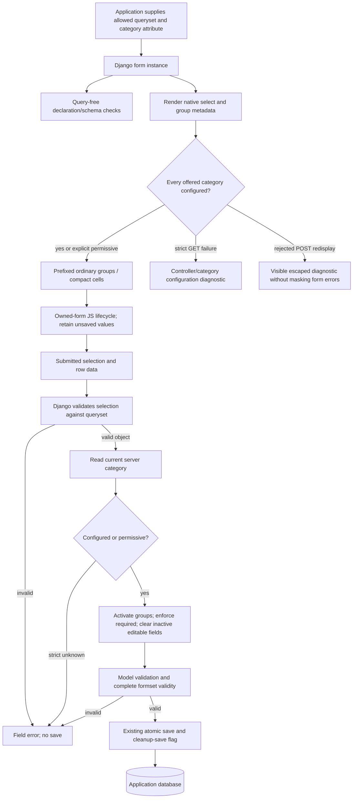

# Phase 06.30: Queryset-driven conditional fields (#360) — Research

**Researched:** 2026-11-13
**Domain:** Django model-choice validation, conditional rendering, inline persistence, upstream examples and downstream adoption
**Confidence:** MEDIUM. Official documentation/source and live repository source were inspected; no feature implementation or runtime acceptance is claimed.

<user_constraints>
## User Constraints (from CONTEXT.md)

The following approved decisions, delegated choices and all 14 acceptance criteria are copied verbatim. [VERIFIED: .planning/phases/06.30-queryset-driven-conditional-fields-360/06.30-CONTEXT.md]

<!-- DATA_7e4b92ad_START -->
## Implementation Decisions

### Approved decisions — preserve issue identifiers

Carry these discussion decisions into GSD planning without reopening them absent a concrete conflict.

- **D-01 — Three-value contract:** dynamic options have a selectable key, display label and conditional key.
  Configuration matches the conditional dimension, not a hard-coded list of volatile product PKs.
- **D-02 — Model-choice approach:** use Django's `ModelChoiceField` and the normal queryset/key/label behavior;
  declare an attribute or annotation for the conditional key. The demonstrated API class names are provisional.
- **D-03 — Shared feature:** support this contract on base forms and individual inline rows, not just the roastery.
- **D-04 — Strict by default:** offered keys must have configuration; a known category may explicitly activate
  nothing. An explicit permissive option allows unknown keys and activates no groups for that controller.
- **D-05 — Check both stages:** check offered options when rendering and the validated selection on submission.
  Reject unmatched selections without saving; browser metadata is not server authority.
- **D-06 — Bounded coverage:** do not check unused categories absent from the selectable options or introduce a
  separate category-source scan. A new, unused dimension value does not fail the form.
- **D-07 — Layout-based presentation:** inactive groups hide on base forms and ordinary inlines; compact cells
  remain visible with disabled controls. No new presentation setting in the initial scope.
- **D-08 — Preserve until save:** retain unsaved browser values when switching away/back; clear inactive values
  on successful save. Apply this consistently to base forms and inlines, including the roastery migration.
- **D-09 — Downstream upgrade included:** this issue includes upgrading and verifying `tabler-test`, not merely
  shipping an API for a future downstream task.
- **D-10 — Separate focused example app:** one dedicated Django app with its own models; do not mix this feature
  into an existing example app. Keep unrelated features out of its visible source.
- **D-11 — Both contexts in that app:** shared small models/configuration, separate standalone and inline modules,
  ordinary/compact inline variants, and relevant source modules per demonstration in the code viewer.
- **D-12 — Cross-linked documentation:** include documentation and the runnable example, linked in both directions.
- **D-13 — Handoff destination:** the discussion deliverable is a GitHub issue containing these decisions in a
  `gsd-handover` section. Filing it does not implement the feature, create a phase or create a worktree.

### Accepted design defaults and researcher / planner discretion

These author-proposed defaults were accepted in the full design approval. They support the individually
discussed decisions above; details explicitly left to the builder remain implementation choices.

- Start with model-choice controllers rendered as ordinary native single-selects. Existing static checkbox,
  select and radio controllers retain their supported behavior. AJAX/autocomplete controllers, dynamic radio
  controllers, multiselects, arbitrary widget adapters and a predicate/expression engine are outside this addition.
- A blank selector placeholder means no selection and activates nothing; the field's own required/invalid-choice
  validation still applies. An actual object with a missing/empty category is unmatched, not a placeholder.
- Preserve the usual model-choice key behavior, including supported `to_field_name` restrictions. Specify
  deterministic matching/serialization for supported conditional codes and PKs; reject ambiguous configurations.
  Choose the bounded supported key types and document them rather than inventing coercion heuristics.
- Reuse existing group semantics and clearing, including explicit empty values and server-disabled precedence.
  Detect conflicting ownership of fields/controllers rather than depending on declaration order. A shared group
  that stays active must retain its values; do not clear it merely because another category is inactive.
- The integration must be opt-in. Preserve existing static-choice and checkbox paths and the current
  whole-`ConditionalFormSet` contract. New queryset-driven whole-formset toggles are not included.
- Keep metadata/schema inspection query-free. Perform data-dependent coverage checking when options are actually
  rendered and selected objects validated, not at import, system-check startup or compact schema construction.
  Use an annotation/direct attribute to avoid per-option category queries; test query behavior and document any
  application-owned label/category access costs. No cross-request caches or background category registry.
- Use existing form ownership, exact prefixed names, row-added events, reset and modal initialization. Preserve
  independently disabled controls and management/identity/deletion fields. Do not add a document-wide observer
  as a substitute for the existing row lifecycle.
- Respect Django's empty-extra and deleted-inline handling. Keep row independence, existing atomic save behavior
  and conditional clearing for existing rows whose persisted data needs changing even when submitted fields
  otherwise look unchanged. No new concurrency/locking guarantees are requested.
- Make any page-specific source selection a small examples-only enhancement with explicit relevant files. Avoid
  a package-wide source-browser framework; preserve existing example source panels by default.
- Final public names, descriptor/layout integration, error classes and safe invalid-POST redisplay mechanics,
  metadata encoding, check IDs and exact example models are builder choices within the contract above.
- Expected release treatment is additive. Update `CHANGELOG.md`; if a breaking entry is needed, update
  `docs/migrating-1.0.md` under repository policy and explain the concrete reason.

### Matching and error handling details

- Derive the conditional key from the selected object validated by the field's authoritative queryset, never
  from a submitted category or an invalid raw key. Keep normal model-choice labels and selection behavior.
- Strict rendering failures identify the controller and unmatched key. Strict POST failures become form errors
  and prevent saving. Do not mask a rejected-POST error with a second unhandled rendering failure.
- With permissive matching, unknown categories activate no groups for that controller and its inactive editable
  fields clear normally; other controllers remain independent.
- An actual object with an empty/missing category is unmatched, unlike a blank placeholder. Configured categories
  without offered objects and unused dimension values cause no coverage failure.
- Reuse active-required validation, explicit `empty_values`, bounded clearing inference, trusted server-disabled
  precedence, model constraints and persistence safeguards. A shared group that stays active retains its data.
  A successful save clears inactive values without retaining hidden history.

### Focused example app and documentation

Create one separate Django app in `examples/bootstrap5/`, with its own models, forms, views, URLs, migrations,
seed data and tests. Do not extend the existing `conditional` or `formsets_conditional` apps or import their
domain code. Register a distinct feature/navigation entry.

The proposed teaching domain is service requests:

| Service | Conditional category | Required active field |
| --- | --- | --- |
| Boiler inspection | On-site | Visit address |
| Appliance installation | On-site | Visit address |
| Technical consultation | Remote | Meeting URL |
| Document review | General | None, explicitly configured |

Keep shared models and declarations small. Put the standalone editor in one module and inline forms/views
in another, with ordinary and compact variants. Demonstrate a standalone request and a batch of independent
request rows using the same conditional contract. Show only the modules relevant to the current demonstration
and its shared definitions in the code viewer: visitors must be able to connect the code to what they see.

The service domain and exact model names are the author's proposal, not separately selected API names.
Avoid unrelated business workflows. A correctly configured seeded example should support switching,
adding rows, saving and reopening. Cover strict failure and permissive behavior in tests and a documentation
recipe; do not leave the normal live demo deliberately broken.

Documentation must explain the three values, attribute/annotation configuration, strict default, explicit
empty cases, permissive opt-in, validation timing, browser preservation versus server clearing, layout
differences, supported controller bounds and query costs. Link to the runnable example and relevant source;
the example must link back to specific documentation sections using the established `Feature` / `DocRef`
conventions. Update the existing statement excluding relation-backed/per-row conditions without implying
that static `ValueToggle` now supports arbitrary querysets.

### Required downstream adoption

Use the product field's existing restricted queryset, including the selected retired product where currently
allowed. Supply an explicit conditional-key attribute or annotation derived by the application from the
product category/type, and configure coffee plus the known no-fields categories. Keep the field's normal
model-choice labels and selection validation.

Replace the coffee-specific `ProductSelect` option marking, row-toggle attributes and conditional portion of
`sales.js` with upstream support. Preserve the unrelated packing-slip print handler. Replace duplicate
form-level clearing with the upstream declaration. Retain `OrderLine.save()`'s domain safeguard for writes
outside forms. Preserve compact columns and allow coffee values to survive switching away/back before save,
which intentionally differs from the old immediate-clearing script.

Keep existing coffee fields optional: introducing required grind/bag size is not a requested business change.
Account for an existing subscription or other retained product explicitly under the application's categories;
do not use permissive matching merely to conceal missing configuration. Update finding 20 with issue/PR
references and adoption status only when the corresponding work is actually verified.

### Acceptance criteria carried from the approved handover

- [ ] Base form, ordinary inline and compact inline all use the same queryset/category mapping contract.
  Multiple options sharing a category activate the same fields; configured no-fields categories work.
- [ ] Strict rendering detects any offered unmatched option; strict POST detects an unmatched validated selection
  even without a preceding GET. Both are diagnosable and prevent the affected operation from silently succeeding.
- [ ] Test category changes between render and submit, allowed-queryset restrictions, forged/stale selections,
  explicit permissive behavior, unused categories and configured categories with no currently offered objects.
- [ ] Blank placeholders, required controllers, invalid values and trusted server-disabled controllers behave
  consistently. Invalid controllers never lead to successful saves through raw-data/category fallback.
- [ ] Active required fields validate; inactive editable fields clear using existing inference/explicit overrides,
  including submitted invalid inactive values. Model constraints and server-disabled controlled fields are preserved.
- [ ] Each row responds only to its own controller on initial create/edit, changes, invalid redisplay, reset and
  dynamic insertion. Verify supported modal initialization and exact prefixed names.
- [ ] Ordinary groups hide; compact cells stay aligned and disabled. Preserve accessible labels, errors and
  independently disabled states. Management and identity/control fields remain functional.
- [ ] Browser values survive switching away/back before save. Save/reopen proves inactive values really cleared,
  including an existing row that needs conditional cleanup. No-JavaScript and tampered POSTs cannot bypass clearing.
- [ ] Empty extra rows and deletion follow existing formset semantics. An invalid retained row prevents partial
  parent/sibling saves. Existing checkbox/static-choice and whole-formset behavior retain regression coverage.
- [ ] Demonstrate bounded query behavior: no choice evaluation during schema/startup checks, no category N+1 for
  an annotation-based controller, and no scan of categories absent from the field's options.
- [ ] The new example app owns its models and demonstrates standalone, ordinary inline and compact inline use.
  Seed at least two selectable objects sharing a category, a different active category and an explicit no-fields one.
- [ ] Example navigation, explanatory text and page-relevant source panels work. The documentation and runnable
  example link to each other at valid destinations/anchors; strict/permissive reproduction is documented and tested.
- [ ] `tabler-test` adopts the API, removes superseded form/widget/JavaScript plumbing, preserves the print handler
  and model safeguard, and verifies coffee/non-coffee, retained products, row insertion, switching and persistence.
  Record downstream verification and update finding 20 accurately.
- [ ] Run meaningful Python, template and JavaScript/browser checks, example/docs checks and appropriate lint.
  Use multicore pytest for broad runs per repository instructions. Record both repositories' verification evidence.

### Existing project constraints and discussion outcome

- Developer maintainability is a hard constraint: keep the extension bounded, traceable and opt-in. Broader
  test coverage does not justify a general rule engine, shared state or unrelated refactoring.
- Preserve Phase 06.27's static-choice, checkbox and whole-formset paths. Its exclusion of relation controllers
  is intentionally extended through this addition; do not implicitly broaden static `ValueToggle`.
- Preserve compact layout, accessible labels/errors, independent disabled states, management/identity/deletion
  controls and existing atomic saves. Use multicore pytest for broad verification.
- No meaningful unresolved maintainer decision or concrete conflict was found in the scout. The user selected
  option 1 to carry the approved design forward. Public API names, bounded key types, integration mechanics,
  error handling and test organization remain delegated builder choices under the accepted defaults.
- Source inspection during this discussion establishes no runtime acceptance result. Record actual upstream
  and downstream verification, browser evidence and limitations during implementation.

## Deferred Ideas

None added; no pending todos matched. AJAX/autocomplete, dynamic radios, multiselect controllers, arbitrary
widget adapters, predicate/expression engines, queryset-driven whole-formset toggles, a general source-browser
framework and new concurrency guarantees remain exclusions, not newly scheduled backlog work.
<!-- DATA_7e4b92ad_END -->
</user_constraints>

## Summary

Add one opt-in queryset condition source which produces ordinary group toggles. Keep the existing form mixin responsible for validation, clearing and model persistence. Do not expand static ValueToggle admission or build another form-validation engine. The existing mixin already suppresses inactive field errors, respects server-disabled fields and records persistence changes; the inline saver already saves existing rows when conditional cleanup changes their model state. [VERIFIED: src/crud_views/lib/conditional/group.py:189-304; src/crud_views/lib/formsets/render_tree.py:329-338]

The difficult work is rendering and lifecycle integration, not merely registering another change listener. Compact rows replace ordinary crispy layouts; ordinary non-polymorphic inline rows use the formset helper, not the row form's helper. Strict category coverage must inspect actual options at rendering time without leaking database work into schema/startup checks, while rejected POSTs must remain renderable. [VERIFIED: src/crud_views/lib/formsets/compact.py:71-158; src/crud_views/lib/formsets/render_tree.py:87-98; src/crud_views/lib/formsets/inline_formset.py:52-81; src/crud_views/checks.py:345-381]

**Primary recommendation:** implement a shared-source descriptor plus a small render-time metadata projection; preserve the current native select, clearing and save paths. Finish the separate example and verified roastery migration before closing the phase. This is a recommended implementation within delegated scope, not an additional locked user decision. [VERIFIED: phase CONTEXT, D-02, D-09–D-12 and accepted defaults]

## Architectural Responsibility Map

Recommended ownership follows existing seams, rather than introducing a new service. [VERIFIED: src/crud_views/lib/conditional/group.py:189-304; src/crud_views/lib/conditional/layout.py:31-45; src/crud_views/lib/formsets/compact.py:135-158]

| Capability | Primary tier | Secondary tier | Planning direction |
|---|---|---|---|
| Allowed selections and category derivation | Application/backend | Database | Application supplies restricted annotated queryset/direct attribute. |
| Category coverage and selected-object validation | Django forms/backend | Renderer | Validate offered options during rendering; validate selected cleaned object on POST. |
| Required and inactive-field behavior | Existing form mixin/backend | Model persistence | Reuse native model validation and conditional clearing. |
| Initial metadata and row presentation | Django/crispy renderer | Browser | Exact prefixed names; ordinary wrappers and compact cell attributes. |
| Switching, reset, insertion and modal rebinding | Browser | Existing lifecycle events | Preserve values in DOM; reconcile disabled baselines without clearing values. |
| Atomic writes | Existing view/formset backend | Database | Keep validity gate and transaction boundary. |
| Examples, source panels and doc links | Example application | Documentation | Explicit page-relevant files, scoped to examples. |
| Product classification | Downstream application | Downstream models | Explicit type/category code; upstream knows nothing about coffee. |

## Project Constraints (from AGENTS.md)

The user supplied AGENTS instructions reproduce the repository's CLAUDE guidance. Follow these actionable directives; project skill directory discovery found no project SKILL.md files, and the configured agent-skills query returned no injected skills. [VERIFIED: user-provided AGENTS instructions; CLAUDE.md; session project-skill discovery and agent-skills query]

- Developer maintainability is a hard constraint: choose bounded, traceable, opt-in additions; preserve proven paths; account for hidden state, abstractions and query costs.
- Use existing ViewSet/CrudView integration, permission behavior, nested parent filtering and system checks. Do not mix domain logic into upstream.
- CrudView attributes use the exact prefix `cv_`; workflow methods use `wf_`. Existing view keys are `list`, `detail`, `create`, `update`, `delete`, `workflow`, `manage`; permission mapping is list/detail→view, create→add, update→change, delete→delete. These are instruction quotes, not new phase APIs. [VERIFIED: CLAUDE.md, Conventions]
- Use double quotes, line length 120 and Ruff. The commit hook runs ruff-format.
- Keep hatchling packaging and bump-my-version conventions. An additive change is expected. Any `### Breaking` entry requires the paired 1.0 migration update.
- Broad pytest runs use `-n auto` or a bounded `-n 2`/`-n 4`; use serial only for tiny selections or a stated isolation/debugging reason. Do not interrupt existing verification merely to alter worker count.
- Preserve existing test model/fixture conventions; use the current Django test configuration rather than adding another test framework.
- Development entry points remain `task dev`, `task test`, `task format`, `task check`, `task build`, `task docs`; respect that `task check` applies fixes.
- After a subsequent GSD ship run, refresh codebase maps before further work.
- If separately asked to create a phase worktree, use GSD workspace, reuse an existing worktree where available, preserve the phase number in the branch and replace dots with hyphens in the workspace path. This research does not create or switch worktrees.
- Downstream: keep theme/app boundaries, use upstream hooks before copied templates, retain login/permission conventions, never wholesale commit licensed Tabler assets, and update the findings document alongside adoption. The approved cross-repository task authorizes eventual upstream/downstream work despite the downstream repository's normal read-only-sibling rule. [VERIFIED: /home/alex/projects/alex/tabler-test/CLAUDE.md:10-26,92-126,129-138]

## Standard Stack

No new dependency is recommended. Keep the installed project stack and existing minimums; do not combine this phase with version upgrades. Versions below are **observed environments**, not claims that a particular version is the newest release. Package publication dates were not fetched because no new package/version is proposed. [VERIFIED: pyproject.toml:25-35; noxfile.py:3-24; session importlib.metadata probes]

| Component | Declared/observed versions | Purpose |
|---|---|---|
| Django | Declaration `"django (>=4.2.0)"`; observed core 4.2.30, 5.2.19, 6.0.10; example/downstream 6.1.2 | ModelChoiceField, forms, model validation, inlines and tests |
| django-crispy-forms | Declaration `"django-crispy-forms (>=2.0)"`; observed 2.7 | Existing helper/LayoutObject rendering |
| crispy-bootstrap5 | Declaration `"crispy-bootstrap5 (>=2023.10)"`; observed 2026.9 | Existing upstream template pack |
| pytest / pytest-xdist | Observed 9.2.0 / 3.8.0 | Existing Python checks, bounded parallel broad runs |
| Vitest / jsdom / jQuery | Installed 5.0.3 / 30.1.2 / 3.7.1 | Existing JavaScript harness; manifest mismatch noted below |
| Playwright / Chromium | Observed package 1.64.1 / executable 149.0.7827.55 | Existing external browser harness |

Declared Python minimum is `requires-python = ">=3.12"`. The checked nox matrix is `DJANGO_VERSIONS = ["4.2", "5.2", "6.0"]` and `python=["3.12", "3.13", "3.14", "3.15"]`, with explicit skips in the file. Preserve those configured checks; do not infer compatibility merely from an absent version classifier. [VERIFIED: pyproject.toml:25-35; noxfile.py:3-19]

**Installation:** none for the feature. **Package Legitimacy Audit:** not triggered: no external package installation is recommended. Existing package names come from the project manifest and official Django/crispy documentation, not speculative discovery. [VERIFIED: pyproject.toml:25-35; CITED: https://docs.djangoproject.com/en/5.2/ref/forms/fields/; CITED: https://django-crispy-forms.readthedocs.io/en/latest/layouts.html]

## Architecture Patterns

### System Architecture Diagram

Recommended flow; conceptual nodes below are proposed responsibilities, not new services or classes.



### Recommended API shape — proposed, not existing public symbols

Use one source per controller with explicit configured category keys, and derive reusable toggles for membership. This is the smallest recommended way to retain the existing group API. Keys declared in the source but used by no toggle explicitly activate no fields. A toggle accepting several keys represents a shared group once, so switching between its active categories cannot clear it. The approved design's class names and case dictionary were illustrative; this sketch implements its three-value/category-to-group contract without a second form class hierarchy. [VERIFIED: phase CONTEXT D-01–D-06 and final public-name discretion]

**Proposed symbols:** `QuerysetConditions`, its `keys` argument and `.when()` method. All example field names and category literals below are proposed example-owned names, not existing enums or schema values.

```python
# Proposed API, not executable against today's package.
service_conditions = QuerysetConditions(
    "service",
    conditional_key="conditional_category",
    keys=("on_site", "remote", "general"),  # "general" is an explicit no-fields case
    allow_unmatched=False,
)
visit = service_conditions.when("on_site")
meeting = service_conditions.when("remote")

class RequestForm(ConditionalGroupModelForm):
    service = forms.ModelChoiceField(
        queryset=Service.objects.annotate(conditional_category=F("category__code"))
    )
    cv_conditional_groups = [
        ConditionalGroup(visit, fields=["visit_address"], required=["visit_address"]),
        ConditionalGroup(meeting, fields=["meeting_url"], required=["meeting_url"]),
    ]
    # Existing crispy layout convention:
    # "service", ToggleGroup(visit, "visit_address"), ToggleGroup(meeting, "meeting_url")
```

Keep source declarations immutable; store resolved/rendered state on the individual form, never on class-level descriptors. Reject multiple conflicting source definitions for the same controller and overlapping controlled fields/controllers. Validate structure without evaluating querysets. Reuse group required/empty-value semantics instead of inventing independent case-cleaning semantics. Existing fields default to required when `required` is omitted: `return self.required if self.required is not None else self.fields`; downstream coffee groups must therefore specify an explicit empty required list. [VERIFIED: src/crud_views/lib/conditional/group.py:40-73,166-180,199-211]

### Bounded key decision

**Recommendation within delegated scope:** support nonempty strings, integers excluding bool, and UUID objects for category keys; serialize with exact `str(value)`, preserving case and whitespace and UUID canonical formatting. Reject None, empty strings, booleans, floats, Decimal, bytes, collections and arbitrary objects; reject duplicate serialized configured keys. Thus integer 0 is valid, but configuring both 0 and "0" is an ambiguity error. Actual objects with missing/None/empty attributes are unmatched even in the presence of a blank widget placeholder. Do not treat them as the placeholder. This deliberately extends the existing scalar-token approach with UUID support, without altering static ValueToggle's contract. [VERIFIED: src/crud_views/lib/conditional/toggle.py:60-66,75-85; phase CONTEXT bounded-key discretion]

For selectable keys, preserve Django `prepare_value` and the field's normal validation. Admit native scalar integer/text/UUID PKs and unique scalar `to_field_name` columns of those types. Reject composite keys, relation-path lookups and nonunique target columns in this first increment. Permit label-only ModelChoiceField subclasses while refusing ModelMultipleChoiceField, manually replaced choices/custom iterators and selection/token overrides outside the native contract. Native single Select only; request-specific queryset replacement after `super().__init__()` must still work. Test structural admission without queryset evaluation. Django documents unique `to_field_name` and custom labels explicitly. [CITED: https://docs.djangoproject.com/en/5.2/ref/forms/fields/#modelchoicefield; VERIFIED: installed Django forms/models.py:1506-1582]

### Render-time projection: bounded extra work is preferable to widget machinery

**Recommendation:** keep the ordinary native Select and add a per-form, render-local projection of offered selectable tokens to category tokens. Walk the current field queryset once per controller, derive selectable keys through `prepare_value`, and read the direct attribute/annotation. Build each group's list of offered selectable tokens from that one projection. Do not rebuild it for each group/cell; do not enumerate the category table. This can add one bounded queryset evaluation per rendered form/controller beyond normal select rendering; document and test that cost rather than promising zero queries. Do not cache across requests or reuse a rendered projection for POST authority.

This approach avoids a new widget class, compact admission exception, option-template override and choice-iterator replacement. Its tradeoff is the extra bounded scan. Django's iterator normally uses `iterator()`, while length and truth tests can issue count/exists queries; simply calling `list(field.choices)` and then rendering again is not free. These are query-count hazards, not grounds to build shared caches. [VERIFIED: installed Django forms/models.py:1413-1441,1516-1545; CITED: https://raw.githubusercontent.com/django/django/stable/5.2.x/django/forms/models.py]

Keep matching metadata escaped by Django templates. Existing template contract quotes: `cv-data-toggle-group`, `cv-data-toggle-field`, `cv-data-toggle-values`; current JS rejects an empty value list with `values.length > 0`. Introduce an explicit queryset marker or separate metadata key so an empty **dynamic** match list means always inactive without silently broadening static malformed-metadata behavior. Compact cells additionally need an internal “disable only” marker; this is layout-derived metadata, not a new user presentation option. Final marker spelling is delegated and must be documented before Phase 7 inventory. [VERIFIED: src/crud_views/templates/crud_views/conditional/toggle_group.html:6-12; src/crud_views/static/crud_views/js/toggle.js:169-181]

**Counter-check against the simpler recommendation:** extra scanning can call application category properties or fetch deferred fields, and a manually replaced choices list might differ from the queryset. Bound admission to normal ModelChoiceIterator behavior; require annotation/direct loaded attribute for query guarantees; test chosen queryset restrictions and queryset replacement. Application label/property costs remain application-owned. Never call `label_from_instance` just to compute conditional metadata. The official option-value instance hook remains a valid future optimization, but is unnecessary for the agreed bounded query target. [CITED: https://docs.djangoproject.com/en/5.2/ref/forms/fields/#iterating-relationship-choices; VERIFIED: installed Django forms/models.py:1437-1441,1532-1545]

### Authoritative cleaning and safe redisplay

1. Preserve normal Django field cleaning. In group cleaning, derive activation only from the selected **cleaned model object**, after inherited form cleaning has supplied its final mapping. Never re-resolve raw submitted PKs as an activation fallback. Missing/invalid controller data cannot make the form valid. Django's selection lookup is `self.queryset.get(**{key: value})`; disabled fields clean initial data instead of POST. [VERIFIED: installed Django forms/models.py:1557-1572; forms/fields.py:270-272; src/crud_views/lib/conditional/group.py:221-234]
2. Validate strict selected-category coverage once per controller and attach a form field error. Other controllers continue to resolve independently. In permissive mode, all that controller's groups are inactive for unknown categories; clearing remains authoritative. Preserve the distinction between configuration shape errors and runtime unmatched-data errors. [VERIFIED: phase CONTEXT D-04–D-06 and matching/error details]
3. Use the mixin's inherited-clean mapping handling, disarmed required checks, inactive-error suppression, explicit empty values and disabled-field precedence. Reuse its pre-model-construction cleanup and persistence flag. Do not bypass model constraints or preserve inactive values in a hidden database history. [VERIFIED: src/crud_views/lib/conditional/group.py:213-304]
4. On an unbound render, raise a specific configuration error identifying the controller and unmatched category. On **bound redisplay**, render a visible escaped coverage diagnostic while retaining existing form/row errors; do not repeat the same exception as a 500. Keep that diagnostic outside a potentially hidden group. This also covers a valid sibling or untouched extra row rendered because another row failed. Do not broadly catch database failures or arbitrary exceptions. This is a proposed containment mechanism, not an existing runtime behavior.
5. Do not add coverage errors late during rendering and then imply an earlier successful `is_valid()` was authoritative for a save. Submitted-object validation owns the POST gate; rendering owns offered-option coverage. A valid POST is not required to scan unrelated offered categories, and an invalid POST must never be saved by the normal view path. [VERIFIED: phase CONTEXT D-05/D-06; src/crud_views/lib/views/mixins.py:42-64]

### Inline integration and component responsibilities

| Existing seam | Plan changes/reuse |
|---|---|
| Conditional descriptor module | New shared source and membership toggle; separate scalar serializer/admission; static ValueToggle unchanged |
| Group mixin | Recognize queryset membership toggles; one controller resolution; existing required/clear/model pipeline |
| ToggleGroup | Render shared projection and safe diagnostics using exact prefixed controller name |
| Ordinary InlineFormSet helper | Explicit ToggleGroup wrappers in `get_helper_layout_fields()`; do not assume row form helper is used |
| Compact helper | Add group attributes to each controlled cell while preserving column Div, label and errors |
| Compact schema/projection | Structural inspection only; no category/option iteration; metadata uniform across row states |
| JS toggle runtime | New opt-in dynamic empty-list and compact disable-only semantics; reuse ownership/baselines/events |
| ConditionalFormSet validation | Explicitly reject the new queryset membership/source objects for whole-formset activation |
| System checks | Walk base fields/declarations only; no form/query evaluation; inspect inline form classes too |
| Examples source panels | Explicit per-view relevant files with current defaults retained |

Grounding: compact uses `cells = [Div(column.field, css_class=f"col-md-{column.span}") for column in columns]` and identity roles `"ORDER", "DELETE"`; it must not nest these controls inside conditional cells. Ordinary helper renders hidden controls separately. Current ConditionalFormSet only explicitly rejects ValueToggle, so failing to add a new rejection would accidentally broaden its contract. [VERIFIED: src/crud_views/lib/formsets/compact.py:71-105,135-158; src/crud_views/lib/formsets/inline_formset.py:56-81; src/crud_views/lib/conditional/formset.py:18-29]

Native empty extra forms short-circuit validation; deleted rows are excluded after their forms have cleaned. Keep dynamic coverage failures as validation errors, not exceptions raised before Django can process deletion. Existing persisted rows still require cleanup even when field `has_changed()` is false; reuse `"_cv_conditional_requires_save"` in the saver instead of changing Django change detection. Keep the parent/sibling two-pass validity gate and atomic view save. [CITED: https://raw.githubusercontent.com/django/django/stable/5.2.x/django/forms/forms.py; CITED: https://raw.githubusercontent.com/django/django/stable/5.2.x/django/forms/formsets.py; VERIFIED: src/crud_views/lib/formsets/render_tree.py:329-338; src/crud_views/lib/formsets/formsets.py:367-385; src/crud_views/lib/views/mixins.py:53-64]

## Don't Hand-Roll

| Problem | Reuse instead | Reason/evidence |
|---|---|---|
| Submitted model selection | ModelChoiceField cleaning | Allowed-queryset validation and to_field_name already exist. [CITED: https://docs.djangoproject.com/en/5.2/ref/forms/fields/#modelchoicefield] |
| Inactive-value persistence | Existing conditional empty resolver and model hook | Defaults, files, relations, disabled fields and model validation already have bounded handling. [VERIFIED: src/crud_views/lib/conditional/group.py:76-155,266-304] |
| Row lifecycle | Existing row-added/modal/reset entry points | Exact form ownership and disabled baselines already exist. [VERIFIED: src/crud_views/static/crud_views/js/toggle.js:23-35,96-153,247-255] |
| Compact rendering | Existing crispy cell/helper | Preserve shared headings, labels and identity controls. [VERIFIED: src/crud_views/lib/formsets/compact.py:135-158] |
| Transaction/order/identity security | Existing formset gate and save pipeline | Conditional activation is not row authorization. [VERIFIED: src/crud_views/lib/formsets/render_tree.py:240-263; src/crud_views/lib/formsets/formsets.py:367-385] |
| Example browsing framework | Small explicit relevant-files option | Existing source panel already reads app-local files. [VERIFIED: examples/bootstrap5/project/templatetags/example_tags.py:70-96] |

## Downstream Adoption and Runtime State Inventory

### Concrete roastery migration

The offered queryset is explicitly `Product.objects.instance_of(Beans, Equipment).filter(is_active=True)`, unioned with `Product.objects.filter(pk=self.instance.product_id)` for persisted lines, then `.distinct()`. Preserve the union: it retains both retired products and a subscription line generated elsewhere. Current classification is Python Beans type, while Category only has a unique human-facing name and is nullable on Product; do not introduce a business dependency on category display labels. [VERIFIED: /home/alex/projects/alex/tabler-test/example/sales/forms.py:103-121; /home/alex/projects/alex/tabler-test/example/catalog/models.py:37-69]

**Recommendation:** derive a bounded stable conditional code from the product type in the downstream application, preferably a queryset annotation using explicit subtype conditions, or a simple application-owned scalar property with verified query cost. Configure coffee as active, equipment and subscription as explicit no-fields cases; retain failure for unknown newly offered types. Verify type derivation on the polymorphic queryset and retained base objects before settling the exact expression. Do not use permissive mode to hide missing downstream configuration. This recommendation preserves the existing type-based domain behavior; it does not rename category rows.

Coffee fields are optional: `grind = models.CharField(max_length=10, choices=Grind.choices, blank=True)` and `bag_size = models.CharField(max_length=5, choices=BagSize.choices, blank=True)`. Configure `required=[]`. Retain the current blank-label presentation and model save safeguard `self.grind = self.bag_size = ""` for non-coffee writes outside forms. Remove only the superseded ProductSelect marker, form clearing and conditional JavaScript; preserve the independent `if (event.target.closest("[data-print]")) window.print();` handler. [VERIFIED: /home/alex/projects/alex/tabler-test/example/sales/models.py:267-290; /home/alex/projects/alex/tabler-test/example/sales/forms.py:87-121; /home/alex/projects/alex/tabler-test/example/sales/static/sales/sales.js:6-32]

Existing downstream tests assert old option markers, so replace those expectations with behavior/metadata assertions and retain compact labels/error tests. Finding 20 currently reports the workaround; update the table and detailed finding only after adoption is actually tested. [VERIFIED: /home/alex/projects/alex/tabler-test/example/sales/tests/test_orders.py:70-99,146-156; /home/alex/projects/alex/tabler-test/docs/crud_views_upstream_findings_roastery.md:69,507-518]

### Runtime inventory — migration is application adoption, not a rename

| Category | Evidence/limits | Required action |
|---|---|---|
| Stored data | Existing order-line coffee values persist; save safeguard clears non-coffee values. Real developer data was not inspected. [VERIFIED: downstream sales/models.py:254-293] | No bulk data migration proposed. Test existing stale values via fixtures, then save/reopen; do not rewrite developer data during verification. |
| Live service configuration | No service rename or service configuration change is in approved scope. Deployed services were not inspected. [VERIFIED: phase CONTEXT boundary/defaults] | Use disposable loopback test servers; do not claim deployed adoption. |
| OS-registered state | No OS registration is changed by the proposed form/JS migration; OS registrations were not inventoried. [VERIFIED: phase CONTEXT scope] | None required for the code change; record actual browser/runtime paths in evidence. |
| Secrets/env vars | No secret/env key rename is proposed. Real secret values were not read. [VERIFIED: phase CONTEXT scope] | Use existing settings with temporary database/media overrides for browser checks. |
| Build artifacts/installed packages | Downstream declares `django-crud-views = { path = "../django-crud-views", editable = true }`; import probe resolves this checkout. [VERIFIED: /home/alex/projects/alex/tabler-test/pyproject.toml:19-21; session import probe] | Confirm import path again during adoption; restart only owned temporary servers and ensure tested static assets are current. |

## Focused Example and Documentation Plan

Create a new example app (suggested new path: `examples/bootstrap5/queryset_conditional/`; **proposed**, not existing). Give it small service/category/request/batch models, migrations, seed and tests; standalone and inline modules share only its own models/declarations. Offer standalone, ordinary inline and compact inline routes. Seed two services in one category, a second active category and an explicit no-fields category. Keep normal routes fully configured; test strict/permissive failures in deliberate fixtures and executable documentation recipes. [VERIFIED: phase CONTEXT D-10–D-12 and focused-example details]

Extend the examples-only source collector with explicit per-view relative files, constrained under that app directory, while retaining the current fallback `SNIPPET_FILES = ["models.py", "views.py"]` and existing template panels. Standalone pages show shared models/declarations plus standalone module; inline pages show shared files plus inline module. Avoid showing unrelated demonstrations. Navigation, app/URL registration and seed registration are all required: the seed command iterates FEATURES and imports each app's seed module. [VERIFIED: examples/bootstrap5/project/templatetags/example_tags.py:53-96; examples/bootstrap5/project/management/commands/seed.py:12-17; examples/bootstrap5/project/features.py:11-26,50-60]

Update the conditional and formset references with the three-value contract, explicit no-fields keys, strict/permissive behavior, validated-object authority, safe error redisplay, bounded key/widget support, query costs, browser preservation/server clearing and layout differences. Keep static ValueToggle's exclusions scoped to that feature: its current text explicitly says `relation-backed selectors` and `Product-dependent per-row conditions` are outside its contract. Add reciprocal docs/demo links using Feature/DocRef and verify anchors against built documentation. [VERIFIED: docs/reference/conditional.md:318-322; examples/bootstrap5/project/features.py:11-26; examples/bootstrap5/test_doc_links.py:1-8]

Published examples currently link to `DOCS_BASE = "https://django-crud-views.readthedocs.io/en/stable"`. New local anchors will not automatically exist on published stable docs before release. Record local build/link evidence and the actual published destination status separately; do not claim a published link is working solely because the local anchor test passes. [VERIFIED: examples/bootstrap5/project/features.py:7-8; examples/bootstrap5/test_doc_links.py:1-8]

## Common Pitfalls

1. **Raw PK/category fallback:** invalid POST starts activating groups. Resolve from cleaned objects only; category changes between GET/POST must affect POST validation. [CITED: https://docs.djangoproject.com/en/5.2/ref/forms/fields/#modelchoicefield]
2. **Group-level projection per cell:** query cost multiplies by group/column count. Build one render-local controller projection and reuse it; assert query slope for more options. [VERIFIED: installed Django forms/models.py:1413-1441]
3. **Hidden compact columns:** ordinary JS writes `group.style.display = enabled ? "" : "none"`. Add disable-only behavior for opted-in compact cells while preserving cell widths/labels. [VERIFIED: src/crud_views/static/crud_views/js/toggle.js:104-129]
4. **Losing values during toggling:** roastery's current `if (!beans) select.value = "";` violates the new accepted preservation contract. Remove that behavior; prove it by switching away/back in a real browser. [VERIFIED: downstream sales/static/sales/sales.js:6-14; phase CONTEXT D-08]
5. **Late render exceptions mask valid error reporting:** invalid selected category or unrelated invalid sibling triggers coverage again. Bound-render diagnostics need their own narrow path and must remain visible. [VERIFIED: phase CONTEXT matching/error handling requirements]
6. **Treating disabled as merely visual:** server-disabled controllers must use trusted initial selection and server-disabled controlled values must not clear. Browser-disabled inactive controls still require server clearing on tampered/no-JS POST. [CITED: https://docs.djangoproject.com/en/5.2/ref/forms/fields/#disabled; VERIFIED: src/crud_views/lib/conditional/group.py:296-304]
7. **Forcing validation of empty/deleted rows:** early data-dependent exceptions defeat Django's lifecycle. Leave structural validation query-free and unmatched selection as a field error. [CITED: https://raw.githubusercontent.com/django/django/stable/5.2.x/django/forms/formsets.py]
8. **Changing fields to server-disabled based on initial category:** prevents later legitimate POST changes and bypasses intended clearing. JS disability and trusted field.disabled are distinct controls. [CITED: https://docs.djangoproject.com/en/5.2/ref/forms/fields/#disabled]
9. **Silent omission from ordinary inline layout:** a row form's helper alone is insufficient; use the formset helper seam. [VERIFIED: src/crud_views/lib/formsets/render_tree.py:87-98]
10. **Unsupported whole-formset extension by accident:** new ToggleSource subclass passes the current ValueToggle-only rejection unless explicitly rejected. [VERIFIED: src/crud_views/lib/conditional/formset.py:18-29]

## Code Examples

The API sketch above is proposed. The existing reusable pattern is one shared descriptor referenced in both server groups and layout wrappers; no new class hierarchy is needed. Existing public symbols quoted verbatim are `ConditionalGroup`, `ConditionalGroupModelForm`, `ToggleGroup`, `ToggleSource`, `ValueToggle`. [VERIFIED: src/crud_views/lib/conditional/__init__.py:10-20]

Official Django's relationship-choice hook provides an object as `ModelChoiceIteratorValue.instance`; its prepared value carries the normal selected key. Use this fact when testing that metadata follows the real queryset/key pipeline, even though the recommended first implementation keeps the ordinary widget and scans its queryset separately. [CITED: https://docs.djangoproject.com/en/5.2/ref/forms/fields/#iterating-relationship-choices]

Proposed test shape (pseudocode, **not existing fixture/enum values**):

```python
# New fixture contract:
# 1. Render allowed annotated choices under strict source.
# 2. Change selected record's category in the database.
# 3. Construct a fresh bound form from the same allowed queryset.
# 4. Assert invalid category => field error, no parent/child saves.
# 5. Render invalid response: error remains visible, no unhandled exception.
# 6. Configure permissive source: inactive posted garbage clears, other source unaffected.
```

## State of the Art

| Established behavior | Phase addition | Consequence |
|---|---|---|
| Static choice membership via ValueToggle | Separate queryset category source | Static behavior stays bounded. [VERIFIED: src/crud_views/lib/conditional/toggle.py:69-162] |
| Ordinary wrappers hide groups | Compact cells only disable | Same authority, different layout-derived presentation. [VERIFIED: phase CONTEXT D-07] |
| Roastery bespoke option attributes and immediate clearing | Shared upstream metadata and preserve-until-save | Adoption intentionally changes switching behavior. [VERIFIED: downstream sales/static/sales/sales.js:6-14; phase CONTEXT D-08/D-09] |

No framework deprecation or version upgrade is required by the recommendation. Do not describe the new API as already released.

## Environment Availability

Actual availability probes only; these are not feature test results. Paths are observed command locations, not inferred installation recipes. [VERIFIED: session executable/import/version probes]

| Dependency/environment | Available | Observed | Action/fallback |
|---|---|---|---|
| Core Python 5.2 nox environment | Yes | Python 3.12.3; Django 5.2.19 | Primary core checks, explicitly expose current source via PYTHONPATH |
| Compatibility environments | Yes | Django 4.2.30 and 6.0.10 under Python 3.12 | Run affected selection in each |
| Upstream example .venv | Yes | Python 3.12.3; Django 6.1.2; crispy 2.7 / pack 2026.9 | Example checks; do not label as the nox 6.0 matrix |
| Downstream .venv | Yes | Python 3.14.7; Django 6.1.2; editable upstream import | Separate adoption check target |
| Node/npm | Yes | Node v24.21.0; npm 11.19.0 | Existing JS tools |
| JS manifest consistency | **Fails** | npm ls exits ELSPROBLEMS: jsdom 30.1.2 vs ^30.1.3; vitest 5.0.3 vs ^5.0.5 | Report drift; establish reproducible verification environment before final acceptance |
| Playwright | Yes | 1.64.1 at existing external harness package | Use explicit harness path; no speculative installation |
| Chromium | Yes | Executable --version returned 149.0.7827.55 | Actual browser launch remains implementation-time check |
| MkDocs | Yes | 1.6.1 | Strict local docs build |
| Context7 MCP / CLI | Not available | No callable tools; command lookup absent | Official Django/crispy docs and official source fetched instead |
| Graph context | Not available | graphify status reports exists=false | Live code inspection used |

No database service is needed for the proposed tests: the existing browser host creates temporary SQLite and media. Do not seed/reset either repository's developer database. [VERIFIED: tests/browser/conditional_formsets_server.py:1-28]

## Validation Architecture

### Test framework and commands

The command paths below were checked for existence/imports. **No broad test suite was run for research.** Added file paths are recommendations, not existing artifacts. The current Python suite uses pytest; the JS config selects jsdom and test helpers; existing browser tests use authenticated CSRF HTTP and real Chromium. [VERIFIED: pyproject.toml:145-146; vitest.config.js:1-9; tests/browser/conditional-formsets.cjs:1-16,254-279]

**Focused existing regression command:**
```bash
PYTHONPATH=src .nox/tests-3-12-django-5-2/bin/python -m pytest tests/test1/test_conditional_toggle.py tests/test1/test_conditional_group.py tests/test1/test_conditional_persistence.py tests/test1/test_conditional_layout.py tests/test1/test_conditional_checks.py tests/test1/test_conditional_formset.py tests/test1/test_formsets_compact.py -n 2
npm test -- tests/js/toggle.test.js
```

**New targeted test file (proposed):** `tests/test1/test_conditional_queryset.py`. Per-task checks should select the relevant unit or short integration case; establish measured runtime rather than promise a sub-30-second duration before it exists.

**Wave/full checks:**
```bash
PYTHONPATH=src .nox/tests-3-12-django-5-2/bin/python -m pytest tests -n 4
npm test
npm run test:integration
PYTHONPATH=src:examples/bootstrap5 .venv/bin/python -m pytest -c examples/bootstrap5/pytest.ini examples/bootstrap5 -n 2
.venv/bin/mkdocs build --strict
```

Repeat the affected conditional/compact selection with the available 4.2 and 6.0 nox interpreters; include existing crispy-floor sessions when rendering changes touch their supported contracts. Use scoped Ruff checks on edited files, migration consistency checks for the new example app and deterministic seed tests on temporary test databases.

**Downstream commands** (run from its checkout, separate environment):
```bash
.venv/bin/python example/manage.py test sales.tests.test_orders --parallel 2
.venv/bin/python example/manage.py test django_tabler dashboard sales catalog roastery shipping showcase --parallel 2
.venv/bin/python -m pytest tests/crud_views_tabler --ds tests.crud_views_tabler.settings
.venv/bin/python example/manage.py check --fail-level WARNING
```
These follow downstream's documented test entry points. It does not currently declare pytest-xdist, so do not invent a downstream `-n` dependency; Django's test-runner parallelism is the available broad-run path. Verify test-package availability before the theme command. [VERIFIED: downstream CLAUDE.md:28-54; downstream pyproject.toml:33-41]

### Acceptance → Test Map

AC labels below are local labels for the **14 ordered acceptance bullets copied above**, not invented global requirement IDs. Every plan should reference these and D-01–D-13. No formal phase requirement IDs were supplied. [VERIFIED: phase CONTEXT acceptance section; .planning/ROADMAP.md:1795-1805]

| AC | Required evidence | Test layer / concrete scope | Existing support / gap |
|---|---|---|---|
| 1 | Same contract in three layouts; shared category and explicit no-fields | Python metadata/cleaning + rendered forms + browser three routes | New queryset fixtures and example needed |
| 2 | Strict offered coverage; strict POST without GET; safe diagnostics/no save | Core render failure + invalid bound response + endpoint DB assertions | Extend conditional layout/check/persistence surfaces |
| 3 | Changed category, restricted/forged/stale key, permissive, unused category | DB-backed core parameterization; no category-table scan assertion | New queryset test file |
| 4 | Blank/required/invalid/disabled controller | Core cleaning and rendered native selection; tampered POST | Existing conditional tests provide patterns |
| 5 | Required active; invalid inactive data clears; model/disabled preservation | Persistence tests, explicit empty overrides, constraint failure | Extend persistence tests |
| 6 | Per-row initial/change/reset/modal/insertion independence | JS unit + real HTTP row fragments + browser | Existing toggle/formset suites and browser harness |
| 7 | Ordinary hide, compact alignment, labels/errors/disabled baselines, control fields | DOM assertions and desktop/mobile captures; management/identity POST | Existing compact tests; new dynamic metadata tests |
| 8 | Away/back values; save/reopen cleanup; unchanged-row/no-JS/tamper | JS/browser plus persisted DB assertions incl unchanged retained row | Existing conditional cleanup-save seam |
| 9 | Empty extra/deleted rows; atomicity; static/checkbox/whole-formset regression | Django formset integration + parent/sibling zero-save assertions | Existing suites, add queryset-specific rows |
| 10 | Query-free schema/startup; no N+1; options-only coverage | assertNumQueries/CaptureQueriesContext, small vs larger option count | New query-budget tests; include queryset replacement |
| 11 | New app owns models and all three demonstrations | Example routes, seed state, migrations and save tests | New app/tests required |
| 12 | Relevant sources/navigation/reciprocal links; strict/permissive recipe | Example source-panel assertions; doc link/anchor tests; strict MkDocs | Existing project/tests and test_doc_links/test_docs_sync |
| 13 | Verified roastery migration and accurate finding | Downstream order tests + real browser + DB checks + diff audit | Existing order tests need expanded categories/retained-products coverage |
| 14 | Recorded Python/template/JS/browser/example/docs/lint evidence | Versioned commands/results plus source fingerprints | New phase evidence artifact required |

### Browser evidence strategy

Use actual server-rendered HTML and the existing authorized row-fragment lifecycle. Existing lifecycle event names are `"cv:modal:loaded"` and `"cv:formset:row-added"`; use them, not a document-wide observer. Extend a focused harness or add one bounded queryset scenario runner rather than duplicating the large historical harness wholesale. [VERIFIED: src/crud_views/static/crud_views/js/toggle.js:247-255; tests/browser/conditional-formsets.cjs:1-16]

At minimum exercise standalone, ordinary inline, compact inline and downstream roastery at desktop and narrow widths. Include two rows with different selections, added row, selected blank, shared category, active-required redisplay, category-changed rejection, native/canceled reset, modal reload, independently disabled controls, keyboard labels/focus, switched-away/back values and no-JS/tampered POST. For compact, measure or inspect visible aligned cells, not merely class presence. Persist final inactive values and reopen to prove clearing.

Record source hashes/commits for both repositories, interpreter/browser versions, exact URLs, assertions, response/save results, captures and cleanup. Existing harness defaults point to historical evidence outputs: always supply a new phase-owned output location. Use isolated temporary SQLite/media/server ports and preserve developer databases. Separately record any unrun theme, browser engine, Python matrix or published-doc checks. These are proposed evidence requirements; none has been passed in this research.

### Wave 0 gaps and sampling

- Add DB-backed queryset fixtures and the new focused Python test file; retain existing static/checkbox/whole-formset suites.
- Add deterministic rendered-metadata, strict invalid-redisplay and query-budget cases before widening JS behavior.
- Add JS tests for empty dynamic matches, compact disability without hiding, row/prefix isolation and preservation.
- Add example app migrations/seeds/test data, page-relevant source-panel assertions and executable strict/permissive recipes.
- Add downstream retained retired/subscription product tests, optional coffee fields and model-save safeguard tests.
- Resolve or explicitly isolate JS manifest drift; do not report an old installed tree as a clean lockfile environment.
- Per task: relevant short tests. Per implementation wave: affected suites. Final gate: full upstream, downstream adoption, browser and docs evidence; no phase completion from inspection alone.

## Security Domain

Security enforcement is enabled: `"security_enforcement": true`, with configured level `"security_asvs_level": 1`. Use an explicit ASVS version. The requested V2/V3/V4/V5/V6 labels are the **ASVS 4-era** taxonomy, documented by OWASP's developer guide; ASVS 5 uses different chapter numbers (including V6 authentication, V7 sessions and V8 authorization). Do not silently apply old numbers to a 5.0 report. [VERIFIED: .planning/config.json workflow security keys; CITED: https://devguide.owasp.org/en/03-requirements/05-asvs/; CITED: https://github.com/OWASP/ASVS/blob/master/5.0/docs_en/OWASP_Application_Security_Verification_Standard_5.0.0_en.csv]

| ASVS 4 category | Applies to phase | Standard control to preserve/test |
|---|---|---|
| V2 Authentication | Existing boundary, no new auth | Real authenticated examples/downstream tests |
| V3 Session Management | Existing boundary, no new session mechanism | Existing CSRF and modal/form ownership |
| V4 Access Control | Yes | Allowed ModelChoiceField queryset, row identity/permissions, no client category authority |
| V5 Validation/Sanitization/Encoding | Yes | Native field/model validation; escaped JSON attributes and diagnostics; bounded supported types |
| V6 Stored Cryptography | No new cryptographic capability | Do not add cryptography or signing as a substitute for server selection validation |

Threat recommendations: reject forged selection (tampering/elevation); ensure exact owning form/row (tampering); escape category/key error output and metadata (script injection); keep coverage work bounded by offered queryset rather than category-dimension scans (resource exhaustion); retain complete validity and transaction boundary (partial writes). These controls are grounded in existing selection, identity, encoding and save seams. [CITED: https://docs.djangoproject.com/en/5.2/ref/forms/fields/#modelchoicefield; VERIFIED: src/crud_views/lib/formsets/render_tree.py:240-263; src/crud_views/templates/crud_views/conditional/toggle_group.html:6-12; src/crud_views/lib/views/mixins.py:53-64]

## Assumptions Log

No unverified training-based technical claim is used to lock a decision. New API names, key bounds, projection strategy, example names and error-containment mechanics are explicitly **proposed recommendations within already delegated scope**, not claims about current code. Their correctness must be proved by implementation tests. No additional maintainer confirmation is needed merely because these implementation choices are proposed. [VERIFIED: phase CONTEXT accepted defaults/final-name discretion]

| Item requiring execution evidence | Risk if unproven |
|---|---|
| Render-local projection meets agreed query budget in supported environments | Hidden per-row/per-option overhead |
| Native key/label admission and downstream polymorphic annotation/property behavior | Selection/category disagreement |
| Safe coverage diagnostics work in invalid parent/sibling/modal redisplays | Error-page regression |
| Compact DOM remains aligned/accessibly labelled in stock and Tabler | Visual/accessibility regression |
| Published docs/example destinations after deployment | Local links pass while published links remain unavailable |

## Open Questions

No unresolved user decision blocks planning. Settle the proposed public names and source API in the first core plan; keep the chosen model-choice contract and all no-fields/strict/clearing semantics.

Implementation verification must resolve: exact query count for projection, the bounded roastery type annotation/property, safe diagnostic markup placement, and measured browser/compatibility behavior. The existing installed JS tree is inconsistent with its manifest; address reproducibility before accepting its final evidence. Runtime browser launch and full test suites were intentionally not performed during research.

## Sources

- Approved phase CONTEXT and approved design were read; live issue #360 title/body were retrieved using gh. D-01–D-13 and all 14 acceptance bullets are preserved above. [VERIFIED: session reads; https://github.com/jacob-consulting/django-crud-views/issues/360]
- Core conditional, compact, render tree, inline helper, checks, JS and relevant tests were inspected with numbered source reads. Citations identify the actual seams; no codebase-map claim substitutes for source. [VERIFIED: source citations throughout]
- Official Django 5.2 field docs: model-choice keys/labels, to_field_name, iterator-instance access, disabled initial behavior. [CITED: https://docs.djangoproject.com/en/5.2/ref/forms/fields/]
- Official Django 5.2 source: model choices, BaseForm lifecycle and formset deletion/extra handling. Installed 5.2.19 sources were cross-checked. Some docs module endpoints failed; official raw source was fetched instead. [CITED: https://raw.githubusercontent.com/django/django/stable/5.2.x/django/forms/models.py; CITED: https://raw.githubusercontent.com/django/django/stable/5.2.x/django/forms/forms.py; CITED: https://raw.githubusercontent.com/django/django/stable/5.2.x/django/forms/formsets.py]
- Official crispy layouts: nested layouts and Div/Field attributes. [CITED: https://django-crispy-forms.readthedocs.io/en/latest/layouts.html]
- Downstream instructions, product/order models, form, script, order tests and finding 20 were read without modifying downstream. [VERIFIED: downstream source citations throughout]
- Canonical prior phase contexts 06.24, 06.26 and 06.27, maintainability note, project/requirements and current state were read as preservation context. [VERIFIED: canonical reference reads]

## Metadata

**Confidence calculation:** research-plan selected Context7 for framework questions and websearch for security. Context7 MCP and CLI were unavailable; official documentation/source was used as fallback and corroborated with installed source. The classify-confidence seam returned MEDIUM for `--provider websearch --verified`; digests were stored with that value. Its unrecognized webfetch provider returned LOW, so that was not misreported as authoritative-provider confidence.

| Area | Confidence | Basis |
|---|---|---|
| Standard stack | MEDIUM | Installed versions and manifest read; no upgrades proposed |
| Existing architecture | MEDIUM | Live source and official source corroboration; no new runtime result |
| Recommended integration | MEDIUM | Bounded proposal using current seams; tests required |
| Pitfalls | MEDIUM | Concrete lifecycle/query/schema behavior inspected |
| Downstream adoption | MEDIUM | Read-only code inspection and import probe; adoption not implemented or accepted |

**Research date:** 2026-11-13
**Recheck:** before execution if either repository changes; package/browser environment observations are session-specific.
**Output boundary:** only this research file is owned by the researcher. No product changes, downstream changes, branch changes or commits were made.

