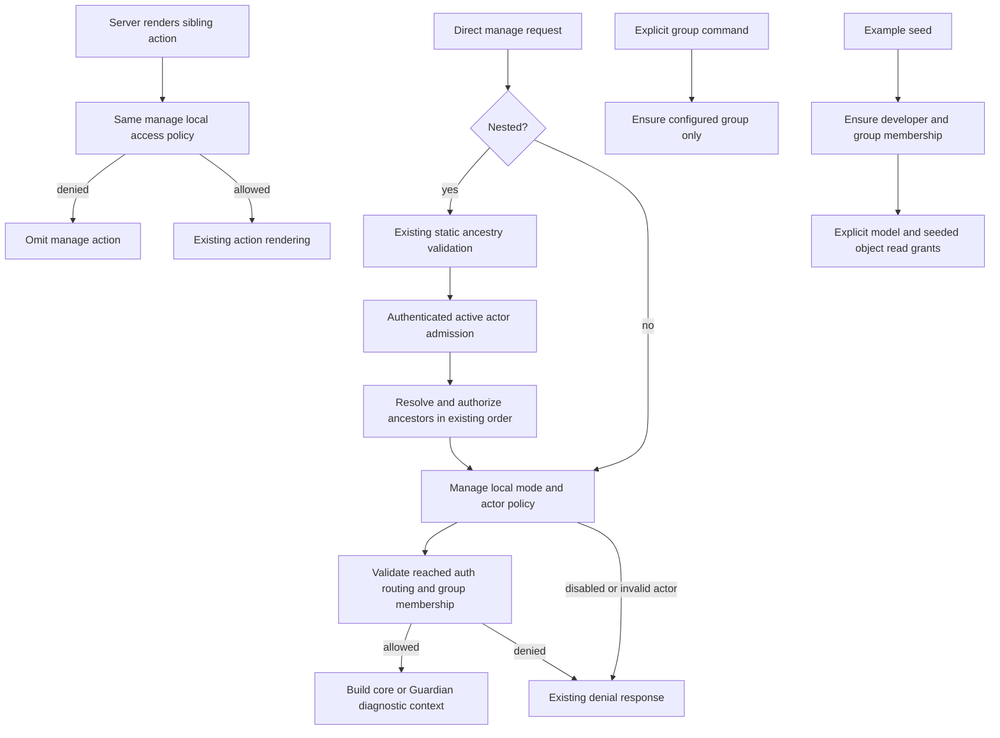

# Phase 06.31: Developer-only manage diagnostics (#361) - Research

> **Decision resolved (2026-11-13):** The maintainer approved correcting the affected custom-form and flash
> example actions to require appropriate write permissions while preserving Alice/Bob's abilities (CONTEXT D-11).
> References to a pending decision below record the original research state; D-11 now governs planning.

**Researched:** 2026-11-13
**Domain:** Django authorization, diagnostic action projection, management commands, example seeding
**Confidence:** MEDIUM

<user_constraints>
## User Constraints (from CONTEXT.md)

The following decisions, discretion, and deferred scope are copied verbatim from the phase context. [VERIFIED: .planning/phases/06.31-developer-only-manage-diagnostics-361/06.31-CONTEXT.md]

<!-- DATA_d9a73b6f_START -->
## Implementation Decisions

### Approved issue decisions — preserve D-01–D-07 identifiers

- **D-01 — Developer diagnostics only:** Regular application users must not see the manage action or open the
  manage URL. Apply to both core and Guardian. DEBUG=True never grants access by itself. Hide denied manage
  actions even where ordinary inaccessible application actions use the disable presentation.
- **D-02 — Explicit group membership:** Use CRUD_VIEWS_MANAGE_GROUP, default CRUD_VIEWS_MANAGE. Staff and
  superusers also require membership. This group grants diagnostic access only; ordinary CRUD permissions and
  nested ancestor restrictions remain independent. D-08 below additionally requires an active account.
- **D-03 — Production diagnostics:** Permit authorized developers with DEBUG=False; debug mode cannot be a
  universal prerequisite.
- **D-04 — Enable modes:** CRUD_VIEWS_MANAGE_VIEWS_ENABLED defaults to "yes" and requires the active,
  authenticated group member regardless of DEBUG. "no" denies everyone, including members and superusers.
  "debug_only" requires both that membership/actor rule and DEBUG=True. Remove the old group exception under "no".
- **D-05 — Explicit group setup:** Add `python manage.py cv_manage_group`. Ensure the configured group exists,
  report created/already present, respect custom naming, and preserve existing memberships and permissions.
  Idempotent and usable with DEBUG=False; document running after migrations. The command creates no users and
  assigns no permissions or membership. Django admin/application setup remains responsible for real memberships.
- **D-06 — Per-user diagnosis:** Current-user permission results describe the signed-in account. To inspect as
  Alice, temporarily grant Alice manage-group membership, then remove it. Alice herself can open diagnostics
  during that interval. A developer account does not impersonate Alice or reproduce Alice's current-user results.
- **D-07 — Phase and source:** Track finding 25 from the Roastery report as P06.31 / issue #361. The initial
  discussion deliverable was the issue and handover; insertion and this context capture are subsequent authorized
  planning work. Do not infer authorization to execute implementation from this discussion command.

### Additional decisions explicitly settled in this phase discussion

- **D-08 — Active users required:** All manage pages require an active user. Reject inactive group members even
  if a custom authentication backend permits their session. This intentionally changes the existing inactive
  allowance at top level and under unprotected/all-none ancestry. Preserve unrelated ancestor authorization.
- **D-09 — Seed and show developer:** The example app's seed creates the developer account, ensures the configured
  manage group exists, and adds the developer to it. Display developer alongside Alice/Bob in existing account
  guidance. This explicitly supersedes the prior private/manual-account recommendation, including its instruction
  to keep demonstration developer credentials unpublished. Do not automatically add Alice/Bob to the group.
  The standalone command remains group-only; account provisioning belongs to the example seed.
- **D-10 — Read access, including Guardian:** The developer is a regular non-superuser account with read access
  across the examples. Assign needed model view permissions and Guardian object view permissions for seeded data,
  including protected ancestors and nested objects. The maintainer explicitly required Guardian coverage.
  Group-only access and a superuser were considered and not selected. Do not grant add/change/delete, execution
  permissions, or superuser/staff privileges merely to make browsing convenient. Preserve Alice/Bob's roles,
  ownership, shares, and restricted experiences.

### Acceptance and preservation constraints

- Keep current URL registration; disabled manage pages still enforce denial on direct requests.
- Cover both manage families across every enable mode and DEBUG value, active/nonactive members, anonymous users,
  ordinary nonmembers, and staff/superusers without membership. Verify denied users receive no diagnostic content.
- Verify the manage action is absent for denied users, including the ordinary disable-action presentation.
- Keep nested ancestor and database-routing boundaries; group membership is not an ancestor-permission bypass.
- Demonstrate actual developer browsing of Guardian documents and notes, including nested manage pages whose
  ancestor requires an object grant. A global model permission alone is insufficient for strict Guardian.
- The delete example also uses Guardian-backed projects/tasks: include its seeded readable objects in the
  across-examples read-access contract. Do not change its ownership or protected-delete demonstrations.
- Fresh seed and repeated seed produce a usable developer account, configured group/membership, and read grants
  without duplicates or disruption of Alice/Bob scenarios. The group-only command must leave existing group
  permissions and memberships intact.
- Show the developer account consistently in the existing login/home/base account guidance and seed output;
  explain its read-plus-diagnostics role. Use existing example presentation rather than a new authentication UI.
- Verify denied application writes as well as successful reads. Do not make intentionally public/plain views
  more restrictive as an incidental change to this phase; research should report any concrete conflict with the
  read-only demo role before broadening ordinary application authorization.
- Update settings/Guardian documentation, example/development guidance, CHANGELOG.md's Breaking section, and
  docs/migrating-1.0.md. Include the default change, mandatory active group membership, new hard-off meaning of
  "no", explicit group setup, and demonstration account behavior.
- Follow project maintainability constraints: small traceable changes, no hidden startup writes, no new general
  permission framework, no weakening of existing ancestor/object policy. Broad pytest runs use multiple workers.
- Source inspection is the evidence so far. No new test or browser verification was performed during discussion.

### Researcher / planner discretion

Exact helper placement, command wording, demo credential convention, explicit seed grant organization, regression
fixtures, and documentation layout are implementation decisions. Follow existing example conventions for the
account named developer. Prefer reuse of current grant helpers and account setup; do not add a generic identity
or permission synchronization framework. The user settled behavior, not a specific call graph.

Grant view access to seeded example data; automatic grants for future production objects and a new permission
propagation service were not requested. Keep optional app boundaries and custom manage subclass behavior in view
when choosing the smallest compatible gate. Check inactive admission and action projection together with direct
request handling. Preserve unrelated failure ordering unless the new active-user rule requires a bounded change.

The Roastery finding motivates this phase; document the same developer-account approach for consumers. A separate
cross-repository upgrade project was not authorized here. Technical conflicts should be reported with evidence;
settled group/mode/account decisions should not be reopened merely as implementation preferences.

## Deferred Ideas

- Finding 25's responsive manage-table wrappers remain outside this phase.
- No impersonation, membership-management CLI, automatic startup group creation, general permission redesign,
  new account-switching system, or separate downstream upgrade project.
- No pending todos matched this phase.
<!-- DATA_d9a73b6f_END -->
</user_constraints>

## Project Constraints (from AGENTS.md)

Applicable instructions were supplied as AGENTS.md and read in CLAUDE.md. Preserve developer maintainability as a hard constraint: smallest bounded solution, proven paths, self-contained changes, explicit unsupported cases, and attention to hidden state, abstractions and extra queries. Do not broaden authorization architecture to implement this phase. [VERIFIED: CLAUDE.md:17-29]

Use the existing development commands and tools; broad pytest selections use multiple workers, while tiny focused selections may run serially to avoid startup overhead. Follow the existing fixture naming and class-attribute conventions, double quotes and 120-character lines. Keep permission mapping and workflow conventions. A breaking changelog entry requires paired migration guidance before 1.0. Preserve the hatchling and bump-my-version setup. After a later ship, refresh codebase maps. Worktree creation, if needed later, follows the prescribed GSD workspace convention; this research uses the supplied workspace. [VERIFIED: CLAUDE.md]

## Summary

Keep this change in the manage view family, its settings, a small command, and explicit example setup. The current local gate makes diagnostics public in enabled/debug mode and allows group membership even in hard-off mode. Its early nested actor hook reproduces those assumptions. Separately, manage inherits unconditional action access from CrudView. Therefore request authorization, early actor admission, and action projection must change together. GuardianManageView inherits ManageView, so a shared core implementation can cover both without importing Guardian into core. [VERIFIED: src/crud_views/lib/views/manage.py:31-69; src/crud_views/lib/view/base.py:482-484; src/crud_views_guardian/lib/views.py:384-391]

**Planning conflict requiring the pending user decision:** granting ordinary read permissions currently also enables two data mutations in the custom-form example and message execution in the flash-message example. Do not silently broaden scope or claim the developer is read-only until that conflict is resolved. Other settled work can be planned independently. [VERIFIED: src/crud_views/lib/views/form.py:36-37,72-73; examples/bootstrap5/custom_form/views.py:54-74,86-103; examples/bootstrap5/flash_messages/views.py:44-63]

**Primary recommendation:** share one small manage-local policy between request and projection, retain ancestor enforcement order, force denied manage actions hidden, provision the group explicitly, and add explicit developer read grants to example seeds. This is an implementation recommendation grounded in the cited code and D-01–D-10, not a new locked user decision.

## Architectural Responsibility Map

Recommended allocation, based on existing ownership above:

| Capability | Primary Tier | Secondary Tier | Rationale |
|---|---|---|---|
| Manage actor/mode/group decision | Django backend | Auth database | Enforce before diagnostic context creation; reuse for projection |
| Nested authorization | Existing backend ancestor engine | ORM/auth/Guardian data | Keep independent ancestor policy and routing checks |
| Manage visibility | Server-side rendering | Backend access predicate | Hide at existing action projection boundary |
| Explicit group setup | Django management command | Auth database | Deliberate idempotent mutation after migrations |
| Developer setup/grants | Example seed | Auth and Guardian tables | Keep demo provisioning separate from reusable command |
| Account guidance | Existing templates/docs | Seed output | Add developer alongside existing accounts |

## Phase Requirements

Phase 06.31 has prose requirements in ROADMAP rather than new formal requirement IDs. Use D-01–D-10 and acceptance statements for plan traceability; do not invent global IDs. Existing AUTH/ANCE requirements are preservation constraints except the explicit manage-policy supersessions. In particular, preserve ancestor ordering, independent object gates, and default-database nested checks. [VERIFIED: .planning/ROADMAP.md:1808-1814; .planning/REQUIREMENTS.md:71-77,281-288]

| Decision group | Required planning evidence |
|---|---|
| D-01–D-04, D-08 | Core/Guardian mode × DEBUG × actor matrix; absent buttons, no diagnostic response content |
| D-05 | Default/custom group setup; repeated invocation; existing grants/memberships unchanged |
| D-06 | Current account diagnostic semantics and temporary Alice membership guidance |
| D-09–D-10 | Fresh/repeated developer seed; regular active actor; visible credentials; protected reads and denied writes |
| Preservation | Ancestor denial/order, database routing, optional Guardian boundary, Alice/Bob ownership and restricted scenarios |

## Standard Stack

Reuse existing dependencies. No external package install or upgrade is recommended, so a registry freshness claim and package-install legitimacy audit are not applicable. Versions below describe inspected installed environments, not latest releases. [VERIFIED: interpreter importlib.metadata probe, 2026-11-13; pyproject.toml:27-78]

| Component | Inspected version / declaration | Purpose |
|---|---|---|
| Python | 3.12.3 in both supplied environments | Existing runtime |
| Django | 5.2.19 in supplied nox environment | Auth, ORM, management command, TestCase |
| django-guardian | 3.5.2 in both | Existing object grants |
| Pydantic | 2.14.3 in nox | Existing settings model |
| pytest / pytest-django / pytest-xdist | 9.2.0 / 4.14.0 / 3.8.0 | Existing core test infrastructure |
| Alternate environment | Django 6.1.2, Pydantic 2.14.1 | Available, but not evidence for the declared Django 6.0 matrix |

The official Django command pattern uses a Command subclass with handle and self.stdout for testable output. [CITED: https://docs.djangoproject.com/en/5.2/howto/custom-management-commands/]

**Package Legitimacy Audit:** No new packages proposed. Do not add a permission framework or a seeding dependency.

## Architecture Patterns

### System Architecture Diagram

Recommended flow preserving the existing ancestor engine:



This diagram does not promise full ancestor-aware button parity. The existing class access API receives user/object rather than arbitrary request ancestry. This phase requires the manage-local gate in projection and independent full ancestry enforcement on direct requests; do not reopen the retired integrated URL/access work. [VERIFIED: src/crud_views/lib/view/base.py:482-489,854-864; src/crud_views/lib/ancestors.py:452-486; .planning/ROADMAP.md:62-68]

### Source values and precise implementation seams

The following discrete values are quoted verbatim from opened source. Paths in citations identify inspected files, not newly proposed generated paths.

<!-- DATA_23c6a19e_START -->
- Settings currently declare `MANAGE_VIEWS_ENABLED_VALUES: ClassVar[tuple[str, ...]] = ("no", "yes", "debug_only")`, `manage_views_enabled: str = from_settings("CRUD_VIEWS_MANAGE_VIEWS_ENABLED", default="debug_only")`, and `manage_group: str = from_settings("CRUD_VIEWS_MANAGE_GROUP", default="CRUD_VIEWS_MANAGE")`. Change the default as D-04 requires. [VERIFIED: src/crud_views/lib/settings.py:25-35]
- Existing presentation vocabulary is `INACCESSIBLE_ACTIONS_VALUES: ClassVar[tuple[str, ...]] = ("hide", "disable")`. Manage declares `cv_key = "manage"` and `cv_path = "manage"`. [VERIFIED: src/crud_views/lib/settings.py:26; src/crud_views/lib/views/manage.py:15-16]
- Custom manage settings are `"CRUD_VIEWS_MANAGE_VIEW_CLASS"` and `"CRUD_VIEWS_GUARDIAN_MANAGE_VIEW_CLASS"`. Core resolves `dotted = self.manage_view_class or crud_views_settings.manage_view_class` and imports it; auto-registration uses `type("AutoManageView", (base,), {"model": self.model, "cv_viewset": self})`. Preserve subclass-based customization. [VERIFIED: src/crud_views/lib/settings.py:37-38; src/crud_views/lib/viewset/__init__.py:205-208,356-362]
- Shared button resolution uses `ctx.get("cv_access") is True`, `ctx.get("cv_action_enabled") is not False`, and `ctx.get("cv_inaccessible_actions") != "disable"`. [VERIFIED: src/crud_views/lib/view/visibility.py:14-20]
<!-- DATA_23c6a19e_END -->

### Pattern 1: one manage-local gate, three callers

Recommended: a small class-level manage predicate accepting the actor, used by ManageView.has_permission and ManageView.cv_has_access; leave helper naming to execution. It checks actor authentication/activity, mode, then membership. Keep the reached nested auth validation immediately before membership queries. The existing routing helper explicitly accepts a view class for access helpers and returns immediately at top level. [VERIFIED: src/crud_views/lib/views/manage.py:62-69; src/crud_views/lib/ancestor_db.py:141-170]

Replace the old public-mode helper and update early nested actor admission so anonymous/inactive actors cannot pass the all-none path. Reuse the existing protected actor response for consistent anonymous denial and inactive rejection. Keep membership/mode enforcement in the local gate after ancestry; an authenticated active nonmember should retain unrelated missing-ancestor versus forbidden ordering. Do not move all group queries ahead of the ancestor engine. [VERIFIED: src/crud_views/lib/views/manage.py:31-60; src/crud_views/lib/ancestors.py:417-425,458-483; tests/test1/test_ancestor_actors.py:507-516]

For denied manage controls, prefer ManageView's existing inaccessible-action accessor override returning the hidden presentation, rather than adding a global special-case permission system. Merely setting a default attribute may be overridden by a custom manage subclass; document and test inherited custom subclasses and the chosen boundary. An explicitly overridden authorization method remains custom code's responsibility; do not promise to secure arbitrary replacements without scope approval. [VERIFIED: src/crud_views/lib/view/base.py:392-399; src/crud_views/lib/viewset/__init__.py:356-362]

Keep URLs registered. Current registration creates the manage subclass regardless of mode; only automatic context-action insertion is suppressed under the hard-off value. Tests should cover directly requested URLs and explicitly configured manage actions, not rely on import-time omission. [VERIFIED: src/crud_views/lib/viewset/__init__.py:205-208,346-354]

### Pattern 2: group-only command

Implement the new command requested in D-05 using the existing BaseCommand pattern. The entire data mutation can be Group.objects.get_or_create(name=crud_views_settings.manage_group); report its created flag through self.stdout. Do not add user arguments, memberships, permission assignments, startup hooks, or signals. Django's installed Group model declares a unique name, quoted as `name = models.CharField(_("name"), max_length=150, unique=True)`. [VERIFIED: installed Django 5.2.19 django/contrib/auth/models.py:120-125; src/crud_views/management/commands/cv_assets.py:4-9,22-25] [CITED: https://docs.djangoproject.com/en/5.2/howto/custom-management-commands/]

Proposed new file: `src/crud_views/management/commands/cv_manage_group.py` (implementation destination, not an existing-path verification claim). Test invocation through Django call_command and capture output; document running after migrations. The command remains independent of manage enablement and DEBUG, per D-05.

### Pattern 3: explicit developer grants, no global permission synchronization

The existing user setup only creates Alice/Bob and resets passwords; it supplies staff/superuser flags as creation defaults, so an already-existing account is not normalized. The seed command ensures users before invoking feature seeds. Decide explicitly how the example-owned developer is kept active/nonstaff/nonsuperuser on reruns; avoid modifying Alice/Bob or building a general account cleanup service. If pre-existing custom privileges are not normalized, document that narrow boundary and do not claim their removal. [VERIFIED: examples/bootstrap5/project/seeding.py:5-24; examples/bootstrap5/project/management/commands/seed.py:12-18]

Use explicit model lists in a small shared developer-read helper or explicit grants within current feature seeds. Keep feature-owned Guardian grants alongside each existing get_or_create result so only seeded data is granted. Avoid blanket permissions across all installed apps and grants over all database rows. The existing helper's default grants all CRUD actions, so every developer call must explicitly select read only. Quoted source: `def grant_model_perms(user, model, actions=("view", "add", "change", "delete"))`. [VERIFIED: examples/bootstrap5/project/seeding.py:27-32]

| Seed coverage | Bounded recommendation | Source evidence |
|---|---|---|
| Ordinary example models | Explicit read model list across feature apps, including related detail-only models | Existing per-feature seed conventions; library includes `Author, Book, Contract` [VERIFIED: examples/bootstrap5/library/seed.py:6,39-51] |
| Nested examples | Read parent and child models, not just feature landing model | `Company, Department, Employee, Office` are explicitly seeded [VERIFIED: examples/bootstrap5/nested/seed.py:4,23-37] |
| Polymorphic examples | Include base and concrete model read grants | Existing model loop is `(Vehicle, Car, Truck, Motorcycle)` [VERIFIED: examples/bootstrap5/polymorphic_demo/seed.py:4,7-16] |
| Guardian documents/notes | Model read grants plus object view on each seeded document and note; preserve owners/shares | Seed creates objects and assigns owner/share grants [VERIFIED: examples/bootstrap5/guardian_demo/seed.py:29-62] |
| Guardian delete demo | Model read and object view on seeded projects, tasks, and milestones | Existing seed gives milestones a separate grant `assign_perm("delete_demo.view_milestone", owner, milestone)` [VERIFIED: examples/bootstrap5/delete_demo/seed.py:25-44] |
| Resource example | Explicit existing resource read permission, not synthesized model permission | `default_permissions = ()`; `("view_s3file", _("Can view S3 files"))`; resource mapping `"view": "resources.view_s3file"` [VERIFIED: examples/bootstrap5/resources/models.py:15-18; examples/bootstrap5/resources/views.py:63-70] |
| Read-triggered custom actions | Pending decision; do not claim read-only safety | See conflict below |

Guardian document ancestry explicitly declares `ancestor_policy=AncestorPolicy(provider="guardian", accept_global_perms=False)`. Note read/manage requires document object read, then the note endpoint has its own local rule. A global model read grant cannot replace the ancestor object grant. Preserve the declared strict policy. [VERIFIED: examples/bootstrap5/guardian_demo/views.py:21-28,85-94,113-119]

### Concrete example conflict — decision pending

1. ContactRemindView inherits `cv_permission = "view"`, but its valid form executes `contact.save(update_fields=["last_reminded_dt"])`.
2. ContactInviteView inherits the same permission and executes `Contact.objects.create(email=context["form"].cleaned_data["email"])`.
3. NoticeComposeView inherits the same permission and calls `messages.add_message(self.request, LEVELS[data["level"]], data["text"])`; it is the flash example's compose interface.

[VERIFIED: src/crud_views/lib/views/form.py:36-37,72-73; examples/bootstrap5/custom_form/views.py:54-74,86-103; examples/bootstrap5/flash_messages/views.py:44-63]

The parent orchestrator has surfaced this conflict to the user and is awaiting a choice between narrow explicit write permissions on affected example actions (preserving Alice/Bob abilities) and withholding affected access from developer. Do not select either option in dependent plans until the parent supplies the decision. This is a conflict discovered in current code, not an invitation to reopen D-01–D-10.

The inspected example view modules did not reveal a plain/public mutation view; existing mutation families use permission-required classes. This is bounded source inspection, not a proof covering arbitrary runtime customization. The confirmed conflict is the read-permission meaning of the custom-form classes. [VERIFIED: inspected examples/bootstrap5/*/views.py; src/crud_views/lib/views/form.py:36-37,72-73]

## Don't Hand-Roll

| Problem | Use existing mechanism | Why |
|---|---|---|
| Anonymous/authenticated denial | Django permission mixin response | Preserves established login/forbidden behavior |
| Nested object traversal | Existing ancestor guard | Keeps queryset scope, relationship and database checks |
| Object permission grants | Guardian ViewSet.assign_perm | Keeps current permission vocabulary and Guardian implementation |
| User password setup | Existing ensure_demo_users | Keeps example convention and idempotence |
| Group existence | ORM get_or_create | Small explicit operation; no startup state machinery |
| Inaccessible actions | Existing target presentation accessor | Avoids a new generic diagnostic-control framework |

Recommendations grounded in [VERIFIED: src/crud_views/lib/views/manage.py:31-69; src/crud_views/lib/ancestors.py:452-486; src/crud_views_guardian/lib/viewset.py:148-153; examples/bootstrap5/project/seeding.py:12-32; src/crud_views/lib/view/base.py:392-399].

## Runtime State Inventory

This phase changes authorization semantics and demo provisioning rather than renaming existing persisted keys. Inventory is intentionally limited to state demonstrated by source; no production state inspection occurred.

| Category | Items found / evidence | Required action |
|---|---|---|
| Stored data | Auth groups/users/model grants and Guardian object grants are written by existing example seeds [VERIFIED: examples/bootstrap5/project/seeding.py:12-32; examples/bootstrap5/guardian_demo/seed.py:29-62] | New explicit group setup and repeatable seed; no schema migration implied |
| Live service config | Consumer manage mode/group configuration is external to this checkout; not inspected [ASSUMED: A1] | Publish migration instructions; do not claim deployed consumers are upgraded |
| OS-registered state | No OS registration is introduced by proposed changes; existing external registrations not inspected [ASSUMED: A2] | No OS operation planned |
| Secrets/env vars | Example public-demo settings read `os.environ["SECRET_KEY"]`; demo users are separately seeded [VERIFIED: examples/bootstrap5/project/settings_demo.py:11-12; examples/bootstrap5/project/seeding.py:5-24] | Do not rotate keys; use existing demo credential convention per D-09 |
| Build artifacts | Existing environments may contain installed checkout packages [ASSUMED: A3] | Test this worktree via explicit source path; rebuild package through normal release workflow |

## Common Pitfalls

- **Request-only fix:** action access currently defaults to allowed. Test direct request and resolved button data independently. [VERIFIED: src/crud_views/lib/view/base.py:482-484,857-867]
- **Inactive session gap:** ordinary authentication can conceal inactive actors by rejecting login; use the existing allow-inactive backend fixture to exercise the actual manage gate. Current regression explicitly admits an inactive member and must change. Quoted test name: `test_all_none_group_manage_keeps_admitting_an_inactive_member`. [VERIFIED: tests/test1/test_ancestor_actors.py:520-529]
- **Old routing tests become vacuous:** some tests use `_manage_mode(monkeypatch, "no")` to reach membership queries or rely on public diagnostics. Reconfigure those to an enabled mode with explicit membership so routing failure remains exercised; do not merely change their expected response to forbidden. [VERIFIED: tests/test1/test_ancestor_auth_databases.py:665-738]
- **Cached package settings:** `crud_views_settings = CrudViewsSettings()` is created at module load. Follow existing tests that monkeypatch the singleton; use override_settings for Django DEBUG and an isolated fresh settings instance for default construction. [VERIFIED: src/crud_views/lib/settings.py:373; tests/test1/test_authorization_matrix.py:14-16]
- **Group grants escape their purpose:** the command preserves existing group grants, so it cannot promise a pre-existing group has no permissions. Test preservation separately from a fresh developer's read-only grants. [VERIFIED: installed Django 5.2.19 django/contrib/auth/models.py:108-125; D-05]
- **Stale guidance:** feature catalog prose currently says diagnostics are locally available because DEBUG enables them; account text lives on login, home and demo banner, as well as seed output/docs. Update all those surfaces. [VERIFIED: examples/bootstrap5/project/features.py:272-279; examples/bootstrap5/project/templates/registration/login.html:14-17; examples/bootstrap5/project/templates/project/home.html:41-44; examples/bootstrap5/project/templates/project/base.html:50-53]
- **Superseded assertions spread beyond manage tests:** authorization matrices, ancestor tests and demo Guardian tests also encode previous public/group behavior. Update only manage expectations and explicit member setup, leaving unrelated authorization scenarios unchanged. [VERIFIED: tests/test1/test_authorization_matrix.py:12-16; tests/test1/test_ancestor_actors.py:492-543; tests/test1/test_ancestor_auth_databases.py:665-738]

## Code Examples

Source-grounded patterns; snippets below are implementation recommendations, not an implemented patch.

### Existing narrow developer grant pattern

The source declares `actions=("view", "add", "change", "delete")` and supports an explicit action subset; existing seeds already use `actions=("view",)`. [VERIFIED: examples/bootstrap5/project/seeding.py:27-32; examples/bootstrap5/library/seed.py:51]

```python
# Adapt existing helper; model and developer are supplied by explicit seed code.
grant_model_perms(developer, model, actions=("view",))
```

### Group-only operation

```python
# Proposed command handle body; no memberships or permissions are touched.
group, created = Group.objects.get_or_create(name=crud_views_settings.manage_group)
self.stdout.write(f"{group.name}: {'created' if created else 'already present'}")
```

The setting is quoted in Architecture Patterns; Group's unique name is confirmed in installed Django source. Output wording is discretionary. [VERIFIED: src/crud_views/lib/settings.py:35; installed Django 5.2.19 django/contrib/auth/models.py:120] [CITED: https://docs.djangoproject.com/en/5.2/howto/custom-management-commands/]

## State of the Art

This phase is an intentional policy change, not a framework migration: public/debug-based diagnostics become explicit active-member diagnostics, and the hard-off mode stops admitting group members. These are locked D-01–D-04/D-08 decisions; retain existing Django/Guardian mechanisms.

The research template uses ASVS 4 chapter names. Label security references with their version: the official current standard is ASVS 5.0.0, whose numbering differs. This report uses explicitly versioned ASVS 4.0.3 categories to match the planning template, not an assertion that version 4 is latest. [CITED: https://asvs.owasp.org/]

## Environment Availability

Installed metadata was probed; no test suite or browser verification was performed. Both supplied interpreters are available. [VERIFIED: interpreter metadata probe, 2026-11-13]

| Dependency | Available | Version / use | Fallback |
|---|---|---|---|
| Supplied nox interpreter | Yes | Python 3.12.3, Django 5.2.19; primary verification | Existing environment |
| Supplied .venv interpreter | Yes | Python 3.12.3, Django 6.1.2 | Use 5.2 environment for declared-series evidence |
| pytest/Django/xdist/Guardian | Yes in both | Versions recorded in Standard Stack | No installation needed |
| Context7 MCP/ctx7 CLI | Not available in this agent | Research provider fallback | Official documentation via web |
| Knowledge graph | init reports absent | No graph context injected | Opened source files |

No required implementation dependency is known missing. Availability of the entire supported Python/Django matrix was not audited; do not extrapolate from these two environments.

## Validation Architecture

Nyquist and security enforcement are explicitly enabled in project configuration. [VERIFIED: .planning/config.json]

### Test Framework

| Property | Value |
|---|---|
| Framework | Installed pytest 9.2.0 + pytest-django 4.14.0 + pytest-xdist 3.8.0; example Django TestCase |
| Core configuration | pyproject pytest options and tests/test1/conftest.py pytest_configure |
| Quick run | Command Q below; execution time not measured |
| Core integration | Command C below |
| Example integration | Command E below; separate process/settings from core |
| Full suite | Command F below |

Source evidence: `addopts = "--strict-markers"` and `def pytest_configure():`; example tests subclass TestCase and invoke call_command. [VERIFIED: pyproject.toml:145-146; tests/test1/conftest.py:43-49; examples/bootstrap5/project/tests.py:66-78]

Commands are proposed validation invocations, not claims of having run tests. Use the supplied absolute interpreter to avoid PATH ambiguity; PYTHONPATH selects this worktree.

```bash
# Q: tiny local selection; serial startup is appropriate for a short task loop.
PYTHONPATH=src /home/alex/projects/alex/django-crud-views/.nox/tests-3-12-django-5-2/bin/python -m pytest tests/test1/test_manage.py -q

# C: affected authorization families with bounded workers.
PYTHONPATH=src /home/alex/projects/alex/django-crud-views/.nox/tests-3-12-django-5-2/bin/python -m pytest tests/test1/test_manage.py tests/test1/test_guardian.py tests/test1/test_authorization_matrix.py tests/test1/test_ancestor_manage.py tests/test1/test_ancestor_actors.py tests/test1/test_ancestor_auth_databases.py tests/test1/test_authorization_templates.py tests/test1/test_context_actions_isolation.py -n 4 -q

# E: run from repository root, separate Django example settings.
PYTHONPATH=src:examples/bootstrap5 /home/alex/projects/alex/django-crud-views/.nox/tests-3-12-django-5-2/bin/python examples/bootstrap5/manage.py test project guardian_demo delete_demo custom_form flash_messages --parallel 4

# F: final broad core preservation.
PYTHONPATH=src /home/alex/projects/alex/django-crud-views/.nox/tests-3-12-django-5-2/bin/python -m pytest tests -n 4 -q
```

### Phase Requirements → Test Map

Decision identifiers below are context identifiers, not invented REQUIREMENTS IDs. Proposed new tests may live in the named existing modules.

| Req / decision | Behavior | Test type | Automated command | Exists? |
|---|---|---|---|---|
| D-01–D-04/D-08 | Core/Guardian all modes, both DEBUG values, active/inactive/anonymous/nonmember/staff/superuser matrix | Integration | C, narrowed with -k manage for task loop | Existing modules; new cases needed |
| D-01 | Manage absent under default and disable presentation; ordinary denied actions keep their behavior | Rendered integration | C, authorization_templates/context_actions selection | Extend |
| D-02/D-08 | Inactive admission before nested lookups; member still needs ancestor grants | Integration | C, ancestor_actors/ancestor_manage selection | Existing explicit old expectations need replacement |
| D-02 preservation | Auth routing checks still reached for authorized nested membership and Guardian diagnostics | Multi-database integration | C, ancestor_auth_databases selection | Existing assertions need meaningful member setup |
| D-05 | Group-only creation, repeated run, custom name, production, existing permissions/memberships unchanged | Command integration | Q after adding command cases to test_manage.py, or separate proposed test module | Wave 0 |
| D-09 | Fresh/repeated developer seed and three guidance surfaces/output | Example integration | E, project | Extend |
| D-10 | Model/object read across apps, Guardian document/note/project/task reads, nested manage read | Example integration | E | Wave 0 |
| D-10 | Denied mutations leave rows/state unchanged; custom forms depend on pending decision | Example integration | E, custom_form/flash_messages and project coverage | Wave 0 / pending decision |
| D-06/docs | Current-account explanation, settings/default/hard-off/migration/account copy agree | Documentation review/build | Existing strict MkDocs workflow after edits | Existing toolchain; no new harness |

### Sampling Rate

- Per task: smallest affected test selection (Q or corresponding example TestCase); aim below thirty seconds but measure before claiming this.
- Per wave: C or E as applicable, with multiple workers for broad runs.
- Phase gate: F, full example suite with parallel workers, existing lint/format checks and strict documentation build; supported-series evidence only from environments actually run.

### Wave 0 Gaps

- Add a compact core/Guardian manage actor/mode matrix with an allow-inactive backend.
- Add rendered absent-action assertions under disable, including inherited custom manage subclasses.
- Add group-only command cases and isolated configured-name/default tests.
- Add seeded developer read/write integration checks, preserving Alice/Bob object permissions.
- Adapt existing tests asserting public manage, inactive admission, or the old hard-off exception; preserve database-routing assertions instead of bypassing their code paths.
- No test framework installation required. Do not globally add manage membership to every fixture: that would conceal nonmember regressions.

## Security Domain

Apply ASVS **4.0.3** category names explicitly; trusted-layer enforcement and least privilege are relevant controls. This is scoped engineering guidance, not a compliance certification. [CITED: https://github.com/OWASP/ASVS/blob/master/4.0/docs_en/OWASP%20Application%20Security%20Verification%20Standard%204.0.3-en.flat.json]

| ASVS 4.0.3 category | Applies | Planned control |
|---|---|---|
| V2 Authentication | Yes | Require authenticated active user even with permissive backend |
| V3 Session Management | Existing-session boundary | Use existing Django sessions; no new impersonation/session system |
| V4 Access Control | Yes, primary | Explicit group membership, hard-off mode, independent ancestor/object authorization |
| V5 Input Validation | Configuration/route boundary | Existing setting vocabulary and ancestry validation; no user-selected group argument |
| V6 Cryptography | No new implementation | Existing Django password setter; no custom credential primitives |

| Threat | STRIDE | Mitigation / validation |
|---|---|---|
| Direct diagnostics URL by ordinary user | Information disclosure | Server-side gate; assert no diagnostic content |
| Staff/superuser or DEBUG implicit bypass | Elevation of privilege | Exact actor/mode matrix |
| Inactive session admitted | Elevation of privilege | Explicit activity test under permissive backend |
| Manage member bypasses ancestor | Information disclosure | Preserve existing ancestor engine, strict Guardian object grant |
| Cross-database auth identity mismatch | Spoofing | Preserve reached routing checks, colliding-identity regression tests |
| Read grant permits example mutation | Tampering | Pending narrow example-action decision; prove denied write has no effect |
| Setup command mutates existing privileges | Tampering | Only get_or_create; snapshot existing memberships/permissions in test |

These threat mappings are recommendations derived from verified gate/seeding behavior, not claims of discovered production exploitation.

## Assumptions Log

| # | Claim | Section | Risk if wrong |
|---|---|---|---|
| A1 | Consumer live service settings have not been inspected | Runtime inventory | Consumers need explicit migration verification |
| A2 | Existing external OS registrations have not been inspected | Runtime inventory | Do not claim production rollout completion |
| A3 | Existing installed packages may resolve outside this worktree unless source path is forced | Runtime inventory | Tests could exercise installed code rather than current edits |

No assumed library capability or newly discovered package is required. Proposed implementation paths and test commands are planning recommendations, not verified existing artifacts.

## Open Questions

1. **Confirmed custom-form/flash action conflict:** parent is awaiting the user decision. Hold dependent example authorization tasks until that response; all manage/group work is independently plan-ready.
2. **Seed rerun boundary for an already-customized developer:** choose a small explicit example-owned identity policy; creation defaults alone cannot guarantee an existing user's nonstaff/non-superuser flags. Do not add a general sync system or silently clear permissions in the configured group.
3. **Custom manage overrides:** document that inherited subclasses receive the new defaults; do not claim arbitrary overriding permission methods are constrained automatically. Test a conventional configured subclass, not every possible custom implementation.
4. **Compatibility evidence:** the supplied alternate environment is Django 6.1.2, not the roadmap's 6.0 entry. Use nox 5.2 first and only label further matrix results when actually run.

## Sources

### Opened primary local sources

- Phase CONTEXT, applicable CLAUDE guidance, ROADMAP phase entry, REQUIREMENTS AUTH/ANCE sections, STATE current focus.
- Core ManageView, CrudView action/access/projection, settings, ViewSet registration, ancestor engine/auth-routing helpers.
- GuardianManageView and Guardian ViewSet assignment helper.
- Shared example seeding/orchestration, Guardian/delete/nested/resource/custom-form/flash/library/polymorphic example source.
- Existing manage/authorization/ancestor/auth-database/core fixture and example tests.
- Installed Django 5.2.19 auth mixins and Group model; interpreter distribution metadata.

### Official documentation

- https://docs.djangoproject.com/en/5.2/howto/custom-management-commands/ — command shape and output.
- https://asvs.owasp.org/ — current version and versioned identifier guidance.
- https://github.com/OWASP/ASVS/blob/master/4.0/docs_en/OWASP%20Application%20Security%20Verification%20Standard%204.0.3-en.flat.json — explicitly versioned authorization categories/control rationale.

### Research method and limits

Research-plan selected Context7 for Django and websearch for ASVS. Context7 MCP/CLI was unavailable, so official Django documentation was fetched directly. The confidence seam returned MEDIUM for websearch cross-checked against official sources; fetched digests were cached. The seam returns LOW for unknown provider names such as local/webfetch, so no registry or provider-tier claim is used to upgrade installed-source observations. Local findings carry precise opened-source provenance separately. No external issue fetch was required for the decisions because the supplied phase context reproduces the approved handover and newer decisions; the parent remains responsible for any canonical issue synchronization.

## Metadata

- **Standard stack confidence:** MEDIUM; installed versions directly observed; no installation/latest-version recommendation.
- **Architecture confidence:** MEDIUM; source-grounded, with one explicit pending scope decision.
- **Pitfall confidence:** MEDIUM; concrete source/test conflicts identified, no runtime reproduction claimed.
- **Research date:** 2026-11-13.
- **Validity:** Recheck touched source after implementation or upstream merge; no fixed external compatibility guarantee.
- **Execution:** Product code unchanged; tests not executed; artifact not committed, per parent ownership instructions.

