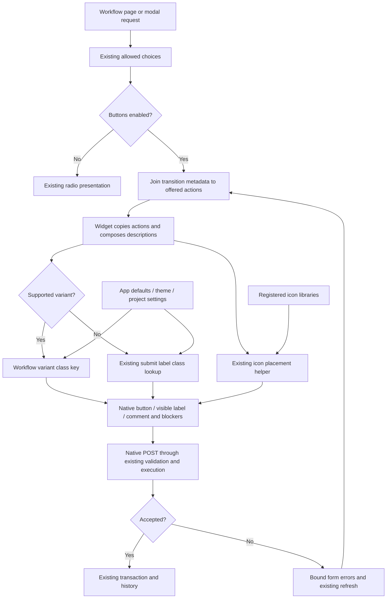

# Phase 06.32: Workflow transition variant and icon metadata (#362) - Research

**Researched:** 2026-11-13
**Domain:** Existing Django workflow widget and theme registries
**Confidence:** MEDIUM (conservative research-provider tier; implementation facts checked directly in source)

<user_constraints>
## User Constraints (from CONTEXT.md)

The following sections are copied verbatim from the phase context. [VERIFIED: phase CONTEXT.md, Implementation Decisions and Deferred Ideas]

<!-- DATA_B91E6A04_START -->
### Locked Decisions

### Approved decisions carried forward from issue #362

- **D-01 — Transition metadata:** Read `custom["variant"]` and `custom["icon"]` from each available transition
  when `cv_transition_presentation = "buttons"`. Each transition declares its presentation once.
- **D-02 — Bounded variants:** Support exactly `primary`, `secondary`, `success`, `danger`, `warning`, `info`,
  `light`, and `dark`. Missing, empty, or unsupported variants retain the existing submit styling, including
  the current `form:submit:label` fallback and its theme/project overrides. Do not interpolate arbitrary values
  into Bootstrap class names.
- **D-03 — Existing class registry:** Add workflow-owned `workflow:transition-<variant>` keys with corresponding
  Bootstrap `btn btn-<variant>` defaults declared by the workflow app. Use existing theme/project precedence.
  These keys represent supported variants, not individual transition names.
- **D-04 — Existing icon system:** Use current icon resolution, rendering, and button-host placement conventions.
  Missing or empty icons retain text-only appearance. A registered library is required for names such as
  `tabler:circle-x`; do not bundle Tabler or invent another icon system.
- **D-05 — Visible labels:** Icons supplement the full visible transition label. Preserve literal escaping,
  required-comment markers and accessible explanations, help text, blocker descriptions, and disabled state.
  Icon-only transition buttons are excluded.
- **D-06 — Local opt-in scope:** Only button presentation changes. Preserve appearance without presentation
  metadata, radio presentation, permission filtering, validation, comments, execution, and history behavior.
- **D-07 — Low complexity:** The maintainer explicitly selected the metadata-only approach. Do not add the
  medium-complexity per-view override method, a configuration hierarchy, or a general button framework.
- **D-08 — Verification:** Cover metadata rendering, variant/icon fallbacks, theme overrides, and preservation
  of disabled buttons and comment indicators. Existing workflow tests guard behavior outside presentation.
- **D-09 — Tracking and handover:** Issue #362, labeled `P06.32`, is the canonical approved discussion handover.
  Its statement that filing did not modify GSD planning files describes that earlier step: the maintainer
  subsequently requested phase insertion and this context capture. Implementation remains subsequent work.

### Acceptance and preservation obligations

- Demonstrate Confirm/success and Cancel/danger with distinct classes and their declared icons when the icon
  library is registered. Cover all eight supported variants and the missing/empty/unsupported fallback cases.
- Project and theme overrides must use the existing class-table rules, including intentionally empty/disabled
  values. Do not replace a deliberately empty resolved class with a truthiness fallback.
- Reuse inline and host-placed icon behavior without rendering the same icon twice. Labels remain visible even
  when an icon is absent or unavailable; use existing icon failure behavior rather than inventing a new policy.
- Preserve native submit identity (`name`, prefix, transition method value, and ID), offered transition ordering,
  permission omission, business blockers, comment requirements, and independent navigation Cancel behavior.
- Preserve the shared page/modal form, group accessibility, unique description IDs, wrapping, and disabled controls.
  No additional form, generic submit, hidden transition input, or JavaScript submission layer is required.
- Presentation must survive invalid-form redisplay and the existing bound-form refresh path. Preserve custom
  form construction, extra fields, and normal layout behavior.
- Update `docs/reference/workflow_view.md` and `docs/reference/theme.md` with supported metadata, class keys,
  defaults, fallbacks, icon registration, and the button-only scope. The current theme guide describes all
  transition buttons as using submit-label classes; revise that statement to explain the new explicit-variant
  path and preserved fallback. Document any added widget context needed by copied templates.
- Add a changelog entry. If implementation introduces a `### Breaking` entry, also update
  `docs/migrating-1.0.md` as required by the repository; this discussion does not presume a breaking redesign.
- Prefer focused rendered-output regressions plus the existing workflow suite. Use multicore pytest for broad
  runs. Report actual verification evidence; this discussion ran no application tests or browser reproduction.

### Researcher / planner discretion

These are bounded engineering choices, not additional maintainer-selected APIs:

- Exact private helpers, action-dictionary presentation fields, mode-specific class lookup details, icon spacing,
  fixture structure, and test organization. Follow established theme conventions and the visible-label requirement.
- Extend the existing workflow preparation/widget/template path. It already reads available transition metadata;
  changing the public transition tuple or form constructor just to carry two presentation values is unnecessary.
- Preserve current public APIs and proven execution paths. Avoid new database queries, broad core refactoring,
  caches, registry abstractions, or new configuration checks without a demonstrated need.
- Treat supported-variant validation and bad metadata types defensively within the agreed fallback contract;
  do not add arbitrary custom variants or derive new per-request presentation behavior.
- Choose documentation examples and verification commands that demonstrate the bounded feature. A new complex
  runnable example or downstream adoption project was not requested; the existing Roastery declarations provide
  the concrete acceptance example.

### Deferred Ideas (OUT OF SCOPE)

No new ideas were added to the backlog and no pending todos matched. The medium-complexity presentation hook,
per-transition-name styling keys, arbitrary variants, configurable icon-only labels, radio redesign, new JavaScript,
and downstream application upgrades remain outside this phase. They are exclusions, not promised future work.
<!-- DATA_B91E6A04_END -->
</user_constraints>

## Summary

Implement this as a small extension of action preparation, widget context, the existing transition template, and workflow app class defaults. Action preparation already joins available transition metadata to offered choices; widget rendering copies each action before composing descriptions. Preserve that pipeline, its ordering and its refresh boundary. Evidence: `steps[name].custom.get("help_text")`, `widget.actions = actions`, and `action = dict(action)`. [VERIFIED: src/crud_views_workflow/lib/forms.py:118-139; src/crud_views_workflow/lib/widgets.py:36-48]

Use eight workflow-owned **base** keys, without introducing workflow label-mode keys. Keep fallback styling exactly ``, even when an icon accompanies a transition whose variant is absent or invalid. The current registry resolves mode-key presence before base keys, but its checks recognize mode suffixes only for action locations and form kinds. Adding workflow mode keys would unnecessarily broaden the public grammar. [VERIFIED: src/crud_views_workflow/templates/crud_views_workflow/widgets/transitions.html:7-8; src/crud_views/lib/button_classes.py:212-223,309-324,387-417]

**Primary recommendation:** carry raw metadata locally, resolve presentation in the existing widget context with the class/icon helpers, and keep the native submit template and visible captions. This is a design recommendation within the context's explicitly delegated implementation discretion, not a new public hook. [VERIFIED: phase CONTEXT.md, Researcher / planner discretion]

The baseline five-file workflow suite passed **405 tests in 23.45 seconds** using four workers, Python 3.12.3 and Django 6.0.10. This demonstrates the existing baseline and an available verification environment; it does not verify the unimplemented feature. [VERIFIED: research command result, 2026-11-13]

## Architectural Responsibility Map

| Capability | Primary tier | Secondary tier | Rationale |
|---|---|---|---|
| Offered actions and metadata extraction | Django backend/form | Existing workflow model | Preserve choice ordering and permission-filtered metadata join; existing `get_available_user_state_transitions` supplies steps. [VERIFIED: src/crud_views_workflow/lib/forms.py:118-136] |
| Class resolution and icon placement | Django widget/context | Existing class/icon registries | The widget already copies actions; `icon_host_keys` returns placement information without changing transition identity. [VERIFIED: src/crud_views_workflow/lib/widgets.py:38-48; src/crud_views/lib/view/button_data.py:99-107] |
| Literal labels, icons, disabled controls, descriptions | Django template/SSR | Browser native form controls | Existing template owns `type="submit"`, `name="{{ widget.name }}"`, `value="{{ action.name }}"` and escaped captions. [VERIFIED: src/crud_views_workflow/templates/crud_views_workflow/widgets/transitions.html:7-10] |
| Authorization, validation and history | Existing backend execution | Database transaction | Keep `workflow_has_transition` before business checks and method dispatch, inside `transaction.atomic(using=using)`. [VERIFIED: src/crud_views_workflow/lib/execution.py:75-104] |
| Icon assets | Consumer theme/static assets | Existing registered library | Prefix resolution needs a usable configured library; an unknown prefix renders empty markup. This phase should not bundle an asset library. [VERIFIED: src/crud_views/lib/icons.py:239-253; phase CONTEXT.md, D-04] |

## Project Constraints (from AGENTS.md)

The supplied AGENTS instructions mirror the repository's CLAUDE guidance. No project skill directories or configured researcher skills were returned by discovery. [VERIFIED: research filesystem discovery and agent-skills command, 2026-11-13]

- Keep changes bounded, understandable, explainable and maintainable by the developer; preserve proven paths, avoid hidden state, abstractions and extra queries without demonstrated need. [VERIFIED: CLAUDE.md:15-27]
- Keep additions opt-in and self-contained; the historical URL-helper note explains this constraint, rather than authorizing its old unrelated proposals. [VERIFIED: CLAUDE.md:21-30; superpowers/notes/2026-11-04-opt-in-url-helper-decision.md, Reasons and Decision sections]
- Use multicore pytest for broad runs; bound workers while sharing resources. Preserve fixture naming conventions. [VERIFIED: CLAUDE.md:129-135]
- Preserve class attribute prefix `cv_`, transition prefix `wf_`, view keys `list`, `detail`, `create`, `update`, `delete`, `workflow`, `manage`, and permission mapping list/detail→view, create→add, update→change, delete→delete. [VERIFIED: CLAUDE.md:139-142]
- Use line length `120` and `double` quote style; existing build backend is `hatchling.build`. Version tooling is bump-my-version. [VERIFIED: pyproject.toml:96-98,125-130; CLAUDE.md:143-146]
- A newly added `### Breaking` changelog entry requires paired migration guidance; this additive feature does not inherently need such an entry. The first sentence is a repository directive; the second is the recommended release classification. [VERIFIED: CLAUDE.md:147]
- After shipping, refresh codebase maps through the mandated map-codebase workflow. Existing worktree conventions require reuse checks and the repository subfolder as working directory; no new worktree is needed for this assigned research. [VERIFIED: CLAUDE.md:66-87; assigned task scope]
- Setup, lint, format, build and docs commands are the existing Task recipes. Do not introduce another toolchain for this phase. [VERIFIED: CLAUDE.md:32-64]

## Requirements and Scope

There are **no formal requirement IDs assigned to phase 06.32**. Use the roadmap's prose and five success criteria as acceptance ownership. Do not relabel historic FORM/WFX requirements as this phase's IDs. Historic requirements provide preservation context: `FORM-04` establishes form icon-host support, and `WFX-04` establishes native transition buttons. [VERIFIED: .planning/ROADMAP.md:1795-1809; .planning/REQUIREMENTS.md:41,236]

Live issue #362 was read with its comments on 2026-11-13 and agrees with the copied decisions. The original finding's alternative of transition-name keys is superseded by the issue's approved variant-key choice. [CITED: https://github.com/jacob-consulting/django-crud-views/issues/362]

## Standard Stack

Reuse the installed project stack. No new package or dependency upgrade is part of this phase. Versions below are **observed installed versions in the chosen baseline environment**, not claims about latest releases. No package discovery, installation or registry-legitimacy gate is needed for this implementation. [VERIFIED: pyproject.toml:26-41,70-79; research environment probe; phase CONTEXT.md, D-07]

| Component | Observed version | Use |
|---|---|---|
| Python | 3.12.3 | Existing test interpreter. [VERIFIED: environment version probe] |
| Django | 6.0.10 | Form/widget/template integration and existing test database. [VERIFIED: environment version probe] |
| django-fsm-2 | 4.3.0 | Existing transition metadata source, already a workflow dependency: `"django-fsm-2>=4.0.0"`. [VERIFIED: environment version probe; pyproject.toml:39-42] |
| django-crispy-forms / crispy-bootstrap5 | 2.7 / 2026.9 | Existing shared form rendering; declared floors remain `"django-crispy-forms (>=2.0)"` / `"crispy-bootstrap5 (>=2023.10)"`. [VERIFIED: environment version probe; pyproject.toml:33-34] |
| pytest / pytest-xdist | 9.2.0 / 3.8.0 | Existing rendered-output and request regression suite, multiple workers. [VERIFIED: environment version probe; pyproject.toml:70-79] |
| Class/icon helpers | In-repository code | Reuse `get_button_class`, `icon_host_keys`, `cv_icon`; no new registry. [VERIFIED: src/crud_views/lib/button_classes.py:212-223; src/crud_views/lib/view/button_data.py:99-107; src/crud_views/templatetags/crud_views.py:652-667] |

**Installation:** none for this phase. Publish dates/latest registry versions were deliberately not researched: there is no package selection or upgrade decision. Installed dependency metadata is evidence of this executable environment only. [VERIFIED: assigned bounded scope; environment probes]

## Architecture Patterns

### System Architecture Diagram

The following is the proposed extension of the observed flow. No new client or database processing stage is introduced. [VERIFIED: src/crud_views_workflow/lib/forms.py:103-160; src/crud_views_workflow/lib/widgets.py:20-49; src/crud_views_workflow/lib/views.py:66-107]



### Component Responsibilities and Bounded Change Targets

These paths identify proposed edit targets, not files to create or filesystem-generation contracts.

| Target | Planned responsibility | Source anchor |
|---|---|---|
| `src/crud_views_workflow/lib/forms.py` | Add metadata to the existing action dictionary inside button-only configuration; reuse the available step instead of another lookup. | `"help_text": steps[name].custom.get("help_text")` [VERIFIED: src/crud_views_workflow/lib/forms.py:118-139] |
| `src/crud_views_workflow/lib/widgets.py` | Resolve presentation on the copied action; preserve description composition and original actions. | `action = dict(action)` [VERIFIED: src/crud_views_workflow/lib/widgets.py:38-48] |
| `src/crud_views_workflow/apps.py` | Declare eight base class defaults alongside existing workflow keys. | `crud_views_button_class_defaults: ClassVar[dict[str, str | None]]` [VERIFIED: src/crud_views_workflow/apps.py:11-22] |
| Existing transition template | Consume resolved styling and placement while preserving native submit attributes and literal labels. | `template_name = "crud_views_workflow/widgets/transitions.html"` [VERIFIED: src/crud_views_workflow/lib/widgets.py:7] |
| Existing workflow button and class registry tests | Add rendered metadata coverage, update owned-key counts, preserve lifecycle checks. | `assert len(workflow) == 10`, `assert len(get_button_classes()) == 112` [VERIFIED: tests/test1/test_button_classes.py:134-143] |
| Workflow/theme references and changelog | Document metadata, new keys and fallback; list added context fields for copied templates. | Theme currently says `no icon/variant metadata or new class registry key is added`; replace that stale sentence. [VERIFIED: docs/reference/theme.md:444-459] |

### Pattern 1: Finite variants, with fallback decided before class lookup

Recommend a string type guard plus membership in a local finite vocabulary; a tuple avoids unhashable-metadata errors, or type-check before set membership. The existing workflow enum provides the precise eight values below; using those existing values privately is reasonable, but do not expand core action variants or badge customization rules. [VERIFIED: src/crud_views_workflow/lib/enums.py:10-22; phase CONTEXT.md, D-02/D-03]

<!-- DATA_4D26B1C8_START -->
```python
PRIMARY = "primary"
SECONDARY = "secondary"
SUCCESS = "success"
DANGER = "danger"
WARNING = "warning"
INFO = "info"
LIGHT = "light"
DARK = "dark"
```
<!-- DATA_4D26B1C8_END -->

Declare the eight requested base keys and corresponding Bootstrap defaults explicitly in the workflow app. These are **new implementation targets**: `workflow:transition-primary`, `workflow:transition-secondary`, `workflow:transition-success`, `workflow:transition-danger`, `workflow:transition-warning`, `workflow:transition-info`, `workflow:transition-light`, `workflow:transition-dark`; defaults are the corresponding `btn btn-<variant>` strings. [VERIFIED: phase CONTEXT.md, D-02/D-03; .planning/ROADMAP.md:1799]

For a valid variant, call the class helper with its workflow base slot. For everything else, call the existing form-submit **label** lookup. Do not switch fallback to both mode when metadata contains an icon, and do not use `resolved_class or fallback_class`. Once the key is selected, empty class resolution is final. Evidence: `if mode and f"{key}:{mode}" in classes:` followed by `return value if isinstance(value, str) else ""`. [VERIFIED: src/crud_views/lib/button_classes.py:212-223]

Do not document or create workflow mode suffixes. Registry checks accept known declared keys, but `_action_key_parts` only classifies action locations or `parts[0] == "form"`; unsupported workflow suffixes reach the unknown-key warning. This keeps the phase local and avoids changes to core grammar/checks. [VERIFIED: src/crud_views/lib/button_classes.py:319-324,391-417]

### Pattern 2: Reuse placement information, not icon-availability truthiness

Call `icon_host_keys(icon, "form")` for each copied action. Add its class to the button; call the existing icon template tag only when the returned inline flag permits it. Never infer inline placement from whether the host class is empty: explicit host suppression returns empty host class **and false inline**. Evidence: `return get_icon_host_class(location, icon), False`; the existing host default is `"form:icon-host": "{name_class}"`. [VERIFIED: src/crud_views/lib/view/button_data.py:99-107; src/crud_views/lib/button_classes.py:127-133]

Use a small fixed icon/label separator like the existing form template; keep the full label always visible and force-escaped. Do not run the generic form-button normalizer, label-mode defaults or per-view maps for these controls; this widget has its own established native-action contract. [VERIFIED: src/crud_views/templates/crud_views/tags/button/form.html:3; src/crud_views_workflow/templates/crud_views_workflow/widgets/transitions.html:7-8; phase CONTEXT.md, D-05/D-07]

**Failure behavior to preserve:** empty/non-string icon metadata resolves to nothing; semantic aliases may be suppressed by the icon table; raw CSS strings and registered prefixed values use the existing renderer. Unknown prefix, missing callable renderer, and invalid built-in font class format return empty markup. A callable custom renderer's own exception is **not** swallowed: `return renderer(name, css=css, config=config)` is outside a try/except. Do not promise that all renderer failures are silent, and do not add a broad exception catch. [VERIFIED: src/crud_views/lib/icons.py:194-218,221-253]

### Pattern 3: Refresh through the existing bound form

Do not add public constructor parameters or change transition tuples. Form construction applies view labels then calls configuration; late execution refusal reuses the bound form and refreshes its actions. Rebuild metadata with the same available choices on every configuration. Evidence: `form._workflow_configure()`, `form._workflow_refresh()`, and `self._workflow_configure()`. [VERIFIED: src/crud_views_workflow/lib/views.py:66-75,96-103; src/crud_views_workflow/lib/forms.py:156-160]

## Don't Hand-Roll

| Problem | Avoid | Reuse and reason |
|---|---|---|
| Theme layering | A parallel dict, new precedence or truthiness fallback | `classes = {**defaults, **_THEME_BUTTON_CLASSES, **_settings_layer()}` plus existing lookup preserve exact-key precedence and explicit suppression. [VERIFIED: src/crud_views/lib/button_classes.py:201-223] |
| Host icons | Inspecting library dictionaries in workflow or rendering every icon twice | `icon_host_keys` and `cv_icon` already separate placement and rendering. [VERIFIED: src/crud_views/lib/view/button_data.py:99-107; src/crud_views/templatetags/crud_views.py:652-661] |
| Transition dispatch | Hidden inputs, JavaScript, new submit adapter | Existing `name="{{ widget.name }}"` / `value="{{ action.name }}"` preserves prefixed native submission. [VERIFIED: src/crud_views_workflow/templates/crud_views_workflow/widgets/transitions.html:7] |
| Authorization/blockers | Client-side or presentation-based enforcement | Existing execution rechecks availability before calling business rules and the selected method. [VERIFIED: src/crud_views_workflow/lib/execution.py:75-88] |
| Testing framework | Parallel harness or downstream demo project | Existing request tests already render production crispy markup and inspect it with lxml. [VERIFIED: tests/test1/test_workflow_buttons.py:1-36,191-222] |

## Common Pitfalls

1. **Overwriting intentional empty styling.** Use fallback only for unsupported metadata, never because the selected registry result is empty. Cover project/theme base values and fallback mode values set to both empty string and null. [VERIFIED: src/crud_views/lib/button_classes.py:212-223]
2. **Accidentally selecting different submit modes.** The current fallback explicitly passes `'label'`; adding an icon must not start honoring a conflicting submit-both override. This is a regression target even when the two defaults happen to look identical. [VERIFIED: src/crud_views_workflow/templates/crud_views_workflow/widgets/transitions.html:8]
3. **Mistaking a decorative icon for a comment marker in tests.** Current test finds marked buttons using `b.cssselect('[aria-hidden="true"]')`, while the font renderer emits `aria-hidden="true"`. For metadata cases target the marker span or accessible comment suffix, not any hidden decoration. [VERIFIED: tests/test1/test_workflow_buttons.py:373-375; src/crud_views/lib/icons.py:236]
4. **Leaking theme registrations or metadata between tests.** Existing registry tests snapshot theme state and reset caches; transition tests use `monkeypatch.setitem(step.custom, ...)`. Reuse those isolation patterns, including reset after restored registry state. [VERIFIED: tests/test1/test_button_classes.py:108-115; tests/test1/test_workflow_buttons.py:366-369]
5. **Missing hard-coded count guards.** Existing checks assert `len(workflow) == 10`, merged count `112`, core count `102`; fresh-process setup also asserts `112`. Adding eight workflow defaults means planned workflow/merged totals 18/120 while core remains 102. Search for all old counts before editing, and retain optional-app lifecycle assertions. [VERIFIED: tests/test1/test_button_classes.py:118-143,241,254-258]
6. **Testing an installed copy instead of this worktree.** Shared nox environments install distributions; explicitly prepend this worktree's source through the tested command below. The research probe confirmed imports came from this worktree. [VERIFIED: noxfile.py:13-19; research import-path probe]
7. **Stale copied-template documentation.** Replace both the old submit-only styling statement and the explicit no-metadata statement; add the final presentation context fields to the existing contract table. [VERIFIED: docs/reference/theme.md:419-459]
8. **Hiding labels because global form mode requests icons.** The new widget must retain full captions independent of configurable generic form label modes. This is explicitly locked; test with the global icon-only form setting as a negative control. [VERIFIED: phase CONTEXT.md, D-05/D-07; .planning/REQUIREMENTS.md:47]

## Code Examples

These are existing verified helper patterns, not a proposed new public action schema.

### Registry lookup and host placement

<!-- DATA_78F34A19_START -->
```python
# Existing implementations; sources cited below.
if mode and f"{key}:{mode}" in classes:
    key = f"{key}:{mode}"
value = classes.get(key)
return value if isinstance(value, str) else ""
```

```python
if resolve_icon_name_class(icon) is None:
    return "", True
return get_icon_host_class(location, icon), False
```
<!-- DATA_78F34A19_END -->

[VERIFIED: src/crud_views/lib/button_classes.py:220-223; src/crud_views/lib/view/button_data.py:105-107]

### Host library test fixture

Use the existing fixture configuration; its source values are quoted verbatim. This demonstrates that host placement must render no nested icon even when its class slot is suppressed. [VERIFIED: tests/lib/helper/icons.py:3-5; tests/test1/test_icon_host_leaves.py:97-101]

<!-- DATA_E40AB793_START -->
```python
HOST_LIBRARY = {
    "ui": {"renderer": "font", "class": "icon-{name}", "placement": "host", "standalone": "icon {name_class}"},
}
```
<!-- DATA_E40AB793_END -->

### Concrete acceptance metadata

The downstream source already declares the two central examples below. Use them in documentation and local metadata fixtures without modifying the downstream application. [VERIFIED: /home/alex/projects/alex/tabler-test/example/sales/models.py:218,248]

<!-- DATA_F1579C60_START -->
```python
custom={"label": "Confirm", "comment": WorkflowComment.NONE, "icon": "tabler:check", "variant": "success"}
custom={"label": "Cancel order", "comment": WorkflowComment.REQUIRED, "icon": "tabler:circle-x", "variant": "danger"}
```
<!-- DATA_F1579C60_END -->

The existing enum spells these policies `NONE = 0` and `REQUIRED = 2`; preserve their behavior. Register the test icon library through the existing settings or theme registration API; font class strings supplied by a fixture demonstrate markup, not whether a browser loaded the real icon font. [VERIFIED: src/crud_views_workflow/lib/enums.py:4-7; src/crud_views/lib/icons.py:133-161,221-236]

## State of the Art

This is an internal API extension, not a library modernization phase. Current code uses native named submits, app-owned class defaults, and the existing icon registry. Preserve these patterns and extend only their workflow presentation data. [VERIFIED: src/crud_views_workflow/templates/crud_views_workflow/widgets/transitions.html:7-8; src/crud_views_workflow/apps.py:11-22; src/crud_views/lib/icons.py:133-161]

No rename, migration or refactor is planned; a runtime-state migration inventory is not applicable to the locked metadata-only change. [VERIFIED: phase CONTEXT.md, D-01–D-07]

## Environment Availability

The following are observations from this research session, not portable environment guarantees. Absolute interpreter paths below were probed on disk and executed; they are not version-controlled paths created by repository scripts. [VERIFIED: environment probes, 2026-11-13]

| Dependency | Available | Observed version / limit | Fallback |
|---|---|---|---|
| Worktree-local virtual environment | No local environment found | Bare `python` / `pytest` unavailable on PATH | Existing source-checkout nox interpreter plus explicit source path |
| System Python / uv / Task | Yes | 3.12.3 / 0.12.19 / 3.53.1 | Existing setup recipe if isolation becomes necessary |
| Source-checkout Django 6.0 nox environment | Yes; suite executed | Python 3.12.3, Django 6.0.10 | Primary validation environment |
| Source-checkout Django 4.2 / 5.2 nox environments | Yes; version probe only | Django 4.2.30 / 5.2.19; Python 3.12.3 | Matrix regression interpreters; no pass claim yet |
| Source-checkout general venv | Yes; version probe only | Django 6.1.2 | Prefer configured nox matrix over this environment |
| Browser / real Tabler font | Not exercised | No browser visual result claimed | Rendered markup coverage; optionally inspect page/modal with registered assets during implementation |

Use this shell setup for the validated environment; these are **observed command paths**, not proposed repository files:

```bash
PHASE_PY=/home/alex/projects/alex/django-crud-views/.nox/tests-3-12-django-6-0/bin/python
PYTHONPATH=src "$PHASE_PY" -m pytest tests/test1/test_workflow_buttons.py -n 4 -q
```

The exact baseline run covered the button, workflow, execution, permissions and review test modules:
`405 passed in 23.45s`. Missing dependencies with no fallback: **none for the scoped implementation/tests**. Do not mutate shared dependency environments while other agents use them. [VERIFIED: completed research test run; assigned shared-workspace constraint]

## Validation Architecture

### Test Framework

| Property | Value |
|---|---|
| Framework | pytest 9.2.0, pytest-django and pytest-xdist 3.8.0, existing lxml rendered-output checks. [VERIFIED: environment probe; tests/test1/test_workflow_buttons.py:7-20] |
| Configuration | Existing pyproject pytest options: `addopts = "--strict-markers"`; test setup uses `def pytest_configure():` / `settings.configure(`. [VERIFIED: pyproject.toml:145-146; tests/test1/conftest.py:43-44] |
| Quick run | `PYTHONPATH=src "$PHASE_PY" -m pytest tests/test1/test_workflow_buttons.py -n 4 -q` |
| Adjacent regression | `PYTHONPATH=src "$PHASE_PY" -m pytest tests/test1/test_button_classes.py tests/test1/test_button_classes_checks.py tests/test1/test_icon_host_leaves.py tests/test1/test_icons_registry.py -n 4 -q` |
| Broad run | `PYTHONPATH=src "$PHASE_PY" -m pytest tests -n 4 -q` |
| Matrix | Repeat focused workflow/presentation and registry regressions with the existing 4.2 and 5.2 interpreters; use the repository nox matrix for broader CI coverage. Existing nox matrix declares `DJANGO_VERSIONS = ["4.2", "5.2", "6.0"]`. [VERIFIED: noxfile.py:3-19] |

Commands are planning instructions. Only the five-file baseline listed above was executed during research; do not interpret the proposed broad/matrix commands as completed evidence.

### Phase Acceptance → Test Map

There are no phase requirement IDs; the first column names acceptance behavior rather than inventing identifiers. Add metadata-specific cases to the existing workflow button tests; adapt registry lifecycle tests in place. [VERIFIED: .planning/ROADMAP.md:1799-1809; tests/test1/test_workflow_buttons.py:173-222; tests/test1/test_button_classes.py:134-179]

| Acceptance behavior | Test design | Automated selection | Coverage status |
|---|---|---|---|
| Eight variants and fallback | Parametrize every approved variant; absent, empty, unsupported strings and non-string/unhashable values; assert exact class tokens and no raw interpolation | Workflow button module, proposed metadata test group | New cases needed |
| Theme/project precedence and suppression | Register theme defaults, override exact keys in settings, cover empty/null class values; explicit icon with invalid variant must still use submit-label key; set conflicting submit-both key | Workflow button module + existing class registry module | New metadata cases; existing registry guards |
| Confirm/Cancel icons with full labels | Register a test Tabler renderer; confirm two distinct variant classes, one declared icon each, full captions, native values and comment marker | Workflow button module | New cases needed |
| Icon failure/placement | Inline, semantic alias, host, host suppression, missing/empty/non-string, unknown prefix, unusable built-in config; custom renderer failure propagates through existing policy | Workflow button module; existing icon/host helper modules | New integration cases; helper behavior exists |
| Literal text and disabled controls | Decorated button with literal label/help/blocker text, required-comment suffix, disabled widget/business blocker, unique descriptions in page and modal | Existing caption/comment/description cases extended with metadata | Existing baseline, metadata variants needed |
| Invalid and refreshed bound forms | Invalid comment/custom field redisplay; late refusal; change transition metadata before refresh and assert fresh presentation, retained form/data/IDs, no persistence | Existing ordinary-error and late-refusal patterns with metadata | Existing baseline, metadata variants needed |
| Radio/no metadata unchanged | Same metadata ignored by radio mode; no metadata retains fallback, no added icon; generic label modes cannot hide workflow captions | Workflow button module + existing workflow regression | Existing baseline, metadata negative controls needed |
| Authorization/execution untouched | Existing workflow, execution, permissions and review modules; keep offered ordering and omission assertions | Five-file command below | 405 baseline passes |
| App-owned keys | Update 10→18 and 112→120 guards, preserve core 102 and absent-app behavior; assert new known keys produce no unknown-key diagnostic | Existing class registry module | New keys not implemented |
| Documentation/release | Review workflow metadata example, eight keys, fallback, icons and final action context table; remove stale no-metadata sentence; changelog entry | Targeted diff/review; repository docs build if available | Manual review required |

Recommended focused workflow command (baseline-tested):

```bash
PYTHONPATH=src "$PHASE_PY" -m pytest \
  tests/test1/test_workflow_buttons.py \
  tests/test1/test_workflow.py \
  tests/test1/test_workflow_execution.py \
  tests/test1/test_workflow_permissions.py \
  tests/test1/test_workflow_review.py -n 4 -q
```

### Sampling Rate

- Per implementation task: run its focused rendered-output or registry selection.
- Before documentation finalization: run the five-file workflow regression plus adjacent registry/icon tests.
- Phase gate: run the broad multicore suite and record exact interpreter, dependency versions, command and results; matrix coverage must distinguish fresh runs from CI or earlier evidence.

These are recommended verification boundaries derived from the explicit phase verification obligations and repository multicore rule. [VERIFIED: phase CONTEXT.md, D-08 and Acceptance obligations; CLAUDE.md:129-135]

### Wave 0 Gaps

No framework/configuration install is required. Extend existing fixture helpers and tests; no separate test system. Metadata cases do not yet exist because the feature is not implemented. New test names/selectors should be chosen by the plan and must not be presented as already runnable. [VERIFIED: current workflow form action dictionary and template; src/crud_views_workflow/lib/forms.py:129-139; src/crud_views_workflow/templates/crud_views_workflow/widgets/transitions.html:7-8]

Keep registry cleanup local to metadata tests; do not depend on the module-local registry autouse fixture being globally available. [VERIFIED: tests/test1/test_button_classes.py:108-115]

## Security Domain

Security enforcement is enabled: `"security_enforcement": true`, `"security_asvs_level": 1`. [VERIFIED: .planning/config.json, workflow configuration]

Use versioned **ASVS 5.0.0** category names. The generic research template's old category numbering is not ASVS 5 numbering. Official OWASP taxonomy identifies Encoding/Sanitization, Validation/Business Logic, Web Frontend Security, Authentication, Session Management, Authorization and Cryptography as the categories below. [CITED: https://asvs.owasp.org/; https://cornucopia.owasp.org/taxonomy/asvs-5.0]

| ASVS 5 category | Applies | Phase treatment |
|---|---|---|
| V1 Encoding and Sanitization | Yes | Keep force-escaped captions/help/blockers; keep class attributes escaped; use existing icon rendering |
| V2 Validation and Business Logic | Yes | Finite variant vocabulary; preserve existing transition/comment validation |
| V3 Web Frontend Security | Yes | Native controls, existing form/CSRF ownership; no new script or submission path |
| V6 Authentication | Preservation | Existing authenticated-actor checks; no authentication changes |
| V7 Session Management | Preservation | No session changes |
| V8 Authorization | Preservation | Keep server availability/permission check authoritative |
| V11 Cryptography | No new work | No cryptographic capability introduced |

The applicability decisions are scope analysis, supported by the locked presentation-only boundary and observed execution/template code; they are not a claim of whole-project ASVS compliance. [VERIFIED: phase CONTEXT.md, D-06; src/crud_views_workflow/lib/execution.py:66-88; src/crud_views_workflow/templates/crud_views_workflow/widgets/transitions.html:7-10]

| Threat | STRIDE | Concrete preservation/test |
|---|---|---|
| Label/help/blocker HTML injection | Tampering | Preserve `force_escape` even for marked-safe input; metadata rendering tests must retain hostile-caption regressions. [VERIFIED: src/crud_views_workflow/templates/crud_views_workflow/widgets/transitions.html:8-10; tests/test1/test_workflow_buttons.py:329-355] |
| Forged disabled/unauthorized transition POST | Elevation of privilege | Preserve `if not object.workflow_has_transition(user, name):` before dispatch; unchanged server checks remain authoritative. [VERIFIED: src/crud_views_workflow/lib/execution.py:75-88] |
| CSS-class injection through arbitrary variant | Tampering | Permit only the fixed approved vocabulary; choose registry keys after validation. This is an explicit phase constraint. [VERIFIED: phase CONTEXT.md, D-02] |
| Breaking custom renderer semantics | Availability | Preserve existing propagation rather than catching every exception and hiding a real theme bug. [VERIFIED: src/crud_views/lib/icons.py:239-253] |

## Assumptions Log

No unverified external compatibility, performance, compliance, package or product claims are used to lock a decision. Proposed private organization, base-only keys and test placement are recommendations within the context's delegated discretion, with their supporting source evidence listed above. No additional maintainer confirmation is needed for these recommendations. [VERIFIED: phase CONTEXT.md, Researcher / planner discretion]

| # | Claim | Section | Risk if wrong |
|---|---|---|---|
| — | No training-only assumptions used | — | — |

## Open Questions

No unresolved product decision blocks planning. The planner should settle the exact minimal action-context field names and list them in the theme reference; those names become a copied-template contract even though the Python helpers stay private. [VERIFIED: docs/reference/theme.md:419-432,457-459; phase CONTEXT.md, Researcher / planner discretion]

Browser visual behavior and the 4.2/5.2 feature regressions remain implementation-time verification work. The research makes no pass claim for either. [VERIFIED: research execution record]

## Sources

### Direct primary evidence

- Live [issue #362](https://github.com/jacob-consulting/django-crud-views/issues/362), fetched through GitHub CLI on 2026-11-13: approved metadata-only scope and handover.
- Phase context, roadmap section and existing FORM/WFX requirements, read during this session: constraints and preservation boundaries.
- Workflow form/widget/template/app declarations, class registry, icon registry, button-data helper and template tags, read with line numbers: implementation and failure semantics.
- Workflow rendered-output tests, shared icon fixtures and registry lifecycle tests: reusable test patterns and count guards.
- Repository CLAUDE guidance and maintainability decision note: project constraints.
- The downstream finding and sales transition declarations: concrete acceptance examples.
- Executed environment/import probes and five-file baseline: runnable local verification evidence.

Each claim above points to its specific source and line range; these source-list entries are an index, not substitute evidence.

### External official documentation — MEDIUM confidence

- [OWASP ASVS](https://asvs.owasp.org/) and [official taxonomy](https://cornucopia.owasp.org/taxonomy/asvs-5.0): versioned category mapping only.
- Research-plan selected `websearch`; classification with official verification returned `MEDIUM`. The digest was cached through research-store. [VERIFIED: research-plan/classify-confidence/research-store command outputs]

### Tertiary

None used. No new library/API knowledge was required beyond source inspection; no Context7 or registry package claim is being made.

## Metadata

| Area | Confidence | Reason |
|---|---|---|
| Existing stack | MEDIUM | Installed versions and source contracts inspected; no fresh installation or latest-version claim |
| Architecture | MEDIUM | Direct source trace and locked decisions; proposed implementation not yet executed |
| Pitfalls | MEDIUM | Source-level failure semantics and specific existing test assertions identified |
| Baseline tests | Direct verified observation | 405 passed, four workers, Django 6.0.10; no feature pass claim |

**Research date:** 2026-11-13
**Recheck trigger:** source/registry contract changes or changed test environment; external ASVS metadata should be rechecked before a later unrelated security audit.

