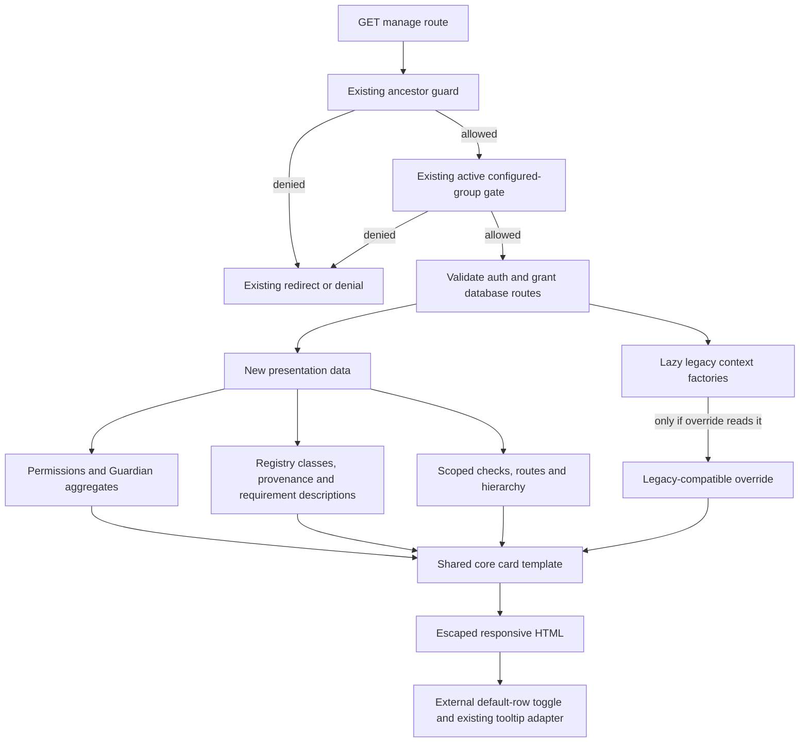

# Phase 06.33: Structured manage page (#366) — Research

**Researched:** 2026-11-14
**Domain:** Django developer diagnostics, permission presentation, template compatibility
**Confidence:** MEDIUM overall; source-grounded implementation guidance, with browser work still to be implemented.

<user_constraints>
## User Constraints (from CONTEXT.md)

The following decision, acceptance and discretion text is copied verbatim from the approved context. It is authoritative task input, not newly inferred behavior. [VERIFIED: .planning/phases/06.33-structured-manage-page-366/06.33-CONTEXT.md:53-583]

<!-- DATA_63acbd92_START -->
## Implementation Decisions

The following approved decisions and planning discretion are carried forward from the issue body without
renumbering. Their source line numbers refer to commit `4510cee9`; research must locate the current code.
Do not reopen a settled choice without a concrete conflict. The issue's historical statement that filing it
did not create a phase describes the earlier design handoff; phase insertion and this context capture were
subsequently requested. Implementation is subsequent work.

### Approved decisions

#### Purpose and layout

- **D-01 — Reader and focus.**
  - The reader is a developer, i.e. a manage-group member (#361).
  - The page is optimised for permissions and view configuration.
  - Everything else (ViewSet facts, hierarchy, ancestor policy, Guardian) stays on the page but is secondary.
- **D-02 — One page of cards (layout "B").** A single page, so browser search, printing and anchors keep working.
  On large screens:
  - **Main column:** checks alert (only when a check fails, D-17), Permissions, Views, Presentation (collapsed,
    D-21).
  - **Side column:** checks strip (D-17), ViewSet (D-18), Hierarchy (D-19), URL names (D-20), Ancestor policy,
    Guardian.
  - Below the large breakpoint the side column stacks under the main one.
  - **Ancestor policy card:**
    - Two labelled parts, "as ancestor of nested requests" and "requests to this ViewSet".
    - Two columns: the setting and its effective value, with an "inherited" marker where nothing is declared.
      There is no separate Declared column: a declared value is either `None` (inherited) or equal to the effective
      one (`view_manage.html:77-110`), so the marker carries the same information and the card fits the side
      column.
    - It keeps the "configuration only, not an access result" note and `id="cv-ancestor-policy"` as its anchor.
    - Rejected: keeping today's three-column table. Values such as "nearest: change, higher: view" would appear
      twice per row and wrap in a column a third of the page wide.
  - **Guardian card:** on Guardian pages only. A plain card rather than the current warning alert, showing
    `get_objects_for_user` (strict). `parent_viewset`, provider and `accept_global_perms` are not repeated there,
    because the Hierarchy and Ancestor policy cards already show them.
- **D-03 — Stock Bootstrap 5 only.**
  - Cards, list groups, tables, badges, a form switch and `<details>`.
  - No theme-specific markup upstream.
  - Every table sits inside `.table-responsive`.

#### Permissions card

- **D-04 — Holder × permission matrix.**
  - **Columns:** the ViewSet's permissions (`viewset.permissions`). Each header shows the key with the codename as a
    sub-label, custom permissions included.
  - **Rows:** the signed-in user first (D-05), then holders in two labelled sections, **Groups** then **Users**.
    Holders are rows so that many of them make the table longer, not wider.
  - **Cells:** **model** (model-level permission), **n objects** (Guardian object grants), or a dash.
  - A footer legend explains the two badges.
- **D-05 — "Access for: you" row.**
  - The signed-in user's result is **one row at the top of the matrix**, labelled "Access for: *username* (you)".
    It replaces today's three-column `has_perm` table and uses the same cells as every other row:
    - **model** when `user.has_perm()` is true for that permission. Unlike the Users rows, this is the effective
      result: it includes rights through groups and superuser status.
    - **n objects**, on Guardian pages, for the objects the user reaches through object grants, their groups'
      grants included (`get_objects_for_user`, strict, one count per permission).
    - a dash otherwise.
  - Why it exists: `docs/reference/settings.md` ("Diagnose the signed-in account") and `guardian.md` tell
    developers to sign in as the affected user and read this result.
  - The row's data method takes a user, so #370 can feed it another user (D-29).
  - Rejected:
    - dropping the current-user result, which removes a documented workflow with nothing in its place;
    - per-view marks from `cv_has_access(user)`. Without an object, that method returns `False` for every Guardian
      object view and `True` for a Guardian list as soon as the permission key exists
      (`crud_views_guardian/lib/mixins.py:129-146, 201-208`), so every user would read the same line. The view
      badges (D-08) say which permission each view needs.
- **D-06 — Users behind the existing setting.**
  - The Users section renders only when `CRUD_VIEWS_MANAGE_SHOW_USERS` is on. Its default (False) is unchanged.
  - It lists users with a direct model permission or a direct Guardian object grant. Rights that come through a
    group show in that group's row.
  - Beyond about 20 users, the rest fold under a "+ n more" `<details>`.
- **D-07 — Guardian object grants for users and groups.**
  - `GuardianManageView` counts object grants per user and permission, next to the per-group counts.
  - Both counts go through Guardian's per-model lookups, `get_user_obj_perms_model()` and
    `get_group_obj_perms_model()`, so direct-foreign-key grant tables are counted and both cover the same tables.
  - The old `get_permission_holders()` keeps its query on the generic `GroupObjectPermission` (D-14).
- **D-26 — Superusers and group sizes.**
  - Each group row shows its member count.
  - A line under the matrix states how many active superusers exist ("hold every permission"). Their names appear
    only with `CRUD_VIEWS_MANAGE_SHOW_USERS`.
  - Why: Django grants an active superuser every permission, so without this the matrix can show a permission as
    held by nobody while several accounts have it. Two count queries per page.
  - Rejected: the superuser line alone (an empty group would still look like a holder), and leaving both out.
- **Auth queries.** Every query on auth or grant tables in this card runs only after `_check_nested_auth(...)`, with
  `provider="guardian"` on Guardian pages, as today's methods do (`crud_views/lib/views/manage.py:74,106`,
  `crud_views_guardian/lib/views.py:419`).

#### Views card

- **D-08 — One summary line per view.**
  - Shows `cv_key`, the route (D-20), and the real view class as a dotted path (this fixes the metaclass bug).
  - **Requirement badges.** A view's requirement has two parts, and the line shows both:
    - its **own** requirement, one of:
      - **permission**, the permission key;
      - **group**, for the manage view;
      - **no permission required**, for view variants without `cv_permission`;
      - **custom**, when the view overrides the gate and describes nothing (D-27).
    - on a nested ViewSet, the **parent requirement** from the ancestor policy, as a second badge (e.g. `change`
      plus `parent: view`). It names the nearest ancestor's permission for the view's operation; the Ancestor
      policy card has the higher ancestors.
    - A nested Guardian **create** has no own requirement: `GuardianParentPermissionMixin.has_permission()` returns
      `True` there (`crud_views_guardian/lib/mixins.py:381-385`). It shows only `parent: change`. Nested Guardian
      detail, update and delete keep their own object permission (`get_object()`, `mixins.py:117-123`) and show
      both badges.
  - **Guardian policy badge**, on Guardian pages: the effective global-fallback policy, **global fallback**,
    **strict** or **not applicable**.
  - The separate "Global permission fallback" table is removed. Its content is in this badge and in the expanded
    view's Guardian section.
- **D-09 — Collapsed by default.** Each view is a native `<details>` element with the stable anchor
  `#cv-view-<key>`. All views start collapsed. The `<summary>` contains no link (D-24).
- **D-10 — The expanded view is one two-column key/value table.**
  - Keys sit in a fixed-width column that never wraps. Values take the remaining width.
  - Sections are thin heading rows, curated ones first:
    - **Navigation:** context and list actions, home/success/cancel keys, list action method, backend-only.
    - **Templates.**
    - **Icons.**
    - **Guardian**, on Guardian pages only: `guardian_mixin`, and `cv_guardian_accept_global_perms` with its
      effective policy.
    - **Other** (D-25): every remaining `cv_*` attribute.
  - **One key per row**, always in the same section and order, so two views compare line by line.
  - Keys are displayed without the `cv_` prefix.
  - Rejected:
    - three side-by-side columns, because values wrapped and it looked unclean;
    - set values first with defaults at the bottom, because a key's position would depend on whether it's set.
- **D-25 — "Other" section: every remaining `cv_*` attribute.**
  - After the curated sections, **Other** lists every `cv_*` data attribute of the view that no curated row shows,
    view-level `cv_context_buttons` included. Without it the page hides what makes a view special.
  - The attributes are found the way W280 finds them (`_collect_cv_names`, `crud_views/lib/check.py:296-306`):
    declared on a class in the MRO, data only (no methods, properties or other descriptors). `cv_viewset` is left
    out.
  - Rows are in alphabetical order, so two views still compare line by line.
  - Set/default follows D-11, and the Show defaults switch hides default rows here too.
  - An attribute W280 would flag as unknown is marked as such in its row.
  - Values: a class shows as its dotted path, anything else as a shortened `repr`. A name that is only annotated
    and has no value (e.g. `cv_formsets` on a view that doesn't set it) shows "not declared".
  - Rejected: keeping only the fixed key list of today's page.
- **D-11 — Effective values; "set" means set by a project class.**
  - Each row shows the value in effect.
  - Where `None` is a placeholder that resolves elsewhere, the row shows the resolved value and its source, e.g.
    `icon_header` → `building-store (from ViewSet)`.
  - **The rule:** an attribute is **set** when a class in the view's MRO whose module is outside the `crud_views*`
    packages has it in its own `vars()`. Everything else is a **default**. That includes library class values and
    values the library copied from a `CRUD_VIEWS_*` setting at import (e.g. `ListView.cv_context_actions` from
    `CRUD_VIEWS_LIST_CONTEXT_ACTIONS`).
  - This is the test W280 already uses (`CheckUnknownAttributes._suspects`, `crud_views/lib/check.py:387-394`).
    Reuse that code; don't write a second MRO walk.
  - **Exception, `cv_context_actions`:** `ViewSet.register_view_class()` writes
    `view_class.cv_context_actions = [*actions, "manage"]` onto the project class
    (`crud_views/lib/viewset/__init__.py:351-354`), so the attribute sits in every project view's `vars()` whether
    or not the project declared it. In the demo all five customer views have it; only `CustomerDetailView`
    declares it.
    - `register_view_class()` therefore records, before it assigns, whether the class declared the attribute
      itself, and the page uses that record.
    - The record is consulted for every registered class in the MRO, not only the leaf. A project view that
      subclasses another registered view would otherwise inherit the base's library-written copy and show "set".
  - Accepted consequences:
    - a project-wide setting shows greyed out on every view; it stays visible while defaults are shown;
    - a project package whose name starts with `crud_views` (a theme such as `crud_views_tabler`) counts as
      library code, as it does for W280.
  - Rejected: comparing against crud_views' shipped defaults, which would need provenance tracking for settings
    copied at import.
- **D-12 — Dimmed and switchable.**
  - Default rows are greyed out.
  - In every row the key stays visually stronger than the value: keys are darker and medium weight, default values
    are muted.
  - One **Show defaults** switch in the Views card header shows or hides default rows for all views at once, and in
    the Presentation card too (D-21).
  - With JS, default rows are **hidden on load**. The page exists to show what is special, and most rows are
    defaults.
  - A section whose rows are all hidden says "n defaults hidden", so an expanded view never looks empty or broken.
  - Without JS, all rows are visible.
  - The choice isn't stored.
  - The four `*_template_code` entries may collapse into one row when all of them are empty.
  - Rejected: defaults shown on load (the long lists return by default), and remembering the choice in
    `localStorage` (more JS and a stored key).

#### ViewSet facts (side column)

- **D-17 — System checks for this ViewSet.** Run on page load.
  - **No messages:** a small strip at the top of the side column: "✓ no issues · n system checks for this ViewSet".
  - **Warnings or errors:** an alert at the top of the main column, above Permissions, listing each message with its
    check id (e.g. `viewset.W280`).
  - **Scope:** `viewset.checks()` plus the checks that are registered separately, restricted to this ViewSet:
    - the ancestor declaration checks including E269 (`crud_views/checks.py:198`);
    - the conditional checks (`crud_views/checks.py:394`);
    - the icon check (`crud_views/checks.py:584`);
    - on Guardian pages, `crud_views_guardian.E001` (`crud_views_guardian/checks.py`).

    Without them the strip would say "no issues" while `manage.py check` fails. Project-wide checks (settings,
    assets, button classes) are not shown.
  - Those registered functions return messages for all ViewSets, and the icon check's messages carry no object to
    filter by (`crud_views/checks.py:592-601`). Each function is therefore split so that its per-ViewSet part can
    be called alone.
  - Messages whose id is in `SILENCED_SYSTEM_CHECKS` are left out, as Django's own runner does.
  - The "n" in the strip counts the `viewset.checks()` entries only.
  - Cost, measured in the demo: the 178 `viewset.checks()` for `customer` take about 10 ms on the first run and
    1 ms after. The separately registered checks are not measured.
- **D-18 — ViewSet identity card.**
  - Shows name, prefix, pk/pk_name and app.
  - Adds the model as a dotted path.
  - Adds verbose name and plural, ordering, and the header icon (drawn, plus its name).
  - Values the ViewSet doesn't set show the effective value with its source, e.g. `customer · customers (model
    Meta)`.
- **D-22 — "Set" for ViewSet fields.**
  - A ViewSet field is **set** when the project passed it to the constructor. This is D-11 applied to the ViewSet
    instance.
  - pydantic's `model_fields_set` is not that list. The validators assign `pk` and `prefix`
    (`crud_views/lib/viewset/__init__.py:182-196, 285-286`), and an assignment adds the field to the set. The
    passed names are therefore recorded before the validators run (e.g. the input keys in a `mode="before"`
    validator).
  - For the demo's `customer` the set fields are model, name, icon_header, ancestor_policy and context_buttons.
- **D-19 — Hierarchy card.**
  - **Parents:** the full chain up to the top level, each linked to its manage page.
  - **Children:** every registered ViewSet whose `parent` is this one, with its model, plus the URL name and pattern
    of its manage page (e.g. `order-manage → /customer/<customer_pk>/order/manage/`).
  - A Resource child has no manage route. It is listed with its model and the note "Resource, no manage page".
  - **Links go up only.** A nested manage URL needs a parent object, and the parent's manage page has none. Going
    up, any required ancestor pks come from the current URL.
  - The card says how to get to a child's manage page: open the child's list under a parent object and use its
    manage action. Every registered view gets that action (`crud_views/lib/viewset/__init__.py:351-354`).
  - Rejected:
    - linking through a sample object, which costs extra queries and permission checks and gives no link for an
      empty table;
    - a new route for nested manage pages that needs no parent object, which would change URL routing and nested
      permissions.
- **D-20 — URL names card.** Each view's route name and route, e.g. `customer-list → /customer/`.
  - The route is a regex (`^customer/(?P<pk>\d+)/detail/$`, built in `crud_views/lib/viewset/__init__.py:455`). It
    is shown through Django's `django.contrib.admindocs.views.simplify_regex`, which gives
    `/customer/<pk>/detail/`. The import works without `admindocs` in `INSTALLED_APPS`.
  - It is the ViewSet's own route. A prefix added by the project's `include()` isn't known to the ViewSet, so the
    column is labelled "route (relative to where the ViewSet is included)".

#### Presentation card (main column)

- **D-21 — Presentation, collapsed.**
  - A `<details>` card below Views, collapsed on load. Its header shows "n set · m defaults · applies to all views".
  - It sits in the main column because the button targets need the width.
  - Rows follow D-10 to D-12, with "set" as defined in D-22.
  - **Context buttons:** a table with key, button type, **what it points to**, and label. "Points to" is derived from
    each button type's own fields:
    - `ContextButton` with `key_target`: the route name and route;
    - `ParentContextButton`: the parent's view, or "top level, never shown";
    - `ChildContextButton`: the route from `child_name`/`child_key`;
    - `SiblingContextButton`: the sibling ViewSet's view;
    - `FilterContextButton`: "toggles the list filter", plus its template;
    - a custom subclass: falls back to its type and template.

    Child and sibling targets are shown without links (same reason as D-19). A note says that each view's
    `context_actions` row decides where a button appears, and that a view's own `cv_context_buttons` show in its
    **Other** section.
  - **Templates and actions:**
    - `extends`;
    - `inaccessible_actions`, showing the effective value and naming the setting it comes from, if any;
    - the three `*_actions_inline` lists.
  - **Label modes:** the context, list and form label modes.
  - **Other:** `manage_view_class`, showing the effective class.

#### Badges and documentation links

- **D-23 — Short permission and group badges.**
  - **Blue = permission:** the badge text is the permission key (`view`, `add`, a custom key like `roast`). Its
    tooltip says "needs permission: sales.add_customer", the full Django permission string. The parent badge uses
    the same colour with the text `parent: <key>`.
  - **Magenta = group membership:** the badge text is the group name, i.e. the configured `CRUD_VIEWS_MANAGE_GROUP`.
    Its tooltip says "needs group membership: CRUD_VIEWS_MANAGE". The library draws it for the manage view only; a
    project view gets one through D-27.
  - **Neutral = no permission required, or custom.**
  - Colour is never the only carrier of meaning:
    - each badge has a tooltip;
    - a `visually-hidden` prefix ("permission", "group") is there for screen readers;
    - the Views card footer has a key: blue = required permission, magenta = required group, green = Guardian
      policy, "hover a badge for details".
  - **Tooltips:** badges carry a `title` and the `data-cv-tooltip` marker. The tooltip adapter only touches marked
    elements (`crud_views/static/crud_views/js/tooltip.js:27`), so the marker is what lets a theme style them. The
    stock page gets Bootstrap tooltips through the stock adapter (`adapters.js:93`), and `title` is the fallback
    without JS.
- **D-24 — Documentation links through one new docs page, `docs/reference/manage.md`.**
  - **Where the links are:**
    - every card header gets a small round **"?"** button at the top right, after any existing card actions
      (e.g. after the Show defaults switch);
    - so do the checks strip and the Presentation sections "Templates and actions" and "Label modes".
  - **Badges are not links.** Their documentation is reached through the Views card's "?" button and the badge key
    in the card footer. The badges sit inside each view's `<summary>` (D-09), and a link there gives the line two
    click behaviours and adds tab stops before every view.
  - **How they open:** in a new tab (`target="_blank" rel="noopener"`, `aria-label="Documentation: <card>"`).
  - **Where they point:** every link goes to a section of the new manage page in the docs, one section per card. Each
    section explains its card and links on to the detailed pages:
    - `reference/nested/#ancestor-authorization`
    - `reference/guardian/#guardianmanageview`
    - `reference/context_buttons/`
    - `reference/action_menus/#label-mode`
    - `reference/settings/#manage-diagnostics`
  - **Why one page:** the anchors belong to this feature, so renaming headings elsewhere cannot silently break the
    page's links.
  - **Docs version:** links go to the **`stable`** docs. Readthedocs builds only `latest` and `stable`, and
    `stable` matches released code. Accepted consequence: until a release, links point at sections `stable`
    doesn't have yet.
  - **Base URL:** not a setting. It is an attribute of `ManageView`, passed to the template as one context value.
    A project that hosts its own docs sets it on a subclass named in `CRUD_VIEWS_MANAGE_VIEW_CLASS` /
    `manage_view_class`, which exist today.
  - **Help-button class:** comes from the class registry, e.g. `manage:help`; the stock class is
    `btn btn-sm btn-outline-secondary`.
  - **Rejected:**
    - linking each card straight to existing pages: four cards have no matching page (permissions/`cv_permission`,
      view attributes, ViewSet fields, system checks), and the links would depend on other pages' headings;
    - writing those missing reference pages in this issue, which doubles the scope (now a non-goal);
    - badges as links, and plain badges with a linked requirement row in the expanded view (one more row per
      view);
    - a template block for the base URL: the URL is used by about fifteen links.

#### Access description and the follow-up

- **D-27 — A view describes its own requirement.**
  - A public classmethod on `CrudView` returns what the view needs. The return value is small:
    - the view's **own** requirement: a permission key, a group, none, or "custom";
    - whether the **ancestor policy applies** to it.
  - The parent part of the badge is not returned by the method. The page reads it from the ancestor policy data it
    already computes (`ManageView.get_ancestor_policy_data()`), so no view duplicates it.
  - Each class that owns a gate implements the method next to it: `CrudViewPermissionRequiredMixin` from
    `cv_permission`, `ManageView` from `CRUD_VIEWS_MANAGE_GROUP`, the Guardian parent mixin for the nested create
    case, and the views of `crud_views_workflow`, `crud_views_polymorphic` and `crud_views_object_detail` where
    their gate differs.
  - The D-08 badges are drawn from this method, not from `cv_permission` directly. A project view that overrides
    `has_permission()` overrides the method to describe itself; otherwise it shows "custom".
  - Why a method: the answer depends on which mixins a view is built from, #370's trace needs the same answer, and
    a description kept next to the gate changes with it.
  - Risk: a description can drift from the real gate. The tests pair each shipped view class with a request that
    proves the described requirement is the enforced one.
  - Rejected:
    - the logic inside `ManageView` only: it would have to know every mixin in every package, custom views would
      always show "custom", and #370 would need its own copy;
    - reading `cv_permission` only: wrong for nested Guardian views.
- **D-29 — What #370 adds to this page. Not part of this issue.**
  - The "Access for" row (D-05) gets a form: a typed username (no dropdown of all accounts), an optional object
    pk, and a Check button. It is a GET form and changes nothing.
  - Without an object pk the result is the matrix row for that user. With one, each view also gets a yes or no
    for that object.
  - The trace (which grant or ancestor rule decided) comes from one function shared by the page and the command
    line. Today that logic is bound to a request (`_cv_ancestor_guard()` in `dispatch`), which is #370's open
    design question.
  - This issue only has to keep this possible: the row's data method takes a user (D-05), and the requirement method
    exists (D-27).

#### Building it

- **D-13 — The view prepares, the template lays it out.**
  - `ManageView` builds presentation-ready structures:
    - permission columns, the signed-in user's row and holder rows;
    - each view's summary and its sectioned entries, with an `is_default` flag on each entry;
    - the ViewSet facts, hierarchy, URL names, presentation rows and check results.
  - `GuardianManageView` extends the same structures (object counts including user grants, Guardian entries and
    badges) instead of keeping a parallel table.
  - Templates contain no default detection and no pivoting.
  - The new data methods take the ViewSet and the user as arguments and don't read `self.request`. Today's
    methods do (`crud_views/lib/views/manage.py:74,106`). A command can then call them without a web request:
    the configuration dump planned in
    [#371](https://github.com/jacob-consulting/django-crud-views/issues/371) and the access trace of #370.
  - The core template renders the complete Guardian page from that data. The Guardian template stays as a file but
    adds nothing the page depends on, because a project may replace it entirely and fill only `guardian_config`
    (`tests/test1/test_authorization_templates.py:77`).
- **D-14 — Compatibility.**
  - The existing block names stay, and each **wraps its whole new card**: `permission_holders` the Permissions
    card, `ancestor_policy` the Ancestor policy card, `guardian_config` the Guardian card. Every other card gets
    one new block.
  - A project override of an old block replaces that card at the card's position and is fed by the old context
    keys. The overriding project loses the new card (the "you" row and the superuser line included) until it
    updates its template; the migration notes say so.
  - The existing context keys stay with their current shapes: `cv`, `data`, `views`, `permission_holders`,
    `show_users`, `ancestor_policy`, and on Guardian pages `guardian_config` and `views[*].guardian_policy`. New
    structures go under new keys.
  - The cards are fed by **new** data methods. `get_view_data()` and `get_permission_holders()` keep their output
    and only feed the old keys, so project overrides of those methods don't affect the new cards.
  - The old keys `data`, `views` and `permission_holders` are computed lazily, on first use by a template. No stock
    template reads them, and `get_permission_holders()` costs a query per permission
    (`crud_views/lib/views/manage.py:77-92`).
  - User grants (D-07) appear only in the new matrix data.
  - The `class` fix applies to both the old and the new data.
  - Visible output changes are documented in the migration notes.
  - Rejected: old blocks as empty hooks below the cards. Nothing would be lost, but an overriding project would
    show the same information twice.
- **D-30 — No inline JavaScript (CSP).**
  - The page ships no inline `<script>`, no inline event handler (`onclick`, `onchange`, …) and no `javascript:`
    URL. The package documents itself as usable under a CSP without `unsafe-inline`
    (`docs/reference/settings.md`, "Content Security Policy (CSP)"), and the manage page must not break that.
  - The Show defaults switch (D-12) is therefore driven by an external static file, loaded through ``
    like the package's other scripts, with event delegation on a `data-cv-*` attribute. Either a new file in
    `crud_views/static/crud_views/js/` or an addition to an existing one.
  - Tooltips already work this way (`tooltip.js`, D-23). `<details>` needs no script.
  - The same documented policy covers inline styles. Fixed widths and similar come from CSS classes in the
    package's stylesheet, not from `style` attributes.
- **D-15 — Badge and row classes through the class registry.**
  - The keys follow the `workflow:badge-<colour>` pattern, e.g. `manage:badge-model`, `manage:badge-objects`,
    `manage:badge-permission`, `manage:badge-group`, `manage:badge-policy-<state>`, `manage:row-default`,
    `manage:help`. Exact names are a planning choice.
  - The keys are added to the registry's defaults; a theme key the defaults don't know is flagged by
    `crud_views.W362` (`crud_views/lib/button_classes.py:384-417`).
  - Stock defaults are Bootstrap 5 classes (`text-bg-*`, `text-body-secondary`).
  - Themes register their own. tabler-test will register `bg-*-lt`.
- **D-28 — Existing tests and docs that pin the old page.** These change with the page:
  - `tests/test1/test_ancestor_manage.py:485-486` asserts rows of the "Global permission fallback" table that D-08
    removes;
  - `tests/test1/test_ancestor_manage.py:343-348` (`_policy_table`) parses the three-column
    `table table-striped#cv-ancestor-policy`; the helper is rewritten for the two-column card (D-02), and the tests
    that use it keep asserting the same declared/inherited and effective facts;
  - `tests/test1/test_authorization_templates.py:77` overrides the `guardian_config` block and must keep passing
    (D-14);
  - `docs/reference/guardian.md#guardianmanageview` and `docs/reference/theme.md:762` describe the current tables
    and context;
  - `docs/reference/settings.md` ("Diagnose the signed-in account") is reworded for the "Access for: you" row;
  - both packages ship a `de` locale, which gets the new strings.
- **D-16 — Handoff.** The deliverable of the design sessions is this issue with its `gsd-handover` section. Filing it doesn't implement
  the feature, create a phase or create a worktree.

### Remaining planning discretion

- Exact names: context keys, blocks and class keys.
- Where `register_view_class()` keeps its record of a declared `cv_context_actions` (D-11), and where the ViewSet
  keeps the passed field names (D-22).
- The name and exact return type of the requirement method (D-27).
- How the separately registered check functions are split into per-ViewSet parts (D-17).
- How lists and tuples are displayed.
- The "+ n more" threshold.
- Card order inside the side column.
- Wording of labels, badges and tooltips (translatable).
- The section structure of `docs/reference/manage.md`.
- Example-app and docs coverage, in proportion to the change.

## Acceptance criteria

**Layout and data**
- Core and Guardian manage pages render the card layout of D-02. No `<br><hr><br>` remains.
- At 390 px viewport width, the page doesn't overflow sideways.
- Nested ViewSets render the full ancestor policy (cascade, read, write, actions) in the two-column card, with the
  "inherited" marker where nothing is declared.

**Permissions**
- Permissions render as the D-04 matrix.
- The "Access for: you" row shows, per permission, **model** for the signed-in user's `has_perm` result (a right
  held only through a group counts) and, on Guardian pages, the number of objects reachable through grants. There
  are no per-view marks.
- With `CRUD_VIEWS_MANAGE_SHOW_USERS` on, user-level Guardian grants are listed with per-permission counts. With it
  off, there is no Users section, on both core and Guardian pages.
- Group rows show member counts, and the superuser line shows the count of active superusers.

**Views**
- The `class` entry shows the view class's dotted path (regression test).
- `is_default` follows D-11 and D-22, unit-tested on the data rather than the HTML:
  - library value → default;
  - value copied from a setting → default;
  - attribute on a project class → set;
  - a placeholder `None` → shows the resolved value and its source;
  - `cv_context_actions` that only gained the library's `manage` entry → default; declared on the project class →
    set; inherited from a registered base class that didn't declare it → default;
  - a ViewSet field is set only when the project passed it: `pk` and `prefix` filled in by the validators are
    defaults.
- The **Other** section lists a project-set attribute outside the curated rows (e.g. `cv_modal`) as set, and
  contains no method or property.
- The Show defaults switch hides and shows default rows in Views (Other included) and in Presentation. With JS,
  defaults are hidden on load, and a section with only default rows shows "n defaults hidden". Without JS, all
  rows are visible.
- The requirement badges render each case: permission, group (manage view), no permission required, custom, own
  plus parent requirement (nested detail), and parent requirement only (nested Guardian create).
- For every shipped view class, a request test proves that the requirement the method describes is the one
  enforced.
- A view's `<summary>` contains no link.
- The rendered core and Guardian pages contain no inline `<script>`, no `on*` attribute, no `javascript:` URL and
  no `style` attribute (test on the HTML). The switch works under a CSP without `unsafe-inline`.

**ViewSet facts and Presentation**
- System checks:
  - a ViewSet with a failing check shows the alert at the top of the main column, with the check id;
  - a clean ViewSet shows the "no issues" strip with the number of checks;
  - a ViewSet that fails only a separately registered check (e.g. E269) shows the alert;
  - a message silenced through `SILENCED_SYSTEM_CHECKS` is not shown.
- Hierarchy:
  - on a top-level ViewSet, children are listed with their manage URL name and pattern, unlinked;
  - on a nested ViewSet, the parent chain links to the parents' manage pages, and those links resolve;
  - a Resource child is listed without a manage route, and the page renders without error.
- Routes render in the readable form (`/customer/<pk>/detail/`), not as regexes.
- Context-button targets render for `key_target`, parent, child, sibling and filter buttons. A custom subclass
  renders without error.
- Presentation is collapsed on load.

**Badges and docs**
- Requirement badges show the short key or group name, with the D-23 tooltip, the `data-cv-tooltip` marker and the
  hidden prefix. The Views card shows the key.
- `docs/reference/manage.md` exists, is linked from the reference index, and has one section per card.
- A test collects every docs anchor the templates link to and asserts that each exists as a heading in that page.
- Every "?" button points at `https://django-crud-views.readthedocs.io/en/stable/reference/manage/#…` and opens
  in a new tab. The base URL comes from the manage view class; a subclass with another base URL changes every
  link.

**Compatibility**
- A template that extends `crud_views/view_manage.html` and overrides `permission_holders` and `guardian_config`
  still renders (test), and each override appears in place of its card, not next to it.
- A Guardian page whose Guardian template is replaced by one that fills only `guardian_config` still shows the
  matrix with object counts and the per-view Guardian badges.
- The old context keys trigger no query when no template reads them (query-count test).
- Badge and help classes resolve through the class registry with Bootstrap 5 defaults. A test registers a custom
  class and sees it rendered.

**Docs and example**
- Docs updated: the manage page reference, the migration notes and the pages named in D-28.
- The `de` locales of both packages contain the new strings.
- The bootstrap5 example updated.

### Prior-phase and repository constraints

- Preserve Phase 06.31's active, authenticated configured-group gate for core and Guardian manage pages,
  including staff and superusers. Keep enable modes, hidden denied actions, ordinary CRUD permissions and
  nested ancestor restrictions unchanged. The developer account does not impersonate anyone.
- Preserve the existing seeded developer's read-plus-diagnostics role, including Guardian grants and protected
  ancestors. Do not automatically add Alice/Bob to the manage group or grant new write permissions to demonstrate
  the new cards. Follow the existing example account guidance and bounded seed conventions.
- Reuse the current class registry, theme/project override precedence, icon rendering and tooltip adapter.
  Keep optional extension-app boundaries intact. Include any new public keys and compatibility contracts in
  Phase 7's inventory; avoid a second registry or a generic permission framework.
- Developer maintainability is a hard constraint: prefer traceable, bounded data preparation and preserve proven
  request gates. D-27 describes requirements; it does not authorize redesigning access enforcement for #370.
- Broad test runs use multicore pytest. Verify the issue's data, request, template compatibility, query-count,
  browser/CSP, narrow-screen, documentation and example criteria in proportion to their actual behavior.
- Visible output changes require migration guidance as specified in the handover. Any CHANGELOG.md `### Breaking`
  entry must also update `docs/migrating-1.0.md` before 1.0.0.
- The code scout confirmed existing paths; no application tests or browser verification ran during discussion.

### Research and planning discretion

Use the issue's “Remaining planning discretion” list above. Exact helper/context/block/class-key names,
requirement-method name and return type, provenance record placement, per-ViewSet check extraction, list/tuple
formatting, folding threshold, side-card order, translated wording and documentation/example organization remain
bounded engineering choices. This discussion does not introduce extra APIs or expand example coverage into a
new application. Preserve the approved behavior and report concrete conflicts with evidence.

<!-- DATA_63acbd92_END -->

### Deferred Ideas (OUT OF SCOPE)

<!-- DATA_90cb1b7f_START -->
## Deferred Ideas

- Issue #370: another-user GET form, optional object lookup, per-view access result and shared diagnostic trace.
  Phase 06.33 only keeps this possible through the user-parameterized row method and requirement description.
- Issue #371: configuration-dump command. D-13 now requires all new data methods to accept the ViewSet and
  user explicitly without reading `self.request`; do not implement the command in Phase 06.33.
- Separate downstream tabler-test adoption after release: register new manage class keys and remove the old
  finding-25 overflow workaround when responsive tables replace it.
- Full reference pages for core permissions, all view attributes, ViewSet fields or the check catalogue are
  excluded; this phase's manage reference explains its cards and links to existing detail pages.

No additional ideas or pending todos were folded into scope during this discussion.

<!-- DATA_90cb1b7f_END -->
</user_constraints>

## Summary

Build presentation data in the existing manage classes and render the shared core template from it. Keep the legacy methods intact apart from the class-path defect, and place lazy wrappers behind their existing context keys. The present core context eagerly invokes both legacy methods; the Guardian override augments them. This makes a new, separate card-data path essential to D-14. Quote: `views = self.get_view_data()`, `permission_holders = self.get_permission_holders()`, and `"class": str(view.__class__)`. [VERIFIED: src/crud_views/lib/views/manage.py:104-124,165-207]

The highest-risk changes are declaration provenance, accurate gate descriptions, custom Guardian grant aggregation, and scoped check extraction. None requires an access-engine rewrite. Preserve request ordering and use a few explicit data builders, simple row dictionaries, and a small requirement description beside each actual gate. The current gate starts with `response = self._cv_ancestor_guard()` and then delegates to the configured-group check. [VERIFIED: src/crud_views/lib/views/manage.py:31-64]

**Primary recommendation:** Treat this as a bounded presentation feature with two small provenance records and one descriptive API. Make permission/query ordering and legacy laziness independent testable contracts before changing markup. This implements approved D-11, D-13, D-14, D-22 and D-27; it does not introduce another permission evaluator. [VERIFIED: .planning/phases/06.33-structured-manage-page-366/06.33-CONTEXT.md:190-214,257-263,363-422]

**Fresh issue revision incorporated:** D-13 now requires every new data method to take the ViewSet and user explicitly and not read `self.request`. Keep those builders usable without a web request; pass any route kwargs needed for upward links explicitly from the web adapter. The request adapter retains existing admission/ancestor ordering, and guarded auth/grant data builders validate the supplied actor against the target manage view class before querying. Legacy methods keep their current signatures and lazy compatibility behavior. Configuration dump #371 and access trace #370 are consumers this boundary enables, not CLI deliverables in this phase. Do not instantiate fake requests to satisfy the contract. [VERIFIED: .planning/phases/06.33-structured-manage-page-366/06.33-CONTEXT.md D-13; fresh issue revision 2026-11-14T09:36:39Z]

## Architectural Responsibility Map

The assignment below is the recommended division of work under D-13 and D-30. [VERIFIED: .planning/phases/06.33-structured-manage-page-366/06.33-CONTEXT.md:394-435]

| Capability | Primary tier | Secondary tier | Responsibility |
|---|---|---|---|
| Manage admission and nested authorization | Django server | Existing auth/Guardian backends | Preserve existing request gates |
| Matrix and counts | Django server | Database | Prepare columns/cells; batch holder aggregation |
| Requirement description | Owning view/mixin classes | Manage data builder | Describe local gate; builder adds parent policy |
| Provenance | Construction and registration | Manage data builder | Record original declarations once |
| Scoped checks | Existing check collectors | Manage server | Run only target ViewSet collectors |
| Cards, blocks, help and tooltips | Server templates | Class/icon registry | Render escaped prepared values |
| Default visibility | Browser | External static assets | Progressive enhancement, no stored preference |
| Documentation and translations | Package resources | Example app | Explain new surface and old override behavior |

## Project Constraints (from AGENTS.md)

The supplied AGENTS instructions and on-disk CLAUDE.md govern this phase. Actionable directives: [VERIFIED: CLAUDE.md:1-155]

- Developer maintainability is a hard constraint: simplest bounded implementation, preserve proven paths, avoid hidden state and added queries on ordinary CRUD paths.
- Keep extension apps optional. Do not import Guardian/workflow/polymorphic/object-detail into core merely to label their views.
- Use the existing ViewSet/CrudView registration, permission, nested-parent, settings and theme conventions.
- CrudView public attributes use the `cv_` prefix; preserve CRUD operation keys and established model-permission mapping.
- Use double quotes and 120-character formatting; preserve hatchling packaging and synchronized version management.
- Broad Python tests use multicore pytest; tiny isolated probes may be serial.
- Preserve fixture naming conventions for ViewSets, users and clients.
- A `### Breaking` changelog entry requires a corresponding migration-document update before 1.0.
- After shipping, refresh codebase maps; creating a worktree is a separate explicit workflow, not part of this research.
- The parent assignment permits only research output and research evidence: no implementation, configuration/state/roadmap edits, or git commit.

No project-local skills were found in the queried skill directories; configured researcher skills returned an empty block. Graph status returned `"exists": false`; no graph relationships informed this report. [VERIFIED: session discovery and gsd-tools graphify status, 2026-11-14]

<phase_requirements>
## Phase Requirements

The init result contains prose requirements, not formal phase requirement IDs. Use the approved D-numbers and acceptance groups as traceability labels; do not invent formal REQUIREMENTS.md IDs. Existing authorization and theme requirements remain preservation obligations. [VERIFIED: /tmp/cv-0633-plan-init.json; .planning/ROADMAP.md:1899-1918; .planning/REQUIREMENTS.md:1-8,79-97]

| Approved coverage | Research support |
|---|---|
| D-01–D-07, D-26 | Shared responsive cards; effective actor versus direct holders; custom grant-model aggregation |
| D-08–D-12, D-25, D-27 | Gate ownership map, immutable provenance, safe attribute inventory and effective resolvers |
| D-13–D-15, D-28, D-30 | Separate new data, lazy old context, whole-card blocks, registry classes and external assets |
| D-17–D-22 | Scoped check collectors, identity fallbacks, upward hierarchy links and readable patterns |
| D-23–D-24 | Marked accessible tooltips, subclassable documentation URL, tested local anchors |
| D-16, D-29 | Handoff history and explicit follow-up boundary; no implementation of #370 |
</phase_requirements>

## Standard Stack

Retain the project's installed dependencies; this phase needs no new production or test dependency and no version upgrade. The declared requirements include `"django (>=4.2.0)"`, `"pydantic (>=2.2.1)"`, `"django-guardian>=2.4"` and `"pytest-xdist"`. The nox series are `DJANGO_VERSIONS = ["4.2", "5.2", "6.0"]`. [VERIFIED: pyproject.toml:28-39,58-60,82-95; noxfile.py:3-21]

| Existing component | Observed working version | Use |
|---|---|---|
| Python | 3.12.3 | Cached nox environments |
| Django | 6.0.10 primary | CBVs, ORM aggregation, templates, lazy wrappers, system checks, regex display |
| Pydantic | 2.14.3 primary | Existing ViewSet model and private provenance |
| django-guardian | 3.5.2 primary | Existing strict helper and per-model grant resolution |
| pytest / pytest-xdist | 9.2.0 / 3.8.0 | Data, request, compatibility, routing and query regression tests |
| Vitest | 5.0.5 | Existing DOM test harness |
| Playwright / Chromium | 1.64.1 / 149.0.7827.55 | Cached browser tooling |
| MkDocs | 1.6.1 in repository venv | Documentation build |

Versions above were read from installed metadata and executable probes this session; they are observed environments, not proposed dependency pins or claims about newest releases. Publication dates were not needed because no packages are introduced or upgraded. The repository venv has Django 6.1.2, so use the cached 6.0 environment for the primary supported-series test run. [VERIFIED: session interpreter and browser probes, 2026-11-14]

### Package Legitimacy Audit

Not applicable: install no external packages for this phase. Existing dependency names come from the repository manifest; no registry-only package recommendation is made. The package legitimacy gate becomes necessary if the implementation plan adds a dependency. [VERIFIED: pyproject.toml:28-103; approved D-03/D-30]

## Architecture Patterns

### System architecture



This is a proposed implementation decomposition of approved D-13/D-14, preserving the existing gate sequence. [VERIFIED: src/crud_views/lib/views/manage.py:31-64,104-124; CONTEXT D-13/D-14/D-30]

### Component responsibilities and recommended seams

| Existing owner | Change to plan |
|---|---|
| Core ManageView | Request adapter plus new builders taking explicit ViewSet/user arguments; view summaries/sections, identity/presentation/hierarchy/check data; lazy compatibility keys |
| GuardianManageView | Extend the new builders with grants/policy; guard before core super-call performs diagnostic auth reads |
| ViewSet construction/registration | Capture original constructor names and declaration provenance |
| Attribute-check helpers | Share project-MRO/data-name discovery rather than duplicate W280 traversal |
| CrudView and owning gate mixins | Small public requirement description; no changes to enforcement |
| Registered check functions | Reusable bounded collectors, preserving global startup behavior |
| Core manage template | Complete layout including Guardian-dependent sections, card blocks and accessible controls |
| Guardian template | Compatibility extension file; no essential data-dependent markup unique to this file |
| Settings asset lists and stylesheet | External toggle asset, narrow-screen layout/default styling |
| Docs/locales/example/tests | Public contract and integration evidence |

These owners are visible in the opened code; the table prescribes changes rather than asserting future APIs already exist. [VERIFIED: src/crud_views/lib/views/manage.py:11-207; src/crud_views_guardian/lib/views.py:384-477; src/crud_views/lib/viewset/__init__.py:174-210,346-362; src/crud_views/lib/settings.py:338-359]

### 1. Separate new data from lazy compatibility

Use Django's `SimpleLazyObject` for legacy lists/mappings, with factories that call the overridable old methods only when consumed. Keep each factory request-local; do not place data on a ViewSet or class. The existing base view already imports `SimpleLazyObject`. Installed Django implements deferred `_setupfunc` evaluation and proxy operations. A template probe across cached 4.2/5.2/6.0 environments confirmed zero unused calls, one call after repeated iteration/length access, and successful dictionary `.items` rendering. [VERIFIED: src/crud_views/lib/view/base.py:27; installed Django django/utils/functional.py:391-431; /tmp/cv-0633-research-probes.py]

Preserve literal legacy keys `"cv"`, `"data"`, `"views"`, `"permission_holders"`, `"show_users"`, `"ancestor_policy"`; Guardian retains `"guardian_config"`, `"guardian_policy"`, `"global_fallback_applicable"`, `"cv_guardian_accept_global_perms"`, `"effective_policy"`. Preserve ordering, mapping/list shapes and legacy generic group-grant behavior. Fix the class entry with the class object's module/qualname, not its metaclass. [VERIFIED: src/crud_views/lib/views/manage.py:114-122,165-207; src/crud_views_guardian/lib/views.py:400-410,413-467]

Never let the stock template read an old key merely to render a heading, check emptiness or decide whether it is a Guardian page. Use new prepared values. Place existing blocks around their entire replacement cards; the locmem Guardian override currently extends the core template and fills only `guardian_config`, reading `views.items`. That override must still replace the Guardian card while the other new Guardian cards remain complete. [VERIFIED: tests/test1/test_authorization_templates.py:77-83; src/crud_views/templates/crud_views/view_manage.html:63-129,154-176]

### 2. Capture provenance once; resolve effective values separately

Registration writes `view_class.cv_context_actions = [*actions, "manage"]`. Record original own declaration before this assignment, using class-local storage read through `vars(base)`, not inherited `getattr`. Consult the record for every registered MRO class. Record both declared and undeclared cases; a registered base's library-generated copy must not count as project configuration in a child. Do not add process-wide maps or alter action selection. [VERIFIED: src/crud_views/lib/viewset/__init__.py:346-354]

For constructor provenance, a small explicit initializer can capture the original keyword-name set before calling the existing Pydantic initializer, then store it in a private immutable attribute. This avoids injected public fields, changed serialization and a mutable `model_fields_set` snapshot taken after validators. A minimal probe confirmed constructor `name` alone yields post-validation `{"name", "prefix"}` in `model_fields_set`, while the saved original set remains `{"name"}`; explicitly passed `prefix=None` remains declared. Require project and Guardian subclass coverage before adopting this exact implementation. [VERIFIED: src/crud_views/lib/viewset/__init__.py:174-210,283-287; /tmp/cv-0633-research-probes.py] [CITED: https://docs.pydantic.dev/latest/api/base_model/]

Reuse the W280 project-MRO classifier by extracting a small helper rather than calling a second independent MRO walk from manage. Existing literals are `_PACKAGE_PREFIX = "crud_views"`, `_CV_PREFIX = "cv_"`, `_IGNORE_ATTR = "cv_check_ignore_attributes"`. Preserve W280 allowlists and package-wide vocabulary when marking unknown rows. For displayed values use static inspection first so data enumeration never evaluates a property/descriptor. Annotation-only declarations need a distinct missing-value marker, not conflation with explicitly declared None. [VERIFIED: src/crud_views/lib/check.py:271-306,364-420]

Resolve only known fallback-bearing attributes with existing resolvers: `cv_get_inaccessible_actions`, inline and label-mode getters, and the extends precedence. Preserve false/empty overrides where the actual resolver uses `is not None`; do not use a blanket truthiness fallback. The default flag describes who declared a value, independently of where its effective value comes from. Model verbose names come from `get_meta`; ordering falls through to normal model/queryset behavior when ViewSet ordering is absent. [VERIFIED: src/crud_views/lib/view/base.py:385-443; src/crud_views/lib/viewset/__init__.py:317-344,509-532]

**Concrete D-25 seam:** the existing helper says `return not (callable(value) or hasattr(value, "__get__"))`, which excludes classes as well as methods. The handover nevertheless specifies dotted paths for class values. Do not blindly broaden W280 warnings. Plan an explicit diagnostics-only allowance for class-valued data in the shared collector, with default behavior unchanged for W280, and tests for annotated/unannotated class values versus methods/descriptors. This reconciles approved class display with established warning behavior. [VERIFIED: src/crud_views/lib/check.py:276-306; .planning/phases/06.33-structured-manage-page-366/06.33-CONTEXT.md:178-199]

### 3. Requirement API: describe actual owners, not nominal permission attributes

Keep the return contract small: own requirement kind/value plus whether ancestor policy applies. Exact names/type are planning discretion. Place implementations beside actual gate owners, with a bounded helper that notices a more-specific project `has_permission` override lacking its own description. Such an override reports custom. Test inherited project overrides, project mixins, explicit description overrides and harmless subclasses. Do not change dispatch or invoke gates to produce badges. [VERIFIED: CONTEXT D-27; src/crud_views/lib/view/base.py:1151-1229; src/crud_views_guardian/lib/mixins.py:90-127,185-207,381-413]

| Shipped family | Actual ownership | Request assertion |
|---|---|---|
| Plain core CBVs and RedirectChildView | Base CrudView has no own model-permission gate; nested guard still applies | Plain access and protected ancestor behavior |
| Core permission variants | CrudViewPermissionRequiredMixin checks model permission then action state | Grant permits gate; missing grant denies; state behavior preserved |
| Core/Guardian manage | ManageView's configured active-group gate | Staff/superuser without membership denied; existing enable modes preserved |
| Guardian object detail/update/delete/action | Guardian parent actor gate plus object gate in get_object | Own object grant required; global fallback only when enabled |
| Guardian list/card | Guardian actor gate plus queryset filtering | Page can return 200 with empty rows; object permission changes visible collection |
| Nested Guardian create | Parent gate returns true locally; ancestor authorization and state remain | Parent permission suffices without child add grant |
| Top-level Guardian create | Parent gate delegates to core model add gate | Model add is required |
| Workflow | Permission variant inherits model change; transition validation remains distinct | Model gate paired with request; no claim that all transitions are thereby allowed |
| Polymorphic create/select/detail/update/delete | Permission variants inherit corresponding core gate; selector is a write-family endpoint | Real registered routes, including contributed content-type path |
| Rich object detail | Permission variant inherits core view gate | Detail request parity |

Sources for this inventory: base, Guardian and extension class definitions. Literal permission declarations are `cv_permission = "view"`, `cv_permission = "add"`, `cv_permission = "change"`, `cv_permission = "delete"`; the selector carries `_cv_ancestor_operation = "write"`. [VERIFIED: src/crud_views/lib/views/detail.py:22-23; src/crud_views/lib/views/create.py:85-86; src/crud_views/lib/views/update.py:37-38; src/crud_views/lib/views/delete.py:390-391; src/crud_views_workflow/lib/views.py:163-164; src/crud_views_polymorphic/lib/create_select.py:29-40,107-108; src/crud_views_object_detail/lib/views.py:1-11; src/crud_views_guardian/lib/views.py:34-43,232-259]

Do not duplicate a requirement method across extension classes whose enforcement is inherited unchanged. Inherit the core description there and cover those concrete classes with request tests. Guardian's own mixins do need local description ownership: a nested parent mixin cannot simply report no requirement for every class, because object and list compositions retain their own downstream gates. Keep these distinctions in the Guardian module, not a core registry of extension types. [VERIFIED: src/crud_views_guardian/lib/views.py:34-43,232-259; src/crud_views_guardian/lib/mixins.py:117-127,149-194,381-413]

For the parent badge reuse the existing operation/policy selection, including exact custom-action overrides and the finite read/write families. Do not infer operation from permission string, URL key or HTTP method. The engine explicitly says family selection is by class; custom forms/workflow/actions need exact policy entries when nested. Show configuration only: no per-view yes/no access result. [VERIFIED: src/crud_views/lib/ancestors.py:213-300; src/crud_views/lib/views/manage.py:126-163]

### 4. Matrix aggregation and Guardian semantics

Expose the new builders with explicit ViewSet and user inputs and test them outside an HTTP request. Guardian extends the same input/output contract. Keep request-specific route kwargs as an explicit optional input to hierarchy preparation, and derive policy/database checks from the supplied ViewSet/actor rather than ambient request state. Test with an instance whose request property raises if read, and preserve legacy request-bound methods unchanged. This is now a locked requirement, not a discretionary abstraction. [VERIFIED: refreshed CONTEXT D-13]

Make a single ordered column vocabulary from the ViewSet's permissions. The actor row calls `user.has_perm` for each full permission string; direct holder rows query direct assignments and therefore must not reuse that result. Batch direct group/user permission memberships; pivot in Python. Key holders by primary key, not label. Build the user section only when enabled, including no user-name query for hidden superusers. Group member counts should be one aggregation; active-superuser count one aggregate, with separate names only if allowed. Use distinct counts where joins could multiply memberships. [VERIFIED: src/crud_views/lib/views/manage.py:70-111; CONTEXT D-04–D-07/D-26]

Before the new Guardian builder calls core builders, validate `provider="guardian"`. Otherwise core permission discovery or actor results can run before direct grant routing is validated. Preserve nested-only refusal rather than forcing aliases or rerouting. The routing helper checks generic and enabled direct grant tables without resolving content types first, and checks actor-related manager routing. [VERIFIED: src/crud_views/lib/ancestor_db.py:121-170; src/crud_views_guardian/lib/ancestors.py:37-54]

Use `get_user_obj_perms_model(model)` and `get_group_obj_perms_model(model)`. Branch on their manager's `is_generic()`: generic grants use `object_pk`; direct grants use their `content_object` foreign key. Count distinct object identifiers grouped by holder ID and permission ID, then map to the exact configured columns. Use Guardian's configured content-type resolver and exact permission identity, not a core `ContentType.get_for_model` assumption or codename-only cross-app join. The old method deliberately retains generic GroupObjectPermission behavior. [VERIFIED: src/crud_views_guardian/lib/views.py:413-447; src/crud_views_guardian/lib/viewset.py:119-146; installed guardian/utils.py:439-468,499-520] [CITED: https://django-guardian.readthedocs.io/en/stable/userguide/performance/]

The signed-in row should call the existing strict ViewSet helper once per permission and count its queryset. This naturally deduplicates user-plus-group access to the same object; it is different from direct holder grant counts. A generic grant may outlive its target, so do not claim direct assignment counts and reachable-object counts are identical. [CITED: https://django-guardian.readthedocs.io/en/stable/api/shortcuts/] [VERIFIED: src/crud_views_guardian/lib/viewset.py:162-182]

**Semantic edge, not an enforcement change:** the helper's documented strict policy rejects global model fallback but retains active-superuser all-object behavior. Quote: `"policy": "strict", "accept_global_perms": False, "use_groups": True`; the call does not disable the Guardian superuser option. Preserve this behavior in the actor row and explain it in docs/tests. If “through object grants” were intended to exclude that shortcut, it conflicts with the specified existing helper; do not silently add a different policy. [VERIFIED: src/crud_views_guardian/lib/viewset.py:11-13,162-182] [CITED: https://django-guardian.readthedocs.io/en/stable/api/shortcuts/]

### 5. Scoped checks without changing startup semantics

Materialize `list(viewset.checks())` once, count its entries, then flatten each check's `messages()`. Add only the per-ViewSet ancestor, conditional, icon and Guardian-composition results. Filter silenced IDs using Django's check-message behavior. Do not run global registered checks and filter by `obj`: several messages omit that field, and global settings/assets/registry diagnostics are outside this page. [VERIFIED: src/crud_views/checks.py:38-47,198-217,398-426,588-620; src/crud_views_guardian/checks.py:7-29] [CITED: https://docs.djangoproject.com/en/6.0/ref/checks/]

Ancestor helpers already accept a sequence of ViewSets, so call them with the current one behind a narrow collector. Preserve the URLconf-completion barrier for startup. Conditional checks currently deduplicate findings across the entire registered set; extracting “one viewset” and concatenating globally would change that deduplication. Prefer a collector accepting a ViewSet sequence, used globally with the registry snapshot and locally with one ViewSet. Split icon attribute checks away from global icon-registry messages. Add parity tests for the registered entry points as well as page scope. [VERIFIED: src/crud_views/checks.py:50-217,303-312,398-426,588-620]

For a diagnostic page, gracefully show a malformed declaration that a scoped check reports instead of crashing while creating its display rows. Catch only expected route/configuration problems locally; do not swallow authorization or database-routing failures. A top-level ViewSet with an invalid permission key is a useful separate-check-only fixture because invalid nested ancestry can deny the request before the page exists. [VERIFIED: src/crud_views/checks.py:93-121; src/crud_views/lib/views/manage.py:31-37]

### 6. Hierarchy, route and presentation details

Use registry metadata and the existing bounded ancestor walker. Upward links need only the ancestor's required URL kwargs already present in the request; do not query sample objects. Children list metadata only, with Resource children explicitly missing a manage route. Reuse the ViewSet-generated pattern rather than reconstructing a path that loses `cv_path_contribute()`. Quote: `route = rf"^{path_parent}{path_prefix}{path_pk}{path_view}{path_contribute}$"`. Simplify the regex for display; label it relative to inclusion. [VERIFIED: src/crud_views/lib/ancestors.py:88-120; src/crud_views/lib/viewset/__init__.py:205-208,289-297,373-463]

Context-button targets must be described from declared fields, not by calling `get_context()`, which resolves objects, access and action state. Known declarations include `key_target: str | None = None`, `child_name: str`, `child_key: str = "list"`, `sibling_name: str`, `sibling_key: str = "list"`. Handle exact built-in types (or unchanged inherited implementation) before the generic custom fallback, so a custom subclass is not accidentally treated as a built-in target resolver. Show a safe label/template description when real rendering would require an object. [VERIFIED: src/crud_views/lib/view/buttons.py:29-61,95-127,132-199,203-250,255-285]

Use external CSS for fixed key widths, overflow handling, help shape and any magenta group badge styling needed beyond stock Bootstrap utilities. The default-visibility script should apply a root enhancement state only after binding the switch; without JavaScript all rows remain visible. Use pretranslated hidden-count text in server markup, toggle visibility/classes instead of constructing HTML, share one switch with Presentation, and store nothing. [VERIFIED: CONTEXT D-03/D-12/D-23/D-30; src/crud_views/lib/settings.py:338-359]

Add assets to the existing settings-owned core lists; the asset registry and pipeline derive their files from those lists. Reuse tooltip initialization with `"[data-cv-tooltip]"` and existing class override precedence. Explicit new manage keys belong in the default registry; do not loosen unknown-key validation. Update executable docs/key/asset inventories when affected. [VERIFIED: src/crud_views/lib/assets.py:88-125; src/crud_views/static/crud_views/js/tooltip.js:20-41; src/crud_views/lib/button_classes.py:156-205,387-417]

## Don't Hand-Roll

| Problem | Use instead | Why |
|---|---|---|
| Lazy old template dictionaries | Django SimpleLazyObject | Existing proxy and template behavior verified |
| Route regex formatting | Django simplify_regex | Handles named and unnamed groups/metacharacters |
| Ancestor traversal/operation selection | Existing bounded walker and policy helpers | Preserves cycle handling and action semantics |
| Permission evaluation | Existing user/Guardian helpers | Avoids second authorization engine |
| Grant-model discovery | Guardian per-model utilities | Covers configured generic and direct models |
| Tooltip rendering | Existing marked adapter | Keeps theme lifecycle consistent |
| Disclosure state | Native details | Already required by approved design |
| Class-key precedence | Existing class registry | Preserves theme/settings override behavior |

These choices follow the opened implementation and approved decisions; they add no dependency. [VERIFIED: src/crud_views/lib/ancestors.py:88-120,213-300; src/crud_views/lib/assets.py:88-125; src/crud_views/lib/button_classes.py:156-205; /tmp/cv-0633-research-probes.py] [CITED: https://django-guardian.readthedocs.io/en/stable/userguide/performance/]

## Runtime State Inventory

This phase restructures display and adds provenance; it does not rename a persisted application identifier. Still verify all five runtime categories during implementation. [VERIFIED: CONTEXT Phase Boundary/D-14/D-30]

| Category | Finding | Required action |
|---|---|---|
| Stored data | Existing auth/group/grant rows are read by diagnostics | No migration; keep read-only and use disposable test databases |
| Live service config | No remote configuration change is requested; live remote inventories were not inspected | None within scope; host template overrides are handled by compatibility tests/docs |
| OS-registered state | No OS service/registration rename in approved scope; registrations were not enumerated | None within scope |
| Secrets/environment | No new settings or credential names approved | Preserve existing manage-group/mode configuration |
| Build artifacts | New static assets and translations will ship with the package | Verify asset loader/bundler inventory, compile catalogs, build docs/package as appropriate; no installed downstream adoption |

The stored-data observation follows existing queries; all “none” actions above are scope conclusions, not claims that external systems were audited. [VERIFIED: src/crud_views/lib/views/manage.py:70-111; src/crud_views_guardian/lib/views.py:413-447; CONTEXT non-goals/D-28/D-30]

## Common Pitfalls

1. **Eager legacy truth tests:** reading old holder keys in the new template defeats laziness. Assert factories are untouched by stock rendering, and called once by a real override. [VERIFIED: src/crud_views/lib/views/manage.py:112-119; tests/test1/test_authorization_templates.py:77-83]
2. **Gate descriptions that promise entry:** Guardian list permission is a row filter; workflow transitions and action-state hooks remain separate. Test actual response/collection behavior, not only method return dictionaries. [VERIFIED: src/crud_views_guardian/lib/mixins.py:149-207; src/crud_views_workflow/lib/views.py:82-107,136-152]
3. **Inherited generated declarations:** checking only the leaf's vars misses library-written values on a registered project base. Test both levels. [VERIFIED: src/crud_views/lib/viewset/__init__.py:346-354]
4. **Custom content-type mismatch:** new Guardian counts must follow its resolver, while the deliberately frozen legacy method keeps its old generic table. Preserve both contracts separately. [VERIFIED: src/crud_views_guardian/lib/viewset.py:119-138; src/crud_views_guardian/lib/views.py:422-429]
5. **Global checks disguised as local checks:** filtering messages after running all checks loses unattributed scope and adds unrelated work. Preserve global deduplication when extracting collectors. [VERIFIED: src/crud_views/checks.py:398-426,588-620]
6. **Presentation helpers that query objects:** button get_context and access methods perform runtime work; use static target metadata. [VERIFIED: src/crud_views/lib/view/buttons.py:95-127,145-199]
7. **Inaccurate source labels:** explicit None can be project-set while its displayed effective value comes from a fallback. Store declaration and effective-source metadata independently. [VERIFIED: CONTEXT D-11/D-22; src/crud_views/lib/view/base.py:385-443]
8. **Template-only CSP assertion:** static HTML checks are necessary but cannot prove the toggle works under headers. Add a real browser fixture with a strict policy and source-identity checks. [VERIFIED: CONTEXT acceptance: Views; tests/browser/workflow-presentation.cjs:1-80]
9. **Narrow screen tables:** a responsive wrapper contains table scrolling, but long class paths in summaries can still overflow the page. Browser assertions need document width plus opened details at 390 px. [VERIFIED: CONTEXT D-03/D-09 and layout acceptance]

## Code Examples

The following probe uses existing Django APIs and arbitrary demonstration labels; it is a verified mechanism example, not a proposed new public schema. It ran under all three cached Django series. [VERIFIED: /tmp/cv-0633-research-probes.py]

```python
from django.contrib.admindocs.views import simplify_regex
from django.utils.functional import SimpleLazyObject

# Keep the callable unevaluated; Django templates can consume .items after evaluation.
legacy_views = SimpleLazyObject(self.get_view_data)
readable_route = simplify_regex(str(pattern.pattern))
```

The concrete old method name is defined at `def get_view_data(self):`; the lazy wrapper import already exists in the base module. [VERIFIED: src/crud_views/lib/views/manage.py:165-167; src/crud_views/lib/view/base.py:27]

For Guardian holder aggregation, use the existing per-model utility and distinguish generic/direct object columns. Do not copy a finished ORM query from this report before fixture coverage proves the configured content-type/custom-model case; that is the phase's main data integration seam. [VERIFIED: installed guardian/utils.py:439-468,499-520; src/crud_views_guardian/lib/viewset.py:119-138]

## State of the Art

No framework migration is needed. The relevant evolution is within this package: the approved page adds prepared cards and requirement descriptions while retaining legacy context as lazy compatibility. Keep Phase 06.31's developer gate and Phase 7's theme inventory boundary; Phase 06.32 is ordering context rather than an implementation dependency. [VERIFIED: .planning/ROADMAP.md:1899-1913,1946-1949; CONTEXT Phase Boundary]

## Environment Availability

| Dependency | Available | Observation / fallback |
|---|---|---|
| Supported-series Python test runtime | Yes | Cached nox 4.2, 5.2, 6.0 environments; primary 6.0.10 |
| Node/npm | Yes | 24.21.0 / 11.19.0 |
| Vitest/jsdom harness | Yes | Existing node_modules; Vitest 5.0.5 |
| Playwright/Chromium | Yes | Cached package and browser verified above |
| uv / task | Yes | 0.12.19 / 3.53.1 |
| MkDocs | Yes | Repository venv has 1.6.1; build docs separately from primary Django runtime |
| GNU msgfmt | Not found on PATH | Existing polib test dependency supports catalog parsing/compilation; confirm repository translation workflow before changing binary artifacts |

These are session probes, not promises about another machine. No dependency installation is a planning prerequisite. A standalone manage browser fixture is still needed; available browser tooling does not imply existing workflow fixtures already cover manage acceptance. [VERIFIED: session environment probes, 2026-11-14; pyproject.toml test dependency `"polib"`; tests/browser/workflow-presentation.cjs:1-80]

## Validation Architecture

### Framework and working commands

Nyquist validation is enabled in configuration: `"nyquist_validation": true`. Tests configure Django in `pytest_configure()`; invoke from the repository root with the source tree explicitly first. [VERIFIED: .planning/config.json; tests/test1/conftest.py:43-75]

```bash
PHASE_PY="$PWD/.nox/tests-3-12-django-6-0/bin/python"

# Verified baseline: 227 passed in 20.37s, four workers.
PYTHONPATH=src "$PHASE_PY" -m pytest tests/test1/test_manage.py tests/test1/test_ancestor_manage.py tests/test1/test_authorization_templates.py tests/test1/test_guardian_composition.py -n 4 -q

# Per-wave affected integration coverage.
PYTHONPATH=src "$PHASE_PY" -m pytest tests/test1/test_manage.py tests/test1/test_ancestor_manage.py tests/test1/test_manage_group.py tests/test1/test_authorization_templates.py tests/test1/test_ancestor_auth_databases.py tests/test1/test_guardian_content_types.py tests/test1/test_unknown_attribute_check.py tests/test1/test_icons_checks.py tests/test1/test_button_classes.py tests/test1/test_assets.py tests/test1/test_import_safety.py -n 4 -q

# Phase gate; run once after feature tests pass.
PYTHONPATH=src "$PHASE_PY" -m pytest tests -n 4 -q
npm test -- --maxWorkers=4
.venv/bin/python -m mkdocs build --strict --site-dir /tmp/cv-0633-docs

# Existing example runner and protected developer identity coverage.
PYTHONPATH=src:examples/bootstrap5 "$PHASE_PY" examples/bootstrap5/manage.py test project guardian_demo --parallel 4
```

Only the first Python command was executed during research; the remaining commands are prescribed implementation validation. Repeat the focused affected suite with the cached 4.2 and 5.2 interpreter paths, and verify imports point to this checkout. The main venv's newer Django is for docs tooling here, not substituted for a declared matrix series. [VERIFIED: session baseline output; noxfile.py:3-21; /tmp/cv-0633-plan-init.json prior_verify_commands]

### Acceptance-to-test map

Names in the “new coverage” column are proposed test areas, not claims that new files exist. Preserve existing fixture cleanup of registry, URLconf, vocabulary and theme caches. [VERIFIED: tests/test1/test_authorization_templates.py:16-19; tests/test1/conftest.py:11-40]

| Decision / acceptance | Test type | New coverage and existing base | Runnable selection |
|---|---|---|---|
| D-13 refreshed | Unit/database | New builders work with explicit ViewSet/user and no request; routing guards still precede queries | new request-free builder tests |
| D-04–D-07/D-26 | Database/data | Effective actor through groups; direct users; custom permissions; group sizes; inactive superuser exclusion; hidden names | manage/Guardian tests with four workers |
| D-07 auth ordering | Database/router | Reject routed generic/direct grant tables before any diagnostic query, warm and cold permission map | ancestor auth databases |
| D-11/D-22/D-25 | Unit/data | Explicit None, import-copied settings, generated actions across MRO, missing annotations, class-valued data, descriptors | manage + unknown-attribute tests |
| D-27 | Real requests | Every concrete shipped view, plain and protected variants, Guardian lists/objects/create, manage, extensions, custom override | new dedicated requirement-request matrix |
| D-14 | Template/query counts | Entire card replacement, legacy getter overrides, lazy first use and cached subsequent use | authorization templates + manage |
| D-17 | Check parity/data/render | Each separate collector; silenced results; other ViewSet isolation; global deduplication preserved | ancestor/manage/icon/conditional/composition tests |
| D-18–D-22 | Data/render | Model defaults, Resource child, full linked parent chain, contributed routes, all button target types | manage + hierarchy fixtures |
| D-12/D-30 | Vitest and browser | Hidden-on-load, toggle both cards, empty-section notice, no storage, no-JS visible, external asset/CSP | npm test plus new manage browser fixture |
| D-02/D-03/D-09 | Browser | Core/Guardian 390 and desktop, opened details, no document overflow, no summary links | new fixture with owned server/database |
| D-15/D-23/D-24 | Render/docs | Registered classes visible, tooltip markers/prefixes, docs override changes every link, anchors exist | button classes + manage docs tests |
| D-28 | Docs/locales/example | Core/Guardian German strings, migration guide, example developer-only access retained | docs build + example runner |

### Wave 0 gaps and sampling

- Add focused data/compatibility tests before card rendering, including the refreshed request-free builder contract.
- Add a finite request matrix covering all shipped view families; inspect exports to include custom forms, ordered variants, card lists, child redirects, polymorphic selector and rich detail.
- Add direct-FK grant fixtures using real configured models; reuse existing multi-database and custom content-type fixture conventions.
- Add the external toggle's Vitest tests and a bounded managed browser fixture. Reuse owned process/database cleanup and source fingerprints; do not copy downstream/Tabler setup into this upstream-only phase.
- Add docs-anchor and both-locale assertions.
- Per task run its smallest meaningful selection; per wave run affected multicore suites. Full Python/JS/docs/example gate follows integration. Browser evidence must cover CSP and disabled JavaScript as actual separate contexts.

These gaps are derived from the approved acceptance criteria; research did not implement them. [VERIFIED: CONTEXT acceptance criteria:477-554; tests/browser/workflow-presentation.cjs:1-80]

## Security Domain

Security enforcement is enabled: `"security_enforcement": true`, `"security_asvs_level": 1`. This is a read-only developer page, so the relevant controls are existing server authorization, database-routing validation, output escaping and CSP-compatible browser behavior. No new authentication/session/cryptographic mechanism is required. [VERIFIED: .planning/config.json; src/crud_views/lib/views/manage.py:31-64; CONTEXT D-30]

Use ASVS **5.0** category names accurately; the older V2/V3/V4/V5/V6 labels in the generic research template belong to an older numbering scheme. [CITED: https://asvs.owasp.org/] [CITED: https://github.com/OWASP/ASVS/blob/master/5.0/en/0x17-V8-Authorization.md]

| ASVS 5.0 category | Applicability | Standard control |
|---|---|---|
| V1 Encoding and Sanitization | Yes | Django autoescape; plain-text repr/source labels; no unsafe HTML concatenation |
| V3 Web Frontend Security | Yes | External assets; no inline events/styles/scripts; strict-header browser test |
| V8 Authorization | Yes | Existing active-group/ancestor gates and nested database boundary |
| Authentication / Session management | Preserve existing behavior | Django session identity and current manage admission; no impersonation |
| Cryptography | No new feature | Do not add custom tokens or signing for diagnostics |

Category guidance is from primary OWASP sources; controls are recommended applications to the read source. [CITED: https://github.com/OWASP/ASVS/blob/master/5.0/en/0x10-V1-Encoding-and-Sanitization.md] [CITED: https://github.com/OWASP/ASVS/blob/master/5.0/en/0x12-V3-Web-Frontend-Security.md]

| Threat | STRIDE | Bounded verification |
|---|---|---|
| Holder/account disclosure before admission | Information disclosure | Denied requests never call diagnostic builders; no hidden usernames |
| Grant reads on rejected nested alias | Information disclosure / elevation | Route rejection before permission/content-type/grant queries, no fallback to another DB |
| Escaping a repr/label/check message incorrectly | Tampering / elevation | Adversarial HTML labels remain text in cards, tooltips and attributes |
| A requirement badge claiming actual object access | Information integrity | Description tests are request-paired; labels describe policy only |
| Excess queries proportional to holders × permissions | Denial of service | Batch holder data; retain only approved per-permission actor counts and measure query growth |

These risks follow the concrete data and gate seams; they do not authorize a broader security redesign. [VERIFIED: src/crud_views/lib/ancestor_db.py:141-170; src/crud_views/lib/views/manage.py:70-124; CONTEXT D-05/D-13/D-27]

## Assumptions Log

No new product choices are assumed or locked. Proposed helper names/storage choices remain within the explicitly delegated planning discretion. Unverified future behavior is represented as implementation/test work, not a source claim. The two concrete semantic seams requiring explicit treatment are recorded below. [VERIFIED: CONTEXT Remaining planning discretion:463-475]

| Item | Unresolved factual limit | Plan treatment |
|---|---|---|
| Browser output | New cards do not exist, so no narrow-screen/CSP acceptance has run | Implement and run the browser cases |
| Custom project authorization | Arbitrary project dispatch/get_object changes cannot be inferred by a small description API | Document that custom gates must describe themselves; automatically detect the specifically required has_permission override case |
| Installed floors | Minimal lazy/provenance/regex probes ran on cached series, not every supported package-floor combination | Run relevant compatibility cases; do not raise dependency floors |

The custom-project scope is a bounded recommendation from D-27, not a claim to analyze arbitrary Python authorization. [VERIFIED: CONTEXT D-27; session probe results]

## Open Questions and Concrete Conflicts

1. **Class-valued Other rows versus W280's callable exclusion.** Resolve with a diagnostics-only class allowance in shared collection infrastructure; retain W280 semantics and test both. The source conflict is explicit above. This does not need a new product decision.
2. **Strict Guardian actor counts and active superusers.** Preserve the explicitly selected helper's superuser behavior and document it; do not reinterpret strict as a new no-superuser policy. If the planner insists on excluding superusers from counts, that requires returning the concrete conflict to the maintainer.
3. **CSP/browser fixture ownership.** Cached tooling is available; a new upstream manage fixture must cover both core and Guardian pages without live developer data or downstream adoption.
4. **No actual blocker found.** Existing request tests pass and the necessary mechanisms are present. Scope remains large enough to warrant independent plan boundaries for data/provenance, gate descriptions, scoped checks/navigation, templates/assets, and integration/docs.

Each issue above derives from source or approved acceptance, rather than reopening approved layout or permission choices. [VERIFIED: src/crud_views/lib/check.py:276-306; src/crud_views_guardian/lib/viewset.py:162-182; CONTEXT D-27/D-30 and acceptance criteria]

## Sources

### Repository and installed primary evidence

- Approved context was read in full, including all D-01–D-30 decisions and acceptance criteria; roadmap, requirements, current state, project constraints and prior-phase summary were inspected.
- Core manage, ViewSet registration/constructor, W280, ancestor/database guards, all owning core/Guardian gate classes, workflow/polymorphic/object-detail classes, scoped check bodies, templates, button/asset/tooltip seams and existing compatibility tests were opened.
- Installed Django lazy/regex implementation and Guardian per-model utility source were opened; versions were probed.
- Focused baseline: **227 passed in 20.37s**, four workers.
- Minimal lazy template/provenance/regex probes passed in cached Django 4.2, 5.2 and 6.0 environments.

These are session observations; inline citations above locate the concrete claims. [VERIFIED: research session, 2026-11-14]

### Official documentation (MEDIUM via confidence seam)

- https://docs.djangoproject.com/en/6.0/ref/checks/ — check messages and silencing.
- https://docs.pydantic.dev/latest/api/base_model/ — model initialization/fields metadata.
- https://django-guardian.readthedocs.io/en/stable/userguide/performance/ — direct permission models.
- https://django-guardian.readthedocs.io/en/stable/api/shortcuts/ — strict query helper and superuser policy.
- https://django-guardian.readthedocs.io/en/stable/api/utils/ — utilities API stability caveat.
- https://asvs.owasp.org/ and linked OWASP source chapters — current category names.

The research-plan seam selected Context7 for library questions; neither Context7 MCP nor ctx7 CLI was available. Official web documents and installed primary source were used instead. The available confidence classifier returned MEDIUM for websearch with official verification; no HIGH tier is claimed for web retrieval. Digests were saved through research-store. Some attempted Django module-documentation URLs failed; those failures are not used as evidence of missing functionality. [VERIFIED: /tmp/cv-0633-research-plan.json and session tool results]

## Metadata

| Area | Confidence | Basis |
|---|---|---|
| Standard stack | MEDIUM | Existing manifest and working installed environment; no upgrade proposed |
| Architecture | MEDIUM | Concrete source seams and approved decisions; new data contracts await implementation |
| Pitfalls | MEDIUM | Source-confirmed incompatibility edges and passing baseline |
| Validation | MEDIUM | Existing 227-case baseline and cross-series mechanism probes; new UI acceptance remains future work |

**Research date:** 2026-11-14.
**Validity:** Recheck after relevant source changes; framework lookups should be refreshed before adding dependencies.
**Git:** Not committed, per parent task instruction.

