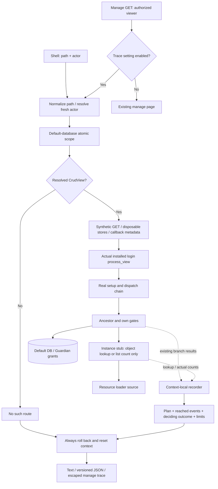

# Phase 06.34: Access trace: cv_access command and manage page form (#370) - Research

**Researched:** 2026-11-14
**Domain:** Django authorization observation, diagnostic dispatch, management commands, structured manage presentation
**Confidence:** MEDIUM — provider classification returned MEDIUM for official-source-verified web research; repository findings below are directly source-grounded and runtime probes are distinguished from implementation verification.

<user_constraints>
## User Constraints (from CONTEXT.md)

The following two sections are verbatim context, including the planning-discretion paragraph. D-24 supersedes username-only wording in the older design. [VERIFIED: phase CONTEXT.md, opened in this session]

<!-- DATA_6e31c9b7_START -->
## Implementation Decisions

### Approved D-01–D-23 design carried forward

The following is a decision index, not a replacement for the full design and acceptance criteria in
`superpowers/specs/2026-11-14-access-trace-design.md`. Downstream agents MUST read that document and the mockup.
Preserve its original decision numbers. Its code line references describe commit `4510cee9`; locate current
implementations rather than assuming those line numbers still apply. Do not reopen settled decisions without
concrete conflicting evidence. D-24 below takes precedence over username-only readings of D-14.

- **D-01 — One core trace function:** Accept a path and user, including anonymous, and return ordered steps and
  an outcome. Both front ends only format this result. Core must not depend on Guardian. The authorization
  input does not include an HTTP-method choice or query-string-dependent policy.
- **D-02 — Observe the real gates:** Use a context-local optional recorder inside the ancestor engine and owning
  library gates, including model/action state, Guardian object/list/parent/ancestor checks and the manage gate.
  Preserve public gate signatures and deduplicate repeated reports. Recording never decides or terminates access;
  without recording, existing behavior remains unchanged.
- **D-03 — Real dispatch, stub handler:** Resolve the view and init kwargs, call setup with a synthetic GET request,
  and run its real dispatch chain, including project mixins. Replace the instance's GET handler with a stub that
  loads only the object or list needed to reach remaining gates and counts. Never run the real handler. Supply a
  throwaway session and message store that are not saved.
- **D-04 — Planned versus reached gates:** Reuse the existing pure ancestor-planning functions and #366's own
  requirement method. Show required keys and provenance; later checks remain not reached after the first denial.
- **D-05 — Step data:** Record kind, ViewSet/model/pk, full requirement/group, provider, source and result. Explain
  Guardian success through object grant, model fallback or active superuser. Record no object content.
- **D-06 — Outcomes:** Allowed, denied, not found, login redirect, error, or no such route. Retain the deciding
  denial/lookup and exception class/message for errors. Unresolved paths and non-CrudView routes are no such route.
- **D-07 — Guardian list counts:** Report filtered n versus pre-Guardian-filter m using the actual querysets;
  count in the trace stub only, without adding count queries to ordinary requests.
- **D-08 — Custom gates:** Project overrides that deny outside an instrumented library gate are one opaque custom
  step identifying the method, class and result. Do not claim visibility into project code.
- **D-09 — Rolled-back default-database transaction:** Always roll back the trace's default-database transaction,
  including the savepoint inside a manage request. Send no messages and save no session. Document that external
  services invoked by project code and process-wide caches are outside the rollback guarantee.
- **D-10 — Resource views:** Run the real item/list loaders under the traced user, including lookup and action-state
  outcomes. Resource lists report a row count. Document possible reads from external sources. Resource manage-page
  registration remains outside this phase.
- **D-11 — Fresh actor:** Resolve users from the project's user model, including inactive users; gates decide their
  outcome. Load the actor fresh so permission caches from another request do not influence the trace.
- **D-12 — Command:** `cv_access <path> <user>` accepts a project path or extracts the path from a full URL;
  username wins over another user's matching primary key. `--anonymous` replaces the user argument. Unknown
  users and missing routes use the specified exit-2 behavior.
- **D-13 — Text/JSON and exit codes:** Text includes the path/route/class/user header, numbered steps and deciding
  outcome. `--as-json` emits one versioned JSON document. Support the approved fixed colors in terminal text and
  JSON through Django's color controls, without new dependencies; ordinary piped output and `--no-color` are
  uncolored. Exit 0 means allowed; 1 means denied/not found/login redirect; 2 means wrong call/no route/error.
- **D-14 — Two web queries:** Provide this-ViewSet user/optional-object-pk checks and arbitrary-path checks in one
  Access check card under Permissions. Use linkable GET forms with typed user input, never a user list. For
  per-ViewSet checks, replace the matrix actor row and list every registered view, including POST-only/backend
  views; object views without a pk say needs an object pk, and views needing extra URL arguments say use the path
  field. Nested parent pks come from the manage URL. Unknown users produce a message and no result. Apply D-24
  to both forms' user selectors.
- **D-15 — Default-off web exposure:** `CRUD_VIEWS_MANAGE_ACCESS_TRACE` defaults to False. Disabled means no card
  and ignored trace GET parameters. When enabled, users authorized to open the manage page may trace another
  user/path without needing access to that traced path's ancestors. This deliberately reveals existence/access
  outcomes but not object content. Preserve authorization to the hosting manage page itself. The CLI is unaffected.
- **D-16 — Existing presentation contracts:** Stock Bootstrap 5, class-registry `manage:*` outcome keys, native
  details disclosure, translated wording and a help link under the manage documentation base URL. No inline
  scripts, handlers or styles; preserve the existing CSP and theme conventions.
- **D-17 — Reuse #366:** Use its requirement method, user-parameterized matrix row and request-independent data
  builders accepting the ViewSet and user. Do not substitute the traced user into the viewer's real request.
- **D-18 — Dependency and delivery order:** #366 first; recorder/trace, command, page form. #371 and #372 are
  related follow-ups, not blockers.
- **D-19 — Recorder neutrality:** Run the whole existing suite a second time with recording enabled for every
  request; existing tests, query counts and ordering assertions must pass unchanged. Add the switch and extra
  CI run, not a new byte-comparison replay harness.
- **D-20 — Fidelity grid:** Compare real GET outcomes and traces across the approved plain, permission-required,
  Guardian object/list/nested-create, manage, Resource and two-level cascade variants, against anonymous,
  inactive, no-rights, model-permission, object-grant and superuser actors. Include error, no-route, not-evaluated
  and login-middleware cases. The grid proves shipped views, not arbitrary project implementations.
- **D-21 — Documentation/locales:** Document command and JSON, the setting, Access check card and limitations.
  Reword signed-in-account diagnosis to recommend tracing first; add Guardian/nested denial pointers and the
  relevant German translations.
- **D-22 — Explicit unevaluated checks:** Allowed means may open the page. Explain untraced handler-phase checks
  for workflow transitions, nested-list database configuration, delete preview and writes. Do not call real
  context/rendering handlers to close those gaps or add workflow transition permission tracing.
- **D-23 — Login middleware boundary:** Where installed, call the real LoginRequiredMiddleware or subclass
  `process_view()` with the resolved view and record its result. Do not copy the rule or run the entire middleware
  chain. Every trace states that other middleware and URL decorators are not traced.

### Decision made in this discussion

- **D-24 — Both web forms accept username or primary key.** The maintainer chose option 1, matching the mockup
  and reusing the command's username-first resolution. When input matches one user's username and another's
  primary key, choose the username match. Apply this to both this-ViewSet and arbitrary-path forms. This resolves
  the ambiguity in D-14; do not later narrow the web UI to username-only because of the older prose. Keep typed
  input, unknown-user feedback and the existing no-user-picker decision. Verification must exercise both selector
  forms and the ambiguous-match precedence. This clarification adds no web anonymous-selector control.

### Acceptance and preservation constraints

- Carry the design's entire Trace, Safety, Command, Page form and Docs acceptance sections into research and
  planning. These summaries do not replace them. Include D-24's web primary-key and collision cases.
- Preserve Phase 06.31's active/authenticated configured-group gate, enabled modes, hidden denied actions and
  hosting manage page's ancestor authorization. Distinguish the viewer from the fresh traced actor throughout.
- Preserve Phase 06.33's lazy legacy context and template override compatibility, request-independent builders,
  class registry, external assets, help-link base and accessible responsive layout.
- Developer maintainability is a hard design constraint. Keep the recorder observational and bounded; do not
  replace proven dispatch or authorization paths with a generic policy engine or duplicated gate driver.
- Keep optional extension boundaries intact. Inventory new public contracts and theme keys before Phase 7.
- Broad test runs use multicore pytest. Do not weaken existing query/order assertions to accommodate recording.
  Report unavailable verification honestly. No application tests or browser acceptance ran during discussion.
- Follow the changelog policy: any new Breaking entry also updates `docs/migrating-1.0.md` before 1.0.0.

### Research and planning discretion

The approved design leaves recorder/context-variable names, trace field names and exact versioned JSON shape,
JSON color implementation without a dependency, trace module location, synthetic request construction,
exact registry keys/translatable wording, and whether the forms share one user field to research/planning.
Resolve these as bounded engineering choices within the approved behavior. Report concrete conflicts with
evidence; do not manufacture additional product questions or silently reduce acceptance scope.

## Deferred Ideas

- Issue #371: configuration-dump command; related output conventions, outside this phase.
- Issue #372: Resource manage pages; Resource URL traces already belong to this phase.
- Full middleware/decorator execution, submit-time workflow transition tracing, impersonation and general bulk
  diagnosis remain outside the approved scope.

No new ideas or pending todos were folded into scope during this discussion.
<!-- DATA_6e31c9b7_END -->
</user_constraints>

## Summary

Implement a small, context-local observation layer inside the existing authorization owners, then a separate diagnostic runner that resolves the actual callback metadata, builds a fresh actor/request, and invokes the real dispatch chain with an instance-local stub. Keep presentation and user-input handling outside the recorder. The ancestor engine already separates metadata planning from runtime enforcement; the structured manage page already has explicit-user builders. These seams support the approved design without a second authorization engine. [VERIFIED: src/crud_views/lib/ancestors.py:345-404,452-488; src/crud_views/lib/views/manage.py:136-192,490-547]

The difficult work is fidelity, not the forms: record values already computed, preserve short-circuit order and duplicate object loads, capture Guardian filter querysets without evaluating them, and distinguish untouched handler logic from authorization. A probe on all three cached supported Django series proves that an instance GET stub works for the shipped ActionView, while an explicit POST-only method whitelist returns 405. Cached nox environments contain old installed package copies: verification must use the current checkout through `PYTHONPATH=src:.`. [VERIFIED: runtime probes reproduced under Environment Availability; src/crud_views/lib/views/action.py:12-23; src/crud_views/lib/view/base.py:1237-1252]

**Primary recommendation:** Deliver recorder/runner, fidelity and neutrality tests, command, then opt-in manage presentation and docs; resolve the bounded conflicts listed below in the plan rather than changing access rules. [VERIFIED: approved design D-18–D-23]

## Architectural Responsibility Map

This is the recommended assignment of the approved capabilities, not a new architecture. [VERIFIED: approved design D-01–D-23]

| Capability | Primary tier | Secondary tier | Rationale |
|---|---|---|---|
| Actual access decisions | Existing Python gate owners | ORM/auth/Guardian | Only owners decide; recorder reads their already-computed results. |
| Recorder and trace assembly | Core backend | Optional extension reporters | One shared result for both front ends; no Guardian import in core recorder. |
| URL resolution and synthetic dispatch | Core backend | Django resolver/CBV/login middleware | Same registered class, init kwargs, setup and dispatch; handler replaced on this instance. |
| Rollback and fresh actor | Database/backend | Synthetic request | Default connection savepoint; no viewer identity or session substitution. |
| CLI | Django management command | Shared trace + formatters | Parse identity/path, emit document and process exit status. |
| Manage form | Authorized SSR manage page | Shared trace and existing builders | Default-off exposure; viewer gate stays independent of traced actor. |
| Disclosure and styling | Browser/static | Server templates/class registry | Native details; no new client authorization or inline assets. |

## Project Constraints (from AGENTS.md)

The supplied AGENTS.md and local CLAUDE.md agree on the following actionable directives. These are constraints, not optional recommendations. [VERIFIED: CLAUDE.md, read in this session]

- Maintainability is a hard constraint: choose the simplest bounded addition, document unsupported cases, preserve proven paths, avoid hidden state and added ordinary-request queries.
- Keep all five package boundaries and existing ViewSet/CrudView, parent, Guardian and Resource integration conventions.
- Use existing project setup/test/lint/build tooling. Broad pytest runs use multiple workers; tiny feasibility probes may run serially. Do not interrupt an existing run merely to change workers.
- Preserve fixture naming conventions and test project setup.
- New public CrudView class attributes use the established prefix; preserve existing operation keys and permission mapping. Verbatim conventions: `cv_`; `list`, `detail`, `create`, `update`, `delete`, `workflow`, `manage`; list/detail→view, create→add, update→change, delete→delete; transition methods `wf_`. [VERIFIED: CLAUDE.md: Conventions]
- Follow 120-character lines and double quotes; hatchling and bump-my-version remain the build/version tools. Do not bump versions as part of research.
- Any new Breaking changelog entry requires the matching pre-1.0 migration update.
- After shipping, refresh codebase maps before subsequent work. Worktree creation, if later requested, follows the documented GSD workspace convention; research does not create/switch a worktree.
- Preserve dirty planning files. This research owns only its phase RESEARCH.md. [VERIFIED: orchestrator assignment; initial git status]

<phase_requirements>
## Phase Requirements and Decision Traceability

Phase-specific requirement IDs have not been supplied as a numbered requirement family. The roadmap supplies prose requirements, and the context preserves D-01–D-24. Use those existing decision IDs plus the acceptance rows below; do not silently invent completed requirements or rewrite the global requirements ledger. Existing authorization and theme requirements remain preservation obligations. [VERIFIED: .planning/ROADMAP.md:1947-1961; .planning/REQUIREMENTS.md:275-297; phase CONTEXT.md]

| Decision | Planning obligation | Research support / verification |
|---|---|---|
| D-01 | One path-and-user core function | Separate runner from formatting; core has no Guardian dependency; route/query normalization. |
| D-02 | Context-local observational events at all gate owners | Instrumentation map below; no repeated permission evaluation; whole-suite recorder run. |
| D-03 | Actual setup/dispatch, only stub handler | Runtime probe; object/list/other classification; POST-only caveat; exploding-handler tests. |
| D-04 | Planned/reached and provenance | Existing pure ancestor helpers and own requirement description; no early permission-map query. |
| D-05 | Typed scalar evidence, no object content | Whitelisted scalar output; Guardian reason branches; stable step identity. |
| D-06 | Six outcomes and deciding step | Exceptions and returned response handling; no non-login redirect misclassification. |
| D-07 | Actual Guardian filtered/pre-filter counts | Keep raw querysets only internally; count exclusively in trace stub. |
| D-08 | Opaque custom denial | Per-instance method observation; no global patching or dynamic registered subclasses. |
| D-09 | Default transaction always rolled back | Finally-set rollback within atomic; disposable sessions/messages; nested savepoint tests. |
| D-10 | Resource item/list loaders | Existing ResourceViewMixin; list uses len, missing item exception; no external-write guarantee. |
| D-11 | Fresh project user including inactive | Shared username/PK resolver; re-fetch actor with alias identity preserved; no viewer caches. |
| D-12 | CLI identity and full-URL input | Username-first collision tests; anonymous excludes positional actor; no URL fetch. |
| D-13 | Versioned JSON, colors, 0/1/2 | Django command facilities; fixed styles; serialize before coloring; real process tests. |
| D-14 | Two GET queries; all registered views | Actual reverse with URL parent kwargs; include backend/action views; extra args fallback. |
| D-15 | Default-off web, hosting gate preserved | Early disabled branch before interpreting trace parameters; arbitrary target independent of viewer. |
| D-16 | Accessible registry-backed card | Native details, help base, Bootstrap, escaping, CSP, translations. |
| D-17 | Existing builders | Replace only selected actor row; do not replace request.user or legacy context. |
| D-18 | Delivery ordering | Recorder/runner → command → page; documentation/acceptance closeout. |
| D-19 | Entire existing suite with recorder enabled | Test-only external ContextVar switch and additional CI run; same tests/assertions. |
| D-20 | Full real-request × trace matrix | Cross-product and supplemental outcomes described in Validation Architecture. |
| D-21 | Docs and German catalogs | Existing help, locale and release tests; publish public trace/setting/theme inventory. |
| D-22 | Unevaluated handler checks visible | Typed family/marker-based explanatory notes, never context rendering or transition checking. |
| D-23 | Actual installed login process_view | Guarded availability, subclasses, callback metadata, configured order, fixed limitation line. |
| D-24 | Web username/PK collision precedence | Both forms use the same fresh actor resolver as CLI; no anonymous selector added. |

Preserve the existing ANCE obligations: real static-validation/actor/outer-to-inner lookup-and-gate ordering, default-database checks before protected reads, separate own gates, and no changed request query costs. Preserve existing manage membership and lazy template contracts. [VERIFIED: src/crud_views/lib/ancestors.py:452-488; src/crud_views/lib/views/manage.py:47-93,697-721]

### Complete approved acceptance text

This is copied verbatim, not a narrowed replacement; the conflict dispositions below qualify ambiguous prose explicitly. D-24 additionally requires PK and collision tests in both web forms. [VERIFIED: superpowers/specs/2026-11-14-access-trace-design.md:412-469; phase CONTEXT.md D-24]

<!-- DATA_b9f1a06e_START -->

**Trace**
- A trace of a top-level core view reports the route, the own permission and the action state, and the right
  outcome for a user with and without the permission.
- A trace of a nested request lists the planned ancestor gates with their source labels, the gates that ran, and
  the remaining ones as "not reached" after a denial.
- A Guardian object view reports whether access came from an object grant or from the model-permission fallback.
- A Guardian list reports "sees n of m objects".
- A nested Guardian create reports the parent requirement and no own permission.
- The manage view reports the group gate and the mode (`CRUD_VIEWS_MANAGE_VIEWS_ENABLED`).
- An anonymous user gets "login redirect" where the endpoint redirects; an inactive user gets "denied".
- A missing ancestor or object gives "not found" with the lookup that missed.
- A nested endpoint without its `actions` entry gives "error" with the exception's class and the library's
  message.
- A project view that overrides `has_permission()` and returns `False` gives a "custom gate" step.
- A Resource object view is traced through its ancestors, its own permission, the item lookup and the action
  state. A missing item gives "not found". A Resource list reports its row count.

**Safety**
- No view handler runs during a trace (test with a handler that raises).
- A gate hook that writes to the database leaves no row behind after a trace.
- The whole existing test suite passes unchanged in a second run with a recorder switched on for every request
  (D-19).
- The grid suite passes: for every kind of view and actor in D-20, the trace's outcome matches the real GET.
- A view with a handler-phase check carries a "not evaluated" step with its reason (D-22): a workflow view, a
  nested list, a delete view and a form view.
- With `LoginRequiredMiddleware` installed, an anonymous trace of a plain view gives "login redirect"; without
  it, "allowed". Every trace carries the line about untraced middleware and URL decorators (D-23).

**Command**
- `cv_access <path> <user>` prints the text form; `--as-json` prints one valid JSON document with a `version` key.
- Output is coloured on a terminal, in both forms. `--no-color` removes every colour code, and so does piping the
  output.
- `--anonymous` traces the anonymous user. A username and a primary key both select a user.
- Exit codes: 0 allowed; 1 denied, not found or login redirect; 2 for an unknown user, a path without a route or
  an error.

**Page form**
- With `CRUD_VIEWS_MANAGE_ACCESS_TRACE` unset, the manage page has no Access check card, and its GET parameters
  change nothing.
- With it on, a manage-group member gets:
  - for a username: that user's matrix row and one outcome line per view, object views saying "needs an object
    pk";
  - for a username and object pk: an outcome for every view, each expandable to its trace;
  - for a username and a path: the full trace.
- On a nested manage page, the parent pks come from the page's URL.
- An unknown username shows a message and no result.
- The viewer needs no access to the traced path's parents.
- The card contains no inline `<script>`, no `on*` attribute and no `style` attribute, and its classes resolve
  through the class registry.

**Docs**
- The docs named in D-21 exist, and the settings reference lists `CRUD_VIEWS_MANAGE_ACCESS_TRACE` with its
  default.

<!-- DATA_b9f1a06e_END -->
</phase_requirements>

## Standard Stack

Use the already declared runtime and existing Django/standard-library APIs. This phase needs **no new external package and no dependency upgrade**. The versions below are installed evidence, not claims that these are the latest registry releases. Retain the project's supported-series verification rather than standardizing on the incidental default environment. [VERIFIED: pyproject.toml:25-35,52-83; noxfile.py:1-22; runtime metadata probe]

| Component | Existing version / constraint | Purpose | Evidence |
|---|---|---|---|
| Python standard library | Installed 3.12.3; declared `requires-python = ">=3.12"` | ContextVar, dataclasses, contextmanager, URL parsing, JSON | [VERIFIED: pyproject.toml:25; runtime metadata] |
| Django | Declared `"django (>=4.2.0)"`; cached 4.2.30 / 5.2.19 / 6.0.10; default venv 6.1.2 | Resolver, CBVs, middleware, transactions, command, forms/templates | [VERIFIED: pyproject.toml:27; runtime imports] |
| Existing Guardian optional extension | Declared `"django-guardian>=2.4"`; default venv 3.5.2 | Real object/filter providers | [VERIFIED: pyproject.toml:52-54; runtime metadata] |
| Existing Pydantic | Declared `"pydantic (>=2.2.1)"`; default venv 2.14.1 | Existing settings/ViewSets; no new model layer needed | [VERIFIED: pyproject.toml:28; runtime metadata] |
| pytest + Django + xdist | Installed 9.2.0 / 4.14.0 / 3.8.0 in default venv | Current regression infrastructure | [VERIFIED: runtime metadata; pyproject.toml:70-83] |
| Bootstrap/class registry/native details | Existing manage rendering | Card, outcomes, keyboard disclosure | [VERIFIED: src/crud_views/templates/crud_views/view_manage.html:21-100; src/crud_views/lib/button_classes.py:136-144] |

**Installation:** none. No package-legitimacy audit is required because no package installation is proposed. Registry publish dates do not govern this code-only change; this research does not recommend newer package versions. [VERIFIED: approved D-13 no-new-dependency constraint; inspected existing imports/declarations]

## Architecture Patterns

### System architecture diagram

Recommended data flow implementing the approved decisions. [VERIFIED: approved D-01–D-23]



### Proposed implementation files and responsibilities

These are proposed locations, not claims that files already exist. Keep this small: two core modules, one command, one shared template partial and bounded tests; split a module only if its responsibility becomes hard to explain. [ASSUMED: A1 — private names and file decomposition within approved discretion]

| Proposed or existing edit target | Responsibility |
|---|---|
| New `src/crud_views/lib/access_trace.py` | Public trace/result contract, context-local recorder, tiny event API; can place runner here initially if readable. |
| Optional separate `src/crud_views/lib/access_trace_runner.py` | Fresh actor, normalization, synthetic request, instance wrappers, actual dispatch, rollback, result finalization. |
| Existing ancestor, base view, manage gate modules | Observe owning checks in place; preserve signatures, returns, exceptions and query order. |
| Existing Guardian mixins and Guardian ancestor provider module | Record actual fallback/checker branch, state and filter queryset references; import core reporter only. |
| Existing Resource mixin | Report item/list loading without changing loader invocation. |
| New `src/crud_views/management/commands/cv_access.py` | CLI argument checks, fixed-color text/JSON formatting, exit mapping. |
| Existing manage view + settings | Opt-in form parsing and actor-row/per-view/path result builders. |
| New `src/crud_views/templates/crud_views/includes/access_trace.html` | Shared escaped trace projection; new card block in core manage template. |
| Existing class defaults and manage CSS | Outcome keys, responsive overflow/focus styling only where necessary. |
| New focused access-trace tests | Recorder/runner, grid, command, manage forms, security/escaping. |
| Existing conftest, nox/CI workflow | External recorder switch and second complete suite. |
| Existing documentation, theme inventory, changelog and locales | Public contracts and limits; paired migration note if a Breaking entry is added. |

### Instrumentation map

Record immediately around the actual computation and emit its result. Do not call a gate again to explain it. The following locations were opened, including current post-map provenance changes. [VERIFIED: cited source reads]

| Owning code | Observation needed | Preserve |
|---|---|---|
| Ancestor engine, `_authorize_ancestors` | Static validation, actor response, each lookup, selected gate, terminal exception | Static checks → actor → interleaved outermost lookup/gate; unselected levels still resolve. [VERIFIED: src/crud_views/lib/ancestors.py:452-488] |
| Core permission mixin, `has_permission` | Exact model permission result, action object lookup, action-state result | Short circuit; duplicate later object load remains intentional. [VERIFIED: src/crud_views/lib/view/base.py:1237-1252] |
| Core `get_object` / Resource `get_object` | Successful or missing own lookup and scalar identity | Existing child-parent validation and Resource loader arguments. [VERIFIED: src/crud_views/lib/view/base.py:277-287; src/crud_views/lib/resource.py:159-166] |
| Manage `_cv_manage_allowed` | Authenticated/active condition, effective mode, configured group and membership result | No extra group query; superuser does not bypass group. Verbatim modes `("no", "yes", "debug_only")`. [VERIFIED: src/crud_views/lib/settings.py:25; src/crud_views/lib/views/manage.py:56-67] |
| Guardian local `_check_object_perm` and `get_object` | Model fallback branch or checker result; object identity; separate state gate | Fallback checked before checker; do not instantiate a second checker or query object grants to label a fallback success. [VERIFIED: src/crud_views_guardian/lib/mixins.py:115-137] |
| Guardian `get_queryset` | Reference to the actual pre-filter queryset and returned filtered queryset | No counting, len, truthiness, repr or materialization here. [VERIFIED: src/crud_views_guardian/lib/mixins.py:296-311] |
| Guardian parent dispatch | Composition result, actor rule, parent state | No child-add gate on nested create; state uses resolved immediate parent for no-object children. [VERIFIED: src/crud_views_guardian/lib/mixins.py:420-448] |
| Guardian ancestor provider | Actual fallback/checker branch, active-superuser reason where already known | Existing request-local checker reuse and ancestor-specific fallback. [VERIFIED: src/crud_views_guardian/lib/ancestors.py, opened complete; src/crud_views_guardian/lib/viewset.py:83-91] |

**Recorder boundaries:** Use a module-level ContextVar defaulting to no recorder; reset its token in finally. Nested trace contexts restore the outer recorder. In ordinary active-recorder requests, capture only already available scalar facts and temporary queryset references; perform serialization and counts only when finalizing an explicit trace. Never retain model instances in the public result or call their string/repr methods. [CITED: https://docs.python.org/3.12/library/contextvars.html] [VERIFIED: approved D-02,D-05,D-07,D-19]

**Deduplication is about reports, not execution.** Use a request/view-local identity and logical gate/subject key so repeated identical observations render once, while retaining a later terminal denial if a stateful project hook changes its answer. Never memoize get_object, permission or state to reduce event duplication: the existing core code deliberately re-fetches the object. The implementation must test differing repeated results so the deciding denial cannot disappear. [VERIFIED: src/crud_views/lib/view/base.py:1245-1252; approved D-02,D-06] [ASSUMED: A2 — exact internal dedup representation]

### Planned gates without early protected reads

Use the existing pure structure/selection/source helpers for keys, ancestor identities, nearest/higher selection and provenance. Own requirements come from the existing class method. Verbatim existing requirement shape includes `"kind"`, `"value"`, `"ancestor_applies"`; the core permission implementation returns `"custom" if custom else "permission"`, and nested Guardian parent-only returns `{"kind": "none", "value": None, "ancestor_applies": True}`. [VERIFIED: src/crud_views/lib/view/base.py:1178-1185; src/crud_views_guardian/lib/mixins.py:341-358]

Do **not** resolve every full permission by eagerly reading every ViewSet permission map before dispatch. The runtime intentionally validates routing before map/provider access. Record planned keys/source labels without those reads; enrich reached steps with the exact permission string the gate actually used. Pure-planner exceptions should be retained as unavailable-plan metadata and not preempt an earlier login-middleware/custom-dispatch result. The runtime engine remains the authority for ordering and exceptions. [VERIFIED: src/crud_views/lib/ancestors.py:345-404,479-484; src/crud_views/lib/views/manage.py:511-524]

### Synthetic dispatch and custom gates

1. Normalize the input locally using URL splitting; retain the path, omit query and fragment. Resolve in the project URLconf. Non-CrudView callbacks and unresolved paths produce the approved no-route result. Do not fetch the supplied URL. [VERIFIED: D-01,D-06,D-12]
2. Read callback metadata, preserving the resolved callback for login middleware. Instantiate the real class with its real init kwargs; retain args, kwargs and resolver_match. Do not generate a subclass: the CrudView metaclass registers classes and would introduce global state. [CITED: https://docs.djangoproject.com/en/5.2/ref/class-based-views/base/] [VERIFIED: src/crud_views/lib/viewset/__init__.py:457-465; approved D-03]
3. Supply a synthetic GET request with a fresh user, empty GET, disposable session/message storage, and a deliberate synthetic host accepted by request URL helpers. Set the instance stub before setup so setup cannot alias HEAD to the real GET. Do not invoke session middleware, authenticate/login, full Django Client handling, or the resolved decorated callback itself. [CITED: https://docs.djangoproject.com/en/5.2/topics/testing/advanced/] [VERIFIED: D-03,D-09,D-23]
4. Run installed LoginRequiredMiddleware/subclass process_view methods in configured order, using the original resolved callback and args/kwargs. Preserve exemptions and callback login attributes. Absence on Django 4.2 is a supported branch, not an import-time failure. Do not execute unrelated middleware. [CITED: https://docs.djangoproject.com/en/5.2/ref/middleware/] [VERIFIED: three-series runtime probe]
5. Call actual dispatch. Stub object views through the actual get_object; list views through get_queryset, then QuerySet.count or len for the Resource list. Set any required normal instance object/object_list attributes, but never call get_context_data, forms, tables, render or POST. Other views return an empty successful response. [VERIFIED: D-03,D-07,D-10; src/crud_views/lib/resource.py:106-127,159-166]
6. Observe only the three approved custom method boundaries (has_permission, get_object, dispatch) on this instance, wrapping the existing bound callable. Identify method owner from MRO/function metadata. Preserve super semantics and arguments; observe the deepest boundary that newly produces an unreported denial. A custom override that calls a passing library gate and then returns False still needs a custom step. A propagated recorded library denial must not acquire three fake custom denials. Return-value and exception tests are both required. [VERIFIED: D-08; src/crud_views/lib/view/base.py:95-107] [ASSUMED: A3 — proposed wrapper mechanism, to prove with focused tests]
7. Classify exceptions and returned HTTP responses; do not assume denial is always raised. Preserve permission, lookup and error class/message facts. An arbitrary project redirect is not automatically a login redirect: use observed login/denial boundary evidence. Unexpected response types/statuses need an explicit error/unsupported diagnostic, never fabricated success. [VERIFIED: D-06,D-08,D-23]

**Request limits must be explicit.** A path-and-user API cannot reconstruct a production host, user headers, request body or application attributes populated by untraced middleware. Test normal Django URL/login helpers with the synthetic host and include missing-custom-context errors in the documented limitations. Do not globally override ALLOWED_HOSTS during tracing; settings changes would leak between requests. [CITED: https://docs.djangoproject.com/en/5.2/topics/testing/advanced/] [VERIFIED: D-01,D-23] [ASSUMED: A4 — choose/document bounded synthetic-origin policy]

### Rollback, identity and ephemeral stores

Place fresh actor loading, instantiation/setup, selected login middleware, dispatch, stub loads and count evaluation inside the default atomic scope. Set rollback in a finally block even after a successful response; catch/format errors outside the savepoint so the outer manage transaction remains usable. A project callback registered with on_commit inside the rolled-back savepoint must not fire. Test successful and denied writes, exceptions after writes, and an outer write that survives after the trace returns. This is a default-database guarantee, not a claim about additional databases, external services, cache backends or other effects. [CITED: https://docs.djangoproject.com/en/5.2/topics/db/transactions/] [VERIFIED: D-09]

Use an isolated in-memory session implementation, not the project's configured backend: even a disposable configured session can write to shared cache if a project hook calls save. A small SessionBase-based memory store and a memory/discard message store give the familiar request interface without persistence; test direct save/update/flush calls as well as ordinary item assignment. Do not modify the viewer's session or messages. [VERIFIED: D-03,D-09; installed Django SessionBase source opened] [ASSUMED: A5 — bounded session/message adapter implementation]

Resolve the project's USERNAME_FIELD first, then use its actual PK conversion and lookup. Treat invalid PK conversion as no PK match; catch expected conversion/not-found errors narrowly and let database errors become trace errors. Re-load supplied authenticated actors to avoid permission/prefetch caches; retain their database identity instead of silently substituting a same-PK user on default. Nested routing guards must still reject unsupported aliases. Anonymous gets a fresh AnonymousUser, not Guardian's stored anonymous row. [VERIFIED: D-11,D-12,D-24; src/crud_views/lib/ancestors.py:479-484; src/crud_views_guardian/lib/mixins.py:25-39]

### Manage integration

The new setting follows the existing settings model: verbatim neighboring declaration is `manage_show_users: bool = from_settings("CRUD_VIEWS_MANAGE_SHOW_USERS", default=False)`. Add the approved default-off trace setting beside it, using the same settings/check convention. Disabled must short-circuit before user resolution, URL reversal or tracing, even if GET contains plausible or malicious parameters. [VERIFIED: src/crud_views/lib/settings.py:34-38; D-15]

Keep the viewer's request and all hosting manage authorization intact. For a per-ViewSet submission, call get_manage_actor_row with the selected fresh actor and replace only the actor cell data in the existing matrix. Do not call get_manage_permissions again for all groups/users, and do not switch every manage builder to the traced actor. Guardian's override already provides strict object counts; those are intentionally distinct from a concrete list view's optional global fallback. Arbitrary-path mode need not replace the unrelated current-ViewSet matrix row. [VERIFIED: src/crud_views/lib/views/manage.py:136-192,697-721; src/crud_views_guardian/lib/views.py:405-415; D-14,D-17]

Enumerate get_all_views, never a navigation alias or frontend-only list. Build concrete URLs via existing route-name/reverse logic, using only declared parent kwargs from the hosting URL and the supplied own PK. Do not infer parents from objects or concatenate regex route displays. Child redirect contributes `"redirect"` and `"redirect_key"`; polymorphic creation contributes `"polymorphic_ctype_id"`, so the per-ViewSet form must render the approved path-field instruction for those missing coordinates. [VERIFIED: src/crud_views/lib/viewset/__init__.py:239-240,400-465; src/crud_views/lib/views/child.py:26-37; src/crud_views_polymorphic/lib/create.py:18-26]

Put the new block after the complete Permissions block and before Views. Keep the Guardian template as the inherited shared page. Existing theme keys include verbatim `"manage:badge-model"`, `"manage:badge-objects"`, `"manage:help"`; add finite outcome keys through that same registry, with visible words as well as color. Escape user/path/PK/error/class strings, use unique label/input IDs, native details and responsive trace tables. Include the new help anchor under the existing documentation base. [VERIFIED: src/crud_views/templates/crud_views/view_manage.html:21-100; src/crud_views_guardian/templates/crud_views/view_guardian_manage.html:1; src/crud_views/lib/button_classes.py:136-144; D-16]

### CLI behavior and versioned output

Use Django BaseCommand, not another CLI library. Disable automatic command system checks for this diagnostic: otherwise an existing nested declaration error can abort before the trace can produce its required error result. Preserve runtime checks inside real gates. Parse the optional positional actor and anonymous flag, rejecting both or neither. The approved exit values are verbatim `0 allowed`, `1 denied, not found or login redirect`, `2 wrong call, no such route or error`. [CITED: https://docs.djangoproject.com/en/5.2/howto/custom-management-commands/] [VERIFIED: approved design D-12,D-13; installed BaseCommand source opened]

Define one explicit JSON contract with a version key, scalar route/actor identity, plan, ordered events, outcome, deciding-event reference, limitations, optional counts and structured exception class/message. Serialize data with standard JSON before styling; use DjangoJSONEncoder or explicit scalar PK conversion for UUIDs. Keep codes stable and labels translated separately. No model repr, traceback, session data or credential headers belong in the document. [VERIFIED: D-05,D-06,D-13,D-21] [ASSUMED: A6 — exact version-1 field names and enum spellings]

Produce one stdout document; do not return a dict or integer from handle, because Django writes truthy return values. Known trace outcomes can print once then terminate with the mapped status; invalid invocation/unknown actor can use CommandError with returncode=2. Test run_from_argv/subprocess exit status, not just call_command output. For JSON no-route/errors, preserve the one-document stdout contract and put any human diagnostic on stderr. [VERIFIED: installed BaseCommand source:405-468; three-series CommandError signature probe] [ASSUMED: A7 — exact termination helper and stderr wording]

Use Django's force/no-color switches and terminal detection, plus fixed ANSI styles for green/red/yellow/dim and JSON keys. Do not infer availability from a named style role: DJANGO_COLORS can customize that role. Standard termcolors supports fixed colors but its inspected option inventory has no dim option, so use a tiny explicit ANSI dim wrapper only when color is enabled. Tokenize already-serialized JSON string tokens to color keys/result values without corrupting escapes; plain mode returns exactly the serialized JSON. Always test stripping terminal ANSI produces the same parseable JSON. [VERIFIED: installed django/core/management/color.py:28-67 and django/utils/termcolors.py opened; D-13]

## Concrete Conflicts and Bounded Dispositions

These findings must remain visible in planning. None authorizes changing the real access policy. [VERIFIED: approved context preservation constraints]

1. **Inactive does not universally mean denied.** The acceptance shorthand says inactive users are denied, but a plain top-level endpoint has no actor gate; plain all-none ancestry explicitly admits everyone. D-11 and the fidelity grid require reproducing actual behavior. Scope that shorthand to gates enforcing inactivity; keep allowed for plain cases and test both. [VERIFIED: src/crud_views/lib/view/base.py:331-341; D-11,D-20]
2. **Guardian list “always allowed” is conditional.** Actor admission, ancestor and parent-state gates can deny before filtering. Only a reached successful list reports allowed plus counts; do not force allowed to match the D-07 introductory sentence. [VERIFIED: src/crud_views_guardian/lib/mixins.py:25-39,426-448; D-07]
3. **POST-only authorization is not real-GET transport parity.** The shipped ActionView has no get but inherits a whitelist accepting GET; installing the stub works. An explicit whitelist containing only POST still returns 405, and 405 is outside the six approved outcomes. Proposed bounded support is instance-local addition of GET to the diagnostic whitelist solely to reach the stub, with an explicit “handler/method execution not tested” note; never modify the class or real request behavior. If maintainers require method-sensitive custom-dispatch support, that conflicts with D-01 and needs a decision. The fidelity grid should use GET-capable representative families, with separate action/backend stub tests, rather than equating a real action GET's 405 to allowed. [VERIFIED: runtime probe; src/crud_views/lib/views/action.py:12-23; D-01,D-03,D-14,D-20] [ASSUMED: A8 — explicit-whitelist diagnostic adaptation requires acceptance in plan]
4. **The mockup contains object content that D-05 forbids.** Its selected-object summary includes a human object label. Preserve only ViewSet/model/PK; do not reproduce that illustrative object title. The approved text is authoritative for privacy. [VERIFIED: access-trace-mockup.html selected-user summary; design D-05]
5. **Default rollback is not a sandbox.** Extra-database writes, Resource/project external calls and process-wide caches survive; disposable session/message stores cover only those request stores. Document the explicit guarantee and do not claim “changes nothing” without its limits. [VERIFIED: D-09,D-10]
6. **Plan metadata must not become enforcement.** Eager permission-map expansion or failing before login middleware can reorder the deciding error. Keep the planned key/source projection independent of actual runtime validation and auth reads. [VERIFIED: src/crud_views/lib/ancestors.py:461-484; D-04,D-23]
7. **Synthetic host is observable.** Real LoginRequiredMiddleware calls build_absolute_uri. A default RequestFactory host can fail ALLOWED_HOSTS outside pytest; the successful probe used a locally scoped allowed test host. The runner must define its own bounded synthetic origin without mutating process settings. Do not preserve the hostname from an arbitrary supplied URL as trusted request origin. [VERIFIED: middleware source opened and runtime probe] [ASSUMED: A4]
8. **Recorder-on CI must not accidentally test an old wheel.** Cached nox interpreters initially imported older site-packages code; current-source probes required PYTHONPATH. Explicit source-location smoke checks belong in execution evidence. [VERIFIED: failed and corrected probe transcript below]

## Don't Hand-Roll

| Problem | Do not build | Use instead | Source |
|---|---|---|---|
| Access decisions | A second ordered policy driver or replayed permission checks | Existing dispatch and owning gates | [VERIFIED: D-02,D-03] |
| Ancestor plan | Another parent walker/provider chooser | Existing pure ancestor helpers | [VERIFIED: src/crud_views/lib/ancestors.py:345-404] |
| Own requirements | Guess from cv_permission or class name | Existing cv_get_requirement | [VERIFIED: src/crud_views/lib/view/base.py:1178-1185; Guardian mixins:341-358] |
| Routes | String concatenation/regex substitution/object-derived traversal | Django resolve/reverse and actual kwargs | [VERIFIED: D-03,D-14] |
| Transactions | Manual connection rollback or cross-database sandbox | Default atomic savepoint + rollback marker | [CITED: https://docs.djangoproject.com/en/5.2/topics/db/transactions/] |
| Identity matrix | Clone manage permission queries | Explicit-user actor-row builder | [VERIFIED: src/crud_views/lib/views/manage.py:136-147] |
| Session/authentication | Impersonation or real login/session middleware | Disposable request stores, fresh actor | [VERIFIED: D-03,D-09,D-11] |
| UI disclosure | New JavaScript controller | Native details + existing registry/styles | [VERIFIED: D-16] |
| JSON/color/CLI parser | New dependency or serializer | Standard JSON and Django command controls | [VERIFIED: D-13] |

## Common Pitfalls

- **Query count drift:** formatting a queryset, resolving full permission names for untouched gates, checking a fallback twice, or evaluating counts in the recorder adds work even when requests do not explicitly trace. Guard all optional payload construction and count only inside the explicit stub. Verify unchanged query/order assertions with the recorder enabled. [VERIFIED: D-07,D-19; tests/test1/test_ancestor_costs.py:1-29]
- **Wrong custom ownership:** the existing requirement custom detector intentionally inspects has_permission, not get_object/dispatch; a custom description does not prove that a custom gate ran. Capture actual boundary execution and denial, including “super passed, override denied.” [VERIFIED: src/crud_views/lib/view/base.py:95-107; D-08]
- **Fake success after swallowed exception:** do not return allowed merely because no PermissionDenied escaped; inspect actual response and whether the stub was reached. Avoid generic redirect→login mappings. [VERIFIED: D-06,D-08,D-23]
- **Dedup suppresses a deciding failure:** do not suppress a later changed result just because a logical step previously passed; preserve terminal evidence without memoizing enforcement. [VERIFIED: D-02,D-06; base.py:1245-1252]
- **Leaking viewer or cached actor state:** never assign selected user to the hosting request. Clear stale actor caches by re-fetch, not private-cache mutation. Run each per-view trace with isolated context and savepoint. [VERIFIED: D-09,D-11,D-17]
- **Weak inactive grid:** force_login under ordinary ModelBackend may turn the actor anonymous on the subsequent request. Existing tests deliberately use an inactive-admitting backend. Copy that fixture pattern so “inactive” remains authenticated inactive. Verbatim backend: `"django.contrib.auth.backends.AllowAllUsersModelBackend"`. [VERIFIED: tests/test1/test_ancestor_actors.py:40,233-240]
- **Locale blind spots:** the current manage locale test enumerates just the existing Python/template files; adding a partial/module requires extending the inventory or new strings are untested. Compile catalogs using the already installed polib route if gettext CLI is absent. [VERIFIED: tests/test1/test_manage_locales.py:17-29,57-78; environment probe]
- **Incidental broader rewrites:** current check.py and provenance tests have newer descriptor/class/generated-action handling. Preserve these and do not make tracing depend on the static configuration “Other” inventory. [VERIFIED: src/crud_views/lib/check.py:297-326; tests/test1/test_manage_provenance.py:48-180]

## Code Examples

These are small proposed skeletons demonstrating verified framework patterns. Names are illustrative and are not existing repository enums/paths. [ASSUMED: A1,A2,A6]

### Nested recorder restoration and forced rollback

```python
from contextlib import contextmanager
from contextvars import ContextVar
from django.db import DEFAULT_DB_ALIAS, transaction

_recorder = ContextVar("access_trace_recorder", default=None)

@contextmanager
def recording(recorder):
    token = _recorder.set(recorder)
    try:
        yield recorder
    finally:
        _recorder.reset(token)

def invoke_diagnostic(run, recorder):
    # Catch and convert exceptions outside this rollback scope.
    with recording(recorder):
        with transaction.atomic(using=DEFAULT_DB_ALIAS):
            try:
                return run()
            finally:
                transaction.set_rollback(True, using=DEFAULT_DB_ALIAS)
```

ContextVar token reset and Django rollback/savepoints are documented framework mechanisms. The skeleton intentionally does not supply a replacement gate driver. [CITED: https://docs.python.org/3.12/library/contextvars.html] [CITED: https://docs.djangoproject.com/en/5.2/topics/db/transactions/]

### Capture the already-computed result

```python
# Pseudocode at the existing owning branch, not a replacement permission API.
passed = existing_permission_call()
recorder = _recorder.get()
if recorder is not None:
    recorder.note_existing_result(passed)
if not passed:
    return False
```

Construct richer payloads only inside the recorder guard. Do not call existing_permission_call again to explain passed, and do not add caching around it. [VERIFIED: D-02,D-19]

## State of the Art

| Topic | Current direction for this phase | Impact / evidence |
|---|---|---|
| Middleware login enforcement | Call the real installed class's process_view | Available in cached 5.2/6.0, import unavailable in cached 4.2; use a guarded compatibility branch. [VERIFIED: runtime probe] |
| Request-local ambient state | Module-level ContextVar with token reset | Supports nested scopes without a global mutable recorder. [CITED: https://docs.python.org/3.12/library/contextvars.html] |
| Manage diagnostics | Existing explicit-actor builders and pure requirement descriptions | Phase 06.33 already supplies the seams; no duplicate matrix/query implementation. [VERIFIED: manage.py:136-192,490-547] |
| ASVS identifiers | Version the mapping explicitly | ASVS 5 uses Authentication V6, Session V7 and Authorization V8; older template numbers must not be silently labeled current. [CITED: https://cheatsheetseries.owasp.org/IndexASVS.html] |

## Environment Availability

The following are actual probe observations on this checkout, not assumptions about CI. No dependencies were installed. [VERIFIED: runtime command outputs, 2026-11-14]

| Dependency | Available | Version/evidence | Planning use |
|---|---|---|---|
| Default project interpreter | Yes | Python 3.12.3; Django 6.1.2 | Fast local iteration; not a substitute for supported-series tests. |
| Cached nox interpreters | Yes | Django 4.2.30, 5.2.19, 6.0.10 | Use current source via PYTHONPATH; cached installed project copies are stale. |
| pytest + xdist | Yes | Focused run 42 passed in 3.96s; Django5.2 run 42 passed in 3.10s | Use bounded workers while sharing resources. |
| Node | Yes | executable found; runtime v24.21.0 | Existing browser harness/test tooling. |
| MkDocs | Yes | 1.6.1 | Documentation build. |
| msgfmt | Not found by command lookup | No version observation | Existing polib catalog tooling; do not install merely for research. |
| pip in default venv | Unavailable | “No module named pip” | Not needed; use installed dependencies, avoid environment mutation. |
| Context7 MCP / CLI | Unavailable | Tool discovery empty; command lookup absent | Official web docs + installed framework source. |
| Knowledge graph | Absent | graphify status returned exists=false | Source inspection used; maps are advisory. |

### Exact evidence and corrected-source commands

The initial cached-interpreter probe with `PYTHONPATH=.` imported an older package, not this checkout:

```text
.../.nox/tests-3-12-django-5-2/lib/python3.12/site-packages/crud_views/lib/view/base.py
AttributeError: 'NoneType' object has no attribute 'has_parent'
```

Repeating with `PYTHONPATH=src:.` loaded current source and produced:

```text
Django 4.2.30 ActionView stub: 200
Explicit POST-only whitelist: 405
LoginRequiredMiddleware: import unavailable
CommandError signature: (*args, returncode=1, **kwargs)

Django 5.2.19 ActionView stub: 200
Explicit POST-only whitelist: 405
LoginRequiredMiddleware actual process_view: 302 /accounts/login/?next=/trace-probe/
CommandError signature: (*args, returncode=1, **kwargs)

Django 6.0.10 ActionView stub: 200
Explicit POST-only whitelist: 405
LoginRequiredMiddleware actual process_view: 302 /accounts/login/?next=/trace-probe/
CommandError signature: (*args, returncode=1, **kwargs)
```

The serial probe is tiny and database-free; worker startup would add no value. It configured the existing test project, assigned a GET stub to an unregistered ActionView instance, called setup/dispatch, changed only its instance whitelist for the second case, and invoked the real login middleware with an allowed test host. It proves those mechanics only, not the future trace implementation. [VERIFIED: /tmp/probe-0634.py executed against the three cached interpreters]

Existing targeted baseline (both successful):

```bash
.venv/bin/python -m pytest tests/test1/test_ancestor_costs.py tests/test1/test_manage_provenance.py -n 2 -q
PYTHONPATH=src:. .nox/tests-3-12-django-5-2/bin/python -m pytest tests/test1/test_ancestor_costs.py tests/test1/test_manage_provenance.py -n 2 -q
```

**Missing dependencies with no fallback:** none for planning the Python change. Real browser acceptance still requires checking the browser harness runtime/assets during execution; this research did not run a browser or certify screenshot acceptance. [VERIFIED: probes above; research scope]

## Validation Architecture

Validation is enabled in project configuration. The framework already supplies database fixtures, temporary routes, registry restoration, inactive actors, ordered events, exact cost assertions, template override tests and locale checks. Reuse them. [VERIFIED: .planning/config.json workflow.nyquist_validation=true; tests/test1/conftest.py:43-133; tests/test1/test_ancestor_operations.py:60-80; tests/test1/test_ancestor_costs.py:1-29; tests/test1/test_authorization_templates.py:1-24]

### Test framework and commands

| Property | Value |
|---|---|
| Framework | Existing pytest/pytest-django/xdist, versions above. |
| Config | Existing pyproject pytest options and test-project conftest. |
| Current quick baseline | `PYTHONPATH=src:. .nox/tests-3-12-django-5-2/bin/python -m pytest tests/test1/test_ancestor_costs.py tests/test1/test_manage_provenance.py -n 2 -q` |
| Proposed trace quick selection | `PYTHONPATH=src:. .nox/tests-3-12-django-5-2/bin/python -m pytest tests/test1/test_access_trace.py -n 2 -q` |
| Full suite | `PYTHONPATH=src:. .nox/tests-3-12-django-5-2/bin/python -m pytest tests -n 4 -q` |
| Proposed recorder-on run | `CV_ACCESS_RECORD_REQUESTS=1 PYTHONPATH=src:. .nox/tests-3-12-django-5-2/bin/python -m pytest tests -n 4 -q` |
| Supported-series targeted runs | Substitute cached 4.2/6.0 interpreter; assert imported crud_views path first. |
| Docs | `.venv/bin/python -m mkdocs build --strict` (execute to an owned output directory or preserve existing site artifacts). |

The new file and environment-switch names above are proposals, not existing commands guaranteed to work before implementation. Tests should be split so per-task quick selections stay under roughly thirty seconds; full grid and whole-suite runs are separate gates. [ASSUMED: A1,A9 — proposed test layout/switch]

### Full grid, not a curated handful

Create a single parameterized cross-product: plain, core permission-required, Guardian object, Guardian list, nested Guardian create, manage, Resource, and two-level nesting with cascade on/off × anonymous, authenticated inactive, no rights, model grant, object grant, active superuser. Represent the two cascade cases distinctly, and include model/Guardian ancestry where needed to prove mixed-provider behavior. Each cell performs a real GET and shared trace for the same actual user/path. Assert concrete HTTP mapping, deciding evidence and expected untouched gates, not only aggregate allowed/denied. Add a manage-member case so the manage success path is exercised; a superuser without group is denied. [VERIFIED: D-20; ManageView gate:56-67]

Use an inactive-admitting test backend, fresh user reloads between calls, isolated registries and URL caches, and plain GET-capable fixture views that render successfully. Do not put POST-only actions in a false 200/403/404 parity assertion: test their authorization/stub behavior separately as described above. Add extra cases for error, no route, missing objects/ancestors, custom denial, limitations and login middleware. [VERIFIED: D-06,D-08,D-20,D-22,D-23; tests/test1/test_ancestor_actors.py:233-240; runtime probe]

### Phase requirements → test map

Acceptance IDs below are local planning labels for the verbatim source bullets, not new global REQUIREMENTS.md IDs. New test filenames are proposals. [ASSUMED: A9]

| Decision / acceptance coverage | Behavior | Test type | Proposed automated command/selection | Exists? |
|---|---|---|---|---|
| D-01–06; Trace bullets 1,2,6–9 | Core/nested plan/order/provider/mode/outcome | Integration | access trace suite: core, ancestry, invalid-declaration cases | New |
| D-05,07; Trace bullets 3,4 | Guardian grant/fallback/superuser and actual counts | Integration + cost assertions | trace Guardian cases and existing ancestor cost suite | Mixed |
| D-02,05; Trace bullet 5 | Nested create parent-only gate and state | Integration | trace nested-create cases | New |
| D-08; Trace bullet 10 | Custom False/raise/direct-response denial and owner | Unit + integration | custom boundary cases, including super-then-deny | New |
| D-10; Trace bullet 11 | Resource ancestors/permission/lookup/state/list count | Integration | Resource trace cases plus existing Resource tests | Mixed |
| D-03,09; Safety bullets 1,2 | No handler; writes/session/messages/callbacks discarded | Transaction integration | runner safety cases, including outer atomic | New |
| D-19; Safety bullet 3 | Whole unchanged suite with recorder on | Regression | full suite command with proposed switch | Switch new |
| D-20; Safety bullet 4 | Complete real GET × trace grid | Integration | dedicated grid suite with all cells counted | New |
| D-22; Safety bullet 5 | Workflow/nested list/delete/form not evaluated | Integration | all four limitation-family cases | New |
| D-23; Safety bullet 6 | Installed/absent/custom login middleware and fixed boundary note | Integration | middleware cases on cached 4.2/5.2/6.0 | New |
| D-12,13; Command bullets 1–4 | Text/JSON, full URLs, actor resolution, ANSI, exit statuses | Command + subprocess/PTY | CLI suite with terminal and piped streams | New |
| D-14–17; Page form bullets 1–6 | Off ignores input; all views; actor row; pk/path; nesting; unknown feedback; viewer separation | Request/template integration | manage-access suite on core and Guardian | New |
| D-16; Page form bullet 7 | Registry/CSP/escaping/disclosure/mobile | DOM integration + browser | template assertions plus real browser desktop/mobile and keyboard | New |
| D-24 | Both forms PK selection and username/PK collision precedence | Request integration | parameterize two query modes and collisions | New |
| D-21; Docs bullet 1 | Settings/default/JSON/examples/links/German | Docs/catalog + build | manage docs/locales plus new trace contract coverage | Mixed |
| Existing AUTH/ANCE/manage/theme contracts | No ordinary-request, template or query regressions | Regression | complete supported-series suites, recorder off/on | Existing suites |

### Recorder switch and CI implementation guidance

Add a **test-only** environment switch that activates the real optional recorder from outside gate code; do not add another production Django setting. A per-test autouse context can encompass Client and direct RequestFactory calls, provided event dedup identity includes the actual view instance and nested trace scopes restore correctly. Do not patch gates into a different execution path, replace responses, or compare request bodies byte-for-byte. The complete existing suite must run unchanged under this switch, including exact query/event assertions. Add one explicit extra CI suite invocation with the switch; avoid changing the coverage report accounting merely to add the extra run. [VERIFIED: D-19; .github/workflows/tests.yml existing nox/coverage setup] [ASSUMED: A9 — switch name and fixture lifetime]

### Sampling rate and Wave 0 gaps

- Per task: focused suite for touched owner; after each gate edit run existing order/query checks with recorder both off and on.
- Per wave: associated broad multicore preservation suite.
- Phase gate: entire existing suite normal + recorder enabled; full grid; supported-series compatibility; docs/catalog/CLI and real-browser card acceptance.
- Wave 0: create trace test modules, shared isolated route/actor fixtures, switch fixture and CLI process/TTY harness. No framework install needed.
- Verify actual imported package location before cached-interpreter tests. No new acceptance is passed merely by this research baseline.

These are proposed validation steps implementing the locked acceptance, not evidence that future implementation already passes. [VERIFIED: D-19,D-20,D-21; baseline transcript] [ASSUMED: A9]

## Security Domain

Security enforcement is enabled at level 1 in project config. This phase exposes an intentional diagnostic capability to authorized developers when explicitly enabled; it must not alter application access rules or expand default web visibility. [VERIFIED: .planning/config.json workflow.security_enforcement=true and security_asvs_level=1; D-15]

### Applicable ASVS categories

Use ASVS **5.0** chapter numbering below; the research template's V2-auth/V3-session/V4-access labels correspond to an older version. Chapter names are verified against the official OWASP index. Controls below are phase-specific implementation obligations, not a claim of certified ASVS compliance. [CITED: https://cheatsheetseries.owasp.org/IndexASVS.html]

| ASVS 5 category | Applies | Required phase control |
|---|---|---|
| V6 Authentication | Yes | Preserve hosting active/authenticated membership; actual login middleware; fresh traced actor. |
| V7 Session Management | Yes | Isolated nonpersisting session/message objects; no login or viewer session replacement. |
| V8 Authorization | Yes | Default-off web; unchanged hosting ancestry; real target gates; no replayed policy. |
| V1 Encoding / V2 Validation | Yes | Escape all diagnostics; parse local paths and actual user PK types; exact unknown-input behavior. |
| V3 Web Frontend Security | Yes | Existing CSP, native forms/details, no inline code/styles, finite class keys. |
| V11 Cryptography | No new crypto | Reuse Django mechanisms; this phase introduces no signing/token protocol. |
| V14 Data Protection / V16 Error Handling | Yes | Only model/PK and approved exception class/message; no object repr, credentials or traceback; limits explicit. |

| Threat | STRIDE | Standard mitigation / required proof |
|---|---|---|
| Trace actor replaces viewer | Elevation of privilege | Fresh synthetic request; unchanged hosting request and gate, explicit actor-only builder. |
| Recorder changes authorization order | Elevation of privilege / tampering | Observe existing results; unchanged-suite recorder run and full grid. |
| Session/DB writes during trace | Tampering | Always-rollback default savepoint; memory stores; transaction and callback tests. |
| Model/user exception text becomes HTML | Information disclosure / tampering | Autoescape scalar values; malicious-string DOM assertions. |
| Supplied full URL causes network access | Information disclosure | Split path locally and resolve URLconf only; Resource reads remain separately documented. |
| Query/count work occurs on every request | Denial of service | No recorder evaluation; counts only in trace stub; existing cost assertions. |
| Context leaks between simultaneous traces | Information disclosure | ContextVar finally-reset, independent recorder objects, nested/concurrent isolation tests. |

Threat controls derive from the approved safety/exposure requirements and the inspected gate boundaries. [VERIFIED: D-02,D-05,D-09,D-15,D-19; source map above]

## Assumptions Log

Proposed engineering choices are not locked user decisions. They sit within the explicit research/planning discretion, except A8 which addresses a concrete scope tension and must be visibly accepted or bounded during plan review. [VERIFIED: phase CONTEXT.md Research and planning discretion]

| # | Proposed choice / unverified detail | Section | Risk if wrong |
|---|---|---|---|
| A1 | Exact new module/template/test decomposition | Proposed files / examples | Too many modules add cognitive cost; keep minimum needed. |
| A2 | Request-local event identity and duplicate/conflicting-result representation | Recorder | Can hide a terminal denial or combine unrelated requests. |
| A3 | Instance-bound wrappers for three custom methods | Custom gates | Incorrect wrapping could change super behavior or misattribute propagated denial. |
| A4 | Synthetic host/origin construction | Runner/conflicts | Login redirect helpers or host-sensitive custom gates may behave differently. |
| A5 | SessionBase-style memory store and discard message store | Safety | Incomplete interface could fail project hooks; configured backends could persist. |
| A6 | Exact version-1 JSON fields/enum spellings | CLI | Becomes a public contract; freeze before docs/frontend implementations diverge. |
| A7 | Known-outcome process termination helper and stderr convention | CLI | Can duplicate JSON, lose exit codes or interfere with call_command tests. |
| A8 | GET admission on an instance with explicit POST-only whitelist | Conflicts | Method-sensitive custom dispatch cannot be faithfully claimed with path/user alone. |
| A9 | Test filenames, environment switch name, per-test recorder scope | Validation | Switch may miss requests or permit stale dedup state; prove coverage. |
| A10 | Thirty-day research review interval | Metadata | Source changes can invalidate findings sooner; always recheck changed gate code. |

## Open Questions / Planner Actions — RESOLVED

All five planning actions are resolved by the contracts below. Resolution means the execution disposition is explicit; implementation and acceptance checks remain pending. D-01–D-24 are unchanged.

1. **RESOLVED — POST-only scope:** `06.34-04-PLAN.md`, task 3, admits GET only on the diagnostic instance's whitelist and emits the method/handler limitation. Method-sensitive custom dispatch refusals remain explicit unsupported errors under task 1; no real-GET parity is claimed for POST-only routes. `06.34-07-PLAN.md`, task 2, retains every registered backend/POST-only row, and `06.34-08-PLAN.md`, task 2, publishes the boundary. No registered view is silently dropped.
2. **RESOLVED — Public result contract:** `06.34-01-PLAN.md` freezes the version-1 scalar `AccessTrace`/`AccessStep` contract and limitation codes/text, with task 1 creating its executable contract tests. `06.34-04-PLAN.md`, tasks 1–3, complete the specified non-login/unsupported response classification and limitation behavior before consumers ship. `06.34-06-PLAN.md` uses `AccessTrace.to_dict` as the single JSON schema; `06.34-08-PLAN.md`, task 1, checks published examples against actual output.
3. **RESOLVED — Synthetic origin and stores:** `06.34-01-PLAN.md`, task 1, selects a bounded `HttpRequest` subclass with fixed `http://localhost`, empty GET and `get_host()` returning localhost, without changing `ALLOWED_HOSTS`. Memory-only session/message stores never reach configured persistence. `06.34-04-PLAN.md`, tasks 1–2, verify store operations, callback/savepoint safety and real login middleware URI behavior; `06.34-08-PLAN.md`, task 2, documents synthetic-context limits.
4. **RESOLVED — Complete coverage ledger:** `06.34-COVERAGE.md` maps all D-01–D-24 decisions and every Trace/Safety/Command/Page/Docs acceptance clause to tasks. Its Page-1/Page-2 entries cover default-off and enabled states; Safety-5 covers all four D-22 families; Safety-3 and Page-6 include the second whole-suite run and real browser checks. `06.34-VALIDATION.md` provides the corresponding per-task commands, failure obligations and pending-implementation status.
5. **RESOLVED — Honest runtime evidence:** `06.34-05-PLAN.md`, task 2, requires current-source supported-series checks. `06.34-10-PLAN.md`, tasks 1–2, require measured browser/release receipts and explicit environment-blocked or unverified reporting for unavailable combinations; absent tools and old receipts cannot imply success. `06.34-VALIDATION.md` preserves the distinction between the research baseline and pending implementation, full-suite and browser acceptance. This resolution adds no claim that those checks have run.

References above are sibling phase artifacts. These dispositions close the planning actions within the authorized scope without reopening approved decisions. [VERIFIED: phase plan contracts and coverage/validation artifacts]

## Sources

### Primary repository and runtime evidence

- Complete approved access-trace design and mockup; phase context including D-24.
- Current ancestor engine, database guards, core permission/dispatch/object seams; Resource loaders.
- Current manage data/gates/templates/settings/class registry; Guardian gates/provider/builders.
- Current check.py and test_manage_provenance.py, including post-map changes.
- Existing ancestor-order/cost/actor tests, manage/template/docs/locales tests; nox and CI configuration.
- Exact environment metadata, three-series stub/login probes and two successful 42-test baseline runs above.

Each source claim is tagged at its use site; file paths used as citations refer to files opened during this session. Proposed file paths are explicitly labeled proposals. [VERIFIED: session source reads and command outputs]

### Official documentation (MEDIUM via provider seam)

- [Django View setup and dispatch](https://docs.djangoproject.com/en/5.2/ref/class-based-views/base/) — CBV instance lifecycle.
- [Django transactions](https://docs.djangoproject.com/en/5.2/topics/db/transactions/) — atomic/savepoints/rollback.
- [Django RequestFactory](https://docs.djangoproject.com/en/5.2/topics/testing/advanced/) — explicit session/auth attributes; no middleware.
- [Django middleware reference](https://docs.djangoproject.com/en/5.2/ref/middleware/) — login middleware scope.
- [Django custom commands](https://docs.djangoproject.com/en/5.2/howto/custom-management-commands/) — command framework.
- [Python ContextVar](https://docs.python.org/3.12/library/contextvars.html) — module scope, tokens and reset.
- [OWASP ASVS index](https://cheatsheetseries.owasp.org/IndexASVS.html) — version-5 categories.

Research-plan seam selected Context7 for docs and websearch for the security question. Context7 MCP and CLI were unavailable; official web pages and installed framework source were used instead. The confidence seam returned MEDIUM for websearch with official verification. Digests were cached through the research-store seam in the global curated cache. No package discovery/installation recommendation was made. [VERIFIED: research-plan/classify-confidence/research-store command outputs]

## Metadata

| Area | Confidence | Reason |
|---|---|---|
| Existing stack/seams | MEDIUM | Provider seam tier; exact current source and executable targeted baseline available. |
| Runner architecture | MEDIUM | Locked design and three-series mechanics verified; new implementation still needs tests. |
| Risks/pitfalls | MEDIUM | Concrete source conflicts and stale-cache failure reproduced. |
| Proposed private names/layout | LOW | Explicit assumptions A1–A9, not user-locked decisions. |

**Research date:** 2026-11-14. **Revalidate:** when the authorization/manage sources change, or before implementation if more than thirty days elapse. The framework claims are versioned; the local baseline must be rerun on the execution checkout. [ASSUMED: A10 — review interval]
