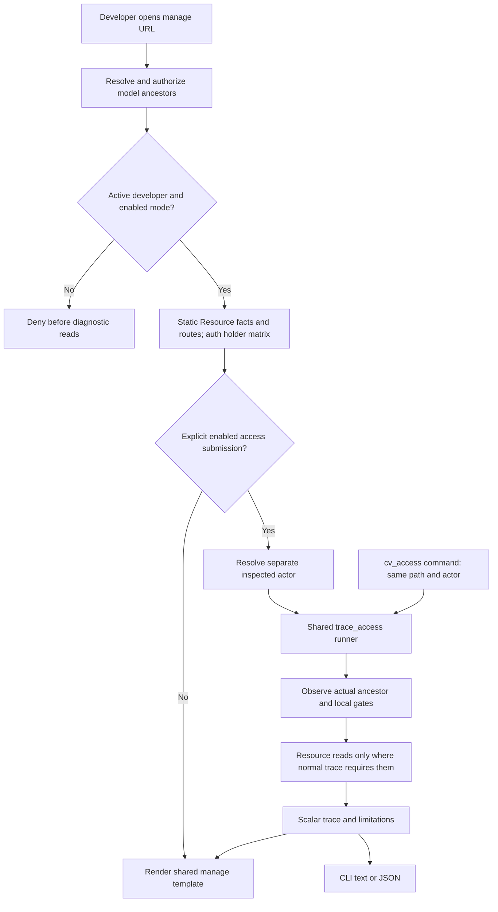

# Phase 06.35: Resource manage pages with cv_access parity (#372) - Research

**Researched:** 2026-11-15
**Domain:** Django developer diagnostics, Resource ViewSets, access-trace parity
**Confidence:** MEDIUM overall; implementation seams are source-grounded, acceptance coverage remains execution work.

<user_constraints>
## User Constraints (from CONTEXT.md)

Copied verbatim from the approved context. [VERIFIED: .planning/phases/06.35-resource-manage-pages-with-cv-access-parity-372/06.35-CONTEXT.md:23-105]

<!-- DATA_8f43b6a1_START -->
## Implementation Decisions

### Selected approach

Extend `ManageView`; do not introduce a separate Resource manage view. Reuse the existing cards,
data builders, route machinery, authorization and trace runner. Small explicit Resource branches are
preferred to a new abstraction. Developer maintainability is a hard constraint alongside correctness.

### Approved D-01–D-07

The following index preserves the approved design's decision numbers. Read the full design and its
`gsd-handover`, including all acceptance criteria; this index does not narrow them.

- **D-01 — Registration and access:** Automatically register Resource manage routes and manage actions
  using existing settings and `manage_view_class` selection. Keep the active/authenticated developer-group
  gate, staff/superuser treatment and enabled/disabled/debug-only modes. Resource permissions do not
  authorize entry to the manage page. The manage route itself needs no Resource item identifier. Empty
  mappings must not make system checks demand a fictitious Resource permission for the manage view.
- **D-02 — Standalone and nested support:** Support standalone Resources and Resource leaves below
  model-based ViewSets. Preserve parent URL coordinates, ancestor authorization before local manage
  authorization/holder diagnostics, and existing nested database restrictions. Guardian model ancestors
  remain supported through their existing authorization; Resources do not gain Guardian object grants.
- **D-03 — No implicit Resource reads:** Opening the built-in manage page must not call the managed
  Resource's `cv_get_items` or `cv_get_item`. Parent-model lookups and auth-table reads are legitimate.
  Explicitly submitted access checks may invoke the normal Resource loaders. Arbitrary downstream
  overrides/custom system checks remain outside the built-in no-read guarantee; add no sandbox or cache
  to police them. Acceptance uses fake Resources without S3 credentials or live buckets.
- **D-04 — Resource-aware diagnostics:** Identify the Resource and its dotted class path, display
  effective names/PK metadata/ordering through existing metadata and ViewSet overrides, and label
  Resource metadata accurately. Preserve declaration/default provenance and Show defaults. Include
  `resource_permissions` in Presentation. Replace the no-manage-page hierarchy text with actual Resource
  manage route information; retain upward links versus child route descriptions without fabricated
  parent objects. Keep the existing page layout.
- **D-05 — Resource permissions and approved badge:** Use `viewset.permissions` backed by the explicit
  `resource_permissions` map; never derive a Resource ContentType/default permission set. Reuse the
  actor/group/user/overflow matrix behavior and existing user visibility/superuser rules. Successful
  Resource cells display `resource`, meaning a Django permission declared in the map, not an item grant.
  The approved theme key is `manage:badge-resource`; its approved Bootstrap default is
  `badge bg-info text-dark`. Translate text and explanatory legends, retain text independent of color,
  and allow normal downstream theme overrides. Preserve model/Guardian labels and the existing cell
  data contract. `None` and empty maps have no permission columns and a clear empty state that does not
  imply the page/endpoints are public.
- **D-06 — Existing access forms and identifiers:** Reuse #370's default-off setting, forms, user
  selection and trace runner. Configuration, permission matrices and non-object checks need no Resource
  item identifier. Object-view traces use the existing URL identifier for lookup/existence/state
  conditions; without it retain “needs an object pk”. Keep extra-argument/path-field behavior and nested
  coordinates. Do not invent S3 identifier encoding, run action handlers or weaken existing disclosures
  about external reads and the limits of database rollback.
- **D-07 — UI/`cv_access` parity:** This explicitly refers to the existing access command, not #371's
  configuration dump. For the same URL, inspected actor and fixture state, compare outcome, deciding
  step, ordered observations, requirements, identity, applicable counts, errors and limitations. Both
  use `trace_access`. Compare the UI path form and each executable per-ViewSet row against the matching
  command path. Cover command text, `--as-json` and HTML, including new Resource manage URLs and their
  developer/ancestor gates. Preserve the actual Django provider meaning; the `resource` matrix badge
  is not a new permission backend. Keep JSON version/schema and exit behavior unless concrete conflicting
  evidence requires a maintainer decision. Parity is equivalent diagnostics, not identical formatting
  or adding the holder matrix to the CLI. The hosting developer and inspected actor remain distinct.

### Acceptance and preservation constraints

- Cover both direct requests and relevant action visibility, all existing manage modes, active/developer
  membership, ancestor denials and nested database boundaries. Denied requests must not reach Resource
  loaders or holder diagnostics.
- Render an allowed default page with both Resource loaders failing if called. Test empty permission
  maps through registration/system checks and the rendered matrix.
- Cover Resource metadata/provenance, hierarchy routes, every badge row kind, theme overrides, translated
  legends and English/German output. Preserve model/Guardian behavior and template extension contracts.
- Prove default-off forms and explicit list/object/missing-identifier/missing-item/nested checks. Compare
  CLI JSON with web trace data for matching inputs, and check equivalent meaningful text/HTML output.
- Update Resource/manage references, the obsolete limitation, theme inventory, German translations and
  changelog. Any Breaking changelog entry also updates `docs/migrating-1.0.md` before 1.0.0.
- Use focused Resource/manage/access-trace coverage and relevant model/Guardian regressions; broad pytest
  runs use multiple workers. Preserve existing normal/recorder test contracts and avoid adding query
  costs to existing model paths. No application tests were run during this context capture.

### Research and planning discretion

Exact helper placement, internal context plumbing, template conditionals, translated wording and test
organization remain bounded engineering choices. The label, theme key and Bootstrap classes are settled.
Verify `_check_nested_auth` with actual requests before changing it: inspected source recognizes Resource
leaves and its ordinary auth-table path appears compatible, but that is not runtime acceptance evidence.
Do not invent product questions for these engineering choices or silently relax approved criteria.

<!-- DATA_8f43b6a1_END -->

<!-- DATA_79cd02e5_START -->
## Deferred Ideas

- Issue #371's configuration-dump command remains separate. The maintainer clarified that CLI parity
  here means `cv_access`; do not accidentally expand into a configuration CLI.
- No Resource-as-parent support, Resource Guardian integration, bucket browser/connectivity probe, new
  AWS dependency, new write capabilities, identifier encoding or authorization/trace redesign.

<!-- DATA_79cd02e5_END -->
</user_constraints>

## Summary

Extend the existing ManageView and its registration path. Resource permissions already resolve through the explicit map, the page is a TemplateView with no object lookup requirement, and both web modes already call the shared trace runner. The registration exclusions and presentation assumptions are the bounded changes; do not rebuild authorization, Resource loading or tracing. [VERIFIED: src/crud_views/lib/viewset/__init__.py:182-218,354-372,513-517; src/crud_views/lib/views/manage.py:28-55,740-779]

An isolated in-memory probe manually registered the existing ManageView for a Resource, with both loaders raising, and rendered standalone, core-parent and Guardian-parent pages successfully. This positively supports retaining the existing nested auth helper. The probe does not establish automatic registration, all denial cases, action visibility or cross-database acceptance; make those first-class implementation tests. [VERIFIED: research probe executed 2026-11-15, exit 0; source excerpts and output under Environment Availability]

**Primary recommendation:** implement registration and static Resource presentation first, prove no-load and authorization boundaries, then add exhaustive UI/CLI parity tests using the existing runner and finish theme/locale/documentation delivery. This follows approved D-01–D-07, not a new product decision. [VERIFIED: superpowers/specs/2026-11-15-resource-manage-page-design.md:25-131,217-251]

## Architectural Responsibility Map

This is the recommended assignment of work, grounded in existing ownership. [VERIFIED: src/crud_views/lib/views/manage.py:49-55,192-235,740-858; src/crud_views/lib/access_trace_runner.py:385-463]

| Capability | Primary tier | Secondary tier | Rationale |
|---|---|---|---|
| Manage route and action registration | Python package/backend | URL router | ViewSet already owns both registrations. |
| Hosting developer and ancestor gates | Django backend | Auth database | Existing dispatch must authorize before diagnostics. |
| Resource facts, permissions and routes | Django backend | Auth database for permission holders | Class metadata needs no Resource loader. |
| Resource badge, legends and defaults display | Django template server | Existing browser defaults control | Presentation distinction; preserve permission-cell data. |
| Explicit access checks | Shared backend trace runner | Application-owned Resource loader | Both web and command call the same runner. |
| Selected actor/session distinction | Django backend | CLI actor resolution | Inspecting another user must not change the hosting session. |
| German text and theme classes | Existing catalogs/registry | Template rendering | No new frontend subsystem or external service. |

## Project Constraints (from AGENTS.md)

AGENTS.md resolves to CLAUDE.md; these are actionable repository constraints, not optional design advice. [VERIFIED: local symlink inspection; CLAUDE.md:15-68,70-88,129-147]

- Keep every change understandable and maintainable by the developer; use the simplest bounded solution, preserve proven paths, document unsupported cases, and account for cognitive costs and queries.
- Prefer self-contained additions and avoid cross-cutting abstractions without demonstrated need.
- Use the repository tools for formatting/checks/builds and respect the pre-commit formatter.
- Broad pytest verification uses multicore execution; use four workers here. Serial execution is justified for the tiny research probes only; do not interrupt existing checks to change workers.
- Keep fixture naming conventions and existing in-memory Django test configuration.
- Preserve class-attribute and workflow naming conventions, CRUD permission mappings, double quotes and the configured line length.
- Any Breaking changelog entry before 1.0.0 must also update the migration guide.
- After a ship run, refresh the codebase map. Worktree creation, if separately requested, uses the prescribed GSD workspace convention and checks existing worktrees first. Neither action belongs to this research task.

Exact convention values, quoted from CLAUDE.md:139-147: `cv_`, `list`, `detail`, `create`, `update`, `delete`, `workflow`, `manage`; “list/detail→view, create→add, update→change, delete→delete”; `wf_`; “120 characters”; “double quotes”; `hatchling`; `bump-my-version`; `### Breaking`; `CHANGELOG.md`; `docs/migrating-1.0.md`. [VERIFIED: CLAUDE.md:139-147]

<phase_requirements>
## Phase Requirements

Use the approved decision IDs below and the five roadmap success criteria; do not create new requirement IDs. Existing ancestor requirements are preservation context, not new phase scope. [VERIFIED: .planning/ROADMAP.md:1995-2009; .planning/REQUIREMENTS.md:281-288]

| ID | Approved behavior | Research support |
|---|---|---|
| D-01 | Automatic registration/actions and existing manage gate, including empty mappings | Remove two exclusions; retain direct Django permission-mixin distinction and valid checks. |
| D-02 | Standalone and model-nested Resources, including Guardian model ancestors | Existing ancestor walk/auth helper; successful bounded request probe; add denial/action/database tests. |
| D-03 | Default page performs no managed Resource reads | TemplateView reuse; raising-loader actual rendering test; distinguish auth/parent queries. |
| D-04 | Resource identity, provenance, permissions presentation and hierarchy routes | Existing facts/presentation/hierarchy builders with small explicit branches. |
| D-05 | All matrix row kinds use approved resource badge, accurate empty state and translations | Preserve cells, adapt four template sites, add one registry key and inventories. |
| D-06 | Existing default-off access forms and identifiers | Existing path/ViewSet builders; missing PK and extra-argument instructions preserved. |
| D-07 | UI path and executable row parity with command JSON/text/HTML | Compare full dictionaries per path and language; preserve real provider and scalar identity. |

Roadmap success criteria map directly: criterion 1 → D-01/D-02; criterion 2 → D-03; criterion 3 → D-04/D-05; criterion 4 → D-06/D-07; criterion 5 → tests, catalogs, docs and changelog across all decisions. [VERIFIED: .planning/ROADMAP.md:2003-2009]
</phase_requirements>

## Standard Stack

Reuse the installed project dependencies; this phase needs no package installation or version upgrade. Minimum constraints below are verbatim declarations, while observed versions are environment facts, not claims of latest upstream versions or new support promises. [VERIFIED: pyproject.toml:25-35,52-83; research environment probe 2026-11-15]

| Existing component | Declared constraint / observed runtime | Purpose |
|---|---|---|
| Django | `"django (>=4.2.0)"`; cached 4.2.30, 5.2.19, 6.0.10; main venv 6.1.2 | Auth, CBVs, ORM, templates, routing, translation |
| Pydantic | `"pydantic (>=2.2.1)"`; main venv 2.14.1 | Existing Resource/ViewSet metadata |
| django-guardian | `"django-guardian>=2.4"`; main venv 3.5.2 | Existing model-ancestor and regression behavior |
| pytest / pytest-django / pytest-xdist | `"pytest"`, `"pytest-django"`, `"pytest-xdist"`; main venv 9.2.0 / 4.14.0 / 3.8.0 | Existing test harness |
| polib | `"polib"`; main venv 1.2.0 | Existing catalog inspection and available compilation fallback |

Package provenance: these names come from the opened project manifest. No new package is recommended; no registry freshness claim is made, and a package legitimacy/install gate is therefore not applicable. Version publish dates were not queried because installed versions are evidence of runnable local environments, not a recommendation to pin current registry releases. [VERIFIED: pyproject.toml:25-83; environment probe]

**Alternatives:** the approved design rejects a separate Resource manage class. Keep the shared class and small presentation branches. [VERIFIED: superpowers/specs/2026-11-15-resource-manage-page-design.md:19-23]

## Architecture Patterns

### System architecture

Recommended flow, preserving existing ownership. [VERIFIED: src/crud_views/lib/views/manage.py:49-119,740-858; src/crud_views/lib/access_trace_runner.py:385-463]



### Component responsibilities and bounded edits

| Existing source location | Implementation responsibility | Grounding |
|---|---|---|
| `src/crud_views/lib/viewset/__init__.py` | Remove Resource exclusion around auto-manage creation and context-action insertion; keep class selection and copy-on-write behavior. | [VERIFIED: src/crud_views/lib/viewset/__init__.py:213-216,354-372] |
| `src/crud_views/lib/views/manage.py` | Resource identity/provenance, mapping in Presentation; retain matrix and trace builders. | [VERIFIED: src/crud_views/lib/views/manage.py:179-265,299-375,457-525,740-858] |
| `src/crud_views/templates/crud_views/view_manage.html` | Four row kinds, Resource legend/empty state and hierarchy text; keep blocks and layout. | [VERIFIED: src/crud_views/templates/crud_views/view_manage.html:21-91,277-316] |
| `src/crud_views/lib/button_classes.py` | Add the approved Resource badge default through the normal registry. | [VERIFIED: src/crud_views/lib/button_classes.py:136-145,204-242] |
| Shared trace/CLI/template implementation | Prefer tests; change only a reproduced missing diagnostic fact, shared where appropriate. | [VERIFIED: src/crud_views/lib/access_trace.py:13-56; src/crud_views/management/commands/cv_access.py:197-213] |

These paths identify opened implementation files, not new generated filesystem outputs. Recommended new test files are planning proposals listed under Wave 0.

### Pattern 1: registration without a fictitious permission

The current automatic class construction is `type("AutoManageView", (base,), {"model": self.model, "cv_viewset": self})`, under `if not self.is_resource:`. Action insertion additionally requires `crud_views_settings.manage_views_enabled != "no" and not self.is_resource`. Remove the Resource terms while retaining the rest. Do not suppress route construction solely because the manage mode is disabled: current model behavior constructs the view and enforces the mode in its gate. [VERIFIED: src/crud_views/lib/viewset/__init__.py:213-216,354-364; src/crud_views/lib/views/manage.py:83-87]

The check uses `issubclass(view, CrudViewPermissionRequiredMixin)` and `id="E260"`; the built-in class declaration is `class ManageView(PermissionRequiredMixin, CrudView, generic.TemplateView):`. Those mixins differ. Empty-map manage registration already passed the isolated probe; do not add a blanket manage-key exemption or weaken checks for actual permission-required Resource views. [VERIFIED: src/crud_views/lib/viewset/__init__.py:251-265; src/crud_views/lib/views/manage.py:28; probe output below]

Keep exact route/object declarations `cv_pk: bool = False`, `cv_key = "manage"`, `cv_path = "manage"`, `cv_object = False`. No ResourceViewMixin is needed on this TemplateView. [VERIFIED: src/crud_views/lib/views/manage.py:28-35; successful rendering probe]

### Pattern 2: distinguish metadata, permission facts and provider

The Resource metadata vocabulary is `("verbose_name", "verbose_name_plural", "app_label", "pk_field", "pk_type", "ordering")`. The ViewSet has separate `pk_name: str = "pk"` and `pk: str | None = None`, with the latter populated from Resource metadata if omitted. Display the Resource field identity as well as effective route PK metadata; do not confuse the URL keyword with the backing item attribute. [VERIFIED: src/crud_views/lib/resource.py:21-52; src/crud_views/lib/viewset/__init__.py:74-85,190-204]

Facts currently label inherited values `_("model Meta")`. Preserve `_manage_constructor_fields` and existing `"is_default"` semantics while choosing a Resource-aware translated source label. Keep existing fact keys where possible; add a display label only if needed and document any new public mapping fields. Place the Resource permission map through the existing presentation field helper so explicit empty/default declarations retain provenance. [VERIFIED: src/crud_views/lib/views/manage.py:299-337,457-525; src/crud_views/lib/viewset/__init__.py:110-117]

Exact matrix cell contract: `{"key": key, "model": user.has_perm(permission), "object_count": None}`. Direct-holder cells use the same keys. The boolean named `"model"` must remain compatible; choose the displayed badge from the managed ViewSet's Resource status. Do not add a parallel permission boolean or invent item counts. [VERIFIED: src/crud_views/lib/views/manage.py:179-189,254-262]

Three concepts must remain distinct:
- The approved matrix text/key/classes are `resource`, `manage:badge-resource`, `badge bg-info text-dark`. [VERIFIED: superpowers/specs/2026-11-15-resource-manage-page-design.md:77-89]
- Core endpoint trace events use `provider="core"`; manage gate events use `"provider": "none"`; these are not the matrix badge. [VERIFIED: src/crud_views/lib/view/base.py:1284-1300; src/crud_views/lib/views/manage.py:63-71]
- Trace object identity remains `{"model": model, "pk": str(pk) if pk is not None else None}`, including Resource class-derived identity. Preserve that schema instead of renaming its model field to Resource. [VERIFIED: src/crud_views/lib/access_trace.py:48-56; tests/test1/test_access_trace_resources.py:75-88]

### Pattern 3: actual request authorization, then diagnostics

Manage dispatch runs the ancestor guard first. Its local gate rejects anonymous/inactive users, disabled modes and missing developer-group membership; superuser/staff status does not replace membership. Settings enumerate `("no", "yes", "debug_only")`. [VERIFIED: src/crud_views/lib/views/manage.py:49-119; src/crud_views/lib/settings.py:24-38]

The ordinary nested auth path checks auth tables and actor hints without treating the Resource as an ORM model. Only the Guardian provider branch asks for model-specific object-grant tables. Preserve this helper; the Resource leaf remains a core ViewSet even beneath a Guardian model parent. [VERIFIED: src/crud_views/lib/ancestor_db.py:54-63,121-170; src/crud_views_guardian/lib/viewset.py:46-62]

Test denied ancestry before the local group check, loaders and holder builders. Also test active developer membership without Resource permissions, Resource permissions without developer membership, inactive members, staff/superusers without membership, missing/mismatched ancestors, core/Guardian parents, action projection and rejected nondefault auth/ancestor aliases. These are required acceptance expansions, not evidence that all already pass. [VERIFIED: superpowers/specs/2026-11-15-resource-manage-page-design.md:25-58,139-158,217-244]

### Pattern 4: exact diagnostics parity, shared runner

Web query names are `"cv_access_mode"`, `"cv_access_user"`, `"cv_access_pk"`, `"cv_access_path"`; accepted modes are `{"path", "viewset"}`. The ViewSet builder emits `_("needs an object pk")` for object views without a PK and `_("use the path field")` when reverse fails. Compare only executable rows to command traces, and independently assert the instructions for unexecutable rows. [VERIFIED: src/crud_views/lib/views/manage.py:740-819]

Compare complete JSON-decoded command output to the corresponding web context dictionary under the same translation override. That retains outcome, deciding step, plan, ordered steps, identity, counts, exceptions and limitations without brittle field selection. Also assert meaningful facts in CLI text and HTML rather than merely checking that each renders. Existing locale tests demonstrate full-dictionary comparison and stable cross-language facts. [VERIFIED: tests/test1/test_access_trace_locales.py:36-70; tests/test1/test_access_trace_command.py:40-49]

Preserve `version: int = field(default=1, init=False)` and the command exit map `{"allowed": 0, "denied": 1, "not_found": 1, "login_redirect": 1, "no_such_route": 2, "error": 2}`. The runner uses a synthetic GET, stubs handlers and rolls back its default-database transaction. Explicit Resource reads may still occur; no external-write rollback promise is valid. [VERIFIED: src/crud_views/lib/access_trace.py:31-45; src/crud_views/management/commands/cv_access.py:197-213; src/crud_views/lib/access_trace_runner.py:385-463; src/crud_views/lib/resource.py:151-162]

## Don't Hand-Roll

| Problem | Do not build | Reuse |
|---|---|---|
| Resource manage support | Separate manage class or identity abstraction | Shared ManageView, explicit branches |
| Permission holders | Resource ContentTypes/default-permission discovery | ViewSet.permissions and existing matrix builders |
| Nested security | Resource-specific ancestor authorization | Existing ancestor guard and nested auth checks |
| Access explanation | New tracing engine or UI-specific permission predictor | trace_access, existing scalar schema and renderers |
| Themed badges | Literal class strings in template branches | Existing class registry and cv_button_class |
| No-read guarantee | Cache, hook interception or custom-I/O sandbox | Built-in static inspection plus raising-loader tests |

All recommendations follow approved scope and the existing owners. [VERIFIED: superpowers/specs/2026-11-15-resource-manage-page-design.md:19-23,25-131; src/crud_views/lib/views/manage.py:179-375,740-858]

## Common Pitfalls

1. **Weakening E260 to solve a nonexistent built-in conflict.** The existing mixin distinction already protects the stock manage view; retain failing checks for real unmapped Resource endpoint permissions. Test custom manage selection through the existing contract. [VERIFIED: src/crud_views/lib/viewset/__init__.py:251-265,366-372; tests/test1/test_resource_viewset.py:114-133]
2. **Only changing one badge row.** Actor, group, visible-user and overflow-user cells each render the model badge independently. Test all four with more than twenty direct users and theme overrides. Existing split is `"users": users[:20]` and `"users_overflow": users[20:]`. [VERIFIED: src/crud_views/templates/crud_views/view_manage.html:37-71; src/crud_views/lib/views/manage.py:218-235]
3. **Zero database queries mistaken for zero Resource reads.** Parent lookups and auth diagnostics are legitimate. Use loader spies separately from model-path query-regression checks. [VERIFIED: superpowers/specs/2026-11-15-resource-manage-page-design.md:48-58]
4. **Old negative assertions surviving new routes.** Update the explicit no-manage assertions in Resource registration/trace tests and the hierarchy assumptions in manage facts/browser cases; preserve surrounding assertions. [VERIFIED: tests/test1/test_resource_viewset.py:65-67; tests/test1/test_access_trace_resources.py:89; tests/test1/test_manage_facts.py:85-102; inspected tests/browser/manage-presentation.cjs:257,641]
5. **Adding public context fields without inventory updates.** Release tests compare actual context and template blocks to theme documentation; prefer using existing ViewSet context for presentation where sufficient. [VERIFIED: tests/test1/test_manage_release.py:35-82]
6. **Stale translations and class counts.** Existing manage-key guards say `assert len(defaults) == 19` and `assert len(documented_classes) == 19`; update inventories consistently for the new key, including the theme document's spelled-out count. Compile and test German output, not just PO text. [VERIFIED: tests/test1/test_button_classes.py:153-177; tests/test1/test_manage_release.py:75-82; docs/reference/theme.md:1048-1053; tests/test1/test_manage_locales.py:190-239]
7. **Comparing different actors or mutable fixtures.** Keep hosting developer separate, select the same actor in command and form, and use deterministic fake Resource data. Path mode retains host matrix actor; ViewSet mode substitutes the inspected actor only in its matrix row. [VERIFIED: src/crud_views/lib/views/manage.py:814-829; tests/test1/test_manage_access_trace.py:57-74]
8. **Testing stale installed source.** Cached nox packages are installed distributions; local source checks must explicitly set PYTHONPATH. Installed-package CI deliberately clears it. Do not claim cached checkout testing verifies packaging. [VERIFIED: noxfile.py:5-17,27-57]

## Code Examples

These are existing patterns to reuse, not a proposed new API.

### Resource permission map and compatible cell

Exact source quotes are fenced for provenance. [VERIFIED: src/crud_views/lib/viewset/__init__.py:513-517; src/crud_views/lib/views/manage.py:186-189]

<!-- DATA_d27f304c_START -->
```python
@property
def permissions(self) -> OrderedDict[str, str]:
    if self.is_resource:
        return OrderedDict(self.resource_permissions or {})
    return self.default_permissions
```

```python
"cells": [
    {"key": key, "model": user.has_perm(permission), "object_count": None}
    for key, permission in viewset.permissions.items()
],
```
<!-- DATA_d27f304c_END -->

### Existing command invocation helper

Use the existing helper in parity tests so denial exit statuses remain observable alongside emitted JSON. The string values below are verbatim source. [VERIFIED: tests/test1/test_access_trace_command.py:40-49]

<!-- DATA_167d9c83_START -->
```python
def invoke(*args, **kwargs):
    stdout, stderr = StringIO(), StringIO()
    try:
        result = call_command("cv_access", *args, stdout=stdout, stderr=stderr, **kwargs)
    except SystemExit as exc:
        code = exc.code
    else:
        assert result is None, "handle must not return truthy output for BaseCommand to print again"
        code = 0
    return code, stdout.getvalue(), stderr.getvalue()
```
<!-- DATA_167d9c83_END -->

## State of the Art

This phase is an additive extension of merged implementations, not a dependency migration. [VERIFIED: .planning/STATE.md:31-54; source files cited above]

| Existing implemented restriction | Approved replacement |
|---|---|
| Resource auto-registration/action exclusion | Shared manage registration/action rules |
| Generic model metadata labels | Accurate Resource identity and inherited-source labels |
| Resource child has no manage-route description | Actual route description, upward links only |
| Resource access command can be run from another manage host | Resource can itself host the same opt-in forms |
| All successful global cells say model | Resource mapped-permission label, unchanged underlying cell |

Current Resource documentation still says “without registering a Resource manage page” and contains the limitation row `No `ManageView``. Remove those obsolete claims; do not remove Resource-as-parent/write/Guardian exclusions. [VERIFIED: docs/reference/resources.md:497-511; approved design:133-136]

## Environment Availability

All observations below are from this session. These are available local tools, not a supported-version declaration. [VERIFIED: environment probes, 2026-11-15]

| Dependency | Available/version | Execution guidance |
|---|---|---|
| Python | 3.12.3 in main venv; cached test environments import successfully | Use cached Django series explicitly. |
| Django cached test environments | 4.2.30 / 5.2.19 / 6.0.10 | Primary focused loop on cached 5.2, replay supported series. |
| Main venv | Django 6.1.2, pytest 9.2.0, pytest-django 4.14.0, xdist 3.8.0 | Supplemental coverage; do not substitute it for named supported-series evidence. |
| SQLite test setup | In-memory default and shard databases | No service startup needed. |
| GNU gettext commands | msgfmt and xgettext not found by shutil.which | Existing polib available; validate PO/MO semantic parity. |
| polib | 1.2.0, import succeeded | Existing test dependency, no install needed. |
| Node | 24.21.0 executable discovered | Existing frontend harness only if needed. |
| S3/cloud credentials | Not probed; not required | Fake Resource data only. |

Exact cached command paths were executed successfully; their names are observations of existing environments, not paths this phase creates. Source creation/configuration evidence: nox sessions use `@nox.session(python=["3.12", "3.13", "3.14", "3.15"], venv_backend="uv")`, `DJANGO_VERSIONS = ["4.2", "5.2", "6.0"]`, and `session.install(".[polymorphic,workflow,ordered,test]")`. [VERIFIED: noxfile.py:3,20-28]

**Research probes completed (serial because only eight existing test cases):**

- Cached Django 5.2 Resource baseline: `6 passed in 1.71s`.
- Cached Django 5.2 catalog semantics: `2 passed in 0.10s`.
- RequestFactory plus real dispatch/render, manually attached existing ManageView, in-memory database, active developer superuser, empty mapping and both Resource loaders raising:
  `standalone rendered 200 errors [] bytes 38576`
  `core rendered 200 errors [] bytes 39842`
  `guardian rendered 200 errors [] bytes 39842`
  Exit status 0. This isolates the existing built-in path; it is not automatic registration acceptance. Initial probe setup omitted syncing unmigrated test models; rerunning with run_syncdb enabled resolved that setup error. [VERIFIED: executed research probes, 2026-11-15]

**Missing dependencies with no fallback:** none established for the required focused Python/catalog checks. Browser infrastructure was not exercised and full suites were not run during research. [VERIFIED: scope of probes above]

**Missing dependencies with fallback:** use existing polib compilation if gettext remains unavailable, then run compiled-catalog semantic and real German rendering tests. Existing test code calls `catalog.save_as_mofile(str(stem.with_suffix(".mo")))`, and the project requires both PO and MO files committed. [VERIFIED: tests/test1/test_manage_locales.py:243-269; docs/development/i18n.md:92-106]

## Validation Architecture

Nyquist and security are enabled by project configuration. Quote: `"nyquist_validation": true`, `"security_enforcement": true`. [VERIFIED: .planning/config.json:24,48]

### Test framework and commands

Existing pytest configuration declares `addopts = "--strict-markers"`. Django setup configures `"ENGINE": "django.db.backends.sqlite3"` and `"NAME": ":memory:"`; recorder mode is enabled only by `os.environ.get("CV_ACCESS_RECORD_REQUESTS") == "1"`. [VERIFIED: pyproject.toml:145-146; tests/test1/conftest.py:99-108; tests/conftest.py:8-20]

| Property | Value |
|---|---|
| Framework | pytest 9.2.0, pytest-django, pytest-xdist; existing project configuration |
| Primary interpreter | cached Python 3.12 / Django 5.2.19 |
| Quick baseline, executed | Command A below; six cases, under two seconds |
| Focused phase gate | Command B below, extend with new phase tests |
| Complete suite | Command C below, normal and recorder modes |
| Other series | Same focused file list under cached 4.2 and 6.0 interpreters; no installs required |

The following are runnable observed-environment commands, with future files intentionally omitted from current commands. For new tests, replace the selection with the created file/node ID during planning; do not call a missing file a passing check.

```bash
# A — executed baseline
PYTHONPATH=src .nox/tests-3-12-django-5-2/bin/python -m pytest tests/test1/test_resource_viewset.py::test_no_new_errors_for_plain_resource_viewset tests/test1/test_access_trace_resources.py -q

# B — planned focused regression gate; broad selection uses four workers
PYTHONPATH=src .nox/tests-3-12-django-5-2/bin/python -m pytest tests/test1/test_resource*.py tests/test1/test_manage*.py tests/test1/test_access_trace*.py tests/test1/test_ancestor*.py tests/test1/test_button_classes*.py tests/test1/test_theme_adoption_docs.py -n 4

# C — planned complete suites, separate commands with captured exit statuses
CV_ACCESS_RECORD_REQUESTS=0 PYTHONPATH=src .nox/tests-3-12-django-5-2/bin/python -m pytest tests -n 4
CV_ACCESS_RECORD_REQUESTS=1 PYTHONPATH=src .nox/tests-3-12-django-5-2/bin/python -m pytest tests -n 4

# Compiled German checks; first command executed during research
PYTHONPATH=src .nox/tests-3-12-django-5-2/bin/python -m pytest tests/test1/test_manage_locales.py::test_manage_compiled_catalog_matches_po_semantics -q
PYTHONPATH=src .nox/tests-3-12-django-5-2/bin/python -m pytest tests/test1/test_manage_locales.py tests/test1/test_access_trace_locales.py -n 4
```

### Requirements → executable acceptance map

Commands in this table use the prefix `PYTHONPATH=src .nox/tests-3-12-django-5-2/bin/python -m pytest`. Proposed new files are explicit Wave 0 work, not present evidence. Each task should choose a focused node/parameter subset for a sub-30-second feedback loop; complete selected files may take longer. [VERIFIED: executed six-case timing; existing helpers/tests cited in Architecture Patterns]

| Requirements | Behavior to prove | Test type and proposed selection | Existing evidence / gap |
|---|---|---|---|
| D-01 | Registration, chosen manage class, actions; all modes; empty maps through checks | integration: proposed test_resource_manage.py, registration/auth selections | Existing test_resource_viewset.py and test_manage_group.py; new Resource composition required |
| D-02 | Core/Guardian parent permissions, ancestor-before-local ordering, 404 paths, default DB boundaries, actions | integration: proposed test_resource_manage.py, nested/database selections | Existing test_ancestor_manage.py, test_ancestor_auth_databases.py, test_ancestor_resources.py; new combined path required |
| D-03 | Authorized render with both loaders raising; denied before holder reads | integration: proposed test_resource_manage.py, no_reads selections | Successful bounded research probe; add normal client and denial spies |
| D-04 | Names, dotted identity, field/route PKs, inherited/declared values, empty override semantics, mapping, hierarchy | unit/integration: proposed test_resource_manage.py and existing test_manage_facts.py/test_manage_provenance.py | Existing builders; update old absence expectations |
| D-05 | Four row kinds, direct/group grants, overflow, user visibility, superusers, empty maps, override/clear classes, EN/DE legends | integration: proposed test_resource_manage.py matrix selections plus test_button_classes.py | Existing model/Guardian assertions; Resource assertions missing |
| D-06 | Default-off ignores input; enabled list/detail/missing PK/missing item, extra arguments, nested coordinates; no action handlers | integration: proposed test_resource_manage_trace.py | Existing test_manage_access_trace.py, test_access_trace_resources.py, test_access_trace_paths.py |
| D-07 | Path form and every executable ViewSet row versus CLI JSON; equivalent CLI text/HTML for permissions, state, missing objects, errors, limitations and new manage URLs | integration: proposed test_resource_manage_trace.py | Existing invoke helper and locale equality pattern; Resource-host parity grid missing |
| D-04/D-05/D-07 and delivery | German PO/MO semantics, EN/DE actual rendering, theme inventory, docs/changelog | existing test_manage_locales.py, test_access_trace_locales.py, test_manage_release.py, test_manage_docs.py, test_access_trace_docs.py | Current semantic checks pass; new messages and inventories need updates |

**Parity grid minimum:** standalone and model-nested hosts; core and Guardian model ancestors; different hosting developer and inspected actor; allowed/denied mapped permissions; existing/missing Resource item; state-disabled action; missing identifier instructions; path-only contributed arguments; missing/denied ancestors; new manage URL with member/nonmember/inactive actor and disabled mode; normalized error trace; both languages. Reuse a small deterministic Resource fixture and parametrized assertions rather than a new testing framework. Each executable row must be compared using its own resolved path, not a representative row only. [VERIFIED: approved design:111-131,217-244; existing reusable contracts: tests/test1/test_access_trace_resources.py:17-89; tests/test1/test_manage_access_trace.py:149-187]

### Sampling and Wave 0 gaps

- Per task: focused new acceptance tests plus nearest existing regression file; preserve red/green evidence where useful.
- Per wave: relevant Resource/manage/access/ancestor selections with four workers.
- Phase gate: full normal and recorder suites, supported-series focused replay, catalog semantics, documented public-surface tests, scoped lint/format, and actual EN/DE rendered output.
- Wave 0: create Resource-manage and Resource-host parity tests; reuse isolated_routes, fake data, developer fixture and invoke helper. Add no package or generic harness.
- Measure existing model/Guardian query behavior before/after changes where diagnostics builders change; do not assert zero auth queries.
- Refresh the old Resource hierarchy browser assertions if retaining the browser fixture. A focused visual check of Resource legends, blue badge, overflow and Show defaults can accompany execution; do not rebuild the previous phase's browser platform.

These are recommended validation tasks, grounded in D-01–D-07 and repository verification conventions. No full-suite, browser or cross-series acceptance result is claimed by this research. [VERIFIED: approved design:139-158,217-244; CLAUDE.md:129-147; noxfile.py:27-57]

### Documentation and inventory checklist

Update Resource and manage references, the class-table inventory, theme structured-manage contracts, German catalogs and changelog. Existing exact inventory guards are in test_button_classes and test_manage_release; the latter also checks context mappings and blocks. Keep the custom-template extension surface stable and document any deliberately added mapping field. [VERIFIED: tests/test1/test_manage_release.py:35-82; docs/reference/buttons.md:173-179; docs/reference/theme.md:1048-1065; docs/reference/resources.md:497-511]

If the executor adds a translated include to reduce cell duplication, extend the translation extractor's source list: it currently lists `"lib/views/manage.py"`, `"lib/access_trace.py"`, `"lib/access_trace_runner.py"`, `"management/commands/cv_access.py"`, `"templates/crud_views/view_manage.html"`, `"templates/crud_views/includes/access_trace.html"`. Prefer keeping the bounded changes in the existing template unless extraction complexity is justified. [VERIFIED: tests/test1/test_manage_locales.py:17-25]

## Security Domain

Security review is enabled. Apply ASVS 5.0 chapter names instead of silently using the older template numbering: authentication is V6, sessions V7 and authorization V8. This is a scoped engineering review, not a certification or new product policy. [CITED: https://asvs.owasp.org/; https://raw.githubusercontent.com/OWASP/ASVS/v5.0.0/5.0/en/0x15-V6-Authentication.md; https://raw.githubusercontent.com/OWASP/ASVS/v5.0.0/5.0/en/0x16-V7-Session-Management.md; https://raw.githubusercontent.com/OWASP/ASVS/v5.0.0/5.0/en/0x17-V8-Authorization.md]

| Applicable category | Application in this phase |
|---|---|
| V6 Authentication | Preserve existing authenticated/active actor admission; no new credential mechanism. |
| V7 Session Management | Hosting user/session remains unchanged while another actor is inspected. |
| V8 Authorization | Server-side ancestor gates, independent developer-group gate, reached DB boundary checks; never trust hidden UI actions as authorization. |
| Output/input safety | Retain escaped names/errors and existing path/user resolution; compare scalar diagnostics without exposing Resource contents. |
| Cryptography | No new cryptographic operation proposed; reuse existing framework mechanisms. |

The local security control mapping is grounded in existing manage dispatch, actor-resolution flow and escaping tests. [VERIFIED: src/crud_views/lib/views/manage.py:49-119,781-829; tests/test1/test_manage_access_trace.py:57-74,129-146]

| Threat | STRIDE | Required mitigation/test |
|---|---|---|
| Resource permission used to enter developer page | Elevation of privilege | Direct and action-visibility denial without developer membership |
| Nested parent bypass or cross-database auth | Elevation of privilege / disclosure | Real parent/core/Guardian and nondefault-alias tests before diagnostics |
| Host identity used for selected actor trace | Spoofing / elevation | Different users, unchanged session, full dictionary parity |
| Page inspection triggers remote loader | Information disclosure / availability | Both loaders raise on default render; explicit trace is the only allowed read boundary |
| Resource badge changes provider or invents object grants | Integrity | Preserve scalar provider, cell schema and object-count semantics |
| Names/errors rendered as markup or Resource contents serialized | Information disclosure / injection | Existing escaping and identity-only serialization contracts |

These tests implement already approved boundaries rather than new security requirements. [VERIFIED: superpowers/specs/2026-11-15-resource-manage-page-design.md:25-58,72-131]

## Assumptions Log

No new product assumptions are needed: decisions are approved. Proposed test filenames, helper placement and translated wording are explicitly engineering recommendations, not claims of existing files or locked API additions.

| # | Unverified matter | Handling |
|---|---|---|
| — | No training-only factual claims are used to lock a design choice. | All acceptance results not yet run are listed as execution gaps below. |

## Open Questions and Empirical Uncertainties

1. Automatic registration and action projection remain untested in the changed implementation because this research does not modify production code. Turn them into the first implementation acceptance tests.
2. The successful nested probe used an active superuser developer. Ordinary core grants, strict Guardian object grants, denials, multiple ancestors and nondefault routing still need the complete acceptance matrix; do not extrapolate the probe.
3. Exact Source/Resource metadata wording and minimal context plumbing remain implementation discretion. Preserve old mapping keys and update documented inventories if any are added.
4. Full suite, recorder suite, cached-series replay and browser execution were not run here. Capture fresh results during execution and report unavailable runtime combinations honestly.
5. Existing translations pass semantic tests; new Resource strings do not yet exist. Compile them and prove actual German rendering, including every row kind and trace limitations.
6. No design conflict was found requiring a maintainer question. If execution finds a real schema or exit-contract conflict, present that concrete evidence rather than silently changing the approved contract.

These are bounded evidence gaps, not user decision blockers. [VERIFIED: research scope/probes; approved design:111-131,217-251]

## Sources

### Primary local sources

- Approved context and complete design/handover; roadmap phase 06.35; relevant ancestor preservation requirements and current state.
- Opened ManageView, ViewSet, Resource, ancestor database helper, Guardian ViewSet, trace schema/runner/command, manage template and class registry.
- Opened Resource/manage/trace/locale/inventory tests and test setup; project manifest, nox sessions, i18n task/documentation.
- Tiny executed existing tests and isolated in-memory request/render probe documented above.

### Official documentation

- [Django 5.2 translation documentation](https://docs.djangoproject.com/en/5.2/topics/i18n/translation/) — literal translation markers, named placeholders and compiled catalogs. [CITED: https://docs.djangoproject.com/en/5.2/topics/i18n/translation/]
- [OWASP ASVS](https://asvs.owasp.org/) and versioned chapter sources linked in Security Domain — current category names and server-side authorization scope. [CITED: https://asvs.owasp.org/]

### Method and confidence

The research-plan seam selected Jina for official-page scraping. No Jina/Context7 tools or ctx7 executable were available; the official pages were fetched through the available web tool. Digests were cached. The confidence seam returned MEDIUM for websearch with official-source verification. It returns LOW for unknown provider names such as local/webfetch, so no synthetic HIGH provider tier is claimed. Source-grounded local tags identify files opened in this session and executable probe observations; they should not be mistaken for a new dependency legitimacy verdict. [VERIFIED: executed research-plan/classify-confidence/research-store commands; opened research-provider implementation]

## Metadata

- Standard stack: MEDIUM overall; local versions positively probed, no upgrade/compatibility extrapolation.
- Architecture: source-grounded reuse plus successful narrow request probe; remaining acceptance is explicitly unverified.
- Pitfalls: source-grounded negative assertions, template duplication, inventory and translation contracts.
- Research date: 2026-11-15.
- Recheck after any change to the shared manage/trace baseline; otherwise planning can proceed immediately.
