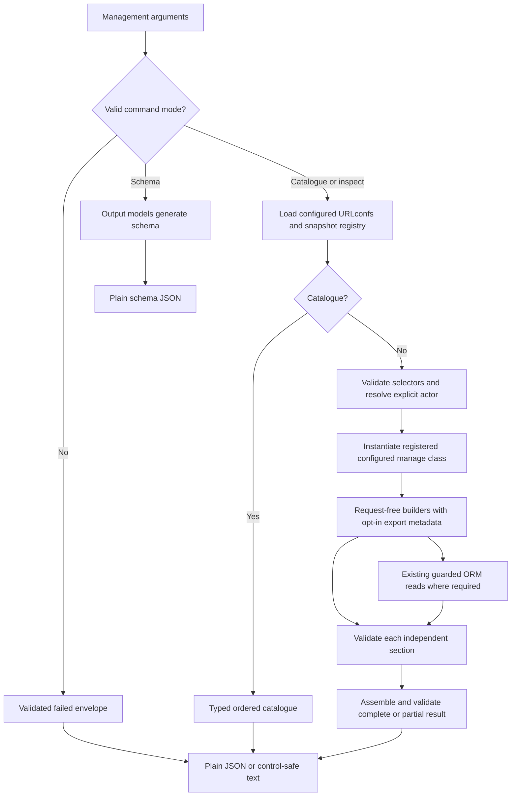

# Phase 06.36: ViewSet configuration CLI and versioned JSON contract (#371) — Research

**Researched:** 2026-11-15
**Domain:** Django management commands, shared diagnostic builders, Pydantic versioned output
**Confidence:** MEDIUM — official documentation checked with the research confidence seam; repository behavior read directly and a focused baseline executed.

<user_constraints>
## User Constraints (from CONTEXT.md)

The following decision/discretion and deferred sections are copied verbatim from the phase context. The complete issue snapshot remains authoritative for D-01–D-09, A-01–A-04 and acceptance 1–10. [CITED: .planning/phases/06.36-viewset-configuration-cli-and-versioned-json-contract-371/06.36-CONTEXT.md]

<!-- DATA_8a091fbd_START -->
## Implementation Decisions

### Selected approach and maintainability

Keep semantic fact collection in the configured manage class's existing request-independent builders.
Make narrow additions for complete values, stable metadata and permission collection without an actor;
mechanically convert facts to explicit Pydantic output models, then render text or JSON. Preserve builder
dictionary/list contracts, valid downstream subclasses, template extension points and normal page query costs.
Do not migrate all builders to Pydantic or create a second authorization/configuration evaluator.

### Approved D-01–D-09

This index preserves the design's decision numbers. Read the complete source snapshot; these summaries do
not replace its acceptance criteria or narrow the scope.

- **D-01 — Command and discovery:** `cv_manage_view --list`, a registered ViewSet name with optional view
  key, `--user`, `--as-json`, and generated `--schema`. Select by registered names, not model/import/URL
  selectors. Catalogue is required, cheap discovery; there is no bulk full-report mode.
- **D-02 — Report scope:** Identity, effective facts/provenance, presentation, all collected view defaults,
  permissions/holders/counts, optional actor, hierarchy/routes, ancestor/Guardian policies and scoped checks.
  Single-view selection filters view configuration and its route inventory; retain and explicitly label
  ViewSet-wide facts, permissions, checks and contextual policies. No Show defaults filter is required.
- **D-03 — Permissions:** No actor or implicit anonymous evaluation by default; live holder diagnostics
  still run. `--user` uses existing username-first resolution, permits inactive inspected actors and fails
  for an unknown user. Distinguish direct holders from effective actor grants, model/Resource global grants
  from Guardian object grants, and active-superuser meanings. Respect SHOW_USERS; when enabled include all
  collected users including overflow, without the page's 20-row display limit. Explicit selected-actor
  identity remains visible when holder details are hidden. This is not a concrete URL access decision.
- **D-04 — Access and routing:** The management environment authorizes command use. Browser manage mode,
  developer-group membership and selected-actor permissions are not admission gates. Do not dispatch the
  web view, fabricate privileges, fetch parent objects for invented coordinates, bypass reached diagnostic
  database guards or add a database-selection flag.
- **D-05 — Typed output:** Explicit Pydantic models own catalogue, inspection, known sections and structured
  errors. Validate before rendering; generate the schema from those same models. No unrestricted report
  dictionary/Any escape hatch. Preserve configured manage-class selection, including Guardian and project
  overrides. Missing full-value metadata is unavailable, never reconstructed from truncated legacy text.
- **D-06 — Complete bounded values:** Preserve supported JSON values and dotted class paths, distinguishing
  null, annotation-only/not-declared, unsupported and failed collection. No silent truncation, arbitrary
  instance stringification, descriptor/callable execution or object-graph traversal. Reuse existing bounded
  structured projections and keep resolution/provenance in the shared owner.
- **D-07 — Version and rendering:** JSON version 1, stable locale-independent machine fields/codes and
  documented compatibility rules; breaking type/meaning/removal changes require a new version. Consumers
  tolerate additive fields, but new closed-enum variants are not automatically compatible. JSON and schema
  stay plain and parseable under force-color, without command-owned stdout progress. Text follows Django
  color conventions and escapes terminal controls. Both formats preserve the same supported facts/errors.
  JSON/schema are the machine contracts; internal Python class names/import paths are not a public SDK.
- **D-08 — Failures:** Exit 0 for completed reports without unsilenced error/critical checks, 1 for completed
  reports with those findings, 2 for incomplete/input/runtime failures. Independent failed sections preserve
  good sections and report explicit errors, not fake empty results. Incomplete takes precedence over check
  findings. Run page-equivalent scoped checks with silencing; automatic global checks must not preempt
  the report. Handled JSON errors use one versioned result; pre-command startup/parser boundaries remain
  explicit. Preserve normal help/parser behavior and process termination.
- **D-09 — Read boundary:** Inspection may query live auth/permission and Guardian counts; catalogue/schema
  must not run those collectors. Built-in inspection does not call Resource item/list loaders, traces,
  handlers or dynamic labels. No Resource identifier or external-service connectivity is needed. Arbitrary
  startup code, overrides and custom checks are not sandboxed; add no cache/interception framework.

### Approved engineering defaults A-01–A-04

- **A-01 — Selection:** No selector/mode is usage error 2. List/schema are mutually exclusive and disallow
  positionals/user; as-json works with list and is redundant with schema. Load configured URLconf/includes,
  snapshot registered entries without holding the lock through diagnostics, and do not scan arbitrary
  packages. Catalogue fields are name, kind (model/guardian/resource), backing_class, parent and views;
  sort entries by name, retain registered view order, and allow an empty catalogue. Resource below Guardian
  remains resource. Schema needs neither registry discovery nor actor lookup after normal Django startup.
- **A-02 — Envelope:** version, kind, status, selection, data, errors; kinds catalogue/inspection and statuses
  complete/partial/failed. Catalogue data has entries. Inspection has identity plus facts, presentation,
  views, routes, hierarchy, ancestor_policy, permissions, checks and guardian. Typed section statuses are
  ok/error/not_applicable with data and error references. Errors include stable code, nullable section,
  human message, optional exception class and validation location where applicable; no tracebacks/raw objects.
  Exact nested names beyond those fixed by the design remain planner choices.
- **A-03 — Visibility and recovery:** Explicit actor states not_selected/selected and holder visibility
  hidden/shown. Hidden data is not a measured empty set. Resolve invalid users before holder diagnostics.
  Treat permissions as one section, without per-query recovery/retries. Validate sections independently and
  the assembled envelope; use a minimal valid failed envelope if assembly fails. Partial requires useful
  surviving data; failed means none usable. Both exit 2.
- **A-04 — Normalization:** Explicit native-JSON/class-path/unsupported/not-declared value records, with
  original type markers where needed. Ordinary tuples become arrays with tuple markers. Non-string-key
  mappings, sets, cycles, non-finite floats and arbitrary instances are unsupported unless an existing
  bounded projection owns them; never coerce mapping keys. Resolve known Django lazy translations only.
  Preserve ordering where meaningful and stabilize unordered output. Add numeric/machine check severity,
  not translated-label inference. No volatile timestamps or transactional-snapshot promise. Generated schema
  describes serialized complete/partial/failed results and is not itself an enveloped report.

### Acceptance and preservation

Map all ten source acceptance groups into executable work: discovery, inspection, permissions, access/routing,
Resources/static collection, contract/values, failures, renderer compatibility, regression/query costs and
delivery. Include long values, annotation-only declarations, inherited/fallback provenance, force-color,
English/German output, hidden and overflow holders, custom builders, Guardian generic/direct permission models,
no-actor nested guards, and failed sections. No Pydantic coercion may conceal malformed known fields.

Preserve page structures and model/Guardian/Resource behavior and #370's trace contract. Tests must prove no
extra diagnostic queries on normal page paths. Use multicore pytest for broad runs and fake Resources without
credentials/services. Document command modes, schema/version compatibility, statuses/exits, visibility,
live-query/startup limits, custom-builder participation and unsupported values. Add German translations and
changelog; any Breaking entry also updates docs/migrating-1.0.md. No application acceptance tests ran during
this discussion; source inspection is not acceptance evidence.

### Research and planning discretion

The approved design delegates exact helper placement, internal full-value plumbing, Pydantic class names,
nested wire fields not fixed above, test organization and precise rendering/translated wording. Keep these
bounded and explainable, preserve existing APIs and the Pydantic dependency floor, and report concrete conflicts
with evidence. Do not add a new approval round for decisions already approved in the issue.

<!-- DATA_8a091fbd_END -->

<!-- DATA_e8270b4c_START -->
## Deferred Ideas

The source design explicitly defers the JSON-consuming skill, whole-project dumps, configuration diff tooling,
a new permission engine, browser redesign, broad Pydantic builder migration, Resource-as-parent/object grants,
S3 integration, new write capabilities and unrelated changes to cv_access/cv_manage_group/crud_views_show.
No new deferred ideas or matching pending todos were introduced in this discussion.

<!-- DATA_e8270b4c_END -->
</user_constraints>

## Summary

Use the existing registered manage class as the collection owner, add command-only full-value/stable-source metadata, and adapt its dictionaries into explicit strict output models. Keep public builder calls at their existing two-argument shape. Instantiate the registered class without a request; do not dispatch it or create another registered subclass. Registration already constructs the configured subclass, and page context calls the request-independent builders separately. [VERIFIED: src/crud_views/lib/viewset/__init__.py:213-214; src/crud_views/lib/views/manage.py:840-865]

The largest risks are information already lost through display formatting, accidentally evaluating arbitrary objects while collecting those displays, and treating failed diagnostics as successful empty data. The existing display helpers call repr and truncate; the checks helper drops numeric severity after translating it. Capture facts at those exact owners before formatting. [VERIFIED: src/crud_views/lib/views/manage.py:292-305,651-705,714-746]

**Primary recommendation:** implement the explicit contract and preservation tests together, then narrow shared-builder changes, command orchestration, renderers and delivery. This follows the approved shared-builder approach and avoids a parallel policy evaluator. [CITED: .planning/phases/06.36-viewset-configuration-cli-and-versioned-json-contract-371/06.36-ISSUE-371.md, selected approach]

## Architectural Responsibility Map

This is a proposed ownership map within the approved design, not a new application tier. [CITED: phase context, Selected approach and maintainability]

| Capability | Primary tier/owner | Secondary | Rationale |
|---|---|---|---|
| Parse modes, select registry entries, resolve explicit actor | Management command | Existing URL loader and actor resolver | No HTTP admission or request fabrication |
| Resolve effective configuration, provenance, routes and policies | Existing core/Guardian builders | Existing ViewSet and ancestor helpers | One semantic source shared with pages |
| Query permission vocabulary, holders and counts | Existing core/Guardian builders | ORM and existing routing guard | No duplicate SQL or permission engine |
| Normalize bounded values and validate typed sections/envelope | Small command output module | Pydantic | Mechanical representation, no fallback/authorization logic |
| Render text and plain JSON/schema | Command renderer | stdlib JSON/Django styles | Both consume the same validated result |
| Page presentation and access | Existing web views/templates | Unchanged contexts | Command plumbing stays opt-in |

## Project Constraints (from AGENTS.md)

The user-supplied AGENTS instructions are represented by the checkout's CLAUDE.md. Apply its actionable directives: keep solutions bounded and explainable; preserve proven paths; prefer self-contained opt-in additions; account for hidden state, extra abstractions and query costs; use multicore pytest for broad selections; use cv_ prefixes for public view configuration, existing fixture conventions, 120-character lines and double quotes; retain hatchling and existing version tooling; pair every Breaking changelog entry with migration documentation before 1.0. The after-ship codebase-map refresh and phase-workspace convention remain workflow obligations when those operations occur; this research does neither. [CITED: CLAUDE.md]

No project skill directory or configured researcher skill was discovered by the bootstrap. Graph status reports no graph, so source reads are the architecture evidence. Research leaves application code, branches, configuration and state untouched. [VERIFIED: session discovery, agent-skills query and graphify status]

## Phase Requirements

The roadmap requirement field is prose, not formal requirement IDs. Use the approved numbered acceptance groups as traceability references, without inventing requirement identifiers. [CITED: .planning/ROADMAP.md, Phase 06.36; .planning/REQUIREMENTS.md]

| Approved acceptance group | Implementation support |
|---|---|
| 1 Discovery | URLconf traversal, registry snapshot, cheap catalogue/schema |
| 2 Inspection | All nine typed sections plus identity; selected-view filtering only for views/routes |
| 3 Permissions | No-actor support, existing resolver, visibility/overflow, direct/effective semantics |
| 4 Access/routing | Request-free registered class; preserve reached guards with None actor |
| 5 Resources/static collection | Existing Resource metadata; failing-loader/handler/label sentinels |
| 6 Contract/values | Strict nested models, pre-display metadata, bounded normalization, generated schema |
| 7 Failures | Independent section collection/validation, explicit errors, exit precedence |
| 8 Renderers/compatibility | Shared validated model, locale-independent codes, plain JSON, escaped text |
| 9 Regression/query costs | Existing dictionaries/subclasses and exact query assertions |
| 10 Delivery | Complete schema/version/CLI docs, custom-builder recipe, German catalogs/changelog |

The mapping above transcribes the approved acceptance scope, not an additional product specification. [CITED: .planning/phases/06.36-viewset-configuration-cli-and-versioned-json-contract-371/06.36-ISSUE-371.md, Acceptance and documentation]

## Standard Stack

| Component | Existing constraint / observed runtime | Use |
|---|---|---|
| Django | Declared "django (>=4.2.0)"; local focused runtime 5.2.19 | BaseCommand, resolver, checks, ORM, translations |
| Pydantic | Declared "pydantic (>=2.2.1)"; local runtime 2.14.3 | Explicit output models and generated serialization schema |
| typing-extensions | Declared "typing-extensions (>=4.7.1)" | Backported TypeAliasType for recursive JSON values |
| Python stdlib | Declared requires-python = ">=3.12"; local 3.12.3 | json, inspect, finite-number and cycle checks |
| Existing pytest stack | Local pytest 9.2.0, xdist 3.8.0 | Integration, query and contract tests |

Dependency declarations are verbatim from the opened source. Runtime versions were printed by the available test interpreter. [VERIFIED: pyproject.toml:25-34,70-83; session runtime probe]

No runtime package installation or version-floor increase is recommended. Registry observations on the research date: Pydantic latest 2.14.3 published 2026-11-05; floor 2.2.1 published 2023-08-18; Django latest 6.1.3 published 2026-11-03. These are registry currency observations, not an instruction to upgrade the repository. [VERIFIED: https://pypi.org/pypi/pydantic/json; https://pypi.org/pypi/pydantic/2.2.1/json; https://pypi.org/pypi/Django/json]

### Pydantic floor implementation path

Use a shared BaseModel base with strict validation on every nested model; ConfigDict strictness on an outer model alone does not make separately defined inner models strict. Use TypeAliasType from typing_extensions for the recursive JSON-only value type. Generate the output schema in serialization mode. These APIs are documented in the 2.2 documentation, and serialization schema mode is present in the v2.2.1 source tag. [CITED: https://docs.pydantic.dev/2.2/usage/strict_mode/; https://docs.pydantic.dev/2.2/usage/types/custom/; https://raw.githubusercontent.com/pydantic/pydantic/v2.2.1/pydantic/main.py]

Use standard-library json.dumps after model_dump(mode="json") for plain JSON. The v2.2.1 model_dump_json signature has no ensure_ascii parameter; do not copy newer convenience calls. Avoid newer named JSON helpers or Python type-alias syntax whose Pydantic-floor behavior has not been proved. [CITED: https://raw.githubusercontent.com/pydantic/pydantic/v2.2.1/pydantic/main.py]

**Execution task:** isolate a Pydantic 2.2.1 environment, keep the main cached test environment unchanged, and run the actual new model/schema tests there before release. Print the resolved version; test recursive values, strict rejection, union schema, complete/partial/failed serialization and round-trip validation. Source/API inspection is completed; floor execution has not been run and is not claimed. If installation fails, report the exact target/runtime failure and distinguish installation availability from API incompatibility. [CITED: phase context, dependency-floor preservation; research execution limitation]

## Package Legitimacy Audit

This audit covers existing declared dependencies needed by the isolated Pydantic-floor, build and installed-distribution verification paths. It introduces no runtime dependency and does not recommend upgrading to registry-latest versions. The existing declaration names are verbatim: "pydantic", "django", "typing-extensions", "python-box", "django-tables2", "django-filter", "django-crispy-forms", "crispy-bootstrap5", "django-fsm-2", "django-fsm-2-admin", "django-polymorphic", "django-ordered-model", "django-guardian", "nox", "pytest", "pytest-cov", "pytest-random-order", "pytest-mock", "pytest-django", "pytest-xdist", "lxml", "cssselect", "polib", "django-pipeline", and "hatchling". The ordinary nox installation selects the existing polymorphic/workflow/ordered/test extras. [VERIFIED: pyproject.toml:26-83,96-98; noxfile.py:20-28]

Ran `query package-legitimacy check --ecosystem pypi` for all 25 names above and for the already-installed external schema verifier `jsonschema`. The raw verdict is **SUS for every package**, with `exists=true` and `unknown-downloads`: the seam returned no weekly download observations for this ecosystem. Some additionally received `too-new` based on the latest release date, rather than the project's first release, or `no-repository` despite repository links in other PyPI project-URL keys. Preserve those raw verdicts; they are not evidence that these existing dependencies are newly created or malicious. [VERIFIED: session package-legitimacy output and direct PyPI JSON metadata reads]

**Warning applying to every package row:** [WARNING: flagged as suspicious — verify before using.] The warning records the seam result, not a newly discovered concrete security defect. Existing dependency use for authorized isolated verification remains within scope; missing download metadata alone does not introduce another approval checkpoint. Retain existing constraints/resolved versions, pin Pydantic 2.2.1 for its specific floor probe, and print the actual installed versions. [VERIFIED: session seam output; CITED: authorized planning scope and developer authorization instructions]

All registry columns below refer to **PyPI**. Age is reported as the earliest available release year observed in its JSON metadata, not a guaranteed project founding date. Downloads were **unavailable in the seam for all rows**. Source repositories are registry-declared links, not a code audit. [VERIFIED: https://pypi.org/pypi/pydantic/json and corresponding /pypi/{package}/json responses for the declared package set]

| Package | Registry | Earliest observed release | Downloads | Source repo (GitHub) | Raw verdict | Disposition |
|---|---|---|---|---|---|---|
| pydantic | PyPI | 2017 | Unavailable | pydantic/pydantic | SUS | Existing; floor probe pins 2.2.1 |
| Django | PyPI | 2010 | Unavailable | django/django | SUS | Existing; retain supported series |
| typing-extensions | PyPI | 2017 | Unavailable | python/typing_extensions | SUS | Existing constraint retained |
| python-box | PyPI | 2017 | Unavailable | cdgriffith/Box | SUS | Existing constraint retained |
| django-tables2 | PyPI | 2011 | Unavailable | jieter/django-tables2 | SUS | Existing constraint retained |
| django-filter | PyPI | 2009 | Unavailable | carltongibson/django-filter | SUS | Existing constraint retained |
| django-crispy-forms | PyPI | 2011 | Unavailable | django-crispy-forms/django-crispy-forms | SUS | Existing constraint retained |
| crispy-bootstrap5 | PyPI | 2020 | Unavailable | django-crispy-forms/crispy-bootstrap5 | SUS | Existing constraint retained |
| django-fsm-2 | PyPI | 2024 | Unavailable | django-commons/django-fsm-2 | SUS | Existing workflow extra |
| django-fsm-2-admin | PyPI | 2024 | Unavailable | coral-li/django-fsm-2-admin | SUS | Existing workflow extra |
| django-polymorphic | PyPI | 2011 | Unavailable | django-commons/django-polymorphic | SUS | Existing polymorphic extra |
| django-ordered-model | PyPI | 2011 | Unavailable | django-ordered-model/django-ordered-model | SUS | Existing ordered extra |
| django-guardian | PyPI | 2010 | Unavailable | django-guardian/django-guardian | SUS | Existing test/Guardian dependency |
| nox | PyPI | 2018 | Unavailable | wntrblm/nox | SUS | Existing test tooling |
| pytest | PyPI | 2010 | Unavailable | pytest-dev/pytest | SUS | Existing test tooling |
| pytest-cov | PyPI | 2010 | Unavailable | pytest-dev/pytest-cov | SUS | Existing test tooling |
| pytest-random-order | PyPI | 2016 | Unavailable | jbasko/pytest-random-order | SUS | Existing test tooling |
| pytest-mock | PyPI | 2014 | Unavailable | pytest-dev/pytest-mock | SUS | Existing test tooling |
| pytest-django | PyPI | 2012 | Unavailable | pytest-dev/pytest-django | SUS | Existing test tooling |
| pytest-xdist | PyPI | 2010 | Unavailable | pytest-dev/pytest-xdist | SUS | Existing test tooling |
| lxml | PyPI | 2007 | Unavailable | lxml/lxml | SUS | Existing test dependency |
| cssselect | PyPI | 2012 | Unavailable | scrapy/cssselect | SUS | Existing test dependency |
| polib | PyPI | 2006 | Unavailable | izimobil/polib | SUS | Existing test dependency |
| django-pipeline | PyPI | 2011 | Unavailable | jazzband/django-pipeline | SUS | Existing test dependency |
| hatchling | PyPI | 2022 | Unavailable | pypa/hatch (backend) | SUS | Existing declared build backend |
| jsonschema | PyPI | Not collected | Unavailable | python-jsonschema/jsonschema | SUS | Use existing system 4.10.3; no new installation proposed |

**Packages removed due to SLOP:** none; no SLOP verdict was returned. **Packages flagged SUS:** all rows, for the metadata limitations explained above. No package is relabeled OK or granted a package-legitimacy VERIFIED claim merely from registry existence. The Pydantic/Django official API references and jsonschema official validator documentation were already read; the other names originate in the repository's existing dependency declaration, not generated package suggestions. [VERIFIED: session seam output; CITED: primary documentation in Standard Stack and Don't Hand-Roll]

The requested ecosystem CLI check was attempted with `python3 -m pip index versions`; the system interpreter returned `/usr/bin/python3: No module named pip`. Direct HTTPS reads of the correct PyPI JSON registry supplied the existing package/version/source observations instead; no pip installation was needed. Node postinstall checks do not apply to these Python distributions. This bounded audit does not cover every transitive dependency or claim artifact/signature integrity. It found no missing declared package or concrete installation blocker; the outstanding Pydantic 2.2.1 runtime probe remains as already documented. [VERIFIED: session pip-index failure and PyPI metadata probes]

## Architecture Patterns

### Data flow



This is the recommended flow derived from D-01–D-09 and A-01–A-04. No Resource service, handler execution, tracing or browser request is introduced. [CITED: phase issue snapshot]

### Component responsibilities and proposed file targets

New filenames below are proposed targets, not claims that files already exist. Existing owners were opened/read this session. [CITED: phase context, Research and planning discretion]

| Owner / proposed target | Responsibility and evidence |
|---|---|
| Existing src/crud_views/lib/views/manage.py | Optional actor; opt-in full values/source/severity in existing branches; public builder shape preservation |
| Existing src/crud_views_guardian/lib/views.py | Same opt-in mode for Guardian synthetic rows/checks; inherit no-actor support without changing aggregate semantics |
| Existing src/crud_views/lib/ancestor_db.py | Prefer no modification; prove None actor still reaches manager/table guards |
| Existing src/crud_views/checks.py | Reuse URL traversal; if extracting a throwing loader, preserve existing boolean readiness wrapper |
| Proposed src/crud_views/lib/manage_report.py | Explicit wire types, bounded normalization and simple section adapters |
| Proposed src/crud_views/management/commands/cv_manage_view.py | Arguments, discovery, selection, per-section orchestration, rendering/exits |
| Proposed tests/test1/test_manage_command.py | Modes, selectors, configured classes, errors, exits, output |
| Proposed tests/test1/test_manage_report.py | Strict contract/schema/normalization, full values, malformed sections |
| Proposed tests/test1/test_manage_export.py | Shared-builder metadata and exact page preservation |
| Existing manage/theme/resources/guardian reference documents | CLI schema/version contract and updated builder participation |
| Existing core/Guardian German catalogs; CHANGELOG.md | New human copy and release entry |

Keep this organization small. Split rendering into a separate module only if the implemented command becomes difficult to follow; do not introduce a plugin registry, collector framework or generic dependency scheduler. [CITED: CLAUDE.md, maintainability rule]

### Configured class and selection

Registration uses "base = self.get_manage_view_class()" and constructs "AutoManageView" with the supplied ViewSet. get_manage_view_class honors explicit and global configuration; get_all_views returns the registered mapping. Instantiate that registered manage class, which already carries the correct cv_viewset, and invoke its public builders with the supplied ViewSet/actor. [VERIFIED: src/crud_views/lib/viewset/__init__.py:206-238,364-379]

Check selected view membership in the actual registered mapping. Do not use get_view_class to validate a selector: its existing compatibility alias maps "list" to "card", whereas this command selects registered keys. [VERIFIED: src/crud_views/lib/viewset/__init__.py:375-379, verbatim "list" and "card"]

The current URL-loading helper walks Django URLResolver objects and returns False on an import exception. Reusing False as catalogue success would lose the command's completeness guarantee. Prefer a small shared raising traversal with the existing helper retaining its boolean wrapper; alternatively fail the command on False with a clear collection error. Do not run check_ancestor_declarations just to load URLs. [VERIFIED: src/crud_views/checks.py:172-212]

Keep registry locks only while copying entries; sort catalogue names afterwards. Schema mode must branch before URL loading or actor resolution. Classify Resource first; a Guardian ancestor is not evidence that the leaf uses Guardian object permissions. Preserve extension independence rather than unconditionally importing Guardian from the new core command. [CITED: issue snapshot A-01; VERIFIED: src/crud_views/lib/viewset/__init__.py:224-238]

### Optional actor without weakening routing

The core permission builder currently inserts "actor": self.get_manage_actor_row(viewset, user). It already collects "users": users[:20] and "users_overflow": users[20:] in the same call. Make only that actor call conditional on a supplied actor; leave the guard and holder queries in place. Join visible/overflow collections in the output adapter, without another query. [VERIFIED: src/crud_views/lib/views/manage.py:192-235]

The nested guard checks actor state only when an actual model actor exists, but always checks every reached table manager. Its loop is independent of hints. Therefore None already preserves manager/router checks; do not add an early return for missing user. The existing Guardian override invokes the guard with provider="guardian" before core diagnostics and aggregates configured generic/direct grant models. [VERIFIED: src/crud_views/lib/ancestor_db.py:141-170; src/crud_views_guardian/lib/views.py:405-477, verbatim provider="guardian"]

Actor resolution is username-first, catches typed-username conversion errors, then tries converted primary key; it does not filter inactive actors. Reuse the exported resolver and resolve an invalid user before any holder collector. Do not call the trace runner. [VERIFIED: src/crud_views/lib/access_trace_runner.py:178-193; src/crud_views/lib/access_trace.py:127-130]

For Guardian output, the fixed helper projection is verbatim {"policy": "strict", "accept_global_perms": False, "use_groups": True}. Preserve the distinction between this effective actor helper and direct holder counts; do not infer object access from a view's fallback flag. [VERIFIED: src/crud_views_guardian/lib/viewset.py:11-13; src/crud_views_guardian/lib/views.py:410-477,479-483]

### Opt-in full values and machine metadata

Recommended implementation: one explicit per-command-instance export mode, default off, with metadata produced on rows at the existing resolution point. Add no keyword argument to public builder calls, so existing overrides with (viewset, user) continue to dispatch normally. Document how overrides retain metadata from super() or supply it when replacing a known row. This is an engineering recommendation under the approved opt-in allowance. [CITED: issue snapshot D-05 and Source evidence and implementation boundaries]

Normal page output must remain exactly unchanged, including row key sets. In export mode, capture raw effective value, missing-value state, declaration/default state, stable source identifier, declaring class/setting when known, and any separately declared empty value. Do not append metadata on normal calls merely because templates ignore it. [CITED: phase context, Acceptance and preservation; VERIFIED: src/crud_views/lib/views/manage.py:299-340,651-705]

Touch all actual producers: ViewSet facts, Presentation rows/buttons, ordinary view entries, Guardian-added entries, and core/Guardian check messages. Guardian currently appends display-only "guardian_mixin" and "effective_policy" rows with translated "effective" sources; they need export metadata too. [VERIFIED: src/crud_views_guardian/lib/views.py:485-538, verbatim "guardian_mixin", "effective_policy", "effective"]

**Do not merely add raw_value after repr.** In command mode, avoid arbitrary repr/str during the display phase as well as normalization. Both current display functions can execute custom repr; verbose names explicitly call str. Preserve legacy page behavior but make export formatting type-bounded. Test values whose __repr__, __str__, descriptor and callable hooks raise. [VERIFIED: src/crud_views/lib/views/manage.py:292-297,333-334,687-695]

Record source codes at the branches that already choose effective values. The existing branches distinguish project declaration from effective fallback; do not infer source by translated text or duplicate the MRO/fallback logic in the converter. Existing _project_cv_declarations excludes generated context-action assignments. [VERIFIED: src/crud_views/lib/views/manage.py:651-705; src/crud_views/lib/check.py:309-326]

For valid legacy replacement builders lacking complete-value metadata, report the affected section as unavailable with a structured error; preserve independently usable sections. Do not guess full values from display strings or represent missing metadata as null/unsupported. An override preserving the new metadata remains fully usable. This conservative section-level boundary follows A-03/A-04; document it with a working customization example. [CITED: issue snapshot D-05, A-03, A-04]

### Bounded normalization

Normalize only native scalars, ordinary lists/tuples/string-key mappings, and Python classes; retain tuple origin metadata and class-path markers. Detect cycles with an active-container stack so repeated non-cyclic values are not mislabeled cycles. Reject non-finite numbers before serialization, never stringify mapping keys, and never traverse arbitrary instance attributes. Reuse only already-owned button/parent/policy projections. These are proposed algorithms implementing the approved value boundary. [CITED: issue snapshot D-06 and A-04]

Distinguish known lazy translations from arbitrary Django Promise objects. Django lazy wraps any callable and both repr and str invoke it. Exact proxy types produced by the stable gettext_lazy/pgettext_lazy wrappers can provide a narrow recognized case; do not blanket-force every Promise. Cover the actual shipped translation forms and document unsupported deferred/composite values. [VERIFIED: local Django 5.2.19 django/utils/functional.py:77-119; django/utils/translation/__init__.py:111-164]

Avoid treating every Pydantic model as serializable configuration. ParentViewSet declares "name", "attribute", "pk_name", "many_to_many_through_attribute"; its "viewset" property resolves the registry. Use a bounded owned projection, never traverse that property/object graph. [VERIFIED: src/crud_views/lib/viewset/parentviewset.py:13-21,47-54]

### Explicit typed schema and partial results

Use two explicit result-family models (catalogue/inspection), a discriminated union at the output root, concrete typed section payloads, and bounded JSON only inside dynamic configuration values. A short generic section wrapper is acceptable if each inspection field supplies a concrete payload type; do not replace the known sections with an arbitrary mapping. The fixed envelope/section vocabularies are quoted here verbatim: "version", "kind", "status", "selection", "data", "errors"; "catalogue", "inspection"; "complete", "partial", "failed"; "ok", "error", "not_applicable". [VERIFIED: .planning/phases/06.36-viewset-configuration-cli-and-versioned-json-contract-371/06.36-ISSUE-371.md:240-266]

Keep known producer fields strict. Do not pre-coerce malformed booleans/counts through bool(), int() or str(). Normalize identity values only through an explicit supported scalar identity policy; UUID user IDs need a documented string projection rather than arbitrary-instance stringification. Recommended consumer behavior is to ignore unknown additive fields, so do not accidentally publish additionalProperties:false everywhere while promising old schema consumers can accept additions. Keep closed enum vocabularies fixed within version 1. [CITED: issue snapshot D-05–D-07, A-02, acceptance 6]

Collect and validate sections separately; catch Exception at the section boundary, not BaseException. Permissions stay one unit, without retrying subqueries. Never wrap all diagnostics in one atomic block: a database exception must not prevent unrelated successful collection through a broken transaction. Validate the assembled envelope, with a minimal failed result as the last resort. Preserve successful scoped check messages as data, even when their numeric level causes exit 1. [CITED: issue snapshot D-08 and A-03; implementation recommendation]

Compute exit status after validation: incomplete/failed → 2; otherwise any unsilenced error/critical check → 1; otherwise 0. The stock helper already calls is_silenced(); retain that filtering and capture message.level before translated severity formatting. Count remains the original count of ViewSet check objects, not the number of messages. [VERIFIED: src/crud_views/lib/views/manage.py:714-746]

### Command rendering and boundaries

Follow the existing command convention of requires_system_checks = [] to suppress global checks. Use optional positionals and plain recognized flags, then validate mutually exclusive combinations inside handle so JSON can represent command-owned usage failures. Preserve normal parser/help behavior for syntax it rejects before handle. [VERIFIED: src/crud_views/management/commands/cv_access.py:181-213, verbatim "requires_system_checks: ClassVar[list] = []"; CITED: https://docs.djangoproject.com/en/4.2/howto/custom-management-commands/]

Emit exactly one fully serialized stdout document, then raise SystemExit for nonzero report exits; do not raise CommandError after printing a structured result. Django's execute writes a truthy handle return again, so return None after an explicit write. Conflicting built-in color flags are handled before handle; document this as a framework execution boundary alongside startup/parser failures. [VERIFIED: local Django 5.2.19 django/core/management/base.py:439-474]

JSON/schema must bypass styling even when force-color is set. For text, escape every dynamic scalar/key/label/error before applying intentional Django color. The existing _text uses isprintable and JSON escapes for non-printable characters; reproduce this small bounded pattern without refactoring cv_access merely to share it. [VERIFIED: src/crud_views/management/commands/cv_access.py:36-38,159-178]

## Don't Hand-Roll

| Problem | Use existing owner | Reason |
|---|---|---|
| Actor lookup | resolve_trace_user | Username/PK precedence and typed-field fallback already implemented |
| Permission semantics/counts | Configured manage builders | Core, Resource and Guardian distinctions already live there |
| Defaults and source resolution | Existing field/view branches | Declaration provenance differs from fallback source |
| Scoped checks | get_manage_checks | Includes per-ViewSet collectors and silencing |
| Output schema | Pydantic serialization schema | Same model owns emitted results and schema |
| Independent schema validation | Available jsonschema validator | Do not write a partial JSON Schema interpreter |

These choices follow the source owners documented above. jsonschema's official API validates both schema and instances; it is available in the system interpreter for local verification, though absent from the cached pytest environment. [CITED: https://python-jsonschema.readthedocs.io/en/stable/validate/; VERIFIED: session import/version probes]

## Common Pitfalls

| Pitfall | Prevention / test |
|---|---|
| Ordinary pages acquire extra keys/queries | Compare exact pre-existing dictionaries and retain exact cold query assertions |
| Export retains truncated display as canonical value | Long string/list tests; verify before-display raw capture |
| Unsupported objects execute during collection | Raising repr/str/descriptor/callable/lazy sentinels |
| No actor disables table restrictions | Router rejection tests with None, core and Guardian direct/generic grant models |
| Missing raw metadata fabricated as null | Explicit affected-section error and surviving sections |
| Missing user becomes no-actor success | Actor lookup before holder diagnostics; unknown-user failed result |
| User visibility leaks through overflow or superuser names | Hidden/shown plus >20 users and independently visible selected actor |
| Translated source/severity controls machine behavior | Compare English/German machine fields and numeric check levels |
| Schema tests only revalidate Pydantic | Also validate actual emitted JSON against generated JSON Schema |
| Discovery import errors become empty catalogue | Failing included URLconf fixture; empty completed URLconf remains success |
| Selected view filters ViewSet-wide evidence | Filter only views/routes and explicitly label the remaining scope |
| Broad compatibility claims from a latest-only run | Dedicated floor and supported-Django checks with observed-version receipts |

These pitfalls are derived from the read source and the approved acceptance groups, not claims of new defects in completed phases. [CITED: phase issue snapshot acceptance 1–9; VERIFIED: source owners cited above]

## Code Examples

API pattern, not a new project SDK or final field naming. The snippet uses documented Pydantic 2.2 primitives; the same recursive value/strict boolean pattern was exercised locally on 2.14.3. [CITED: https://docs.pydantic.dev/2.2/usage/types/custom/; https://docs.pydantic.dev/2.2/usage/strict_mode/]

```python
import json

from pydantic import BaseModel, ConfigDict
from typing_extensions import TypeAliasType

JsonValue = TypeAliasType(
    "JsonValue",
    dict[str, "JsonValue"] | list["JsonValue"] | str | int | float | bool | None,
)

class WireModel(BaseModel):
    model_config = ConfigDict(strict=True)

class ExampleValue(WireModel):
    value: JsonValue
    declared: bool

result = ExampleValue(value={"items": [None, True, 1]}, declared=True)
serialized = json.dumps(result.model_dump(mode="json"), ensure_ascii=True, allow_nan=False)
schema = ExampleValue.model_json_schema(mode="serialization")
```

The normalization boundary must reject unsupported objects/cycles/non-finite values before this model sees them. The example is deliberately limited to the library API; implement explicit value markers, section models and envelopes from the approved contract rather than treating ExampleValue as the report. [CITED: issue snapshot D-05/D-06/A-04]

## State of the Art

For this phase the relevant compatibility distinction is the project's declared floor versus the installed newer Pydantic, not replacing the stack. Serialization schema mode and strict BaseModel are available in floor-era docs; newer dump convenience keywords must not be assumed. Existing manage dict contracts remain public, while the new JSON/schema become the machine interface and model import paths remain internal. [CITED: Pydantic v2.2.1 source above; phase issue snapshot D-05/D-07]

## Environment Availability

| Dependency | Observed availability | Fallback / next step |
|---|---|---|
| Cached Python/Django test runtime | Python 3.12.3, Django 5.2.19, Pydantic 2.14.3, pytest 9.2.0, xdist 3.8.0 | Use source PYTHONPATH explicitly |
| Cached other Django sessions | 4.2 and 6.0 session directories present | Probe resolved versions before their execution; do not claim tested here |
| Schema validator | System python3 has jsonschema 4.10.3; cached pytest interpreter lacks it | Validate emitted artifacts with system interpreter; make CI verification availability explicit |
| uv | Available | Isolated floor probe; preserve existing cached environment |
| msgfmt | Not found by command lookup | Existing polib test dependency can compile catalog artifacts where needed |
| Context7 / ctx7 | No callable MCP or CLI found | Official documentation via web fallback, completed |
| Resource external service | Not required | Fake Resource fixtures with raising loaders |

Availability comes from this session's command/import probes; no new packages were installed. No external service blocks implementation. Independent JSON Schema checking must not silently skip when a verifier is missing; plan a declared test/verification environment or a separate artifact-validation step. If introducing any test-only dependency, run the package legitimacy gate before installation; no such addition is prescribed here. [VERIFIED: session availability probes; CITED: issue snapshot acceptance 5–6]

## Validation Architecture

### Existing evidence and runnable commands

The focused source baseline passed **165 tests in 3.14 seconds**, using four workers. This is regression-foundation evidence only; the new command has not been implemented or accepted. The selection includes the exact cold model/Guardian query baseline. [VERIFIED: session pytest output]

```bash
PYTHONPATH=src:. .nox/tests-3-12-django-5-2/bin/python -m pytest tests/test1/test_resource_manage.py tests/test1/test_manage_provenance.py tests/test1/test_manage_checks.py tests/test1/test_manage_facts.py -n 4 -q
```

Preserve verbatim the existing query assertion "assert len(queries) == (21 if fixture == \"cv_guardian_author\" else 9)" and its table-count comparison/cache restoration. Do not replace this with an upper bound. [VERIFIED: tests/test1/test_resource_manage.py:49-89]

Test configuration currently uses "addopts = \"--strict-markers\"" and pytest_configure supplies the Django project. Tests must run with the same configuration instead of inventing another settings module. [VERIFIED: pyproject.toml:145-146; tests/test1/conftest.py:43-99]

### Proposed acceptance → tests

Paths below are proposed additions. Commands become runnable once the named tests exist; existing baseline/regression commands are runnable now. [CITED: phase context, test-organization discretion]

| Acceptance | Test target / type | Required assertions |
|---|---|---|
| 1 | test_manage_command.py, integration | URLconf-only registration; includes; empty; disabled manage; sorted names; view order; no holder/schema lookup |
| 2 | test_manage_command.py, integration | Full/selected view; nine sections/defaults; retained ViewSet-wide scope; configured core/Guardian override |
| 3 | test_manage_command.py, database | None actor; collision username wins; inactive/unknown user; direct/effective grants; hidden/show/overflow |
| 4 | test_manage_export.py, database | No web gates; no fabricated request; None/selected actor routing failures; direct/generic Guardian tables |
| 5 | test_manage_export.py, integration | Standalone/nested Resource; empty maps; loaders/handlers/traces/dynamic labels fail if invoked |
| 6 | test_manage_report.py, unit + schema | Native types, >200 values, tuples, classes, undeclared/null/unsupported, cycles/non-finite/bad keys; strict nested errors |
| 7 | test_manage_command.py, integration | Exit 0/1/2; silencing; one failed section retains others; incomplete beats check errors; no BaseException swallowing |
| 8 | test_manage_command.py + test_manage_export.py | Text/JSON/page parity; en/de machine stability; force-color schema/JSON parseable; controls; valid replacement/super builders |
| 9 | Existing manage/resource/trace tests | Exact row key sets; 9/21 query/table counts; public builder and trace preservation |
| 10 | Existing docs/locale tests plus command examples | Full schema, compatibility/status/exits/limitations; German strings; changelog/migration rule |

Proposed per-task command:

```bash
PYTHONPATH=src:. .nox/tests-3-12-django-5-2/bin/python -m pytest tests/test1/test_manage_command.py tests/test1/test_manage_report.py tests/test1/test_manage_export.py -n 4 -q
```

Existing broad regression command:

```bash
PYTHONPATH=src:. .nox/tests-3-12-django-5-2/bin/python -m pytest tests/test1/test_manage*.py tests/test1/test_resource_manage*.py tests/test1/test_ancestor_manage.py tests/test1/test_access_trace_command.py tests/test1/test_manage_access_trace.py tests/test1/test_access_trace_manage.py -n 4 -q
```

Final source regression commands, after implementation:

```bash
PYTHONPATH=src:. .nox/tests-3-12-django-5-2/bin/python -m pytest tests -n 4 -q
CV_ACCESS_RECORD_REQUESTS=1 PYTHONPATH=src:. .nox/tests-3-12-django-5-2/bin/python -m pytest tests -n 4 -q
```

The recorder switch is verbatim "CV_ACCESS_RECORD_REQUESTS" with enabled value "1"; existing nox also performs full normal and recorder runs on the installed distribution. Source checks do not substitute for that packaging gate. [VERIFIED: tests/conftest.py:8-21; noxfile.py:20-57]

### Wave 0 gaps and sampling

- Add the three proposed focused test modules alongside their implementation tasks; reuse current fixtures rather than a new harness.
- Add generated-schema validation of actual complete catalogue, complete inspection, partial inspection and failed result fixtures. Also include malformed-fixture rejection; Pydantic validation alone does not execute the generated schema.
- Add the isolated Pydantic floor execution task described above, including observed dependency versions.
- Exercise selected/no-actor nested routing with failure sentinels before running successful permission diagnostics.
- Compare en/de machine projections independently of translated labels; compare text semantically with validated JSON, not merely a few headings.
- Run focused tests per task, existing regression selection per integration wave, and full source/installed-distribution checks at the final phase gate. Repeat only for source changes or unresolved failures.

These are required test gaps inferred from the approved acceptance list; no new test framework is needed. [CITED: issue snapshot acceptance 1–10; VERIFIED: session baseline]

## Security Domain

Security enforcement is enabled in project configuration. Use ASVS **5.0.0** numbering explicitly; the generic research template's old category numbers should not be presented as current ASVS labels. The official 5.0.0 source names V1 Encoding and Sanitization, V2 Validation and Business Logic, V6 Authentication, V7 Session Management, V8 Authorization, V11 Cryptography, V14 Data Protection, and V16 Security Logging and Error Handling. [CITED: https://raw.githubusercontent.com/OWASP/ASVS/v5.0.0/5.0/docs_en/OWASP_Application_Security_Verification_Standard_5.0.0_en.flat.json; VERIFIED: .planning/config.json, "security_enforcement": true]

| Category | Applies | Phase control |
|---|---|---|
| V1 Encoding and Sanitization | Yes | Plain JSON; escape text controls before intentional color |
| V2 Validation and Business Logic | Yes | Strict typed known fields, bounded values, honest incomplete states |
| V6 Authentication / V7 Session Management | Preservation only | CLI does not create sessions or impersonate; existing pages remain gated |
| V8 Authorization | Yes | Management environment admission; diagnostic database restrictions retained |
| V11 Cryptography | No new cryptographic work | No new cryptographic protocol or implementation |
| V14 Data Protection | Yes | SHOW_USERS respected, selected actor distinction, no object-graph/raw-object export |
| V16 Security Logging and Error Handling | Yes | Structured errors without traceback/raw validation inputs; no false empty success |

This is a scoped applicability assessment, not an ASVS certification or a new authentication policy. [CITED: issue snapshot D-03/D-04/D-06/D-08/D-09]

| Threat / STRIDE | Mitigation to prove |
|---|---|
| Terminal control injection / Tampering | Escape dynamic keys, labels, values and exception/check text |
| Hidden-holder disclosure / Information disclosure | Hidden users and superuser names absent, not reconstructed from other rows |
| Router bypass / Elevation of privilege | Preserve manager and actor-hinted guards; no alternate alias retry |
| Arbitrary value execution / Tampering | No repr/str/evaluation of unknown values, even before normalization |
| Misleading zero grants / Repudiation | Failed permissions section has explicit error, surviving sections retained |
| Unbounded object traversal / Denial of service | Only supported containers; cycle detection; no instance traversal |

The threat mapping follows the approved read and visibility boundaries. [CITED: issue snapshot D-03–D-09 and A-04]

## Assumptions Log

No unverified factual compatibility claim is promoted to a locked decision. Pydantic-floor runtime verification remains unexecuted, rather than being asserted supported or unsupported from missing metadata. Proposed filenames, helper placement and strict schema organization are engineering recommendations explicitly delegated by the context. [CITED: phase context, Research and planning discretion]

## Open Engineering Choices

These do not reopen approved product scope:

1. **Opt-in plumbing:** choose a small command-instance collection switch and row metadata shape; public builder calls and default dictionaries stay unchanged. Ensure exceptions cannot leave reused instance mode enabled.
2. **Missing legacy metadata:** implement explicit affected-section unavailability, with a working super()-preserving override recipe and malformed-known-field coverage.
3. **Schema verification environment:** local system jsonschema is available; specify repeatable CI availability without hand-rolling a schema validator or adding a runtime dependency.
4. **Floor proof:** run the actual output contract under Pydantic 2.2.1 in isolation. The researched APIs are floor-era; actual target-runtime execution is still required.
5. **Known lazy translations:** narrowly recognize approved translation proxies and document unsupported arbitrary Promise/deferred forms; test that arbitrary lazy functions are not evaluated.

These choices derive from the specific source gaps above and approved discretion. No new user approval round is needed to resolve them within scope. [CITED: phase context, Research and planning discretion]

## Sources and Metadata

- Approved full issue/context, roadmap phase 06.36 and requirements/state summaries: scope and completed #372 baseline.
- Canonical structured-manage, access-trace and Resource-manage designs and phase contexts: preserve settled owners and distinguish historical exclusions from shipped Resource support.
- Current manage/theme/resources/guardian reference sections: public builder/page contracts.
- Opened source owners and line ranges throughout this file: collector behavior and integration evidence.
- Pydantic 2.2 docs and v2.2.1 tag: recursive aliases, strict validation and serialization schema.
- Django 4.2 command docs plus installed 5.2.19 source: framework command boundaries.
- Official OWASP ASVS 5.0.0 source: version-qualified security applicability.
- Official jsonschema validation documentation: independent schema validation.

Research-plan seam selected Context7 for library questions; no Context7 tool/CLI was available, so official web documentation was used. classify-confidence with provider websearch and verified returned MEDIUM; digests were cached. Registry latest versions were observed, not substituted for project constraints. The only pytest run was the reported 165-test baseline. No new feature acceptance, floor execution, full suite, publication or commit is claimed by this researcher. [VERIFIED: session research-plan/classify-confidence/store and pytest outputs]

**Confidence:** Standard stack MEDIUM (official floor APIs checked, floor runtime pending); architecture MEDIUM (direct source reads and preservation baseline); pitfalls MEDIUM (source gaps plus approved acceptance).
**Valid until:** recheck if shared builders, the approved issue or dependency floor changes; otherwise 2026-12-15.

