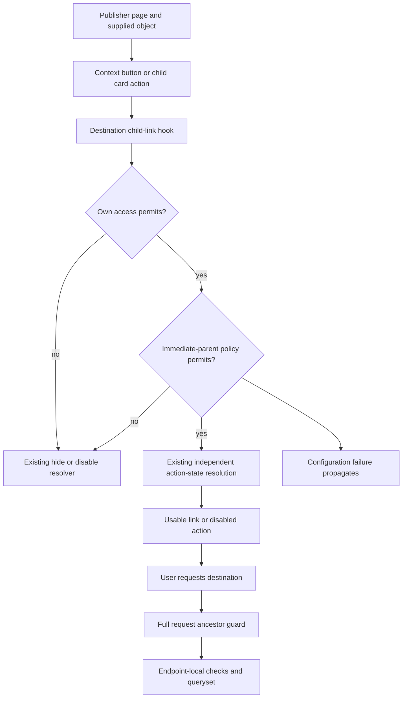

# Phase 06.39: Immediate-parent permission checks for child links (#380) - Research

**Researched:** 2026-11-18
**Domain:** Django server-rendered child-link authorization; core/Guardian cooperative inheritance
**Confidence:** MEDIUM — official-doc lookup tier; implementation findings are directly source-grounded and the defect was reproduced.

<user_constraints>
## User Constraints (from CONTEXT.md)

Source: approved phase context, reproduced verbatim below. [VERIFIED: 06.39-CONTEXT.md, Implementation Decisions and Deferred Ideas]

<!-- DATA_8f31b62e_START -->
### Locked Decisions

### Destination-owned access and bounded scope

- **D-01 — Existing hook:** Keep the decision in `_cv_child_link_has_access(user, parent_obj)`. Honor the
  destination's own `cv_has_access` result first. An own-access denial short-circuits the parent check.
- **D-02 — Parent policy:** After own access passes, use the existing `_immediate_parent_access` policy with
  the supplied parent. The destination determines the operation requirement; preserve configured parent providers,
  permission mappings and Guardian fallback, including provider `none`. Do not substitute a hard-coded parent
  `view` check for the existing operation policy.
- **D-03 — Both renderers:** `ChildContextButton.get_context()` and the child-action branch of
  `cv_get_card_action_data()` continue to call the destination hook and apply their existing hide/disable settings.
  Do not add a second gate in either renderer.
- **D-04 — Bound:** Consult only the immediate parent already supplied to the child link. Request authorization
  remains authoritative for the full ancestor chain. A visible link can still be denied by a farther ancestor.
  Sibling links, higher-ancestor rendering checks and changes to `cv_action_enabled` are excluded.

### Guardian compatibility and maintainability

- **D-05 — Check once:** Inspect both Guardian collection and create paths before moving the gate to core.
  Shipped Guardian paths already perform parent checks; an allowed link must not gain a duplicate parent check.
  Preserve actor admission, custom access denials and the tested standalone Guardian queryset behavior.
- **D-06 — Preserve existing paths:** Ordinary row actions and top-level behavior remain unchanged. Keep the fix
  bounded and understandable under the project's developer-maintainability rule. This phase does not revive the
  retired integrated URL/access design or introduce a general navigation/access framework.

### Acceptance and measured cost

- **D-07 — Permanent reproduction:** Reproduce the original case on `main` with permanent tests: a user has
  Book `view` and Publisher `change`, lacks Publisher `view`, and can open a Publisher page such as update.
  Both child context buttons and child card actions to Books must hide or disable according to configuration;
  the corresponding Books list GET must return 403.
- **D-08 — Positive case:** Grant the required Publisher permission and verify both renderers emit a working
  link for that same Publisher and its GET succeeds. Include an accessible empty Books collection. Cover
  own-access denial short-circuiting the parent check.
- **D-09 — Cost and preservation evidence:** Measure and record the allowed plain-link cost for both renderers;
  distinguish permission-hook calls from actual database queries. Update the former plain-child cost expectation
  in `tests/test1/test_guardian_child_link_visibility.py`, retaining ordinary-row and Guardian composition coverage.
  Verify Guardian collection and create do not duplicate the parent gate. Use multicore pytest for broad runs.

### Documentation and release behavior

- **D-10 — Consumer guidance:** Update `docs/reference/context_buttons.md` and `docs/reference/nested.md` to
  explain which previously visible links disappear or become disabled, the per-link permission cost, the
  immediate-parent limit, and parent-policy misconfigurations that raise `ImproperlyConfigured` while rendering.
  Preserve the existing helper's error behavior; do not silently treat configuration errors as permission denials.
- **D-11 — Release notice:** Call out the existing-page behavior change in release notes. Record it under
  `### Breaking` and update `docs/migrating-1.0.md` as required before 1.0.
- **D-12 — Navbar handoff:** After this fix lands, #381's D-09/A-03 must describe a child item calling
  `target._cv_child_link_has_access(user, owner)` once. Navbar owner/active-section selection and its open
  action-state decision remain with #381. Check the current navbar spec before a later edit; avoid duplicating
  wording already updated there.


### the agent's Discretion

The approved handover fixes behavior and acceptance. Exact helper placement, cooperative inheritance adjustments,
test organization and documentation wording are implementation details for research/planning. Keep changes bounded;
do not reopen approved policy or add new capabilities. Report concrete compatibility conflicts with evidence.
No new dependency, public configuration option, caching system or public access API was requested.

### Deferred Ideas (OUT OF SCOPE)

The approved source excludes sibling-link parity, farther-ancestor rendering checks and action-state changes.
Object-navbar implementation and its remaining action-state decision belong to #381. The opt-in URL helper remains
separate work. No new deferred ideas were introduced, and no pending todos matched this phase.

<!-- DATA_8f31b62e_END -->
</user_constraints>

## Summary

Put the additional check in the existing destination hook and leave both renderer callers intact. Core currently returns only `cls.cv_has_access(user, parent_obj)`; context buttons and child card actions already call that hook. The policy helper already selects the destination operation and the immediate parent's provider. Reusing it avoids a second policy implementation. [VERIFIED: src/crud_views/lib/view/base.py:527-530; src/crud_views/lib/view/buttons.py:222-252; src/crud_views/lib/views/card.py:46-88; src/crud_views/lib/ancestors.py:654-686]

A blanket conjunction is insufficient: Guardian collections already add the helper after delegation, Guardian create already calls it inside its own access method, and standalone Guardian queryset compositions deliberately omit it. Preserve these distinctions with small explicit Guardian adaptations, not call-history state or a navigation framework. [VERIFIED: src/crud_views_guardian/lib/mixins.py:296-308; src/crud_views_guardian/lib/views.py:347-385; tests/test1/test_guardian_child_link_visibility.py:343-375,415-453]

The original defect was reproduced on main at bf19bcdb: Publisher update GET succeeded, Books GET denied, and both renderer adapters returned usable actions. The existing Guardian child-link suite passed all 127 cases on Django 5.2.19 with four workers. These are baseline findings, not evidence that the fix or its permanent tests already exist. [VERIFIED: research execution, 2026-11-18; exact commands and output below]

**Primary recommendation:** Plan one bounded runtime/regression slice followed by measured compatibility and documentation delivery. Use the approved four acceptance groups; do not introduce new requirements or dependency upgrades. [VERIFIED: 06.39-ISSUE-380.md, gsd-handover]

## Architectural Responsibility Map

| Capability | Primary tier | Secondary tier | Rationale / source |
|---|---|---|---|
| Child-link admission | Python destination view | Existing parent provider | Destination owns operation and own-access check. [VERIFIED: base.py:527-530; ancestors.py:654-686] |
| Hidden/disabled markup | Server-rendered presentation | Existing action resolver | Preserve renderer behavior and remove usable URLs on denial. [VERIFIED: src/crud_views/lib/view/visibility.py:1-20] |
| Full request authorization | Django request lifecycle | ORM/auth backends | Rendering remains bounded; request guard still enforces ancestry. [VERIFIED: src/crud_views/lib/ancestors.py:464-568] |
| Guardian collection/create compatibility | Guardian extension | Core hook | Actor rules and existing create access belong to their existing owners. [VERIFIED: mixins.py:296-308; views.py:263-385] |
| Permission queries | Existing core/Guardian providers | Django caches | Core delegates to user permission lookup; Guardian helper with no rendering view creates a fresh checker. [VERIFIED: src/crud_views/lib/viewset/__init__.py:507-509; src/crud_views_guardian/lib/ancestors.py:61-88] |

## Project Constraints (from AGENTS.md)

The supplied AGENTS.md and repository CLAUDE.md agree on the following actionable directives. These are project constraints, not proposed alternatives. [VERIFIED: AGENTS.md:1-147; CLAUDE.md]

- Keep every design explainable and maintainable by the developer; use the simplest bounded solution, preserve proven paths, document unsupported cases, and account for added queries and cognitive cost.
- Prefer opt-in/self-contained additions when applicable; this approved behavior correction does not authorize revival of the retired integrated URL design.
- Use multicore pytest for broad runs; bounded four-worker runs suit the shared workspace. Do not interrupt an existing verification only to alter worker count.
- Preserve fixture conventions and the existing Django test-project setup.
- Use the `cv_` prefix for CrudView class attributes, established operation keys and permission mappings, and `wf_` for workflow transitions.
- Use 120-character lines and double quotes; retain hatchling and existing version management.
- Pair the mandated Breaking release entry with migrating-1.0 guidance.
- After ship, refresh codebase maps with the prescribed map-codebase workflow. If a phase worktree is requested later, use the prescribed workspace workflow and naming convention, reusing an existing worktree where possible.
- Preserve unrelated working-tree changes. This research does not alter implementation, state, roadmap or config.

## Phase Requirements

No new formal requirement IDs were assigned to this phase. Plan against D-01–D-12 and the issue's four acceptance groups; the existing ancestor requirements remain preservation constraints, not newly reopened requirements. [VERIFIED: 06.39-CONTEXT.md; .planning/ROADMAP.md, Phase 06.39; .planning/REQUIREMENTS.md:274-288]

| Acceptance group | Required behavior | Research support |
|---|---|---|
| Issue acceptance 1 / D-07 | Real accessible Publisher host, denied Books destination, both presentation modes and renderers | Baseline reproduced; existing integration fixture pattern available |
| Issue acceptance 2 / D-08 | Grant parent permission, working same-parent link, empty collection, own-denial short circuit | Existing permission fixtures and empty-collection tests; refetch actor after adding model grant |
| Issue acceptance 3 / D-05,D-09 | Once-only Guardian checks, measured plain-link cost, ordinary paths preserved | Explicit MRO map and existing SQL/call-count suite |
| Issue acceptance 4 / D-10,D-11 | Consumer, rendering-error, cost and migration documentation | Exact stale paragraphs identified below |

All rows derive from the approved issue and context. [VERIFIED: 06.39-ISSUE-380.md, Acceptance criteria; 06.39-CONTEXT.md, D-05–D-11]

## Standard Stack

Reuse the existing environment and dependencies; no installations or version upgrades are part of this phase. Installed versions below were queried through Python importlib.metadata in the cached Django 5.2 environment, not inferred from latest registry versions. [VERIFIED: environment probe, 2026-11-18]

| Component | Installed version used for research | Purpose |
|---|---|---|
| Python | 3.12.3 | Existing runtime |
| Django | 5.2.19 | Request authorization, model permissions, test client |
| django-guardian | 3.5.2 | Existing object-grant provider |
| Pydantic | 2.14.3 | Existing policy configuration |
| pytest / pytest-django / pytest-xdist | 9.2.0 / 4.14.0 / 3.8.0 | Existing integration and multicore tests |

Repository declarations quote `"django (>=4.2.0)"`, `"pydantic (>=2.2.1)"`, `"django-guardian>=2.4"`, `"pytest"`, `"pytest-django"`, and `"pytest-xdist"`. Keep these unchanged. [VERIFIED: pyproject.toml:25-34,52-54,70-83]

### Package Legitimacy Audit

Not applicable: the approved task installs no external packages. The table inventories already installed dependencies; it is not a recommendation to fetch new versions. No registry release-date or latest-version claim is made. [VERIFIED: 06.39-CONTEXT.md, Research and planning discretion]

## Architecture Patterns

### System architecture



This is the intended core flow. Guardian create combines own access and parent policy in its existing access helper; standalone queryset-only Guardian remains an explicit exception. State-call ordering inside each renderer is preserved rather than unified by the diagram. [VERIFIED: base.py:527-555; buttons.py:237-245; card.py:61-88; mixins.py:296-308; views.py:379-385]

### Component responsibilities and bounded edit surface

| Existing component | Planning instruction |
|---|---|
| Core CrudView child-link hook | Evaluate own access first; deny without parent work; only apply helper for nested destinations so top-level calls keep existing behavior |
| GuardianQuerysetMixin child-link hook | Keep nested actor admission; preserve standalone queryset-only bypass; let shipped compositions reach the core gate once, removing the former second gate |
| GuardianCreateViewPermissionRequired | Keep the existing create access semantics; provide a narrow child-link override delegating to its own access method so the built-in parent check is not repeated |
| Both renderer callers | Leave their gate and state calls in place; test integration instead of adding another parent check |
| Existing parent-policy helper/provider | Reuse unchanged policy, failure ordering and database guards |
| Existing child-link test module | Extend original fixtures and spying; update only obsolete expectations |

Recommendation based on source inspection and locked D-01–D-06. [VERIFIED: src/crud_views/lib/view/base.py:527-530; src/crud_views_guardian/lib/mixins.py:296-308; src/crud_views_guardian/lib/views.py:263-385; 06.39-CONTEXT.md]

For Guardian create, do not replace its current own-access call with core model-add checking: nested create intentionally has no child-model add requirement. A custom create access override remains the existing extension point; preserve custom denials and normal overrides that call super. Do not infer whether arbitrary custom methods performed permission work by inspecting return values, function identities or hidden flags. [VERIFIED: src/crud_views_guardian/lib/views.py:263-277,347-385; tests/test1/test_guardian_child_link_visibility.py:415-453]

### Exact policy vocabulary

<!-- DATA_b2a980dc_START -->
```python
AncestorProvider = Literal["model", "guardian", "none"]
DEFAULT_CASCADE = True
DEFAULT_READ_PERMISSIONS = {"nearest": "view", "higher": "view"}
DEFAULT_WRITE_PERMISSIONS = {"nearest": "change", "higher": "view"}
```
<!-- DATA_b2a980dc_END -->

These values are copied verbatim from the policy definition. [VERIFIED: src/crud_views/lib/ancestor_policy.py:17-22]

Use the destination's exact action override first, then its operation family override, then global defaults. The helper consults only the supplied immediate structural parent; it does not replace that parent with a farther protected ancestor. A disabled immediate-parent provider returns before operation requirement lookup inside this helper, even though the full request has additional validation. Preserve that ordering. [VERIFIED: src/crud_views/lib/ancestors.py:346-394,672-686]

### Guardian path map

| Destination composition | Current own check | Current parent check | Required result |
|---|---|---|---|
| Plain core nested view | Own permission/custom access | None in child-link hook | One new helper call after own access |
| Shipped Guardian list/card | Actor admission, then vocabulary/custom access | Queryset child-link override | One total helper call |
| Standalone Guardian queryset-only | Actor admission, then own access | Deliberately absent | Still absent |
| Shipped Guardian nested create | Own create access includes parent policy | Already inside cv_has_access | One total helper call, no model-add check |
| Top-level hook call | Own access | Absent | Remains absent |

Source evidence: [VERIFIED: src/crud_views/lib/view/base.py:527-530; src/crud_views_guardian/lib/mixins.py:287-308; src/crud_views_guardian/lib/views.py:251-277,379-385; tests/test1/test_guardian_child_link_visibility.py:343-375,400-453]

## Don't Hand-Roll

| Problem | Do not build | Reuse |
|---|---|---|
| Selecting ancestor permission | Hard-coded parent view check | Existing immediate-parent helper and operation policy |
| Deciding presentation | New template-specific permission gates | Existing action resolver |
| Avoiding duplicate work | Cross-call caches, thread locals, context flags, access-result objects | Small explicit core/Guardian control flow |
| Empty collection visibility | Queryset existence test | Permission decision independent of collection contents |
| URL generation | New traversal/reversing framework | Existing renderer URL builders |

These recommendations implement locked D-01–D-06 and preserve the existing source paths. [VERIFIED: 06.39-CONTEXT.md; src/crud_views/lib/view/buttons.py:222-245; src/crud_views/lib/views/card.py:57-88; src/crud_views/lib/view/visibility.py:1-20]

## Common Pitfalls

1. **A spy can miss the new gate.** Existing parent_spy patches only Guardian mixins and views. Extend it to the core helper's actual lookup site, or spy on the parent provider as a second independent assertion. Patch imported aliases where used, not merely the original definition. The old cost test additionally points its spy at the displaced Guardian target instead of the replacement core target. [VERIFIED: tests/test1/test_guardian_child_link_visibility.py:194-208,812-832]

2. **A second old expectation is easy to overlook.** The alternate-child core lane currently allows both parents solely because the target is core. Its parent is Guardian and its default read operation needs the parent's read grant; existing world grants only the change operation. Give the authorized fixture the correct read grant and assert the other parent denies. Preserve same-model rendering-only and M2M lanes. [VERIFIED: tests/test1/test_guardian_child_link_visibility.py:216-222,505-558]

3. **Granting permission does not refresh an existing actor's cache.** Re-fetch the actor before checking the post-grant rendering result; refresh_from_db alone does not clear Django's permission cache. [CITED: https://docs.djangoproject.com/en/5.2/topics/auth/default/#permission-caching]

4. **The exact original actor cannot open the ordinary Publisher card list.** The standard card view itself requires read permission; use the accessible update page for the original context-button GET. For the card action, keep that same actor/parent and use the real card-action method, or an isolated explicitly permitted card host. Do not silently grant parent read just to make the initial host render. [VERIFIED: tests/test1/app/views.py:333-348; src/crud_views/lib/views/card.py:144-145]

5. **Do not turn configuration failure into ordinary denial.** Missing parent vocabulary, unclassified operation, and reached unsupported authorization routing can fail during host rendering. Tests should observe propagation, while own-access denial should short-circuit before those parent failures. Provider bypass must preserve existing helper ordering. [VERIFIED: src/crud_views/lib/ancestors.py:654-686]

6. **Action state and access are distinct.** Context buttons evaluate state before the access hook; card actions evaluate access before state. This fix does not standardize that order or suppress existing state calls. [VERIFIED: src/crud_views/lib/view/buttons.py:237-245; src/crud_views/lib/views/card.py:61-65]

7. **A cached nox environment may contain an old installed package.** Source checks must set PYTHONPATH=src. The project's normal nox test session deliberately clears PYTHONPATH and asserts installed-package origin, so use that session only when intentionally testing a freshly installed distribution. [VERIFIED: noxfile.py:5-16,27-56]

## Code Examples

### Preserve the existing renderer boundary

Verbatim core child-card caller excerpt; no changes to its behavior are required. [VERIFIED: src/crud_views/lib/views/card.py:62-65]

<!-- DATA_c17e940a_START -->
```python
"cv_access": bool(child_cls._cv_child_link_has_access(user, obj)),
"cv_action_enabled": child_cls._cv_action_enabled_for_rendering(user, obj, self),
"cv_inaccessible_actions": child_cls.cv_get_inaccessible_actions(),
```
<!-- DATA_c17e940a_END -->

### Existing presentation contract

Verbatim resolver result for a disabled action; preserve these exact dictionary keys and values. [VERIFIED: src/crud_views/lib/view/visibility.py:17-20]

<!-- DATA_0eb751a9_START -->
```python
if ctx.get("cv_inaccessible_actions") != "disable":
    return None
reason = "permission" if ctx.get("cv_access") is not True else "state"
return {**ctx, "cv_disabled": True, "cv_url": None, "cv_disabled_reason": reason}
```
<!-- DATA_0eb751a9_END -->

### Measuring calls separately from SQL

Use the existing CaptureQueriesContext and parent_spy pattern; count the hook invocation even when Django caches mean no SQL. Measure real renderer invocation with fresh versus warmed actor/vocabulary, and retain ordinary-row baseline comparison. [VERIFIED: tests/test1/test_guardian_child_link_visibility.py:604-670,791-843]

Do not publish a universal one-query cost. Core provider calls user.has_perm; Guardian without rendering context creates a checker for each helper call. Both backends' caches and vocabulary state affect observed SQL. [VERIFIED: src/crud_views/lib/viewset/__init__.py:507-509; src/crud_views_guardian/lib/ancestors.py:61-88] [CITED: https://docs.djangoproject.com/en/5.2/topics/auth/default/#permission-caching]

## Baseline Reproduction and Measurements

Research used a temporary script outside the repository, configuring the existing test project and a temporary Django test database. It called the existing renderers and policy helper without modifying source. After correcting the standalone runner to use Django setup_test_environment (the first run had testserver host rejection), the observed output was: [VERIFIED: research execution, 2026-11-18]

```text
branch main; source HEAD bf19bcdb
before_fix: host_get=200, child_get=403, link_access=True, parent_access=False
before_fix renderer adapters: context=True, card=True
grant_parent_view: child_get=200, empty=True

renderer  actor state  existing renderer SQL  separate real parent gate SQL
context   fresh        2 permission queries   0
context   warmed       0                      0
card      fresh        2 permission queries   0
card      warmed       0                      0
```

Both vocabularies were warmed for this measurement. The parent helper was called separately after the existing renderer, so this establishes cache-sensitive baseline cost, not acceptance of a future implementation. Final tests must measure the integrated changed hook, cold vocabulary as well as warm vocabulary, and exactly-once helper calls. No parent/child row fetch appeared in these adapter measurements. [VERIFIED: research probe output, 2026-11-18]

The baseline suite command and result were: [VERIFIED: research execution, 2026-11-18]

```bash
PYTHONPATH=src .nox/tests-3-12-django-5-2/bin/python -m pytest tests/test1/test_guardian_child_link_visibility.py -n 4 -q
# 127 passed in 2.60s
```

## Documentation and State of the Art

This phase changes the project's own child-link contract, not its framework stack. [VERIFIED: 06.39-ISSUE-380.md, approved handover]

| Current wording/behavior | Required update |
|---|---|
| Context-button reference limits parent gating to shipped Guardian destinations | Explain plain destinations, operation-based policy, same-parent Book/Publisher example and empty collection |
| Context-button reference says target per-view fallback and a None parent policy | Correct to parent's ancestor fallback and the actual provider bypass; retain standalone exception |
| Nested reference states only the immediate-parent bound | Add the newly affected renderers, per-link cost and render-time configuration errors |
| Breaking section and migration guide | Explain disappeared/disabled existing links, grants/configuration remedies and diagnostic failures |
| Navbar D-09/A-03 still combine the hook and separate helper | On the later handoff edit, read current text and replace the duplicate gate with one destination-hook call; retain owner/active-section and open state-policy scope |

Evidence: [VERIFIED: docs/reference/context_buttons.md:183-197; docs/reference/nested.md:560-565; docs/reference/guardian.md:421-468; CHANGELOG.md:3-12; docs/migrating-1.0.md:1-6; superpowers/specs/2026-11-17-object-navbar-design.md:200-213,289-306]

No new public names, configuration, template contract or deprecation is recommended. The private destination hook becomes the common consumption point for the later navbar work. [VERIFIED: 06.39-CONTEXT.md, D-06,D-12 and Research and planning discretion]

## Environment Availability

These paths are measured local environment locations, not claimed repository-created artifacts. Their original creation commands were not inspected. Re-probe them at execution; the commands below are runnable local recommendations rather than promises about other machines. [VERIFIED: environment probes, 2026-11-18]

| Dependency | Available version | Use |
|---|---|---|
| Cached Django 4.2 environment | Python 3.12.3 / Django 4.2.30 | Supported-series regression |
| Cached Django 5.2 environment | Python 3.12.3 / Django 5.2.19 | Primary quick checks, verified by baseline run |
| Cached Django 6.0 environment | Python 3.12.3 / Django 6.0.10 | Supported-series regression |
| Repository .venv | Django 6.1.2 | Do not substitute for the configured three-series verification |
| Ruff / MkDocs in .venv | 0.17.3 / 1.6.1 | Scoped lint and strict docs |
| uv / task | Available on PATH | Existing setup/runner fallback |

No installation blocker was observed for the scoped research test. No database service is required by the existing SQLite test configuration. If cached environments disappear, use the existing project nox setup rather than adding a dependency. [VERIFIED: tests/test1/conftest.py:99-110; noxfile.py:20-28; environment probes]

## Validation Architecture

### Test framework

| Property | Value |
|---|---|
| Framework | Existing pytest 9.2.0, pytest-django 4.14.0, pytest-xdist 3.8.0 |
| Config | Existing project pytest options and test-project configuration |
| Quick run | Baseline command above, already measured below 30 seconds |
| Broad run | PYTHONPATH=src .nox/tests-3-12-django-5-2/bin/python -m pytest tests -n 4 -q |
| Supported-series repeat | Same source-based commands with cached 4.2 and 6.0 interpreters |
| Recorded-request preservation | Repeat affected tests with CV_ACCESS_RECORD_REQUESTS=1 if call-site changes interact with recorder behavior |

Framework/config evidence: [VERIFIED: pyproject.toml:145-146; tests/test1/conftest.py:43-110; noxfile.py:30-56; research environment probe]

### Acceptance → test map

Use the existing child-link module as the primary home; add permanent plain-view regression cases there or in one focused companion module. The listed selections exist now except the explicitly marked new cases. [VERIFIED: tests/test1/test_guardian_child_link_visibility.py:143-843]

| Contract | Test type | Automated selection after shared quick-command prefix | Current state |
|---|---|---|---|
| D-07 original plain core host, denied list, both modes/renderers | Integration | child-link module, new original-case tests | Wave 0 additions |
| D-08 positive same-parent/empty result, own denial | Integration | child-link module, new plain positive/short-circuit tests | Guardian analogues exist |
| D-02 operation pairs, exact overrides, provider bypass | Unit/integration | child-link module plus test_ancestor_helpers.py | Existing helpers; extend core coverage |
| D-05 Guardian collection/create once | Integration + SQL | -k 'create_policy_once or create_uses_only or custom_access' | Existing; extend spy to core |
| D-05 standalone/top-level preservation | Integration | -k 'queryset_only or top_level or inherited_custom' | Existing |
| D-06 ordinary row/sibling/state | Integration | -k 'ordinary or none_policy_actor_state' | Existing |
| D-09 plain cost both renderers | SQL + call count | -k 'query_' | Existing former core assertion must change |
| D-10 render-time configuration failure | Integration | -k 'declaration_error' plus new core errors | Guardian case exists |
| D-10–D-12 consumer and release handoff | Documentation review + strict build | .venv/bin/mkdocs build --strict | Existing builder |

The test module names in this table denote opened/existing sources, not newly asserted created paths. Exact test function names quoted from source include `test_preservation_queryset_only_composition`, `test_preservation_create_policy_once`, `test_query_create_uses_only_its_existing_parent_check`, and `test_query_unaffected_core_and_ordinary_actions`. [VERIFIED: tests/test1/test_guardian_child_link_visibility.py:345,419,793,812]

### Sampling and phase gate

- Per runtime task: full child-link module on cached Django 5.2, four workers.
- After Guardian/core edits: relevant ancestor, Guardian, context-button, inaccessible-action, card and state modules with four workers; preserve existing ordinary and standalone assertions.
- Phase gate: full suite on configured Django 4.2, 5.2 and 6.0 with bounded multicore execution, plus scoped Ruff and strict MkDocs. Record actual combinations executed; do not imply the entire Python matrix was exercised.
- Record cold/warm measurements in a durable phase summary or cost artifact and keep hook counts separate from SQL counts.

These are planning recommendations implementing D-09, using existing framework/matrix commands. The configured series are quoted verbatim: `DJANGO_VERSIONS = ["4.2", "5.2", "6.0"]`. [VERIFIED: 06.39-CONTEXT.md, D-09; noxfile.py:3,20-56]

### Wave 0 gaps

- Permanent reproduction and positive plain-core tests do not yet exist as phase deliverables; the temporary research probe is not a substitute.
- Extend the spy to observe the new core call site, and fix its target when replacing the Guardian target with a core class.
- Replace the obsolete no-parent-cost assertion and the alternate-child core permission expectation.
- No framework, fixture system, new dependencies or generalized test harness is needed.

[VERIFIED: tests/test1/test_guardian_child_link_visibility.py:194-208,505-558,812-843; 06.39-ISSUE-380.md, acceptance criteria]

## Security Domain

Security enforcement is enabled in project config. Use ASVS 5.0 chapter labels below; the generic research template's V4 Access Control label belongs to an older numbering scheme. This is a targeted threat review, not a claim of ASVS certification. [VERIFIED: .planning/config.json, workflow.security_enforcement] [CITED: https://github.com/OWASP/ASVS/blob/master/5.0/en/0x17-V8-Authorization.md]

| Relevant category | Applies | Control for this phase |
|---|---|---|
| V8 Authorization | Yes | Preserve server request enforcement; match supplied parent identity and operation policy |
| V6 Authentication | Preservation | Keep Guardian actor admission before custom/parent work |
| V7 Session Management | No new mechanism | Reuse the existing authenticated request; no session changes |
| V2 Validation and Business Logic | Configuration/policy boundary | Preserve validation and rendering-time configuration errors |
| V11 Cryptography | No new mechanism | No cryptographic work in this phase |

ASVS authorization control selection is grounded in the official function/data-access and trusted-service-layer requirements (8.2.1, 8.2.2, 8.3.1). Phase applicability follows the inspected Python request and renderer flow. [CITED: https://github.com/OWASP/ASVS/blob/master/5.0/en/0x17-V8-Authorization.md] [VERIFIED: src/crud_views_guardian/lib/mixins.py:296-308; src/crud_views/lib/ancestors.py:654-686]

The remaining chapter labels were checked against their official definitions. [CITED: https://github.com/OWASP/ASVS/blob/master/5.0/en/0x15-V6-Authentication.md] [CITED: https://github.com/OWASP/ASVS/blob/master/5.0/en/0x16-V7-Session-Management.md] [CITED: https://github.com/OWASP/ASVS/blob/master/5.0/en/0x11-V2-Validation-and-Business-Logic.md] [CITED: https://github.com/OWASP/ASVS/blob/master/5.0/en/0x20-V11-Cryptography.md]

| Threat | STRIDE | Bounded mitigation |
|---|---|---|
| Renderer advertises a denied destination | Information disclosure / confused authorization UI | Apply existing parent policy after own access; keep direct GET denial tests |
| Wrong parent or operation checked | Elevation of privilege | Use exact supplied parent and destination requirement; retain identity/interleaving tests |
| Guardian actor rule skipped during refactor | Elevation of privilege | Preserve anonymous/inactive denial before delegated access |
| Misconfiguration silently hidden | Tampering / operational ambiguity | Propagate existing configuration exception |
| Repeated checks increase cost | Denial of service amplification | Assert exactly one built-in parent gate per eligible link; no repeated queries introduced on row paths |

Mitigation evidence and test locations: [VERIFIED: tests/test1/test_guardian_child_link_visibility.py:225-327,343-453,561-601,791-843; src/crud_views/lib/ancestors.py:654-686]

## Assumptions Log

No unverified product policy is needed. Runtime and SQL observations are bounded to the stated environment and cache conditions. Implementation structure above is a recommendation within the approved discretion, not a claim that unimplemented code has been tested.

## Open Questions

1. **Exact integrated query totals:** final cold/warm numbers must come from changed-code tests. Research measured baseline renderer plus separate parent-helper calls only; there is no universal SQL count.
2. **Navbar handoff timing:** current spec still contains the duplicate gate. Re-read D-09/A-03 immediately before the later handoff edit because another task may update it. No navbar implementation belongs here.
3. **Arbitrary custom Guardian create access overrides:** preserve their current override contract and custom denial behavior; do not invent a mechanism to detect whether custom code already evaluated parent permission. The mandatory once-only assertion applies to the shipped path.

Sources: [VERIFIED: research probe output; superpowers/specs/2026-11-17-object-navbar-design.md:200-213,289-306; src/crud_views_guardian/lib/views.py:347-385; 06.39-CONTEXT.md, D-05,D-12]

## Sources and Metadata

- Source-of-truth implementation and tests cited inline were opened during this research.
- Approved scope: captured issue, phase context, project instructions and retained ancestor requirements.
- Django official documentation: https://docs.djangoproject.com/en/5.2/topics/auth/default/#permission-caching
- OWASP official ASVS sources: https://github.com/OWASP/ASVS/tree/master/5.0/en
- Baseline run: main bf19bcdb, Django 5.2.19, 127 passed in 2.60s, four workers.
- Research-plan seam selected Context7 for Django and websearch for ASVS; Context7 MCP/CLI was unavailable, so official documentation was fetched via the web fallback.
- classify-confidence with websearch and official cross-check returned MEDIUM; both digests were cached at that tier. The seam does not recognize a local-code provider; local findings therefore use precise provenance and test evidence rather than claiming a provider-generated HIGH tier.
- Graph status reported no graph; no graph conclusions were used.
- No project-local skills or configured researcher skills were found.
- No runtime state migration is proposed: no persisted identifiers, service configuration, OS registrations or installed package names are being renamed.

**Confidence breakdown:** standard stack MEDIUM (observed installed environment); architecture MEDIUM (direct source plus baseline probe); pitfalls MEDIUM (source, passing preservation tests and official Django docs).
**Research date:** 2026-11-18.
**Refresh trigger:** source changes to child-link/Guardian hooks, parent policy, test environments or navbar handoff.

