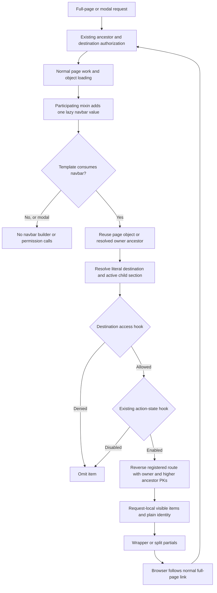

# Phase 06.40: Object navbar: opt-in section navigation (#381) - Research

**Researched:** 2026-11-18
**Domain:** Django object navigation, nested routing, permission-aware server rendering
**Confidence:** MEDIUM — direct source inspection and passing baseline; new implementation remains to be tested.

<user_constraints>
## User Constraints (from CONTEXT.md)

The following decision and discretion text is copied verbatim. Provenance: [CITED: .planning/phases/06.40-object-navbar-opt-in-section-navigation-381/06.40-CONTEXT.md].

<!-- DATA_49c8e3f1_START -->
## Implementation Decisions

### Approved source decisions D-01–D-15

These summaries preserve the issue's decision numbers. Read its full prose and acceptance criteria; the summaries
do not narrow the approved scope.

- **D-01 — Upstream contract:** Supersede #363's downstream-only outcome for object navigation. Its experiment
  is visual reference and access evidence only; do not port its code.
- **D-02 — Additional choice:** Context buttons retain their behavior, are not deprecated, and may coexist
  with a navbar. Applications choose whether to omit redundant buttons.
- **D-03 — Declaration and attachment:** Declare a `NavBar`; attach it per view through `cv_navbar` and
  `CrudViewNavBarMixin`, normally paired in a project mixin. Do not implicitly attach a bar to every ViewSet view.
- **D-04 — Destinations:** Every item selects a registered GET-capable view. Owner items target object views
  by key, including multiple detail views or update. At most one item per direct child ViewSet targets a
  no-child-object view, including list, create or custom collection pages. An explicit key selects exactly
  that view; an omitted child key selects list, falling back to card only if list is unregistered.
- **D-05 — Owner identity:** Use the owner page's object or the owner ancestor resolved for the current
  descendant request. The same owner supplies the caption and link PKs at every participating depth.
- **D-06 — Placement and depth:** A bar may appear on owner object views and selected descendant views,
  even if intermediate views omit the mixin. One bar per participating view. Nested owners retain higher
  ancestor PKs in links. Rendering checks only the child destination and immediate parent; it adds no farther
  ancestor gate. Destination requests independently enforce their own ancestor policy and can still return 403.
- **D-07 — Layout B:** Identity row above the items, followed by the unchanged view header, icon and actions.
- **D-08 — Application control and laziness:** The base template places ``. Ship a wrapper,
  identity partial and items partial; allow global overrides, split placement and `NavBar(template=...)`.
  The tag and partials share one lazily built result per request. Only layout B ships; document layout A as
  an override example. No location or layout-selection setting.
- **D-09 — Access then state:** Owner items use the owner's object for destination access. Each child item
  calls `target._cv_child_link_has_access(user, owner)` once. After permissions pass, evaluate the destination's
  existing state check with that same navbar owner. Hide denied or state-disabled items. Accessible empty
  collections remain visible. Requests remain authoritative for access and project queryset restrictions.
- **D-10 — Navigation and viewport:** Plain full-page links; no AJAX, embedded lists or unsaved-change warning.
  Omit bars from modals. Items wrap on narrow screens without horizontal page scrolling.
- **D-11 — Labels and empty state:** Child labels/icons default to the child ViewSet's plural name/header icon;
  owner labels default to the view's short action label. Support item label/icon overrides. Identity is the
  owner header icon plus `str(object)` as plain text. If no items are visible, render nothing, including identity.
- **D-12 — Active section:** Descendant pages highlight the visible item for the owner's direct child along
  their ancestry path; it stays clickable. Owner pages highlight a visible item matching their own view key.
  If no visible item matches, none is active. Owner list/create pages cannot carry the bar; report at startup.
- **D-13 — Bounded opt-in feature:** Keep it traceable in one module and preserve `base.py` behavior for
  nonparticipating views, with no added queries on pages without a bar. Navbar checks run on participating
  mixin views with a configured bar. Defer detection of a forgotten mixin. Apply the developer-maintainability
  rule; expose concrete scope/complexity conflicts rather than building new general machinery.
- **D-14 — Exclusions:** No badges/counts, dropdowns, groups, nested items, global application menu, downstream
  Tabler adoption, or changes to context buttons, ancestor authorization or existing URL-building behavior.
  Consume the separate #380 fix; do not rebuild its policy.
- **D-15 — Dedicated example:** Add a self-contained app in `examples/bootstrap5`, owning its models, views,
  navbar, seeds and tests. Use Tenant → Customer → (Order → Item, Address). Alice and Bob are full-CRUD account
  managers in different tenants; Charlie has read-only Customer/Order/Item access in Alice's tenant, with no
  Addresses or writes. Use Guardian object permissions on Tenant and model permissions below it, with ancestor
  cascading enabled. No per-business-record grants or permission-management UI. Customer's bar has Details,
  Notes (a second detail view of a text field), Orders and Addresses. Demonstrate Item-page owner/active-section
  consistency and an accessible empty Orders collection. Test copied descendant URLs, cross-tenant denial and
  Charlie's direct-request/write denial. Shared login/style/index infrastructure is allowed, but no cross-app
  model imports or required scenario cross-links. Reference docs and the live example link to each other.

### Stability decision from this discussion

- **D-16 — Stable at 1.0:** The maintainer selected “Stable at 1.0” rather than a provisional contract.
  Cover the documented declarations, `cv_navbar`, template tag and documented template override contract.
  Keep implementation helpers internal. Follow `docs/development/stability.md`: public breaking changes belong
  in major releases, with the existing deprecation and migration policy. Do not introduce a navbar-specific
  provisional exception. Settle and document the actual public surface during this phase so Phase 7 can inventory
  it. This decision sets the compatibility promise; it does not approve every proposed internal name or mechanism.

### Research and planning discretion

A-01–A-07 in the source remain proposals to evaluate with stated reasons for changes. They describe module/model
shape, `SimpleLazyObject` context, ancestor reuse and URL reversal, access/state helper calls, startup-check
implementation, Bootstrap markup, documentation/testing organization and cost measurement. Preserve any behavior
already fixed by D-01–D-16 or the acceptance criteria. Do not treat the A-label as permission to override those
requirements: for example, lazy single-build rendering, the once-only child hook, startup errors enumerated by
acceptance criterion 6, and documentation/example coverage are already required.

Use the simplest bounded implementation that the developer can explain and maintain. Research exact hook placement,
cooperative inheritance, registered route arguments, Pydantic compatibility, check IDs and test organization.
Report concrete conflicts with evidence. The user did not request another discussion of these proposals.

### Acceptance and delivery

Map all nine issue acceptance criteria into executable work: basic declaration/attachment and plain identity;
active sections and stable URLs across owner/descendant/nested-owner pages; access and state with real destination
responses and empty collections; omitted-template/modal zero work; unchanged nonparticipants/context buttons;
startup checks including POST-only targets; global/split/per-bar overrides with one build; narrow-screen wrapping;
and reference documentation plus the dedicated example with reciprocal links and the full supported test matrix.

Measure actual query counts separately from hook-call counts. Preserve configuration-error propagation and document
the immediate-parent limit. Follow the example's `Feature.docs` / `DocRef` conventions and documentation-link tests.
Update the packaged skill/reference guidance, stability inventory and feature changelog. If implementation discovers
a genuine breaking change, apply the repository's paired Breaking/migration rule rather than concealing it.
Use multicore pytest for broad runs and report unavailable matrix combinations honestly.


## Deferred Ideas

No new deferred ideas arose in this discussion. Preserve D-14's exclusions: global application menu, downstream
Tabler adoption, badges/counts, dropdown/group/nested-item navigation and changes to existing context buttons,
ancestor authorization or URL-building behavior. Forgotten-mixin detection remains deferred under D-13.
No pending todos matched this phase.

<!-- DATA_49c8e3f1_END -->
</user_constraints>

## Summary

Implement the approved feature as one opt-in module with declaration models, a cooperative mixin, private resolution/building helpers and bounded checks. Add the tag and three theme templates, then the dedicated example and consumer documentation. Keep existing route builders and permission policy unchanged. This follows D-03/D-08/D-13 and uses the existing cooperative mixin and request-ancestor machinery. [CITED: 06.40-CONTEXT.md, D-03/D-08/D-13; src/crud_views/lib/breadcrumb.py:98-106; src/crud_views/lib/ancestors.py:576-585]

Three source facts govern implementation: explicit destination keys need literal registration checks before existing lookup helpers; resolved ancestors already contain the correct owner at arbitrary supported nesting depth; access must precede state even though existing context-button renderers do the opposite. These require small navbar-local code, not changes to those existing paths. [CITED: src/crud_views/lib/viewset/__init__.py:372-388; src/crud_views/lib/ancestors.py:464-585; src/crud_views/lib/view/buttons.py:237-243]

**Primary recommendation:** adopt A-01–A-07 with the specific refinements below, freeze only the documented declaration/tag/template contract under D-16, and use acceptance criteria 1–9 as plan traceability identifiers. Roadmap requirements are literally "**Requirements**: TBD"; no new formal requirement IDs were supplied. [VERIFIED: .planning/ROADMAP.md:2118-2127]

## Architectural Responsibility Map

These are recommended assignments derived from the approved feature boundaries, not a new service architecture. [CITED: 06.40-CONTEXT.md, D-03–D-15]

| Capability | Primary Tier | Secondary Tier | Rationale |
|---|---|---|---|
| Registration, declaration validation | Django application startup | — | Registry and class metadata suffice; never query models during checks |
| Owner identity, active section, destination URLs | Django server/view instance | Existing ancestor request state | Use already resolved identity and route declarations |
| Item admission | Existing destination access hooks | Existing state hooks | One child-link hook, then one state evaluation |
| Shared rendering result | Django request/view instance | Django templates | One lazy value shared by tag and direct partials |
| Layout and navigation | Server HTML + browser CSS | Existing Bootstrap styles | Full-page links and wrapping; no JavaScript navigation |
| Tenant access and CRUD | Existing request authorization | ORM + Guardian tables | Visibility does not authorize requests |
| Demonstration data | Dedicated example app | Shared login/index/seed dispatch | App owns all business models and grants |

## Project Constraints (from AGENTS.md)

The supplied AGENTS instructions are mirrored by the checkout's CLAUDE.md. Apply these actionable directives. [CITED: CLAUDE.md; user-supplied AGENTS.md instructions]

- Keep behavior explainable, debuggable and maintainable by this developer; prefer bounded opt-in additions, preserve proven paths, document unsupported cases and account for hidden state/query cost.
- Use established ViewSet/CrudView registration, permission, parent-child and extension compositions; all CrudView attributes use the documented prefix.
- Preserve fixture naming and existing class/key/permission conventions. Use double quotes and 120-character Python lines. Build with the existing backend and version-management tooling.
- Use multiple pytest workers for broad runs; use serial only for a concrete isolation reason or a tiny diagnostic selection, and explain it.
- Run the existing project quality gates before delivery. Do not change unchanged-page goldens to absorb navbar output.
- Pair any new Breaking changelog entry with migration guidance; additive opt-in navbar behavior should need a feature entry, subject to actual implementation findings.
- After a ship run refresh codebase maps before subsequent work. If a phase workspace is requested, follow the documented workspace convention and reuse an existing worktree.
- Do not include downstream project names in new product/docs artifacts. [CITED: .planning/PROJECT.md:143-162]

No project-local skill directories were found at the documented discovery locations, and the agent-skills query returned no configured skill. Graph status reported no graph; direct source is the evidence for current behavior. These are observations of this session, not compatibility claims. [VERIFIED: research tool observations, 2026-11-18]

## Standard Stack

Retain existing dependencies; no external package installation or upgrade is needed for the feature. This table distinguishes declared floors from measured installed versions and does not claim that installed versions are registry-latest. [CITED: pyproject.toml:25-35,52-83]

| Component | Existing declared floor | Measured research environment | Use |
|---|---|---|---|
| Django | `django (>=4.2.0)` | 5.2.19 | CBVs, templates, reverse, checks, lazy wrapper |
| Pydantic | `pydantic (>=2.2.1)` | 2.14.3 | Small declaration models; stay within existing v2-floor features |
| django-guardian | `django-guardian>=2.4` | 3.5.2 | Existing Tenant object grants and compatibility tests |
| pytest / pytest-django / pytest-xdist | Existing test extras, no version pins | 9.2.0 / 4.14.0 / 3.8.0 | Existing Django test harness and worker isolation |
| Bootstrap | Existing theme | Use existing Bootstrap 5 nav utilities | HTML/CSS only |
| MkDocs | `mkdocs (>=1.6.1)` | 1.6.1 | Reference/example/stability validation |

Exact declaration excerpts above were read in this session. [VERIFIED: pyproject.toml:25-35,52-83]
Installed versions were obtained with importlib.metadata from the cached Django 5.2 test environment; MkDocs reported its version from the project venv. [VERIFIED: research version probes, 2026-11-18]
Bootstrap static navigation and wrapping are documented by its official nav and flex guides. [CITED: https://getbootstrap.com/docs/5.3/components/navs-tabs/; https://getbootstrap.com/docs/5.3/utilities/flex/#wrap]

**Package Legitimacy Audit:** not applicable: no new packages proposed. Do not add a navigation library, caching library, browser bundle or dependency pin. If execution introduces a new dependency, run the package legitimacy/registry checks then; existing installed dependencies were not reclassified as newly approved packages. [CITED: 06.40-CONTEXT.md, D-10/D-13/D-14]

## Architecture Patterns

### System Architecture Diagram

Recommended data flow, derived from D-05/D-08/D-09 and the existing guard lifecycle. [CITED: 06.40-CONTEXT.md; src/crud_views/lib/view/base.py:302-339; src/crud_views/lib/ancestors.py:464-585]



### Module and declaration shape

Adopt the A-01 module/declaration shape; preserve names as strings until checks/rendering so declarations can precede child registration. Make the two declaration objects configuration-only, with no user, request, object or resolved URLs stored on shared declarations. Use ordinary Pydantic v2 construction/field validation already present in the breadcrumb module. Defer registry-dependent failures to cooperative startup checks so diagnostics identify attachment and item. [CITED: 06.40-ISSUE-381.md, A-01/A-04; src/crud_views/lib/breadcrumb.py:24-60; src/crud_views/lib/viewset/__init__.py:219-238]

Proposed new files (creation targets, **not existing-path claims**): `src/crud_views/lib/navbar.py`; `src/crud_views/templates/crud_views/tags/navbar.html`, `navbar_identity.html`, `navbar_items.html`; focused tests under `tests/test1/test_navbar*.py`; a dedicated example package such as `examples/bootstrap5/navbar_demo/`; and `docs/reference/navbar.md`. The example package name is an implementation choice, not a locked user choice. [CITED: 06.40-ISSUE-381.md, A-01/A-05/A-06]

Keep helper methods private. Retain A-01's single item declaration with optional owner key/child name, label and icon overrides; do not introduce subclasses per item kind, a global navbar registry, a pluggable resolver or general traversal framework. A configured-bar check should validate declaration type safely before inspecting fields. A mixin with no bar remains a no-op. [CITED: 06.40-CONTEXT.md, D-13; 06.40-ISSUE-381.md, A-01]

### Owner and active-section resolution

On an owner object page use the already loaded page object. On a descendant, use `_resolved_ancestor(view, owner_name)`; it walks request-local resolved objects alongside declared ancestry, without fetching them. The ancestor guard resolves every structural ancestor even when only a subset has selected permission gates. Do not copy breadcrumb ancestor loading, which explicitly queries each ancestor again. [CITED: src/crud_views/lib/ancestors.py:498-566,576-585; src/crud_views/lib/breadcrumb.py:234-246]

Use `_walk_ancestors` for finite ancestry metadata: it yields nearest-first edge/ViewSet pairs and detects missing parents/cycles. Track the node immediately below the owner to identify the active direct-child section. Never infer this from object model class, URL substrings, label text, or whether intermediate views have the navbar mixin. [CITED: src/crud_views/lib/ancestors.py:89-121; 06.40-CONTEXT.md, D-05/D-06/D-12]

Treat missing resolved owner state on a real descendant render as a clear configuration/lifecycle error, not an excuse for an unscoped ORM fallback. Tests that invoke the builder without dispatch should supply equivalent request state explicitly. Preserve the actual object identity passed to both access and state. [CITED: src/crud_views/lib/ancestors.py:576-585; 06.40-CONTEXT.md, D-05/D-09]

### Exact destination and URL resolution

The source definitions are:
<!-- DATA_17d62af9_START -->
`if not self.is_view_registered(key) and key == "list" and self.is_view_registered("card"):`
`return self._views["card"]`
`return f"{app}{self.name}-{key}"`
<!-- DATA_17d62af9_END -->
Both class lookup and router lookup contain this fallback. Therefore first require literal registration for every explicit navbar key. For an omitted child key, select registered `"list"`, otherwise registered `"card"`, and then validate that selected target. Never fall back because a list is denied, POST-only, object-bound or otherwise invalid. [VERIFIED: src/crud_views/lib/viewset/__init__.py:372-388]

Build route kwargs from **target topology**, not from all rendering kwargs:

1. For an owner target, take only the owner's ancestor argument names from the rendering kwargs, and add the owner object's PK under the owner's own PK-name.
2. For a direct-child collection target, take the child's ancestor argument names. Its immediate-parent edge gets the resolved owner PK; remaining names come from the rendering kwargs.
3. Reverse the target ViewSet's registered router name. Preserve the existing target extra-kwargs hook where a custom path contribution needs it; structural owner/ancestor identity must remain authoritative.
4. Assert owner/child/grandchild pages produce equal destination URLs using deliberately distinct PKs and custom parent PK names. [CITED: src/crud_views/lib/viewset/__init__.py:295-303,381-468; src/crud_views/lib/view/base.py:717-757,1126-1146; src/crud_views/lib/viewset/parentviewset.py:56-60]

Existing parent-edge naming is exactly `return self.pk_name if self.pk_name else f"{self.viewset.name}_pk"`; route patterns are assembled as `route = rf"^{path_parent}{path_prefix}{path_pk}{path_view}{path_contribute}$"`. Do not hard-code model names or a single universal parent PK name. [VERIFIED: src/crud_views/lib/viewset/parentviewset.py:56-60; src/crud_views/lib/viewset/__init__.py:455-463]

Custom URL contributions that cannot be satisfied by the existing extra-kwargs hook remain a compatibility edge to document/test, not justification for a new public argument resolver. The approved custom no-object destination can use an ordinary fixed route, exercising the actual required contract. [CITED: src/crud_views/lib/view/base.py:700-701,746; 06.40-CONTEXT.md, D-04/D-14]

### Access then state, once per item

Use the exact existing signatures below. For owner items call access with the resolved owner. For child items call the child-link hook exactly once; do not additionally call its own access or parent-policy helper. If denied, skip state, label and URL work. If allowed, evaluate the state adapter once with the same owner and current rendering view. [CITED: src/crud_views/lib/view/base.py:524-566; 06.40-CONTEXT.md, D-09]

<!-- DATA_c490b3e7_START -->
`def cv_has_access(cls, user: User, obj: Model | None = None) -> bool:`
`def _cv_child_link_has_access(cls, user, parent_obj) -> bool:`
`def _cv_action_enabled_for_rendering(cls, user, obj, rendering_view) -> bool:`
<!-- DATA_c490b3e7_END -->
[VERIFIED: src/crud_views/lib/view/base.py:524-566]

Guardian collection compositions delegate through this hook; Guardian create overrides it to return its already-parent-aware own access. Its state adapter recognizes the parent object. This is why a second parent call would be wrong. Preserve standalone queryset-composition behavior and propagate reached configuration failures rather than converting exceptions to invisibility. [CITED: src/crud_views_guardian/lib/mixins.py:287-305; src/crud_views_guardian/lib/views.py:285-313,377-390; src/crud_views/lib/ancestors.py:654-686]

Navigation visibility checks only the owner/destination and direct parent, while requests run their full configured ancestry policy. A visible item can still yield a denied request higher up. Custom plain request compositions are not upgraded to new state enforcement by this phase; the explicit state-denied owner GET regression should use a permission-required detail composition, as acceptance criterion 3 specifies. [CITED: src/crud_views/lib/ancestors.py:654-670; src/crud_views/lib/view/base.py:1295-1331; 06.40-ISSUE-381.md, acceptance 3]

### Lazy context, templates and no-op behavior

Use one `SimpleLazyObject` stored on the participating view instance; expose that same wrapper in every context build. Do not resolve owner, check permissions, render labels or reverse routes while merely assembling context. Use an explicit sentinel/attribute-existence check rather than boolean-testing the lazy value. All three templates must consume the shared value, never call a builder themselves. Return an empty/falsy result when no visible items remain so identity disappears too. [CITED: 06.40-ISSUE-381.md, A-02; src/crud_views/lib/views/manage.py:1010-1019; https://docs.djangoproject.com/en/4.2/_modules/django/utils/functional/]

Django's wrapper stores the callable result, but an unevaluated wrapper can be copied into a new wrapper. Keeping one wrapper on the view and passing it through context avoids duplicate builds under normal tag/partial rendering. A small request-local cached builder can additionally make repeated invocation robust if execution demonstrates a copying path; do not introduce cross-request caching. [CITED: https://docs.djangoproject.com/en/4.2/_modules/django/utils/functional/]

The actual modal predicate is `return request.headers.get("X-CV-Modal") == "true"`. Check it before constructing navbar work; expose no navbar for such requests even if a custom modal template explicitly includes the partials. The generic tag must safely produce the empty string on nonparticipants. [VERIFIED: src/crud_views/lib/view/base.py:71-73]

Use a context-taking rendering tag capable of choosing the per-bar template at render time. The existing breadcrumb's fixed inclusion-tag decorator alone cannot implement a per-bar override. Respect the theme path, which currently returns `"crud_views"`, and document the wrapper plus identity/items partial input contract as public under D-16. [CITED: src/crud_views/templatetags/crud_views.py:446-449; 06.40-CONTEXT.md, D-08/D-16] [VERIFIED: src/crud_views/lib/settings.py:322-324]

Use existing icon rendering, escaped text and ordinary links. Do not mark owner captions safe; explicitly test a markup-bearing caption, including a safe-string return, to preserve D-11 plain text. Choose override checks by `is not None` so empty icon strings can intentionally suppress icons. Existing icon constants are exactly `VIEWSET_DEFAULT = None` and `NONE = ""`. [CITED: 06.40-CONTEXT.md, D-11; src/crud_views/templatetags/crud_views.py:653-656] [VERIFIED: src/crud_views/lib/icons.py:15-19]

Default layout: identity, wrapped pill links, existing page heading and actions. Keep current link clickable and mark its active state accessibly. Do not copy dynamic-tab roles or Bootstrap tab JavaScript attributes into full-page navigation. Split-placement and layout-A examples should reuse the documented partial context. [CITED: 06.40-CONTEXT.md, D-07/D-08/D-10/D-12; https://getbootstrap.com/docs/5.3/components/navs-tabs/]

### Startup checks

Use a navbar-specific Check subclass in the navbar module, yielded from the mixin after `super().checks()`. Existing ViewSet checks iterate registered view classes, and Check prefixes its identifier via `return f"viewset.{self.id}"`. Keep all registry-dependent checking at that stage. Allocate new IDs after a repository-wide collision audit; do not claim proposed IDs are already reserved. [VERIFIED: src/crud_views/lib/check.py:25-38] [CITED: src/crud_views/lib/viewset/__init__.py:286-287; src/crud_views/lib/breadcrumb.py:98-106]

The checker must cover all A-04 errors: missing owner/child; indirect or unrelated child; missing literal key; invalid GET capability; owner target without object; child target requiring an object; duplicate owner key; duplicate child even with distinct keys; owner attachment without object; and unrelated attachment. Include bar owner, item position/target, and attached view in each message. Test valid declarations before ViewSets register, then check after registration. Catch only expected resolution/configuration failures at check-reporting boundaries. Do not evaluate permissions or state during checks. [CITED: 06.40-ISSUE-381.md, A-04 and acceptance 6]

GET eligibility requires both a permitted method name and a callable handler. ActionView inherits Django's default allowed-method list but defines only a POST handler, so testing method names alone misses the required POST-only regression. Test the converse too: a callable GET handler excluded by the method allow-list. [CITED: src/crud_views/lib/views/action.py:12-23; https://docs.djangoproject.com/en/4.2/ref/class-based-views/base/]

### Dedicated example and documentation delivery

Create one app owning Tenant, Customer, Order, Item and Address, plus its migrations, forms, views, navbar, seeds and tests. Customer Notes should be a second detail subclass with its own registered key and a simple text field; inheriting the standard detail family avoids creating a novel ancestry operation for it. A genuinely custom no-object endpoint outside standard families needs its exact ancestor action declaration in tests/docs. [CITED: 06.40-CONTEXT.md, D-15; src/crud_views/lib/ancestors.py:244-277]

Use GuardianViewSet/protected views for Tenant, ordinary model-permission ViewSets/protected CRUD below it. Explicitly retain cascading in this example. Defaults are exactly `DEFAULT_CASCADE = True`, `DEFAULT_READ_PERMISSIONS = {"nearest": "view", "higher": "view"}`, and `DEFAULT_WRITE_PERMISSIONS = {"nearest": "change", "higher": "view"}`. Therefore full business CRUD requires Tenant view and change object grants for each account manager, while Charlie gets only the assigned Tenant view and the three approved business read permissions. Do not grant global Tenant access or individual business-record permissions. [VERIFIED: src/crud_views/lib/ancestor_policy.py:19-22] [CITED: 06.40-CONTEXT.md, D-15]

Use distinct primary keys at each level in fixtures. Demonstrate two customers in Alice's tenant, including one with an empty Orders collection; Bob's separate tenant; Charlie's comparison on Alice's same data. Include selected Item pages even where an intermediate Order page lacks the mixin. Test valid copied cross-tenant paths separately from structurally mismatched ancestor paths: the former should hit the Tenant permission denial, the latter may legitimately be not found. Confirm denied writes leave rows unchanged and new business rows need no grants. [CITED: 06.40-CONTEXT.md, D-05/D-06/D-15; src/crud_views/lib/ancestors.py:498-566]

Shared demo users currently enumerate only `("alice", "alice", False)`, `("bob", "bob", False)`, `("developer", "developer", False)`. Explicitly add Charlie creation and login discoverability in the planned example integration; keep other apps' grants untouched and seeds idempotent. The seed dispatcher invokes each registered feature's seed module, so register the feature and ensure the app can seed its own scenario without cross-app business-model imports. [VERIFIED: examples/bootstrap5/project/seeding.py:5-10] [CITED: examples/bootstrap5/project/management/commands/seed.py:13-20; 06.40-CONTEXT.md, D-15]

Example documentation registration has `docs: tuple[DocRef, ...] = ()`. Its tests reverse the feature landing URL and require clickable backlinks inside example admonitions on **every** referenced page. Add only relevant references and ensure all reciprocal pages are updated, together with reference index/theme inventory/stability/changelog. The reference must spell out exact explicit-key behavior, visibility/request differences, no-object owner prohibition, scope limits, mixin order, global/split/per-bar overrides, default layout B and a layout-A override. [VERIFIED: examples/bootstrap5/project/features.py:50-60] [CITED: examples/bootstrap5/test_doc_links.py:118-146; 06.40-CONTEXT.md, D-08/D-16 and Acceptance and delivery]

## Don't Hand-Roll

Recommended reuse is constrained by the existing implementations and approved exclusions. [CITED: 06.40-CONTEXT.md, D-13/D-14; sources in Architecture Patterns]

| Problem | Do not build | Use instead |
|---|---|---|
| Owner retrieval | Model-class guessing or new FK queries | Existing resolved ancestor identity |
| Parent access | Duplicate local Guardian/model permission policy | Destination child-link hook |
| State | New navbar predicate | Existing target rendering state adapter |
| Route discovery | URL string slicing or router rewrite | Target router name + declared parent kwargs + reverse |
| Lazy result | Global/thread/request-user cache | Single view-local Django lazy wrapper |
| Ancestry safety | New unbounded parent walk | Existing bounded ancestry traversal |
| Icons | Hard-coded icon-library class assumptions | Existing icon renderer |
| Client navigation | JavaScript tabs/AJAX/router | Ordinary anchors and CSS wrapping |

## Common Pitfalls

1. **Explicit list becomes card silently.** Guard literal keys before either class or router lookup; omitted-key fallback is a separate operation. [CITED: src/crud_views/lib/viewset/__init__.py:372-388]
2. **Item-page PK becomes Customer PK.** Resolve owner first and construct destination-specific kwargs, with unequal fixture PKs. [CITED: 06.40-ISSUE-381.md, acceptance 2; src/crud_views/lib/view/base.py:730-745]
3. **Wrong active section on a grandchild.** Find the direct child below the owner in declared ancestry, not the nearest parent or rendering ViewSet alone. [CITED: 06.40-CONTEXT.md, D-12; src/crud_views/lib/ancestors.py:89-121]
4. **Eager or duplicated work.** Breadcrumb context eagerly builds and ancestor breadcrumbs query again; copy cooperative structure only. A lazy wrapper truthiness check also triggers evaluation. [CITED: src/crud_views/lib/breadcrumb.py:240-246,280-283; https://docs.djangoproject.com/en/4.2/_modules/django/utils/functional/]
5. **Second parent check or early state check.** Existing context buttons evaluate state first; Guardian create already owns its parent gate. Implement the approved navbar ordering independently. [CITED: src/crud_views/lib/view/buttons.py:237-243; src/crud_views_guardian/lib/views.py:388-390]
6. **Empty collections disappear.** Never test count/exists or infer permission from collection rows. Guardian collection access is separate from row filtering. [CITED: src/crud_views_guardian/lib/mixins.py:287-305; 06.40-CONTEXT.md, D-09]
7. **False access equivalence.** Navbar admission is intentionally bounded; configuration errors propagate; farther ancestry and project querysets can still deny the destination. [CITED: src/crud_views/lib/ancestors.py:654-686]
8. **Broad “stable” promise.** Freeze only the declared classes/attributes/tag/documented template contract; keep resolution and built-data helpers internal. D-16 is settled, not an open provisional-tier choice. [CITED: docs/development/stability.md:3-17,87-93; 06.40-CONTEXT.md, D-16]
9. **Companion skill treated as a local file.** Current docs say “It is no longer bundled inside this repository.” Plan the actual external guidance update or explicitly preserve it as a delivery dependency. [VERIFIED: docs/development/index.md:87-91]

## Code Examples

These are implementation sketches using source-grounded methods, not already implemented navbar API. No new error IDs or application route names are asserted. [CITED: sources immediately below]

### Access sequence

```python
allowed = (
    target._cv_child_link_has_access(user, owner)
    if child_item
    else target.cv_has_access(user, owner)
)
if not allowed:
    continue
if not target._cv_action_enabled_for_rendering(user, owner, rendering_view):
    continue
```

The helper signatures are quoted in Architecture Patterns; this sequence implements D-09, rather than reusing a context button renderer. [CITED: src/crud_views/lib/view/base.py:524-566; 06.40-CONTEXT.md, D-09]

### Owner and direct-child destination kwargs

```python
# Owner object target.
kwargs = {name: rendering_view.kwargs[name] for name in owner_viewset.get_parent_url_args()}
kwargs[owner_viewset.pk_name] = owner.pk
url = reverse(owner_viewset.get_router_name(target_key), kwargs=kwargs)

# Direct-child no-object target.
kwargs = {name: rendering_view.kwargs[name] for name in owner_viewset.get_parent_url_args()}
kwargs[child_viewset.parent.get_pk_name()] = owner.pk
url = reverse(child_viewset.get_router_name(target_key), kwargs=kwargs)
```

Validate literal key registration before these sketches; merge any supported custom target extras deliberately, without overwriting owner identity. The no-object target contributes no child PK. [CITED: src/crud_views/lib/viewset/__init__.py:295-303,372-423; src/crud_views/lib/viewset/parentviewset.py:56-60]

### Cooperative check/context integration

Follow the existing superclass delegation pattern; install the lazy value only when a declaration exists and the request is a full page. Do not evaluate it in context construction. [CITED: src/crud_views/lib/breadcrumb.py:98-106,280-283; src/crud_views/lib/views/manage.py:1010-1019; 06.40-CONTEXT.md, D-08/D-13]

## State of the Art

This phase extends the current repository; it does not upgrade the stack. [CITED: 06.40-CONTEXT.md, Phase Boundary]

| Earlier assumption | Current source-grounded position | Planning impact |
|---|---|---|
| Core child hook checks only own access | Phase 06.39 includes own access and immediate-parent policy | Consume once; no policy work |
| All navigation shares post-1.0 provisional timing | D-16 settles this object navbar as stable at 1.0 | Document public surface now |
| Breadcrumb pattern guarantees lazy, query-free owner resolution | Breadcrumb is eager and reloads ancestors | Reuse ancestor cache and lazy context instead |
| Skill ships in this repo | Current development docs point to a separate repository | Companion delivery dependency |

[CITED: src/crud_views/lib/view/base.py:528-541; 06.40-CONTEXT.md, D-16; src/crud_views/lib/breadcrumb.py:240-246,280-283; docs/development/index.md:87-91]

## Measured Baseline and Cost Limits

The command below completed with **259 passed in 3.75s**, using four workers. The strict documentation build also passed in **1.49s**. These are baseline results, not claims that new navbar behavior is implemented. [VERIFIED: research execution results, 2026-11-18]

```bash
PYTHONPATH=src:. .nox/tests-3-12-django-5-2/bin/python -m pytest tests/test1/test_guardian_child_link_visibility.py tests/test1/test_action_enabled.py -n 4 -q
.venv/bin/mkdocs build --strict
```

Existing source-bound cost tests separate own access from full rendered controls and categorize permission SQL versus parent/child row queries. The documented warm-actor/warm-vocabulary plain-parent case is zero SQL, whereas a strict Guardian parent case is two SQL queries. These counts belong to the measured child-link configuration, not a promised navbar budget. [CITED: tests/test1/test_guardian_child_link_visibility.py:1068-1151; docs/reference/context_buttons.md:207-228]

For the implementation, measure separately: builder count, each target hook count, state count after admission, owner-resolution row queries, cold/warm permission vocabulary, cold/warm actor permissions and whole-page overhead. Compare equivalent participating/nonparticipating pages, excluding unrelated breadcrumb/ORM/page work. Include mixed owner/child/Guardian items and split template reuse. Publish actual measured totals only after those tests exist. [CITED: 06.40-CONTEXT.md, Acceptance and delivery; 06.40-ISSUE-381.md, A-07]

## Environment Availability

Observed on this checkout; these observations do not establish the whole release matrix. [VERIFIED: research tool probes, 2026-11-18]

| Dependency | Observation | Execution handling |
|---|---|---|
| Python | 3.12.3 default; 3.15.0rc2 command also available | Use explicit environment interpreter |
| Python 3.13/3.14 | Not found on shell PATH | Nox/uv may discover managed runtimes; record actual availability |
| Cached core test envs | Django 4.2, 5.2, 6.0 environment directories present | Probe actual imported versions before reuse |
| pytest/Django/Guardian | Django 5.2 baseline executed successfully | Fast local source checks are available |
| uv, task, node, npm | Commands found | Existing tooling only |
| MkDocs | 1.6.1; strict build passed | Documentation validation available |
| Nox/Ruff/Vitest | Existing executables found | Run project quality gates during execution |
| Browser automation | Playwright tool namespace available, browser launch not probed | Executor must verify browser/server setup before viewport evidence |
| Separate skill repository | Not in this checkout; two conventional sibling paths absent | Locate authorized companion checkout/repository |

**Missing dependencies with no established fallback:** companion skill checkout location remains unresolved. **Missing dependencies with possible fallback:** Python 3.13/3.14 may be supplied by uv; do not mark them unsupported based on PATH absence. [CITED: docs/development/index.md:87-91; research environment observations]

## Validation Architecture

Nyquist and security validation are enabled in project configuration. Keep validation alongside implementation rather than postponing all tests to a final plan. [CITED: .planning/config.json, workflow]

### Test Framework

| Property | Value |
|---|---|
| Framework | Existing pytest 9.2.0 / pytest-django 4.14.0 / pytest-xdist 3.8.0 in research environment |
| Core configuration | Django settings initialized by tests/test1/conftest.py; strict markers in pyproject.toml |
| Example configuration | examples/bootstrap5/pytest.ini uses project.settings and discovers tests.py |
| Quick baseline | Command in Measured Baseline; 3.75 seconds observed |
| New focused suite | Add navbar unit/render/request/check tests; run selected files using same interpreter and four workers |
| Broad local suite | `PYTHONPATH=src:. .nox/tests-3-12-django-5-2/bin/python -m pytest tests -n 4 -q` |
| Installed-distribution matrix | Existing Nox tests/examples sessions, plus required existing floor gates |

[CITED: tests/test1/conftest.py:43-80; pyproject.toml:145-146; examples/bootstrap5/pytest.ini:1-5; noxfile.py:20-57; research version probes]

The matrix lists `DJANGO_VERSIONS = ["4.2", "5.2", "6.0"]` and Python `["3.12", "3.13", "3.14", "3.15"]`. Nox explicitly skips the Django 4.2/Python 3.14 and 3.15 combinations; report those as declared skips, not passing tests. Core sessions run the installed package twice, including request-trace mode. [VERIFIED: noxfile.py:3,20-25,30-57]

### Acceptance → Test Map

The rows map the nine approved acceptance criteria; these are local labels, not invented requirement IDs. New test filenames below are proposed creation targets. All behavior requirements derive from the issue acceptance section. [CITED: 06.40-ISSUE-381.md, Acceptance criteria 1–9]

| Criterion / decisions | Required evidence | Test shape and proposed location | Automated check |
|---|---|---|---|
| AC1; D03/D05/D07/D11 | One declaration, owner + descendants, plain identity with hidden first item | Declaration/render tests in test_navbar.py | Focused core command |
| AC2; D04/D06/D12 | Owner/child/grandchild URL parity; own Update active; omitted intermediate mixin; child list/detail/create/update/custom active; explicit Create/custom collection; nested Tenant PK retained | Resolver/request cases in test_navbar.py using unequal PKs and custom PK names | Focused core command |
| AC3; D09 | One child hook per outcome with exact user/owner; denied skips state; state-disabled owner hidden + GET 403; disabled child hidden; allowed empty plain and Guardian GET 200; empty bar; ancestor limit | Real requests + spies in test_navbar_permissions.py | Focused permissions command |
| AC4; D08/D10 | Omitted tag and modal partials: no navbar builder/access/state calls or navbar queries | Lazy tests with templates that do/don't access shared value | Focused rendering command |
| AC5; D02/D13/D14 | Nonparticipant bytes/query counts unchanged; mixin without declaration no-op; existing context buttons alone/coexisting | Golden/control + existing child-link suite | Core preservation command |
| AC6; D04/D12/D13 | Every A-04 error, named diagnostics, POST-only owner, excluded GET, explicit missing list with card present, duplicates, unrelated attachment; no check-time queries | test_navbar_checks.py through actual checks pipeline | Focused checks command |
| AC7; D08/D16 | Global wrapper override, each leaf override, per-bar template, split placement builds once, repeated context/tag reuse, no-item identity absent | Loader overrides + exact builder counters in test_navbar_templates.py | Focused rendering command |
| AC8; D10 | Narrow viewport wraps items; no horizontal document scroll; active remains a link | Example browser evidence at narrow and desktop widths; long caption/labels | Browser step required; pytest HTML alone insufficient |
| AC9; D15/D16 | Complete scenario, reciprocal links, supported matrix, stable API docs, release entry, external skill disposition | Example tests, doc-link tests, strict docs, Nox matrix | Commands below |

Recommended focused command after files are created:
```bash
PYTHONPATH=src:. .nox/tests-3-12-django-5-2/bin/python -m pytest tests/test1/test_navbar.py tests/test1/test_navbar_permissions.py tests/test1/test_navbar_checks.py tests/test1/test_navbar_templates.py -n 4 -q
```

Recommended example and project gates:
```bash
# Nox builds/install tests for each configured matrix cell; add bounded workers for examples too.
.venv/bin/nox -s tests examples -- -n 4
.venv/bin/mkdocs build --strict
.venv/bin/ruff check src tests examples
.venv/bin/ruff format --check src tests examples
npm test
```

These are proposed validation invocations, based on existing session/script definitions; matrix invocation has not been executed in this research. Core Nox intentionally clears checkout PYTHONPATH and verifies the installed package, so cached-source tests do not replace it. The package script is exactly `"test": "vitest run"`. [CITED: noxfile.py:7-57 and examples session; .planning/PROJECT.md:157-158] [VERIFIED: package.json:9-12]

For an available cached example-capable environment, run its interpreter from the example project directory with checkout src on PYTHONPATH, selecting the new app tests and test_doc_links.py; keep example/core suites separate because their Django settings differ. Confirm that interpreter contains demo dependencies before promising that shortcut. [CITED: examples/bootstrap5/pytest.ini:1-5; tests/test1/conftest.py:43-51; noxfile.py, examples session]

### Sampling Rate

- Each task: focused relevant suite with bounded workers.
- Each wave: affected existing integration/preservation suites.
- Phase gate: complete supported core/example matrix, documented skip/unavailable cases, strict docs, lint/format, JS gate and browser viewport evidence. Run Pydantic-floor-focused navbar checks because the public declarations must retain the existing floor. [CITED: .planning/PROJECT.md:157-162; 06.40-ISSUE-381.md, acceptance 9; pyproject.toml:28]

### Wave 0 Gaps

- New navbar fixtures/test modules, isolated temporary registry handling and explicit URLconf cache cleanup where declarations are dynamic.
- Owner/descendant fixtures with noncolliding PKs, alternate parent PK names, multiple owner detail keys, card-only child, explicit-list-invalid child, GET custom collection and POST-only action.
- Dedicated example models/migrations/seeds/authentication fixtures and reproducible browser startup.
- Query-category and hook-counter fixtures reused from current tests, with navbar-only measurements separated from page cost.
- Concrete documentation/stability contract assertions; exact template context keys settled before release.
- External skill repository location and scoped deliverable. [CITED: 06.40-ISSUE-381.md, acceptance 1–9; tests/test1/test_guardian_child_link_visibility.py:1068-1151; docs/development/index.md:87-91]

## Security Domain

Use versioned ASVS terminology. The template's older category labels do not match ASVS 5.0: authorization is V8, authentication V6 and session management V7; output encoding is V1. This is a focused threat review, not a certification claim. [CITED: https://github.com/OWASP/ASVS/blob/master/5.0/docs_en/OWASP_Application_Security_Verification_Standard_5.0.0_en.csv]

| ASVS 5.0 category | Applies | Standard control / verification |
|---|---|---|
| V8 Authorization | Yes | Existing server request gates, Guardian Tenant grants, copied-URL/direct-write denial tests |
| V1 Encoding and Sanitization | Yes | Escaped captions/labels, existing icon renderer, registered-route reversal |
| V2 Validation and Business Logic | Yes | Declarative startup checks; access-before-state; unchanged writes |
| V6 Authentication / V7 Session Management | Existing infrastructure only | Reuse existing Django login/session behavior; no new auth flow |
| V11 Cryptography | No new crypto | No navbar secrets, signing or token format |

The relevant threat mitigations are recommendations derived from the approved access boundary and ASVS server enforcement controls. [CITED: https://github.com/OWASP/ASVS/blob/v5.0.0/5.0/en/0x17-V8-Authorization.md; 06.40-CONTEXT.md, D-09/D-15]

| Threat | STRIDE | Bounded mitigation |
|---|---|---|
| Cross-tenant copied descendant URL | Elevation of privilege / information disclosure | Cascading Tenant authorization and real request tests |
| Wrong owner PK on a deep page | Tampering / information disclosure | Resolved owner identity and target-specific ancestry kwargs |
| Reused cached permissions across users/requests | Elevation of privilege | No cross-request/navbar declaration cache |
| Caption or label interpreted as HTML | Tampering | Escape plain text, including safe-string caption regression |
| Hidden link mistaken for enforced policy | Elevation of privilege | Test destination response and denied writes separately |
| Swallowed policy configuration failure | Information disclosure | Propagate reached configuration exceptions |

## Assumptions Log

No unsupported compatibility or performance claim is locked by this research. Recommendations are implementation proposals grounded in the existing APIs and approved decisions; future navbar query totals and browser behavior remain test obligations. [CITED: 06.40-CONTEXT.md, Research and planning discretion and Acceptance and delivery]

| # | Claim | Section | Risk if Wrong |
|---|---|---|---|
| A1 | No external skill checkout location has yet been established; it may be available elsewhere. [ASSUMED] | Open Questions | Guidance delivery needs a separate location or explicit tracked disposition |
| A2 | The suggested example-app/test filenames are suitable organizational choices, not existing files or locked names. [ASSUMED] | Architecture / Validation | Planner may choose different bounded names without changing scope |

## Open Questions

1. **External skill guidance delivery:** development docs explicitly moved the skill to jacob-consulting/skills. Locate the actual authorized checkout and preserve a separate scoped guidance task; do not invent a bundled path or silently omit the requirement. This does not block planning the core feature. [CITED: docs/development/index.md:87-91]
2. **Custom route contributions:** standard registered object/collection routes are fully accounted for; retain the existing extra-kwargs seam and test it if used. Do not promise arbitrary dynamic capture inference. [CITED: src/crud_views/lib/view/base.py:700-701,717-749; src/crud_views/lib/viewset/__init__.py:460-463]
3. **Full matrix and viewport evidence:** this research ran one focused Django 5.2 baseline plus strict docs. Execution still owes matrix and browser evidence, with actual tool/runtime availability reported. [VERIFIED: research execution observations, 2026-11-18]

No unresolved user stability decision remains: D-16 is stable at 1.0. [CITED: 06.40-CONTEXT.md, D-16]

## Sources

### Primary repository sources

- Phase context and captured issue: approved D-01–D-16, evaluated A-01–A-07, nine acceptance criteria.
- CLAUDE.md and .planning/PROJECT.md: maintainability, compatibility, test/doc gates.
- Ancestors, view base, ViewSet, parent declaration, breadcrumb, Guardian mixins/views: exact lifecycle, identity, route, access and state behavior cited above.
- Existing child-link/state tests and nested/context-button/Guardian references: baseline and cost/authorization boundaries.
- Example feature/seed/settings/URL/doc-link modules: dedicated-app integration.
- Stability and development docs: public surface and external skill location.

### Official external sources

- [Django 4.2 lazy-object source](https://docs.djangoproject.com/en/4.2/_modules/django/utils/functional/) — single wrapper result and copy caveat.
- [Django base views](https://docs.djangoproject.com/en/4.2/ref/class-based-views/base/) — dispatch and method eligibility.
- [Bootstrap navs](https://getbootstrap.com/docs/5.3/components/navs-tabs/) and [flex wrapping](https://getbootstrap.com/docs/5.3/utilities/flex/#wrap) — static nav semantics and wrapping.
- [ASVS 5.0 authorization](https://github.com/OWASP/ASVS/blob/v5.0.0/5.0/en/0x17-V8-Authorization.md) — operation/data-specific server authorization.

### Research method and confidence

The research-plan seam selected Context7 for library questions and websearch for ASVS. Neither Context7 MCP nor the ctx7 CLI was available, so official documentation was fetched through the web tool and digests cached. The classify-confidence seam returned MEDIUM for officially cross-checked websearch findings; no new package verdict was sought. Local source was opened with numbered shell reads because this runtime exposes no named Read/Write tool; the canonical research file is written with apply_patch. Provenance tags identify source inspection separately from the conservative aggregate confidence level. [VERIFIED: research tool observations, 2026-11-18]

## Metadata

| Area | Confidence | Reason |
|---|---|---|
| Existing stack | MEDIUM | Declared floors and actual installed versions read; no registry-latest claim |
| Architecture | MEDIUM | Direct source grounding and baseline tests; new feature still unimplemented |
| Pitfalls | MEDIUM | Concrete fallback/order/laziness/companion-repo differences identified |
| New feature acceptance | Not yet measured | Covered by the executable validation plan |

**Research date:** 2026-11-18. **Refresh trigger:** changes to ancestor/access helpers, route composition, approved decisions or supported dependencies; otherwise recheck external documentation within 30 days. This refresh interval is an operational recommendation. [CITED: source-dependent findings above]

