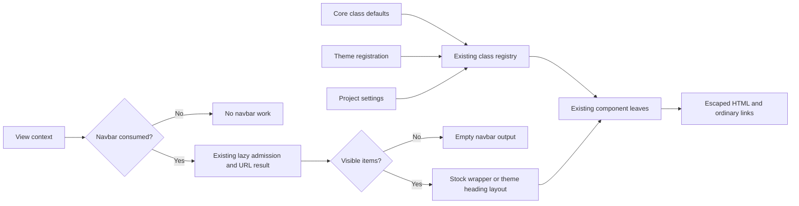

# Phase 06.40.1: ViewSet Navigation theme class keys and owner-heading layouts — Research

**Researched:** 2026-11-19
**Domain:** Existing Django class registry, navbar leaves, executable theme documentation
**Confidence:** LOW under the GSD provider classifier; local findings below are directly source-verified. See Metadata for the classifier limitation.

<user_constraints>
## User Constraints (from CONTEXT.md)

The following approved decisions are reproduced verbatim. [VERIFIED: .planning/phases/06.40.1-viewset-navigation-theme-class-keys-and-owner-heading-layout/06.40.1-CONTEXT.md:25-91]

<!-- DATA_73ca409b_START -->
### D-01 — Bounded theme-support follow-up

Implement the selected class-keys-plus-guidance approach. Preserve the stock layout and proven runtime
paths; reuse existing registry and template mechanisms. Developer maintainability remains a hard constraint.

### D-02 — Class keys (finding 36)

Use six ordinary keys in the existing registry. These names and defaults were proposed by the assistant
and approved with the design. `navbar:nav` styles the list inside the `nav` landmark.

| Key | Default |
|---|---|
| `navbar:wrapper` | `cv-navbar mb-3` |
| `navbar:identity` | `cv-navbar-identity mb-2 fw-medium mw-100 text-break` |
| `navbar:nav` | `nav nav-pills flex-wrap gap-1` |
| `navbar:item` | `nav-item mw-100` |
| `navbar:link` | `nav-link mw-100 text-break` |
| `navbar:link-active` | `active` |

The active key adds classes only to active links; `aria-current="true"` remains independent of styling.
Follow existing registry precedence and empty-value behavior. Do not retain hard-coded copies of these
classes outside the keys. A theme can choose `nav nav-tabs flex-wrap gap-1` and add link spacing through
`navbar:link` without copying the items template.

### D-03 — Owner as page heading (finding 38)

Replace the universal prohibition in the theme contract with a distinction between the stock layout and
theme-owned layouts. A theme may use the owner identity as its page heading, put section links below it,
and render the view title/subtitle and actions as a subordinate section header. Preserve the view's actions
and extension points. The theme owns a coherent heading hierarchy; the package does not infer heading levels.

Document a recipe using escaped `cv_navbar.label`, the existing icon renderer and ``,
guarded by `cv_navbar`, with the ordinary header retained when the bar is absent. Explain integration with
the theme's own header blocks rather than inventing a new shared block contract.

### D-04 — Accessibility and component boundaries

Keep independent empty guards, visible labels, decorative icons, translated navigation naming, clickable
active links, keyboard focus and wrapping. `NavBar(template=...)` continues to select only the full wrapper;
component tags continue to resolve their theme leaves independently.

### D-05 — Acceptance and documentation

- Default classes and markup semantics remain equivalent; ordinary pages retain the stock layout.
- Theme registration and project settings can override all six keys through existing precedence rules,
  including empty classes; active semantics survive an empty or replaced active class.
- Full, component and direct-include rendering use the keys; existing wrapper selection, empty/modal
  suppression and one lazy result remain intact.
- The owner-heading recipe renders escaped identity and section links while retaining view actions and a
  useful header without a navbar. Guidance assigns heading hierarchy and narrow-screen layout to the theme.
- Update the navbar reference, theme/class-key inventory, relevant stability inventory and changelog.
  Add focused rendering/recipe coverage and run the affected existing suites with bounded pytest workers.

### D-06 — Non-goals and implementation discretion

No Guardian optimization, heading variant, automatic duplicate-title suppression, per-bar component-template
configuration, Tabler source changes or redesign of the shipped example. Requiring a template copy merely
to change classes, or broadening this into permission infrastructure, would defeat the selected approach.

The implementer chooses test organization and recipe placement using existing conventions. Any genuine
breaking change must be identified explicitly and follow the paired changelog/migration rule.

### D-07 — Separate Guardian follow-up (finding 37)

Repeated Guardian permission queries deserve their own design and query-count acceptance criteria.
That work must consider custom destination hooks, parent checks and request isolation. No checker-sharing
mechanism is approved here; theme improvements must be able to proceed independently.
<!-- DATA_73ca409b_END -->

### Implementation discretion

The implementer chooses test organization and recipe placement using existing conventions. Any genuine
breaking change must be identified explicitly and follow the paired changelog/migration rule.

[VERIFIED: .planning/phases/06.40.1-viewset-navigation-theme-class-keys-and-owner-heading-layout/06.40.1-CONTEXT.md:84-85]

### Documentation placement

<!-- DATA_57b2e849_START -->
The user asked whether the Tabler examples should enter consumer documentation. Carry the reusable
owner-heading recipe into `docs/reference/navbar.md` and the class-key/registration example into
`docs/reference/theme.md`, using existing upstream conventions. Keep Tabler-specific header blocks,
CSS workarounds and pinned downstream regression links as implementation evidence in the issue/design.
The example class registration is proposed usage of approved new keys, not already-shipped Tabler code.
No duplicate-heading suppression, Tabler source edit, or new shared header-block contract is approved.
<!-- DATA_57b2e849_END -->

[VERIFIED: .planning/phases/06.40.1-viewset-navigation-theme-class-keys-and-owner-heading-layout/06.40.1-CONTEXT.md:99-104]

### Deferred Ideas (OUT OF SCOPE)

<!-- DATA_d31fa6c8_START -->
Guardian checker reuse (finding 37) needs a separate design and query-count criteria. No mechanism is
approved here. All exclusions in D-06 remain out of scope. No new phase or follow-up issue is requested
by this planning run.
<!-- DATA_d31fa6c8_END -->

[VERIFIED: .planning/phases/06.40.1-viewset-navigation-theme-class-keys-and-owner-heading-layout/06.40.1-CONTEXT.md:138-140]
</user_constraints>

## Summary

Implement six dictionary entries and replace the corresponding class literals in the three existing navbar templates. The registry already merges defaults, theme registrations and project settings; lookup already renders absent, null and invalid non-string values as empty strings. The existing check derives recognized ordinary keys from the defaults. Therefore no registry algorithm, check algorithm, template-tag API, builder, permission hook or URL change is needed. [VERIFIED: src/crud_views/lib/button_classes.py:211-243,355-437; src/crud_views/templatetags/crud_views.py:452-479,694-697]

Documentation is the second deliverable: an executable owner-heading recipe in the navbar reference and executable class registration in the theme reference, with cross-links. Replace the current universal heading prohibition with a stock-layout versus theme-layout distinction. Preserve real view actions, subtitle and extension blocks even when the navbar is absent. The existing tests provide template overrides, real lazy contexts, DOM assertions and Markdown recipe extraction. [VERIFIED: docs/reference/theme.md:819-843; tests/test1/test_navbar.py:24-74; tests/test1/test_navbar_docs.py:17-90; tests/test1/app/templates/app/crud_views.html:7-37]

**Primary recommendation:** Keep product edits to the registry and three leaves; organize focused tests and synchronized documentation as bounded follow-up tasks. The approved contract explicitly excludes permission/URL/builder changes. [VERIFIED: superpowers/specs/2026-11-19-navbar-theme-support-design.md:16-19]

## Architectural Responsibility Map

| Capability | Primary tier | Secondary tier | Implementation boundary |
|---|---|---|---|
| Class resolution | Server-side presentation registry | Theme startup/project settings | Reuse the merge and invalidation functions. [VERIFIED: src/crud_views/lib/button_classes.py:169-243] |
| Wrapper, identity and links | Django server-rendered templates | Browser CSS | Substitute class lookups at existing elements; retain their semantics. [VERIFIED: src/crud_views/templates/crud_views/tags/navbar.html:1-4; src/crud_views/templates/crud_views/tags/navbar_identity.html:1; src/crud_views/templates/crud_views/tags/navbar_items.html:1-5] |
| Owner heading, subordinate header and actions | Consumer theme base template | Browser layout | Document a theme-owned composition; retain existing action/header/content blocks. [VERIFIED: tests/test1/app/templates/app/crud_views.html:7-37; phase CONTEXT.md:49-58] |
| Admission, owner, routes and lazy result | Existing backend implementation | Templates consume resolved data | Preserve the implementation. [VERIFIED: src/crud_views/lib/navbar.py:73-119,189-208] |

## Project Constraints (from AGENTS.md)

AGENTS.md resolves to CLAUDE.md in this checkout (read through both names during research). Apply these directives:

- Keep the solution understandable and maintainable: smallest demonstrated scope, existing code paths, opt-in behavior, explicit unsupported cases, no unnecessary hidden state, abstractions or queries. [VERIFIED: CLAUDE.md:15-27]
- Use multicore pytest for broad verification; use a bounded four-worker selection here. Serial execution requires a concrete reason. [VERIFIED: CLAUDE.md:129-135]
- Retain fixture naming conventions: `cv_<model>`, `user_<model>_<permission>`, `client_user_<model>_<permission>`. [VERIFIED: CLAUDE.md:135]
- Preserve `cv_` class attributes; view keys `list`, `detail`, `create`, `update`, `delete`, `workflow`, `manage`; list/detail map to view, create to add, update to change, delete to delete; workflow methods use `wf_`. [VERIFIED: CLAUDE.md:139-142]
- Use 120-character lines and double quotes; keep hatchling and bump-my-version conventions. No dependency or version change is necessary for this task. [VERIFIED: CLAUDE.md:143-146; superpowers/specs/2026-11-19-navbar-theme-support-design.md:16-19]
- Any new `### Breaking` entry must also update `docs/migrating-1.0.md`. The approved additive change should be described alongside the existing `### Added` navbar entries unless implementation exposes a real breaking change. [VERIFIED: CLAUDE.md:147; CHANGELOG.md:648-659]
- After shipping, refresh codebase maps. Create/reuse a phase workspace only when requested, using the documented GSD workspace convention; this research stays on the current planning checkout and does not commit. [VERIFIED: CLAUDE.md:65-87; orchestrator task instruction]

## Phase Requirements

**None; the approved issue contract supplies phase acceptance criteria.** This is prose, not a requirement identifier. Map planning and validation to D-01–D-07 and the acceptance bullets; do not invent requirement IDs. [VERIFIED: .planning/ROADMAP.md:2160-2172]

## Standard Stack

Use the already-installed project stack; no package installation or dependency recommendations.

| Existing component | Observed version | Use |
|---|---|---|
| Python / Django | 3.12.3 / 5.2.19 | Source-checkout focused rendering tests. [VERIFIED: local environment metadata probe, 2026-11-19] |
| pytest / pytest-xdist / pytest-django | 9.2.0 / 3.8.0 / 4.14.0 | Existing test harness and four workers. [VERIFIED: local environment metadata probe, 2026-11-19] |
| lxml | 6.1.3 | Existing DOM assertions. [VERIFIED: local environment metadata probe, 2026-11-19; tests/test1/test_navbar_templates.py:16] |
| MkDocs / Ruff | 1.6.1 / 0.17.3 | Strict documentation build and scoped Python checks. [VERIFIED: local executable version probes, 2026-11-19] |

These are observed installed versions, not claims about newest releases. No registry freshness or package legitimacy audit is needed because this phase installs nothing. Existing dependency declarations include `"django (>=4.2.0)"`, `"pytest"`, `"pytest-django"`, `"pytest-xdist"`, `"lxml"` and `"mkdocs (>=1.6.1)"`. [VERIFIED: pyproject.toml:25-35,60-82]

## Architecture Patterns

### Data flow



The rendering and laziness branches follow the current code; class lookup is the proposed approved integration. [VERIFIED: src/crud_views/lib/navbar.py:73-119,200-208; src/crud_views/templatetags/crud_views.py:452-479; phase CONTEXT.md:30-47]

### Exact class destinations and preservation

The approved values match the current literal markup exactly:

| New key | Current literal | Element |
|---|---|---|
| `navbar:wrapper` | `cv-navbar mb-3` | Outer div |
| `navbar:identity` | `cv-navbar-identity mb-2 fw-medium mw-100 text-break` | Identity div |
| `navbar:nav` | `nav nav-pills flex-wrap gap-1` | ul, **not** nav |
| `navbar:item` | `nav-item mw-100` | li |
| `navbar:link` | `nav-link mw-100 text-break` | a |
| `navbar:link-active` | `active` | Active a only |

[VERIFIED: phase CONTEXT.md:35-42; src/crud_views/templates/crud_views/tags/navbar.html:1; src/crud_views/templates/crud_views/tags/navbar_identity.html:1; src/crud_views/templates/crud_views/tags/navbar_items.html:2-3]

Use the existing `cv_button_class(location, slot, mode=None)` tag without a mode argument. Preserve the literal structure, spacing between base/active classes, href and independent `aria-current="true"` condition. Empty active styling must not erase current-state semantics. Keep the leading `` before all output in each leaf. Do not add fallbacks that resurrect the Bootstrap classes after a project deliberately clears them. [VERIFIED: src/crud_views/templatetags/crud_views.py:694-697; src/crud_views/lib/button_classes.py:232-243; src/crud_views/templates/crud_views/tags/navbar_items.html:1-5; phase CONTEXT.md:44-47]

### Registry and checks

- Precedence is per-key: `classes = {**defaults, **_THEME_BUTTON_CLASSES, **_settings_layer()}`. Registration and the `"CRUD_VIEWS_BUTTON_CLASSES"` setting-change receiver reset the cache. [VERIFIED: src/crud_views/lib/button_classes.py:205-243]
- The lookup contract is `return value if isinstance(value, str) else ""`; `None` and `""` remove classes, and a non-string value renders empty while checks report `"crud_views.E361"`. [VERIFIED: src/crud_views/lib/button_classes.py:232-243,365-372]
- Ordinary recognized keys use `key in defaults`. Adding six defaults makes them recognized without adding a navbar validator. Unsupported mode suffixes/typos continue to receive `"crud_views.W362"`; navbar must not join action-mode location sets. [VERIFIED: src/crud_views/lib/button_classes.py:317-344,407-437]
- Use snapshot/restore isolation for the theme registry and invalidate caches before/after tests. Reuse the existing fixture pattern; do not clear unrelated pre-existing registrations permanently. [VERIFIED: tests/test1/test_button_classes.py:128-135; tests/test1/test_theme_adoption_docs.py:30-37]

### Smallest file responsibilities

| Area | Existing source to edit/extend | Required work |
|---|---|---|
| Runtime | `src/crud_views/lib/button_classes.py`; the three inspected navbar leaves | Six defaults and six lookup locations only. [VERIFIED: sources and exact defaults above] |
| Class inventory | `tests/test1/test_button_classes.py`; `tests/test1/test_theme_adoption_docs.py`; `docs/reference/buttons.md` | Extend expected key set; adjust explicit counts and documented table. Existing checks quote `122`, `140`, and `"140 effective default keys"`; adding six means 128 core / 146 with the existing workflow contribution. [VERIFIED: tests/test1/test_button_classes.py:138-145,388-405,418-422; tests/test1/test_theme_adoption_docs.py:293-305; docs/reference/buttons.md:194-202,225,249-250] |
| Rendering/checks | Existing navbar template tests and button check tests | Prove defaults, all six overrides, settings precedence, null/empty removal, active semantics and invalid-key/value behavior. [VERIFIED: tests/test1/test_navbar_templates.py:30-67,247-319; tests/test1/test_button_classes_checks.py:12-43] |
| Recipes | `docs/reference/navbar.md`, `docs/reference/theme.md`; existing navbar/theme docs tests | Add executable owner heading and registration examples, cross-linked; preserve action and fallback behavior. [VERIFIED: phase CONTEXT.md:99-104; tests/test1/test_navbar_docs.py:17-90; tests/test1/test_theme_adoption_docs.py:23-42] |
| Public contract | Existing theme, template-context and stability references; changelog | Remove stale prohibition/no-keys statement, document key scope and heading ownership, retain wrapper/component boundaries. [VERIFIED: docs/reference/theme.md:819-843; docs/reference/templates.md:164-197; docs/development/stability.md:55-65; CHANGELOG.md:648-659] |

Source paths above identify inspected existing edit targets, not newly created directories. Keep all unrelated files untouched.

### Owner-heading recipe strategy

Publish a small complete theme-header fragment using the already documented label, icon renderer and items component. Guard only the owner/title-and-tabs portion; render the ordinary view heading/subtitle/actions outside that guard. Give the theme a concrete coherent example outline, with the view heading subordinate when owner identity is the page heading and a useful ordinary heading when no bar exists. Keep the existing header/action/content extension blocks once each, so template inheritance still works. Avoid copying Tabler-specific blocks into the shared API. This is an implementation recommendation within D-03, not a new runtime contract. [VERIFIED: phase CONTEXT.md:49-58,99-104; tests/test1/app/templates/app/crud_views.html:7-37]

The existing helper `owner_routes` sets `"cv_context_actions": []`; `section_routes` also defaults actions to empty. A recipe test using either unchanged does **not** prove actions survive. Adjust a test-local participating view to expose real existing actions and assert their URLs/order below the tabs. Also render a child template that overrides the retained blocks. The existing context-button preservation test demonstrates a real-client assertion pattern. [VERIFIED: tests/test1/test_navbar.py:55-74,209-220; tests/test1/test_navbar_costs.py:230-257]

Do not assume the existing heading tag automatically creates the desired owner/view distinction: it reads `header_level = crud_views_settings.header_level`, and `"header"` mode uses that configured level even if the literal level differs. The setting is `header_level: Any = from_settings("CRUD_VIEWS_HEADER_LEVEL", default=None)`. Explain how a theme coordinates its own outline with that existing setting; do not change it automatically per navbar or introduce a new level-inference API. [VERIFIED: src/crud_views/templatetags/crud_views.py:380-410; src/crud_views/lib/settings.py:59-61; docs/reference/templates.md:30-68]

## Don't Hand-Roll

| Problem | Use existing mechanism | Why |
|---|---|---|
| Class merge/cache/validation | Existing class registry and simple tag | Already implements per-key settings precedence, invalidation and escaping. [VERIFIED: src/crud_views/lib/button_classes.py:205-243,355-437; src/crud_views/templatetags/crud_views.py:694-697] |
| Navigation routes/permissions | Existing resolved navbar items | Builder already performs admission, state checks and URL resolution. [VERIFIED: src/crud_views/lib/navbar.py:80-119] |
| Split rendering | Existing component tags | Full wrapper selector and component leaves already have separate behavior. [VERIFIED: src/crud_views/templatetags/crud_views.py:452-479] |
| Executable examples | Markdown recipe extraction + Django rendering + lxml | Existing tests execute documented text against real contexts. [VERIFIED: tests/test1/test_navbar_docs.py:17-90] |
| Icon markup | Existing `cv_icon` | Existing icon tests cover decorative/absent/host-library variants. [VERIFIED: src/crud_views/templatetags/crud_views.py:682-685; tests/test1/test_navbar_templates.py:296-319] |

## Common Pitfalls

1. **Keeping old classes as defaults in templates.** This defeats intentional null/empty overrides. Replace complete strings, including the `cv-navbar` identifiers in the approved defaults; assert resolved element classes rather than finding overridden elements by their removed Bootstrap classes. [VERIFIED: phase CONTEXT.md:35-47; src/crud_views/lib/button_classes.py:232-243]
2. **Coupling active semantics to styling.** An empty or renamed active class still needs the same href and `aria-current="true"`; inactive links must not receive either current styling or current semantics. [VERIFIED: src/crud_views/templates/crud_views/tags/navbar_items.html:3; phase CONTEXT.md:44,69-70]
3. **A broad validator change.** Six utility entries require no new location grammar or check code. Test one typo and unsupported suffix as well as valid values. [VERIFIED: src/crud_views/lib/button_classes.py:317-344,407-437]
4. **Missing inventory coupling.** Update every current count location listed above; retain the independently declared expected-key set. Existing sentinel keys derive automatically from the defaults, so do not introduce a new sentinel registry. Add a navbar assertion using sentinel-style values where it demonstrates that no old class remains. [VERIFIED: tests/test1/test_button_classes.py:25-145; tests/test1/test_button_classes_templates.py:219-274]
5. **Docs tests that never execute the published recipe.** Read the actual Markdown block and render it; use real actions and inherited blocks. The declaration test currently executes Python blocks by positions `blocks[0]` and `blocks[2]`; placing a new earlier Python fence can silently change what it executes. Add a stable recipe marker for the new block or append it after existing declarations; avoid refactoring the whole docs harness. [VERIFIED: tests/test1/test_navbar_docs.py:21-39,87-90]
6. **Turning visual tabs into a JavaScript tab widget.** Retain ordinary clickable links and the named navigation landmark; the existing test rejects `role="tab"`, `role="tablist"`, `aria-selected` and `data-bs-toggle`. A theme's CSS class choice does not change interaction semantics. [VERIFIED: tests/test1/test_navbar_templates.py:275-290]
7. **Forgetting template-local output guards.** Direct includes and component tags are independent seams; ensure class-tag changes do not introduce leading whitespace for an absent bar. Keep existing one-build/modal tests rather than reimplementing laziness tests in each new case. [VERIFIED: tests/test1/test_navbar_templates.py:64-67,104-162]

## Code Examples

### Approved registration recipe

These exact values are proposed consumer usage in the approved design, not already-shipped Tabler code. Adapt into the theme's existing startup registration and test its effective rendered classes. [VERIFIED: superpowers/specs/2026-11-19-navbar-theme-support-design.md:145-163]

<!-- DATA_f5ac018e_START -->
```python
from crud_views.lib.button_classes import register_button_classes

register_button_classes({
    "navbar:nav": "nav nav-tabs flex-wrap gap-1",
    "navbar:link": "nav-link mw-100 text-break gap-2",
    "navbar:link-active": "active",
})
```
<!-- DATA_f5ac018e_END -->

### Existing action extension block to preserve

The recipe must retain this existing action seam alongside its view heading, outside the navbar guard. [VERIFIED: tests/test1/app/templates/app/crud_views.html:23-25]

<!-- DATA_23b57df1_START -->
```django

    

```
<!-- DATA_23b57df1_END -->

Keep the owner expression `{{ cv_navbar.label }}`, conditional icon rendering ``, and `` component from the approved example; retain autoescaping. Their use requires no new view properties. [VERIFIED: phase ISSUE-384.md:119-142; src/crud_views/lib/navbar.py:113-119]

## State of the Art

This is a project-local contract update, not an ecosystem migration.

| Current repository contract | Approved result |
|---|---|
| Literal stock navbar classes | The same defaults in six ordinary registry entries. [VERIFIED: the three navbar leaves cited above; phase CONTEXT.md:30-47] |
| Theme documentation says `"no button-class keys are added"` and identity must `"not become another page heading"` | Document stock plain identity and supported theme-owned owner-heading layouts separately. [VERIFIED: docs/reference/theme.md:821-835; phase CONTEXT.md:49-58] |
| Existing full/component/direct-include seams | Preserve those seams and the same named lazy value. [VERIFIED: src/crud_views/templatetags/crud_views.py:452-479; phase CONTEXT.md:60-72] |

## Environment Availability

Read-only probes completed; no implementation tests or broad suites were run during research.

| Dependency | Availability | Probe / qualification |
|---|---|---|
| Focused test interpreter | Available: Python 3.12.3, Django 5.2.19 | `.nox/tests-3-12-django-5-2/bin/python` metadata probe succeeded. [VERIFIED: local probe, 2026-11-19] |
| Source checkout imports | Available | With `PYTHONPATH=src:.`, import printed `/home/alex/projects/alex/django-crud-views/src/crud_views/__init__.py`. This is an observed runtime path, not a guessed output location. [VERIFIED: local import probe, 2026-11-19] |
| Four-worker test support | Available | pytest-xdist 3.8.0 imported via distribution metadata; fixture setup uses `"django.db.backends.sqlite3"` and `":memory:"`. [VERIFIED: local metadata probe; tests/test1/conftest.py:99-107] |
| Strict docs build | Available: MkDocs 1.6.1 | `.venv/bin/mkdocs --version` succeeded. [VERIFIED: local probe, 2026-11-19] |
| Scoped lint/format | Available: Ruff 0.17.3 | `.venv/bin/ruff --version` succeeded. [VERIFIED: local probe, 2026-11-19] |

No missing dependency was observed for the recommended focused checks. Other Python/Django environments were not probed, so do not claim a fresh full-matrix result. The project Nox suite intentionally tests an installed distribution, while checkout checks require the explicit source import path. [VERIFIED: noxfile.py:5-17,20-56]

## Validation Architecture

Enabled by `"nyquist_validation": true`. [VERIFIED: .planning/config.json:20-24]

### Test framework and commands

Configuration is `[tool.pytest.ini_options]` with `addopts = "--strict-markers"`; Django test settings are built in the existing conftest. [VERIFIED: pyproject.toml:145-146; tests/test1/conftest.py:58-107]

**Quick rendering/docs command:**

```bash
PYTHONPATH=src:. .nox/tests-3-12-django-5-2/bin/python -m pytest tests/test1/test_navbar_templates.py tests/test1/test_navbar_docs.py -n 4 -q
```

**Registry/inventory task command:**

```bash
PYTHONPATH=src:. .nox/tests-3-12-django-5-2/bin/python -m pytest tests/test1/test_button_classes.py tests/test1/test_button_classes_checks.py tests/test1/test_theme_adoption_docs.py -n 4 -q
```

**Full affected-scope gate:**

```bash
PYTHONPATH=src:. .nox/tests-3-12-django-5-2/bin/python -m pytest tests/test1/test_navbar*.py tests/test1/test_button_classes*.py tests/test1/test_theme_adoption_docs.py -n 4 -q
.venv/bin/mkdocs build --strict
```

These are proposed executable validation commands using the observed installed tools and inspected existing test modules, not claimed passing receipts. The quick command was supplied as previously proven by the orchestrator; current timing was not measured. Use scoped Ruff check/format-check on changed Python files. Avoid an exhaustive matrix during this bounded task unless a failure or actual compatibility change warrants it. [VERIFIED: orchestrator instruction; local environment probes; inspected test files cited throughout]

### Acceptance → test map

| Contract | Meaningful assertion | Existing home | Command above |
|---|---|---|---|
| D-02 defaults/recognition | Exact six defaults, expected inventory, check acceptance without grammar expansion | Button class and check tests | Registry |
| D-02/D-05 override semantics | Distinct theme classes at all six elements; project wins; null/empty remove; active href/ARIA preserved | Navbar template tests | Quick |
| D-04 component boundaries | Full/component/direct include apply overrides; wrapper selection and independent empty guards remain | Navbar template tests | Quick |
| D-03/D-05 owner recipe | Actual documented template escapes owner, renders registered icon and links, retains real actions/subtitle/header/content overrides, coherent owner/view outline | Navbar docs tests | Quick |
| D-03 absent fallback | Missing/hidden navbar still renders useful ordinary header and actions | Navbar docs tests | Quick |
| D-05 class recipe | Execute published registration and render unchanged leaves; compare documented six-key table to defaults | Theme adoption docs tests | Registry |
| D-01/D-04 preservation | Existing one-build, modal, cross-user, cost, translated landmark, permission and route regressions pass | Existing navbar suites | Affected scope |
| D-05 docs/inventories | Counts, stable public surface and links consistent | Existing inventory tests plus strict docs | Registry + docs |

These are test recommendations grounded in the acceptance contract and existing helpers, not new requirements IDs. [VERIFIED: phase CONTEXT.md:66-76; tests/test1/test_navbar_templates.py:64-181,201-319; tests/test1/test_navbar_docs.py:17-155; tests/test1/test_theme_adoption_docs.py:293-305]

### Sampling and Wave 0

- Per task: run the corresponding focused four-worker selection.
- Per completed wave: run the affected-scope gate once; rerun after relevant fixes.
- Phase gate: fresh affected-scope results plus strict docs; include actual commands/environment in receipts.
- No framework installation or new harness is needed. Extend current tests with six-key behavior and executable owner/registration examples. The identified gap is real action coverage in the owner recipe, not missing test infrastructure. [VERIFIED: tests/test1/test_navbar.py:55-74; tests/test1/test_navbar_docs.py:17-90; local environment probes]

## Security Domain

Enabled by `"security_enforcement": true` and `"security_asvs_level": 1`. This is a narrow preservation review, not a new compliance claim. [VERIFIED: .planning/config.json:48-50]

| Security area | Applicability to this phase | Control/check |
|---|---|---|
| Authentication and sessions | No new mechanism | Preserve existing request context and backend; no login/session changes. [VERIFIED: phase ISSUE-384.md:18-21; src/crud_views/templatetags/crud_views.py:452-479] |
| Access control | Existing boundary remains relevant | Render only resolved items, keep builder/admission unchanged, run existing permission regressions. [VERIFIED: src/crud_views/lib/navbar.py:80-119] |
| Input validation and output encoding | Directly relevant | Existing class-type check, autoescaped class tag and owner label; include a quote/markup class override and malicious owner caption in focused tests. [VERIFIED: src/crud_views/lib/button_classes.py:365-372; tests/test1/test_button_classes.py:518-523; tests/test1/test_navbar_templates.py:210-244] |
| Cryptography | No new operation | No crypto or secret-handling work is part of the approved template/doc scope. [VERIFIED: phase ISSUE-384.md:18-21] |

The categories above are descriptive security areas; no ASVS version-specific chapter numbers are asserted. The inherited security register identifies caption/attribute tampering, admission versus destination authority, and lazy-result isolation as existing trust boundaries; the current inspected code/tests directly support preserving them. [VERIFIED: .planning/phases/06.40-object-navbar-opt-in-section-navigation-381/06.40-SECURITY.md:17-33; src/crud_views/lib/navbar.py:80-119,200-208]

| Threat | STRIDE area | Bounded mitigation |
|---|---|---|
| Caption or class text becomes HTML/attributes | Tampering | Keep automatic escaping, no safe filter or raw interpolation; assert DOM has no injected nodes/attributes. [VERIFIED: tests/test1/test_navbar_templates.py:210-244; tests/test1/test_button_classes.py:518-523] |
| Recipe recomputes links or admission | Elevation of privilege | Consume the existing items component and leave admission/URL code untouched. [VERIFIED: src/crud_views/lib/navbar.py:80-119; phase CONTEXT.md:56-64] |
| New shared render/cache state leaks between requests | Information disclosure | Use only the existing lazy context and registry API; retain cross-request tests. [VERIFIED: src/crud_views/lib/navbar.py:200-208; tests/test1/test_navbar_templates.py:165-183] |

## Assumptions Log

No unverified external facts or new product decisions are used. Recommendations implement approved decisions using inspected sources. The LOW provider classification below is a tooling limitation, not an unresolved product assumption requiring another discussion.

## Open Questions

No blocking product questions. Recipe wording and test organization remain implementation discretion under D-06. The executor must record actual test durations/results; research only checked availability.

## Sources

All sources were inspected locally in this session. Short references `phase CONTEXT.md` and `phase ISSUE-384.md` mean the two named files in this phase directory.

- Approved phase context, captured issue, approved design and roadmap: scope, verbatim decisions and acceptance.
- Registry source and existing class/check/template tests: precedence, empties, checks, inventory coupling and isolation.
- Three navbar leaves, existing tag functions, builder and navbar tests: component, escaping, current-link and lazy boundaries.
- Navbar/theme/buttons/templates/stability docs and changelog: exact documentation seams and stale wording.
- Project instructions, test config, Nox source and local metadata/version probes: constraints and runnable environments.

No downstream checkout, web research, new dependencies or external package claims were needed. Pinned Tabler examples remain supplied design evidence, not fresh downstream validation.

## Metadata

- Research-plan seam ran with zero external questions and returned `{"items":[]}`; all questions were answered from repository sources. Nothing was fetched or cached.
- Agent skill query returned no configured extra skills. No project-local skill directories were found. Graph status returned `"exists": false`; no graph context was used.
- `query classify-confidence --provider codebase --verified` returned `"confidence": "LOW"`. The inspected classifier has no local-code provider tier: unknown providers map to no authority even with verification. Rather than pretend that a web/Context7 fetch occurred, this artifact retains the returned tier and separately supplies direct source evidence. [VERIFIED: /home/alex/.codex/gsd-core/bin/lib/research-provider.cjs:20-66; local CLI results]
- Standard stack, architecture and pitfalls: LOW under that provider classifier; all concrete local findings are backed by inspected source or explicit probe output. No training-only compatibility assertion is made.
- Runtime-state inventory omitted: this is an additive presentation contract; no renamed identifiers, persisted state or data migration is proposed. [VERIFIED: phase ISSUE-384.md:18-25]
- Research date: 2026-11-19. Re-read cited seams if they change before execution.
- Research writes only this artifact; no product code, branch change, dependency installation, broad test run or commit.

