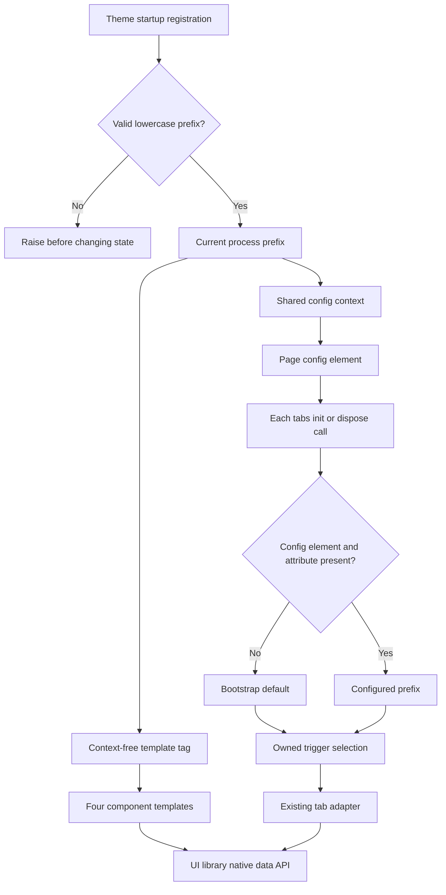

# Phase 06.42: Theme-registered data-attribute prefix for templates and object-detail tabs — Research

**Researched:** 2026-11-21
**Domain:** Django template registration and existing object-detail JavaScript lifecycle
**Confidence:** MEDIUM — official web fallback classified by the research seam; source observations and executed baselines are identified separately.

<user_constraints>
## User Constraints (from CONTEXT.md)

The following is copied verbatim from the phase context. [VERIFIED: .planning/phases/06.42-theme-registered-data-attribute-prefix-for-templates-and-obj/06.42-CONTEXT.md:21-67]

<!-- DATA_b7d28f41_START -->
### Approved source decisions D-01–D-05

These summaries retain the issue's numbering. Read the complete source handover; summaries do not narrow it.

- **D-01 — Bounded scope:** Change the actions-menu toggle, language selector, vertical object-detail tabs,
  accordion groups and `tabs.js` trigger selector. Exclude host-app markup, dropdown adapters (U3), adapter
  namespace changes (U4), `--bs-*` CSS properties (U5), crispy-bootstrap5 (U6) and `register_theme()` (U8).
  No new Django setting or project-level override.
- **D-02 — Registration:** Provide `register_data_prefix(prefix: str)` in `crud_views.lib` for a theme's
  `AppConfig.ready()`. Default to `bs`; repeated calls use the last value. Validate at registration time
  against `^[a-z][a-z0-9]*(-[a-z0-9]+)*$`; invalid input raises. Document last-call-wins behavior.
- **D-03 — Templates:** Add the simple tag `` in the `crud_views` tag library. Use it
  for the identified `data-*-toggle`, `-target`, `-parent` and `-popper-config` attributes. It must work
  in inclusion-tag contexts and separately rendered object-detail groups. Preserve the four components'
  default output. Update the two layout-pack recipes and actions-menu example, and related theme/buttons guidance.
- **D-04 — JavaScript configuration:** Carry the registered prefix on `#cv-config`. Build the tabs trigger
  selector at each initialization/disposal call, not at script load. Missing config element or attribute
  falls back to `bs`. Preserve marked roots, nested-tablist boundaries, repeat safety, DOM-ready and
  modal load/unload behavior, absent adapter/Tab no-op, malformed adapter errors and no show/focus.
- **D-05 — Acceptance and documentation:** Preserve existing default Python/golden/JS behavior, subject only
  to D-06's config-markup exception. Under `coreui`, all four templates emit the corresponding
  `data-coreui-*` attributes with no `data-bs-*` attributes in those components, the config carries
  `coreui`, and tabs initialize CoreUI triggers inside owned tablists while ignoring Bootstrap triggers.
  Test invalid prefixes per validation rule. Document the one-line registration and when forks need it;
  add a `### Added` changelog entry. This is nonbreaking; leave `docs/migrating-1.0.md` unchanged.
  Downstream deletion of overrides, the custom tabs script/wrapper and app-order check is release guidance,
  not work authorized in this upstream phase.

### Default-page compatibility clarification

- **D-06 — Always emit the prefix:** The maintainer selected option 1 on 2026-11-21. The shipped
  `#cv-config` always includes the prefix attribute, including when its value is `bs`.
  This is the sole exception to the issue's blanket byte-identical default-page requirement.
  Component markup and behavior remain unchanged under the default prefix.
  Do not conditionally omit the attribute for `bs` merely to preserve page bytes.
  Retain the missing-element/missing-attribute fallback for existing/custom config markup.
  Preserve existing golden expectations except where a fixture necessarily contains the newly added
  config attribute; any such adjustment must be limited to this approved difference.

### Builder discretion

Module placement, exact validation exception type, the config attribute name and test-file organization
remain delegated by the approved issue. `data-data-prefix` is the issue's suggestion, not a locked name.
Choose the smallest solution consistent with existing registration and template-tag patterns.
No new registry framework, initialization adapter, setting, dependency or broader theme API is requested.
<!-- DATA_b7d28f41_END -->

### Deferred Ideas (OUT OF SCOPE)

<!-- DATA_8c91e4ad_START -->
No new deferred ideas arose. Preserve the issue's explicit exclusions and downstream-only cleanup note.
No pending todos matched this phase. The separate phase 06.43 workspace does not expand this phase's scope.
<!-- DATA_8c91e4ad_END -->
</user_constraints>

## Summary

Implement one validated process-local string, one getter-backed simple tag, one config field and a selector assembled inside the existing trigger-discovery function. These are implementation recommendations within the explicitly delegated discretion above. Preserve the existing registration style: button registration updates the theme mapping, and icon registration assigns the named library before resetting its existing cache. Neither requires a new framework for this scalar feature. [VERIFIED: src/crud_views/lib/button_classes.py:217-220] [VERIFIED: src/crud_views/lib/icons.py:133-140]

The principal hidden regression is a source guard, not rendering: the alert test requires literal Bootstrap attributes to exist in template source. Its exact predicate is `if "data-bs-" in path.read_text()` and it asserts `assert matches`. Change that guard to recognize the approved dynamic attribute syntax while retaining rejection of forbidden locations. Existing normalized action-menu goldens do not prove raw byte equality: they sort attributes/classes and collapse whitespace. Keep them unchanged and add deterministic raw-component baseline checks where needed. [VERIFIED: tests/test1/test_alerts.py:377-402] [VERIFIED: tests/test1/test_action_menus_golden.py:39-56]

**Primary recommendation:** use a small dedicated module with a public registration re-export, `ValueError`, the issue-suggested config attribute, and per-call selector construction; retain all existing adapters and event wiring.

## Architectural Responsibility Map

This is the recommended allocation of the approved scope; it does not introduce additional services.

| Capability | Primary Tier | Secondary Tier | Rationale |
|---|---|---|---|
| Register and validate the prefix | Django application startup | None | Theme-owned process configuration; no request/project override |
| Render native data attributes | Django template rendering | Browser native data API | Each existing template remains responsible for its markup |
| Publish current prefix | Django config inclusion tag | Browser DOM | One value shared by both existing config tags |
| Discover owned tab triggers | Browser/client | Existing theme tab adapter | Modify selection only; adapter still owns init/dispose |
| Dropdown, accordion, tab interaction | Existing UI library | Existing adapter for tabs | Preserve native keyboard, selection and grouping behavior |

The server/client ownership follows D-01–D-04 above. CoreUI's official Bootstrap 5 documentation confirms native dropdown, tab/pill and accordion-parent attributes. [CITED: https://coreui.io/bootstrap/docs/components/dropdowns/] [CITED: https://coreui.io/bootstrap/docs/components/navs-tabs/] [CITED: https://coreui.io/bootstrap/docs/components/collapse/]

## Project Constraints (from AGENTS.md)

The user supplied AGENTS.md instructions are mirrored by the inspected repository CLAUDE.md. Apply these actionable directives:

- Maintainability is a hard constraint: bounded additions, explicit unsupported cases, preservation of proven code, and accounting for cognitive/runtime/query costs. [VERIFIED: CLAUDE.md:15-27]
- Broad Python verification uses multiple workers; use the established bounded four-worker runner while agents share resources. Tiny individual probes may be serial. [VERIFIED: CLAUDE.md:127-132]
- Follow existing fixture conventions; preserve the class-attribute prefix `cv_`, workflow prefix `wf_`, CRUD view keys and permission mapping. This phase adds no view attributes or permission behavior. [VERIFIED: CLAUDE.md:133-142]
- Use line length 120, double quotes, existing Hatchling packaging and existing version-management process. Do not bump the package for this research. [VERIFIED: CLAUDE.md:143-146]
- A new Breaking entry requires migration documentation; this approved additive phase instead requires Added and leaves the migration guide untouched. [VERIFIED: CLAUDE.md:147] [VERIFIED: .planning/phases/06.42-theme-registered-data-attribute-prefix-for-templates-and-obj/06.42-CONTEXT.md:42-49]
- After shipping, refresh codebase maps before subsequent work. If a phase worktree is requested, use the documented GSD workspace convention, first check existing worktrees, and open the repository subfolder. This research creates no worktree and switches no branch. [VERIFIED: CLAUDE.md:66-89]
- Before push, run Python tests, Vitest, strict documentation build, lint and format checks; public changes require a changelog entry. Avoid downstream project names in product files. [VERIFIED: .planning/PROJECT.md:149-166]

<phase_requirements>
## Phase Requirements

Phase scope is assigned to issue decisions rather than newly numbered requirements: the roadmap states “Issue #391 D-01–D-05 and acceptance criteria”; D-06 is the later authoritative clarification. Do not invent permanent requirement IDs. Retain the existing object-detail behavior described by completed ODT-01–ODT-05. [VERIFIED: .planning/ROADMAP.md:2183-2203] [VERIFIED: .planning/REQUIREMENTS.md:262-272]

| ID | Required behavior | Research support |
|---|---|---|
| D-01 | Four components and existing tabs selector only | Responsibility map and explicit file ownership below |
| D-02 | Startup registration, default, grammar and last-call-wins | Scalar module, public import, fullmatch and atomic rejection |
| D-03 | Context-independent tag and preserved default components | Exact context/attribute inventory; raw baseline checks |
| D-04 | Config transport, per-call lookup and preserved tabs lifecycle | Shared context builder; existing ownedTriggers integration |
| D-05 | CoreUI acceptance, invalid-input tests, executable documentation | Validation map and recipe extraction |
| D-06 | Always publish prefix, including default | Config tests for both tag aliases; sole approved page-byte difference |
</phase_requirements>

## Standard Stack

Reuse the project's installed stack. No new dependency or package upgrade is needed for this implementation recommendation.

| Layer | Declared contract / observed version | Use |
|---|---|---|
| Python | `requires-python = ">=3.12"`; baseline interpreter 3.12.3 | Standard-library regular expression and scalar state |
| Django | `"django (>=4.2.0)"`; baseline 5.2.19 | Existing simple/inclusion tags and template loader |
| pytest / xdist | Installed 9.2.0 / 3.8.0 | Existing Python rendering and registry tests |
| Vitest / jsdom | Installed 5.0.5 / 30.1.3; declared `"vitest": "^5.1.0"`, `"jsdom": "^31.0.0"` | Existing actual-script DOM harness; mismatch tracked below |
| Node / npm | Installed v24.21.0 / 11.19.0; declared `"node": ">=20"` | Existing JavaScript test commands |

Declared Python/Django values: [VERIFIED: pyproject.toml:25-35]. Declared JavaScript values: [VERIFIED: package.json:10-22]. Installed versions were printed by interpreter metadata, `node --version`, `npm --version` and `npm ls --depth=0` during this research. [VERIFIED: local environment probes, 2026-11-21]

**Package Legitimacy Audit:** Not applicable: no external package installation is proposed. Existing dependencies are not new recommendations; no registry/latest-version claim or publish date is asserted. Do not update dependencies merely to implement the prefix.

## Architecture Patterns

### System Architecture Diagram



This diagram is the proposed implementation of D-01–D-06; it adds no database or network boundary.

### Registry and public import

Recommend a new `src/crud_views/lib/data_prefix.py` containing a private scalar, a registration function and a read-at-call-time getter. Re-export only the approved registration function from `src/crud_views/lib/__init__.py`, so the documented public import is `from crud_views.lib import register_data_prefix`. These are **proposed new implementation locations**, not existing APIs. The package initializer was read and is currently empty (0 lines); other registration implementations are separate modules. [VERIFIED: source read and wc of src/crud_views/lib/__init__.py, 2026-11-21] [VERIFIED: src/crud_views/lib/button_classes.py:217-220] [VERIFIED: src/crud_views/lib/icons.py:133-140]

Use `ValueError` for every invalid input, including nonstrings. The closest validating registration API already raises `ValueError` for wrong input type and invalid entries before publishing any change. No Django strict-setting branch, custom exception or system-check ID is necessary. [VERIFIED: src/crud_views/lib/view/label_mode.py:42-64]

Validate with an explicit string check followed by `re.fullmatch`; do not trim, lowercase, stringify, substitute Unicode character classes or impose an unapproved maximum length. A rejected registration must retain the prior valid value. A scalar assignment needs no mapping merge, cache invalidation, signals or locking abstraction. These are recommendations implementing D-02, not additional supported configuration knobs.

Python documents that fullmatch covers the entire string while the dollar anchor also matches before a final newline. A local probe of the approved anchored grammar produced `match= True fullmatch= False` for a prefix with a trailing newline. [CITED: https://docs.python.org/3.12/library/re.html#re.fullmatch] [VERIFIED: Python 3.12.3 regex probe, 2026-11-21]

Register at startup, not per request. Same-value registration is naturally repeat-safe; different later calls overwrite as approved. Django documents that ready can be called more than once in some tests. [CITED: https://docs.djangoproject.com/en/5.2/ref/applications/#django.apps.AppConfig.ready]

### Template and config plumbing

Make the tag call the getter; never import the scalar into the tag module, which would bind an old string. Use the context-free tag directly inside each existing attribute name, avoiding extra assignment tags or whitespace changes.

| Existing component | Exact current values to replace | Preserve and test |
|---|---|---|
| Actions-menu toggle | `data-bs-toggle="dropdown"`, `data-bs-popper-config='{"strategy":"fixed"}'` | List-only Popper config; toolbar/card omission, classes, icon, accessible label |
| Language selector | `data-bs-toggle="dropdown"` | More-than-one-language condition, POST form, URLs, translations and CSRF |
| Vertical tabs | `data-bs-toggle="pill"`, `data-bs-target="#{{ entry.panel_id }}"` | IDs, active state, tabindex, ARIA and owned tablist marker |
| Accordion group | `data-bs-toggle="collapse"`, `data-bs-target="#{{ presentation.panel_id }}"`, `data-bs-parent="#{{ component.id }}"` | Parent only when component exists; first-open projection and standalone rendering |

Sources for each row respectively: [VERIFIED: src/crud_views/templates/crud_views/tags/actions_menu_toggle.html:1-7], [VERIFIED: src/crud_views/templates/crud_views/snippets/language_selector.html:1-25], [VERIFIED: src/crud_views_object_detail/templates/crud_views_object_detail/layouts/tabs-vertical/object_detail.html:1-31], [VERIFIED: src/crud_views_object_detail/templates/crud_views_object_detail/layouts/accordion/group.html:1-33].

The actual reduced contexts explain why a global context variable is unsuitable: the action inclusion tag returns its own mapping; the language inclusion tag returns `"languages"`, `"current"`, `"next"`; object-detail rendering independently constructs group/component mappings. Keep those mappings unchanged. [VERIFIED: src/crud_views/templatetags/crud_views.py:158-170,621-628] [VERIFIED: src/crud_views_object_detail/templatetags/crud_views_object_detail.py:39-68]

Recommend adding the proposed key `data_prefix` to the existing shared config context and rendering the proposed attribute `data-data-prefix="{{ data_prefix }}"` unconditionally. This follows the issue's suggested name and avoids another load directive in the config template. Both config tags already call the same builder; existing keys are exactly `"request_path"`, `"request_query_string"`, `"csrf_token"`. Preserve them and the modal-shell include. [VERIFIED: src/crud_views/templatetags/crud_views.py:103-121] [VERIFIED: src/crud_views/templates/crud_views/tags/cv_config.html:1-6]

### JavaScript integration

Move trigger-selector construction into `ownedTriggers(root)`, after reading the current global document config. Both init and disposal already call this function. Keep root inclusion, closest-tablist filtering, empty-root short circuit, adapter lookup, errors and event handlers in their existing order. Current selector values are exactly `tab`, `pill`, `list`; current boundary selector is `'[data-cv-od-tabs], [role="tablist"], .nav, .list-group'`. [VERIFIED: src/crud_views_object_detail/static/crud_views_object_detail/js/tabs.js:10-56]

Do not query for the config inside the supplied modal root: the page's config is outside that root. Do not cache the prefix at script evaluation. Do not add an observer, retry timer, instance registry, dropdown adapter, automatic global namespace selection or a second regular-expression policy in JavaScript. The prefix is trusted startup configuration; arbitrary hand-edited malformed config markup is not an expanded supported input surface. Recommend documenting that registration and UI adapter/library selection must agree.

The existing public initializer and events remain exactly `cv.initObjectDetailTabs`, `DOMContentLoaded`, `cv:modal:loaded`, `cv:modal:unload`. Missing adapters no-op; present malformed adapters raise `TypeError`. [VERIFIED: src/crud_views_object_detail/static/crud_views_object_detail/js/tabs.js:23-67]

## Don't Hand-Roll

| Problem | Do not build | Use instead |
|---|---|---|
| Attribute-name safety | Escaping-based sanitizer or permissive normalization | Approved ASCII grammar at registration |
| Theme selection | Settings layer or general registry framework | One startup-owned string |
| Tag context propagation | Inject prefix into every group and action context | Context-free simple tag |
| Tab lifecycle | New script wrapper or state/instance bookkeeping | Existing ownedTriggers and tab adapter |
| Dropdown and accordion behavior | Custom initialization or parent closing logic | UI library's native data attributes |
| Documentation verification | Assert example strings exist only | Compile and render actual fenced recipes |

These are recommendations constrained by D-01–D-04. Django simple tags already conditionally escape their output; a plain string return is sufficient, with no new safe-string bypass. [CITED: https://docs.djangoproject.com/en/5.2/howto/custom-template-tags/#simple-tags]

## Runtime State Inventory

This is a bounded attribute refactor with new process configuration, not a persisted identifier migration. The following inventory states the examined scope and avoids claiming that external downstream state was inspected.

| Category | Items found / inspected | Required action |
|---|---|---|
| Stored data | The inspected templates, config builder and tabs script have no persistent prefix store; proposed prefix exists only in process state | Code change; no upstream data migration |
| Live service config | Theme startup registration is the authorized input; downstream deployments were not inspected | Document theme registration; no remote changes |
| OS-registered state | No OS registration operation in this phase's inspected execution path | No OS rename/re-registration task |
| Secrets / env vars | Existing config carries CSRF; preserve `"csrf_token"` unchanged | No new secret or environment variable |
| Build artifacts | Shipped template/static files change; old collected/copied assets do not acquire edits by changing source | Normal package/static deployment; document downstream copies can be removed after release, outside this phase |

Evidence for the bounded inventory: [VERIFIED: src/crud_views/templatetags/crud_views.py:103-121] [VERIFIED: src/crud_views/templates/crud_views/tags/cv_config.html:1-6] [VERIFIED: src/crud_views_object_detail/static/crud_views_object_detail/js/tabs.js:1-67]. No database or external-service audit was performed or is required by this scope.

## Common Pitfalls

1. **Trailing newline validation loophole.** An anchored match can accept it; fullmatch rejects it. Cover final and embedded newline, not just spaces. [CITED: https://docs.python.org/3.12/library/re.html]
2. **Stale imported scalar or cached selector.** Resolve through a getter during rendering and read the DOM each init/dispose call; prove registering after tag import and inserting config after script evaluation. This directly implements D-02/D-04.
3. **Source assertion mistaken for golden output.** Update the alert guard's recognition of `data-bs-` and dynamic attribute syntax, preserving its forbidden-path test. Do not remove the guard or regenerate unrelated goldens. [VERIFIED: tests/test1/test_alerts.py:377-402]
4. **Accidental attribute renaming outside scope.** Keep host tooltip markup, adapter namespaces, CSS custom properties, owned markers and existing ARIA/IDs unchanged. This is required by D-01.
5. **Process state leaking between tests.** Snapshot/restore the new private scalar around registering tests, using monkeypatch fixtures. The repository already isolates theme state by monkeypatch/rebind; use a small fixture, not a public reset API. [VERIFIED: tests/test1/conftest.py:23-28]
6. **Wrong selection during cleanup.** A test that changes config only before initialization does not prove disposal resolves it afresh. Include a late-prefix disposal case with a recording custom adapter and matching owned nodes, without adding live theme-switch support.
7. **Overclaiming compatibility.** jsdom plus recording adapters proves selection/lifecycle dispatch, not a complete CoreUI theme's visual or keyboard behavior. Preserve existing library-owned behavior and label the receipt accurately.

## Code Examples

These are **proposed implementation sketches**, not claims that the new module, keys or API already exist. The locked input values `"bs"`, `"coreui"` and `^[a-z][a-z0-9]*(-[a-z0-9]+)*$` are quoted verbatim in the context above. The exception choice is grounded in the existing validating registration API.

```python
# Proposed scalar registry; public registration is re-exported from crud_views.lib.
import re

_data_prefix = "bs"

def register_data_prefix(prefix: str) -> None:
    if not isinstance(prefix, str) or re.fullmatch(r"^[a-z][a-z0-9]*(-[a-z0-9]+)*$", prefix) is None:
        raise ValueError(f"Invalid data attribute prefix: {prefix!r}")
    global _data_prefix
    _data_prefix = prefix

def get_data_prefix() -> str:
    return _data_prefix
```

```javascript
// Proposed first lines inside ownedTriggers(root); retain the existing traversal.
const prefix = document.getElementById("cv-config")?.getAttribute("data-data-prefix") ?? "bs";
const trigger = `[data-${prefix}-toggle="tab"], [data-${prefix}-toggle="pill"], [data-${prefix}-toggle="list"]`;
```

The nullish fallback implements absent-element/absent-attribute behavior exactly; it does not promise recovery from deliberately malformed custom attribute values. The three selector values come from the existing selector quoted above. [VERIFIED: src/crud_views_object_detail/static/crud_views_object_detail/js/tabs.js:10-20]

## Documentation Work

Recommended edits within the approved files:

- Theme reference: give the public import and a one-line call inside ready, default/last-call-wins/grammar/error, supported component scope, native-library/adapter alignment, and downstream cleanup guidance. Update the existing claim that prefix-only forks must copy dropdown templates; retain the override guidance for genuinely different DOM structures. Existing guidance names `data-bs-toggle="dropdown"`. [VERIFIED: docs/reference/theme.md:725-743]
- Buttons reference: keep the class-table boundary while explaining that the native data-API prefix is configured separately. Existing text names `data-bs-toggle` as markup-owned. [VERIFIED: docs/reference/buttons.md:314-320]
- Action menus: update the actual split-toggle fence and clipping prose; preserve list-only fixed Popper strategy. [VERIFIED: docs/reference/action_menus.md:322-349]
- Layout packs: update the vertical component and accordion group fences, preserving the separate group/component contexts. Existing fences quote `data-bs-toggle="pill"`, `data-bs-toggle="collapse"` and conditional `data-bs-parent`. [VERIFIED: docs/reference/object_detail_layout_packs.md:143-216]
- JavaScript reference: explain config lookup timing and missing-config fallback alongside the unchanged lifecycle contract. [VERIFIED: docs/reference/javascript.md:126-141]
- Changelog: add the approved Added entry; do not rewrite historical migration sections. D-05/D-06 above are authoritative.

Execute the published registration snippet, render the action-menu fence in list and non-list contexts, and render both copied layout recipes with the alternative prefix. The existing `recipe(path, section, language="django")` helper extracts one actual fence; copied layout tests install those fences via a locmem loader and already verify escaping, selection and reference integrity. Extend that pattern, not a new documentation framework. [VERIFIED: tests/test1/test_heading_docs.py:35-41] [VERIFIED: tests/test1/test_presentation_migration_docs.py:26-105]

## State of the Art

| Existing approach | Phase approach | Impact |
|---|---|---|
| Literal Bootstrap prefixes in four owned components | Startup-registered prefix rendered through a tag | Prefix-only compatible forks can use the upstream templates |
| Script-load fixed selector | Selector built for each owned trigger scan | Config may follow script; cleanup uses the current config |
| Theme recipe copies repeat literal prefix | Executable recipe fences use the same tag | Documentation follows the new surface |

This comparison describes the approved phase delta, not ecosystem deprecation claims. [VERIFIED: .planning/phases/06.42-theme-registered-data-attribute-prefix-for-templates-and-obj/06.42-CONTEXT.md:27-60]

## Environment Availability

Observed 2026-11-21; availability is not a claim that the whole support matrix passed.

| Dependency | Availability / version | Execution guidance |
|---|---|---|
| Cached primary Python runner | Python 3.12.3, Django 5.2.19, pytest 9.2.0, xdist 3.8.0 | Proven focused command below |
| Other cached runners | Imports succeeded for Python 3.12.3/3.13.15 with Django 4.2.30/5.2.19/6.0.10; Python 3.14.7/3.15.0rc2 with Django 5.2.19/6.0.10 | Optional/current matrix verification must record actual outcomes; no historical missing-runtime assumption |
| Node/npm | v24.21.0 / 11.19.0 | Existing focused Vitest command succeeds |
| Installed JS dependencies | Vitest 5.0.5 / jsdom 30.1.3 differ from manifest ranges | Cached receipt is provisional; reconcile lockfile install before claiming declared-stack validation |
| Documentation/lint | Local venv mkdocs 1.6.1 and Ruff 0.17.3 available | Use local executables below |
| Context7 | Neither MCP tools nor ctx7 CLI available | Official web fallback used |
| External service | None needed by proposed feature | No service setup |

[VERIFIED: local executable/import/metadata probes, 2026-11-21]

The declared nox matrix literally uses `["3.12", "3.13", "3.14", "3.15"]` and `["4.2", "5.2", "6.0"]`; its explicit skip condition excludes Django 4.2 on Python 3.14 and 3.15. Report this as repository policy, not a new upstream-compatibility inference. Installed-distribution verification is separate from source checkout runs: nox asserts the package origin and runs normal plus traced-request suites. [VERIFIED: noxfile.py:3-56]

**No missing dependency blocks planning.** The JS manifest/install mismatch is an execution preflight item. Research made no dependency changes.

## Validation Architecture

Enabled by the project's explicit `"nyquist_validation": true`; security is also explicitly enabled. [VERIFIED: .planning/config.json:24-48]

### Test Framework

| Property | Value |
|---|---|
| Python framework | Existing pytest 9.2.0 + pytest-django + xdist |
| Python config | Existing pyproject pytest section, `addopts = "--strict-markers"` |
| JS framework/config | Existing Vitest/jsdom; `environment: "jsdom"`, `include: ["tests/js/**/*.test.js"]` |
| Fast new Python gate | Root-based selection with `-k data_prefix`, four workers |
| Fast JS gate | `npm test -- tests/js/object-detail-tabs.test.js` |
| Full regression gate | Source-backed full Python suite and full JS suite, then docs/lint |

Config evidence: [VERIFIED: pyproject.toml:145-146] [VERIFIED: vitest.config.js:1-9]. Commands below are recommended invocations; new test file names are proposals.

### Phase Requirements → Test Map

| Req | Behavior / boundary | Tests to add or retain | Automated command | Exists? |
|---|---|---|---|---|
| D-02 | Default, public import, successive registration, same-value repeat, rejected write atomicity | Proposed test_data_prefix.py registry tests | `PYTHONPATH=src:. .nox/tests-3-12-django-5-2/bin/python -m pytest tests/test1 -k data_prefix -n 4 -q` | New tests |
| D-02 | Every grammar rule including newline/nonstring | Parameterized valid/invalid cases in same file | Same command | New tests |
| D-03/D-05 | Context-free tag; four actual template renders; CoreUI attributes only within scoped components | Proposed test_data_prefix.py rendering tests; preserve existing language/layout/action tests | Same command | New tests plus existing coverage |
| D-04/D-06 | Both config tags always emit default/custom prefix; request/query/CSRF/modal shell preserved | Proposed test_data_prefix.py config tests | Same command | New tests |
| D-04/D-05 | Prefix-specific tab/pill/list selection, late config, init and disposal, root/nested ownership, adapter contract | Extend existing object-detail-tabs.test.js | `npm test -- tests/js/object-detail-tabs.test.js` | Existing file, new cases |
| D-03/D-06 | Default raw component bytes and existing goldens | Capture deterministic component baselines before edits; preserve existing goldens | Focused command below | Existing goldens; new raw checks where absent |
| D-01/D-05 | Alert guard rejects static/dynamic attributes outside allowed paths | Update existing test_alerts.py guard and its synthetic fixtures | `PYTHONPATH=src:. .nox/tests-3-12-django-5-2/bin/python -m pytest tests/test1/test_alerts.py -n 4 -q` | Existing |
| D-05 | Actual theme/action/layout recipes compile and honor prefix | Proposed test_data_prefix_docs.py; retain presentation migration recipe tests | `PYTHONPATH=src:. .nox/tests-3-12-django-5-2/bin/python -m pytest tests/test1 -k 'data_prefix or presentation_migration_docs' -n 4 -q` | New tests plus existing file |

The exact original rule is `^[a-z][a-z0-9]*(-[a-z0-9]+)*$`. Recommended case classes: empty input; uppercase anywhere; digit/hyphen first; consecutive/trailing hyphens; leading/trailing/internal whitespace; final newline; underscore; period/colon; quotes/brackets/angle brackets; non-ASCII letters/digits; None, bytes, numbers, booleans and containers. Accept the approved examples and at least one single-letter, digit-suffixed and multi-segment lowercase prefix. These are derived test cases, not new validation restrictions.

For render coverage, exercise menu list and non-list locations, language menu with two languages, tabs with stable component identity, accordion component parent and standalone parent omission. Compare generated targets/ARIA/selection before and after; restrict the no-Bootstrap assertion to the four changed components, not host pages. Use actual inclusion/render tags so missing context propagation fails visibly.

For JS, retain all 27 existing cases. Add recording-adapter tests for the alternative prefix across all three existing trigger values, mixed-prefix siblings, marked root, nested unmarked lists, missing element, missing attribute, config inserted after script load, config changed between separate scans, modal load/unload and disposal lookup. Do not alter old default fixtures merely to make the new tests work. Existing JS fixture cleanup removes script listeners/global guards. [VERIFIED: tests/js/object-detail-tabs.test.js:21-58,68-125,129-194,202-294]

### Verified baseline and invocation trap

The following executed successfully against the unchanged checkout:

```bash
PYTHONPATH=src:. .nox/tests-3-12-django-5-2/bin/python -m pytest tests/test1 -k 'action_menus_golden or language_selector or test_modal or layout_a11y or layout_packs or presentation_migration_docs' -n 4 -q
# 163 passed in 10.03s

npm test -- tests/js/object-detail-tabs.test.js
# 1 test file passed; 27 tests passed; 1.40s
```

[VERIFIED: executed baseline commands, 2026-11-21]

**Use root selection for suites containing object-detail tests.** Passing nested object-detail files directly in the initial pytest argument list failed before configuration. Actual output:

```text
ImportError while loading conftest '.../tests/test1/od/conftest.py'.
E django.core.exceptions.ImproperlyConfigured: Requested setting USE_I18N, but settings are not configured.
```

The nested conftest imports the tag module at module load; the parent initializes Django in `pytest_configure()`. Root collection plus `-k` succeeded without any source change. [VERIFIED: tests/test1/od/conftest.py:1-5] [VERIFIED: tests/test1/conftest.py:43-49] [VERIFIED: failed and successful baseline invocations, 2026-11-21]

### Sampling Rate and Full Gates

Per task commit: run the affected focused Python command and/or tabs JS file. Per wave: run the focused existing baseline plus new prefix/docs tests and alerts. Phase gate:

```bash
PYTHONPATH=src:. .nox/tests-3-12-django-5-2/bin/python -m pytest tests -n 4 -q
npm test
.venv/bin/mkdocs build --strict
.venv/bin/ruff check src tests
.venv/bin/ruff format --check src tests
```

These full gates were **not** run during research. For declared-stack/matrix receipts, reconcile the existing JS install and use the project's nox workflow; do not relabel the cached focused results as full matrix or real CoreUI browser verification.

### Wave 0 Gaps

- Add the proposed registry/render/config tests and a narrow shared scalar-restoration fixture usable by documentation tests.
- Capture deterministic raw component baselines before template edits; existing normalized goldens remain useful but insufficient alone.
- Extend the existing JS suite; no new harness needed.
- Execute the actual public registration/action-menu/layout fences.
- Adapt the alert source guard before expecting full regressions to remain green.
- Resolve the installed-versus-declared JS version mismatch for final verification; no framework installation is needed to start implementation.

## Security Domain

Scope: startup string validation and emission into HTML attribute names / CSS selectors. Authentication, authorization and CSRF logic remain unchanged; preserve the existing config token and language POST markup. [VERIFIED: src/crud_views/templates/crud_views/tags/cv_config.html:1-6] [VERIFIED: src/crud_views/templates/crud_views/snippets/language_selector.html:13-19]

Use version-qualified ASVS names. The current OWASP index uses 5.0.x: V1 Encoding and Sanitization, V2 Validation and Business Logic, V6 Authentication, V7 Session Management, V8 Authorization and V11 Cryptography. The older generic research template's V2/V3/V4/V5/V6 numbering is not the current index. [CITED: https://cheatsheetseries.owasp.org/IndexASVS]

| ASVS 5.0 category | Applies to this change? | Recommended control |
|---|---|---|
| V1 Encoding and Sanitization | Yes | Keep Django escaping; no safe-string override; reject unsafe attribute-name characters |
| V2 Validation and Business Logic | Yes | Exact string type/grammar, before assignment; rejected values retain prior state |
| V6 Authentication | No new surface | Preserve existing request behavior |
| V7 Session Management | No new surface | Preserve existing CSRF/config transport |
| V8 Authorization | Preservation only | Prefix changes never determine action permission |
| V11 Cryptography | No new cryptographic behavior | Do not introduce cryptographic code |

| Threat pattern | STRIDE | Mitigation / evidence to require |
|---|---|---|
| Invalid prefix creates malformed HTML or selector | Tampering / denial of service | Reject unsafe characters and nonstrings at startup; newline regression |
| Global state contaminates unrelated requests/tests | Tampering | Startup-only API documentation, fail-before-assignment, test isolation |
| Selector captures foreign nested widgets | Tampering | Preserve owned marker and nearest-tablist filter; mixed-prefix/nested tests |
| Config or template plumbing damages token/target attributes | Tampering | Preserve original context values and rendered ARIA/target relationships |

These are phase threat-model recommendations, not a certification or new compliance claim.

## Assumptions Log

No unverified factual assumptions are needed to implement the approved scope. Proposed module/API internals, exception selection, config key/name and test organization are explicitly delegated implementation choices; they are identified as recommendations above. External downstream state, full CoreUI browser operation and unexecuted test-matrix combinations are deliberately not claimed verified.

## Open Questions

1. **Final JavaScript verification environment.** The installed packages run the baseline but `npm ls --depth=0` reports `ELSPROBLEMS` because their versions fall outside the manifest's explicit ranges. Reconcile against the existing lockfile as an execution preflight and record versions; do not opportunistically upgrade the project.
2. **Source-guard acceptance wording.** D-05 asks that default tests stay unchanged, but the literal-source alert guard directly conflicts with the approved template edit. Preserve rendered assertions/goldens and the guard's security intent while updating only its source-syntax recognition; record this distinction in the plan.
3. **Fresh browser receipt.** None produced in research. The required phase acceptance can be mapped to Python/Vitest as above; any additional visual/native-library claim requires an actual browser receipt and should stay bounded.

## Sources

### Primary repository evidence

All source observations above came from opened files using line-numbered filesystem reads in this session, not codebase-map inference. The phase context and captured issue were read in full; canonical source and recipe sections were inspected. The graph status command returned `"exists": false`, so no semantic graph relationships were used. [VERIFIED: gsd graphify status, 2026-11-21]

### Official documentation — MEDIUM

- https://docs.djangoproject.com/en/5.2/howto/custom-template-tags/ — simple-tag escaping.
- https://docs.djangoproject.com/en/5.2/ref/applications/ — startup/ready repetition.
- https://docs.python.org/3.12/library/re.html — full-string validation and final-newline semantics.
- https://coreui.io/bootstrap/docs/components/navs-tabs/ — native tabs/pills.
- https://coreui.io/bootstrap/docs/components/dropdowns/ — native dropdown trigger.
- https://coreui.io/bootstrap/docs/components/collapse/ — target and accordion parent attributes.
- https://cheatsheetseries.owasp.org/IndexASVS — versioned security category names.

Research-plan returned Context7 for docs and websearch for external ecosystem/security questions. Context7 MCP and CLI were unavailable, so official pages were retrieved through the web fallback; the seam command `query classify-confidence --provider websearch --verified` returned `"confidence": "MEDIUM"`. Four digests were cached with that tier. [VERIFIED: research-plan/classify-confidence/research-store commands, 2026-11-21]

## Metadata

| Area | Confidence | Reason |
|---|---|---|
| Standard stack | MEDIUM | Existing versions observed; JavaScript manifest mismatch disclosed |
| Architecture | MEDIUM | Direct current-source inspection, locked decisions, official documentation |
| Pitfalls / validation | MEDIUM | 163 Python and 27 JS baseline passes; actual direct-path failure reproduced |
| Browser / full matrix | Not claimed | Not executed during research |

**Research date:** 2026-11-21. **Refresh before execution if source or manifests change; otherwise review within 30 days.** This is a research maintenance recommendation, not a dependency support guarantee.

