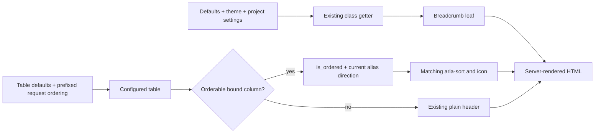

# Phase 06.43: Breadcrumb class keys and accessible table sort state (#393) - Research

**Researched:** 2026-11-21
**Domain:** Django template leaves, layered class registry, django-tables2 bound-column ordering
**Confidence:** MEDIUM — official-source fallback classification; local behavior additionally exercised.

<user_constraints>
## User Constraints (from CONTEXT.md)

The following decisions, discretion and exclusions are copied verbatim from the approved context. [VERIFIED: .planning/phases/06.43-breadcrumb-class-keys-and-accessible-table-sort-state-393/06.43-CONTEXT.md:19-75,125-130]

<!-- DATA_13f7a9bc_START -->
### D-01 — Bounded scope: U9 + U10

Breadcrumb class keys and the table header sort state, nothing more. Out of scope: the breadcrumb `nav` element's
untranslated `aria-label="breadcrumb"`, breadcrumb item content and links, the card list's sorting UI, pagination,
the `--bs-*` CSS properties (U5), and any new setting or API.

### D-02 — Breadcrumb class keys (U9)

Three ordinary keys in `crud_views/lib/button_classes.py`. Names and defaults were proposed by the assistant and
approved with the design.

| Key | Default | Element |
|---|---|---|
| `breadcrumb:list` | `breadcrumb` | `<ol>` |
| `breadcrumb:item` | `breadcrumb-item` | every `<li>` |
| `breadcrumb:item-active` | `active` | added to the last (current-page) `<li>` only |

- No `breadcrumb:nav` key: nothing needs it, and an empty default would need empty-`class` handling.
- Follow existing registry precedence (defaults < `register_button_classes()` < `CRUD_VIEWS_BUTTON_CLASSES`) and
  empty-value behaviour, as for the navbar keys of #384. Keep no hard-coded copies of these classes in the template.
- `aria-current="page"` on the last item stays independent of styling.
- With default keys the rendered breadcrumb is byte-identical to today.

### D-03 — Header sort state (U10)

In block `table.thead` of `table/bootstrap5.html`, for orderable columns only:

- `aria-sort` on the `<th>`: `ascending` / `descending` when `column.is_ordered` (direction from
  `column.order_by_alias.is_descending`), else `none`. This is exactly the attribute both downstream themes render.
- The sort icons use the same condition instead of `request.GET.sort`, so icon and `aria-sort` always agree and
  tables with a `prefix` show their icon.
- Non-orderable columns are unchanged: no `aria-sort`, no icon.

Visible change (accepted): a table ordered by default (`Meta.order_by`, or an `order_by` passed to the table) now
shows its sort icon on first load without `?sort=`. Not breaking; record it under CHANGELOG `### Changed`.

### D-04 — Acceptance and documentation

- Breadcrumb: existing breadcrumb output and goldens unchanged; tests that each key is overridable through theme
  registration and project settings and lands on the right element (`item-active` on the last item only).
- Table header: tests for a URL-sorted table (ascending and descending), a default-ordered table without `?sort=`,
  a table with a `prefix`, an unsorted orderable column (`none`) and a non-orderable column (no attribute, no icon),
  each checking icon and `aria-sort` together.
- Docs: list the three keys in `docs/reference/buttons.md` / `docs/reference/theme.md` next to the navbar keys and
  mention them in `docs/reference/breadcrumb.md`; state in the table docs that the sort icon and `aria-sort` follow
  the table's effective ordering. CHANGELOG: `### Added` (breadcrumb keys, `aria-sort`), `### Changed` (icon on
  default ordering), `### Fixed` (icon on prefixed tables). Not breaking, so `docs/migrating-1.0.md` is untouched.
- Downstream note, not upstream work: once released, the CoreUI theme can drop its `.header-breadcrumb .breadcrumb`
  rule (setting `breadcrumb:list` to `breadcrumb my-0` instead), and the CoreUI and Tabler themes can delete their
  copied `table.thead` blocks.


### Builder's Discretion

The approved issue leaves exact template formatting of the `aria-sort` expression, test file layout, and placement of the table-docs sentence to the builder. Use existing patterns and the simplest bounded implementation. These are implementation choices, not unresolved product decisions.

Follow the repository's multicore pytest preference for broad verification; use bounded workers when resources are shared. Research should verify existing test helpers and dependency behavior, not reopen D-01–D-04 or broaden scope.

## Deferred Ideas

No new ideas were introduced. Existing issue exclusions remain excluded: breadcrumb nav-label translation, item content/links, card sorting, pagination, U5 CSS properties, new settings/APIs, and downstream theme implementation. Do not create extra tasks or phases for these exclusions.
<!-- DATA_13f7a9bc_END -->
</user_constraints>

## Summary

Use three ordinary defaults and inline calls to the existing class tag; keep the breadcrumb leaf's existing whitespace. The registry already merges defaults, theme registration and project settings, and its ordinary getter returns an empty string for empty/non-string values. No new resolver, settings, model logic or registry category is needed. [VERIFIED: src/crud_views/lib/button_classes.py:217-249 — `classes = {**defaults, **_THEME_BUTTON_CLASSES, **_settings_layer()}`; `return value if isinstance(value, str) else ""`]

Use the bound column for both header indicators. Installed django-tables2 3.0.1 exposes current ordering independently of query-parameter spelling; a real request probe confirmed unsorted, URL ascending/descending, constructor-default and prefixed ordering. The same properties are present in upstream 2.5.3 source, the declared floor; that source comparison is not a claim that the floor suite ran. [VERIFIED: session runtime probe, 2026-11-21] [CITED: https://django-tables2.readthedocs.io/en/latest/_modules/django_tables2/columns/base.html] [CITED: https://raw.githubusercontent.com/jieter/django-tables2/v2.5.3/django_tables2/columns/base.py]

**Primary recommendation:** keep production edits in the existing registry and two leaves; pair them with focused rendering tests, exact breadcrumb output preservation, inventory-count maintenance and the approved documentation/release notes. This implements D-01–D-04 without adding architecture. [VERIFIED: approved context quoted above]

## Architectural Responsibility Map

| Capability | Primary tier | Secondary tier | Rationale / provenance |
|---|---|---|---|
| Resolve breadcrumb classes | Django backend registry | Server-rendered leaf | Existing three-layer lookup; `get_button_class()` is used by `cv_button_class`. [VERIFIED: src/crud_views/lib/button_classes.py:227-249; src/crud_views/templatetags/crud_views.py:694-697] |
| Determine effective ordering | django-tables2 backend | Server-rendered header | Bound column follows table ordering; request configuration supplies prefixed ordering. [CITED: https://django-tables2.readthedocs.io/en/latest/_modules/django_tables2/columns/base.html] |
| Emit classes, icon and ARIA | Django template leaf | Browser accessibility tree | Approved D-02/D-03 puts presentation in templates; no client-side state. [VERIFIED: approved context quoted above] |
| Preserve styling semantics | Existing theme registry | Consumer theme | Theme and settings overrides already exist. [VERIFIED: src/crud_views/lib/button_classes.py:217-249] |

## Project Constraints (from AGENTS.md)

AGENTS.md and CLAUDE.md contain the same guidance in this checkout. The following actionable directives apply to planning; no project-local skill directories were found by filesystem checks, and agent-skills returned no injected skills. [VERIFIED: session filesystem/query observations, 2026-11-21]

- Prefer the simplest bounded, explainable solution; preserve proven code; prefer self-contained opt-in additions; account for cognitive/runtime/query costs; narrow excessive complexity even if tests pass. [VERIFIED: AGENTS.md:15-27]
- Use multicore pytest for broad runs; bounded workers are appropriate here. Use serial only for a concrete isolation/debugging reason or tiny selection, and do not interrupt a run merely to change workers. Follow existing fixture naming. [VERIFIED: AGENTS.md:129-135]
- Keep view class attributes prefixed `cv_`, existing operation/permission conventions and workflow methods prefixed `wf_`; these areas need no changes in this phase. Use 120-character Python lines and double quotes, existing Hatch build/version tooling. [VERIFIED: AGENTS.md:137-146 — `cv_`, `wf_`, `120`, `double quotes`]
- A new breaking changelog entry requires paired migration guidance until 1.0; D-04 expressly classifies this change as non-breaking. [VERIFIED: AGENTS.md:147; approved context quoted above]
- Use documented development/test/docs commands where available; the commit hook runs Ruff formatting. Refresh codebase maps after ship. If creating a phase worktree, use the documented GSD workspace convention, reuse existing worktrees and work in the repository subfolder. No new worktree or ship is part of this research. [VERIFIED: AGENTS.md:32-86]

## Standard Stack

Retain the declared dependencies; no package addition or upgrade belongs in the phase. The version column is observed installed tooling, not a proposed newest-version pin. [VERIFIED: pyproject.toml:25-35,59-84 — `requires-python = ">=3.12"`, `"django (>=4.2.0)"`, `"django-tables2 (>=2.5.3)"`; session metadata probe]

| Component | Observed version | Use |
|---|---|---|
| Python / Django | 3.12.3 / 5.2.19 | Existing borrowed test environment; source checkout selected explicitly. [VERIFIED: session interpreter/metadata/origin probe] |
| django-tables2 | 3.0.1 | Real bound columns and RequestConfig. [VERIFIED: session metadata/probe] |
| pytest / pytest-django / pytest-xdist | 9.2.0 / 4.14.0 / 3.8.0 | Existing rendering and integration coverage with four workers. [VERIFIED: session metadata/test run] |
| lxml | 6.1.3 | Existing HTML assertions. [VERIFIED: session metadata; tests/test1/test_table_template.py:13] |
| MkDocs | 1.6.1 | Strict documentation build. [VERIFIED: session version/build run] |

**Package Legitimacy Audit:** not applicable to dependency selection: this phase adds no external packages. Bootstrap below installs the project's existing declared extras only; this research does not recommend a new registry package or claim a latest release/publish date. [VERIFIED: approved context; pyproject.toml:25-84]

## Architecture Patterns



Diagram describes the approved composition, using the existing registry and bound-column APIs. [VERIFIED: approved context; src/crud_views/lib/button_classes.py:227-249] [CITED: https://django-tables2.readthedocs.io/en/latest/_modules/django_tables2/columns/base.html]

### Component Responsibilities

Paths below are edit targets in the existing checkout, not instructions to create a parallel package tree. The package source mapping is explicitly `"src/crud_views"` in the wheel declaration. [VERIFIED: pyproject.toml:104-111]

| Target | Bounded responsibility / source evidence |
|---|---|
| `src/crud_views/lib/button_classes.py` | Add approved defaults beside ordinary navbar keys. Existing `"navbar:link-active": "active"` is the nearest precedent. [VERIFIED: src/crud_views/lib/button_classes.py:100-105] |
| `src/crud_views/templates/crud_views/tags/breadcrumb.html` | Replace literal classes, load tag library without emitting a new newline; preserve last-item semantics. Existing literals: `class="breadcrumb"`, `class="breadcrumb-item active"`, `aria-current="page"`, `class="breadcrumb-item"`. [VERIFIED: src/crud_views/templates/crud_views/tags/breadcrumb.html:1-15] |
| `src/crud_views/templates/crud_views/table/bootstrap5.html` | Keep header attrs, scope, text, blocks and query link; replace state predicates and add approved attribute. Existing expressions: `column.attrs.th.as_html`, `scope="col"`, `request.GET.sort == column.name`, `table.prefixed_order_by_field=column.order_by_alias.next`. [VERIFIED: src/crud_views/templates/crud_views/table/bootstrap5.html:9-27] |
| Existing breadcrumb/registry/table test modules | Reuse direct tag rendering, isolated registry snapshots, real tables and request setup. [VERIFIED: tests/test1/test_breadcrumb.py:323-368; tests/test1/test_button_classes.py:134-146; tests/test1/test_table_template.py:198-255] |
| Existing docs and changelog | Add key inventory near navbar sections, breadcrumb usage, and sort-state sentence in ListView's table section. [VERIFIED: docs/reference/buttons.md:194-226; docs/reference/theme.md:819-875; docs/reference/list_view.md:71-90; approved D-04 quoted above] |

### Pattern 1: preserve template bytes

Place the non-output load tag on the existing first line, next to the guard. Substitute only the class values; preserve spacing around the active class and all item markup. The navbar leaf already uses this inline-load convention. A research-only in-memory candidate, never written into product files, rendered byte-identically for zero, one and two items with escaped labels and URLs. [VERIFIED: src/crud_views/templates/crud_views/tags/navbar_items.html:1-5 — ``; session substitution probe]

### Pattern 2: test the configured table, not the raw URL

Construct fresh dictionary-backed tables and configure them with a real RequestFactory request. Select the package template explicitly: test settings otherwise select `DJANGO_TABLES2_TEMPLATE="django_tables2/bootstrap5.html"`. Existing `_pagination_engine` and `_render_table_pagination` render the package source through an isolated Engine and prove origin; use that approach for the header tests without broad helper refactoring. [VERIFIED: tests/test1/conftest.py:127-128; tests/test1/test_table_template.py:198-255]

### Pattern 3: preserve independent semantics and escaping

Use direct `cv_button_class` output in quoted class attributes. Its simple tag is documented as autoescaped, and the registry accepts ordinary empty values. Last-item ARIA remains unconditional within the last-item branch even if the active class is empty. Test all three defaults, theme replacements, project-over-theme precedence, empty values, and quote-bearing class strings using the navbar precedent. [VERIFIED: src/crud_views/templatetags/crud_views.py:694-697; src/crud_views/lib/button_classes.py:238-249; tests/test1/test_navbar_templates.py:93-125; approved D-02]

## Don't Hand-Roll

| Problem | Use instead | Evidence |
|---|---|---|
| Theme precedence and empty removal | Existing registry/getter/tag | Existing merge/getter quoted above. [VERIFIED: src/crud_views/lib/button_classes.py:217-249] |
| Current sorting / query-prefix detection | Configured bound-column state | Current direction and next-link direction are separate properties. [CITED: https://django-tables2.readthedocs.io/en/latest/_modules/django_tables2/columns/base.html] |
| Query encoding / toggle links | Existing `cv_querystring` link | Keep `table.prefixed_order_by_field=column.order_by_alias.next`. [VERIFIED: src/crud_views/templates/crud_views/table/bootstrap5.html:18] |
| Icon markup | Existing semantic icon renderer | Names/defaults are `"table-sort-asc": "fas:angles-up"`, `"table-sort-desc": "fas:angles-down"`. [VERIFIED: src/crud_views/lib/icons.py:39-40] |
| General-purpose attr renderer or new table adapter | Existing serializer and bounded template edit | No new rendering path is approved. [VERIFIED: approved D-01/D-03] |

## Common Pitfalls

1. **Adding a load line changes bytes.** A new standalone line emits whitespace even though the tag itself emits nothing. Keep the load on the existing guard line. Add a raw-string baseline assertion; the shared golden helper normalizes whitespace and therefore cannot prove this requirement alone. Existing helper operation is `re.sub(r"\s+", " ", ...)`. Do not regenerate existing goldens. [VERIFIED: tests/lib/helper/golden.py:10-16; session byte-equivalence probe]

2. **Reading alias direction without checking ordered state.** An unsorted column still has a usable alias for its next link. The installed source returns `self.name in (self._table.order_by or ())` for `is_ordered`; evaluate it first, and use current direction rather than `.next` for the icon. [VERIFIED: installed django_tables2/columns/base.py:625-633, read from the environment recorded below] [CITED: https://django-tables2.readthedocs.io/en/latest/_modules/django_tables2/columns/base.html]

3. **Passing an ARIA default through render_attrs is not a forced override.** Installed `render_attrs` starts with keyword args then updates from caller attrs. A live probe using caller descending and keyword ascending produced `aria-sort="descending"`. Keep caller classes, data attributes and serializer escaping intact. Appending the computed attribute to the existing serialized attrs preserves ordinary attrs, but a consumer already supplying its own same-named attribute can create duplicate markup. D-03 does not settle collision precedence; do not silently promise collision handling or build a new attr API to solve it. Record the supported bounded behavior in the plan and avoid replacing `.as_html` with a hand-serialized loop. [VERIFIED: installed django_tables2/templatetags/django_tables2.py:275-282; session collision probe]

4. **Missing registry-count collateral.** Current assertions include `assert len(EXPECTED_KEYS) == 128`, `assert len(core) == 128`, `assert len(get_button_classes()) == 146`, including subprocess snippets. Docs say `The default table has 128 keys` and `146 effective default keys`. Adding the three approved keys requires arithmetic updates to 131 core and 149 core-plus-workflow; the eighteen workflow defaults stay unchanged. Include all relevant assertions and documentation consistency tests. [VERIFIED: tests/test1/test_button_classes.py:144-146,254-268,383-428; tests/test1/test_theme_adoption_docs.py:328-334; docs/reference/buttons.md:194-202,273-274; arithmetic from D-02]

5. **Passing against the dependency's template.** The default test configuration renders the dependency template unless explicitly selected. Keep real package-template origin evidence. Also assert each header's icon and ARIA together, rather than separate page-wide searches. [VERIFIED: tests/test1/conftest.py:127-128 — `DJANGO_TABLES2_TEMPLATE="django_tables2/bootstrap5.html"`; tests/test1/test_table_template.py:102-113,226-255]

6. **Overclaiming accessibility conformance.** WAI-ARIA defines the approved tokens but recommends the property on one header per table. D-03 explicitly requires `none` on other orderable columns and bound-column direction for ordered columns. Implement the locked contract; do not claim it is identical to that recommendation or introduce an unapproved multi-sort redesign. [CITED: https://www.w3.org/TR/wai-aria-1.2/#aria-sort] [VERIFIED: approved D-03 quoted above]

## Code Examples

These are planning patterns, not product changes. Approved literal values are quoted in User Constraints; existing semantic icon names are quoted above. The first substitution was rendered in memory against the current template. [VERIFIED: session byte-equivalence probe]

```django

```

Within the existing class attributes, use ``, `` and ``; retain the existing single literal space between item and active classes. The approved joined-empty behavior follows the navbar leaf and need not strip spaces. [VERIFIED: approved D-02; src/crud_views/templates/crud_views/tags/navbar_items.html:2-3]

For the icon inside the existing orderable branch, the decision shape is:

```django

    
        
    
        
    

```

Emit the corresponding approved ARIA token on the header using the same predicates, with the explicit unsorted branch. Keep the existing link expression. [VERIFIED: approved D-03; src/crud_views/templates/crud_views/table/bootstrap5.html:15-18; src/crud_views/lib/icons.py:39-40]

Observed probe results (labels describe probe cases, not new API values): [VERIFIED: session runtime probe, 2026-11-21]

| Case | is_ordered | alias.is_descending | Prefixed field | Next alias |
|---|---|---|---|---|
| Unsorted | False | False | sort | value |
| URL ascending | True | False | sort | -value |
| URL descending | True | True | sort | value |
| Constructor default | True | False | sort | -value |
| Prefixed URL descending | True | True | p-sort | value |

## State of the Art

No stack modernization is required. The relevant transition is project-local: literal breadcrumb classes become ordinary registered classes, and raw request comparison becomes effective bound-column state. Both are approved in D-02/D-03. The implementation must retain dependency floors rather than raising them for APIs already present in the floor's upstream source. [VERIFIED: approved context] [CITED: https://raw.githubusercontent.com/jieter/django-tables2/v2.5.3/django_tables2/columns/base.py]

## Environment Availability

All observations are from this research session. The worktree had neither a local `.nox` nor `.venv`; the previous phase paths must not be copied as if they exist. A shared source checkout provides usable read-only test/docs executables. Tests explicitly selected this worktree through `PYTHONPATH=src`, and an import-origin probe confirmed the worktree's package was loaded. [VERIFIED: session filesystem, metadata and source-origin probes]

| Dependency | Available here | Version / fallback |
|---|---|---|
| uv | Yes, on PATH | 0.12.19. [VERIFIED: `uv --version`] |
| Python 3.12 | Yes, on PATH | 3.12.14; borrowed test interpreter is 3.12.3. [VERIFIED: interpreter probes] |
| Worktree-local test/docs environment | No | Create the proposed `.venv` below, or use verified shared executables. [VERIFIED: filesystem probe] |
| Shared test Python | Yes | `/home/alex/projects/alex/django-crud-views/.nox/tests-3-12-django-5-2/bin/python`. [VERIFIED: executed session command] |
| Shared MkDocs | Yes | `/home/alex/projects/alex/django-crud-views/.venv/bin/mkdocs`. [VERIFIED: executed session command] |
| Context7 MCP / ctx7 CLI | No | Official documentation via built-in web tool; no research dependency install. [VERIFIED: tool discovery and command lookup] |

**Bootstrap recipe for execution:** proposed local paths below are created by the first command, not presumed existing. The extras are already declared and mirror the existing nox test setup plus docs tooling. The recipe itself was not run during research; resolved versions may differ. [VERIFIED: pyproject.toml:37-84; noxfile.py:20-28; `uv venv --help`, `uv pip install --help`] [ASSUMED: a fresh resolver transaction will install successfully in the future execution environment]

```bash
uv venv --python 3.12 .venv
uv pip install --python .venv/bin/python '.[polymorphic,workflow,ordered,test,dev]' 'django~=5.2.0'
PYTHONPATH=src .venv/bin/python -c 'import crud_views; print(crud_views.__file__)'
PYTHONPATH=src .venv/bin/python -m pytest tests/test1/test_breadcrumb.py tests/test1/test_table_template.py tests/test1/test_button_classes.py -n 4 -q
PYTHONPATH=src .venv/bin/mkdocs build --strict
```

**Immediately runnable verified fallback:** run from this repository's root; do not install into or mutate the borrowed environment. [VERIFIED: successful session commands]

```bash
PYTHONPATH=src /home/alex/projects/alex/django-crud-views/.nox/tests-3-12-django-5-2/bin/python -m pytest tests/test1/test_breadcrumb.py tests/test1/test_table_template.py tests/test1/test_button_classes.py -n 4 -q
PYTHONPATH=src /home/alex/projects/alex/django-crud-views/.venv/bin/mkdocs build --strict --site-dir /tmp/cv-0643-research-docs
```

Missing dependencies with no fallback: none for scoped validation. No database service or browser is needed for the dictionary-backed header tests; existing integration fixtures configure Django for tests. [VERIFIED: tests/test1/test_table_template.py:198-255; tests/test1/conftest.py:43-50; successful baseline]

## Validation Architecture

Validation and security remain enabled under role defaults: project config contains neither an explicit Nyquist disable nor a security disable. [VERIFIED: .planning/config.json:1-112, read in full this session]

### Test Framework

| Property | Value / evidence |
|---|---|
| Framework | pytest 9.2.0, pytest-django 4.14.0, pytest-xdist 3.8.0 in the executed fallback. [VERIFIED: metadata probe] |
| Configuration | Existing pytest options include `addopts = "--strict-markers"`; Django config is in the test conftest. [VERIFIED: pyproject.toml:145-146; tests/test1/conftest.py:43-50] |
| Quick run | The three-module fallback command above: 242 passed in 5.37 seconds. [VERIFIED: session pytest output] |
| Full suite | `PYTHONPATH=src .venv/bin/python -m pytest tests -n 4 -q` after local bootstrap; substitute the verified shared executable if using fallback. Existing nox matrix installs and checks distribution origin, so do not confuse source-path validation with distribution/matrix validation. [VERIFIED: noxfile.py:5-57; AGENTS.md:131] |
| Documentation | Strict build passed in 1.45 seconds using the fallback command. [VERIFIED: session MkDocs output] |

### Approved Decisions → Test Map

No formal new requirement IDs were supplied; these rows map directly to locked decisions instead of inventing requirements. [VERIFIED: parent scope; approved context]

| Decision | Behavior | Test type | Command selector | Existing home / gap |
|---|---|---|---|---|
| D-02/D-04 | Defaults, registry precedence, empty values, complete inventory | Unit | `python -m pytest tests/test1/test_button_classes.py -q` | Existing module; add keys and update core/effective counts. [VERIFIED: tests/test1/test_button_classes.py:134-146,254-268,383-428] |
| D-02/D-04 | Exact default bytes; each key on correct element; last-item ARIA and escaping independent | Rendering | `python -m pytest tests/test1/test_breadcrumb.py -q` | Existing module; add raw-output baseline and theme/settings cases. [VERIFIED: tests/test1/test_breadcrumb.py:323-368] |
| D-03/D-04 | URL asc/desc, default constructor and Meta ordering, prefix, unsorted, non-orderable | Rendering | `python -m pytest tests/test1/test_table_template.py -q` | Existing module; add real table/request matrix and combined icon/ARIA assertions. [VERIFIED: tests/test1/test_table_template.py:198-255; approved D-04] |
| D-03 | Ordinary custom header attrs, scope, links and escaping survive | Rendering | Same table command | Include a custom class/data attr in the matrix; preserve serialization. [VERIFIED: src/crud_views/templates/crud_views/table/bootstrap5.html:14-20] |
| D-04 | Public inventories and counts agree with runtime | Docs regression | `python -m pytest tests/test1/test_theme_adoption_docs.py tests/test1/test_button_classes.py -n 4 -q` | Existing modules; update existing exact counts plus breadcrumb docs coverage. [VERIFIED: tests/test1/test_theme_adoption_docs.py:328-336] |
| D-01/D-04 | Existing breadcrumb, navbar, table pagination and theme consumers remain stable | Regression | `python -m pytest tests/test1/test_breadcrumb.py tests/test1/test_table_template.py tests/test1/test_button_classes.py tests/test1/test_button_classes_templates.py tests/test1/test_button_classes_checks.py tests/test1/test_navbar_templates.py tests/test1/test_theme_adoption_docs.py -n 4 -q` | Existing suites; preserve goldens. [VERIFIED: source modules read this session; approved D-04] |

Commands in this map are suffixes for the environment commands above. Focused serial selections are small; use four workers for the combined affected/full suite. Add registry snapshot/restore only in tests that register a theme; the existing registry fixture resets caches on both sides. [VERIFIED: tests/test1/test_button_classes.py:134-141; AGENTS.md:131]

### Sampling and Wave 0 Gaps

- Per task: affected focused tests, then scoped formatting/lint for changed Python.
- Per integration: the combined affected suite and strict docs build.
- Phase gate: all approved acceptance cases and existing goldens pass; report separately whether full suite, dependency floor and Django matrix were actually run.
- No new framework/configuration is needed. New assertions are the gap, especially raw breadcrumb bytes and the sort-state matrix; they are not implemented by this research. [VERIFIED: baseline output and existing test infrastructure cited above]

## Security Domain

Use the role's ASVS 4.0.3 numbering explicitly; OWASP now publishes 5.0.0, whose numbering must not be silently mixed with these categories. For this template-only change, output encoding is the applicable control. [CITED: https://asvs.owasp.org/] [CITED: https://raw.githubusercontent.com/OWASP/ASVS/v4.0.3/4.0/en/0x13-V5-Validation-Sanitization-Encoding.md]

| ASVS 4.0.3 category | Applies to phase | Control |
|---|---|---|
| V2 Authentication | No changed behavior | Preserve current paths; no authentication changes in D-01. [VERIFIED: approved scope] |
| V3 Session Management | No changed behavior | No session changes in D-01. [VERIFIED: approved scope] |
| V4 Access Control | No changed behavior | Preserve existing breadcrumb items/links and table actions. [VERIFIED: approved scope] |
| V5 Validation, Sanitization and Encoding | Yes | Keep autoescaped class tags and existing attribute serializer; add quote-bearing class override assertion. [VERIFIED: src/crud_views/templatetags/crud_views.py:694-697] [CITED: ASVS 4.0.3 V5 source above] |
| V6 Cryptography | No changed behavior | No crypto or secret handling is introduced. [VERIFIED: approved scope] |

| Threat | STRIDE | Mitigation / evidence |
|---|---|---|
| Attribute injection via class override | Tampering | Existing simple tag escaping and quoted attributes; avoid safe-marking configurable classes. [VERIFIED: src/crud_views/templatetags/crud_views.py:694-697; tests/test1/test_navbar_templates.py:93-115] |
| Misleading sort state | Spoofing of presentation | Both indicators follow the same effective bound-column predicates; test prefix/default ordering together with ARIA. [VERIFIED: approved D-03/D-04] |

## Assumptions Log

| # | Claim | Section | Risk / disposition |
|---|---|---|---|
| A1 | Fresh local bootstrap will resolve and install the existing extras successfully. [ASSUMED] | Environment Availability | Future network/resolver state untested. Execute setup before implementation; verified borrowed tools provide a fallback. This is an operational probe, not an unresolved product choice. |

## Open Questions

No new product decisions are needed for the approved acceptance cases. The one concrete edge not settled by D-03 is an explicitly caller-supplied same-named header attribute: duplicate direct attributes versus caller-overridden defaults. State the bounded behavior explicitly in the implementation plan; keep ordinary custom attrs and current serialization. Do not invent a generalized attribute API or broaden the approved feature to resolve this edge. [VERIFIED: installed render_attrs source/probe; approved D-01/D-03]

No runtime-state inventory is needed: this phase adds class keys and updates a presentation predicate; it does not rename persisted identifiers, migrate data, or change service/OS registration. [VERIFIED: approved scope]

## Sources

- Current repository: AGENTS.md/CLAUDE.md, approved phase context and issue snapshot, current state/requirements, registry/templates/tests/docs listed above; opened in this session. Local source claims use line references and verbatim relevant values.
- [django-tables2 BoundColumn source](https://django-tables2.readthedocs.io/en/latest/_modules/django_tables2/columns/base.html): current aliases, ordering and attr behavior; cross-checked against installed 3.0.1 source and runtime probes.
- [django-tables2 2.5.3 BoundColumn source](https://raw.githubusercontent.com/jieter/django-tables2/v2.5.3/django_tables2/columns/base.py): presence of approved properties at the declared floor.
- [django-tables2 ordering](https://django-tables2.readthedocs.io/en/latest/pages/ordering.html): column aliases/orderability.
- [WAI-ARIA 1.2 aria-sort](https://www.w3.org/TR/wai-aria-1.2/#aria-sort): token meanings and single-header recommendation; 2023-06-06 Recommendation.
- [OWASP ASVS](https://asvs.owasp.org/) and [versioned V5 control source](https://raw.githubusercontent.com/OWASP/ASVS/v4.0.3/4.0/en/0x13-V5-Validation-Sanitization-Encoding.md): version distinction and contextual output encoding.

## Metadata

Research-plan seam selected Context7 for both questions; neither MCP nor CLI was available. Used built-in web fallback against official documentation and cached both digests. `classify-confidence --provider websearch --verified` returned `MEDIUM`; that is the external-research tier, rather than an invented HIGH rating. Local source and probe evidence are separately tagged VERIFIED. Graph context was unavailable because graphify is disabled; no graph relationships were inferred. [VERIFIED: session seam/tool output]

**Confidence breakdown:** stack MEDIUM (installed metadata and existing declarations); architecture MEDIUM (approved design, source and runtime corroboration); pitfalls MEDIUM (source/observed probes; attr collision explicitly bounded).

**Research date:** 2026-11-21. **Recheck trigger:** source changes to registry/templates, dependency resolution changes, or execution environment recreation. No product implementation, dependency manifest change, plan or golden regeneration was performed by this research.
