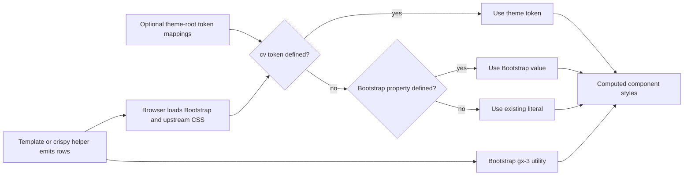

# Phase 06.44: CSS tokens for manage pages and formsets - Research

**Researched:** 2026-11-21
**Domain:** CSS custom properties, Bootstrap gutters, bounded contract and browser verification
**Confidence:** MEDIUM overall; source inventory HIGH; external documentation MEDIUM

<user_constraints>
## User Constraints (from CONTEXT.md)

The following decisions and deferred scope are copied verbatim. [VERIFIED: 06.44-CONTEXT.md:17-46]

<!-- DATA_82e941ac_START -->
## Implementation Decisions

### Approved source decisions D-01–D-04

Retain the issue's numbering. These summaries do not narrow its acceptance criteria.

- **D-01 — Bounded scope:** Cover the six read properties, compact gutter, and help-button documentation in `manage.css` and `formset.css`. Exclude extensions U12, additional tokens, other CSS files, class-key changes and new Python APIs/settings. D-03 explicitly includes the compact helper's `Row(..., css_class=...)` edit; the issue's broad “no Python changes” wording does not exclude that named class-string change.
- **D-02 — Tokens and compatibility:** Read each token through the exact chain below. Upstream never declares `--cv-*` tokens, including on `:root`. Preserve every current literal fallback. Existing themes redefining `--bs-*` on upstream elements remain supported through the fallback and may migrate at their convenience. This is nonbreaking.

| Token | Required fallback chain |
|---|---|
| `--cv-secondary-color` | `var(--cv-secondary-color, var(--bs-secondary-color, #6c757d))` |
| `--cv-secondary-text-emphasis` | `var(--cv-secondary-text-emphasis, var(--bs-secondary-text-emphasis, #495057))` |
| `--cv-body-bg` | `var(--cv-body-bg, var(--bs-body-bg, #fff))` |
| `--cv-border-color` | `var(--cv-border-color, var(--bs-border-color, #dee2e6))` |
| `--cv-border-radius` | `var(--cv-border-radius, var(--bs-border-radius, .375rem))` |
| `--cv-tertiary-bg` | `var(--cv-tertiary-bg, var(--bs-tertiary-bg, #f8f9fa))` |

- **D-03 — Component variables:** Remove only the `--bs-gutter-x: 1rem` declaration from the compact-row rule, preserving its other styling. Add `gx-3` to both the compact headings template and the crispy field `Row`, retaining the existing `cv-formset-compact-*` classes. Keep the help-button `--bs-btn-color` contrast rule and `.btn-outline-secondary` selector, but read secondary text emphasis through its new chain. Explain that themes either retain the stock class and hand the value to their own button variable or supply their own `manage:help` class.
- **D-04 — Acceptance and documentation:** Add a CSS-parsing test that rejects any Bootstrap variable read outside an approved token fallback chain, any upstream token declaration, and any used token absent from the docs table. The help button's `--bs-btn-color` is the sole allowed Bootstrap-variable declaration in these two files. Verify unchanged stock computed styles in light mode and a nested `data-bs-theme="dark"` section. Formset/manage tests and goldens must pass apart from the added `gx-3` class. Publish a “CSS tokens” section in `docs/reference/theme.md` with all six tokens, theme-root mapping, the nested-colour-mode explanation and help-button guidance; link it from formset CSS-class guidance and manage documentation. Add changelog `### Added` for tokens and `### Changed` for `gx-3`. Leave `docs/migrating-1.0.md` unchanged.

### Builder discretion

The approved issue delegates CSS-chain formatting, the test parser, and documentation-link placement. Choose a small, understandable implementation consistent with existing tests. Test-file organization and verification harness reuse are implementation details for research/planning, not new product choices.

### Carry-forward constraints

- Preserve established layouts, responsive behavior, selectors, formset behavior and manage access rules.
- Phase 06.42 owns theme data-attribute prefixes; its work is separate from CSS tokens. This phase adds no registration mechanism or runtime theme state.
- Keep broad pytest runs multicore. Report browser checks separately from Python/JavaScript suites and tie evidence to the source tested.


## Deferred Ideas

No new deferred ideas or matching pending todos. Preserve issue exclusions: extensions U12 is separate; CoreUI/Tabler source changes and downstream release/adoption remain outside this phase.

<!-- DATA_82e941ac_END -->
</user_constraints>

## Summary

Implement the approved chains directly at the twelve existing use sites, make the two gutter class edits, and publish one canonical token table. The source inventory below establishes the complete change surface; no registry, Python API, new CSS file, or downstream theme change is needed. This recommendation follows D-01–D-04. [VERIFIED: 06.44-CONTEXT.md:23-46]

Use existing Vitest/jsdom infrastructure for stylesheet parsing plus a deliberately small exact-chain guard; retain Python rendering/documentation tests; use real Chromium for computed styles. jsdom explicitly does not implement layout, so its successful CSS parsing is not browser acceptance. [CITED: https://github.com/jsdom/jsdom]

**Primary recommendation:** Separate the static contract check from a small before/after browser comparison covering all twelve declarations, the two gutters, stock light/nested dark modes, token precedence, literal fallbacks and the documented theme-root mapping.

## Architectural Responsibility Map

This is a planning allocation derived from the locked scope, not a new runtime architecture. [VERIFIED: 06.44-CONTEXT.md:23-46]

| Capability | Primary tier | Secondary tier | Responsibility |
|---|---|---|---|
| Token fallback resolution | Browser | Theme stylesheet | Resolve chains on actual consuming elements. |
| Gutter utility attachment | Django template / crispy helper | Bootstrap CSS | Emit the utility on each of the two rows; preserve existing hooks. |
| Theme-root mappings | Downstream theme CSS | Documentation | Themes declare tokens; upstream only consumes them. |
| Contract regression guard | Development test runner | Documentation table | Parse the two stylesheets and compare the approved token vocabulary. |
| Manage access / formset writes | Existing Django backend | — | Preserve existing behavior; no new work in these layers. |

## Project Constraints (from AGENTS.md)

The supplied AGENTS.md instructions match the repository CLAUDE.md read this session. The following directives constrain planning. [CITED: CLAUDE.md]

- Developer maintainability is a hard constraint. Prefer a bounded, explainable solution, preserve proven paths, avoid hidden state and unnecessary abstractions or queries.
- Use existing project commands and test conventions. Broad pytest runs use multiple workers; serial execution requires a concrete reason. Do not interrupt a running suite to change its worker count.
- Keep existing fixture naming and the in-memory Django test configuration.
- Preserve the existing attribute prefixes, CRUD keys and permission mapping; this phase introduces none.
- Python formatting uses 120-character lines and double quotes; the pre-commit formatter runs on commits.
- Preserve hatchling packaging and bump-my-version version synchronization; no version bump is required by this scope.
- Breaking changelog entries require paired migration documentation, but this phase is explicitly nonbreaking and leaves the migration document unchanged.
- After a future ship run, refresh codebase maps before subsequent work. Worktree creation follows the established phase convention; the requested phase worktree already supplies this task's working directory.

No configured researcher skills were returned by the skills seam. Graph status returned `exists: false`; no graph-derived claims are used. [VERIFIED: research init and graphify status command output, 2026-11-21]

## Phase Requirements

No requirement IDs have been assigned: the roadmap says **“None assigned; use the approved issue acceptance criteria.”** Keep D-01–D-04 as acceptance identifiers rather than inventing requirement IDs or changing requirements/state. [VERIFIED: .planning/ROADMAP.md:2183-2191]

| Decision | Research support |
|---|---|
| D-01 | Exact source inventory and explicit exclusions below. |
| D-02 | Six-token use-site map, W3C inheritance semantics, precedence/fallback checks. |
| D-03 | Two row-class changes, preserved alignment/help selector, gutter measurement. |
| D-04 | Static contract guard, bounded browser cases, existing regression commands and documentation links. |

## Standard Stack

Retain the repository's declared/locked versions. These are source and environment observations, not recommendations to upgrade to registry-latest releases. No new package is required. [VERIFIED: package.json:19-22; pyproject.toml:70-83]

| Component | Version / source | Use |
|---|---|---|
| Bootstrap | Fixture URL contains `bootstrap@5.3.3/dist/css/bootstrap.min.css`. [VERIFIED: tests/browser/templates/manage/page.html:5] | Stock baseline, nested modes and gutter utility. |
| Vitest | Lock entry `"version": "5.1.0"`. [VERIFIED: package-lock.json:1354-1357] | Existing unit-test runner. |
| jsdom | Lock entry `"version": "31.0.0"`; Node constraint `"^22.22.2 || ^24.15.0 || >=26.0.0"`. [VERIFIED: package-lock.json:652-679] | Existing stylesheet parser; not rendering proof. |
| pytest / pytest-xdist | Existing test dependencies; observed compatible cached environment has 9.2.0 / 3.8.0. [VERIFIED: pyproject.toml:70-83; runtime probe, 2026-11-21] | Real Django rendering/docs/golden regressions. |
| Playwright / Chromium | Existing cached runtime launched successfully: 1.64.1 / 149.0.7827.55. [VERIFIED: browser launch probe, 2026-11-21] | Real computed-style comparison. |
| Django / crispy | Observed cached supported environment: Django 6.0.10, django-crispy-forms 2.7, crispy-bootstrap5 2026.9. [VERIFIED: runtime probe, 2026-11-21] | Current-worktree rendering via explicit source import path. |

**Setup recommendation:** Restore existing JavaScript dependencies with `npm ci`, without changing manifests/lockfile. Reuse an existing compatible Python interpreter with checkout source explicitly selected, or create an isolated local environment using the project's existing dependencies. Do not mutate another worktree's installation. The test task already uses `test -d node_modules || npm ci`. [VERIFIED: taskfile.yaml:82-87]

### Package Legitimacy Audit

No new dependencies or package upgrades are proposed; the new-package legitimacy gate is not applicable. Restoring existing locked dependencies is environment setup, not adding a CSS parser dependency. Avoid importing a parser merely because it happens to be transitively installed.

## Architecture Patterns

### System architecture diagram

The diagram expresses the approved fallback contract. [VERIFIED: 06.44-CONTEXT.md:24-35]



### Component responsibilities and exact source inventory

Source references below are locations to edit, not newly generated filesystem paths. Every existing discrete CSS value is quoted verbatim. The six replacement strings are quoted in User Constraints; do not alter their pairs or literals.

| Source location | Current declaration(s), verbatim | Required work |
|---|---|---|
| manage stylesheet, lines 74–76 | `color: var(--bs-secondary-text-emphasis, #495057);` | Wrap with approved emphasis token. [VERIFIED: src/crud_views/static/crud_views/css/manage.css:74-76] |
| manage stylesheet, lines 100–106 | `[data-cv-manage] [data-cv-manage-help].btn-outline-secondary`; `--bs-btn-color: var(--bs-secondary-text-emphasis, #495057);`; `color: var(--bs-secondary-color, #6c757d);` | Preserve help selector/declaration property; wrap both reads. [VERIFIED: src/crud_views/static/crud_views/css/manage.css:100-106] |
| formset stylesheet, row card | `border: 1px solid var(--bs-secondary-color, #6c757d);`; `border-radius: var(--bs-border-radius, .375rem);`; `background-color: var(--bs-body-bg, #fff);` | Wrap three reads. [VERIFIED: src/crud_views/static/crud_views/css/formset.css:49-55] |
| formset stylesheet, compact row / bordered row | `border-radius: var(--bs-border-radius, .375rem);`; `background-color: var(--bs-body-bg, #fff);`; `border: 1px solid var(--bs-border-color, #dee2e6);` | Wrap three reads. [VERIFIED: src/crud_views/static/crud_views/css/formset.css:71-80] |
| formset stylesheet, shared row rule | `.cv-formset-compact-fields,`; `.cv-formset-compact-headings`; `--bs-gutter-x: 1rem;`; `align-items: flex-start;` | Remove only the gutter declaration. [VERIFIED: src/crud_views/static/crud_views/css/formset.css:90-94] |
| formset stylesheet, compact child | `background-color: var(--bs-tertiary-bg, #f8f9fa);`; `border: 1px solid var(--bs-border-color, #dee2e6);`; `border-radius: var(--bs-border-radius, .375rem);` | Wrap three reads. [VERIFIED: src/crud_views/static/crud_views/css/formset.css:130-135] |
| headings template | `<div class="row cv-formset-compact-headings">` | Insert the approved utility before the existing component class. [VERIFIED: src/crud_views/templates/crud_views/formsets/compact_headings.html:1] |
| compact helper | `helper.layout = Layout(*guards, Row(*cells, css_class="cv-formset-compact-fields"), *hidden)` | Insert the approved utility before the existing component class; no logic changes. [VERIFIED: src/crud_views/lib/formsets/compact.py:173-176] |

**Planning recommendation:** Keep existing component classes last to minimize class-suffix assertion churn. Add rendered class-membership assertions for both rows, including dynamically rendered formset fragments, rather than coupling new tests to arbitrary class order.

### Smallest useful CSS contract parser

Use the already configured jsdom environment: insert each stylesheet as style text, obtain its stylesheet rules, recursively visit child rule lists (including media/keyframe rules), and inspect each declaration's property name/value. Keep this helper local to one contract test. Existing Vitest config explicitly selects `environment: "jsdom"` and `include: ["tests/js/**/*.test.js"]`. [VERIFIED: vitest.config.js:3-7]

A read-only probe using the shared checkout's installed jsdom 30.1.3 parsed all 26 top-level rules in the current formset stylesheet and preserved a nested token fallback in a border declaration. That establishes a useful implementation pattern, **not a verified result for this worktree's locked jsdom 31.0.0**; rerun the small probe after restoring the locked environment. [VERIFIED: jsdom parser probe output, 2026-11-21]

Recommended guard algorithm:

1. Keep an explicit six-entry expected chain map taken from the approved table, independent of the CSS under test.
2. Normalize insignificant whitespace in declaration values; recognize complete exact approved chains, including their closing parentheses. Remove only these complete matches, then reject remaining Bootstrap or cv variable reads.
3. Reject every cv custom-property declaration. Permit a Bootstrap declaration only for the exact help-button selector and property quoted in the inventory; reject it elsewhere.
4. Extract token names from the **token column of the CSS tokens documentation table**, not an unrestricted document-wide substring search. Require the approved set, used set and table set to agree.
5. Add a short raw-source residual check after removing comments and approved full chains. This must reject forbidden reads/declarations even if the CSSOM parser discarded or overwrote the containing declaration. Keep this a bounded source-contract guard, not an attempted general CSS grammar.
6. Prove rejection with small in-memory mutations: bare Bootstrap read, wrong Bootstrap pair or literal, unknown cv token, cv declaration, Bootstrap declaration outside help, missing docs row, and a forbidden read followed by another declaration of the same property. Include a nested-rule sample and harmless whitespace/comment variation.

These are proposed acceptance tests implementing D-04, not a demand for a generic parser library or broad mutation-testing framework. If the locked jsdom version cannot parse the actual sheets, prefer the existing browser CSSOM plus the same bounded source checks; do not silently accept an empty stylesheet.

### Browser proof that can actually falsify the change

**Baseline recommendation:** Capture the untouched CSS bytes (or an immutable Git revision plus their hashes) before editing. Record styles from the original CSS and original row markup, then current CSS and current markup, in fresh isolated pages with identical Bootstrap bytes. Never create the expected result by mechanically reversing the newly implemented fallback strings; that shares the implementation's mistakes.

Measure rendered CSS properties, not just custom-property strings:

- Manage table-header text, dimmed cell text and actual outlined help-button foreground.
- Row-card border color/radius/background.
- Compact-row background/radius, bordered-compact border color.
- Compact-child background/border color/radius.
- Both row gutters, alignment, child padding, row margins and representative bounding boxes.

This list follows all twelve quoted declarations and the shared gutter rule. [VERIFIED: src/crud_views/static/crud_views/css/manage.css:74-106; src/crud_views/static/crud_views/css/formset.css:49-135]

Bound the new browser scenarios:

| Case | Setup | Falsifiable expectation |
|---|---|---|
| Stock wide | Existing Bootstrap bytes; outer light page and nested dark section, no cv declarations | Every affected computed property equals its baseline counterpart; dark backgrounds differ from light, proving the mode really applied. |
| Stock narrow | Same at 390 CSS pixels; wide case at 1280 | Both gutters and geometry match baseline; existing compact responsiveness remains. |
| cv precedence | Distinct valid values for all six cv tokens while conflicting Bootstrap values exist | Every consuming declaration uses the cv value, including the help button's actual foreground. |
| Legacy Bootstrap theme | No cv tokens; element-scoped Bootstrap overrides | Baseline/current computed values remain equal. |
| Literal fallback | Isolated component fixture without Bootstrap or cv declarations | All six literal defaults resolve correctly; this case proves values, not an entire unstyled page layout. |
| Theme-root mapping | Synthetic theme variables on an outer root and nested theme root; mappings redeclared on both | Nested values change independently. A root-only control remains the outer value, demonstrating the docs warning. |

A single synthetic CSS fixture may include all styled selectors in each theme section. Pair it with existing real-rendering Python tests for emitted classes and existing manage/browser smoke coverage; do not build another Django application solely to demonstrate CSS inheritance. Mark synthetic fixture evidence clearly; it does not prove backend or downstream theme integration.

Reuse the existing manage harness's exported asset preflight and runtime discovery rather than copying its large scenario matrix. The module is import-safe via `if (require.main === module)` and exports preflight/owned-server cleanup helpers. [VERIFIED: tests/browser/manage-presentation.cjs:751-752] The row-card runner accepts `--output`, while the compact-widget runner writes its old phase report directly; do not import executable runners or accidentally overwrite historical evidence. [VERIFIED: tests/browser/formset-row-cards.cjs:9-17; tests/browser/compact-widget-compatibility.cjs:11-15,183-205]

**Evidence recommendation:** Record source hashes, baseline revision/hashes, Bootstrap hash, runtime versions, case IDs and actual/expected measurements in the phase evidence directory. Require every expected case and nonempty selector match; failures must exit nonzero. Close the browser in a finally block. Existing manage preflight validates cached file digests and SRI. [VERIFIED: tests/browser/manage-presentation.cjs:25-51]

## Don't Hand-Roll

| Problem | Use instead | Scope rationale |
|---|---|---|
| CSS syntax parsing | Existing jsdom stylesheet parser, with a small contract-specific residual guard | Avoid a custom recursive CSS grammar or new dependency. |
| Color-mode semantics | Browser custom-property inheritance and Bootstrap theme selectors | No Python theme state, root token defaults or runtime registration. |
| Horizontal gutters | Approved Bootstrap utility | Avoid a new spacing token or framework-specific component handover. |
| Style equivalence | Real Chromium computed properties against captured baseline | Source-string tests and jsdom layout cannot prove rendered equality. |
| Browser environment / asset validation | Existing runtime/cache helpers | Avoid downloader, server framework or additional browser library. |

These recommendations implement the locked bounded-scope decision; the rendering limitation is documented by jsdom. [VERIFIED: 06.44-CONTEXT.md:23-46] [CITED: https://github.com/jsdom/jsdom]

## Runtime State Inventory

This is a CSS consumption/gutter refactor, not a persisted identifier rename. No runtime migration is authorized by the approved scope. The inventory is a scope assessment, not a claim that unrelated deployed systems were exhaustively inspected. [VERIFIED: 06.44-CONTEXT.md:23-46]

| Category | Items relevant to this phase | Action |
|---|---|---|
| Stored data | No database keys or records are being renamed in the approved changes. | No data migration. |
| Live service config | Downstream themes may retain their existing Bootstrap mappings under D-02. | No service changes; downstream adoption deferred. |
| OS-registered state | No executable/service names change. | No registrations to change. |
| Secrets / environment | No product settings or secret names change. | Verification may select existing runtime locations only. |
| Build artifacts | Distributed CSS/template/helper bytes change. | Normal package/static-asset release process; do not deploy or rewrite caches during this planning phase. |

## Common Pitfalls

1. **Upstream root defaults break nested modes.** Custom properties resolve referenced variables before inheritance. Keep upstream chains at use sites; document theme mappings on each theme root. [CITED: https://www.w3.org/TR/css-variables-1/#cycles]
2. **Tests pass without exercising dark mode.** Require a nested dark section inside a light document and at least one meaningful light/dark computed difference before asserting before/after equality. Bootstrap supports element-scoped modes. [CITED: https://getbootstrap.com/docs/5.3/customize/color-modes/]
3. **Checking only token-name presence misses incorrect chains.** Test exact token/Bootstrap/literal pairing and every residual read, including duplicate declarations and nested rules. This implements D-04's “any” requirement. [VERIFIED: 06.44-CONTEXT.md:36]
4. **A docs substring is not a table contract.** Restrict name extraction to the canonical token table; an undocumented token appearing in prose must not satisfy acceptance. [VERIFIED: 06.44-CONTEXT.md:36]
5. **Gutter replacement changes more than intended.** Preserve `align-items: flex-start;`, both existing row classes and all remaining styles. Include both heading and field-row measurements. [VERIFIED: src/crud_views/static/crud_views/css/formset.css:90-94]
6. **A shared runtime tests the wrong package.** Select checkout source explicitly and record imported module origins; the existing manage fixture prepends its own checkout source. [VERIFIED: tests/browser/manage_presentation_server.py:25-27]
7. **Custom Bootstrap builds need not use stock spacing.** Bootstrap builds gutter classes from its configurable spacer map. Claim stock equivalence against the fixture, not arbitrary Sass customizations. [CITED: https://getbootstrap.com/docs/5.3/layout/gutters/]

## Code Examples

### Approved upstream consumption

Exact chain quoted above from D-02; this example introduces no new contract values. [VERIFIED: 06.44-CONTEXT.md:30]

```css
background-color: var(--cv-body-bg, var(--bs-body-bg, #fff));
```

### Browser research probe already executed

With the repository's SRI-validated Bootstrap fixture, Chromium returned the following observations for a small independent inheritance probe. This was **not** the phase's full before/after acceptance run. [VERIFIED: browser probe output, 2026-11-21]

```text
gutter: '1rem'
rootOnly: 'rgb(255, 255, 255)'
themeRoot: 'rgb(33, 37, 41)'
```

The probe placed one mapping only at the outer root and another on both the outer root and theme-bearing elements, then consumed both inside a dark section. It confirms the documentation's motivating mechanism and the stock gutter value. [CITED: https://www.w3.org/TR/css-variables-1/#cycles] [CITED: https://getbootstrap.com/docs/5.3/layout/gutters/]

## State of the Art

| Existing approach | Approved phase approach | Impact |
|---|---|---|
| Direct Bootstrap reads | cv token → Bootstrap property → existing literal | Explicit theme contract; old Bootstrap mappings continue to work. |
| Upstream gutter variable assignment | Utility on both generated rows | Remove component-variable ownership from upstream CSS. |
| Undocumented help-button bridge | Preserve and document the stock-selector-specific rule | Themes choose their own button-variable bridge or class. |

These are approved project changes, not claims of ecosystem deprecation. [VERIFIED: 06.44-CONTEXT.md:24-36]

## Environment Availability

Observations are from this research session; no environment/package installation was performed. [VERIFIED: runtime/import/preflight probes, 2026-11-21]

| Dependency | Available | Observation / fallback |
|---|---|---|
| Node | Yes | 24.21.0 satisfies the locked jsdom engine range quoted above. |
| uv / task | Yes | 0.12.19 / 3.53.1. |
| Worktree Python environment | No local environment detected by executable probe | Compatible cached interpreter below, or local isolated setup during execution. |
| Cached Python test environment | Yes | Python 3.12.3 / Django 6.0.10 / pytest 9.2.0 / xdist 3.8.0. |
| Worktree JavaScript dependencies | Missing | Local require returned MODULE_NOT_FOUND for jsdom/vitest; restore existing lockfile with npm ci. |
| Shared jsdom | Available but different version | 30.1.3; only used for research feasibility probe, not locked-version acceptance. |
| Browser runtime | Yes; launched | Playwright 1.64.1 / Chromium 149.0.7827.55. |
| Cached stock assets | Yes | Manage preflight verified 11 cached assets including Bootstrap 5.3.3. |
| Context7 | Unavailable | No tool and no ctx7 executable discovered; used official web documentation instead. |

Compatible cached interpreter observed at:
`/home/alex/projects/alex/django-crud-views/.nox/tests-3-12-django-6-0/bin/python`.
This is an observed external environment location, not a new project-created path. Its installed project must not be mistaken for this worktree; use explicit source selection and verify origins. [VERIFIED: runtime probe, 2026-11-21]

Exact reusable source-checkout commands (execution prerequisite, not yet a completed phase test run):

```bash
CV_PHASE_PYTHON=/home/alex/projects/alex/django-crud-views/.nox/tests-3-12-django-6-0/bin/python
PYTHONPATH=src:. "$CV_PHASE_PYTHON" -c 'import crud_views; print(crud_views.__file__)'
PYTHONPATH=src:. "$CV_PHASE_PYTHON" -m pytest tests/test1/test_formsets_compact.py tests/test1/test_formsets_compact_docs.py tests/test1/test_formset_row_legends.py tests/test1/test_manage_presentation.py tests/test1/test_manage_docs.py -n 4 -q
```

The printed module must belong to this worktree. Keep the variable assignment in the same shell as its dependent commands. For the existing browser smoke harness, an exact reusable command is:

```bash
node tests/browser/manage-presentation.cjs --python /home/alex/projects/alex/django-crud-views/.nox/tests-3-12-django-6-0/bin/python --case smoke --output /tmp/cv-0644-manage-smoke.json
```

This smoke result supplements, but cannot replace, the new nested-mode/style-equivalence cases. The accepted arguments are quoted in the source as `--python PATH --case smoke|all --output FILE`. [VERIFIED: tests/browser/manage-presentation.cjs:704-710]

**Missing with fallback:** local Python/JS setup. **Missing without fallback:** none identified for planning. Do not use the shared source checkout's default venv as matrix evidence: its probe reports Django 6.1.2, whereas the checked-in matrix is `DJANGO_VERSIONS = ["4.2", "5.2", "6.0"]`. [VERIFIED: noxfile.py:3; runtime probe, 2026-11-21]

## Validation Architecture

Enabled configuration values are `"nyquist_validation": true` and `"security_enforcement": true`. [VERIFIED: .planning/config.json:24,48]

### Test Framework

| Property | Existing value / recommendation |
|---|---|
| JavaScript | Vitest/jsdom, versions quoted above; existing root config. |
| Python | pytest/xdist; `addopts = "--strict-markers"`. [VERIFIED: pyproject.toml:145-146] |
| Proposed focused test file | `tests/js/css-tokens.test.js` — proposed new file, not an existing path. |
| Quick static command | `npm test -- tests/js/css-tokens.test.js` after locked dependencies are restored. |
| Focused Python command | `PYTHONPATH=src:. <compatible-python> -m pytest tests/test1/test_formsets_compact.py tests/test1/test_formsets_compact_docs.py tests/test1/test_formset_row_legends.py tests/test1/test_manage_presentation.py tests/test1/test_manage_docs.py -n 4 -q` |
| Broad regression command | `PYTHONPATH=src:. <compatible-python> -m pytest tests -n 4 -q` |
| Existing JS commands | `npm test`, `npm run test:integration`. [VERIFIED: package.json:10-13] |
| New browser command | Planner should name one bounded runner and output destination; suggested new runner `tests/browser/css-tokens.cjs`. This path is a proposal. |

Use a focused selection per task, broader affected regression at the wave boundary, and report browser results independently. Do not promise a sub-30-second full Python selection without measuring it. A single static contract test should be the fast feedback loop; Python broad tests remain multicore.

### Phase acceptance → test map

| Decision | Behavior | Test type | Command / evidence | Exists? |
|---|---|---|---|---|
| D-01 / D-02 / D-04 | All chains, no token declarations, sole help declaration, docs set | Static CSS parsing + negative fixtures | Proposed focused Vitest test | Wave 0 gap |
| D-03 | Both rendered rows receive gutter utility; existing hooks retained | Django rendering / fragment regression | Focused Python command above | Existing tests; add assertions |
| D-02 / D-03 / D-04 | Stock light/nested dark parity and equal gutters | Real browser | Bounded before/after runner and measured report | Wave 0 gap |
| D-02 | Token precedence, legacy Bootstrap and literal fallback | Real browser | Same runner, isolated cases | Wave 0 gap |
| D-04 | All six docs rows, nested-mode explanation, help note, links | Docs contract + documentation build | Focused contract/docs tests; strict MkDocs build | Existing docs tests; extend narrowly |
| D-04 | Manage/formset/golden preservation | Existing Python/JS regression | Broad regression, unit and integration suites | Existing infrastructure |
| D-01 / D-04 | Scope and nonbreaking changelog | Diff review | Confirm only intended code/docs/tests changed; no migration-doc changes | Manual review |

### Sampling and success criteria

- Per task: run the relevant focused test; for CSS changes include the contract guard.
- Per wave: affected multicore Python regression plus applicable JS suites.
- Final phase gate: all planned assertions pass, all bounded browser cases exist and pass, styles equal baseline in both modes, six documented tokens match used tokens, and source fingerprints identify the tested code.
- An environment-blocked or skipped browser run is not a passing computed-style acceptance result.
- Golden diffs must be inspected and limited to the approved class addition; do not bulk-refresh unrelated goldens.

### Wave 0 Gaps

- Restore locked JavaScript dependencies and verify jsdom parsing on that actual version.
- Add one focused contract test using the existing runner.
- Capture untouched CSS baseline before editing.
- Add one bounded browser comparison using existing runtime and cached assets.
- Extend existing rendering/doc assertions; no new Python test framework, parser package, server framework or matrix policy.

## Security Domain

This phase adds no authorization/input API. Preserve backend access enforcement, escaping and fixture isolation. The required GSD category names below use **ASVS 4.0.3 terminology**, not unversioned identifiers: OWASP currently publishes ASVS 5.0.0 and warns that identifiers change between versions. [CITED: https://asvs.owasp.org/]

| Category | Applies to this scope | Standard control / planned check |
|---|---|---|
| V2 Authentication | Preservation only | Existing authenticated manage-page gate; no auth code changes. |
| V3 Session Management | Preservation only | Existing Django sessions and fixture login; no session changes. |
| V4 Access Control | Preservation only | Existing server-side manage/formset gates; presentation never authorizes requests. |
| V5 Validation, Sanitization and Encoding | Preservation | Keep template escaping; only add constant classes, not arbitrary style interpolation. |
| V6 Stored Cryptography | No new cryptographic feature | Retain existing digest/SRI verification for browser asset provenance. |

V4's server-side enforcement and V5's output-encoding guidance are directly relevant preservation boundaries. [CITED: https://raw.githubusercontent.com/OWASP/ASVS/v4.0.3/4.0/en/0x12-V4-Access-Control.md] [CITED: https://raw.githubusercontent.com/OWASP/ASVS/v4.0.3/4.0/en/0x13-V5-Validation-Sanitization-Encoding.md] V6 is explicitly stored cryptography, which this CSS change does not add. [CITED: https://raw.githubusercontent.com/OWASP/ASVS/v4.0.3/4.0/en/0x14-V6-Cryptography.md]

| Threat | STRIDE | Bounded mitigation |
|---|---|---|
| Broad help selector changes unrelated button foregrounds | Tampering / presentation integrity | Preserve the exact selector and verify actual foreground. |
| Test harness accepts stale or substituted assets | Tampering | Reuse digest/SRI preflight and record source hashes. |
| CSS contract changes tempt client-side access logic | Elevation of privilege | Keep all server-side authorization code outside the diff and run existing manage regressions. |

This is a scope-specific threat assessment, not an ASVS certification.

## Assumptions Log

No unverified product choice is proposed for locking. The parser's locked-version behavior is an explicit execution preflight, not an assumed compatibility guarantee. Browser parity and complete regressions remain to be executed after implementation.

| # | Claim requiring confirmation | Risk |
|---|---|---|
| — | None. The six-token contract and scope are already approved; remaining gaps are executable checks. | — |

## Open Questions

1. **Does locked jsdom 31.0.0 parse these sheets as expected?** Existing 30.1.3 probe passed; restore the current lockfile and run the same tiny probe before writing the guard. If it fails, use existing Chromium CSSOM rather than adding a dependency.
2. **Where should browser evidence live?** Use this phase's evidence directory and explicit output arguments. The planner owns the exact proposed filenames; do not reuse historical phase defaults.
3. **Which baseline revision will be used?** Pin the unchanged source before the implementation task. Research observed HEAD `446a081d70782a6f30836f629f34ad58c0b1106d`; verify the relevant CSS bytes are still unchanged when capturing. [VERIFIED: git rev-parse HEAD, 2026-11-21]

No product decision or user clarification blocks planning.

## Sources

### Primary source inventory (HIGH for inspected source facts)

- Approved context and issue snapshot; roadmap phase section; CLAUDE.md; current project/requirements/state documents.
- Both complete scoped stylesheets; headings template; compact helper; Python rendering/docs tests.
- package manifests/lockfile, Vitest configuration, nox matrix and taskfile.
- Existing manage/row-card/compact-widget browser runners and manage fixture template/server.
- Read-only jsdom, environment, asset-preflight and real Chromium inheritance/gutter probes described above.

### Official documentation (MEDIUM from confidence seam)

- [W3C CSS Variables Level 1](https://www.w3.org/TR/css-variables-1/) — computed-value resolution before inheritance; nested fallback syntax. Published snapshot dated 2022-06-16.
- [Bootstrap gutters](https://getbootstrap.com/docs/5.3/layout/gutters/) — horizontal utilities and configurable spacing map.
- [Bootstrap color modes](https://getbootstrap.com/docs/5.3/customize/color-modes/) — nested element modes since 5.3.
- [jsdom official project](https://github.com/jsdom/jsdom) — layout/rendering limitation.
- [OWASP ASVS](https://asvs.owasp.org/) and versioned chapter sources linked above — category versioning and preservation boundaries.

The research-plan seam selected Context7, but neither its MCP tools nor CLI were available. Official sources were fetched with the built-in web tool instead; `classify-confidence --provider websearch --verified` returned **MEDIUM**. Digests were cached with their plan keys. No registry package-name provenance is asserted.

## Metadata

| Area | Confidence | Basis |
|---|---|---|
| Existing stack / source edit inventory | HIGH | Manifests and actual declarations opened; runtime availability probed. |
| Architecture / CSS semantics | MEDIUM | Official primary documentation plus independent browser mechanism probe. |
| Verification approach | MEDIUM | Existing harnesses inspected; full phase parity has not run. |
| Pitfalls | MEDIUM | Approved exclusions, source patterns and CSS inheritance specification. |

**Research date:** 2026-11-21  
**Valid until:** 2026-12-21 for CSS design; recheck source revisions/runtime availability at execution.  
**Implementation status:** Planning research only; no product files changed.

