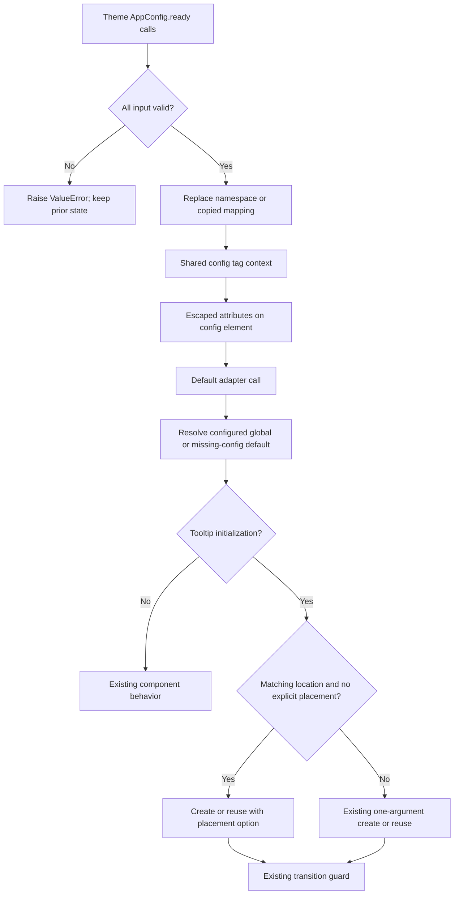

# Phase 06.45: Theme-registered JS namespace and tooltip placements (#398) - Research

**Researched:** 2026-11-21
**Domain:** Django startup registration, HTML configuration transport, Bootstrap-compatible JavaScript adapters
**Confidence:** MEDIUM — official-document fallback tier returned by the research confidence seam; source findings are individually grounded below.

<user_constraints>
## User Constraints (from CONTEXT.md)

The following locked decisions, delegated choices, carry-forward constraints and exclusions are reproduced verbatim from the phase context. [VERIFIED: 06.45-CONTEXT.md, decisions and deferred sections]

<!-- DATA_d24e198a_START -->
## Implementation Decisions

### Approved source decisions D-01–D-05

These summaries preserve the issue's numbering and do not narrow its complete handover.

- **D-01 — Bounded scope:** Namespace registration and per-location tooltip placements only. No dropdown
  adapter (U3), `register_theme()` helper (U8), new Django setting, host-app tooltip ownership, or changes to
  the five adapter entries beyond `tooltip.init` and the namespace resolver. Preserve the other adapter behavior.
- **D-02 — Namespace registration:** Export `register_js_namespace(name: str)` from `crud_views.lib` alongside
  `register_data_prefix()`. Default `bootstrap`; keep namespace and data prefix separate. Validate at registration
  time against `^[A-Za-z_$][A-Za-z0-9_$]*$`. Invalid input raises `ValueError` without changing the previous
  registration; the last valid call wins.
- **D-03 — Tooltip registration:** Export `register_tooltip_placements(placements: dict[str, str])` from
  `crud_views.lib`. Allowed locations are `context`, `list`, `card`, `card-order`, `formset`, `object-detail`,
  `form`, and the empty string for a bare marker. Allowed placements are `top`, `bottom`, `left`, `right`,
  and `auto`. Default `{}` leaves the library default in force. Unknown locations or placements raise
  `ValueError` without altering the previous registration. The last valid call replaces the whole mapping;
  it does not merge. Document that behavior.
- **D-04 — Browser configuration:** Always emit the namespace and placements JSON as two attributes on
  `#cv-config`, alongside the existing data prefix. Resolve the namespace on every adapter call, reading the
  config element/attribute when present and falling back to `bootstrap` when absent. Preserve late config and
  deferred-bundle resolution and existing `Object.assign` adapter overrides. `tooltip.init(el, {location})`
  applies a matching placement only when the trigger lacks `data-{prefix}-placement`; read the prefix from
  `data-data-prefix`, falling back to `bs`. Explicit trigger placement wins. An unmatched location behaves as
  today. Missing or malformed JSON means `{}`. Preserve the transition guard and tooltip hide/dispose behavior.
- **D-05 — Acceptance and documentation:** Existing Python, golden and JS tests pass, with stock Bootstrap
  tooltip and adapter behavior unchanged. Python tests cover registration validation and rendered config.
  JavaScript tests cover config inserted after script load, namespace fallback, registered/unregistered
  locations, and explicit placement precedence with both `bs` and `coreui` prefixes. Update
  `docs/reference/theme.md` with the two startup calls replacing the adapter-script recipe, update the adapter
  section in `docs/reference/javascript.md`, and add CHANGELOG `### Added`. This is nonbreaking;
  `docs/migrating-1.0.md` remains untouched. Downstream removal of CoreUI/Tabler adapter scripts and asset
  registrations is release guidance, not work in this upstream phase.

### Builder discretion

The approved issue delegates module placement, exact config attribute names, applying placement through instance
configuration versus a data attribute, and test-file layout. Preserve explicit-attribute precedence whichever
mechanism is chosen. These implementation details do not require another product discussion.

### Carry-forward constraints

- Follow the developer-maintainability rule: simple bounded additions, understandable startup state, and preservation
  of proven adapter and lifecycle paths.
- Phase 06.42 provides the existing `data-data-prefix` contract and startup-registration pattern. Do not infer a
  JavaScript namespace from that prefix (`bs` and `bootstrap` differ).
- Always-emitted config attributes are explicitly approved by D-04. Default behavior remains unchanged; any
  golden adjustment containing that config must be limited to the approved attribute additions.
- Keep broad Python test runs multicore and distinguish executed checks from downstream-library claims.


## Deferred Ideas

No new ideas or matching pending todos. Preserve the issue's exclusions: dropdown adapter U3, combined
`register_theme()` helper U8, host-app tooltip initialization and downstream theme source changes.

<!-- DATA_d24e198a_END -->
</user_constraints>

## Summary

Implement two small standard-library registration functions and internal getters, publish their values through the existing shared config context, and change only the default namespace resolver and tooltip initialization branch. The existing prefix module already demonstrates validate-before-assignment startup state; the existing adapter factory accepts objects or resolver functions and preserves user adapters with a shallow merge. [VERIFIED: src/crud_views/lib/data_prefix.py:8-21; src/crud_views/static/crud_views/js/adapters.js:7-8,67-68,129-130]

**Primary recommendation:** Add one focused registration module, use ordinary JSON serialization plus quoted HTML-attribute escaping, read config at each adapter call, and pass a placement option only after checking the trigger's explicit placement attribute. This is a recommended implementation within the delegated choices, not a new product decision.

The acceptance contract has no assigned requirement IDs; map validation to D-01–D-05 without inventing IDs. The roadmap explicitly says “None assigned; use the approved issue acceptance criteria.” [VERIFIED: .planning/ROADMAP.md:2317-2327]

## Project Constraints (from AGENTS.md)

The supplied AGENTS guidance corresponds to the repository's CLAUDE.md. Apply these actionable directives; unrelated view conventions remain unchanged. [VERIFIED: CLAUDE.md:15-28,31-88,129-147]

- Prefer the simplest bounded solution the developer can explain, debug and own. Preserve proven paths; avoid hidden runtime costs and broad abstractions.
- Use multicore pytest for broad runs; bounded four-worker runs suit a shared workspace. Serial execution is appropriate for tiny selections only. Do not interrupt a running check to change worker count.
- Maintain fixture naming conventions; restore process-wide registrations around tests.
- Preserve the existing view-prefix, operation-key, permission and workflow naming conventions if touched. No view or permission changes are needed here.
- Use 120-character Python lines and double quotes; follow Ruff formatting and the existing pre-commit formatter.
- Use existing hatchling packaging and bump-my-version machinery if packaging/version changes become necessary; this phase does not require them.
- A Breaking changelog entry normally requires migration documentation. D-05 instead requires Added and leaves migration documentation untouched.
- After a future ship, refresh codebase maps. If a phase worktree is requested, reuse/create it through the prescribed GSD workspace convention; this research neither switches branches nor creates a worktree.
- Preserve other agents' and the user's edits. Product execution and downstream theme changes are outside this research assignment.

## Architectural Responsibility Map

Recommended allocation within D-01–D-04:

| Capability | Primary tier | Secondary tier | Rationale |
|---|---|---|---|
| Validate and replace theme defaults | Django startup / backend | — | One process-wide startup registration, no request-specific theme selection |
| Publish config | Django template rendering | Browser DOM | Both public config tags already share one context builder |
| Resolve namespace | Browser adapter | Host library global | Resolve on each use, including later-inserted config and deferred libraries |
| Select tooltip placement | Browser tooltip adapter | UI-library constructor options | Location comes from existing owned-trigger scanner |
| Tooltip discovery and lifecycle | Existing browser tooltip module | Existing library instance | Preserve initialization events, hide/dispose and transition protection |

Grounding: shared context and aliases [VERIFIED: src/crud_views/templatetags/crud_views.py:111-130]; scanner passes “init(el, {location})” and owns lifecycle events [VERIFIED: src/crud_views/static/crud_views/js/tooltip.js:3-13,20-68].

## Standard Stack

No dependency installation or upgrade is recommended. Retain the current standard library, Django templates and plain JavaScript; extend the existing test harness. Registry-current versions and publish dates are intentionally not substituted for this project's installed/locked tooling.

| Existing tool | Version / declared constraint | Purpose | Evidence |
|---|---|---|---|
| Python standard library | Installed 3.12.3; declaration “>=3.12” | Regular-expression validation and JSON serialization | [VERIFIED: runtime version probe; pyproject.toml:25] |
| Django | Cached 4.2.30, 5.2.19, 6.0.10; checkout 6.1.2 | Config tag rendering and startup hooks | [VERIFIED: interpreter/import probes, 2026-11-21] |
| Node.js | Installed 24.21.0; declaration “>=20” | Existing JS harness | [VERIFIED: node --version; package.json:16-18] |
| Vitest / jsdom | Installed 5.1.0 / 31.0.0; declarations “^5.1.0” / “^31.0.0” | Adapter, DOM, lifecycle regression tests | [VERIFIED: installed package metadata; package.json:19-22] |
| pytest / pytest-xdist | Installed 9.2.0 / 3.8.0 in inspected environments | Python registration/rendering and broader regression | [VERIFIED: interpreter/import probes] |
| Ruff / MkDocs | Installed 0.17.3 / 1.6.1 | Scoped Python style and strict docs | [VERIFIED: executable version probes] |

Bootstrap is supplied by host assets, not installed as a direct npm dependency in this checkout: the attempted package-resolution probe returned “MODULE_NOT_FOUND”. That observation does not claim the browser/example assets lack Bootstrap. [VERIFIED: node package-resolution probe]

### Package Legitimacy Audit

Not applicable: no new external package is proposed or installed. Do not add a validation library, theme registry framework, Bootstrap npm dependency, or browser runner for this bounded change. Retain the existing dependency manifest.

## Architecture Patterns

### System Architecture Diagram

Recommended data flow:



### Component Responsibilities

Paths below identify inspected integration files or explicitly proposed files; they are not claims about filesystem-creation scripts.

| Component | Recommended change |
|---|---|
| Proposed `src/crud_views/lib/js_config.py` | Keep both new registrations and private state/getters together; standard-library imports only |
| Existing `src/crud_views/lib/__init__.py` | Add the two public exports alongside existing prefix export |
| Existing `src/crud_views/templatetags/crud_views.py` | Add current namespace and serialized placements to the shared context |
| Existing `src/crud_views/templates/crud_views/tags/cv_config.html` | Always emit the two escaped config attributes |
| Existing `src/crud_views/static/crud_views/js/adapters.js` | Add call-time default resolver and placement branch only |
| Existing `tests/js/adapters.test.js`, `tests/js/tooltip.test.js` | New config behavior and preservation coverage |
| Proposed `tests/test1/test_js_config.py`, `tests/test1/test_js_config_docs.py` | Registration/rendering and executable startup documentation |
| Existing prefix tests and docs references | Exact approved config delta; replace obsolete adapter recipes and retain custom-adapter guidance |

The current public export is “from .data_prefix import register_data_prefix as register_data_prefix”. [VERIFIED: src/crud_views/lib/__init__.py:1]
Both inclusion decorators refer to “tags/cv_config.html”, and both call “_cv_config_context(context)”. [VERIFIED: src/crud_views/templatetags/crud_views.py:123-130]

### Pattern 1: Validate completely, then replace a snapshot

Use string type checks and full-match validation for the namespace. For placements, validate the dictionary container, each key and each value before changing module state; copy the valid dictionary on assignment. Returning a copy from the internal getter prevents accidental mutation from bypassing registration validation. Test a mapping whose first pair is valid and later pair invalid, then assert the prior registration is intact. Empty mapping is an explicit reset; replacement must remove old keys.

This recommendation follows the existing assignment-after-validation pattern [VERIFIED: src/crud_views/lib/data_prefix.py:13-16]. The new vocabulary is already locked:
<!-- DATA_20b5a19e_START -->
“^[A-Za-z_$][A-Za-z0-9_$]*$”; locations “context”, “list”, “card”, “card-order”, “formset”, “object-detail”, “form”, and ""; placements “top”, “bottom”, “left”, “right”, “auto”; defaults “bootstrap” and {}.
<!-- DATA_20b5a19e_END -->
[VERIFIED: .planning/phases/06.45-theme-registered-js-namespace-and-tooltip-placements-398/06.45-ISSUE-398.md:72-90]

Use type checks before membership checks so unhashable invalid values produce the intended ValueError, not an incidental TypeError. Keep registration startup-owned; do not add locking, settings, a reset API, live theme switching or a registry abstraction. Repeating a valid call naturally remains safe when ready() runs again; Django documents repeated ready() execution in some test scenarios. [CITED: https://docs.djangoproject.com/en/5.2/ref/applications/#django.apps.AppConfig.ready]

### Pattern 2: Ordinary JSON in escaped attributes

Recommended new attribute names: `data-js-namespace` and `data-tooltip-placements`; recommended context names: `js_namespace` and `tooltip_placements_json`. These are delegated naming choices, not existing source constants.

Serialize with json.dumps into an ordinary string in the shared context. Use a quoted template attribute and an explicit escape filter on JSON to remain safe even when a caller disables autoescape. Never mark the JSON safe or use Python dict repr as JSON. Test raw encoded quotes, DOM-parsed JSON equality, both config tags, and a caller with autoescape disabled.

Django escapes quotes, ampersands and angle brackets, and documents that the escape filter is appropriate where autoescape may be off. [CITED: https://docs.djangoproject.com/en/5.2/ref/templates/language/#automatic-html-escaping]
Current config already carries “data-data-prefix”, “data-request-path”, “data-query-string” and “data-csrf-token”. [VERIFIED: src/crud_views/templates/crud_views/tags/cv_config.html:1-6]

### Pattern 3: Resolve each use, preserve caller ownership

Change the default factory's resolver closure to look up the current config element and then `globalThis[name]`. Do not cache the element, attribute or resolved global when the script loads. Use missing-element/missing-attribute fallback; do not fall back to Bootstrap merely because a selected theme bundle is not yet present. That would initialize the wrong provider instead of preserving existing missing-component behavior.

Keep explicitly supplied factory namespace objects/functions authoritative. Preserve exactly the existing merge shape:
<!-- DATA_96c839f2_START -->
`Object.assign(cv.bootstrapAdapters(() => globalThis.bootstrap), cv.adapters || {})`
<!-- DATA_96c839f2_END -->
Only replace the resolver expression. [VERIFIED: src/crud_views/static/crud_views/js/adapters.js:129]

For tooltip initialization, accept an optional options object, read placement JSON at call time, treat absent/invalid JSON and non-object JSON as empty, and use an own-property lookup. In particular, null, arrays, strings and inherited object names must not yield accidental placements. Keep this parser small; do not add a browser schema framework or blanket error catch around provider calls.

When a matching location exists, inspect presence of the prefix-specific placement attribute with hasAttribute. A present empty attribute is still explicit. Pass the placement option only when absent; otherwise retain the one-argument getOrCreateInstance call. JavaScript constructor options override data attributes in Bootstrap, so relying on Bootstrap to implement the desired precedence would be wrong. [CITED: https://getbootstrap.com/docs/5.3/components/tooltips/#options]

Keep guardTooltipTransitions on both construction branches. Its private callback wrapper checks instance identity so disposed or replaced instances cannot revive queued callbacks. [VERIFIED: src/crud_views/static/crud_views/js/adapters.js:15-30,93-100]

## Don't Hand-Roll

| Problem | Avoid | Reuse |
|---|---|---|
| JSON transport | Manual quoting, dict repr, inline executable config | json.dumps plus Django escaped attribute |
| Library selection | eval, dotted-path resolver, automatic namespace inference | Validated single name and direct global property lookup |
| Instance ownership | New tooltip map or wrapper lifecycle | Existing getOrCreateInstance, transition guard, hide/dispose |
| Trigger selection | New scanner or host tooltip ownership | Existing data-cv-tooltip scanner and location argument |
| Registration | General registry framework or per-request setting | Small validated module state, modeled on data prefix |
| Tests | New JS runner or browser stack | Existing Vitest/jsdom and pytest harness |

These are implementation recommendations grounded in the current seams and the bounded D-01 scope.

## Common Pitfalls

1. **Config cached too early.** A config element inserted after adapters load must affect subsequent calls. Also test attribute changes between calls and provider globals introduced later. Existing call-time namespace coverage is present, but new DOM-config behavior needs additional tests. [VERIFIED: tests/js/adapters.test.js:489-504]

2. **Placement silently overrides explicit markup.** Test both supported example prefixes and both nonempty/empty explicit placement attributes. The current documentation-recipe tests already exercise the empty explicit attribute. Preserve that case when converting coverage. [VERIFIED: tests/js/adapters.test.js:98-104; CITED: https://getbootstrap.com/docs/5.3/components/tooltips/#options]

3. **Documentation edits break executable fixtures.** Existing JS tests extract the marker “cv-tooltip-adapter-location” and execute its following JavaScript fence. Replace this obsolete recipe and migrate its assertions to config-driven initialization; preserve queued-callback, disposal, replacement-identity and override coverage rather than deleting it. The namespace recipe marker “cv-tab-adapter-namespace” also requires an impact search before changing documentation. [VERIFIED: tests/js/adapters.test.js:41-47,54-88,118-174; docs/reference/javascript.md:123-136]

4. **Atomic replacement accidentally becomes merge or shared mutable state.** Test second valid call removing prior entries, empty reset, invalid final entry, mutation of the caller's dictionary and getter results. These proposed tests enforce D-03's replacement contract, not a new registration framework.

5. **False byte-compatibility claims.** Frozen prefix config tests strip exactly one line, “data-data-prefix=\"bs\"”, then compare the old literal. Update that narrowly to account for the two newly approved attributes, retaining exact unrelated bytes and the modal shell. Raw component captures must remain unchanged. [VERIFIED: tests/test1/test_data_prefix.py:397-447]

6. **Late lookup confused with live reconfiguration.** getOrCreateInstance reuses an existing instance. This phase should not recreate it or schedule retries when config/library changes. Documentation already distinguishes call-time resolution from scheduling. [CITED: https://getbootstrap.com/docs/5.3/components/tooltips/#methods; VERIFIED: docs/reference/javascript.md:125-127]

7. **Downstream compatibility overstated.** Mocked compatible namespaces prove upstream dispatch and placement arguments, not native CoreUI/Tabler behavior or their modal event naming. Leave modal events and non-tooltip adapters unchanged under D-01. No downstream checkout or browser integration was exercised in this research.

## Code Examples

Recommended shape, deliberately pseudocode for the new delegated helper/attribute names:

```text
register placements:
    reject non-dictionary input
    validate every key and value
    replace stored state with a shallow copy

tooltip init:
    resolve Tooltip from supplied namespace object/function
    if absent: preserve existing no-op
    read current placements JSON; on parse/shape failure use empty mapping
    read current prefix, falling back only when unavailable
    if location is an own key and trigger has no explicit prefix-placement attribute:
        instance = Tooltip.getOrCreateInstance(element, placement options)
    else:
        instance = Tooltip.getOrCreateInstance(element)
    run the unchanged transition guard
```

Existing real pattern to preserve:
<!-- DATA_27b481fd_START -->
`tooltip.init(el, {location: el.getAttribute("data-cv-tooltip") || ""});`
<!-- DATA_27b481fd_END -->
[VERIFIED: src/crud_views/static/crud_views/js/tooltip.js:27-29]

## State of the Art

| Current project behavior | Approved target | Constraint |
|---|---|---|
| Default factory resolves the Bootstrap global | Config chooses a single global name at call time | Explicit factory resolver/object and adapter overrides remain supported |
| Documented theme script wraps placement initializer | Startup registration publishes per-location placement defaults | No stock context-bottom default |
| Prefix and namespace wired separately by a theme | Independent registrations remain separate | Never derive namespace from data prefix |

Current behavior is directly visible in the adapter and published recipes. [VERIFIED: src/crud_views/static/crud_views/js/adapters.js:93-100,129; docs/reference/javascript.md:123-139,220-239]

No external-library deprecation or upgrade is required or claimed.

## Environment Availability

Read-only executable/import probes were run on 2026-11-21; no product test suite was run during this research.

| Dependency | Available observation | Recommended use |
|---|---|---|
| Local Node/npm | 24.21.0 / 11.19.0 | Existing npm scripts; no install needed |
| Local Vitest/jsdom | 5.1.0 / 31.0.0 | Focused and full existing JS runs |
| Checkout Python | 3.12.3, Django 6.1.2, pytest 9.2.0 | Fast development feedback, explicitly label runtime |
| Cached Python 3.12 + Django | 4.2.30, 5.2.19, 6.0.10; pytest/xdist import successfully | Focused supported-series checks and default acceptance on cached 5.2 |
| Ruff / MkDocs | 0.17.3 / 1.6.1 | Scoped style and strict docs |
| Context7 MCP / ctx7 CLI | Neither exposed/found | Official documentation through web fallback |
| Knowledge graph | Status reports no graph | Direct source inspection used |

[VERIFIED: command-v, version/import probes and GSD graphify status, 2026-11-21]

Missing dependencies with no fallback: none identified for this bounded phase. Live downstream runtimes were not audited. Cached environment availability is not evidence that any tests pass there.

## Validation Architecture

Enabled by the active planning configuration; security enforcement is enabled too. [VERIFIED: .planning/config.json, workflow configuration read this session]

### Test Framework

The package scripts are “test”: “vitest run” and “test:integration”: “vitest run --config vitest.integration.config.js”. [VERIFIED: package.json:10-14]
The unit harness uses jsdom and the existing setup file; the script loader evaluates shipped source against the test window. [VERIFIED: vitest.config.js:3-9; tests/js/helpers/load.js:36-45]

Use these concrete commands from repository root. File operands below are inspected existing test locations or explicitly proposed new tests, not inferred generated-artifact paths. Commands are recommendations, not executed-test receipts.

**Quick JS:**
```bash
npm test -- tests/js/adapters.test.js tests/js/tooltip.test.js tests/js/object-detail-tabs.test.js
```

**Quick Python after adding the proposed tests:**
```bash
PYTHONPATH=src .nox/tests-3-12-django-5-2/bin/python -m pytest tests/test1/test_js_config.py tests/test1/test_js_config_docs.py tests/test1/test_data_prefix.py tests/test1/test_data_prefix_docs.py -n 4 -q
```

**Existing preservation selection:**
```bash
PYTHONPATH=src .nox/tests-3-12-django-5-2/bin/python -m pytest tests/test1/test_modal.py tests/test1/test_action_menus_golden.py tests/test1/test_form_buttons_golden.py tests/test1/test_action_tooltip_docs.py -n 4 -q
```

**Phase gate after implementation:**
```bash
npm test
npm run test:integration
PYTHONPATH=src .nox/tests-3-12-django-5-2/bin/python -m pytest tests -n 4 -q
.venv/bin/mkdocs build --strict --site-dir /tmp/cv-phase-0645-docs
git diff --check
```

Run scoped Ruff check and format-check on changed Python files. Repeat the focused Python selection with the inspected cached Django 4.2 and 6.0 interpreters; this is not full-matrix acceptance. Existing nox defines “4.2”, “5.2”, “6.0” and distribution-origin checks, so local PYTHONPATH checks must be reported as source-checkout verification. [VERIFIED: noxfile.py:3,5-17,20-56]

### Phase Decisions → Test Map

No requirement IDs were assigned; the references below are approved decision numbers.

| Decision | Behavior | Test type | Command / coverage location | Exists? |
|---|---|---|---|---|
| D-02 | Accepted identifier characters; invalid type/value rejection; last valid wins; old state retained | Python unit | Quick Python; proposed registration module tests | New cases needed |
| D-03 | Complete vocabulary; whole-map replacement; reset; atomic invalid mapping; alias isolation | Python unit | Quick Python; proposed registration module tests | New cases needed |
| D-04 | Both tags always emit both defaults/registrations; escaped JSON round-trip | Python rendering | Quick Python plus existing exact config delta tests | Existing seam; new cases |
| D-04 | Late config/namespace, missing element/attribute fallback, explicit factory ownership | JS unit | Quick JS; adapters tests | Existing seam; new cases |
| D-04 | Matched/unmatched/bare location; malformed/null/array JSON; bs/coreui explicit attribute presence | JS unit | Quick JS; adapters tests | New cases needed |
| D-01/D-04 | Transition guard, hide/dispose, pre/post-load overrides, modal/tab/collapse/alert preservation | JS regression | Quick JS plus full JS suite | Existing coverage, retain |
| D-05 | Executable startup recipe; replacement semantics and downstream adoption guidance | Python docs + JS recipe tests | Quick Python and adapters tests | Migrate old recipe tests |
| D-05 | Stock output except exact two config additions; existing golden and broader suite | Regression | Preservation selection and phase gate | Existing coverage |

### Sampling Rate and Wave 0 Gaps

- Per task: relevant quick selection; serial one-case iteration is acceptable when worker startup dominates.
- Per wave: combined affected selections once; broaden when integration changes justify it.
- Phase gate: full existing JS, integration and multicore Python suite, scoped style, strict docs and whitespace check.
- Add test-local snapshot/restore fixtures for both new registrations; use the existing prefix fixture where required. Its current implementation restores the process scalar through monkeypatch. [VERIFIED: tests/test1/conftest.py:11-16]
- Add the two proposed Python modules and extend existing JS modules. No framework installation is needed.
- Quick selections target short feedback; execution must measure actual duration. Research did not establish a sub-30-second timing.
- Keep golden update mode off. The existing helper rewrites fixtures when “CV_UPDATE_GOLDEN” is set. [VERIFIED: tests/lib/helper/golden.py:10-16]

## Security Domain

Use current ASVS 5.0 naming, rather than copying older category numbers into this phase's audit. Relevant official categories are V1 Encoding and Sanitization, V2 Validation and Business Logic, and V3 Web Frontend Security. [CITED: https://github.com/OWASP/ASVS/tree/v5.0.0/5.0/en]

| Applicable category | Phase control recommendation |
|---|---|
| V1 Encoding and Sanitization | JSON serialization, quoted HTML escaping, JSON.parse only; no safe marking or eval |
| V2 Validation and Business Logic | Strict server allowlists and atomic whole-map assignment |
| V3 Web Frontend Security | Config remains inert DOM data; library resolution uses a single validated global property name |
| Authentication / sessions / authorization / cryptography | No new mechanism in D-01–D-05; preserve existing handling |

| Threat | STRIDE | Bounded mitigation |
|---|---|---|
| Attribute/JSON injection | Tampering | Validate server values; escape transport; render/parse regression cases |
| Partial invalid registration or external dictionary mutation | Tampering | Validate first, copy and replace once; isolated state tests |
| Malformed config breaks initialization | Denial of service | Parse/shape fallback local to config; preserve provider exceptions |
| Unintended prototype key treated as a location | Tampering | Own-property lookup |
| Custom adapter replaced by new defaults | Tampering | Retain merge order and explicit factory namespace ownership |

These are phase-specific control recommendations, not an assertion of ASVS certification or a new compliance obligation.

## Assumptions Log

No unverified external compatibility or performance target is needed to implement the approved contract. Proposed filenames, attribute names and small validation/parser choices above are explicitly recommendations within builder discretion, not locked claims.

| # | Claim | Section | Risk if wrong |
|---|---|---|---|
| — | No training-only factual claim is used as a locked decision | — | — |

## Open Questions

No product decision blocks planning. Keep the following evidence limits visible:

- Native CoreUI/Tabler execution is unverified; acceptance can prove the upstream compatible-namespace contract without modifying downstream projects.
- Actual focused-run duration and post-change compatibility are execution results, not research facts.
- The checkout environment differs from the named nox series; use the probed cached interpreters for supported-series evidence.
- If a custom theme copies the config template, its author must adopt both new attributes to benefit. Existing missing-config defaults preserve old markup's behavior; document this beside the existing prefix adoption guidance.

## Sources

### Direct source inspection

All cited source files were opened with line-numbered shell reads because this runtime exposes no dedicated Read tool. Key anchors: prefix registration; config context/template; adapter resolver and transition guard; tooltip scanner; prefix raw config baselines; executable adapter-doc tests; current manifests, nox and test harness.

### Official documentation — MEDIUM confidence

- [Django 5.2 template language](https://docs.djangoproject.com/en/5.2/ref/templates/language/#automatic-html-escaping): quote escaping and explicit escape filter.
- [Django 5.2 AppConfig.ready](https://docs.djangoproject.com/en/5.2/ref/applications/#django.apps.AppConfig.ready): repeat-safe startup and no database work.
- [Bootstrap 5.3 tooltips](https://getbootstrap.com/docs/5.3/components/tooltips/): configuration precedence and existing-instance behavior; retrieved page identifies 5.3.9.
- [OWASP ASVS 5.0.0](https://github.com/OWASP/ASVS/tree/v5.0.0/5.0/en): category naming and relevant scope.

The research-plan seam selected Context7 for framework questions and websearch for ASVS. Context7 MCP and CLI were unavailable, so official web pages were used. The classify-confidence seam returned MEDIUM for websearch with official verification; digests were cached with that tier. No provider fallback was silently presented as Context7 evidence.

## Metadata

- Standard stack: MEDIUM overall; existing installed versions and manifests directly inspected, no dependency changes proposed.
- Architecture: MEDIUM overall; bounded recommendation grounded in source and locked decisions.
- Pitfalls: MEDIUM overall; exact config-baseline and executable-doc coupling directly inspected.
- Research date: 2026-11-21. Recheck after implementation or relevant source changes; otherwise useful for 30 days.
- No product changes, downstream edits, branch switch, broad tests or commit performed by this researcher.

