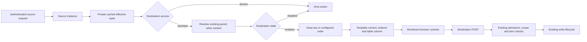

# Phase 06.46: Bulk toolbar destination entry gates — Research

**Researched:** 2026-11-21
**Domain:** Django request-local rendering and destination admission
**Confidence:** MEDIUM (existing code and bounded runtime probes; implementation acceptance remains outstanding)

<user_constraints>
## User Constraints (from CONTEXT.md)

Verbatim approved decisions, builder discretion, carry-forward constraints and deferred ideas follow. [VERIFIED: phase context read this session]

<!-- DATA_b73c8f21_START -->
## Approved Implementation Decisions

Retain the issue's decision numbers. These summaries do not narrow its acceptance criteria.

- **D-01 — Bounded amendment:** Replace #387 D-03's requirement to show every configured action and its zero-bulk-permission-query statement, together with D-19's prohibition on render-time access checks. Preserve no page scan, no calls to `cv_bulk_has_permission` or `cv_bulk_check`, no Guardian object-permission checks during rendering, and all submission behavior. A direct POST still receives the ordinary permission response when the viewer cannot enter the destination.
- **D-02 — Entry gate and order:** For each configured destination, call `cv_has_access(request.user, None)` first. Only on success call `_cv_action_enabled_for_rendering(user, action_obj, source_view)`, with `action_obj=None` for a top-level ViewSet and the parent object for a nested ViewSet. Reuse or share the non-object destination logic already used by `_cancel_target_available`; do not introduce a third policy variant. Hidden actions emit no markup, including no disabled button. Preserve configured order.
- **D-03 — One effective action list:** Compute the offered actions once per request and make every consumer use that result: `cv_bulk_buttons`, toolbar inclusion on table/card pages, card checkbox cells and `cv_bulk_select` column injection. The class-level `cv_bulk_actions` tuple remains the configured declaration, and E271–W275 continue to inspect it. The per-request result is private; introduce no public attribute, setting or opt-out. With no offered actions, the entire source output is byte-identical to `cv_bulk_actions = ()`. An empty page with an offered action retains its toolbar.
- **D-04 — Custom gates and limits:** A destination overriding `has_permission` more generously than its model permission also overrides `cv_has_access`, matching the existing context/list-button contract. Document this without adding an opt-out. Visibility remains a display rule: a later ancestor write rule can still refuse submission, and model admission without selected-record object grants still produces the existing all-blocked review.
- **D-05 — Cost:** One access call and at most one state-hook call per configured action per request, with nothing per row. Preserve equal top-level query counts with and without bulk actions. Measure nested query counts and record them in the plan; they must not grow with the number of rows or actions. Treat these as requirements to verify, not measurements already established by this discussion.
- **D-06 — Acceptance and documentation:** Rewrite the existing table/card no-permission-work tests to allow one destination access check per configured action while continuing to prohibit item hooks and preserving query-count equality. Cover partial and total permission denial, configured order, disabled state, nested parent state, custom access overrides and exact empty-action output for both source types. Keep admission, scope, review and execution tests passing, including direct-POST denial. Update the selection and permission sections in `docs/reference/bulk_actions.md`, the bulk section of `docs/reference/guardian.md`, and the unreleased #387 changelog entry. No migration entry: the feature is unreleased. AdminLTE/CoreUI demo validation is a downstream note, not upstream implementation work.

### Builder discretion

The approved issue delegates the shared gate's location, private list naming/caching, test-file layout and the way Phase 06.41 records are annotated as amended. Choose the smallest implementation the maintainer can explain and debug. These are research/planning details, not missing product decisions.

### Carry-forward constraints and precedence

- Issue #399 supersedes only the identified Phase 06.41 D-03/D-19 render-time clauses. Keep the rest of that phase's behavior, submission authority, rendering conventions and public contracts.
- The codebase convention map still says source rendering performs no destination permission work. That statement describes the old contract and must not override this approved amendment.
- Preserve configured class data and request isolation. Do not share actor-specific visibility results across requests.
- Preserve existing label/icon rendering and unrelated template structure. C11 danger variants are excluded.
- Follow `CLAUDE.md`'s maintainability rule and multicore preference for broad Python verification. No dependency, framework or new public extension point is requested.


## Deferred Ideas

No new deferred ideas or matching pending todos. C11 danger variants, downstream AdminLTE/CoreUI changes, new public flags and per-row eligibility previews remain outside this phase.

<!-- DATA_b73c8f21_END -->
</user_constraints>

## Summary

Use one private cached tuple on each source-view instance, reuse the existing shared Cancel availability function, and provide an ordinary internal context key for the two source templates. Keep the configured class tuple and button-rendering pipeline intact. This is a recommendation within the explicitly delegated implementation discretion. The existing gate already checks access before state, passes the parent for a non-object nested destination, and preserves exception behavior. [VERIFIED: src/crud_views/lib/view/base.py:76-88,976-992]

The important implementation trap is template access: Django rejects underscore-prefixed attribute lookups. A private Python attribute therefore needs a context bridge; it cannot appear directly in an `if view._...` expression. This was positively reproduced as `TemplateSyntaxErrorVariables and attributes may not begin with underscores: 'view._cv_effective_bulk_actions'`. [CITED: https://docs.djangoproject.com/en/6.0/ref/templates/language/#variables] [VERIFIED: local Django 6.0.10 template compilation probe]

**Primary recommendation:** confine product changes to the selection mixin and source-template conditions; call the existing shared function directly instead of inventing another access policy. Add focused tests and documentation updates. Parent lookup already reuses ancestor state on ordinary admitted requests. [VERIFIED: src/crud_views/lib/view/base.py:1169-1188; src/crud_views/lib/ancestors.py:564-573]

## Architectural Responsibility Map

The following is the recommended allocation, derived from D-01–D-06. [VERIFIED: phase context]

| Capability | Primary tier | Secondary tier | Rationale |
|---|---|---|---|
| Destination access then state | Django backend | Existing shared gate | The destination owns both hooks. |
| Effective tuple lifetime | Source view instance | None | One request owns one actor-specific result. |
| Toolbar, card cells, selection column | Django rendering | Existing form-button leaf | All consume the same computed tuple. |
| Submitted selection authorization | Destination backend | ORM/Guardian | Existing submission code remains authoritative. |
| Checkbox interactions | Browser | Existing server markup | No JavaScript policy or new public theme surface needed. |

## Project Constraints (from CLAUDE.md)

No root AGENTS.md or project skill directory was found in the discovery probe; CLAUDE.md is the supplied project instruction source. [VERIFIED: local filesystem discovery]

- Prefer the smallest maintainable solution; preserve proven behavior; account for cognitive cost and additional queries.
- Use bounded multicore pytest for broad verification; serial runs require a concrete small-selection or diagnostic reason.
- Keep view class attributes under the existing naming convention; private implementation helpers do not create public configuration.
- Preserve double quotes and 120-character Python formatting.
- Do not add a migration entry for this unreleased amendment; D-06 explicitly governs it.
- Keep the existing table-mixin order and existing label/icon leaf.
- After shipping, refresh the codebase maps; this research does not ship.
[VERIFIED: CLAUDE.md read this session; phase context D-03,D-06]

## Phase Requirements

Formal requirement IDs remain **TBD during planning**; do not invent IDs in the research. The roadmap says verbatim: “**Requirements**: TBD during planning from issue #399 acceptance criteria.” [VERIFIED: .planning/ROADMAP.md:2322-2323]

| Decision | Required behavior | Research support |
|---|---|---|
| D-01/D-04 | Display filtering leaves POST authority intact | Existing admission tests, shared destination hooks |
| D-02 | Access first, then state with correct object | Existing Cancel function and parent resolver |
| D-03 | One effective result and exact empty output | Private cached tuple, internal context bridge, byte comparison |
| D-05 | Once per action; no row work; bounded SQL | Measured diagnostic below and implementation-time regression matrix |
| D-06 | Presentation, custom gate and documentation coverage | Affected fixture/test inventory below |

Decision descriptions are grounded in the verbatim constraints above. [VERIFIED: phase context]

## Standard Stack

Reuse the installed project stack; install no packages and perform no version upgrade in this phase. [VERIFIED: phase context carry-forward constraints]

| Component | Observed version | Use |
|---|---|---|
| Python | 3.12.3 | Existing test runtime |
| Django | 6.0.10 | Views, templates, ORM, permission cache |
| django-tables2 | 3.0.1 | Existing table column injection |
| pytest / pytest-django / pytest-xdist | 9.2.0 / 4.14.0 / 3.8.0 | Existing tests and four-worker baseline |
| MkDocs | 1.6.1 | Existing docs runtime |

Versions are installed-runtime observations, **not registry-current recommendations**; no package publish dates were queried because no install is proposed. [VERIFIED: runtime version probes on 2026-11-21]

## Package Legitimacy Audit

Not applicable: no external packages are installed or newly recommended. [VERIFIED: phase context]

## Architecture Patterns



This diagram is a proposed implementation allocation; submission separation follows the approved D-01/D-04 contract. [VERIFIED: phase context]

### One private cache, one internal template bridge

Recommend a `functools.cached_property` named `_cv_effective_bulk_actions` on the mixin. Iterate the configured tuple in order; resolve each destination once; call the shared function once. A cooperative `get_context_data` supplies an internal context key such as `cv_bulk_actions` containing that tuple. The name is a template implementation detail, not a new view attribute, configuration setting or documented extension point. Templates use the bare context key; Python consumers read the cached property. These names are proposals in delegated discretion, not claims about current source.

Compute lazily so table construction and context construction can arrive in either order. Calling the property repeatedly must reuse its result. Do not assign to `self.cv_bulk_actions` or the class tuple. A new Django view instance per request gives the cache its intended lifetime; test alternating actors explicitly rather than relying only on that design. [CITED: https://docs.djangoproject.com/en/6.0/ref/class-based-views/base/]

Current source truth, quoted verbatim:

<!-- DATA_2fe6d091_START -->
`cv_bulk_actions: ClassVar[tuple[str, ...]] = ()`
`actions = cls.cv_bulk_actions`
`for key in self.cv_bulk_actions:`
`if not self.cv_bulk_actions:`
<!-- DATA_2fe6d091_END -->

These are the declaration/checks/button/column integration points. [VERIFIED: src/crud_views/lib/bulk/__init__.py:38-44,105-139]

Both source templates currently test the exact expression `view.cv_bulk_actions`; the card template tests it both for the toolbar and each checkbox wrapper. Change those conditions together without reformatting unrelated whitespace. [VERIFIED: src/crud_views/templates/crud_views/view_list_table.content.html:3; src/crud_views/templates/crud_views/view_card.content.html:3-11]

### Reuse the actual shared gate

Call the module-level `_cancel_target_available(destination, user, None, self)` directly. This avoids accidentally opting into a Cancel-specific override of `_cv_cancel_target_available`, while honoring destination access and rendering-state overrides inside the shared function. Preserve current missing-parent and custom-exception behavior. [VERIFIED: src/crud_views/lib/view/base.py:76-88,976-992]

Bulk destinations declare verbatim `cv_object = False`; the shared function uses `target_obj = obj if target.cv_object else None` and short-circuits denied access. [VERIFIED: src/crud_views/lib/bulk/__init__.py:201-209; src/crud_views/lib/view/base.py:76-88]

Do not add a second parent cache preemptively: ordinary requests already have resolved ancestor state. A custom parent resolver that itself performs repeated queries needs a separate bounded probe before changing the shared Cancel behavior. The current measured cost guarantee is for stock admitted requests, not arbitrary application hooks that issue their own SQL. [VERIFIED: src/crud_views/lib/view/base.py:982-988,1177-1188; query receipt]

## Don't Hand-Roll

| Problem | Use existing solution | Reason |
|---|---|---|
| Access/state policy | Shared Cancel availability function | Already enforces order and parent semantics |
| Permission caching | Django user permission implementation | Repeated model-permission calls add no SQL in measured requests |
| Button escaping, labels and icons | Existing button-data/form leaf path | Keeps presentation tests meaningful |
| Selected-record authorization | Existing destination flow | Render filtering is never submission authority |

[VERIFIED: src/crud_views/lib/view/base.py:76-88,1333-1341; src/crud_views/lib/bulk/__init__.py:105-124,280-313; query receipt]

## Measured Query Costs

The committed planning diagnostic and receipt are `measure_queries.py` and `06.46-QUERY-RECEIPT.txt` beside this file. The receipt records the exact command, setup, limitations and all 24 cases. [VERIFIED: diagnostic execution, 24 passed in 8.08s]

| Source | Rows tested | Gate evaluations tested | Current baseline SQL | With injected gate SQL |
|---|---|---|---|---|
| Top-level table | 1, 5 | 0, 1, 4 | 8 | 8 |
| Top-level card | 1, 5 | 0, 1, 4 | 7 | 7 |
| Nested table | 1, 5 | 0, 1, 4 | 9 | 9 |
| Nested card | 1, 5 | 0, 1, 4 | 8 | 8 |

All counts cover full Client GET rendering after warming URL/template caches; each request loads a fresh authenticated user. Nested state receives the real parent, and the injected loop records exactly one access and one state invocation per admitted gate evaluation. [VERIFIED: measure_queries.py:56-85; 06.46-QUERY-RECEIPT.txt]

**Limits:** the injected loop is a cost probe, not the effective-list implementation. The nested four-evaluation case deliberately repeats the same real destination; this would not pass production unique-key configuration checks. The nested card uses an in-memory adaptation of the existing fixture. The top-level four-action case uses four real configured destinations. Therefore the plan must still require valid distinct nested destinations, both source types, denied states, and final-cache call-count tests; do not label these diagnostics final acceptance. [VERIFIED: measure_queries.py:22-85]

Initial diagnostic setup mistakes were corrected: nonexistent reverse helper, shared Client fixture login collision, then wrong URLconf insertion. They were probe errors, not product defects. The final receipt above is the successful rerun. [VERIFIED: diagnostic session outputs]

## Common Pitfalls

1. **Private attributes in Django templates.** They raise a compile error. Use the ordinary internal context bridge. [CITED: https://docs.djangoproject.com/en/6.0/ref/templates/language/#variables]
2. **Fixing presentation fixtures by globally granting permissions.** Keep view-only fixtures for real denial tests. Select change/delete clients only where existing tests expect buttons. The delete fixture includes change permission via its dependency. Verbatim fixture grants: `"view"`, `"change"`, `"delete"`. [VERIFIED: tests/test1/conftest.py:328-367]
3. **Replacing access with state or checking state twice.** A denied access call must suppress state; cached result reuse must suppress all reevaluation. Existing Cancel behavior is the oracle. [VERIFIED: src/crud_views/lib/view/base.py:76-88]
4. **Accidentally using both logged-in client fixtures in one test.** Both depend on the same `client` fixture; the later login wins. Use separate Client instances or resolve only the desired fixture. This caused a diagnostic 403 and was corrected. [VERIFIED: tests/test1/conftest.py:348-367,990-993; diagnostic run]
5. **Confusing icon disabled tests with disabled action state.** Existing icon fallback tests disable icon configuration, not destination state; retain them and add separate state-denial coverage. [VERIFIED: tests/test1/test_bulk_source.py:122-133]
6. **Byte comparisons with fresh random form tokens.** Compare the complete denied page with the same-actor empty-config response, controlling unrelated nondeterministic form tokens where necessary; keep the existing isolated content comparison too. Do not normalize away selection markup or whitespace differences. This is a test-design recommendation derived from D-03.
7. **Per-row scans disguised as comprehensions.** Gate only configured destinations; never iterate the queryset or consult item hooks to choose actions. [VERIFIED: phase context D-01,D-05]

## Code Examples

Existing shared gate, verbatim; no new enum/status values are introduced by this phase. [VERIFIED: src/crud_views/lib/view/base.py:76-88]

<!-- DATA_98bc420f_START -->
```python
def _cancel_target_available(target, user, obj, rendering_view):
    """Evaluate the concrete destination's access and state hooks, including overrides."""
    target_obj = obj if target.cv_object else None
    if not target.cv_has_access(user, target_obj):
        return False
    if target.cv_object:
        return target._cv_action_enabled_for_rendering(user, target_obj, rendering_view)
    action_obj = None
    if target.cv_viewset.has_parent:
        action_obj = rendering_view._cv_cancel_parent_object()
        if action_obj is None:
            return False
    return target._cv_action_enabled_for_rendering(user, action_obj, rendering_view)
```
<!-- DATA_98bc420f_END -->

Recommended data flow: Python cached property → same tuple in context → template truthiness. Keep the existing `cv_bulk_buttons` label/icon loop and change only its iterable. This is proposed implementation, supported by existing integration points cited above.

## Affected Test and Documentation Inventory

- **Source tests:** rewrite both named no-permission-work tests, preserving item-hook prohibition and SQL equality. Existing assertions are explicitly incompatible with the amendment. [VERIFIED: tests/test1/test_bulk_source.py:155-176,314-343]
- **Presentation clients:** use the existing delete-authorized client for table controls/all-action order and delete-icon/floor tests; change-authorized client for card layout, escaping, localization, origin and empty-toolbar tests. Keep view-only for denial and nonparticipant output. Table configured keys are verbatim `("archive", "archive_now", "rename", "bulk_delete")`; card keys are `("archive", "archive_now")`. [VERIFIED: tests/test1/app/views_bulk.py:219-232; tests/test1/test_bulk_source.py read in full]
- **Nested fixture:** current bulk Book fixture supplies a table only and a single action `("mark",)`; add a small nested card fixture and valid extra destinations for the cost matrix, preserving registry cleanup if locally constructed. [VERIFIED: tests/test1/app/views_bulk.py:122-154; tests/test1/test_bulk_checks.py:36-50]
- **Regression suite:** retain scope, flow, execution, return, checks, docs and i18n tests; run Cancel permissions/state tests when reusing the gate. Direct-POST denial is already tested for both stages with `assert response.status_code == 403`. [VERIFIED: tests/test1/test_bulk_scope.py:391-400]
- **Guardian coverage:** existing bulk check tests exercise Guardian warning policy. They do not substitute for a runtime source visibility proof. Add a focused model-grant/object-denial case that offers the action without calling item permission hooks during rendering, then reaches the unchanged all-blocked review on POST. This is proposed gap coverage. [VERIFIED: tests/test1/test_bulk_checks.py:248-317; phase context D-04]
- **Documentation:** edit selection and scope/permissions paragraphs in the bulk reference; add model-entry visibility vs object-grant submission distinction in the Guardian bulk section; amend the existing unreleased entry headed verbatim `**Current-page bulk selection and action forms** (#387)`. Keep migration documentation unchanged. [VERIFIED: docs/reference/bulk_actions.md:89-92,194-215; docs/reference/guardian.md:494-510; CHANGELOG.md:678-681; phase context D-06]
- **Documentation guards:** extend existing selection/permission and Guardian checks with the new contract, avoiding fragile whole-paragraph matching. Do not expose internal cache/context names in public API listings. [VERIFIED: tests/test1/test_bulk_docs.py:95-101,175-201,400-421]
- **Historical annotation:** add a short amendment note beside Phase 06.41 D-03/D-19, retaining historical prose and linking D-01–D-06 here. This is delegated planning work, not a new product decision. [VERIFIED: historical 06.41 context:35-37,99-107; phase context]

## State of the Art

The applicable change is the maintainer-approved unreleased contract amendment, not a framework migration: move from configured-action visibility to destination entry visibility while retaining item-level submission checks. [VERIFIED: phase context D-01–D-06]

## Environment Availability

| Dependency | Available | Observed version | Use |
|---|---|---|---|
| Shared nox Python environment | Yes | Python 3.12.3 / Django 6.0.10 | Tests with workspace source selected by PYTHONPATH |
| Shared docs environment | Yes | MkDocs 1.6.1 | Strict docs build |
| Context7 MCP / ctx7 CLI | Not exposed / not found | — | Official web documentation fallback used |
| Graph context | No graph | — | Source inspection used |

[VERIFIED: runtime/discovery/init probes]

No missing execution dependency was identified for the bounded tests. Do not recreate environments or run dependency installs. [VERIFIED: successful baseline and diagnostic runs]

## Validation Architecture

### Existing infrastructure and baseline

Use the project pytest configuration and existing pytest-django fixtures. The source configuration contains verbatim `addopts = "--strict-markers"`. [VERIFIED: pyproject.toml pytest section]

Executed focused baseline:

```bash
PYTHONPATH=src:. /home/alex/projects/alex/django-crud-views/.nox/tests-3-12-django-6-0/bin/python -m pytest tests/test1/test_bulk_source.py tests/test1/test_bulk_scope.py tests/test1/test_bulk_flow.py tests/test1/test_bulk_execution.py tests/test1/test_bulk_return.py tests/test1/test_bulk_checks.py tests/test1/test_bulk_docs.py tests/test1/test_cancel_permissions.py -n 4 -q --tb=short
```

**324 passed in 21.97s**, before product edits. This is baseline preservation evidence, not proof of new visibility requirements. [VERIFIED: actual test run]

### Decision-to-test map

These are proposed implementation checks; D-numbers identify approved decisions, not invented formal requirement IDs.

| Decision | Behavior | Type | Existing / required |
|---|---|---|---|
| D-02 | Partial permission denial, order, disabled state, custom access | Rendered integration, table + card | Add cases to source tests |
| D-02 | Access-before-state; denied access never calls state; correct parent | Hook spies + rendered integration | Add |
| D-03 | Every consumer shares result; class tuple unchanged; alternating actors | Repeated property/context/render access plus HTTP requests | Add |
| D-03 | All denied equals empty configured output; no toolbar/column/cells | Byte comparison, table + card | Extend existing nonparticipant coverage |
| D-03 | Empty page still offers admitted action | Rendered integration | Existing card case; add table twin |
| D-05 | Real access spy delegates; item hooks forbidden; no object permission scans | Integration | Rewrite both old prohibitions |
| D-05 | SQL stable at 1/5 rows and 1/4 valid actions, including nested card/table | CaptureQueriesContext | Add final-implementation matrix |
| D-01/D-04 | Direct POST remains denied; object-blocked review unchanged | Integration | Existing admission plus Guardian case |
| D-06 | Published contract and historical amendment | Docs checks + strict build | Extend existing docs tests |

### Sampling and gates

- Per implementation task: run the source tests plus new visibility tests with four workers.
- Per docs task: run bulk docs tests and strict MkDocs build using the shared docs Python.
- Per wave: run all bulk tests and Cancel permissions/state.
- Final gate: full `tests -n 4` suite, appropriate existing lint checks and strict docs build. A full compatibility matrix is a separate execution decision; do not claim it ran in research.

These are recommended commands/policies, not completed results.

### Wave 0 gaps

No framework installation is required. Add nested card/multiple-destination test fixtures; hook-spy and actor-isolation cases; exact-output and query-growth tests. Existing test modules can contain them; no generalized test framework or new package is warranted. [VERIFIED: fixtures and successful baseline above]

## Security Domain

Use versioned ASVS terminology: the current official stable release is 5.0.0, published 30 May 2025, with **V8 Authorization**. The older template's unversioned V4 Access Control numbering must not be presented as current. [CITED: https://asvs.owasp.org/] [CITED: https://github.com/OWASP/ASVS/blob/master/5.0/en/0x17-V8-Authorization.md]

| Relevant area | Application to this phase | Standard control |
|---|---|---|
| Authorization / V8 | Primary | Destination access checks plus unchanged server-side POST admission and selected-item scope |
| Authentication and session state | Existing boundary | Bind cache to the actual source instance and request actor |
| Encoding and sanitization | Existing rendering boundary | Preserve form leaf escaping and checkbox label escaping |
| Input validation and CSRF | Existing submission boundary | Keep bounded selection parsing and CSRF-protected forms |
| Cryptography | No new primitive | Existing signed navigation remains unchanged |

This is a scoped review map, not an ASVS compliance claim. Relevant threats: forged POSTs bypassing hidden buttons (retain admission); cross-user cached visibility (instance-local cache); record information leakage through row probes (prohibit per-row render hooks); markup injection (retain escaped existing leaves). [VERIFIED: phase context; src/crud_views/lib/bulk/__init__.py:183-198,280-313; existing source escaping tests]

## Assumptions Log

No unresolved product assumption is proposed. Cache/context identifiers and test organization are recommendations under explicit builder discretion. The diagnostic's limits are explicit; arbitrary custom hooks and valid multiple nested destinations still need implementation-time verification. Do not turn those limits into claimed acceptance results. [VERIFIED: phase context; diagnostic receipt]

## Open Questions

No product decision needs clarification. Planning must assign formal requirement IDs if desired, identify the exact private context identifier, and include final multi-destination nested regression tests. Those are delegated planning/execution work. [VERIFIED: phase context; roadmap requirement placeholder]

## Sources and Confidence

- Repository source, fixtures, templates and approved phase context read this session; positive query probes and a 324-test baseline.
- [Django template language](https://docs.djangoproject.com/en/6.0/ref/templates/language/#variables): underscore restrictions, independently reproduced.
- [Django base views](https://docs.djangoproject.com/en/6.0/ref/class-based-views/base/): request-bound view lifecycle.
- [OWASP ASVS](https://asvs.owasp.org/) and its official V8 chapter: current security category.
- Research-plan seam selected Context7 for Django; neither MCP nor CLI was available, so official docs were fetched directly. Confidence seam returned LOW for provider webfetch (even verified), MEDIUM for verified websearch. Cached external digests retain those exact provider tiers; local runtime evidence is reported separately.

**Confidence breakdown:** stack MEDIUM (installed versions, no upgrade claim); architecture MEDIUM (read implementation and successful bounded probe); pitfalls MEDIUM (source and reproduced template/client failures).
**Research date:** 2026-11-21. **Refresh:** when source changes or before implementation if planning is delayed.

