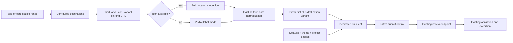

# Phase 06.47: Semantic variants for bulk toolbar buttons (#400) - Research

**Researched:** 2026-11-21
**Domain:** Django server-rendered toolbar leaves, semantic class registry, compatibility tests
**Confidence:** MEDIUM (official documentation fallback); repository behavior directly inspected and regression-probed.

<user_constraints>
## User Constraints (from CONTEXT.md)

The following decisions, discretion and exclusions are copied verbatim from the phase context. [CITED: .planning/phases/06.47-semantic-variants-for-bulk-toolbar-buttons-400/06.47-CONTEXT.md]

<!-- DATA_a813cd90_START -->
## Implementation Decisions

### Approved source decisions D-01–D-05

- **D-01 — Bounded amendment:** Replace only 06.41 D-19's exclusion of semantic variants and D-29's
  choice of the form leaf/no bulk class keys or leaf path. Retain the destination's `cv_icon_action`,
  existing labels, the `bulk` label-mode floor (default `both`), and the prohibition on per-action maps
  on the view, ViewSet or setting. The action leaf is untouched. All-blocked Cancel and real form
  buttons keep the form leaf; `crud_views/tags/button/form.html` and `FORM_LEAF_KEYS` do not change.
- **D-02 — Variant source:** Read the destination's existing `cv_action_variant`; introduce no new
  attribute and no source-view override. Inherited `secondary` remains the default. Destructive
  destinations explicitly set `cv_action_variant = "danger"`.
- **D-03 — Class keys and modes:** Add `bulk:primary`, `bulk:secondary`, `bulk:tertiary`, and
  `bulk:danger`. All four stock defaults are `btn btn-primary`. Add `bulk` to variant locations:
  valid mode-specific keys such as `bulk:danger:icon` are accepted by W362 and take precedence
  when present, matching other variant locations. Document that bulk buttons no longer follow
  a project's `form:submit` override.
- **D-04 — Dedicated leaf:** Add `crud_views/tags/button/bulk.html` for native submit buttons with
  `type="submit"`, `name="cv_bulk_stage"`, `value="review"`, and the existing `formaction`.
  Preserve operation without JavaScript and byte-identical stock toolbar rendering. Reuse
  `form:hidden-label`, `form:icon-host`, and `data-cv-tooltip="form"`; add no tooltip location or
  public name beyond the leaf path and four keys. Document the data contract consumed by the
  copyable leaf. Its data-building helper remains a builder decision.
- **D-05 — Acceptance and documentation:**
  - Existing bulk source tests and goldens pass unchanged; do not regenerate fixtures to conceal
    markup or class differences.
  - On both table and card sources, verify each of the four overridden class keys follows its
    destination variant, inherited secondary works, and an icon-mode key takes precedence.
  - Verify `form:submit` overrides no longer change bulk buttons, while `form:hidden-label`
    overrides still do. W362 accepts valid bulk mode keys and continues rejecting unknown keys.
  - Review Confirm remains `form:submit`; all-blocked Cancel and E209 remain unchanged.
  - Update `EXPECTED_KEYS`, literal key counts, the documented key count/bulk table, and the
    stability inventory for the new leaf path.
  - Update the bulk guide's toolbar section, button keys/variant-location reference, and theme
    guidance for the four keys and copyable leaf. Retain the no-per-action-map rule.
  - Amend the unreleased #387 changelog entry. No migration entry: bulk actions are unreleased.
  - Set `cv_action_variant = "danger"` on the package bulk example's delete action.

### Carry-forward constraints

- **Labels preserve 06.41 D-33:** Issue #400 cites D-20, but D-33 subsequently narrowed it. Keep
  the destination's short action label for visible text, hidden text and tooltip. The full action
  label stays in the review header. A dedicated leaf does not reopen the label contract. This
  reading was presented to the maintainer before they selected handover capture.
- Preserve existing accessibility, escaping, native-submit attributes, icon behavior, label-mode
  fallback and tooltip behavior. Existing selection, admission, review and execution contracts
  remain outside this presentation amendment.
- Preserve 06.41's absence of destination access-checking work during source-page rendering.
  Issue #399's choice of offered actions is a separate contract, not a dependency to introduce here.
- Reusing the `form` tooltip location keeps compatibility with the separate #398/06.45 work.
- Follow `CLAUDE.md`: choose the simplest bounded solution the maintainer can trace and own;
  avoid hidden state, new abstractions without need, and extra queries on existing paths.

### Builder discretion

- Feed the leaf through `cv_button_data` with a bounded bulk branch, or through a smaller helper.
  Inspect the existing form normalization before choosing; neither option is preselected.
- Define and document the exact flat data fields the leaf reads without expanding the approved
  public surface or changing `FORM_LEAF_KEYS`.
- Choose focused test files and fixtures that prove the approved observable contracts.
- Choose how to annotate historical 06.41 decisions/research as amended, preserving their history
  and linking to issue #400 and this phase rather than silently rewriting the original decisions.


## Deferred Ideas

No new ideas were introduced. Existing exclusions remain:

- Issue #399's choice of toolbar actions, despite sharing `cv_bulk_buttons`.
- CoreUI, Tabler and AdminLTE key overrides and downstream demo danger annotations; document
  the handoff, but do not implement downstream work in this upstream phase.
- Review Confirm styling, per-action maps, form/action-leaf changes and a new tooltip location.

<!-- DATA_a813cd90_END -->
</user_constraints>

## Summary

Use the existing form-data normalization inside the bulk source property, add the destination variant to that fresh dict, and render a dedicated bulk leaf. Keep the existing raw-data construction and its short label, effective mode, icon availability and URL logic. This is the smallest bounded adapter: two local data-building statements are enough; no new public helper, schema constant, form branch, tag API or shared normalization refactor is needed. The current property already constructs the complete native-submit payload and invokes form normalization. [VERIFIED: src/crud_views/lib/bulk/__init__.py:105-124]

The important distinction is between using the **form normalizer** and rendering the **form leaf**. Reusing the former preserves literal-text conversion, lazy labels, attribute escaping, host-icon treatment and icon-only titles; the new leaf independently selects bulk classes. The normalizer does not resolve the submit class, so a form submit class override cannot leak through it. [VERIFIED: src/crud_views/lib/view/button_data.py:297-399]

The focused baseline passed **1,102 tests in 11.61s**; the wider bulk/form/action regression selection passed **829 tests in 24.68s**. These are pre-change baselines, not implementation acceptance. The main remaining engineering risk is preserving raw markup bytes while moving to a new template, followed by overlooking the tests and prose that encode the old inventories. [VERIFIED: local pytest probes recorded under Validation Architecture]

**Primary recommendation:** Adapt the fresh normalized data locally in the existing source property; keep the dedicated leaf native and presentation-only; prove stock equality with raw-string comparisons and unchanged existing tests.

## Architectural Responsibility Map

Recommended task ownership follows the existing source/render separation. [VERIFIED: src/crud_views/lib/bulk/__init__.py:105-124,142-163; src/crud_views/lib/button_classes.py:249-260]

| Capability | Primary Tier | Secondary Tier | Rationale |
|---|---|---|---|
| Read destination variant and short caption | Django backend | — | Existing source property already resolves destination metadata; add no admission work. |
| Normalize text, icon and attributes | Django backend | Django template escaping | Reuse existing normalization and one final HTML escaping boundary. |
| Resolve theme/project class precedence | Django backend registry | — | Existing registry already supports effective-mode precedence. |
| Produce the native submit control | Frontend server template | Browser native form submission | Dedicated leaf controls markup; browser preserves native submission. |
| Review, admission and execution | Existing Django destination | Database | Regression-only boundary; this phase makes no changes here. |
| Tooltip initialization | Existing browser adapter | Existing form location | Preserve the existing marker; no new JavaScript/configuration surface. |

## Project Constraints (from AGENTS.md)

Actionable project directives, including those not exercised by this narrow phase: [CITED: AGENTS.md; CLAUDE.md]

- Prefer the simplest maintainable bounded solution; preserve proven paths; avoid hidden state, unnecessary abstractions, cross-cutting work and additional queries.
- Use multicore pytest for broad verification; use a bounded worker count when sharing resources. This research used four workers.
- Follow existing fixture naming: ViewSet, user-permission and authenticated-client fixtures.
- Use the established class-attribute prefix and operation/permission naming; workflow methods retain their workflow prefix.
- Use double quotes and the existing 120-character formatter limit; use repository Ruff formatting/check conventions.
- Preserve the existing build system and synchronized version-management convention.
- A newly added Breaking changelog entry normally requires migration documentation. Here D-05 explicitly requires amending the existing unreleased entry, without a new migration entry.
- If creating a phase worktree, use the GSD workspace convention and open the repository subfolder; this workspace already exists.
- After shipping, refresh the codebase maps before subsequent work.
- Run the existing pre-commit formatting hook on commits; do not bypass it to hide problems.

No project skill directory or configured researcher skill was found by the discovery probes. Graph status returned `"exists": false`; no semantic-graph inference was used. [VERIFIED: local project skill discovery, agent-skills and graphify status probes]

## Standard Stack

**Use the installed stack; install no package for this phase.** New dependencies would not contribute to the approved registry/leaf change. Package versions below describe the verified local test environment, not a proposed dependency upgrade. [VERIFIED: local Python import/version probe; pyproject.toml:25-35,70-84]

| Component | Existing/local version | Use |
|---|---|---|
| Python | 3.12.3 | Existing interpreter for bounded regression probes |
| Django | 6.0.10 | Existing template loader, automatic escaping, test client |
| pytest | 9.2.0 | Existing Python behavior/inventory/golden tests |
| pytest-xdist | 3.8.0 | Four-worker test execution |
| Package class registry and form normalizer | Current checkout | Reuse directly; no new rendering framework |

Django documents variable autoescaping and context-based template rendering; keep labels as data, never template source. [CITED: https://docs.djangoproject.com/en/6.0/ref/templates/language/] [CITED: https://docs.djangoproject.com/en/6.0/topics/templates/]

**Package Legitimacy Audit:** Not applicable: no external installation is proposed. Registry-current/publish-date checks would be relevant to an upgrade, which this phase does not request.

## Architecture Patterns

### System Architecture Diagram

Recommended data flow; the normalization and registry stages already exist. [VERIFIED: src/crud_views/lib/bulk/__init__.py:105-124; src/crud_views/lib/view/button_data.py:297-399; src/crud_views/lib/button_classes.py:249-260]



### Component Responsibilities and exact source anchors

Read these source anchors again at implementation time if intervening work lands. Paths in this table locate inspected source, not claims that a creation script generates them.

| Component | Anchor | Planned responsibility |
|---|---|---|
| Source property | `src/crud_views/lib/bulk/__init__.py:105-124` | Preserve raw payload; normalize, attach destination variant and render new leaf. |
| Normalization | `src/crud_views/lib/view/button_data.py:297-399` | Reuse without broadening the form contract. |
| Existing form output | `src/crud_views/templates/crud_views/tags/button/form.html:1-3` | Reference exact whitespace, attribute order and label body; do not edit. |
| New bulk leaf | Approved D-04 | Create the dedicated template in the existing button template directory. |
| Class defaults | `src/crud_views/lib/button_classes.py:109-116,334-369` | Add four defaults and extend variant locations; do not add utility modes. |
| Class lookup | `src/crud_views/lib/button_classes.py:249-260` | Existing mode-presence semantics, unchanged. |
| Existing generic-tag refusal | `src/crud_views/templatetags/crud_views.py:227-231` | Keep rejecting bulk tag rendering; correct outdated explanatory text only. |
| Existing generic-data refusal | `src/crud_views/lib/view/button_data.py:120-124` | Keep rejecting bulk input under the local-adapter approach; correct outdated text only. |
| Example destructive destination | `examples/bootstrap5/bulk_selection/views.py:60-80` | Set the existing variant attribute to danger and synchronize the guide example. |

These are source observations or implementation recommendations grounded in the cited inspected blocks. [VERIFIED: source blocks listed above] The **new** leaf path is an approved future artifact, not an already-created file. [CITED: phase CONTEXT D-04]

### Pattern 1: Reuse normalization without extending its contract

The current raw payload uses these values verbatim; retain them. [VERIFIED: src/crud_views/lib/bulk/__init__.py:112-123]

<!-- DATA_b9742ce1_START -->
```python
"cv_key": "submit",
"cv_type": "submit",
"cv_name": "cv_bulk_stage",
"cv_value": "review",
"cv_label": destination.cv_get_action_short_label(context),
"cv_id": f"cv-bulk-{key}",
"cv_icon": destination.cv_icon_action,
"cv_label_mode": mode if _icon_available(destination.cv_icon_action) else "label",
"cv_attrs": {"formaction": self.cv_get_link_url(destination, key), "data-cv-bulk-action": key},
```
<!-- DATA_b9742ce1_END -->

The inherited declaration is exactly `cv_action_variant: str = "secondary"`. [VERIFIED: src/crud_views/lib/view/base.py:187-188] The existing action data uses `"cv_variant": ctx.get("cv_variant") or "secondary"`; use the same field spelling in the bulk leaf, populated directly from the destination rather than applying an independent source override. [VERIFIED: src/crud_views/lib/view/button_data.py:180-194]

Recommended adapter shape, with the new path deliberately identified as D-04's proposed artifact:

```python
data = cv_button_data(raw, "form")
data["cv_variant"] = destination.cv_action_variant
buttons.append(render_to_string("crud_views/tags/button/bulk.html", data))
```

The calls and existing field values come from the quoted source above; the new template string is exactly `crud_views/tags/button/bulk.html` in locked D-04. This snippet is a planning proposal, not an implemented helper. [CITED: phase CONTEXT D-04] No public function or new leaf-key constant is required.

The form normalizer returns fresh data and only a subset of its finite key set as appropriate; leave that constant unchanged. In particular, the existing set contains `"cv_type", "cv_name", "cv_value", "cv_label", "cv_id", "cv_label_mode", "cv_icon", "cv_icon_class", "cv_icon_inline", "cv_css_class", "cv_flat_attrs", "cv_title", "cv_cancel_url", "cv_tag", "cv_location", "cv_key"`. [VERIFIED: src/crud_views/lib/view/button_data.py:50-69,378-399]

### Pattern 2: Document only the fields the bulk leaf consumes

Recommend hardcoding the native type/name/value approved by D-04, keeping the form leaf's button-branch spacing and body. The consumed flat data is the following nine fields; supplying additional normalizer fields does not make those fields part of the bulk leaf contract. [CITED: phase CONTEXT D-04] [VERIFIED: src/crud_views/templates/crud_views/tags/button/form.html:1-3; src/crud_views/lib/view/button_data.py:378-399]

| Consumed field | Contract to document |
|---|---|
| `cv_id` | Literal control ID built by the source |
| `cv_variant` | Destination semantic variant, used only for bulk class lookup |
| `cv_label_mode` | Effective mode after the bulk floor and unavailable-icon fallback |
| `cv_label` | Literal destination **short** action label, including hidden text |
| `cv_icon` | Normalized icon value or no icon |
| `cv_icon_class` | Host-icon contribution from the existing form icon-host utility |
| `cv_icon_inline` | Whether the existing icon tag should render an inline icon |
| `cv_title` | Optional short-label title in icon mode only |
| `cv_flat_attrs` | Existing safely serialized destination/action attributes |

All field spellings other than the already-quoted variant are verbatim in the form contract quote above. The body should retain the existing optional single space after an inline icon in combined mode, the same hidden-label span and the same tooltip marker. Omit anchor/cancel branches because this leaf is only a native submit control. The current source never supplies extra CSS classes, so the new leaf does not need to expose that unused field. [VERIFIED: src/crud_views/lib/bulk/__init__.py:112-123; src/crud_views/templates/crud_views/tags/button/form.html:1-3]

### Pattern 3: Extend the grammar, not its validation algorithm

Current definitions, quoted verbatim: [VERIFIED: src/crud_views/lib/button_classes.py:334-335; src/crud_views/lib/view/variant.py:6-15; src/crud_views/lib/view/label_mode.py:12-25]

<!-- DATA_f273bca0_START -->
```python
VARIANT_LOCATIONS: frozenset[str] = frozenset({"context", "list", "card"})
PRIMARY = "primary"
SECONDARY = "secondary"
TERTIARY = "tertiary"
DANGER = "danger"
LABEL = "label"
ICON = "icon"
BOTH = "both"
{"context": "icon", "list": "icon", "card": "both", "form": "label", "bulk": "both"}
```
<!-- DATA_f273bca0_END -->

Add the approved bulk location to the first set. The existing three-part parser will then recognize the variants and validate their mode suffixes; do not introduce a separate bulk validator. Existing warnings use `id="crud_views.W362"`, while destination validation uses `id="E209"`; neither identifier changes. [VERIFIED: src/crud_views/lib/button_classes.py:346-369,440-454; src/crud_views/lib/view/variant.py:22-28]

Use the effective mode in the class lookup, after unavailable-icon fallback. Existing lookup chooses a present mode key even when its value is empty or null; it does not fall back based on truthiness. [VERIFIED: src/crud_views/lib/button_classes.py:249-260]

### Alternatives Considered

| Approach | Assessment |
|---|---|
| Local fresh-data adaptation (recommended) | Reuses current behavior, isolates the change, leaves existing normalizer API intact. |
| Private helper wrapping the same two statements | Acceptable if it materially simplifies tests; do not export it or introduce a new generic abstraction. |
| Bounded bulk branch in generic normalizer | Authorized discretion, but introduces dispatch/validation obligations with no current reuse benefit. |
| Independent bulk normalization | Duplicates literal/attribute/icon behavior and creates regression risk. |
| Extend form leaf or action leaf | Excluded by locked D-01 and D-04. |

The first three are implementation judgments grounded in the existing normalization; the excluded alternatives are explicit user decisions. [VERIFIED: src/crud_views/lib/view/button_data.py:110-130,297-399] [CITED: phase CONTEXT D-01/D-04 and Builder discretion]

## Don't Hand-Roll

| Problem | Do not build | Use instead |
|---|---|---|
| Text/attribute escaping | A second literal/attribute serializer | Existing form normalization and template autoescaping |
| Theme precedence | Bulk-specific override merging | Existing class registry and mode-aware lookup |
| Icon availability/host rendering | Another icon renderer or fallback policy | Existing availability check and normalized icon fields |
| Semantic validation | New variant enum or check | Existing destination variant check |
| Submit behavior | JavaScript routing or hidden custom submission state | Existing native name/value/formaction control |
| Offered-action policy | Source permission scans or filtering | Preserve existing configured destinations; #399 is separate |

These recommendations reuse observed code paths and honor locked scope. [VERIFIED: src/crud_views/lib/bulk/__init__.py:105-124; src/crud_views/lib/view/button_data.py:297-399; src/crud_views/lib/button_classes.py:249-260; src/crud_views/lib/view/variant.py:22-28] [CITED: phase CONTEXT Carry-forward constraints]

## Runtime State Inventory

This is a bounded presentation refactor, not a persisted-name migration. Research made no external service or production-state queries.

| Category | Items found / evidence limits | Action required |
|---|---|---|
| Stored data | The inspected source rendering property reads metadata and builds HTML; it contains no writes. [VERIFIED: src/crud_views/lib/bulk/__init__.py:105-124] | No data migration is part of this change. |
| Live service config | Downstream themes may currently override the form submit key; specific deployed configurations were not inspected. [CITED: phase CONTEXT D-03 and Deferred Ideas] | Document new bulk keys and handoff; do not modify downstream services. |
| OS-registered state | No OS registration operation in the changed rendering path. [VERIFIED: src/crud_views/lib/bulk/__init__.py:105-124] | None in scoped work; broader machine state not audited. |
| Secrets/env vars | No secret or environment-variable rename is approved. [CITED: phase CONTEXT D-01–D-05] | None; do not inspect secrets. |
| Build artifacts / installed packages | New template must be included when the package is built; local probes use this checkout's source. [CITED: phase CONTEXT D-04] | Verify packaged template through the existing packaging workflow at execution; do not claim installed-distribution acceptance from source tests. |

## Common Pitfalls

### 1. Raw bytes differ although the DOM looks identical

Whitespace before the class attribute, inter-icon spacing, attribute ordering and the trailing newline are visible in the old template. Preserve these exactly. Compare raw strings before any DOM normalization; existing source tests primarily assert DOM semantics. Add an equality test against the unchanged form leaf with the same normalized payload under stock settings. [VERIFIED: src/crud_views/templates/crud_views/tags/button/form.html:1-3; tests/test1/test_bulk_source.py:39-133]

Existing form golden extraction deliberately uses raw source slices, not DOM serialization. Reuse that testing principle; never regenerate old fixtures just to make them green. [VERIFIED: tests/test1/test_form_buttons_golden.py:20-23,46-69] [CITED: phase CONTEXT D-05]

### 2. Old inventories extend beyond the obvious default count

Current literal assertions include `assert len(EXPECTED_KEYS) == 138`, `assert len(core) == 138`, `assert len(get_button_classes()) == 156`, `assert len(bc.DEFAULT_BUTTON_CLASSES) == 138` and `assert len(bc._get_default_button_classes()) == 156`. [VERIFIED: tests/test1/test_button_classes.py:154-156,289-303,429-446]

Approved arithmetic: four additional core defaults means **142 core / 160 with workflow**, with eleven total bulk keys (seven existing utilities plus four variants). Update all related literal assertions, subprocess source strings and documentation sentences. Current prose says `The default table has 138 keys`, `bulk selection contributes seven keys`, and `for 156 effective default keys`. [VERIFIED: docs/reference/buttons.md:194-199,292,316-317] [CITED: phase CONTEXT D-03]

### 3. A variant location is not automatically a generic action-leaf location

Current guard says `assert set(ACTION_LOCATIONS) == VARIANT_LOCATIONS`. After adding bulk, change this set relationship deliberately; do not route all variant locations into action templates. Current data/tag rejection messages explicitly say toolbar buttons render through the form leaf and must be corrected if retaining those rejections. [VERIFIED: tests/test1/test_button_data.py:563-574; src/crud_views/lib/view/button_data.py:120-124; src/crud_views/templatetags/crud_views.py:227-231]

### 4. Historic Option C is not today's label contract

The old research table suggested a full hidden label for the dedicated-leaf alternative. D-33 subsequently established short text everywhere on the button, and this phase explicitly retains it. Annotate old D-19/D-29, Option C and Pitfall 2 as amended; preserve the historical text and link to this phase rather than rewriting the record. [CITED: .planning/phases/06.41-current-page-bulk-selection-and-action-forms-for-table-and-c/06.41-RESEARCH.md:224-241,756-770] [CITED: .planning/phases/06.41-current-page-bulk-selection-and-action-forms-for-table-and-c/06.41-CONTEXT.md:168-173] [CITED: phase CONTEXT Carry-forward constraints]

### 5. Documentation guards pin the retired sentence

The docs test explicitly requires `"no variant"`. Amend that assertion to the newly approved contract while retaining the short-label, tooltip and no-per-action-map assertions. The guide's example is synchronized with source, so the destructive example annotation belongs in both places. [VERIFIED: tests/test1/test_bulk_docs.py:315-333; docs/reference/bulk_actions.md:280-317]

### 6. Accidentally use the form floor or the requested rather than effective mode

Keep the existing pre-normalization bulk floor and unavailable-icon fallback. Otherwise an icon-mode request without a usable icon may select the wrong class suffix or raise under strict settings. Existing source tests already cover strict missing/disabled-icon behavior and independence from the form floor. [VERIFIED: src/crud_views/lib/bulk/__init__.py:107-120; tests/test1/test_bulk_source.py:91-133]

## Documentation and inventory worklist

All entries below are planned updates, grounded in the inspected canonical documentation and locked D-05. [CITED: phase CONTEXT D-05]

| File / source anchor | Required change |
|---|---|
| `tests/test1/test_button_classes.py:28-35,154-156,289-303,429-446` | Four expected keys; all core/workflow counts; valid-mode and invalid-utility-mode coverage. |
| `tests/test1/test_button_data.py:563-574` | Correct location-set invariant and outdated refusal wording checks; preserve exact form key assertion. |
| `tests/test1/test_bulk_docs.py:311-333,357-367` | Replace retired no-variant assertion and extend stable leaf/key inventory checks. |
| `docs/reference/buttons.md:57-68,194-201,246-269,292,316-317,621-627,1067` | Variant grammar, all counts, bulk table, new leaf/data subsection and warning reference. |
| `docs/reference/bulk_actions.md:280-317,413-423` | Sync destructive example, new class source, unchanged labels/floor, no per-action map, loss of form-submit inheritance. |
| `docs/reference/theme.md:201-228` | Add four-key registration example and link to copyable leaf/data contract; state shared icon/hidden-label/tooltip utilities. |
| `docs/development/stability.md:76-92` | Add new leaf and four variant keys/mode support; keep internal source properties internal. |
| `CHANGELOG.md:678-681` | Amend existing unreleased bulk entry, linking semantic variants; no new Breaking/migration entry. |
| Prior phase context/research | Add narrowly scoped amendment annotations at D-19/D-29 and superseded leaf/grammar discussion. |

## Code Examples

The class lookup already accepts a mode argument and makes presence decisive. This is the existing implementation, not a new algorithm. [VERIFIED: src/crud_views/lib/button_classes.py:249-260]

<!-- DATA_41c6f90d_START -->
```python
classes = get_button_classes()
key = f"{location}:{slot}"
if mode and f"{key}:{mode}" in classes:
    key = f"{key}:{mode}"
value = classes.get(key)
return value if isinstance(value, str) else ""
```
<!-- DATA_41c6f90d_END -->

Use that lookup from the dedicated leaf with bulk, the destination variant and effective label mode. Continue using the exact shared names `form:hidden-label`, `form:icon-host` and `data-cv-tooltip="form"`. The existing default values are `"form:hidden-label": "visually-hidden"` and `"form:icon-host": "{name_class}"`. [VERIFIED: src/crud_views/lib/button_classes.py:140-150; src/crud_views/templates/crud_views/tags/button/form.html:1-3] [CITED: phase CONTEXT D-04]

## State of the Art

This phase follows an approved local contract amendment, not an ecosystem migration. [CITED: phase CONTEXT D-01–D-05]

| Previous contract | Approved contract | Impact |
|---|---|---|
| Bulk toolbar uses form submit styling | Destination variant selects one of four bulk keys | Themes can distinguish actions; defaults preserve bytes. |
| Form leaf renders toolbar controls | Dedicated native-submit bulk leaf | Themes gain a copyable bulk seam; form/action leaves stay unchanged. |
| Bulk mode keys rejected by class grammar | Variant mode keys accepted | Existing precedence semantics apply without a new validator. |
| Short label in text/hidden text/tooltip | Unchanged | Do not resurrect the historical full-label Option C proposal. |

## Assumptions Log

No unverified package, support-version, compliance, retention or product-policy assumption is promoted into a locked decision. Recommendations above are builder-discretion proposals grounded in read source and approved scope; they are not additional user decisions.

No production/downstream configuration, browser matrix, complete Python/Django matrix or installed distribution was verified. Those are explicit evidence limits, not inferred incompatibilities.

## Open Questions

No product decision blocks planning. Choose the local adapter recommended above within granted builder discretion. Keep three execution checks visible:

1. Confirm new leaf raw bytes against the unchanged old leaf under all three modes and icon configurations.
2. Inspect concurrent edits to the source property before execution or integration because issue #399 touches it.
3. Verify packaged-template inclusion during the normal build/distribution gate if that gate is run; local source tests do not supply that evidence.

These follow the existing byte-compatibility and independent-issue constraints. [CITED: phase CONTEXT D-04/D-05, Phase Boundary]

## Environment Availability

Observed on this machine using the existing cached interpreter; no packages were installed. [VERIFIED: local import/version and pytest probes]

| Dependency | Available | Observed version / limit | Fallback |
|---|---|---|---|
| Cached Python interpreter supplied by orchestrator | Yes | 3.12.3 | Use its absolute path below |
| Django, pytest, xdist in that environment | Yes | 6.0.10 / 9.2.0 / 3.8.0 | None required |
| Context7 MCP / ctx7 CLI | No callable MCP found; CLI lookup returned no executable | Documentation lookup unavailable through preferred provider | Official Django website via web tool |
| Jina MCP | No callable tool found | Preferred scrape provider unavailable | Official OWASP site and versioned sources via web tool |
| Graph context | Not built | Status returned false | Direct source reads |

**Missing dependencies with no fallback:** None for the bounded implementation/tests.

The absolute cached interpreter path is an environment observation supplied by the orchestrator and successfully executed, not a proposed repository-generated path.

## Validation Architecture

Enabled by the project's `"nyquist_validation": true` configuration. [VERIFIED: .planning/config.json:20-24]

### Test Framework

| Property | Value |
|---|---|
| Framework | Existing pytest 9.2.0 / pytest-xdist 3.8.0 |
| Config | Existing project pytest configuration, `addopts = "--strict-markers"` [VERIFIED: pyproject.toml:145-146] |
| Quick run | Focused command below: observed 1,102 passed in 11.61s |
| Wider phase regression | Second command below: observed 829 passed in 24.68s |
| Full suite | Same interpreter/environment with `-m pytest tests/test1 -n 4 -q`; not run in this research |

Run from the repository root. The explicit source path avoids importing the installed copy from the sibling checkout.

```bash
PYTHONPATH=src:. /home/alex/projects/alex/django-crud-views/.nox/tests-3-12-django-6-0/bin/python -m pytest tests/test1/test_bulk_source.py tests/test1/test_button_classes.py tests/test1/test_button_data.py tests/test1/test_bulk_docs.py -n 4 -q
```

Observed output:

```text
1102 passed in 11.61s
```

```bash
PYTHONPATH=src:. /home/alex/projects/alex/django-crud-views/.nox/tests-3-12-django-6-0/bin/python -m pytest tests/test1/test_bulk_flow.py tests/test1/test_bulk_execution.py tests/test1/test_bulk_scope.py tests/test1/test_bulk_return.py tests/test1/test_form_buttons_golden.py tests/test1/test_action_menus_golden.py tests/test1/test_crispy_buttons.py tests/test1/test_variants.py -n 4 -q
```

Observed output:

```text
829 passed in 24.68s
```

Both probes returned exit code zero. [VERIFIED: local pytest executions, 2026-11-21]

### Phase Requirements → Test Map

The roadmap explicitly says `**Requirements**: None assigned; use the approved issue acceptance criteria.` Do not fabricate requirement IDs; the identifiers below are source decision labels. [VERIFIED: .planning/ROADMAP.md:2334-2340]

| Source | Behavior to prove | Type | Existing anchor / new coverage |
|---|---|---|---|
| D-04/D-05 | Raw stock bytes unchanged for table/card, modes, icon states | Integration / byte equality | Existing source and golden tests; add raw-string equality cases before replacing renderer |
| D-02/D-03 | All four variant overrides, inherited default, effective-mode precedence | Rendered integration + registry | Add parameterized tests beside existing source tests; temporarily patch existing destination classes rather than register new global ViewSets |
| D-03 | Form submit override isolation; shared hidden-label/host-icon overrides | Rendered integration | Add tests on both source types, include null/empty mode values |
| D-03 | Valid modes accepted; unknown variants/modes and utility modes still warn | Unit/checks | Extend class-registry tests |
| D-01 | Review Confirm, all-blocked Cancel and form/action leaves unchanged | Integration + goldens | Existing bulk flow/return, crispy and golden files |
| Carry-forward D-33 | Short visible/hidden/title label, full review heading | Rendered integration | Existing source labels; add explicit differing-short/full regression |
| Carry-forward escaping | Quotes, HTML, marked-safe and lazy strings remain literal/escaped | Unit + rendered integration | Add dedicated bulk-leaf assertions; reuse normalizer behavior |
| Carry-forward source cost | No destination permission/item hooks or added queries | Integration | Existing source tests at lines 155-176 and 314-343 |
| D-05 | All inventories, leaf documentation, example, changelog | Docs/contract tests | Amend existing bulk docs and registry guards |

Use the focused command for every changed Python/leaf/docs task. Use the wider phase selection after the implementation wave. Full suite is the execution phase gate before verification, with bounded workers. Test commands and existing anchors above have been exercised locally; new behavioral cases remain implementation work.

### Wave 0 Gaps

- Add independent raw-byte evidence for the toolbar leaf; DOM-only checks cannot establish the contract.
- Add the variant/override matrix to both table and card paths, preserving the unchanged existing source tests.
- Add explicit bulk leaf escaping, host-icon and short-label regressions.
- Add a copied-template override test demonstrating the documented leaf fields.
- Update intentional grammar/docs guards; do not update old golden files.
- No framework installation or new fixture framework is required.

## Security Domain

Security enforcement is configured on. Scope is output rendering and preserved native form submission; adding source authorization is prohibited by the phase. [CITED: .planning/config.json workflow.security_enforcement; phase CONTEXT Carry-forward constraints]

Use **ASVS 5.0.0** category names. OWASP publishes that release with a 2025-05-30 date; the older template labels for authentication/session/access control are not the ASVS 5 numbering. [CITED: https://asvs.owasp.org/]

### Applicable ASVS Categories

| ASVS 5 category | Applies | Standard control / phase responsibility |
|---|---|---|
| V1 Encoding and Sanitization | Yes | Literal data normalization and template-context HTML escaping; preserve safe attribute serialization. |
| V2 Validation and Business Logic | Preservation | Existing destination checks and submission lifecycle remain authoritative; variants are presentation metadata. |
| V3 Web Frontend Security | Yes, bounded | Preserve text rendering, native form submission and existing CSRF owner; no new JavaScript injection surface. |
| Authentication/session/cryptography | No new implementation | This phase changes none of these mechanisms; regression suites retain destination behavior. |

Category names and control themes are verified against versioned official chapters, not inferred from the research template. [CITED: https://raw.githubusercontent.com/OWASP/ASVS/v5.0.0/5.0/en/0x10-V1-Encoding-and-Sanitization.md] [CITED: https://raw.githubusercontent.com/OWASP/ASVS/v5.0.0/5.0/en/0x11-V2-Validation-and-Business-Logic.md] [CITED: https://raw.githubusercontent.com/OWASP/ASVS/v5.0.0/5.0/en/0x12-V3-Web-Frontend-Security.md]

### Bounded threat patterns

| Pattern | STRIDE | Mitigation / proof |
|---|---|---|
| Unescaped label/title/URL changes document structure | Tampering | Reuse normalization, autoescape final template variables, test hostile and marked-safe label values. |
| Lost native submission identity or CSRF ownership | Spoofing / Tampering | Preserve exact button attributes and unchanged toolbar form; retain native POST tests. |
| Variant styling mistaken for permission enforcement | Elevation of privilege | Leave destination admission/execution unchanged; preserve source no-permission-work tests. |
| Host icon/fallback hides the accessible name | Rendering/accessibility regression | Preserve shared hidden-label utility, short caption and effective mode. |

These are bounded planning risks derived from the actual changed output boundary, not a new security-policy decision. [VERIFIED: src/crud_views/lib/view/button_data.py:211-219,324-376; tests/test1/test_bulk_source.py:39-133,155-176,314-343]

## Sources

### Primary repository sources

- Current phase context and captured issue: approved boundaries and builder discretion.
- Prior bulk context/research: historical amendment anchors, especially D-33.
- Separate tooltip phase context: retain the existing form location.
- Source blocks and tests cited inline: destination data, normalization, registry, validators, rendered compatibility.
- Canonical bulk/button/theme/stability documentation and unreleased changelog: inventory and handoff.

### Official documentation (MEDIUM via fallback)

- Django 6.0 template language and template API pages, read this session.
- OWASP ASVS official release page and versioned 5.0.0 chapters, read this session.

The research-plan seam requested Context7 and Jina. Neither was callable here; ctx7 CLI was unavailable. Official web fallback was used and digests were cached. The confidence seam returned MEDIUM for cross-checked web research. It returned LOW for the unrecognized codebase provider, so that provider result is not used to fabricate an authoritative source tier; repository tags instead identify direct opened-source/test observations. No package-legitimacy verdict is claimed.

## Metadata

| Area | Confidence | Basis |
|---|---|---|
| Existing stack | MEDIUM | Local versions measured; no registry/latest-version or matrix claim |
| Architecture recommendation | MEDIUM | Inspected source plus locked boundaries; implementation still needs byte-equality proof |
| Pitfalls and inventories | MEDIUM | Direct source/docs reads and 1,931 passing baseline cases |

**Research date:** 2026-11-21
**Valid until:** Re-read affected source after concurrent theme/bulk changes; otherwise planning guidance for this phase only.
**Research scope:** Read-only experiments; no implementation or source edits.

