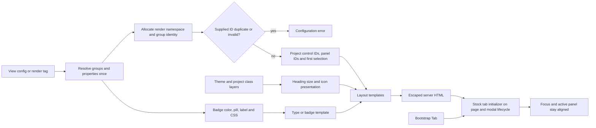

# Phase 06.5: Remaining presentation contracts and decided cleanup - Research

**Researched:** 2026-11-02
**Domain:** Django template presentation, icon placement, object-detail identity and tab lifecycle
**Confidence:** MEDIUM (official-doc lookup tier from the research seam; current-source observations reproduced separately)

<user_constraints>
## User Constraints (from CONTEXT.md)

The following sections reproduce the phase context verbatim. [VERIFIED: 06.5-CONTEXT.md, read this session]

<!-- DATA_c8f31d0a_START -->
### Locked Decisions

### Heading customization

- **D-01:** Make heading sizing theme-configurable. Preserve Bootstrap defaults, while allowing themes to replace
  or omit sizing classes without copying the heading template. Preserve semantic heading-level behavior.
- **D-02:** Put host-based icon classes on the title-bearing element: the heading for plain titles, or the button
  for accordion/tab titles. Element-based icon libraries render one child icon instead. Preserve visible title
  text, accessible headings/control names and no duplicate icon.
- **D-03:** Provide a shared heading-icon styling default with optional overrides for page, modal and group titles.
- **D-04:** Establish one heading contract before 1.0 and require immediate migration of incompatible custom
  templates. Ship tested migration examples and document breaking changes. A temporary legacy compatibility
  period is not required. This supersedes the user's initial choice to preserve working old overrides as a requirement.

### Tabs and accordion IDs

- **D-05:** Generate collision-free IDs by default and support application-supplied stable component/group
  identifiers for Selenium selectors, links and application scripts. Document how supplied identifiers produce
  stable targets across renders. Applications must provide distinct namespaces for repeated components,
  including the same detail view on a page and in a modal. This supersedes the initial internal-IDs-only choice.
- **D-06:** In vertical tabs, arrow keys move focus and immediately activate the corresponding tab/panel.
  Initially select the first tab and its panel; verify both one- and two-group cases.
- **D-07:** Report a clear configuration error for application-supplied ID collisions detectable during rendering.
  Do not silently add suffixes that change supplied stable IDs. Document that applications own uniqueness across
  separately rendered page/modal components; do not promise server-side detection across independent responses.
- **D-08:** Require immediate migration of copied tab/accordion templates to the new shared ID and selection
  context before 1.0. Provide tested migration examples; no temporary legacy-pattern support is required.

### Removed alias behavior

- **D-09:** Reject any supplied `CardAction.no_label` keyword with a clear migration error explaining `label_mode`
  as the replacement, including `label_mode="icon"` for icon-only actions. Presence with `False` also fails;
  do not silently ignore stale configuration. This targeted rejection does not authorize globally changing
  unknown-field handling for unrelated model inputs.
- **D-10:** Carry forward the decided removal of the Python alias and obsolete template `cv_no_label` rejection
  guard. Migrate fixtures, documentation and tests to `label_mode`/`cv_label_mode`. Do not restore the removed
  template context variable. The Python removed-keyword error in D-09 is distinct from the obsolete template guard.

### Badge styling

- **D-11:** Implement semantic badge context now: expose resolved color and pill state alongside the existing
  classes so alternative themes can map native styling. Preserve Bootstrap output by default.
- **D-12:** Preserve arbitrary custom color names. Pass through the resolved name rather than restricting it
  to Bootstrap's standard vocabulary. Each theme maps the names it supports to its own styling.
- **D-13:** Preserve ordinary-value rendering when no color resolves, including a missing color-map entry or
  a color function returning `None`. Do not introduce a neutral badge fallback.
- **D-14:** Preserve resolved-badge template precedence over a property's explicit `template=`. Themes customize
  badges through their badge template, which now receives semantic color and pill values.

### Carried-forward acceptance and compatibility

- **D-15:** Preserve both accepted singular/plural label-mode APIs and completed form-button/cancel-link,
  escaping, authorization, deletion, conditional/formset and modal-focus contracts. Do not reopen their acceptance.
- **D-16:** Retain all roadmap acceptance: mixed icon libraries, empty/disabled icons, escaped classes,
  heading-level changes, colliding/repeated/empty/translated group titles, repeated components and page/modal
  coexistence. A minimal native layout override must retain escaped titles/values and resolved-property context.
  Prove tab initialization, switching and keyboard behavior in a real browser; identify any untested
  non-Bootstrap visual or assistive-technology behavior explicitly.
- **D-17:** Document intentional stock markup changes and copied-template migrations. Pair every Breaking
  CHANGELOG entry with `docs/migrating-1.0.md`. Hand settled heading sizing/icon names, ID/selection projection,
  semantic badge fields and alias removal to Phase 7's public-surface inventory.

### Agent's Discretion and Planning Notes

- No additional product choices were explicitly delegated. Exact public key/tag/context names, helper placement,
  error classes/messages, ID composition/validation and test organization are research/planning responsibilities
  within the decisions above. Do not invent user-approved API names.
- Define shared defaults and location overrides together with the existing theme/project configuration layers.
  Heading sizing changes must not accidentally remove other title classes or alter semantic levels.
- Design one consistent control/panel projection usable by stock and copied layouts. Stable application-supplied
  identity must not depend solely on translated display titles; generated defaults still handle arbitrary titles.
  Stable IDs do not, by themselves, authorize URL-fragment-driven tab activation or selection persistence.
- Define which collisions can actually be detected in a rendering operation and test those errors. Keep generated
  and supplied identity rules explicit, including independently fetched modal content.
- Derive badge CSS and semantic context consistently from the same resolved result. Preserve existing color
  precedence, labels, null handling and escaping; do not duplicate callback evaluation merely to expose context.
- Research must reproduce the source-note findings against current code. Historical tests/source observations
  do not establish that the new contracts pass. Acceptance should include stable selectors across renders and
  tested migration recipes, as well as the existing roadmap browser and native-template checks.
- Older PROJECT/REQUIREMENTS backlog prose still calls headings and alias cleanup deferred and label-mode names
  undecided. The inserted roadmap phase, recorded earlier decisions and this context govern the current scope;
  reconcile traceability during planning without treating that stale prose as a new decision request.

### Deferred Ideas (OUT OF SCOPE)

No new deferred ideas arose. Existing exclusions remain: proposed Phase 6.6 Tabler seams (#277–#280), jQuery port,
optional diagnostics, unrelated CSS cleanup and Phase 7's final stability policy. This phase supplies the latter's
inventory inputs; it does not perform the freeze itself.
<!-- DATA_c8f31d0a_END -->
</user_constraints>


## Project Constraints (from AGENTS.md)

The supplied repository instructions and the checkout's CLAUDE.md govern this research.
[VERIFIED: CLAUDE.md, read this session]

- Keep CrudView attributes prefixed `cv_`; retain the existing CRUD keys, permission mappings and workflow prefix.
- Preserve ViewSet/CrudView integration, nested-parent filtering and extension-app behavior.
- Use existing pytest fixtures and their `cv_<model>`, `user_<model>_<permission>`,
  `client_user_<model>_<permission>` naming conventions.
- Use double quotes and 120-character Python lines; use the existing Ruff tooling.
- Keep hatchling builds and bump-my-version synchronization; no version bump is needed for research.
- Pair every Breaking CHANGELOG entry with a migration-guide update before 1.0.
- Existing project commands cover setup, nox tests, focused pytest, formatting, checks, builds and docs.
  The pre-commit hook formats Python. [VERIFIED: CLAUDE.md]

Additional project constraints are no downstream project names in shipped examples, unchanged unrelated goldens,
and pre-push Python/JS/docs/lint gates. This phase explicitly permits the intentional presentation changes and
immediate migrations identified in D-04/D-08/D-17. [VERIFIED: .planning/PROJECT.md; 06.5-CONTEXT.md]

## Summary

Implement this as four narrow producer-to-template changes plus shared migration/browser acceptance: heading
presentation data, object-detail render identity/selection, targeted alias rejection, and badge semantic data.
Keep semantic heading levels independent from visual size, resolve icon placement once, and give both sides of
every interactive pair the same render projection. The existing object-detail tags create fresh template contexts,
so outer loop state cannot supply panel selection implicitly. [VERIFIED:
src/crud_views/templatetags/crud_views.py:339-353;
src/crud_views_object_detail/templatetags/crud_views_object_detail.py:15-54]

The defects reproduce on current source. A temporary read-only Python probe on Django 4.2.30 found zero active
panels for one-group tabs, duplicate IDs for punctuation/empty/non-Latin titles and repeated components, a standalone
icon inside the modal heading, acceptance of the removed keyword with False, and badge callback evaluation once.
An existing focused baseline passes **171 tests on each of Django 4.2.30, 5.2.18 and 6.0.9**; those passes are
baseline evidence, not acceptance of the new contracts. [VERIFIED: research probe and focused pytest runs,
2026-11-02; details in Validation Architecture]

**Primary recommendation:** Settle the proposed public projection before dividing implementation tasks; implement
all producers and consumers of each projection together, then exercise copied-template migrations and fresh modal
keyboard interaction. This is a planning recommendation within the context's delegated naming/design work.

## Architectural Responsibility Map

| Capability | Primary Tier | Secondary Tier | Rationale |
|---|---|---|---|
| Semantic heading level and visual sizing | Django rendering | Theme class registry | Render numeric levels server-side; themes supply size classes. |
| Heading icon placement | Django rendering | Theme templates | Resolve host versus element once; put classes on the actual title/control host. |
| Component/group identity | Django rendering | Application configuration | Validate supplied identity and produce one projection for both control and panel. |
| Initial tab selection | Django rendering | Browser | Correct first paint must already contain selected trigger and visible panel. |
| Tab focus/activation | Browser | Stock Bootstrap integration | Use the existing library behavior and initialize injected content. |
| Removed CardAction input | Python configuration validation | Migration docs | Reject keyword presence before model extra handling. |
| Semantic badge resolution | Python resolver | Theme badge template | One evaluation supplies semantic values and compatible CSS. |
| Permission/data filtering | Existing backend | None added | Preserve accepted authorization; templates do not gain enforcement responsibility. |

The table is a recommended allocation grounded in the existing rendering/resolver split and D-01–D-17.
[VERIFIED: src/crud_views_object_detail/lib/resolvers.py:161-205;
src/crud_views_object_detail/templatetags/crud_views_object_detail.py:15-98; 06.5-CONTEXT.md]

<phase_requirements>
## Phase Requirements

No phase-specific IDs are assigned yet. ROADMAP explicitly says
`Requirements: TBD during planning`; the context resolves its older conditional badge wording in favor of
implementation. The following IDs are **proposals**, not existing requirement values. Preserve existing completed
requirements and move the relevant deferred ownership into this phase. [VERIFIED: .planning/ROADMAP.md:653-690;
06.5-CONTEXT.md D-11 and planning notes]

| Proposed ID | Proposed behavior | Decisions / research support |
|---|---|---|
| PRES-01 | Configurable heading size, shared/location icon styling and correct host/element rendering | D-01–D-04; heading registry and title-site audit |
| PRES-02 | Generated identities and optional stable component/group identities with bounded collision errors | D-05/D-07/D-08; render projection and registry scope |
| PRES-03 | Correct one/two-group initial tab selection, switching and automatic keyboard activation | D-06/D-16; server state plus stock lifecycle |
| PRES-04 | Remove Python alias with presence-based migration error; remove obsolete template guard | D-09/D-10/D-15; pre-validation and complete fixture migration |
| PRES-05 | Semantic badge color/pill with compatible default CSS, fallback and precedence | D-11–D-14; single resolver result |
| PRES-06 | Tested native/copied-template migration, preservation gates and explicit Phase 7 handoff | D-04/D-08/D-15–D-17; runnable examples and browser acceptance |

Proposed traceability: mark existing `LATER-01` and `LATER-04` as promoted to PRES-04 and PRES-01 respectively,
not completed until execution evidence exists; retain Phase 7's stability-policy ownership. Existing source
identifiers are verbatim `LATER-01`, `LATER-04`, `STAB-01` through `STAB-06`.
[VERIFIED: .planning/REQUIREMENTS.md:147-161]
</phase_requirements>

## Standard Stack

Reuse the installed project stack; this phase needs no new runtime package or dependency upgrade.

| Component | Declared / observed version | Purpose and evidence |
|---|---|---|
| Python | declaration `requires-python = ">=3.12"`; observed 3.12.3 | Existing runtime. [VERIFIED: pyproject.toml:25; runtime probe] |
| Django | declaration `"django (>=4.2.0)"`; tested 4.2.30 / 5.2.18 / 6.0.9 | Existing templates, escaping and render contexts. [VERIFIED: pyproject.toml:26-35; runtime/test probes] |
| Pydantic | declaration `"pydantic (>=2.2.1)"`; observed 2.14.1 / 2.14.2 | Existing configuration models and model validators. [VERIFIED: pyproject.toml:26-35; runtime probe] |
| Bootstrap | test host references `bootstrap@5.3.3` | Existing stock tab/collapse implementation. [VERIFIED: tests/test1/app/templates/app/base.html:13-19] |
| pytest / lxml | existing test extras; default-venv pytest 9.2.0 | Existing Python assertions/DOM parsing. [VERIFIED: pyproject.toml:70-83; runtime probe] |
| Node / Vitest / jsdom | Node 24.21.0; manifest `"vitest": "^5.0.3"`, `"jsdom": "^30.1.2"` | Existing JS harness. [VERIFIED: package.json, read this session; runtime probe] |
| Playwright / Chromium | existing cached Playwright 1.64.1; Chrome 149.0.7827.55 | Real-browser acceptance runtime found by probe. [VERIFIED: runtime probe] |

These are declared/installed versions, not claims about latest registry releases or complete upstream support.
The project test matrix is verbatim `DJANGO_VERSIONS = ["4.2", "5.2", "6.0"]`, with Python session declarations
`["3.12", "3.13", "3.14", "3.15"]`; the existing nox code skips its Django 4.2/Python 3.14+ combinations.
[VERIFIED: noxfile.py:3-14]

**Installation:** none proposed. Retain the existing lock/dependency declarations.

## Package Legitimacy Audit

Not applicable: no package installation is proposed. Existing libraries above were read from the project's
manifest and probed locally; none is being newly recommended from a registry search. If execution adds a dependency,
run the prescribed legitimacy gate and correct-ecosystem registry check before installation.

## Architecture Patterns

### System Architecture Diagram



This is the recommended architecture, not a claim that the new projection already exists.

### Component Responsibilities

| Existing seam | Planned responsibility |
|---|---|
| Core heading node and icon/class helpers | Add visual-size lookup and one shared icon projection; preserve semantic levels/body blocks. |
| Object-detail config/resolvers | Carry stable group key; resolve badge semantics once. |
| Object-detail render tags | Allocate component identity, validate duplicate IDs, create selection projection; do not mutate resolved domain groups. |
| All stock heading/layout consumers | Consume shared presentation fields and pair targets; migrate standalone icon calls at title sites. |
| Stock JS asset integration | Initialize only owned Bootstrap tab roots; dispose removed instances; keep modal focus authority unchanged. |
| Existing docs/goldens/tests | Execute migration recipes and update only intentional markup changes. |

Source seams were opened this session. [VERIFIED: src/crud_views/templatetags/crud_views.py:313-387;
src/crud_views/lib/button_classes.py:125-171; src/crud_views_object_detail/lib/config.py:18-77;
src/crud_views_object_detail/lib/resolvers.py:44-64,94-117,190-205;
src/crud_views_object_detail/templatetags/crud_views_object_detail.py:15-98]

### Pattern 1: Split semantic level, visual size and icon placement

Current heading behavior reads the setting at render time, adds `f"h{self.level}"` when the semantic level differs,
and then appends the caller's classes. The tag currently accepts exactly `{"level", "class"}`.
[VERIFIED: src/crud_views/templatetags/crud_views.py:339-387]
Do not remove arbitrary h-prefixed classes from caller input: introduce an explicit visual-size argument and
migrate known hardcoded size classes to it.

**Proposed contract A1:** extend the heading tag with `size=N`, defaulting to its original numeric `level`.
An explicit size always uses the corresponding theme class; implicit size uses it only when the semantic level
changes, preserving existing default output. Add six class-table keys `heading:size-1` through
`heading:size-6`, defaulting to their corresponding Bootstrap size classes. Empty string or None removes only
the size class. Keep the caller's structural/utility classes intact. All names in this paragraph are proposed.
[ASSUMED: A1, implementation proposal requiring plan review]

**Proposed contract A2:** a public `cv_heading_icon` assignment tag returning `host_class` and `inline_html`,
fed an icon value plus `location="page"|"modal"|"group"`. It uses the existing host-library detector; host placement
produces only host classes, element placement produces exactly one escaped renderer result. Suppressed host
styling must not trigger fallback to an inline duplicate. Templates append `host_class` on the heading or its
title-bearing button and place `inline_html` before visible title text. This separates accordion button placement
from the outer semantic heading without DOM rewriting. [ASSUMED: A2, implementation proposal requiring plan review]

Use shared `heading:icon-host` and `heading:icon-inline` class slots, with optional
`heading-page:icon-host`, `heading-modal:icon-host`, `heading-group:icon-host` and matching inline slots.
Resolve by **configuration layer first**, then exact location before shared fallback inside that layer:
project location, project shared, theme location, theme shared, builtin location, builtin shared.
Explicit None/empty stops inheritance. This prevents a theme location value defeating a project-wide override.
Use a private generalized layered lookup if necessary; do not change existing button resolution semantics.
[ASSUMED: A2, proposed names and precedence]

The existing button implementation merges defaults, theme, project and uses presence rather than truthiness for
mode fallback: verbatim `classes = {**DEFAULT_BUTTON_CLASSES, **_THEME_BUTTON_CLASSES, **_settings_layer()}`
and `if mode and f"{key}:{mode}" in classes:`.
[VERIFIED: src/crud_views/lib/button_classes.py:135-155]
New optional heading keys must be recognized by the existing unknown-key check without registering absent
overrides as None defaults. Existing host format validation already matches keys ending in `:icon-host` and
uses `value.format(name_class="x")`. [VERIFIED: src/crud_views/lib/button_classes.py:250-275]

Audit **page titles too**: the test host currently has literal nested headings; the demo and documentation put
`class="h3 mb-0"` on the page heading. Move that visual size into the proposed size API and retain only the
spacing class. Keep the supported title body block overridable, and document the replaced icon block pattern.
The split-card and striped-row icons currently sit outside their headings and must move to the title host.
[VERIFIED: tests/test1/app/templates/app/crud_views.html:13-27;
examples/bootstrap5/project/templates/project/crud_views.html:17-24;
docs/reference/templates.md:44-64;
src/crud_views_object_detail/templates/crud_views_object_detail/layouts/split-card/group.html:7-9;
src/crud_views_object_detail/templates/crud_views_object_detail/layouts/striped-rows/group.html:3-5]

### Pattern 2: Project interactive identity once per component render

Current domain objects carry verbatim `title: str`, `description: str | None = None`,
`icon: str | None = None`, `properties: list[ResolvedProperty] = field(default_factory=list)`.
Do not attach ephemeral DOM IDs to shared instances; render the same resolved groups twice without mutation.
[VERIFIED: src/crud_views_object_detail/lib/resolvers.py:58-64]

**Proposed contract A3:**

- Add optional `id` to group configuration and resolved groups; add `component_id=None` to
  `render_object_detail`. Give normal view users `cv_object_detail_id` and a request-aware
  `cv_get_object_detail_id()` hook, threading its value through the existing content template.
- Construct immutable per-render entries retaining `group`, `control_id`, `panel_id`, `selected`;
  expose a component record with `id`, `tablist_id`, `content_id`, and `groups`.
- The shared group tag accepts the projected entry explicitly. Keep the existing resolved group/property
  data visible as `group`/`prop`, rather than asking layouts to resolve models again.
- Use selector-safe ASCII tokens for supplied component/group IDs: a leading letter followed by letters,
  digits, underscore or hyphen. Reject empty strings, whitespace, selector punctuation and non-string values.
  Do not trim, translate, slugify, normalize or silently suffix supplied values.
- Compose with injective segments (for example length-prefixed component/group tokens and distinct role
  suffixes); do not use ambiguous plain hyphen concatenation. Document the exact formula and test adversarial
  pairs whose naive concatenation would collide.
- Omitted component IDs get a fresh UUID namespace; omitted group IDs use an explicit indexed fallback namespace
  disjoint from supplied keys. Validate the full emitted ID set. Generated identities are not persistent links.
- Stable component **and** group values produce stable IDs across renders and translations. A supplied component
  with omitted group keys only guarantees positional stability while ordering is unchanged. Applications own
  distinct page/modal/repeated-component namespaces; do not silently append a modal suffix.

[ASSUMED: A3, implementation proposal requiring plan review; no names above are existing APIs]

**Collision boundary:** reject duplicate supplied group keys within one component before output, and duplicate
final component/root/control/panel IDs in the same observable outer rendering operation. Do not use a process
global set, model PK alone, request lifetime alone, or a translated title. Independent render-to-string calls and
independent HTTP/modal responses cannot be checked against an already assembled browser document; document the
application's duty there exactly. [VERIFIED: 06.5-CONTEXT.md D-05/D-07; recommendation A3]

Django recommends render-local state instead of mutable compiled-node attributes. Its render context scopes
are local to template invocations. [CITED: https://docs.djangoproject.com/en/4.2/howto/custom-template-tags/]
The installed source explicitly states `The render context stack is pushed before each template is rendered`
and implements `if isolated_context: self.push()`; normal Template.render uses
`with context.render_context.push_state(self):`.
[VERIFIED: .nox/tests-3-12-django-4-2/lib/python3.12/site-packages/django/template/context.py:176-212;
.nox/tests-3-12-django-4-2/lib/python3.12/site-packages/django/template/base.py:169-177]

**Registry implementation recommendation A4:** hide scope management in one private helper. Use the outermost
active render frame to own the ID set, pass that scope explicitly to nested object-detail rendering, and release
it with that render. An implementation using Django's render-context frame stack must be treated as internal and
tested on all three supported series, including includes/inheritance and reused Context objects. Merely calling
`context.render_context.setdefault` in each isolated template will miss sibling includes. Never keep a set on
a reusable compiled Node. For direct standalone group rendering, allocate a one-group local projection; do not
emit a nonexistent accordion parent selector. [ASSUMED: A4, integration mechanism requiring targeted validation]

### Pattern 3: One selected flag, stock library behavior, explicit injected-content initialization

The existing trigger uses ` active`, but its panel always begins
`<div class="tab-pane fade"`. Both use `group.title|slugify`; the accordion root is
`id="objectDetailAccordion"`. The group tag renders only `{"group": group, "layout": pack}`.
[VERIFIED: src/crud_views_object_detail/templates/crud_views_object_detail/layouts/tabs-vertical/object_detail.html:6-24;
src/crud_views_object_detail/templates/crud_views_object_detail/layouts/tabs-vertical/group.html:2-5;
src/crud_views_object_detail/templates/crud_views_object_detail/layouts/accordion/object_detail.html:2-5;
src/crud_views_object_detail/templatetags/crud_views_object_detail.py:42-54]

Set initial trigger active/aria-selected/tabindex and initial panel active/show from the same projected boolean.
Give each tab an aria-controls target and each panel the matching aria-labelledby; preserve vertical orientation.
Ensure panels with no focusable contents can receive keyboard focus. The ARIA tabs pattern covers these semantics
and automatic activation; it does not make an entire theme or assistive-technology combination certified.
[CITED: https://www.w3.org/WAI/ARIA/apg/patterns/tabs/]

Bootstrap 5.3.3 and 5.3.8 install keydown handlers in the Tab constructor, return early when show() targets an
already-active trigger, and initialize active triggers on window load. Arrow handlers focus and activate the next
tab. Therefore fixing first-paint markup is required, and newly injected modal tabs need initialization before
their first keyboard interaction. [CITED: https://raw.githubusercontent.com/twbs/bootstrap/v5.3.3/js/src/tab.js;
https://raw.githubusercontent.com/twbs/bootstrap/v5.3.8/js/src/tab.js]

**Recommendation A5:** add one stock-layout-owned marker and repeat-safe initializer, calling Bootstrap's existing
Tab constructor/getOrCreateInstance for owned triggers. Invoke it on normal/late page load and modal loaded;
dispose removed instances on modal unload. Reinitialization preserves current selection and focus. Scope to the
root itself plus descendants, do nothing when no owned tabs exist, and keep the native-layout fixture free of
Bootstrap dependencies. Reuse the asset registry/lifecycle pattern; avoid a custom competing arrow-key handler
or mandatory generic tab adapter. [ASSUMED: A5, implementation placement to settle in plan]

Existing lifecycle names are verbatim `"cv:modal:loaded"` and `"cv:modal:unload"`; the tooltip initializer
already handles late document load and uses these hooks. [VERIFIED:
src/crud_views/static/crud_views/js/tooltip.js:32-55;
src/crud_views/static/crud_views/js/modal.js:23-24]

### Pattern 4: Reject the removed input before Pydantic ignores extras

Current CardAction declares `no_label: bool = False`; the runtime checks `elif action.no_label:` and chooses
`label_mode = "icon"`. Delete both the field and consuming branch. The obsolete template guard is a separate
presence check, `if "cv_no_label" in ctx:`, and must also be removed without emitting that context key.
[VERIFIED: src/crud_views/lib/view/card.py:8-33;
src/crud_views/lib/views/card.py:46-58; src/crud_views/lib/view/button_data.py:126-130]

Use a model-before validator that checks membership in raw mapping input, raising ValueError with the replacement
instruction regardless of the supplied value. This is the documented Pydantic pattern for rejecting a removed
input before instance construction; preserve other extra-field handling.
[CITED: https://pydantic.dev/docs/validation/latest/concepts/validators/]

Acceptance must cover constructor, model_validate and JSON-validation paths; False, True, None and conflicting
replacement input; omission; unrelated extra input; no field in schema/dump; and no runtime alias read.
Retain purposeful negative-test and migration examples of the old spelling. Remove obsolete tests promising
compatibility or template rejection. Do not rename either accepted singular/plural label-mode API.
[VERIFIED: 06.5-CONTEXT.md D-09/D-10/D-15; implementation/test recommendation]

### Pattern 5: Resolve badge semantics and CSS from one result

Current inputs are verbatim `color: str | None = None`, `color_map: dict | None = None`,
`color_fn: Any | None = None`, `label_map: dict | None = None`, `pill: bool = False`.
[VERIFIED: src/crud_views_object_detail/lib/config.py:18-27]
The source branches on truthiness: callback, then nonempty map, then fixed color. An **empty map** currently falls
through to fixed color, but a missing entry in a nonempty map yields no badge. A None property skips color
resolution. CSS is verbatim `f"text-bg-{color}"`, adding `" rounded-pill"` when enabled.
[VERIFIED: src/crud_views_object_detail/lib/resolvers.py:94-117; research probe]

**Proposed contract A6:** append `badge_color: str | None = None` and `badge_pill: bool = False` to the resolved
property data; use one private resolver result to fill these and existing CSS/label fields. Preserve positional
construction by appending fields, not inserting before existing fields. For unresolved badges use None/False;
for resolved badges retain the arbitrary color string and requested pill flag. Do not call color_fn a second
time just to obtain context. Keep the truthiness behavior of an empty map and empty color string unless a separately
approved change says otherwise. [ASSUMED: A6, proposed field names/defaults]

Keep existing template selection: `if prop.badge_css:` comes before `elif prop.template:`, then typed fallback.
The default badge chooses a truthy `prop.badge_label` before raw value. Therefore an empty label remains the
ordinary value and a missing color retains the original explicit/typed template path. The existing stock badge
continues using CSS while the native recipe maps semantic values. [VERIFIED:
src/crud_views_object_detail/templatetags/crud_views_object_detail.py:79-98;
src/crud_views_object_detail/templates/crud_views_object_detail/types/default/badge.html:1]

## Don't Hand-Roll

| Problem | Don't build | Use instead |
|---|---|---|
| Tab keyboard/selection state machine | A second arrow handler fighting Bootstrap | Existing Tab implementation plus bounded lifecycle initialization. |
| HTML escaping | Manual escaping or mark_safe around user/config strings | Django escaped template variables / format_html with arguments. |
| Icon recognition | Prefix heuristics or parsing rendered HTML | Existing registry resolution and host detector. |
| Stable group identity | Slugified display titles or Python hash() | Explicit identity projection, generated namespaces and validated stable tokens. |
| Badge semantic extraction | Parsing Bootstrap CSS to recover color/pill | One authoritative resolution result. |
| Removed keyword validation | Global extra-forbid policy | Targeted model-before membership rejection. |

Recommendations derive from the source seams and official behavior above. [VERIFIED:
src/crud_views/lib/icons.py:195-267; src/crud_views_object_detail/lib/resolvers.py:94-110;
src/crud_views/lib/view/card.py:8-33]
[CITED: https://getbootstrap.com/docs/5.3/components/navs-tabs/;
https://pydantic.dev/docs/validation/latest/concepts/validators/ ]

## Runtime State Inventory

This is a template/API migration, so runtime consumers matter. No deployment account or downstream service inventory
was available; those are explicitly unknown, not assumed absent.

| Category | Items found / bounded observation | Required action |
|---|---|---|
| Stored data | Proposed changes touch rendering configuration and resolved dataclasses, not model storage. [VERIFIED: config/resolvers files read above] External persisted CardAction/config dictionaries are unobserved. | No package database migration proposed; applications must migrate stored old-keyword configurations if they have them. |
| Live service config | Theme/template overrides and stable Selenium selectors can exist outside this checkout. [VERIFIED: D-04/D-05/D-08] No deployed service configuration was inspected. | Publish immediate copied-template and selector migration; application owners audit their deployments. |
| OS-registered state | No service/task registration is changed by the proposed implementation. [ASSUMED: A7, scope boundary] External registrations were not inventoried. | None planned; avoid claims of a machine-wide audit. |
| Secrets/env vars | No secret rename is required by the proposed APIs. [ASSUMED: A7] No secret values were inspected. | Retain existing configuration layers; do not add secret/environment migrations. |
| Build artifacts / installed packages | Cached nox environments include installed distributions, while explicit PYTHONPATH resolves this checkout. [VERIFIED: runtime import-path probe] Copied templates/static bundles can remain old after deployment. | Verify source imports; rebuild/redeploy package/static outputs and migrate theme copies together. |

## Common Pitfalls

1. **Treating IDs as domain data.** Mutating a resolved group with component-specific IDs breaks repeated renders.
   Project IDs per rendering operation and assert input objects remain unchanged. [VERIFIED:
   src/crud_views_object_detail/templatetags/crud_views_object_detail.py:18-19; A3 recommendation]
2. **Stable but ambiguous concatenation.** Distinct supplied pairs can produce the same raw hyphen-joined string.
   Use a documented injective composition, test final emitted IDs, and never suffix supplied collisions.
   [ASSUMED: A3 design risk]
3. **An overly broad or narrow registry.** Request-wide/global state causes false collisions across independent renders;
   isolated per-template state misses sibling includes. Require include, reuse, concurrent render and separate-response
   tests before claiming the boundary. [VERIFIED: installed Django render-context source cited above; A4 recommendation]
4. **Host disabled means inline fallback.** A recognized host icon whose style is disabled must not appear as a child.
   Check library placement independently from whether formatted host CSS is nonempty. [VERIFIED:
   src/crud_views/lib/icons.py:248-267; src/crud_views/lib/button_classes.py:158-171]
5. **Sizing only automatically added classes.** The explicit page h3 class defeats a theme that clears generated sizes.
   Migrate the known explicit site to the size API rather than stripping arbitrary class content. [VERIFIED:
   examples/bootstrap5/project/templates/project/crud_views.html:17; docs/reference/templates.md:50]
6. **Browser tests click before testing keys.** A click creates a Tab instance and hides a modal initialization failure.
   Test focus and ArrowDown immediately after injection. [CITED:
   https://raw.githubusercontent.com/twbs/bootstrap/v5.3.3/js/src/tab.js]
7. **Removing the alias field only.** The present model accepts unrelated extras; the old keyword can silently disappear.
   Reject it in before-validation and preserve unrelated extra behavior. [VERIFIED: research probe;
   src/crud_views/lib/view/card.py:8-33]
8. **Broad “color fallback” cleanup.** A missing map entry must stay ordinary content; preserving an empty map's fixed-color
   fallback is a different case. Keep both tests. [VERIFIED: src/crud_views_object_detail/lib/resolvers.py:94-110]
9. **Updating goldens wholesale.** Added IDs, moved icon elements and intentionally changed title markup need targeted
   assertions and reviewed diffs, not a blanket snapshot regeneration. [VERIFIED: D-17; testing recommendation]

## Code Examples

The following is a **proposed migration skeleton**, not executable against the current checkout.
Every new name is part of A1/A2 and must be settled by the planner before publication. [ASSUMED: A1/A2]

```django



    {{ title_icon.inline_html }}

```

Retain utility classes using the final helper/template's escaped class-composition mechanism; the short skeleton
deliberately focuses on placement. Accordion/tab recipes put the same projected host class on the button, keeping
its outer heading semantic. Test the exact published recipe, including structural classes, hostile title/class
values, custom renderers and overrides.

A targeted validation skeleton follows the official before-validator pattern; it is proposed replacement code,
not a quote from current source. The removed keyword and replacement are existing values quoted above.
[ASSUMED: proposed implementation; CITED: https://pydantic.dev/docs/validation/latest/concepts/validators/]

```python
@model_validator(mode="before")
@classmethod
def reject_removed_no_label(cls, data):
    if isinstance(data, Mapping) and "no_label" in data:
        raise ValueError('CardAction.no_label was removed; use label_mode="icon" for icon-only actions')
    return data
```

Use the native migration fixture to assert the existing value-template context remains `prop`, `value`,
`od_settings`, including `property_text_newline`, while adding semantic badge fields.
[VERIFIED: src/crud_views_object_detail/templatetags/crud_views_object_detail.py:94-98]
Do not publish a template that performs model traversal, duplicates callbacks, or reimplements permission checks.

## State of the Art

| Existing approach | Phase target | Impact |
|---|---|---|
| Title-slug IDs and fixed component roots | Per-render identity projection, optional supplied stable identifiers | Translation and repeated-render safety; immediate copied-layout migration. |
| Trigger-only initial selection | Shared selected flag for trigger and panel | Correct first paint; keyboard/browser acceptance. |
| Standalone heading icon + hardcoded size tokens | Shared icon presentation + theme sizing | Host libraries work without copied heading markup. |
| Alias compatibility plus obsolete template guard | Targeted Python error; template guard removed | Explicit migration; unrelated input semantics preserved. |
| CSS-only badge context | Semantic fields alongside compatible CSS | Native theme maps color/pill directly. |

These are phase targets, not ecosystem-wide deprecation claims. Existing implementations are verified by the source
excerpts above; required changes are locked in D-01–D-17.

## Environment Availability

| Dependency | Available observation | Fallback / requirement |
|---|---|---|
| Python project runtime | Python 3.12.3; default .venv Django 6.1.2/Pydantic 2.14.1/pytest 9.2.0 | Use cached supported-series environments for compatibility proof. |
| Django 4.2 | 4.2.30, Pydantic 2.14.1 | Existing nox test environment; focused baseline passed. |
| Django 5.2 | 5.2.18, Pydantic 2.14.2 | Existing nox test environment; focused baseline passed. |
| Django 6.0 | 6.0.9, Pydantic 2.14.1 | Existing crispy-floor environment; focused baseline passed. |
| Node / npm | 24.21.0 / 11.19.0 | Existing toolchain; no installation needed. |
| Playwright / browser | 1.64.1 / Chrome 149.0.7827.55 | Existing cached runtime; runner must honor explicit overrides and fail on invalid ones. |
| uv / task | Executables found | Use project commands for complete gates. |
| Context7 MCP / ctx7 CLI | Neither found in this agent's available tools/PATH | Official web sources used; no automatic installation. |

[VERIFIED: environment probes during this research, 2026-11-02]

No missing runtime blocks planning. Network-dependent browser assets should be pinned/recorded or served from
verified local test assets so failed downloads cannot masquerade as tab success. Accessibility-tree/visual assertions
require actual loaded CSS and font assets. This is a validation recommendation, not a claim those new checks exist.

## Validation Architecture

### Existing Framework and Baseline

| Property | Value |
|---|---|
| Python harness | pytest with pytest-django; in-memory test setup via pytest_configure |
| Config | `[tool.pytest.ini_options]`, `addopts = "--strict-markers"` [VERIFIED: pyproject.toml:129-130] |
| Focused collection | Collect the parent test directory, then select with -k |
| JavaScript | Existing `"test": "vitest run"`, `"test:integration": "vitest run --config vitest.integration.config.js"` [VERIFIED: package.json] |
| Browser analog | Real authenticated loopback runner with source/runtime hashes and explicit browser overrides [VERIFIED: tests/browser/conditional-formsets.cjs:1-17,39-46,118-145] |

Existing pytest configuration calls `settings.configure(` in `pytest_configure()` and uses
`"NAME": ":memory:"` for test databases. [VERIFIED: tests/test1/conftest.py:35-101]
Directly adding the object-detail subdirectory as an initial collection path preloads its conftest before that
setup in this environment. The first attempted focused command failed with:

```text
django.core.exceptions.ImproperlyConfigured: Requested setting USE_I18N, but settings are not configured.
```

Collecting the parent and selecting by -k succeeds. Do not present the initial collection failure as a product
regression. [VERIFIED: failed and corrected pytest commands during research]

**Proven focused command** (run from repository root with each existing interpreter):

```bash
PYTHONPATH=src:. .nox/tests-3-12-django-5-2/bin/python -m pytest tests/test1 -k 'heading_tag or heading_level or test_layout_packs or test_layout_a11y or test_resolvers or card_action_label_mode_field' -q
```

| Runtime | Fresh result |
|---|---|
| Django 4.2.30 | 171 passed, 7650 deselected; 10.14s |
| Django 5.2.18 | 171 passed, 7650 deselected; 15.77s |
| Django 6.0.9 | 171 passed, 7650 deselected; 18.39s |

[VERIFIED: research test runs; imports printed checkout src before tests]
The corresponding existing runtime executables were observed at
`.nox/tests-3-12-django-4-2/bin/python`, `.nox/tests-3-12-django-5-2/bin/python`,
and `.nox/crispy_floor-3-12-django-6-0/bin/python`. These are **observed local paths**, not a portable
installation contract; no creator script/path guarantee is claimed. Executors must probe them again.

**Fresh read-only probe output** (Django 4.2.30, current checkout; no feature code changed):

```text
tabs-vertical.one_active_panels = 0
duplicate_ids = objectDetailPane-, objectDetailPane-a-b, objectDetailTab-,
                objectDetailTab-a-b, objectDetailTabContent, objectDetailTabs
accordion duplicates = objectDetailAccordion, objectDetailCollapse-, objectDetailCollapse-a-b
heading = <h1 class="h5 modal-title"><i class="standalone name-eye" aria-hidden="true"></i> Title</h1>
alias_false_accepted = true
unknown_input_still_ignored = true
badge.custom = "text-bg-brand-custom rounded-pill"; callback calls = 1
badge.missing_map = null
badge.empty_map_falls_to_fixed = "text-bg-fixed"
```

[VERIFIED: temporary read-only probe, 2026-11-02]
The duplicate probe rendered titles A B, A-B, empty and Japanese text, and repeated the component. This establishes
the original failure, not the new uniqueness guarantee. No fresh browser acceptance is claimed by this research.

### Phase Requirements → Test Map

All IDs and new files below are proposals. Existing-test names are bounded discovery anchors, not promises that
their present assertions cover new acceptance.

| Req | Behavior | Test type / runnable target | Exists? |
|---|---|---|---|
| PRES-01 | Default bytes, size replacement/removal, semantic levels, shared/location precedence, escaped host classes, mixed libraries | pytest parent collection with `-k 'heading or icon_host'` | Existing tests need new cases |
| PRES-02 | Stable cross-render IDs, arbitrary titles, repeated groups/components, injective composition, registry lifetime and collision failures | Proposed object-detail identity tests, `-k 'object_detail_identity'` | Wave 0 |
| PRES-03 | One/two-group first selection and aria pairing | Extend layout tests; `-k 'layout_packs or layout_a11y'` | Existing tests need assertions |
| PRES-03 | Keyboard before click, page/modal injection, isolation and cleanup | Proposed real browser presentation runner plus focused JS lifecycle tests | Wave 0 |
| PRES-04 | Presence rejection, schema removal, unknown-extra preservation, existing label APIs and form/cancel behavior | `-k 'card_action_label_mode_field or card_label_mode or button_data or label_mode_docs or variants'` | Existing tests need migration |
| PRES-05 | Fixed/map/function precedence, empty/missing/None cases, callback count, custom names, pill, labels, badge-before-explicit-template | `-k 'test_resolvers or test_templatetags or badge'` | Existing tests plus semantic additions |
| PRES-06 | Executed heading/interactive/native/badge migration recipes and handoff names | Proposed presentation-doc recipe tests | Wave 0 |
| PRES-06 | Accepted backend/form/modal lifecycle remains intact | Full supported-series pytest; full JS; existing browser acceptance where affected | Existing regression gates |

**Browser acceptance cases to put in the plan:**

1. One and two groups: selected tab, visible first panel, accessible names and matching IDs on first paint.
2. Mouse switching, ArrowUp/ArrowDown automatic activation and wrap; Home/End provided by the stock library;
   Tab exits the tablist correctly. In a one-tab case arrows retain the sole selection.
3. Fresh injected modal, keyboard before any tab click; close/reopen and replacement without duplicate listeners
   or changes to the existing modal opener/focus contract.
4. Two components and a page/modal pair: clicking/keyboard on one never changes the other.
5. Stable supplied component/group tokens remain identical across separate renders, title translations and
   reordering when explicit group tokens are used; generated defaults differ.
6. Accordion controls and data parent selectors target only their own component; empty/repeated/colliding titles work.
7. Stock and minimal native heading/badge/layout overrides retain escaped titles, values and resolved context.
   Native details/layout testing does not imply a full non-Bootstrap tabs implementation is supported.
8. Record real runtime/library versions, source hashes, loaded CSS/fonts, console/page errors and assertion outcomes.
   Explicitly report screen-reader and non-Bootstrap visual coverage not actually performed.

These cases translate D-05–D-08/D-16 into checks; they are not claimed existing coverage.
[VERIFIED: 06.5-CONTEXT.md]

### Sampling Rate and Phase Gates

- Per task: relevant focused pytest/JS selection; keep a focused Python target under 30 seconds.
- Per wave: affected presentation suite on all three cached Django series and JS lifecycle tests if JS changed.
- Phase gate: full `PYTHONPATH=src:. <supported-python> -m pytest tests -q` in the supported matrix;
  `npm test`; integration JS when touched; strict MkDocs; Ruff checks/format checks; real browser presentation cases.
- Keep full matrix evidence distinct from the three Python 3.12 series tested in research.
- Run existing conditional/formset/modal browser acceptance when shared initialization or modal behavior changes;
  keep backend authorization/deletion suites in the full gate without reopening accepted requirements.

Gate commands are recommendations built on existing project tools. [VERIFIED: CLAUDE.md; noxfile.py:3-19;
package.json; .planning/PROJECT.md quality gates]

### Wave 0 Gaps

- Add a focused identity/projection suite with include/inheritance/reused-context and no-request rendering.
- Add scoped stock tab initializer tests; pin the actual Bootstrap asset version used by the browser host.
- Add a presentation browser fixture using the existing loopback/runtime-override pattern, with distinct owned port
  and process cleanup; do not overwrite Phase 6.4 evidence.
- Add executable migration recipes for page/modal/button-host headings, copied tabs/accordion, native badge/type/layout
  templates, and the removed Python keyword.
- Add no_label=False rejection and unrelated-extra-preservation regressions before deleting compatibility fixtures.
- Add callback-count and badge-template precedence tests before changing the resolver shape.
- Prepare intentional golden diffs; retain unrelated form/cancel/security/lifecycle baselines.

## Security Domain

Security enforcement is enabled in project workflow configuration. This is a bounded rendering/input-validation
change, not a new authentication or cryptographic design. [VERIFIED: .planning/config.json, read this session]

### Applicable ASVS Categories

Use **ASVS 5.0 category names**, not the stale 4.x numbering in a generic template.
[CITED: https://cheatsheetseries.owasp.org/IndexASVS.html]

| ASVS 5.0 category | Applies here | Planned control |
|---|---|---|
| V1 Encoding and Sanitization | Yes | Django autoescaping / format_html for classes, IDs, titles, values, badge labels. |
| V2 Validation and Business Logic | Yes | Validate supplied ID tokens and collisions; targeted removed-key rejection. |
| V3 Web Frontend Security | Yes | Scoped DOM targeting; no inline handler injection; preserve existing asset/CSP behavior. |
| V6 Authentication | Regression boundary | Preserve existing request authentication. |
| V7 Session Management | Regression boundary | Do not use session state for render identity or selection. |
| V8 Authorization | Regression boundary | Keep existing backend action/data filtering. |
| V11 Cryptography | No new crypto protocol | Generated IDs are DOM namespaces, never authorization tokens. |

### Threat Patterns and Mitigations

| Pattern | STRIDE | Verification |
|---|---|---|
| Hostile title/class/ID/badge label becomes markup | Tampering | Quote/angle-bracket payloads remain data; no added elements or event attributes. |
| Duplicate target activates another component | Tampering | Final-ID injectivity, bounded collision errors and browser component-isolation assertions. |
| Shared mutable render state leaks across requests | Information disclosure / denial of service | No persistent registry; repeated and concurrent render isolation. |
| Copied templates discard safe resolved context | Information disclosure | Native recipe consumes the same safe projection and existing property data. |
| New heading resolver evaluates a callback twice | Tampering | One icon-render callback / one badge color callback per resolved use; deterministic tests. |

These controls are phase-specific recommendations grounded in the source and locked preservation decisions.
[VERIFIED: 06.5-CONTEXT.md D-15/D-16; cited ASVS index]

## Assumptions Log

The A-items are explicit **implementation proposals**, not unverified claims of existing behavior or user-approved
names. The context delegates exact API names, ID composition and helper placement to research/planning; review them
in the plan rather than reopening the locked product choices.

| ID | Proposal / unverified scope claim | Risk if wrong |
|---|---|---|
| A1 | Explicit visual size argument and six theme keys | Hardcoded size leakage or unwanted default markup changes. |
| A2 | Shared icon projection and layer-first location/shared precedence | Inconsistent global override semantics or duplicate host/inline icons. |
| A3 | Optional group/component keys, restricted tokens, injective composition and per-render projection | Selector instability or collisions if encoding/validation is underspecified. |
| A4 | Outer-render registry with explicit propagation and isolated standalone-group rendering | False collisions or missed nested/include collisions; validate on supported Django. |
| A5 | Stock-layout initializer using existing Bootstrap instances/lifecycle | Fresh modal keyboard failure or handler/focus interference. |
| A6 | Append semantic badge fields with None/False unresolved defaults | Incompatible resolved data construction or CSS/semantic disagreement. |
| A7 | No OS-registration/secret migration in this bounded source change | External applications may have unobserved configuration consumers. |

## Open Questions

1. **Public API names and precedence:** A1–A6 are concrete recommendations for the planner to settle. No extra product
   permission is needed merely to choose names within the context; do not advertise them as already implemented.
2. **Registry propagation:** require the plan to specify outer-render lifecycle and include/inheritance behavior,
   not just “use render_context.” A private frame-stack approach needs supported-series tests.
3. **Unknown external copies:** application selectors, deployment caches and independently rendered modal IDs cannot
   be audited from this checkout. The migration guide must state the boundary and distinct-namespace obligation.
4. **Visual/AT evidence:** browser runner availability is verified; final screen-reader checks and non-Bootstrap visual
   review are not performed by this research and must remain explicitly unverified until exercised.
5. **Traceability reconciliation:** planner should replace stale conditional badge/deferred heading/alias prose with
   context-consistent phase ownership; Phase 7 remains responsible for final stability classification.

## Sources

### Current source and executable observations

All cited source files were opened this session; discrete source values are quoted beside their claims.
The research probe and three focused test runs used explicit checkout imports. Existing runtime paths are observed
environment values, not claimed newly created paths.

### Official documentation (MEDIUM lookup confidence)

- [Django custom template tags](https://docs.djangoproject.com/en/4.2/howto/custom-template-tags/) — render-local state.
- [Bootstrap tabs](https://getbootstrap.com/docs/5.3/components/navs-tabs/) — stock markup/selection semantics.
- [Bootstrap 5.3.3 implementation](https://raw.githubusercontent.com/twbs/bootstrap/v5.3.3/js/src/tab.js) —
  actual host version's initialization and keyboard behavior.
- [Bootstrap 5.3.8 implementation](https://raw.githubusercontent.com/twbs/bootstrap/v5.3.8/js/src/tab.js) —
  cross-check of the historical source note's version.
- [WAI-ARIA tabs pattern](https://www.w3.org/WAI/ARIA/apg/patterns/tabs/) — keyboard/role expectations.
- [Pydantic validators](https://pydantic.dev/docs/validation/latest/concepts/validators/) — targeted before validation.
- [OWASP ASVS index](https://cheatsheetseries.owasp.org/IndexASVS.html) — correct 5.0 category identifiers.

### Lookup Method and Limitations

The research-plan seam produced four questions and selected Context7 for library docs and websearch for ASVS.
Context7 MCP and ctx7 CLI were unavailable, so official web pages/source were used; no packages were installed.
The classify-confidence seam returns MEDIUM for `websearch --verified`; its unrecognized webfetch provider returns
LOW, so official web lookups are recorded under the supported websearch classification. Digests were stored in the
user-level curated cache, leaving shared project cache/planning files untouched. Graph status reported no graph.
[VERIFIED: research-plan, classify-confidence, research-store, graphify and tool/PATH outputs]

The first guessed raw ASVS markdown paths returned 404; they establish no absence or compatibility conclusion.
The official ASVS index supplied the category evidence instead.

## Metadata

| Area | Confidence | Reason |
|---|---|---|
| Existing stack and source findings | MEDIUM overall; source provenance verified | Three supported Django baseline runs plus source reads; not a full Python/dependency matrix. |
| Architecture recommendations | MEDIUM | Fit current seams and locked decisions; exact public shapes remain proposed. |
| Failure modes | MEDIUM | Original server-render defects reproduced; Bootstrap lifecycle checked in official source. |
| New browser/accessibility behavior | Unverified | This is research; corrected implementation does not yet exist. |

**Research date:** 2026-11-02  
**Refresh recommendation:** Recheck changed source before planning/execution; official documentation within seven days.

