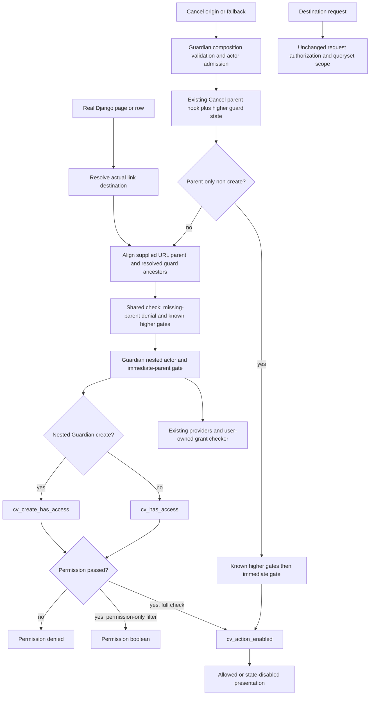

# Phase 06.51: Remove retained Guardian link exceptions - stage 3b (#413) - Research

**Researched:** 2026-11-25
**Domain:** Django server-rendered link eligibility, Guardian mixin composition, migration evidence
**Confidence:** MEDIUM (external-source tier from the research seam; local findings cite opened source)

<user_constraints>
## User Constraints (from CONTEXT.md)

The following decisions, discretion and exclusions are copied verbatim from the phase context. [VERIFIED: .planning/phases/06.51-remove-retained-guardian-link-exceptions-stage-3b-413/06.51-CONTEXT.md:23-155,245-253]

<!-- DATA_7e5dcf14_START -->
### Locked Decisions

### Authority and inherited constraints

- The authority is `superpowers/specs/2026-11-23-link-access-check-design.md` at
  `55dce6f635101af6837d8badabea20431cd6ee88`, especially section 12.8 and its consequences. It prevails over
  the issue or this summary. Sections 12.1, 12.6 and 12.7 remain applicable except where section 12.8 amends
  them. Decision identifiers below are the concept's identifiers, not new phase-local decisions.
- D-45–D-52 are settled stage-3b decisions. Preserve D-39–D-44 and D-55 from stage 3a. Earlier temporary
  deferrals do not override this stage's explicit changes. Reviewers follow section 13: concrete defects
  supported by evidence, without reopening the approved architecture or broadening scope.
- Follow `CLAUDE.md`'s developer-maintainability rule. Preserve proven paths outside the approved changes;
  use bounded, explainable changes. Guardian shares loaded grants through the existing user-owned checker,
  never permission/state decisions. Its lifetime and fresh-request behavior remain unchanged.
- Request gates, their order, authorization responses, login redirects and access traces stay unchanged.
  Keep Guardian list filtering and top-level link rules, including anonymous top-level list behavior.
  Do not fabricate views, add caches/prefetch, or consult ViewSet querysets to decide link membership.

### Settled behavior changes

- **D-45 — Known-parent create links:** End the kept denials at sibling buttons, the create page's own
  create control, the permission filter on child lists and `ManyToMany` child pages. Gate the known higher
  ancestors at every consumer. Never guess a link's parent from a relation. The public create hook's
  documented acceptance of an own child in single-FK nesting, and its parent resolution, remain supported.
- **D-46 — Nested actor rule:** Every nested Guardian link requires a signed-in, active user, under both
  protected and unprotected ancestry. Enforce this before `cv_create_has_access`, including an override
  that returns true without calling `super()`. Anonymous backend grants and Guardian anonymous-user grants
  cannot admit these links. Inactive superusers are denied too. Direct calls to the default nested-create
  hook answer the same actor question. Top-level Guardian links retain their existing rules.
- **D-47 — Queryset-only compositions:** A composition with `GuardianQuerysetMixin` but without
  `GuardianParentPermissionMixin` checks its declared parent policy for links and Cancel to its list.
  Own permission and row filtering do not change.
- **D-48 — Nested Guardian Cancel:** Object, list and create targets move through the shared check with
  known higher ancestors. Preserve the Guardian Cancel actor rule and composition validation around it;
  do not relax actor admission to that of an ordinary top-level Guardian list link.
- **D-49 — Gates before the create hook:** Run the declared parent gates before `cv_create_has_access`
  at every consumer. Do not call the hook after gate denial. A true override cannot restore the link;
  a false override still denies it. Add no bypass flag to spare the default hook its second parent check.
- **D-50 — Actual button target:** Remove the key-based rewrite in `GuardianQuerysetMixin.cv_get_context`.
  Each button is decided once for its actual destination. This applies to parent/sibling buttons with a
  colliding `create` key and to custom `ContextButton.get_context` implementations previously corrected by
  the rewrite. The ordinary create button on a permitted nested list page remains available.
- **D-51 — Parent-only limitation:** Do not adopt S3-08 or detect "explicit" versus "inherited" overrides.
  An ordinary link to a nested parent-only non-create view still asks `cv_has_access`; on a
  `...PermissionRequired` base this asks the child model permission that its request does not require.
  Document the resulting hidden-link/allowed-request case in the Guardian reference. Cancel keeps its
  separate branch, never asks `cv_has_access` for this shape, and gains the higher-ancestor gates. After
  this change, omitting that hook is its one difference from the shared check. Reconsider the ordinary-link
  limitation only when a project reports the case.
- **D-52 — Bulk return URLs:** GET returns, warning POST returns and the all-blocked page's Cancel follow
  the changed Cancel eligibility. Keep origin, fallback, success-URL priority. The chosen `Location` may
  change; authorization responses and login redirects do not.

### Stage-3a rules that remain binding

- **D-40:** Supply the real rendering view only when it belongs to the target's own ViewSet; otherwise
  supply `None`. Preserve this for the nested list's create control after the rewrite disappears and for
  Cancel's existing request-bound view copy.
- **D-41:** Align the immediate parent and every known higher ancestor with the target's declared
  ancestry, nearest first. Unknown levels remain `None` and cannot shift a farther object into their
  position. An unknown immediate parent denies. Normal consumers use resolved guard state or the child
  link's URL object/row; they load nothing solely to decide a link.
- **D-42:** Cancel alone gets the immediate parent through `cv_get_parent_object` via
  `_cv_cancel_parent_object`. Guarded requests reuse the resolved parent without a query; unguarded views
  keep the existing lookup. The built-in missing-row case is unavailable, and project overrides keep
  working. Higher ancestors come only from guard state.
- **D-43/D-44:** Preserve the bulk toolbar's direct shared check and the permission-only filter's
  exclusion of the state hook. Permission precedes state for full link checks.
- **D-55:** Stage 3a's immediate-parent-only create behavior belonged to the page seam and list rewrite,
  not the whole page. Navbar child items already use aligned ancestors on every page. Preserve that
  baseline while removing the two mechanisms; do not invent a navbar exemption or second migration.

### Commit ordering and helper removal

The four constraints on commits within the single stage-3b PR are fixed:

1. D-45 and D-50 land together: the rewrite currently supplies the plain list create button's parent.
2. D-46 lands with or before D-45: newly shown create links must never admit anonymous users.
3. D-49 lands with or before D-48: a true create-hook override must not bypass Cancel's parent gates.
4. Remove the state adapters after the Cancel move removes their last production caller.

Remove `_cv_page_link_ancestors` and its Guardian create override, the key-based rewrite, and both
`_cv_action_enabled_for_context` and `_cv_action_enabled_for_rendering`, including their core/Guardian
create overrides. Reduce the three Guardian `_cv_cancel_target_available` overrides to the actor rule,
composition validation and parent-only branch. Retain what the parent-only branch needs of
`_cv_cancel_parent_target_access`, and `_cv_link_permission` where a provider-specific rule needs it;
record each retained helper's reason.

Locate and list every test that calls or overrides removed helpers. Also rewrite and list stage-3a tests
and documentation that intentionally pin the exceptions now ending. Do not delete these tests without
replacement coverage. The issue's file/line inventory is a starting list, not an exhaustive one.

### Acceptance and migration evidence

All eight acceptance criteria in the issue snapshot apply in full:

1. For every behavior-table row, show the new result on a real list, detail, create or card page beside
   the unchanged request response.
2. At a child button, permission filter and Cancel, prove D-49 with a true hook that is not called when
   the immediate gate denies, plus a false hook that still hides the otherwise permitted link.
3. Cover D-46 under a model-permission parent with an anonymous-granting backend and under provider
   `none`; include a true override without `super()`, direct default-hook calls, inactive users and
   inactive superusers. Deny a nested object link with a Guardian anonymous-user grant and preserve a
   top-level create control.
4. Cover parent/sibling button-key collisions, the permitted list create button and its real list-view
   hook argument. With three levels and a stricter higher key, deny create controls on the own ViewSet's
   list, detail and card pages when the far ancestor denies.
5. Preserve Cancel's actor rule, return priority, empty-list availability and configuration errors.
   Prove `cv_get_cancel_url(user=..., request=...)` still selects the actor and bound view, through the
   create hook for create targets and outcomes for other targets. Parent-only Cancel works with the
   parent grant and without the child model grant, but denies when a higher ancestor denies.
6. Direct `cv_has_access` on a nested Guardian create remains false for every argument.
7. List every changed matrix cell with its governing decision, naming both when two apply. Do not
   regenerate a baseline to absorb unexplained changes. Keep request expectations in request-gate,
   ancestor and access-trace suites unchanged; only references to removed helpers may be edited there.
8. Extend the existing `Link access hooks` Breaking entry, without adding a second entry. Keep
   `CHANGELOG.md`, `docs/migrating-1.0.md` and `docs/reference/guardian.md` consistent. Name the D-46/D-49
   override changes and custom-button case; point to `cv_create_has_access` in this stage. No reference
   page may continue describing an ended exception. List removed and retained helpers with reasons in
   the closing summary.

Preserve the original stage-3a cost-baseline receipt checked by hash in
`tests/test1/test_link_consumer_costs.py`. Measure and update the affected Guardian create/Cancel cost pins;
historical receipts are not fresh verification. Broad test runs use multiple workers per repository policy.
Prior phase verification and maps are orientation, not a certification of stage 3b; some map descriptions
still reflect earlier consumer routing, so current source and the approved concept govern.

### Planner discretion

Only commit order within the four constraints, placement of the actor rule and composition validation
around the check, test selection, and query-count pins remain for the planner. No new product decision
was delegated by selecting this capture route. A newly discovered exception or request-response change
must be brought to the maintainer before adoption.

### the agent's Discretion

Only commit order within the four constraints, placement of the actor rule and composition validation
around the check, test selection, and query-count pins remain for the planner. No new product decision
was delegated by selecting this capture route. A newly discovered exception or request-response change
must be brought to the maintainer before adoption.

### Deferred Ideas (OUT OF SCOPE)

No new deferred ideas arose. Preserve the approved exclusions:

- Stage 3c (#414): public `check_link_access`, input validation, stability and public documentation.
- Request-gate changes, Guardian list filtering, top-level link behavior and public ancestor accessors.
- Breadcrumb/site menu, `prefetch_perms`, caches, `force_full_hierarchy_check`, table link columns,
  DataPanel/DataView and other off-page consumers excluded from stage 3a.
- Reconsidering the parent-only ordinary-link limitation requires a real downstream report.
<!-- DATA_7e5dcf14_END -->
</user_constraints>


## Summary

Use the existing shared link check and remove the Guardian exceptions in the approved dependency order. The current source already provides ancestor alignment, permission-before-state evaluation, a bounded parent-policy check, and Cancel's request-bound owner copy. There is no need for another public API, a parallel authorization engine, or a new dependency. [VERIFIED: src/crud_views/lib/link_access.py:18-92; src/crud_views/lib/ancestors.py:655-686; src/crud_views/lib/view/base.py:77-93,1030-1061]

The two implementation hazards are coupled removals and MRO coverage. The create ancestor seam deliberately supplies no parent for several page shapes, while the queryset context rewrite supplies the list create button's parent afterward; remove them together. Guardian Cancel still owns the last production call to the rendering state adapter. Move Cancel before removing both adapters. Cover standalone object/queryset compositions as well as the shipped parent-plus-object/list classes. [VERIFIED: src/crud_views_guardian/lib/views.py:282-293; src/crud_views_guardian/lib/mixins.py:291-332,414-465; src/crud_views/lib/views/create.py:35-75]

Evidence migration is substantive work. The matrix verifier reconstructs the original dataset from stage-3a deltas; the cost verifier compares stage-3a receipt data with a function that also supplies current runtime pins. Preserve historical evidence explicitly when adding stage-3b deltas and new measurements. The focused pre-change run passed **529 tests in 7.74s**; no full suite was run for this research. [VERIFIED: tests/test1/test_link_access_matrix.py:534-556; tests/test1/test_link_consumer_costs.py:413-450; executed focused command recorded under Validation Architecture]

**Primary recommendation:** implement provider-local actor and parent gates first, remove the create seam and key rewrite atomically, then migrate Cancel with a bounded parent-only branch, remove adapters, and reconcile every changed test/matrix/cost/documentation assertion against the approved decisions. This follows the four approved commit constraints. [VERIFIED: .planning/phases/06.51-remove-retained-guardian-link-exceptions-stage-3b-413/06.51-CONTEXT.md:95-113]

## Architectural Responsibility Map

These assignments follow the existing call boundaries; they are planning guidance, not a proposed architecture replacement. [VERIFIED: src/crud_views/lib/view/buttons.py:96-133,149-200,222-257,283-324; src/crud_views/lib/link_access.py:70-92; src/crud_views_guardian/lib/mixins.py:142-192,334-364]

| Capability | Primary Tier | Secondary Tier | Rationale |
|---|---|---|---|
| Determine actual target, own object and already-known ancestors | Frontend server / Django rendering | Existing request guard | Buttons, view-key actions, cards and filter supply inputs. |
| Nested Guardian actor admission and provider-specific own permission | API/backend / Guardian view mixins | Shared link check | MRO-selected class step supplies Guardian semantics. |
| Higher and immediate ancestor permission gates | API/backend / existing ancestor helpers | Database permission providers | Reuse supplied objects and existing declared policy. |
| Action state | API/backend / target public hook | Frontend server | Runs after permission; permission-only filter omits it. |
| Cancel target selection and return URL priority | Frontend server / existing Cancel owner | Guardian class wrapper, bulk return helper | Keep origin/fallback flow and request-bound actor/view arguments. |
| Grant reuse | Database access / user-owned checker | Guardian providers | Cache loaded grants only; retain destination decisions on each call. |
| Destination enforcement | API/backend / existing request gates | Database/queryset scope | Unchanged and independently tested. |
| Browser/UI | Browser | Rendered output | Existing links and buttons reflect new eligibility; no new client behavior. |

## Project Constraints (from AGENTS.md)

AGENTS.md resolves to the repository's CLAUDE.md. The following actionable rules must remain visible to the planner. [VERIFIED: initial filesystem inspection; CLAUDE.md:15-77,129-147]

- Keep the change understandable, traceable and bounded; preserve proven paths outside demonstrated requirements; account for cognitive cost, hidden state, abstractions and query overhead. [VERIFIED: CLAUDE.md:15-27]
- Prefer self-contained, opt-in additions where additions are necessary; do not broaden this already approved removal project into another framework. [VERIFIED: CLAUDE.md:21-27]
- Use existing development commands: `task dev`, `task test`, `task format`, `task check`, `task build`, `task docs`, `task bump-patch`. The commit hook runs `ruff-format`. These are project commands, not authorization for environment or release changes in this research. [VERIFIED: CLAUDE.md:32-63]
- Broad tests use `-n auto` or a bounded `-n N`; explain any serial exception and do not interrupt an existing run only to change workers. This phase uses six workers. [VERIFIED: CLAUDE.md:129-135; phase task instruction]
- Preserve fixture conventions: `cv_<model>`, `user_<model>_<permission>`, `client_user_<model>_<permission>`. [VERIFIED: CLAUDE.md:135]
- Preserve class attribute prefix `cv_`, transition prefix `wf_`, line length `120`, double quotes, hatchling and bump-my-version. Existing view keys are `list`, `detail`, `create`, `update`, `delete`, `workflow`, `manage`; mappings are list/detail→view, create→add, update→change, delete→delete. [VERIFIED: CLAUDE.md:139-147]
- Extend the existing Breaking entry and migration guide together; do not add a second Link access hooks entry. [VERIFIED: CLAUDE.md:147; tests/test1/test_link_access_docs.py:8-29; phase CONTEXT.md:138-142]
- After a future ship, refresh codebase maps. If later asked for a phase worktree, use the prescribed GSD workspace convention and check existing worktrees first. Neither action belongs to this research assignment. [VERIFIED: CLAUDE.md:65-83]
- No project-local skill files were found in the two configured discovery locations; the agent-skills query returned no additional skill block. No knowledge graph exists according to the GSD status query. Current source, not old maps, grounds this report. [VERIFIED: project skill discovery and GSD init/graphify queries this session]

## Standard Stack

Use the already installed stack and existing package APIs. This phase installs no packages and changes no dependency bounds. The table records the inspected runtime, not a recommendation to upgrade to registry-latest releases. [VERIFIED: pyproject.toml:25-35,52-83; runtime metadata probe this session; phase CONTEXT.md:150-155]

| Component | Installed version | Existing declaration / role |
|---|---|---|
| Python | 3.12.3 | Declared `requires-python = ">=3.12"`; source test runtime verified executable. [VERIFIED: pyproject.toml:25; runtime probe] |
| Django | 6.0.10 | Declared `"django (>=4.2.0)"`; request views, auth and test client. [VERIFIED: pyproject.toml:27; runtime probe] |
| django-guardian | 3.5.2 | Declared `"django-guardian>=2.4"`; existing optional Guardian extension and test dependency. [VERIFIED: pyproject.toml:52-54,80; runtime probe] |
| Pydantic | 2.14.3 | Declared `"pydantic (>=2.2.1)"`; existing configuration models, no schema change planned. [VERIFIED: pyproject.toml:28; runtime probe] |
| pytest / pytest-django / pytest-xdist | 9.2.0 / 4.14.0 / 3.8.0 | Existing test runner and six-worker Django test lane. [VERIFIED: pyproject.toml:70-80; runtime probe] |
| MkDocs | 1.6.1 | Existing development executable, declared `"mkdocs (>=1.6.1)"`; reference/anchor validation. [VERIFIED: pyproject.toml:60-67; development executable version probe] |

**Installation / package legitimacy audit:** not applicable; no installation is part of the recommendation. No registry-discovered package is introduced.

Official Django docs permit custom backend answers for anonymous users and distinguish inactive users; therefore provider permission alone is insufficient to establish the approved nested Guardian actor rule. The default nested-create hook and the package link boundary both need the explicit actor check. [CITED: https://docs.djangoproject.com/en/6.0/topics/auth/customizing/]

Guardian documents that a checker retains permissions per object, so the same checker does not observe an intervening grant change. Keep the existing user-owned checker and refresh the actor in tests that grant/revoke between decisions. Do not add a bypass or prefetch to compensate for the default create hook's deliberate second parent check. [CITED: https://django-guardian.readthedocs.io/en/stable/api/core/] [VERIFIED: src/crud_views_guardian/lib/permissions.py:4-11; phase CONTEXT.md:34-36,58-60]

## Architecture Patterns

### System Architecture Diagram

This diagram describes the approved target behavior, using existing components. [VERIFIED: phase CONTEXT.md:43-93; src/crud_views/lib/link_access.py:18-92; src/crud_views/lib/view/base.py:77-93,1012-1061]



The parent-only branch also checks missing immediate parent and skips state on any denial; it differs from the shared full check only by omitting `cv_has_access`. It is not an alternative ordinary-link pipeline. [VERIFIED: phase CONTEXT.md:65-71; src/crud_views_guardian/lib/mixins.py:414-443]

### Component responsibilities and exact removal points

File names below identify inspected implementation locations, not new files or directories to create.

| Component | Change / retain | Source |
|---|---|---|
| Core link check | Retain alignment, higher gates, permission/state separation and context mapping; update stale seam prose. | [VERIFIED: src/crud_views/lib/link_access.py:18-92] |
| Guardian create | Remove page seam and context-state adapter; actor-check default hook; gate immediate parent before custom create hook in class link permission. Retain own-child normalization and always-denied direct nested own-access hook. | [VERIFIED: src/crud_views_guardian/lib/views.py:282-387] |
| Guardian queryset mixin | Remove only the context rewrite and queryset-only immediate-gate bypass; preserve own permission and queryset filtering. | [VERIFIED: src/crud_views_guardian/lib/mixins.py:282-364] |
| Guardian object / parent mixins | Ensure every nested composition gets the actor rule; preserve request methods and composition checks. | [VERIFIED: src/crud_views_guardian/lib/mixins.py:79-209,367-531] |
| Cancel | Delegate eligible object/list/create targets through the existing core helper; retain wrappers and bounded parent-only branch with higher gates. | [VERIFIED: src/crud_views/lib/view/base.py:77-93,1012-1099; src/crud_views_guardian/lib/mixins.py:114-117,252-256,414-443] |
| Three seam-using buttons | Replace seam/fallback with direct aligned ancestry; preserve actual-target URL and same-ViewSet rendering identity. | [VERIFIED: src/crud_views/lib/view/buttons.py:109-121,178-191,302-315] |
| View-key actions, card own actions, permission filter | Replace each seam/fallback pair with alignment. Filter remains permission-only outside target-lookup exception handling. | [VERIFIED: src/crud_views/lib/view/base.py:939-952; src/crud_views/lib/views/card.py:89-100; src/crud_views/templatetags/crud_views.py:650-666] |
| Child buttons, card child actions and navbar | Existing direct aligned inputs remain; new provider behavior reaches them automatically. Preserve D-55. | [VERIFIED: src/crud_views/lib/view/buttons.py:237-248; tests/test1/test_navbar_permissions.py:268-318; phase CONTEXT.md:91-93] |
| Core adapters and create adapter overrides | Remove after Cancel migrates; clean imports that become unused. | [VERIFIED: src/crud_views/lib/view/base.py:555-596; src/crud_views/lib/views/create.py:1-4,35-75] |
| Bulk returns | Existing `return self.cv_get_cancel_url() or self.get_success_url()` carries new eligibility to GET, warnings and all-blocked Cancel; keep return flow. | [VERIFIED: src/crud_views/lib/bulk/__init__.py:343-367] |

### Pattern 1: preserve precise ordering and input identity

1. A nested target without its immediate parent denies before own permission/state.
2. Known selected higher gates run **outermost first**, even though the supplied ancestor tuple is nearest first; unknown holes retain their positions.
3. The class-specific step supplies the immediate gate and own permission. For nested Guardian create, approved actor admission and all declared parent gates precede the custom create hook.
4. Full link checking runs state only after permission succeeds; the permission filter never does.
5. On a no-object target, own permission receives `None`; state receives the immediate parent. Pass a rendering view only when its ViewSet is the actual target's ViewSet. [VERIFIED: src/crud_views/lib/link_access.py:18-92; src/crud_views/lib/view/base.py:537-553; phase CONTEXT.md:47-60,78-93]

Preserve configuration-error order within the reused helpers. Higher-gate processing validates the operation pair, rejects an inadmissible actor, then checks auth database, permission name and provider per selected level. The immediate helper rejects a missing parent, reuses equal resolved identity, skips the unprotected provider, then checks auth database and permission vocabulary before the provider. Do not rewrite either helper merely to consolidate the new Guardian actor check. [VERIFIED: src/crud_views/lib/link_access.py:32-67; src/crud_views/lib/ancestors.py:655-686]

The exact existing unprotected provider literal is `"none"`, and the core class step explicitly permits it in its actor expression. Tightening that core condition globally would change plain-view behavior outside D-46. Put Guardian-specific admission in a Guardian-owned class step or equivalently bounded provider mechanism. This is implementation guidance; exact placement stays the planner's discretion. [VERIFIED: src/crud_views/lib/view/base.py:543-553; src/crud_views/lib/ancestors.py:680-686; phase CONTEXT.md:47-54,150-155]

### Pattern 2: audit MRO shapes, not just stock class names

The shipped list composition is `GuardianParentPermissionMixin, GuardianQuerysetMixin, ListViewPermissionRequired`; the shipped create is `GuardianParentPermissionMixin, CreateViewPermissionRequired`. An existing standalone list fixture is `GuardianQuerysetMixin, ListViewPermissionRequired`. The parent-only fixture is `GuardianParentPermissionMixin, CustomFormNoObjectViewPermissionRequired`. All four are relevant; a fix only on the parent mixin misses the standalone queryset path. [VERIFIED: src/crud_views_guardian/lib/views.py:251-263; tests/test1/test_link_cancel.py:213-219; tests/test1/test_cancel_permissions.py:455-459]

Retain composition validation before Cancel actor denial. The validator detects missing object/list mixins and mixins placed after terminal Django/core loading implementations. Its checks deliberately inspect MRO because inherited method presence alone cannot prove the gate is reached. Do not replace these checks with a new registry or explicit-versus-inherited hook detector. [VERIFIED: src/crud_views_guardian/lib/mixins.py:414-421,446-466; phase CONTEXT.md:65-71]

Django's official mixin guidance confirms that method selection depends on MRO and cooperating `super()` calls. Use actual subclass compositions in tests. [CITED: https://docs.djangoproject.com/en/6.0/topics/class-based-views/mixins/]

### Pattern 3: a narrow parent-only Cancel exception

Retain a separate branch for nested, non-object, non-queryset, non-create parent-only targets. Preserve the absence of a child-model permission check even when inherited from a PermissionRequired base. Use the same parent source, higher alignment, missing-parent denial, permission-before-state sequence and action object as shared Cancel. A custom own-access denial still must not be consulted for this bounded Cancel shape. Ordinary links continue to ask the inherited own-access hook. [VERIFIED: src/crud_views_guardian/lib/mixins.py:414-443; tests/test1/test_cancel_permissions.py:455-495,517-562; phase CONTEXT.md:65-71]

Reuse the existing request-bound copy: `owner = copy(self)`, `owner.request = request`, `user = request.user if user is None else user`. An explicit actor overrides request.user for eligibility, while the explicit request becomes the create hook's rendering-view request. Keep errors from project parent overrides; only the built-in missing-row lookup becomes unavailable. [VERIFIED: src/crud_views/lib/view/base.py:1012-1061]

### Commit decomposition

Recommended implementation dependency groups, each with matching regressions:

1. Add/extend actor admission and declared-parent-before-create-hook behavior, including queryset-only parent policy. This establishes D-46/D-49 before downstream availability expands.
2. Remove the page seam at all six callers and its definitions together with the list/card key rewrite, preserving the permitted ordinary list create button. This is one atomic D-45/D-50 change.
3. Move Guardian Cancel object/list/create targets to the shared check; add higher gates to the parent-only branch and prove D-52 return changes.
4. Remove adapters and migrate their named tests after the last caller is gone.
5. Complete measured pins, per-cell migration evidence and coordinated references; keep production-facing migration notes with their behavior change when practicable.

These groups satisfy the approved constraints; the planner may combine them but must not split the coupled seam/rewrite removal or remove adapters before Cancel. [VERIFIED: phase CONTEXT.md:95-113; src/crud_views_guardian/lib/mixins.py:301-332,414-435]

## Don't Hand-Roll

| Problem | Don't build | Use instead | Basis |
|---|---|---|---|
| Ancestor discovery | FK walking, M2M parent selection, missing-level queries | Existing target-aligned guard-state helper; explicit child URL object | [VERIFIED: src/crud_views/lib/link_access.py:18-29; phase CONTEXT.md:43-46,81-88] |
| Parent authorization | Reimplemented permission-name/provider/fallback logic | Existing immediate/higher gate helpers | [VERIFIED: src/crud_views/lib/ancestors.py:655-686; src/crud_views/lib/link_access.py:32-67] |
| Grant caching | Decision cache, new checker lifecycle, prefetch bypass | Existing user-owned checker | [VERIFIED: src/crud_views_guardian/lib/permissions.py:4-11; phase CONTEXT.md:34-39] |
| Parent-only hook dispatch | Explicit-versus-inherited override introspection | Approved bounded Cancel branch and documented ordinary-link limitation | [VERIFIED: phase CONTEXT.md:65-71] |
| Return navigation | New redirect eligibility chain | Existing Cancel origin/fallback and bulk success fallback | [VERIFIED: src/crud_views/lib/view/base.py:1041-1099; src/crud_views/lib/bulk/__init__.py:343-356] |
| Matrix/evidence updates | Regenerate every expectation from current implementation | Explicit before/after cells and historical reconstruction | [VERIFIED: tests/test1/test_link_access_matrix.py:534-556; phase CONTEXT.md:135-146] |
| Test architecture | New fixture framework, fake production views | Existing isolated routes, real test models, bound requests and client pages | [VERIFIED: tests/test1/test_link_consumers.py:140-215; tests/test1/test_link_cancel.py:213-272] |

## Runtime State Inventory

This is an internal refactor/removal. The inspected helpers affect in-process rendering, not a named persisted service migration. No external service inspection was needed or performed; the inventory is bounded to this package's source and test runtime. [VERIFIED: src/crud_views/lib/link_access.py:1-5; src/crud_views_guardian/lib/permissions.py:1-11; phase CONTEXT.md:7-18]

| Category | Items found / evidence boundary | Required action |
|---|---|---|
| Stored data | No stored helper identifier in the inspected paths; permission grants remain existing auth/Guardian data. [VERIFIED: src/crud_views_guardian/lib/mixins.py:142-209,334-364] | Code/test migration only; do not migrate grants. |
| Live service config | No service configuration is changed by the approved scope; downstream custom hook/button code is affected and requires migration guidance. External deployment state was not inspected. [VERIFIED: phase CONTEXT.md:61-64,138-141] | Document custom create overrides and custom button implementations. |
| OS-registered state | No process/service registration is part of the approved phase. [VERIFIED: phase CONTEXT.md:7-18,247-253] | None required by this scoped refactor; no OS registrations audited. |
| Secrets / environment | Existing test execution uses `CV_ACCESS_RECORD_REQUESTS`; its values `"0"` and `"1"` select recorder lanes. No rename is proposed. [VERIFIED: noxfile.py:30-56] | Preserve environments and recorder behavior. |
| Build artifacts / installed packages | Installed tests deliberately clear source PYTHONPATH in nox, whereas this phase's development command explicitly selects source. Existing compiled/installed package behavior is not changed by writing source alone. [VERIFIED: noxfile.py:27-31; supplied phase command] | Use explicit source lane for implementation; use the existing package/nox lane if claiming installed-distribution validation. No release/build required by research. |

## Common Pitfalls

### 1. Removing the rewrite before the create seam

The seam returns an empty ancestor tuple for no page object, and the rewrite repairs the list button afterward. Removing only the rewrite hides the ordinary create button. Replace both in one commit and test the real list-view argument to the create hook. [VERIFIED: src/crud_views_guardian/lib/views.py:282-293; src/crud_views_guardian/lib/mixins.py:313-330]

### 2. A custom create hook bypasses policy or actor admission

Today the Guardian create class step directly returns the hook. Putting the actor check only inside the default hook leaves a true override able to bypass it. Establish actor and parent gates outside the override; test that a denied gate leaves the hook uncalled, and that a false hook still denies after passing gates. Preserve the default hook's second immediate-parent check. [VERIFIED: src/crud_views_guardian/lib/views.py:331-387; phase CONTEXT.md:47-60]

### 3. Applying Guardian actor rules to top-level or plain views

Top-level Guardian list own access deliberately permits anonymous actors when its key exists, while Cancel has stricter admission. Core unprotected ancestry can also delegate to backend permissions. Preserve these differences; test nested object, queryset-only and parent-only compositions instead of changing core admission globally. [VERIFIED: src/crud_views_guardian/lib/mixins.py:226-231,252-288; src/crud_views/lib/view/base.py:543-553]

### 4. Replacing all Cancel branches with the shared function

Parent-only Cancel would begin asking an inherited child model permission and regress its approved behavior. Keep its narrow branch and add only the missing higher gates; prove parent grant without child model grant, plus higher denial and public-state invocation. [VERIFIED: tests/test1/test_cancel_permissions.py:517-562; phase CONTEXT.md:65-71]

### 5. Treating adapter tests as request-gate assertions

Some tests call the soon-removed adapters directly. The unguarded ancestor-resolution test currently observes one lookup through the old adapter; that is obsolete adapter behavior, not permission for ordinary links to load parents. Replace named observations with explicit supplied-parent/shared-check or public-state coverage as appropriate; keep D-42's permitted lookup covered through actual Cancel. Preserve all request status, mutation and trace assertions. Record every changed helper assertion rather than relabeling a behavioral change as a spy rename. [VERIFIED: tests/test1/test_ancestor_resolution.py:734-772; tests/test1/test_guardian_parent_none.py:444-459,925-937; phase CONTEXT.md:111-113,135-137]

### 6. Expecting grant mutation to change a retained actor immediately

Use a freshly fetched user after grant mutation, as the existing far-denial/fresh-grant test does. Do not clear the checker in production or create a second checker to make a test pass. [VERIFIED: tests/test1/test_link_consumers.py:146-150,194-200; src/crud_views_guardian/lib/permissions.py:4-11]

### 7. Treating gate counts as SQL counts

D-49 deliberately adds a parent-policy invocation before the default create hook; grant reuse may avoid another SQL query. Measure gate calls, permission queries, domain-object lookups and state calls separately. Existing historical receipts cannot certify the changed run. [VERIFIED: phase CONTEXT.md:58-60,144-146; tests/test1/test_link_consumer_costs.py:350-375]

### 8. Missing prose or historical-verifier consumers

Several documentation tests assert ended exceptions word-for-word. Cost receipt validation also calls live pins; changing those pins alone can invalidate historical evidence. Treat documentation and receipt verifiers as explicit consumers of the old contract. [VERIFIED: tests/test1/test_link_access_docs.py:134-146,166-194; tests/test1/test_navbar_docs.py:287-302; tests/test1/test_link_consumer_costs.py:423-450]

## Caller and Test Migration Inventory

### Production names to remove or retain

Exact removed names: `_cv_page_link_ancestors`, `_cv_action_enabled_for_context`, `_cv_action_enabled_for_rendering`. Their definitions and call sites were opened and the source/test tree was scanned for all three. [VERIFIED: src/crud_views/lib/view/base.py:555-596; src/crud_views/lib/views/create.py:35-75; src/crud_views_guardian/lib/views.py:282-328; repository source/test scan this session]

- Remove the core and Guardian create ancestor-seam definitions and **six** calls: three button classes, view-key action, card own action and permission filter. Child buttons already align directly. [VERIFIED: src/crud_views/lib/view/buttons.py:109-111,179-181,237-237,302-304; src/crud_views/lib/view/base.py:939-941; src/crud_views/lib/views/card.py:89-91; src/crud_views/templatetags/crud_views.py:657-659]
- Remove both core adapter definitions, both core create overrides and the Guardian create context override after migrating the production rendering-adapter caller in Guardian Cancel. [VERIFIED: src/crud_views_guardian/lib/mixins.py:435; src/crud_views/lib/view/base.py:585-596; src/crud_views/lib/views/create.py:35-75; src/crud_views_guardian/lib/views.py:319-328]
- Remove the Guardian queryset `cv_get_context` override, preserving inherited context/label/location behavior. [VERIFIED: src/crud_views_guardian/lib/mixins.py:301-332; src/crud_views/lib/view/base.py:878-904]
- Retain `_cv_guardian_create_parent`: documented default-hook acceptance of an FK own child, with explicit-parent acceptance and ambiguous M2M rejection. [VERIFIED: src/crud_views_guardian/lib/views.py:295-317,355-360]
- Retain provider-specific `_cv_link_permission` behavior for create-hook dispatch and nested Guardian actor policy; remove the queryset bypass. Preserve the class step abstraction rather than invoking public own access directly in consumers. [VERIFIED: src/crud_views/lib/link_access.py:70-79; src/crud_views_guardian/lib/mixins.py:291-299; src/crud_views_guardian/lib/views.py:379-387]
- Retain only the parent-only need of `_cv_cancel_parent_target_access`, or document how that residual responsibility is represented if consolidated. No hidden child-model permission for this shape. Retain Cancel wrappers for actor/composition checks. [VERIFIED: src/crud_views_guardian/lib/mixins.py:114-117,252-256,414-466; phase CONTEXT.md:104-109]
- Retain `_cv_cancel_parent_object` and `_cv_cancel_owner`: parent hook error boundary and explicit request binding. [VERIFIED: src/crud_views/lib/view/base.py:1012-1039]

### Every direct removed-helper test reference found

The identifiers below are verbatim function names; ranges identify their opened source. Replace coverage rather than simply deleting tests. Source grep plus an AST enclosing-function scan found these twelve test/fixture functions. The fixture contains two adapter overrides and a super call. [VERIFIED: repository AST/source inventory this session]

| File / function | Exact affected lines | Replacement intent |
|---|---|---|
| `test_ancestor_resolution.py::test_rendering_a_higher_create_reuses_the_resolved_ancestor` | 749 | Shared aligned input retains resolved ancestor identity and no query. [VERIFIED: tests/test1/test_ancestor_resolution.py:734-751] |
| `test_ancestor_resolution.py::test_rendering_outside_a_guarded_request_stays_bounded` | 771 | Replace obsolete adapter observation; preserve bounded lookup evidence through real Cancel, and ordinary-link missing-parent denial separately. [VERIFIED: tests/test1/test_ancestor_resolution.py:755-772] |
| `test_ancestor_helpers.py::test_none_immediate_parent_retains_actor_and_state_checks` | 289 | Public-state hook receives the structural parent; keep actor assertions. [VERIFIED: tests/test1/test_ancestor_helpers.py:275-290] |
| `test_guardian_parent_none.py::test_none_policy_helper_evaluation_is_side_effect_free` | 452 | Public state with explicit parent; request GET/POST and no-mutation assertions unchanged. [VERIFIED: tests/test1/test_guardian_parent_none.py:444-459] |
| `test_guardian_parent_none.py::test_m2m_own_child_inputs_deny_without_state_hook` | 629 | Default public create hook rejects ambiguous child; shared check with unknown parent skips state. [VERIFIED: tests/test1/test_guardian_parent_none.py:620-630] |
| `test_guardian_parent_none.py::test_child_page_inactive_actor_denied` | 936 | Direct public state remains independent of permission with explicit parent; keep inactive request denial. [VERIFIED: tests/test1/test_guardian_parent_none.py:925-937] |
| `test_core_nested_create_state.py::test_core_create_adapter_normalizes_only_unambiguous_parent` | 213 | New shared-input tests prove explicit parent/unknown-parent contract without retaining deleted normalizer behavior. [VERIFIED: tests/test1/test_core_nested_create_state.py:193-214] |
| `test_core_nested_create_state.py::test_m2m_create_uses_explicit_url_parent_without_inferring_from_child` | 274 | Keep actual URL-parent control; replace adapter-only ambiguous-input assertion. [VERIFIED: tests/test1/test_core_nested_create_state.py:263-285] |
| `test_cancel_permissions.py::guardian_targets` | 467, 490, 492 | Observe public state/create hook, remove adapter event expectations in dependent `test_guardian_parent_only_and_create_targets`. [VERIFIED: tests/test1/test_cancel_permissions.py:446-511,517-562] |
| `test_link_access.py::test_page_link_ancestors_only_for_nested_guardian_create` | 535, 538 | Replace seam existence assertion with removed-name/consumer alignment evidence. [VERIFIED: tests/test1/test_link_access.py:524-541] |
| `test_link_access.py::test_page_link_ancestors_keep_documented_denials` | 558–562 | Replace ended denials with known-parent cases; retain unknown-parent denial, no relation inference, URL identity. [VERIFIED: tests/test1/test_link_access.py:545-565] |
| `test_navbar_permissions.py::test_navbar_target_stricter_far_gate` | 356 | Remove seam spy, preserve stricter higher-gate behavior and unknown-level alignment. [VERIFIED: tests/test1/test_navbar_permissions.py:325-371] |

Do not mechanically call `cv_action_enabled` with an own child where a deleted adapter formerly normalized it. Test the new link input contract or explicitly supply the public hook's documented action object. The public default create hook's FK normalization remains separate. [VERIFIED: src/crud_views/lib/link_access.py:82-87; src/crud_views/lib/view/base.py:565-581; src/crud_views_guardian/lib/views.py:295-317]

### Named behavior fixtures and tests that pin ended exceptions

| Source | Tests / exact baseline behavior to migrate |
|---|---|
| Consumer grid | `test_consumer_grid_real_far_denial_and_fresh_grant`: remove retained-Cancel condition; request remains denied on far denial. [VERIFIED: tests/test1/test_link_consumers.py:140-215] |
| Target collisions | `test_guardian_list_and_card_rewrite_parent_and_sibling_keys`: actual target wins; page-create hook uncalled. [VERIFIED: tests/test1/test_link_consumers.py:307-357] |
| Queryset-only | `test_queryset_only_links_keep_nearest_skip_but_gate_higher`: nearest gate now denies after a passing far gate. [VERIFIED: tests/test1/test_link_consumers.py:363-415] |
| Actor exceptions | `test_guardian_child_create_actor_exception_is_bounded`, `test_guardian_child_create_anonymous_exception_only_without_higher_gate`: no anonymous admission even with no protected higher level. [VERIFIED: tests/test1/test_link_consumers.py:422-459,984-1007] |
| Filter/create seam | `test_permission_filter_guardian_create_retains_immediate_only_seam`, `test_guardian_create_buttons_keep_seam_and_rendering_view_identity`, `test_card_create_seam_and_rendering_view`: higher gates apply; sibling create can pass; preserve view/parent identities. [VERIFIED: tests/test1/test_link_consumers.py:543-563,846-881,1286-1329] |
| Cancel distinction | `test_guardian_cancel_parent_path_and_queryset_only_have_distinct_gates`: both nearest and known higher policy apply; preserve status assertions. [VERIFIED: tests/test1/test_link_cancel.py:226-272] |
| Existing real-page collisions / denied controls | `test_sibling_button_under_create_key_gets_page_create_result`, `test_nested_guardian_create_filter_and_sibling_button_stay_denied`; extend create-control routing tests already in this module. [VERIFIED: tests/test1/test_link_access.py:597-661,821-845,930-963] |
| Earlier queryset preservation | `test_preservation_queryset_only_composition`: existing renderer can now return no control before grant; capture the destination independently and re-fetch actor after grant. Preserve empty queryset and request results. [VERIFIED: tests/test1/test_guardian_child_link_visibility.py:776-806] |
| Navbar D-55 companion | `test_navbar_child_create_own_viewset_higher_denial`: navbar far-denial result stays; context-create difference at lines 310–316 ends. Successful default-hook gate counts may change under D-49. [VERIFIED: tests/test1/test_navbar_permissions.py:268-318] |
| Cost observations | `test_consumer_costs` and the `consumer_cost_pin` data logic, plus `test_query_create_uses_only_its_existing_parent_check` referenced by receipt validation. Re-measure; never infer SQL from extra hook calls. [VERIFIED: tests/test1/test_link_consumer_costs.py:171-224,232-410,534-543] |

Request-only suites remain an unchanged contract; named removed-helper observations are the permitted adaptation, not a reason to revise status/trace expectations. Add new D-46/D-49 real-page tests in link-specific suites where necessary. [VERIFIED: phase CONTEXT.md:119-137]

## Matrix and Cost Evidence Migration

### Matrix

The existing matrix has `1178` cells, with outcomes quoted exactly as `"hidden"`, `"enabled"`, `"disabled:permission"`, `"disabled:state"`, boolean strings and `page:<status>`. Its completeness test intentionally asserts the old queryset-only, anonymous-create, filter, sibling and list rewrite results. Updating only the JSON is insufficient. [VERIFIED: tests/test1/test_link_access_matrix.py:50-53,472-507]

Retain all original case coordinates and request outcomes. Record every stage-3b changed cell with its immediate before value, after value, decision list and concrete reason. Overlapping effects name both decisions; for example an actual sibling create exposed by seam removal and no longer overwritten by the page create requires both D-45 and D-50 where both affect the cell. Do not copy stage-3a's denial-only direction rule to 3b because approved create links also become available. [VERIFIED: phase CONTEXT.md:43-64,135-137; tests/test1/test_link_access_matrix.py:534-550]

Recommended evidence shape: keep stage-3a records intact, add a stage-3b delta ledger, reconstruct the stage-3a state by reversing stage-3b deltas, then run the original stage-3a-to-stage-1 reconstruction. Pin the observed stage-3a input separately and keep the existing original digest verbatim: `c72c34ac59cc48281d897d3ab81292dd2d262bca6e2be0722ab51b278dfea43c`. Test malformed/missing/extra deltas and exact changed-cell completeness. This is a planner-owned evidence arrangement, not a new product contract. [VERIFIED: tests/test1/test_link_access_matrix.py:534-556]

Start the change inventory with the exact old asserted families: `"guardian-queryset-only"`, `"core-guardian"` plus `"anonymous-backend"`, `"guardian-m2m"`, `"create-control"`, `"sibling-button"`, and `"parent-button"` with `"guardian-3"`. These names are existing matrix coordinates, not new IDs. Obtain the actual changed cell list from the focused matrix run after each implementation group; do not predict a fixed count. [VERIFIED: tests/test1/test_link_access_matrix.py:80-89,99-162,482-507]

### Cost receipts

The original stage-3a receipt is read by `read_cost_receipts` and split at the literal `"\n## After measurements"`. Its original-prefix digest is `4e9436029aff6629e0a9c38d703beb50015b39d664e6486cb925a2fe09ab7c55`. Preserve every original byte; preferably leave the entire historical document unchanged and store fresh evidence in this phase. [VERIFIED: tests/test1/test_link_consumer_costs.py:413-426; phase CONTEXT.md:144-146]

The validator currently requires `after["consumers"] == expected`, where `expected` is built by calling `consumer_cost_pin`; it also checks `len(expected) == 276`. Thus changing runtime pins without separating historical validation rewrites the meaning of the old receipt. Keep an immutable historical pin/digest check independent of the new current pins, and separately validate the new measured receipt. Preserve damaged-evidence rejection and source-distribution skips. [VERIFIED: tests/test1/test_link_consumer_costs.py:413-450,566-589]

The current scenario list has Cancel object/list targets only: `for target in ("object", "list")`. Add explicit create-hook measurements alongside retained scenarios, distinguishing default-hook duplicate parent checks from SQL. Capture cold/fresh versus warm user, warm/cold permission vocabulary where relevant, permitted/denied, guarded/unguarded Cancel, and no state on denial. Do not relabel newly added scenarios as historical measurements. [VERIFIED: tests/test1/test_link_consumer_costs.py:160-168,232-243,350-410; phase CONTEXT.md:144-146]

The original receipt describes `276` consumer observations and independent matrix/navbar runs; those are historical evidence only. Maintain raw measurement ownership and hashes when capturing this phase so later verification does not depend on temporary files alone. [VERIFIED: .planning/phases/06.50-move-remaining-link-consumers-to-the-shared-link-check-stage/06.50-COST-BASELINE.md:5-17]

## Documentation Migration Inventory

Revise ended-exception prose in place, keeping the single Link access hooks Breaking entry and its existing migration anchor. Preserve historical cost attribution, but stop presenting ending behavior as current. Include D-46 and D-49 override effects, D-50 custom-button correction removal, D-51's hidden ordinary link / allowed request limitation, and the stage-specific pointer to `cv_create_has_access`. [VERIFIED: CHANGELOG.md:9-28; phase CONTEXT.md:138-142]

| Source inspected | Content requiring reconciliation |
|---|---|
| Migration guide | Main Link access hooks, queryset-only rule, four kept denials, key rewrite and later Nested Guardian create access subsection; distinguish direct M2M own-child denial from route-aware page controls now allowed. [VERIFIED: docs/migrating-1.0.md:99-185,2059-2080] |
| Guardian reference | Create-hook description, ended denials/rewrite, Retained create and Cancel mechanisms, M2M future-enhancement claim, limitations links; add parent-only ordinary-link limit. [VERIFIED: docs/reference/guardian.md:266-382,559-572] |
| Context buttons | General pipeline, queryset-only rule, sibling create denial, permission-filter two-denial recipe, single-parent-check claims. [VERIFIED: docs/reference/context_buttons.md:62-70,218-232,367-375,679-695] |
| Nested reference | Queryset skip, one-check claim, immediate-only Cancel/create and D-55 page difference. [VERIFIED: docs/reference/nested.md:569-575,611-618] |
| Navbar reference | Keep D-55's aligned ancestry; remove present-tense context-create exemption and revise affected current cost explanation if measured counts change. [VERIFIED: docs/reference/navbar.md:126-145] |
| Bulk reference | Cancel eligibility paragraph, including queryset-only nearest skip and immediate-only Guardian Cancel. [VERIFIED: docs/reference/bulk_actions.md:320-330] |
| FAQ, card and action-state references | Filter false recipes and seam/rewrite/Cancel limitations. [VERIFIED: docs/faq.md:151-165; docs/reference/card-list-view.md:340-348; docs/reference/action_enabled.md:108-116] |
| Source docstrings | Guardian create hook and class, sibling button, shared higher gate and core state documentation still name retained behavior. [VERIFIED: src/crud_views_guardian/lib/views.py:273-278,331-387; src/crud_views/lib/view/buttons.py:260-268; src/crud_views/lib/link_access.py:32-43; src/crud_views/lib/view/base.py:578-581] |

Named prose tests to update: `test_link_access_migration_section_lists_the_create_hook_sites`, `test_link_access_migration_bounds_each_retained_guardian_mechanism`, `test_reference_pages_state_the_narrowed_meaning`, `test_navbar_docs_explain_same_page_guardian_create_difference`, `test_related_references_keep_target_specific_stage_three_contracts`, and related bulk/card/state checks. Keep single-entry, same-ViewSet identity, permission-only filter and no-public-checker checks. [VERIFIED: tests/test1/test_link_access_docs.py:8-85,134-194; tests/test1/test_navbar_docs.py:287-366; tests/test1/test_bulk_docs.py:751-788]

## Code Examples

These are existing source patterns to reuse, not new public signatures.

### Align Cancel inputs without loading higher ancestors

Source quote includes the exact inputs and return constant. [VERIFIED: src/crud_views/lib/view/base.py:77-93]

<!-- DATA_b93d06c1_START -->
```python
known = ()
if target.cv_viewset.has_parent:
    known = _known_link_ancestors(
        target, rendering_view, immediate_parent=rendering_view._cv_cancel_parent_object()
    )
return (
    _link_access(
        target,
        user,
        obj if target.cv_object else None,
        known,
        rendering_view=rendering_view if rendering_view.cv_viewset is target.cv_viewset else None,
    )
    == _LINK_ALLOWED
)
```
<!-- DATA_b93d06c1_END -->

### Keep permission and state separate

Existing return constants are quoted verbatim: `_LINK_ALLOWED = "allowed"`, `_LINK_PERMISSION = "permission"`, `_LINK_STATE = "state"`. Existing context keys are `"cv_access"` and `"cv_action_enabled"`. [VERIFIED: src/crud_views/lib/link_access.py:12-14,82-92]

<!-- DATA_5e4731a9_START -->
```python
if not _link_permission(target, user, obj, known_ancestors, rendering_view=rendering_view):
    return _LINK_PERMISSION
action_obj = obj if target.cv_object else known_ancestors[0] if target.cv_viewset.has_parent else None
return _LINK_ALLOWED if target.cv_action_enabled(user, action_obj) else _LINK_STATE
```
<!-- DATA_5e4731a9_END -->

### Test denial with a real grant change and a fresh actor

Existing pattern: remove the far grant, reload the actor, render through a consumer, verify the request status, grant again and reload before re-rendering. Assert hook non-invocation and exact object identity as well as visibility. [VERIFIED: tests/test1/test_link_consumers.py:140-215]

For D-49 coverage, apply this pattern at the child button, permission filter and Cancel with a true custom create hook and an ungranted immediate parent. Assert that the hook is uncalled. Then grant the parent with a fresh actor, use a false hook, and assert denial remains. This test design is directly required by the approved acceptance criteria. [VERIFIED: phase CONTEXT.md:119-133]

## State of the Art

| Existing stage-3a behavior | Approved stage-3b behavior | Governing evidence |
|---|---|---|
| Create page seam plus key-based list correction | Direct actual-target aligned inputs at every consumer | D-45/D-50. [VERIFIED: phase CONTEXT.md:43-46,61-64] |
| Anonymous nested-create provider answers and anonymous object grants can admit links | Explicit signed-in active nested Guardian admission before override | D-46. [VERIFIED: phase CONTEXT.md:47-51] |
| Queryset-only immediate skip | Declared parent policy with unchanged own permission/filter | D-47. [VERIFIED: phase CONTEXT.md:52-54] |
| Separate immediate-only Guardian Cancel | Shared full check, bounded parent-only omission of own hook | D-48/D-51. [VERIFIED: phase CONTEXT.md:55-71] |
| Custom create hook supplies whole nearest permission step | Gates first, custom denial afterward, default repeats parent check | D-49. [VERIFIED: phase CONTEXT.md:58-60] |

These are approved project transitions, not claims about a new upstream library release. Stage 3c's public checker and input validation remain excluded. [VERIFIED: phase CONTEXT.md:247-253]

## Assumptions Log

No unverified product decision is recommended. Runtime counts after implementation, exact changed matrix cells and final costs must be measured; no predicted values are presented as established facts. [VERIFIED: phase CONTEXT.md:135-155]

| # | Claim | Section | Risk if wrong |
|---|---|---|---|
| — | No training-only behavioral assumption is used as a locked decision. | — | — |

## Open Questions

No new maintainer decision or blocking prerequisite was found. Exact actor/composition placement, commit grouping within the four constraints, test placement and measured pins remain the planner's delegated work. [VERIFIED: phase CONTEXT.md:150-155; issue snapshot:92-98]

Implementation must explicitly reconcile two observation migrations: the obsolete unguarded state-adapter lookup test and the historical cost verifier's dependency on current pins. Neither licenses changing destination request behavior or historical receipts. These are evidence/implementation tasks, not reopened product choices. [VERIFIED: tests/test1/test_ancestor_resolution.py:755-772; tests/test1/test_link_consumer_costs.py:423-450]

## Environment Availability

This phase depends on the existing Python/test/docs runtimes; it does not require an external service installation. Version observations below are from this session, with no compatibility inference from missing metadata.

| Dependency | Available | Observed version / check | Fallback |
|---|---|---|---|
| Supplied source-test Python | Yes | Executable probe and successful focused run; Python 3.12.3 | Existing nox provisioning if later unavailable |
| Django / Guardian | Yes | 6.0.10 / 3.5.2 via installed metadata | Existing project test extras |
| pytest / Django plugin / xdist | Yes | 9.2.0 / 4.14.0 / 3.8.0; six-worker run succeeded | Existing nox tests |
| MkDocs development executable | Yes | 1.6.1 | Not installed in the test nox environment; use development executable |
| Context7 MCP and CLI | No callable provider/CLI found | Research tool discovery and command probe | Official documentation through web search/open |
| Knowledge graph | No graph built | GSD graphify status | Direct source inspection used |

[VERIFIED: tool discovery, executable/version probes, GSD status and focused pytest output this session]

**Missing dependencies with no fallback:** none for the scoped research or supplied source-test lane. **Full matrix availability:** directories were observed, but their runtime compatibility was not certified; do not report the whole matrix as verified from this audit. [VERIFIED: executable/runtime probe and nox directory inspection this session]

## Validation Architecture

Nyquist validation and security enforcement are enabled: `"nyquist_validation": true`, `"security_enforcement": true`, `"security_asvs_level": 1`. No formal requirement IDs were assigned; keep plan `requirements` empty and map to the issue's numbered acceptance criteria. [VERIFIED: .planning/config.json:24,48-50; parent task instruction; phase CONTEXT.md:117-142]

### Test Framework

| Property | Value |
|---|---|
| Framework | pytest 9.2.0, pytest-django 4.14.0, pytest-xdist 3.8.0; existing fixtures configure Django. [VERIFIED: runtime metadata; tests/test1/conftest.py:51-90] |
| Configuration | Existing project pytest setup and `pytest_configure()`; no new framework/config needed. [VERIFIED: tests/test1/conftest.py:51-90; pyproject.toml:70-83] |
| Quick run | Exact command below; measured 529 passed in 7.74s before changes. [VERIFIED: executed command/output this session] |
| Full source suite | Same environment/prefix, `-m pytest tests -n 6 -q`; proposed execution gate, not run during research. [VERIFIED: supplied test runtime; noxfile.py:36-56; CLAUDE.md:129-135] |

Exact verified focused command:

```bash
PYTHONPATH=src:. CV_ACCESS_RECORD_REQUESTS=0 .nox/tests-3-12-django-6-0/bin/python -m pytest tests/test1/test_link_consumers.py tests/test1/test_link_access.py tests/test1/test_link_cancel.py -n 6 -q
```

Observed output:

```text
529 passed in 7.74s
```

### Issue Acceptance Criteria → Test Map

All commands below use the verified executable and prefix above; selected filenames are existing test modules, and new cases should be added to those modules unless the planner has a concrete reason to split them. Proposed new case names are deliberately not invented here. [VERIFIED: source inventory in this report]

| Issue criterion | Behavior | Test type / existing coverage | Automated command selection after the standard prefix | Gaps |
|---|---|---|---|---|
| 1 | Every behavior-table row on a real page beside unchanged request response | Django integration; consumer grid, actual client rendering | `tests/test1/test_link_consumers.py tests/test1/test_link_access.py tests/test1/test_link_cancel.py -n 6 -q` | Add all new allowed/denied pairs, including anonymous-admitting plain host. |
| 2 | D-49 true override uncalled after immediate denial; false override denies at button/filter/Cancel | Hook-order and page integration | Same three-module focused selection | Add explicit true-without-super and false cases at all three surfaces. |
| 3 | D-46 protected/unprotected actor cases, inactive superuser, anonymous object grant, unchanged top-level create | Integration and direct-hook cases | `tests/test1/test_link_access.py tests/test1/test_link_consumers.py tests/test1/test_guardian_parent_none.py -n 6 -q` | Expand current anonymous exception tests; add override and direct default-hook controls. |
| 4 | Actual target collisions, custom ContextButton, permitted list create view identity, stricter far gates on list/detail/card | Real-page render and spies | `tests/test1/test_link_consumers.py tests/test1/test_navbar_permissions.py tests/test1/test_link_access.py -n 6 -q` | Replace collision/seam pins; add custom button and explicit own-page three-level cases. |
| 5 | Cancel actor, arguments, bound owner, empty list, errors, parent-only and higher denial | Cancel integration, bulk return regression | `tests/test1/test_link_cancel.py tests/test1/test_cancel_permissions.py tests/test1/test_cancel_state.py tests/test1/test_bulk_return.py -n 6 -q` | Add create-target explicit arguments, parent-only higher gate, and D-52 Guardian destinations. |
| 6 | Direct nested-create own access always denies | Existing direct-hook parameterization | `tests/test1/test_link_access.py -k cv_has_access -n 6 -q` | Preserve every argument shape. |
| 7 | Every matrix delta explained; request expectations unchanged; historical evidence remains intact | Matrix, cost and unchanged request/trace regression | `tests/test1/test_link_access_matrix.py tests/test1/test_link_consumer_costs.py -n 6 -q` | Stage-3b ledger/reconstruction and fresh create/Cancel measurements. |
| 8 | Single Breaking entry; migration/reference consistency; removed/retained helper inventory | Documentation tests and strict MkDocs | `tests/test1/test_link_access_docs.py tests/test1/test_navbar_docs.py tests/test1/test_cancel_docs.py tests/test1/test_bulk_docs.py -n 6 -q` | Rewrite exception prose tests; retain hook/input/private-API guidance. |

The test map is a validation plan, not a claim that all selections have already run. Only the exact focused baseline above was executed. [VERIFIED: research command log this session]

### Sampling Rate

- **Per behavior commit:** exact focused three-module command, plus the targeted existing test file for that commit's adapter/Cancel/matrix/doc changes.
- **Per wave:** relevant multicore selections above; protect request-only assertions by reviewing diffs and run ancestor/request/access-trace regressions unchanged.
- **Phase gate:** full source suite `PYTHONPATH=src:. CV_ACCESS_RECORD_REQUESTS=0 .nox/tests-3-12-django-6-0/bin/python -m pytest tests -n 6 -q`; strict docs using the existing development MkDocs executable; scoped Ruff checks.
- **Recorder lane:** the existing nox suite has a second recorder-enabled multicore run. If that lane is part of final certification, execute and record it separately; do not infer it from recorder-off results. [VERIFIED: noxfile.py:36-56]
- **Matrix breadth:** use the existing nox matrix for broader version certification when required; keep runs multicore. The inspected primary lane alone supports no full-version claim. [VERIFIED: noxfile.py:20-56; CLAUDE.md:129-135]

### Wave 0 Gaps

- No framework or package install needed. Existing isolated route, real-model, request and grant fixtures are sufficient starting points. [VERIFIED: tests/test1/test_link_consumers.py:140-215; tests/test1/test_link_cancel.py:213-272]
- Capture the current matrix and fresh cost measurements before production edits; preserve exact stage-3a historical receipt bytes. [VERIFIED: phase CONTEXT.md:135-146]
- Add D-46/D-49 boundary coverage and a custom-button regression before coupled removals.
- Extend parent-only fixtures to a stricter known higher ancestor and explicit actor/request argument cases.
- Prepare an explicit list of old-helper observations and ended-exception test assertions; use the inventory above.
- Add independent stage-3b evidence checks without making historical validators depend on mutable current pins.

The last four items are direct execution tasks derived from the issue acceptance criteria and inspected gaps, not infrastructure blockers. [VERIFIED: issue snapshot:102-109; inventories above]

## Security Domain

The official ASVS 5.0 index uses V6 Authentication, V7 Session Management, V8 Authorization, V2 Validation and Business Logic, and V11 Cryptography. Use these versioned categories rather than the older template numbering. This is a scoped threat mapping, not ASVS certification. [CITED: https://cheatsheetseries.owasp.org/IndexASVS]

| ASVS 5.0 category | Applies here | Existing control / phase responsibility |
|---|---|---|
| V6 Authentication | Yes, actor admission | Explicit active authenticated nested Guardian rule outside overridable create hook; preserve login redirects. [VERIFIED: phase CONTEXT.md:47-51] |
| V7 Session Management | Preservation only | Existing Django request/user binding; fresh normal-request checker ownership, explicit Cancel request copy. [VERIFIED: src/crud_views/lib/view/base.py:1030-1045; src/crud_views_guardian/lib/permissions.py:4-11] |
| V8 Authorization | Yes, primary | Parent/higher gates, provider policies, override short circuit, independent destination gate. [VERIFIED: src/crud_views/lib/link_access.py:32-87; phase CONTEXT.md:52-71] |
| V2 Validation and Business Logic | Yes, existing boundaries | Composition/configuration failures propagate; permission before state; public input validation remains stage 3c. [VERIFIED: src/crud_views_guardian/lib/mixins.py:414-466; phase CONTEXT.md:247-253] |
| V11 Cryptography | No new cryptographic work | Keep existing mechanisms; no new primitives required by this scope. [VERIFIED: phase CONTEXT.md:7-18,247-253] |

| Concrete threat | STRIDE classification | Required mitigation / evidence |
|---|---|---|
| True create override restores a link denied by ancestry | Elevation of privilege | Gates first and hook uncalled after denial at button, filter and Cancel. [VERIFIED: phase CONTEXT.md:58-60,121-122] |
| Anonymous backend/object grants admit nested Guardian controls | Elevation of privilege | Actor rule outside override, plus default public-hook rule and inactive-superuser tests. [VERIFIED: phase CONTEXT.md:47-51,123-126] |
| Wrong target gains page-create permission by key collision | Tampering | Delete rewrite; actual target decides once; assert target URL and hooks. [VERIFIED: phase CONTEXT.md:61-64,127-129] |
| Higher ancestor is shifted, omitted, or resolved from a child relation | Elevation of privilege | Target-aligned known tuple, preserved holes, no relation inference; strict higher-key cases. [VERIFIED: src/crud_views/lib/link_access.py:18-29; phase CONTEXT.md:81-88] |
| Parent-only Cancel gains unintended child permission dependency | Denial of service / availability regression | Preserve its bounded own-hook omission, add higher gates only. [VERIFIED: phase CONTEXT.md:65-71] |
| Changed grant tests hide stale user-owned cache semantics | Elevation of privilege regression risk | Fresh actor/request tests; no new cache or production bypass. [VERIFIED: phase CONTEXT.md:34-36; src/crud_views_guardian/lib/permissions.py:4-11] |
| Link cleanup changes request authorization or trace order | Elevation of privilege / repudiation | Unchanged request methods and expectations; independently exercise destination response. [VERIFIED: phase CONTEXT.md:37-39,135-137] |

## Sources

### Primary: project authority and directly inspected implementation

- Approved concept, unchanged against pinned commit in this session: `superpowers/specs/2026-11-23-link-access-check-design.md`, sections 12.1, 12.6, 12.7, 12.8 and 13. Relevant opened ranges include 371–405, 498–617, 621–817. [VERIFIED: source read and git comparison]
- Phase context and issue snapshot; source scope, eight acceptance criteria and four commit constraints. [VERIFIED: phase CONTEXT.md:23-155; phase issue snapshot:19-109]
- Shared helper, Guardian mixin/create, core Cancel/consumer and test sources cited throughout.
- Prior-stage contexts, change ledger and cost receipt were read as historical orientation; current runtime source was checked directly. The current branch's source/tests have no diff from the supplied issue baseline under `git diff 350adaae -- src tests`. [VERIFIED: git comparison this session]

### Official documentation: MEDIUM confidence

- [Django authentication customization](https://docs.djangoproject.com/en/6.0/topics/auth/customizing/) — anonymous/custom-backend and inactive-user semantics.
- [Django CBV mixins](https://docs.djangoproject.com/en/6.0/topics/class-based-views/mixins/) — MRO and cooperating mixin behavior.
- [Guardian ObjectPermissionChecker](https://django-guardian.readthedocs.io/en/stable/api/core/) — per-object loaded grants and checker lifetime.
- [OWASP ASVS index](https://cheatsheetseries.owasp.org/IndexASVS) — ASVS 5.0 category mapping.

Research-plan selected Context7 for the library questions; no Context7 MCP/CLI was available, so official pages were fetched through the available web provider. The confidence seam returned **MEDIUM** for official-cross-checked websearch, and all three digests were persisted under the research-plan keys. It returns LOW for an unrecognized local-provider label; local code citations here are direct observations, not an asserted external-provider tier. No package-registry confidence promotion or installation was used. [VERIFIED: research-plan, provider availability, classify-confidence and research-store calls this session]

## Metadata

| Area | Confidence | Basis |
|---|---|---|
| Existing stack | MEDIUM | Installed versions observed; no upstream/latest-version or matrix-wide certification claimed. |
| Architecture and caller inventory | MEDIUM overall; direct source observations individually VERIFIED | Approved concept, opened source and full helper-name AST inventory. |
| Pitfalls / preservation | MEDIUM | Exact historical validators, existing regression sources and 529 passing baseline tests. |
| Post-change matrix/cost outcomes | Not yet measured | Belong to execution; no predicted values substituted. |

**Research date:** 2026-11-25. **Refresh trigger:** any relevant source, concept, phase context or test-runtime change; source-specific recommendations are bound to the inspected stage-3a baseline. No unresolved product decision was identified. [VERIFIED: current source comparison and approved context]

**Research boundaries:** production files, configurations, STATE and ROADMAP were not edited; no full suite, implementation, public API or UI design work was performed. The canonical output is this research document.

