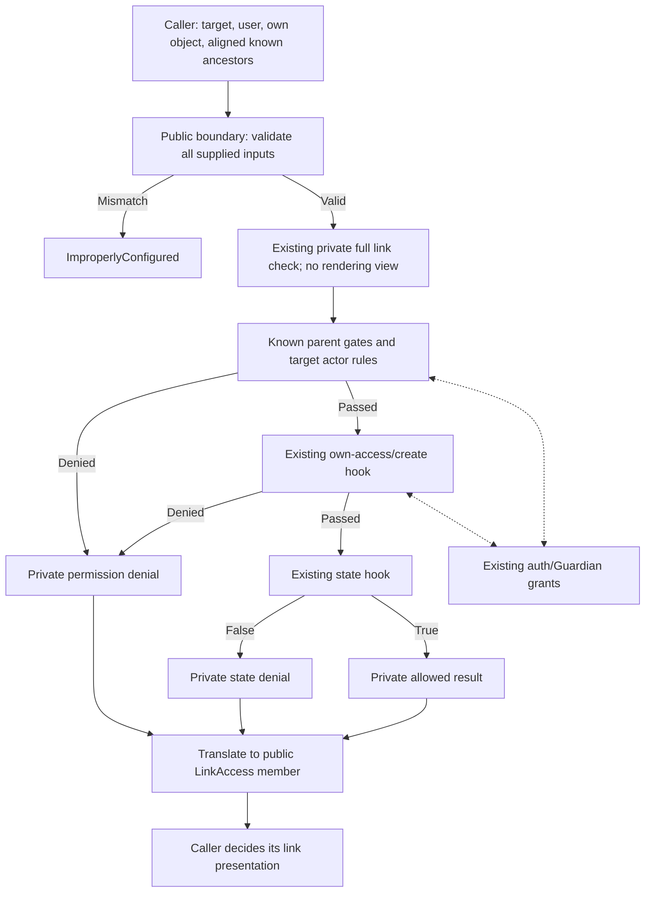

# Phase 06.52: Publish check_link_access — Research

**Researched:** 2026-11-26
**Domain:** Public Python API over existing Django link-permission machinery
**Confidence:** MEDIUM — external documentation tier returned by the research seam; local behavior is backed by source reads and the probes recorded below.

<user_constraints>
## User Constraints (from CONTEXT.md)

The following decisions, remaining discretion and deferred ideas are copied verbatim from the sibling `06.52-CONTEXT.md`, lines 26–174 and 273–275. Their authority is the maintainer's locked discussion, not a new research recommendation. [VERIFIED: .planning/phases/06.52-publish-check-link-access-as-the-documented-way-to-decide-a/06.52-CONTEXT.md:26-174,273-275]

<!-- DATA_k6v2n8r4_START -->
### Authority and inherited constraints

- The approved concept is `superpowers/specs/2026-11-23-link-access-check-design.md` at
  `55dce6f635101af6837d8badabea20431cd6ee88`, especially section 12.8, D-53/D-54 and their consequences.
  It prevails over the issue where they differ. Sections 12.1, 12.6 and 12.7 remain applicable except where
  section 12.8 amends them. Reviewers follow section 13 and do not reopen settled architecture.
- D-39–D-52 and D-55 remain binding. The local decisions P52-01–P52-08 below settle choices explicitly left
  to the planner by issue #414; they do not amend the approved behavior of earlier stages.
- Follow `CLAUDE.md`'s developer-maintainability constraint: a bounded public wrapper, understandable
  validation and tests, and preservation of proven private paths. Do not refactor package consumers to
  adopt the new public wrapper or change the private check's string-return contract.
- Preserve request gates, their order and responses, login redirects, access traces, published
  `cv_access`/`cv_manage_view` formats, Guardian row filtering and checker lifetime. Share grants only,
  never cached permission/state decisions. Add no ancestor/object loading solely to decide a link.

### Public entry point and calling style

- **P52-01 — Import path:** Document `from crud_views.lib.link_access import check_link_access`.
  Keep the public function in the existing module beside the private check. The selected contract does
  not add the alternative convenience re-export from `crud_views.lib`.
- **P52-02 — Arguments:** Use `target`, `user`, `obj` and `known_ancestors`. `target` and `user` may be
  positional; `obj` and `known_ancestors` are keyword-only. The accepted calling example is:

  ```python
  check_link_access(TargetView, user, obj=book, known_ancestors=[publisher])
  ```

  Top-level calls can omit known ancestors. Collection targets have no own object; the approved D-54
  missing/unexpected-own-object checks still apply. There is no rendering-view argument.

### Public result contract

- **P52-03 — Representation:** Return an enum, rather than the private check's raw strings or a result
  object with `.allowed`/`.reason` fields. Translate the private outcome at the public boundary.
- **P52-04 — Boolean use:** Boolean evaluation is true only for the allowed member. Both denial members
  are false. Support `if check_link_access(...)`; do not inherit the ordinary enum behavior in which all
  members are truthy, and do not raise `TypeError` for boolean use.
- **P52-05 — Names:** Export the enum from the same module as the function:

  ```python
  from crud_views.lib.link_access import LinkAccess

  LinkAccess.ALLOWED
  LinkAccess.DENIED_PERMISSION
  LinkAccess.DENIED_STATE
  ```

- **P52-06 — Enum kind:** Use a regular enum, not a string-compatible enum. Raw strings are not
  interchangeable with result members. Callers distinguish outcomes by comparing enum members; direct
  string serialization was not selected. Keep the custom boolean behavior from P52-04.

These public names and behaviors are stable at 1.0, without provisional status. Test the import paths,
argument convention, three identities, boolean behavior and lack of string equality explicitly.

### Caller edge cases

- **P52-07 — Missing ViewSet:** A target class without a ViewSet raises `ImproperlyConfigured` before
  permission or state evaluation. Explain that `check_link_access` requires a target with a ViewSet;
  follow the public validation message prefix convention. Do not preserve the accidental bare
  `AttributeError` or convert this configuration mistake into a permission denial.
- **P52-08 — Unsaved own objects:** Accept an unsaved Django model instance as the own object when its
  model type fits the target. Do not reject it merely for being unsaved. After input validation, delegate
  to the existing permission and state hooks; their results and exceptions remain authoritative. This
  does not promise an allowed result or suppress a backend/hook error. Do not save or load it to validate
  it. The user explicitly chose acceptance over the suggested saved-instance-only restriction.
  Resource instances have no Django persistence state. This decision addresses own objects; ancestor
  validation continues to follow D-54.

### Approved validation and evaluation behavior

- **D-53:** Validate inputs, then delegate to the existing private full check. Pass no rendering view:
  a reached `cv_create_has_access` receives `None`. Keep the permission-only function private and retain
  `cv_context_has_permission` as the public permission-only template entry. Publish no accessor for
  resolved ancestors.
- **D-54:** Validate before any permission or state decision, independently of the user or grants.
  Raise `ImproperlyConfigured`, with a message beginning with `check_link_access`, for all six cases:
  1. An ancestor does not fit its declared level, even when a nearer slot is `None`.
  2. The own object does not fit the target's model or Resource class.
  3. An object target has no own object.
  4. A target without an own object is given one.
  5. There are more ancestors than declared levels; every slot counts, including trailing `None`.
  6. A top-level target is given any ancestor slot.
- Accept instances of the level's concrete model, including compatible proxy, multi-table child and
  polymorphic subclass instances. Resource own objects must be instances of the target Resource class.
  Ancestor ViewSets have models; Resources are not parent ViewSets.
- **D-41:** Ancestors are nearest first and aligned to the target's declared ancestry. Short lists and
  unknown higher slots (`None`) are valid and do not shift farther objects. A missing immediate parent
  yields permission denial; an unknown higher ancestor is not checked.
- **D-40/D-46/D-49:** Preserve the difference between the public call's absent rendering view and a
  package consumer's real same-ViewSet view. Nested Guardian targets require a signed-in, active actor,
  including under provider `none`. Actor and declared parent gates precede the create hook; denial stops
  that hook. A top-level Guardian list retains its anonymous-allowed behavior.
- Parent gates precede own permission, which precedes state. The state hook receives the own object for
  an object target, otherwise the immediate parent for a nested target, otherwise `None`.
- Configuration errors remain errors. Broken declared ancestry may surface during validation with its
  own message. Reached gates can raise for missing ancestor permission keys, missing operation
  requirements or non-default authorization databases. Project hook exceptions propagate. A missing
  own permission key denies rather than raising. Do not add a new exception class.

### Documentation and acceptance

Carry all nine issue acceptance criteria into planning, plus the eight local decisions above:

1. The function is importable from its documented path and included in `docs/development/stability.md`.
2. Direct inputs, without a request or view, produce all three results for both core and Guardian targets.
3. All six validation failures are covered, including nearest-slot holes and trailing `None`; valid short
   lists and unknown higher levels do not raise or shift ancestor alignment.
4. Compatible proxy, multi-table, polymorphic and Resource own instances are accepted.
5. The specified short-list, unknown-higher-level and Guardian cases query neither the target's nor an
   ancestor's model table. This is not a blanket promise of zero permission queries or hook side effects.
6. A permitted nested Guardian create hook receives `None` as its rendering view. Anonymous/inactive
   actors or denied parent gates produce permission denial without calling that hook.
7. No documentation page still claims there is no public checker.
8. All three documented examples run as tests: an object target, a nested list/create target, and an
   off-page caller supplying its own ancestors.
9. Strict MkDocs passes, the changelog entry is under `### Added`, and no golden file, matrix cell or
   pinned query count changes from the stage-3b baseline.

The reference documents the import, inputs, enum names/boolean use, gate order, state-hook arguments,
validation and propagated errors, and the chosen missing-ViewSet and unsaved-object behavior. Explain:

- It decides a link, not request authorization, and adds no object/ancestor loading.
- Missing immediate parents deny; unknown higher levels are unchecked. A CRUD page exposes
  `cv_get_parent_object` but no public accessor for higher ancestors, so a project button can differ from
  a package button when the target requires stricter higher-level permission than the page.
- It does not check parent membership, ViewSet querysets, project `dispatch`/`has_permission` or
  middleware. A child supplied with another parent is accepted by input validation, whereas the request
  can return 404. Acceptance of an unsaved input is likewise not a request-success guarantee.
- A create-hook override that reads the rendering view can answer differently for the public function
  than for a package button. Preserve the D-51 parent-only non-create limitation and link its Guardian
  reference section.

Update the stage-3b custom-`ContextButton` migration pointers and the tests that pin them. Replace the
test excluding the checker from the stability inventory. Correct the stale no-public-checker statements
in `docs/migrating-1.0.md`, `docs/reference/guardian.md` and `docs/reference/nested.md`; keep the statement
that there is no public ancestor accessor. Use issue file/line references as baseline guidance, not fixed
current offsets. Broad implementation test runs use multiple workers per repository policy.
### Planner discretion and exclusions

The discussion settles the issue's public module/import, argument names and convention, outcome shape
and names, missing-ViewSet behavior and unsaved-own-object behavior. Remaining bounded implementation
details include enum underlying values, type annotations, validation helper organization, precise error
wording within the required prefix, test organization and reference-page placement. Do not treat these
as permission to expand the public surface or reopen the selected behaviors.

Out of scope: rendering/request changes, private-function or package-consumer changes, a rendering-view
argument, resolved-ancestor accessor, full-hierarchy flag, public permission-only function, new exception
class, automatic table-column/DataPanel/DataView adoption, breadcrumbs, site menus, prefetch or caches.
## Deferred Ideas

None — discussion stayed within phase scope.
<!-- DATA_k6v2n8r4_END -->
</user_constraints>


## Summary

Implement one public enum and one bounded validation-and-delegation function beside the existing checker. The private protocol is verbatim `_LINK_ALLOWED = "allowed"`, `_LINK_PERMISSION = "permission"`, `_LINK_STATE = "state"`; its full check already evaluates permission before state and defaults its rendering view to `None`. No consumer or private signature needs to change. [VERIFIED: src/crud_views/lib/link_access.py:12-14,69-86]

The main correctness risk is validation, not authorization design. Validate every supplied slot before calling any gate, use `isinstance` against the declared model's concrete model, branch explicitly for Resource targets, and do not use persistence status as a validity condition. The local probe accepted proxy, ordinary multi-table and polymorphic instances without queries; it also demonstrated why concrete-model identity equality rejects valid multi-table children. Public input acceptance must remain distinct from whatever permission/state hooks subsequently return or raise. [VERIFIED: src/crud_views/lib/viewset/__init__.py:74-81,125-127] [CITED: https://docs.djangoproject.com/en/6.0/topics/db/models/] [VERIFIED: local compatibility probe, Evidence section]

**Primary recommendation:** Keep the production delta in the existing link-access module; use existing ancestry metadata and test fixtures, add direct public-contract tests, publish one canonical reference, and run unchanged package regression gates. This follows the explicit bounded-wrapper constraint and the existing private implementation. [VERIFIED: .planning/phases/06.52-publish-check-link-access-as-the-documented-way-to-decide-a/06.52-CONTEXT.md:34-39,158-174] [VERIFIED: src/crud_views/lib/link_access.py:69-86]

## Architectural Responsibility Map

This is the recommended assignment, grounded in the existing checker, ViewSet model metadata and documented separation between link decisions and request authorization. [VERIFIED: src/crud_views/lib/link_access.py:1-4,69-86] [VERIFIED: src/crud_views/lib/ancestors.py:4-35]

| Capability | Primary tier | Secondary tier | Responsibility |
|---|---|---|---|
| Supply target, actor, own object and known ancestors | Calling Python application | Existing CRUD page when applicable | Caller supplies objects it already owns; no request or fake view is required. |
| Validate types, lengths and own-object presence | Python library/API boundary | Declared ViewSet metadata | Complete validation before permission/state evaluation. |
| Decide link permission and state | Existing private server-side checker | Core/Guardian hooks | Preserve gate order, hook identity and all propagated errors. |
| Read permission grants | Existing auth/Guardian backend | Auth database | Existing backend queries/caching remain authoritative; the wrapper adds no queries. |
| Authorize an actual request and check membership | Existing Django request path | ViewSet querysets/database | The public result does not replace this responsibility. |
| Document and test the stable contract | Package reference/tests | Strict documentation build | Freeze imports, enum semantics, arguments and limitations together. |

## Project Constraints (from AGENTS.md)

AGENTS.md contains the same repository guidance supplied as CLAUDE.md. The directives relevant to planning are below; no project-local skill directory or configured researcher skill was found, and graph status reported no graph. [VERIFIED: AGENTS.md:15-147] [VERIFIED: local skill discovery, agent-skills and graphify status commands]

- Maintainability is mandatory: prefer bounded, understandable, opt-in changes; preserve proven paths; account for hidden state, abstractions and extra queries; narrow scope when the developer cannot readily own it. [VERIFIED: AGENTS.md:15-27]
- Use bounded multicore pytest for broad runs; a serial tiny probe is acceptable because worker startup would dominate. Preserve running verification rather than restarting it merely to change worker counts. [VERIFIED: AGENTS.md:129-135]
- Follow the existing fixture naming and class conventions. Verbatim values: `cv_<model>`, `user_<model>_<permission>`, `client_user_<model>_<permission>`; attributes use `cv_`; operation keys are `list`, `detail`, `create`, `update`, `delete`, `workflow`, `manage`; permission mapping is `list/detail→view, create→add, update→change, delete→delete`. [VERIFIED: AGENTS.md:135-141]
- Use 120-character lines, double quotes, existing Ruff formatting, hatchling packaging and existing version management. Do not bump versions for this API addition unless separately authorized. The repository requires a migration update whenever an entry is added under `### Breaking`; this phase specifically requires `### Added` and still updates existing migration guidance. [VERIFIED: AGENTS.md:143-147] [VERIFIED: .planning/phases/06.52-publish-check-link-access-as-the-documented-way-to-decide-a/06.52-ISSUE-414.md:123-123]
- Follow the repository's development commands and pre-commit formatter; use scoped commands rather than fixing unrelated lint. A later ship must be followed by codebase mapping. A requested phase workspace follows the documented GSD workspace convention; this research stays on the assigned branch and does not create one. [VERIFIED: AGENTS.md:32-87]
- Golden output must remain byte-identical unless explicitly authorized. No such markup change is authorized here. [VERIFIED: .planning/REQUIREMENTS.md:8-9] [VERIFIED: .planning/phases/06.52-publish-check-link-access-as-the-documented-way-to-decide-a/06.52-CONTEXT.md:141-142]

<phase_requirements>
## Phase Requirements

No new formal requirement identifiers are assigned. The roadmap says verbatim `**Requirements**: None assigned; use the approved issue acceptance criteria and concept constraints.` Use AC-1–AC-9 below only as local issue-row labels, alongside P52-01–P52-08 and D-53/D-54. [VERIFIED: .planning/ROADMAP.md:2530-2535]

| Local label | Issue behavior | Research support |
|---|---|---|
| AC-1 | Public import and stability inventory | Regular enum and wrapper in the selected module; publish both names and member semantics. |
| AC-2 | All three direct outcomes for core and Guardian | Reuse real isolated target families; exercise public entry with no request/view; assert member identity. |
| AC-3 | All six validation failures; short/unknown positions valid | Complete positional metadata validation before delegation; explicit hole and trailing-unknown tests. |
| AC-4 | Proxy, multi-table, polymorphic and Resource acceptance | Concrete-model `isinstance`; Resource class branch; no exact runtime-class equality. |
| AC-5 | No target/ancestor model-table reads | Capture actual SQL and reject domain-table FROM/JOIN clauses; retain permission queries. |
| AC-6 | Guardian create receives absent rendering view only after admission | Spy on real target hook, actor and parent denial paths; state stays unevaluated after denial. |
| AC-7 | Remove every no-public-checker assertion in docs | Three source passages identified; keep no-public-ancestor-accessor limit. |
| AC-8 | Execute all three published examples | Extract actual Markdown fences and execute them against isolated application inputs. |
| AC-9 | Strict docs, Added changelog, unchanged package baselines | Existing docs tooling, frozen matrix/cost tests, full core regression and baseline diff. |

The source acceptance rows are the nine checkboxes in the issue snapshot. [VERIFIED: .planning/phases/06.52-publish-check-link-access-as-the-documented-way-to-decide-a/06.52-ISSUE-414.md:115-123]
</phase_requirements>

## Standard Stack

Retain installed project dependencies. This phase requires no new package, dependency upgrade or registry installation; versions below are observed environment versions, not claims about the newest releases. Existing declarations include verbatim `requires-python = ">=3.12"`, `"django (>=4.2.0)"`, `"django-polymorphic (>=3.1.0)"` and `"django-guardian>=2.4"`. [VERIFIED: pyproject.toml:25-28,44-54]

| Component | Observed version | Role |
|---|---|---|
| Python standard-library Enum | Python 3.12.3 | Regular Enum plus explicit boolean method; no dependency. |
| Django | 6.0.10 | Model metadata, configuration exception and testing tools. |
| django-guardian | 3.5.2 | Preserve existing own/ancestor grants and checker lifecycle. |
| django-polymorphic | 4.11.7 | Existing real subclass fixture coverage. |
| Pydantic | 2.14.3 | Existing ViewSets/Resources; do not introduce a validation model for the wrapper. |
| pytest / pytest-django / pytest-xdist | 9.2.0 / 4.14.0 / 3.8.0 | Direct contract and preservation tests. |
| MkDocs / Ruff | 1.6.1 / 0.17.3 | Existing strict docs and scoped formatting/checking. |

Versions are tool observations from the environment commands recorded below. [VERIFIED: local runtime and tool version probes, 2026-11-26]

### Package Legitimacy Audit

Not applicable: no external package installation is recommended. Reuse the already-declared dependencies; no package-name discovery, new installation command or unverified package recommendation is part of this phase. [VERIFIED: pyproject.toml:25-83] [VERIFIED: .planning/phases/06.52-publish-check-link-access-as-the-documented-way-to-decide-a/06.52-CONTEXT.md:164-174]

## Architecture Patterns

### System Architecture Diagram

The diagram is the proposed wrapper around the observed private flow. The private function returns before state when permission denies. [VERIFIED: src/crud_views/lib/link_access.py:69-86]



### Bounded implementation sequence

1. Obtain the target's ViewSet with a missing-attribute-safe lookup and reject absent/`None` configuration using the required prefix before any gates. The existing base explicitly defines `cv_viewset: ViewSet | None = None`. Do not require constructing a view. [VERIFIED: src/crud_views/lib/view/base.py:125-128] [VERIFIED: .planning/phases/06.52-publish-check-link-access-as-the-documented-way-to-decide-a/06.52-CONTEXT.md:82-85]
2. Walk declared ancestry once for public validation. Recommended reuse: `ancestors._validate_ancestor_structure(viewset, relations=False)`, which delegates to the bounded walker and rejects Resource parents without validating ORM membership/relationships. This is a metadata-only operation; it avoids writing a second cycle/missing-parent walker. Do not enable full relationship validation just to check caller types. Broken declared ancestry propagates its own existing message. [VERIFIED: src/crud_views/lib/ancestors.py:89-146]
3. Enforce own-object required/unexpected checks using identity with `None`, never object truthiness or PK truthiness. For ORM targets, the expected Python class is `viewset.model._meta.concrete_model`; for Resource targets it is `viewset.model`. Use the existing `is_resource` property: verbatim `return issubclass(self.model, Resource)`. [VERIFIED: src/crud_views/lib/viewset/__init__.py:74-81,125-127] [VERIFIED: .planning/phases/06.52-publish-check-link-access-as-the-documented-way-to-decide-a/06.52-CONTEXT.md:100-110]
4. Count every supplied ancestor slot before iterating corresponding levels. Reject excess slots even if all excess elements are `None`, and reject every nonempty list for a top-level target. Then inspect every non-`None` slot at its original index. A missing immediate slot must not terminate validation of a malformed farther object. [VERIFIED: .planning/phases/06.52-publish-check-link-access-as-the-documented-way-to-decide-a/06.52-CONTEXT.md:100-113]
5. Delegate exactly once to `_link_access` after successful validation, passing the original own-object identities and aligned ancestors. Explicitly pass `rendering_view=None` for clarity. Convert the private answer to the public enum; do not catch project errors or reinterpret them as denials. [VERIFIED: src/crud_views/lib/link_access.py:81-86] [VERIFIED: .planning/phases/06.52-publish-check-link-access-as-the-documented-way-to-decide-a/06.52-CONTEXT.md:96-99,118-123]

Keep helpers local and private, if a helper materially improves clarity. Use TYPE_CHECKING for optional class annotations to avoid importing the view module into its link-check dependency. No generic validation framework, backend adapter, registry or broad target/user duck-type schema is needed. Document a finite ordered ancestor sequence (list/tuple); do not accidentally promise generator consumption, automatic relation lookup or malformed-container coercion. These are implementation recommendations within the stated discretion. [VERIFIED: .planning/phases/06.52-publish-check-link-access-as-the-documented-way-to-decide-a/06.52-CONTEXT.md:164-174]

### Compatibility boundaries to test

| Input shape | Required result from validation | Why |
|---|---|---|
| Exact declared ORM model | Accept | D-54 model contract. |
| Proxy instance for concrete target | Accept | Python inheritance plus concrete target class. |
| Concrete instance for a proxy-declared target | Accept | The declared proxy's concrete model is the acceptance class. |
| Multi-table child for base target | Accept | Child is an instance of base, even though child has a different concrete model identity. |
| Polymorphic child for base target | Accept | Validate class compatibility without querying/downcasting. |
| Base or sibling instance for a genuinely narrower concrete child target | Reject | It is not an instance of that concrete child class. |
| Resource instance/subclass for its declared Resource class | Accept | Resource has its own class contract, without ORM persistence metadata. |
| Other Resource, ordinary dict, unrelated model | Reject | Similar field/PK shapes do not establish class compatibility. |
| Unsaved accepted own-model instance | Accept then delegate | No saved-instance-only gate; hook/backend behavior stays authoritative. |

The first, proxy, multi-table and polymorphic rules were positively probed. Django's metaclass assigns a proxy its base concrete model but assigns a non-proxy its own class. Resource is declared verbatim `class Resource(BaseModel):` and its metadata is a separate adapter. [CITED: https://docs.djangoproject.com/en/6.0/topics/db/models/] [VERIFIED: .nox/tests-3-12-django-6-0/lib/python3.12/site-packages/django/db/models/base.py:246-249] [VERIFIED: src/crud_views/lib/resource.py:42-52,79-94] [VERIFIED: local compatibility probe, Evidence section]

### Unsaved instances: preserve, do not normalize

An unsaved integer-PK instance can have no PK, while this repository's UUID model assigns one at construction: verbatim `id = models.UUIDField(primary_key=True, default=uuid.uuid4, editable=False)`. Both remained unsaved in the probe. Consequently, neither a populated PK nor `_state.adding` is an appropriate public rejection condition. Do not save, refresh, fetch the parent, hash the instance, or read fields merely to format validation errors; use type names/declared level information. [VERIFIED: tests/test1/app/models.py:14-17] [CITED: https://docs.djangoproject.com/en/6.0/ref/models/instances/] [VERIFIED: local compatibility probe, Evidence section]

After acceptance, Guardian still uses its existing permission machinery. The own hook can read permission vocabulary and call the shared checker; Guardian's installed cache key contains the content type and stringified PK. The public wrapper must not promise distinct permission-cache behavior for unsaved instances or suppress backend errors. Prove forwarding identity and hook-exception propagation separately from a plain core unsaved-acceptance case. [VERIFIED: src/crud_views_guardian/lib/mixins.py:202-216] [VERIFIED: src/crud_views_guardian/lib/permissions.py:1-11] [VERIFIED: .nox/tests-3-12-django-6-0/lib/python3.12/site-packages/guardian/core.py:151-192] [VERIFIED: .planning/phases/06.52-publish-check-link-access-as-the-documented-way-to-decide-a/06.52-CONTEXT.md:86-92]

### Existing fixtures and isolation

| Reuse point | Planner guidance |
|---|---|
| `tests/test1/test_ancestor_authorization.py:46-76` | Reuse `isolated_routes` to restore ViewSet registry, vocabulary, URL and content-type caches. Do not leak dynamically registered views between tests. |
| `tests/test1/test_ancestor_helpers.py:36-161` | Reuse real core-parent/Guardian-child and Guardian multilevel families, grant helpers, provider spies and queryset-lookup spies. |
| `tests/test1/test_link_access.py:234-256` | Existing `core_targets` fixture provides plain core detail/list/create and top-level list targets. |
| `tests/test1/test_link_consumer_costs.py:57-127` | Reuse real core/Guardian three-model route builders if needed; leave cost pins/test implementation unchanged. |
| `tests/test1/app/models.py:53-57,228-243` | Existing `class PublisherProxy(Publisher):`, `class Vehicle(PolymorphicModel):` and `class Car(Vehicle):` cover actual proxy and polymorphic classes. Use an isolated temporary ORM subclass for a separate ordinary multi-table test; no schema migration is necessary for an unsaved type-only case. |
| `tests/test1/test_ancestor_resources.py:42-56,109-165` | Resource fixtures include a three-ancestor leaf, useful for an interior unknown slot followed by a farther known object. Their fixture metadata lists ancestors root-first; public inputs must be constructed nearest-first. |
| `tests/test1/test_ancestor_docs.py:78-82,119-147` | Reuse the uniquely headed Python-fence extraction/isolated execution pattern for the actual published examples. |

All referenced helpers/classes were opened in this session; the exact helper names above are verbatim definitions. [VERIFIED: tests/test1/test_ancestor_authorization.py:46-76] [VERIFIED: tests/test1/test_ancestor_helpers.py:36-161] [VERIFIED: tests/test1/test_link_access.py:234-256] [VERIFIED: tests/test1/test_link_consumer_costs.py:57-127] [VERIFIED: tests/test1/app/models.py:53-57,228-243] [VERIFIED: tests/test1/test_ancestor_resources.py:109-165] [VERIFIED: tests/test1/test_ancestor_docs.py:78-82,119-147]

## Don't Hand-Roll

| Problem | Use instead | Boundary |
|---|---|---|
| Walking ancestry, missing parents, cycles | Existing metadata walk/structure validator | No new hierarchy engine or object fetching. |
| Permission/state result | Existing private full checker | No second decision engine or public permission-only helper. |
| Enum semantics | Standard-library Enum with explicit boolean override | No string subclass, dataclass result or custom equality protocol. |
| Guardian grants | Existing hooks/checker | No new cache, prefetch or special unsaved-object cache policy. |
| Example execution | Existing Markdown fence/namespace pattern | No copied example strings that can drift from published docs. |

These recommendations follow the locked delegation contract and existing source seams. [VERIFIED: src/crud_views/lib/ancestors.py:89-146] [VERIFIED: src/crud_views/lib/link_access.py:69-86] [VERIFIED: src/crud_views_guardian/lib/permissions.py:1-11] [VERIFIED: tests/test1/test_ancestor_docs.py:78-82,144-147] [CITED: https://docs.python.org/3.12/howto/enum.html]

## Common Pitfalls

1. **Making denials truthy.** Regular enum members are truthy by default, and all three private strings are nonempty. Implement boolean conversion using member identity, not `bool(self.value)`. Assert the two denial booleans explicitly. [CITED: https://docs.python.org/3.12/howto/enum.html]
2. **Rejecting valid inheritance.** Comparing instance and target concrete-model identities rejects multi-table children; comparing against a proxy class rather than its concrete class overrestricts proxy-declared targets. The probe falsified the equality approach. [VERIFIED: local compatibility probe, Evidence section]
3. **Returning denial before finishing validation.** Invalid farther objects must raise even behind a missing nearest parent or an anonymous actor; the private checker intentionally denies immediately when nearest is absent. Therefore public validation must happen first. [VERIFIED: src/crud_views/lib/link_access.py:71-76] [VERIFIED: .planning/phases/06.52-publish-check-link-access-as-the-documented-way-to-decide-a/06.52-CONTEXT.md:100-113]
4. **Compacting unknown slots.** Filtering falsey values shifts ancestor meaning; use indexed slots and count trailing unknowns. Include a three-ancestor interior-hole case, not only the two-level trailing-hole case. [VERIFIED: src/crud_views/lib/link_access.py:43-65] [VERIFIED: .planning/phases/06.52-publish-check-link-access-as-the-documented-way-to-decide-a/06.52-CONTEXT.md:111-113]
5. **Asserting zero total queries for permission checks.** The contract excludes model-table loads, not auth vocabulary/grant reads. Existing tests inspect SQL FROM/JOIN against domain-table names and independently spy on ViewSet lookups. Reuse that pattern. [VERIFIED: tests/test1/test_link_access.py:275-294] [VERIFIED: src/crud_views/lib/viewset/__init__.py:473-505]
6. **Reusing an actor after changing Guardian grants.** The checker is stored on that Python user. Refresh the actor between grant-mutation scenarios; do not “fix” the wrapper to invalidate the cache. [VERIFIED: src/crud_views_guardian/lib/permissions.py:4-11] [VERIFIED: tests/test1/test_link_access.py:296-304]
7. **Rewriting historical source fingerprints.** Existing cost evidence validates the historical receipt against its historical XML and pins; it does not require old source hashes to become today's new wrapper hashes. Preserve receipts and cost baselines. [VERIFIED: tests/test1/test_link_consumer_costs.py:778-840]
8. **Overstating parity.** Unknown higher ancestors, project create overrides dependent on rendering view, parent membership and the retained parent-only Guardian limitation deliberately permit link/request differences. Document these limits instead of changing existing behavior. [VERIFIED: superpowers/specs/2026-11-23-link-access-check-design.md:769-795]

## Code Examples

### Minimal enum adapter

This is a recommended implementation sketch, not an existing public implementation. The public names are verbatim locked values `LinkAccess.ALLOWED`, `LinkAccess.DENIED_PERMISSION` and `LinkAccess.DENIED_STATE`. The private values are verbatim `"allowed"`, `"permission"` and `"state"`. Reusing these strings as underlying enum values is within planner discretion and does not make the regular enum equal to strings. [VERIFIED: .planning/phases/06.52-publish-check-link-access-as-the-documented-way-to-decide-a/06.52-CONTEXT.md:63-78,164-170] [VERIFIED: src/crud_views/lib/link_access.py:12-14] [CITED: https://docs.python.org/3.12/howto/enum.html]

```python
from enum import Enum

class LinkAccess(Enum):
    ALLOWED = _LINK_ALLOWED
    DENIED_PERMISSION = _LINK_PERMISSION
    DENIED_STATE = _LINK_STATE

    def __bool__(self):
        return self is LinkAccess.ALLOWED
```

After complete validation, return `LinkAccess(_link_access(target, user, obj, known_ancestors, rendering_view=None))`. Preserve the private strings, functions and package callers. The public signature is `check_link_access(target, user, *, obj=None, known_ancestors=())`; tests must distinguish it from the unchanged private positional-own-object signature. [VERIFIED: src/crud_views/lib/link_access.py:69-86] [VERIFIED: tests/test1/test_link_access.py:259-271] [VERIFIED: .planning/phases/06.52-publish-check-link-access-as-the-documented-way-to-decide-a/06.52-CONTEXT.md:43-54]

### Compatibility predicate

Recommended local expression: `expected = viewset.model if viewset.is_resource else viewset.model._meta.concrete_model` followed by `isinstance(obj, expected)`. Ancestors use the ORM branch at their exact declared index. This checks only class fit; it does not establish saved status, parent membership, queryset inclusion or request success. [VERIFIED: src/crud_views/lib/viewset/__init__.py:74-81,125-127] [VERIFIED: src/crud_views/lib/ancestors.py:124-146] [VERIFIED: superpowers/specs/2026-11-23-link-access-check-design.md:779-789]

## Documentation Implementation Map

Recommendation: create one dedicated link-access reference page and link it from the reference index, Actions & navigation menu, context-button guidance and stability inventory. The current menu and index group related topics there. This is proposed placement, not a pre-existing page. [VERIFIED: docs/reference/.pages:26-32] [VERIFIED: docs/reference/index.md:28-37]

| Existing source read | Required edit |
|---|---|
| `docs/development/stability.md:19-27` | Add the exact module, function, enum and three members, including boolean behavior and stable-at-1.0 status; retain private helpers as internal. |
| `docs/migrating-1.0.md:8-16` | Replace no-public-checker/later-work prose with the new reference; retain absence of a public resolved-ancestor accessor. |
| `docs/migrating-1.0.md:169-173` | Point custom ContextButton implementations at the full public checker. Keep the create hook as the place for custom create permission rules, clearly separate from deciding the complete link. |
| `docs/reference/guardian.md:322-327` | Update the matching custom-button migration pointer with the same distinction. |
| `docs/reference/guardian.md:565-574` | Publish the opt-in checker while keeping independent table columns and other off-page consumers outside automatic adoption. |
| `docs/reference/nested.md:626-628` | Remove only the no-public-checker claim; preserve request/redirect and ancestor-accessor limits. |
| `docs/reference/guardian.md:348-357` | Link to the existing parent-only non-create limitation; do not change its semantics. |
| `tests/test1/test_link_access_docs.py:56-94,188-211` | Replace the stability-exclusion test and migrate both old create-hook pointer assertions; keep earlier-stage behavior assertions. |
| `CHANGELOG.md:703-708` | Add the new API under the existing Unreleased Added heading; leave the historical Breaking hook entry intact. |

Each entry is based on reading the cited source ranges in this session. The stale phrases are verbatim `"no public checker API"`, `"No public checker or ancestor accessor is introduced."`, and `"request response or login redirect changes, public checker, or public ancestor accessor are introduced."` [VERIFIED: docs/migrating-1.0.md:12-13] [VERIFIED: docs/reference/guardian.md:574-574] [VERIFIED: docs/reference/nested.md:626-627]

The reference must include the full error/limit inventory from the locked context, not only a happy-path example: gate order and state arguments; all six validation errors plus missing ViewSet; unsaved own-instance acceptance; broken declaration messages; reached missing permission/operation/database configuration errors; arbitrary hook exceptions; missing-own-permission denial; anonymous top-level Guardian list behavior; nested Guardian actor admission; absent rendering view; incomplete known ancestry; no membership/queryset/dispatch/middleware checks. [VERIFIED: .planning/phases/06.52-publish-check-link-access-as-the-documented-way-to-decide-a/06.52-CONTEXT.md:94-156]

Publish three uniquely headed, executable snippets: a direct object target, a nested list/create target with explicit parent, and an off-page caller explicitly providing two or more known ancestor levels. Extract and execute those exact fences with injected realistic project models/views and assert their results. Include the public import and either member comparison or boolean idiom in the executed content. A duplicated test-only recipe or a syntax parse alone does not meet AC-8. [VERIFIED: .planning/phases/06.52-publish-check-link-access-as-the-documented-way-to-decide-a/06.52-ISSUE-414.md:75-77,122-122] [VERIFIED: tests/test1/test_ancestor_docs.py:78-82,119-147]

## State of the Art

The applicable transition is this project's approved stage boundary, not an ecosystem migration. Existing package consumers already share a private full check; stage 3c adds an opt-in validated public facade and enum without moving consumers. The specification at the authoritative commit and working copy had no diff when checked. [VERIFIED: superpowers/specs/2026-11-23-link-access-check-design.md:677-682,791-795] [VERIFIED: local git diff against 55dce6f635101af6837d8badabea20431cd6ee88]

Runtime-state migration inventory is not applicable: this is an additive public surface, with no runtime key/service/secret/build-artifact rename. Do not introduce a data migration or dependency rebuild as an implementation task. [VERIFIED: .planning/phases/06.52-publish-check-link-access-as-the-documented-way-to-decide-a/06.52-CONTEXT.md:9-12,172-174]

## Environment Availability

| Dependency | Availability observed | Use/fallback |
|---|---|---|
| Existing Django 6.0 nox Python | Available; Python 3.12.3 | Source-bound verification with explicit PYTHONPATH. |
| Existing test frameworks/extension dependencies | Available; versions in Standard Stack | No install necessary. |
| Existing development MkDocs | Available; strict baseline build passed | Use development environment executable. |
| Existing development Ruff | Available; 0.17.3 | Scope to changed production/tests. |
| uv / task | Found on PATH | Setup orchestration available if later required. |
| Context7 MCP / ctx7 CLI | Unavailable in this agent | Used official documentation through built-in web lookup. |
| Knowledge graph | Status returned `"exists": false` | Read actual source; no approximate graph claims. |

Availability is from the actual runtime/tool probes and GSD discovery commands, not from dependency declarations alone. No missing dependency blocks this plan. Other Django/Python environments and installed-wheel verification were not tested in this research. [VERIFIED: local environment/discovery probes, 2026-11-26]

## Validation Architecture

Nyquist and security are enabled: verbatim `"nyquist_validation": true` and `"security_enforcement": true`. [VERIFIED: .planning/config.json:24-24,48-49]

### Test framework and commands

| Property | Value |
|---|---|
| Framework | pytest 9.2.0, pytest-django 4.14.0, pytest-xdist 3.8.0, Django 6.0.10 observed |
| Configuration | Existing pyproject pytest options and test-project in-memory configuration |
| Quick baseline | `PYTHONPATH=src:. CV_ACCESS_RECORD_REQUESTS=0 .nox/tests-3-12-django-6-0/bin/python -m pytest tests/test1/test_link_access.py tests/test1/test_link_consumers.py -n 6 -q` |
| Public/docs task gate | Same executable/env, relevant new public tests plus `tests/test1/test_link_access_docs.py`; use `-n 6 -q` for combined runs |
| Preservation gate | Same executable/env: `-m pytest tests/test1/test_link_access_matrix.py tests/test1/test_link_consumer_costs.py -n 6 -q` |
| Full source gate | `PYTHONPATH=src:. CV_ACCESS_RECORD_REQUESTS=0 .nox/tests-3-12-django-6-0/bin/python -m pytest tests -n 6 -q` |
| Strict docs | `.venv/bin/mkdocs build --strict --site-dir /tmp/cv-phase52-docs` |

The quick baseline ran successfully in under 30 seconds. The full suite/preservation gate are proposed implementation verification, not results claimed here. Existing pytest configuration is verbatim `addopts = "--strict-markers"`; test configuration uses `"NAME": ":memory:"` for SQLite. Nox's installed-package lane deliberately uses an empty PYTHONPATH, so a source-path run must not be presented as installed-distribution evidence. [VERIFIED: pyproject.toml:145-146] [VERIFIED: tests/test1/conftest.py:107-115] [VERIFIED: noxfile.py:5-16,27-56] [VERIFIED: local baseline execution, Evidence section]

### Phase acceptance → test map

These are recommended tests to add, using existing framework/fixtures. Quick commands run the relevant function or `-k` selection within the direct/public tests; keep the complete matrix/cost suite for wave/phase verification rather than every tiny edit.

| Local criterion | Required test cases | Type | Existing infrastructure / gap |
|---|---|---|---|
| AC-1, P52-01–06 | Documented import; exact argument kinds/defaults; all three distinct members; both denials false; no string equality; no extra rendering-view argument | Unit | Existing private signature test must remain; add public assertions. |
| AC-2 | Core and Guardian each return allowed, permission-denied and state-denied from direct inputs; state not called after permission denial; action object is correct | Integration | Existing target families, grants and hook spies; add public calls. |
| AC-3, P52-07 | All six errors and missing ViewSet before hooks; normal/anonymous/superuser actors; error-prefix assertion; invalid farther slot behind nearest hole; excess trailing None and top-level [None] | Unit/integration | Add parameterized public-validation table and delegation-not-called assertions. |
| AC-3 / D-41 | Valid short list; unknown higher slot; valid supplied farther object behind hole; wrong farther type still raises; original index/identity preserved | Integration | Reuse three-ancestor Resource chain where an interior higher hole must be observable. |
| AC-4, P52-08 | Proxy/base/proxy-declared target, independent MTI, polymorphic child, Resource + subclass; wrong model/resource; unsaved integer and UUID objects; same identity to hooks; hook error propagates | Unit/integration | Existing model fixtures; add isolated local MTI declaration, no schema migration. |
| AC-5 | Short list, higher unknown, Guardian target: inspect target AND all declared ancestor table SQL; spies show no lookup/Resource load | Integration | Reuse CaptureQueriesContext domain FROM/JOIN checks; no global zero-query assertion. |
| AC-6 | Active permitted Guardian create receives None rendering view; anonymous/inactive denied even provider-none; denied higher/immediate gates skip create/state; false override denies | Integration | Existing Guardian create tests give real configurations; add public-entry assertions. |
| AC-7 | All three stale statements gone; custom-button pointers lead to new reference; no-accessor and permission-only-filter limitations retained | Documentation | Migrate existing prose tests; audit all documentation pages for equivalent stale statements. |
| AC-8 | Execute exact object/nested/off-page fences; assert expected enum result; each example has complete documented setup | Executable documentation | Existing strict-fence pattern; add example coverage. |
| AC-9 | Strict docs; new Added entry; unchanged matrix cells/query pins/golden bytes; existing direct/consumer tests pass | Regression | Existing gates; do not rewrite pins/receipts to pass. |

This table derives from all nine issue criteria and the eight local decisions; it adds no new formal requirement IDs. [VERIFIED: .planning/phases/06.52-publish-check-link-access-as-the-documented-way-to-decide-a/06.52-ISSUE-414.md:115-123] [VERIFIED: .planning/phases/06.52-publish-check-link-access-as-the-documented-way-to-decide-a/06.52-CONTEXT.md:43-92]

### Sampling and Wave 0 gaps

- Per task: run the affected public/direct or documentation selection; after the wrapper changes, run the verified quick baseline.
- Per wave: run combined public/direct/docs tests and unchanged matrix/cost gates.
- Phase gate: strict MkDocs, scoped Ruff, complete source tests and baseline diff; record installed/other-runtime lanes honestly.
- Wave 0 needs public-contract and executable-example tests, not a new framework or fixture package. Reuse existing modules or create one focused public-test module; avoid expanding the existing golden/matrix/cost harness.
- Compare against the phase's stage-3b product baseline; require no differences in golden files, matrix JSON/cells or count pins. Inspect the production diff to confirm private function bodies and package callers remain unchanged.

These are recommended verification tasks within the explicit preservation requirements. [VERIFIED: .planning/phases/06.52-publish-check-link-access-as-the-documented-way-to-decide-a/06.52-CONTEXT.md:129-162]

## Security Domain

Use current ASVS 5.0 terminology rather than copying older chapter numbers from a generic template: input validation/business logic is V2 and authorization is V8. This mapping is guidance for this bounded server-side Python addition, not a claim of application certification. [CITED: https://github.com/OWASP/ASVS/blob/master/5.0/en/0x11-V2-Validation-and-Business-Logic.md] [CITED: https://github.com/OWASP/ASVS/blob/master/5.0/en/0x17-V8-Authorization.md]

| Applicable category | Application to this phase | Standard control |
|---|---|---|
| V2 Validation and Business Logic | Yes | Validate all supplied slots before decision; permission denial skips state; errors remain errors. |
| V8 Authorization | Yes, preserving existing controls | Delegate to existing server-side gates; document that link visibility is not request authorization. |
| Authentication/session handling | Preservation only | Keep existing actor admission and request handling; add no login/session API. |
| Cryptography | No new responsibility | This wrapper introduces no cryptographic primitive or secret handling. |

Phase scope and local threat analysis support these assignments. [VERIFIED: src/crud_views/lib/link_access.py:69-86] [VERIFIED: src/crud_views_guardian/lib/views.py:358-369] [VERIFIED: .planning/phases/06.52-publish-check-link-access-as-the-documented-way-to-decide-a/06.52-CONTEXT.md:114-123,144-174]

| Threat | STRIDE class | Required mitigation/test |
|---|---|---|
| Wrong model accepted because a model-permission backend ignores obj | Tampering | Validate caller model/level independently of grants. |
| Anonymous nested Guardian create reaches a permissive override | Elevation of privilege | Preserve actor and parent admission before create hook; spy proves it is skipped. |
| Missing nearest parent hides a malformed farther slot | Tampering | Finish public input validation before private early denial. |
| Caller treats allowed as authorization or membership proof | Elevation of privilege | Explicit documented limit; request/queryset tests stay unchanged. |
| Cached state/permission decision reused | Elevation of privilege | Wrapper stores no decisions; retain existing grant-only checker lifetime. |

These are phase-specific threats derived from the actual unchecked private input boundary, create gate and grant helper. [VERIFIED: src/crud_views/lib/viewset/__init__.py:507-509] [VERIFIED: src/crud_views/lib/link_access.py:71-86] [VERIFIED: src/crud_views_guardian/lib/views.py:358-369] [VERIFIED: src/crud_views_guardian/lib/permissions.py:1-11]

## Evidence: Read Versus Executed

**Read:** locked context and complete issue snapshot; authoritative concept (including sections 12.1, 12.6–12.8 and 13); global preservation requirements/current state; project instructions/config; link checker, ancestry validators and gates, ViewSet/Resource definitions, core/Guardian hooks/checker; relevant existing fixtures, documentation assertions, matrix/cost receipt validation; installed Django model-metaclass and Guardian checker source; official Python/Django/OWASP documentation. Citations throughout identify the source ranges.

**Executed, 2026-11-26:**

- Source-bound direct-check and consumer baseline command above: **568 passed in 9.86s**, six workers.
- Strict baseline documentation build: **passed in 1.44s**, output redirected outside the repository.
- Tiny serial compatibility/unsaved probe: **zero queries**, output below. This used the existing private checker plus class metadata; the public function does not yet exist.
- Environment/version, GSD init, graph status, configured-skill discovery and research-plan/confidence queries.
- A diff of the authoritative concept against the stated authority commit produced no differences.

[VERIFIED: local tool outputs recorded during this research]

The compatibility probe output is verbatim:
<!-- DATA_t8m4p7q2_START -->
```json
{"concrete_against_proxy_target": true, "mti_against_base": true, "mti_concrete_identity_is_base": false, "polymorphic_against_base": true, "proxy_against_concrete": true, "query_count": 0, "unsaved_auto_adding": true, "unsaved_auto_pk": null, "unsaved_own_private_result": "allowed", "unsaved_uuid_adding": true, "unsaved_uuid_has_pk": true, "wrong_model": false}
```
<!-- DATA_t8m4p7q2_END -->
[VERIFIED: local compatibility probe, Python 3.12.3 / Django 6.0.10]

**Not executed:** new public behavior, new executable examples, full core suite, full matrix/cost gates, other runtime series, installed-wheel tests, browser tests or downstream integration. Existing historical receipts are not presented as new results.

## Assumptions Log

No unverified product assumptions are required to plan this phase. Public behavior is locked; recommendations above concern bounded implementation/test organization. No external service, performance target, compliance certification or new package is assumed. The no-domain-query requirement remains bounded to the specified caller cases and does not prohibit existing auth queries or project hook side effects. [VERIFIED: .planning/phases/06.52-publish-check-link-access-as-the-documented-way-to-decide-a/06.52-CONTEXT.md:133-156]

## Open Questions

No maintainer decision conflict found. Enum underlying values, annotations, local validation helper layout, exact prefix-following error text, test module layout and canonical reference placement remain implementation discretion. This report recommends concrete choices without reopening any of the eight locked decisions. [VERIFIED: .planning/phases/06.52-publish-check-link-access-as-the-documented-way-to-decide-a/06.52-CONTEXT.md:164-170]

The roadmap/issue still contain the earlier “left to planner” list; apply the later locked context to those now-settled items. Do not turn that stale wording into another approval checkpoint. [VERIFIED: .planning/ROADMAP.md:2536-2536] [VERIFIED: .planning/phases/06.52-publish-check-link-access-as-the-documented-way-to-decide-a/06.52-ISSUE-414.md:109-111] [VERIFIED: .planning/phases/06.52-publish-check-link-access-as-the-documented-way-to-decide-a/06.52-CONTEXT.md:164-170]

## Sources and Confidence

- **Authoritative project sources:** locked context/issue, approved concept and actual source/test files cited inline; local behavior cross-checked by the two successful baseline commands and compatibility probe.
- **Official Python:** [Enum HOWTO](https://docs.python.org/3.12/howto/enum.html), regular-member comparison and custom truthiness.
- **Official Django:** [Model inheritance](https://docs.djangoproject.com/en/6.0/topics/db/models/), [model instance lifecycle](https://docs.djangoproject.com/en/6.0/ref/models/instances/); cross-checked with installed source.
- **Official OWASP:** [V2 Validation and Business Logic](https://github.com/OWASP/ASVS/blob/master/5.0/en/0x11-V2-Validation-and-Business-Logic.md), [V8 Authorization](https://github.com/OWASP/ASVS/blob/master/5.0/en/0x17-V8-Authorization.md).
- **Research seam:** selected Context7 for docs and websearch for the security query. Context7 MCP and CLI were unavailable, so official web pages were used. `classify-confidence --provider websearch --verified` returned verbatim `"confidence": "MEDIUM"`; digests were stored at that tier. No tertiary-source claim is used. [VERIFIED: local research-plan/classify-confidence/store outputs]

**Confidence breakdown:** Standard stack MEDIUM (observed runtime, no installation changes); architecture MEDIUM (locked decisions and source/probe agreement); pitfalls MEDIUM (source-grounded failure cases). External-documentation tiers follow the seam output; actual test/probe results are recorded separately rather than generalized into runtime-matrix assurance.

**Research date:** 2026-11-26.
**Validity:** Recheck source locations and environment if the feature branch changes; the locked product choices remain controlling until amended by the maintainer.

