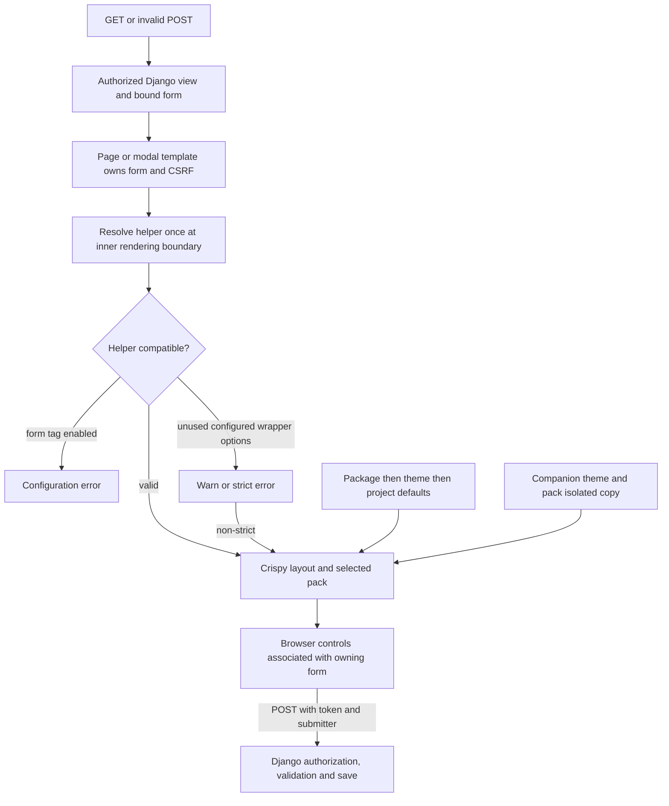

# Phase 06.6: Theme-adoption seams from the Tabler sync - Research

**Researched:** 2026-11-02
**Domain:** Django server-rendered forms, crispy template packs, theme registries and acceptance evidence
**Confidence:** MEDIUM — current source and focused probes are available; the reference companions are unavailable.

<user_constraints>
## User Constraints (from CONTEXT.md)

The following locked decisions and planning notes are copied verbatim from the phase context. Source:
[06.6-CONTEXT.md](06.6-CONTEXT.md). <!-- DATA_9fb3a121_START -->

### Locked Decisions and Agent's Discretion

### Custom form helpers

- **D-01:** Reject with a clear configuration error explaining form_tag=False; immediate migration.
- **D-02:** Page templates own outer form attributes. Document template overrides; do not transfer helper
  attributes.
- **D-03:** Warn with migration guidance; render normally outside strict mode.
- **D-04:** Yes: raise in strict mode, warn otherwise. form_tag=True always blocks rendering.

### Theme label defaults

- **D-05:** Merge per key; later registration wins, matching the class registry. Document order.
- **D-06:** Reject immediately with a descriptive configuration error; leave previous registration intact.
- **D-07:** Warn and use the theme default, then package default; strict mode still raises.

### Action groups and alerts

- **D-08:** Add alert:dismissible and alert:close keys. Preserve Bootstrap defaults, accessible names and dismissal
  behavior; allow themes to replace or omit these classes.
- **D-09:** Library defaults consume form:actions and form:filter-actions; custom overrides opt in. Preserve custom
  layouts and document key consumption.
- **D-10:** Add classes alongside pack classes; preserve existing pack structure and defaults.

### Tabler acceptance

- **D-11:** Validate using temporary adaptations and document follow-up. Do not apply permanent changes or commit to
  the separate theme repository.
- **D-12:** Automated integration tests plus real-browser checks: rendered forms, CSRF and POST behavior;
  action-group styling, label defaults and alert dismissal in Tabler.
- **D-13:** Record a verified baseline and require no new regressions. All Phase 06.6 scenarios must pass;
  demonstrate unrelated failures predate the changes.
- **D-14:** Retain a tested, reviewable patch of temporary adaptations with migration notes, verification results
  and removable overrides. Do not apply or commit it permanently to the theme repository.

### Carried-forward acceptance and compatibility

- **D-15:** Preserve package → theme → project-setting precedence per key and explicit view/button-mode
  precedence over those defaults. The new registration API is `register_label_mode_defaults()`. Keep setting
  reads responsive to `override_settings`, retain validation consistent with E108, and make W292 account for
  the effective theme layer. The decision to add this layer supersedes older PROJECT/REQUIREMENTS prose that
  excludes themes setting label-mode defaults; it does not authorize renaming the accepted label-mode APIs.
- **D-16:** Stock create/update/custom/delete/workflow pages must render one form and one CSRF input with POST
  behavior unchanged. Fix library helpers as well as diagnosing incompatible application helpers. Preserve
  form-button/cancel-link, escaping, authorization, deletion, conditional/formset and modal-focus contracts.
- **D-17:** `form:actions` and `form:filter-actions` have empty-string package defaults and independently style
  their respective groups. Update W362 and the documented key inventory. Alert keys retain byte-identical
  Bootstrap defaults. No unrelated styling cleanup or global crispy-pack template replacement is authorized.
- **D-18:** The reference theme's required overrides must shrink or stay unchanged. Verify current code and
  exact tested theme/pack revisions; historical audit evidence is not fresh acceptance. Record any limits in
  browser, visual or assistive-technology coverage rather than implying universal support.
- **D-19:** Document the nested-form DOM correction and all intentional compatibility changes. Pair every
  Breaking changelog entry with `docs/migrating-1.0.md`, provide tested migration examples, and hand settled
  registration, class-key, helper diagnostic and form-ownership contracts to Phase 7's inventory.

### Agent's Discretion and Planning Notes

- No additional product choices were explicitly delegated. Internal placement, diagnostic IDs, exception
  classes, registry storage, test organization and precise documentation wording are research/planning work
  within the decisions above. Do not present those details as user-approved API choices.
- D-01 supersedes the source analysis's recommendation to merely warn about `form_tag=True`. D-03/D-04 are a
  separate warning/error policy for unused wrapper settings when `form_tag=False`; do not conflate the cases.
- Research must distinguish genuinely configured unused wrapper attributes from ordinary FormHelper defaults.
  Define and test the detectable attribute set without warning on every valid helper. Account for helper
  properties that return fresh objects and for custom template ownership; avoid mutating user helpers or
  introducing unrelated global restrictions on standalone crispy rendering.
- Validate an entire registration before updating the theme layer so a mixed valid/invalid mapping cannot
  partially apply. Preserve per-key merge and documented registration order. Invalid project settings remain
  governed by existing strict-mode/system-check behavior with the newly selected fallback destination.
- Action-group classes supplement pack wrappers; verify the supported packs actually consume those classes.
  Do not rewrite arbitrary custom layouts to inject them. Show custom override authors an opt-in recipe.
- Temporary Tabler adaptation is authorized solely for validation. Use an isolated copy or equivalent reversible
  setup, preserve unrelated theme work, and retain the tested patch in this phase's handoff artifacts with its
  exact base revision and reproduction instructions. Do not permanently apply it or commit to the theme repo.
- Establish the unrelated-failure baseline before claiming no regressions. Required Phase 06.6 failures cannot
  be waived as baseline failures. Preserve the roadmap requirement that needed overrides do not grow.
- Reconcile stale project/requirements exclusions and phase traceability during planning. Alert keys are now
  selected for this phase, rather than the old deferred LATER-06 or frame-only alternative.
- Use multicore pytest for broad verification as required by repository guidance. No product tests have been
  run during this discussion, and the companion patch is a future execution deliverable, not created here.


### Deferred Ideas (OUT OF SCOPE)

No new feature ideas were deferred. Permanent companion-theme changes remain separate follow-up work; only
reversible validation adaptations and their patch handoff are in this phase. Existing exclusions remain: full
jQuery removal, reopening completed backend/presentation acceptance, and final stability-policy inventory.

<!-- DATA_9fb3a121_END -->
</user_constraints>

## Summary

Use the existing rendering boundary, class registry and label resolver. The source still has both nested forms and
duplicate CSRF inputs: the package helpers construct an ordinary crispy helper, and the stock form templates own
another outer form. Workflow bypasses the shared render tag. Disabling the helper's form tag does **not** suppress
its CSRF input. [VERIFIED: src/crud_views/lib/crispy/form.py:43-50,136-146;
src/crud_views/templatetags/crud_views.py:464-466; research render probes below]

The most consequential dependency discovery is that the declared Bootstrap pack floor ignores action-group
`css_class`. A plan consisting only of passing that keyword will fail on a supported dependency combination.
Resolve this within a narrowly scoped library-group compatibility path; do not globally replace pack templates
or quietly raise the dependency floor. The exact mechanism needs a focused implementation spike and regression
proof before closing the group work. [VERIFIED: noxfile.py:22-24, verbatim
`CRISPY_FLOOR = {"django-crispy-forms": "2.0", "crispy-bootstrap5": "2023.10"}`;
floor template/source and falsification output below]

The historical companion paths could not be found in this environment. Their current commits, overrides and
baseline failures remain unknown. Planning can proceed with an explicit acquisition/baseline prerequisite, but
final integration cannot be marked accepted without the real theme, tested reversible patch and browser evidence.
[VERIFIED: environment discovery on 2026-11-02; see Environment Availability]

**Primary recommendation:** Separate ownership/CSRF, atomic label registration, class-group/alert rendering and
reference-theme acceptance into reviewable work packages, followed by paired migration documentation and inventory
handoff. This is a planning recommendation within D-01–D-19, not a new product decision.

## Architectural Responsibility Map

| Capability | Primary Tier | Secondary Tier | Rationale / evidence |
|---|---|---|---|
| Form element, method, target, CSRF | Django template rendering | Browser native submission | Page templates already own the form; retain that boundary (D-02/D-16). |
| Helper diagnostics and single helper selection | Python render boundary | Replaceable inner-form template | Shared tag delegates to a replaceable template; current helper property constructs a new object per access. [VERIFIED: src/crud_views/templatetags/crud_views.py:464-466; src/crud_views/lib/crispy/form.py:43-50] |
| Label defaults | Python theme registry/resolver | App startup registration | Follow existing per-key registration layering; leave per-owner maps above the floor. [VERIFIED: src/crud_views/lib/button_classes.py:135-151; src/crud_views/lib/view/label_mode.py:86-145] |
| Action/alert classes | Python configuration + pack/template rendering | Theme CSS | Resolve strings centrally; pack wrapper consumes group classes, alert leaf consumes utility classes (D-08–D-10). |
| Authorization and writes | Django views/forms | Database | Preserve accepted earlier-phase boundaries; themes receive authorized data (D-16). |
| Dismissal, native form association, modal focus | Browser | Existing adapters | Exercise actual browser behavior; no new adapter API is required by this phase (D-12/D-16). |

## Project Constraints (from AGENTS.md)

- Use multicore pytest for broad runs; bounded workers are appropriate on the shared host. Serial work is reserved
  for tiny probes or an explained isolation/debugging need. Do not interrupt verification merely to change workers.
  [VERIFIED: AGENTS.md:89-91]
- Keep the fixture convention: `cv_<model>`, `user_<model>_<permission>`,
  `client_user_<model>_<permission>`. [VERIFIED: AGENTS.md:95]
- Keep view attributes prefixed `cv_`, operation keys `list`, `detail`, `create`, `update`, `delete`,
  `workflow`, `manage`; preserve permission mapping `list/detail→view, create→add, update→change, delete→delete`
  and workflow method prefix `wf_`. [VERIFIED: AGENTS.md:99-102; verbatim values]
- Use line length 120, double quotes, hatchling and existing bump-my-version synchronization. Pair every
  `### Breaking` entry with migration guidance before 1.0. [VERIFIED: AGENTS.md:103-107]
- Existing developer commands are the project's setup/test/format/check/build/docs workflow; retain the existing
  formatter hook rather than adding another toolchain. [VERIFIED: AGENTS.md, Development Commands]
- Keep companion modifications reversible and outside their working trees; preserve all unrelated edits.
  This is the task assignment and D-11/D-14, not a new restriction inferred from a skill.
- No project-local skills were found in either searched skill directory; configured researcher skills were empty.
  Graph status reported no graph, so no graph relationships were used. [VERIFIED: project discovery and GSD init]

## Phase Requirements

The roadmap still says **“Requirements: TBD during planning.”** No phase-specific IDs were supplied. Assign IDs
and reconcile stale exclusions during planning, without reopening completed contracts. The descriptions below are
scope anchors, **not invented canonical requirement IDs**. [VERIFIED: .planning/ROADMAP.md, Phase 06.6;
.planning/REQUIREMENTS.md:173-187; context D-15/D-17]

| Scope anchor | Required behavior | Research support |
|---|---|---|
| #277; D-01–04, D-16 | One owning form and token; incompatible helpers fail; unused wrapper settings warn/strict-error | Shared render boundary, workflow bypass, helper snapshot and CSRF probes |
| #278; D-05–07, D-15 | Atomic registration; per-key precedence; valid fallback; E108/W292 alignment | Existing resolver and registration patterns |
| #279; D-09–10, D-17 | Independent action-group keys, empty defaults, custom opt-in | Three construction sites and pack-floor failure |
| #280; D-08, D-17 | Selected alert keys, unchanged default bytes/semantics | Existing alert leaf and class checks |
| D-11–14, D-18 | Real Tabler baseline, no new regressions, retained tested patch, override count nonincrease | Missing companion prerequisite and acceptance protocol |
| D-19 | Tested migrations, paired breaking notes, Phase 7 handoff | Existing executable documentation and golden patterns |

Reconcile the old `LATER-06` item and the row `Themes setting label modes` with D-15/D-17.
[VERIFIED: .planning/REQUIREMENTS.md:173-181; verbatim values]

## Standard Stack

Reuse the established stack; no external package installation is recommended for the product change. Package
names below are already declared dependencies and were confirmed against their official documentation/source;
the legitimacy seam flags missing download metadata, so do not interpret them as newly approved installations.

| Component | Declared / observed versions | Purpose and action |
|---|---|---|
| Django | `"django (>=4.2.0)"`; cached 4.2.30 / 5.2.18 / 6.0.9 | Retain templates, CSRF and test client. [VERIFIED: pyproject.toml:27; metadata probes] |
| django-crispy-forms [WARNING: flagged as suspicious — verify before using.] | `"django-crispy-forms (>=2.0)"`; cached 2.0 / 2.5 / 2.7 | Keep FormHelper and FormActions; no replacement form framework. [VERIFIED: pyproject.toml:33; metadata probes] |
| crispy-bootstrap5 [WARNING: flagged as suspicious — verify before using.] | `"crispy-bootstrap5 (>=2023.10)"`; cached 2023.10 / 2026.3 / 2026.9 | Keep stock pack markup and test the floor separately. [VERIFIED: pyproject.toml:34; metadata probes] |
| pytest + pytest-xdist | Observed 9.2.0 / 3.8.0 in cached runtimes | Existing Python harness; bounded multicore broad runs. [VERIFIED: metadata probes; AGENTS.md:91] |
| Existing Node/browser harness | Node 24.21.0; cached Chromium and Playwright directories | Reuse browser acceptance patterns; launch/version/asset verification remains execution work. [VERIFIED: runtime discovery; tests/browser/presentation.cjs:396-416] |

The local default virtualenv reports Django **6.1.2**, so it is not evidence for the repository's target series.
The source matrix is `DJANGO_VERSIONS = ["4.2", "5.2", "6.0"]`.
[VERIFIED: metadata probe; noxfile.py:3]

**Version verification:** Registry seam returned release timestamps 2026-07-29 for crispy-forms, 2026-09-02 for the
Bootstrap pack and 2026-10-06 for Django. The requested `python3 -m pip index versions` commands failed with
`/usr/bin/python3: No module named pip`; no claim of a complete available-version enumeration is made.
The installed versions above are observations, not upgrade recommendations. [VERIFIED: registry seam and commands]

## Package Legitimacy Audit

No installation step belongs to this phase by default. This optional audit was run because the research needed
dependency-floor evidence. Registry evidence does not substitute for provenance. [VERIFIED: research command log]

| Package | Registry | Published release timestamp returned | Downloads | Source Repo | Verdict | Disposition |
|---|---|---|---|---|---|---|
| django-crispy-forms | PyPI | 2026-07-29 | unavailable | github.com/django-crispy-forms/django-crispy-forms | SUS: unknown-downloads | Reuse installed dependency; any new install requires gate |
| crispy-bootstrap5 | PyPI | 2026-09-02 | unavailable | github.com/django-crispy-forms/crispy-bootstrap5 | SUS: unknown-downloads | Reuse installed dependency; any new install requires gate |
| Django [WARNING: flagged as suspicious — verify before using.] | PyPI | 2026-10-06 | unavailable | github.com/django/django | SUS: too-new, unknown-downloads | Reuse supported cached runtime; any new install requires gate |

[VERIFIED: `query package-legitimacy check --ecosystem pypi django-crispy-forms crispy-bootstrap5 Django`]

No package was removed. If execution introduces package installation, the planner must add the required
human-verification checkpoint for these SUS results. Missing download metadata is not evidence of maliciousness;
the seam did not return OK, and no package receives a “verified registry legitimacy” claim here.

## Architecture Patterns

### System Architecture Diagram



This is the recommended flow implementing D-01–D-19; it is not a diagram of completed implementation.

### Component Responsibilities

| Source seam | Planned responsibility | Grounding |
|---|---|---|
| `src/crud_views/lib/crispy/form.py` | Library helper configuration and ordinary/delete action groups | Read helper bodies and group constructors at 43-56,136-146 |
| `src/crud_views/templatetags/crud_views.py` | Shared ownership diagnostics and selected helper/context passed to rendering | Read 464-471 |
| Core inner-form and workflow templates | Consume a single selected helper; eliminate direct workflow bypass | Read stock template bodies; workflow currently calls `` |
| `src/crud_views/lib/view/label_mode.py` | Validated theme layer and lazy effective floor | Read 12-25,56-145 |
| `src/crud_views/lib/views/list.py` | Filter action-group default only | Read 79-94,125-133,167-170 |
| `src/crud_views/lib/button_classes.py` and alert leaf | Four new class keys; default-byte preservation; grammar guard | Read default table, checker 328-345 and alert leaf 1-6 |
| Existing check and docs tests | Effective-floor diagnostics and complete inventory | Read settings E108 and W292 implementations |

These are source locations inspected this session, not promises that new implementation files already exist.

### Pattern 1: One helper selection and one owning form

The built-in helper property allocates each time: verbatim `helper = FormHelper()`, then
`helper.layout = Layout(*fields, self.get_form_actions())`. The current inner template reads
`form.helper` twice, through `` and ``.
[VERIFIED: src/crud_views/lib/crispy/form.py:43-50; src/crud_views/templates/crud_views/tags/form.html:3-6]

Resolve once, diagnose that same instance, and render that selection. Do not use truthiness to confuse an empty
helper with absence. Provide a library-owned nonwrapping helper when no helper exists; the current no-helper path
also creates nested markup. Route workflow through the same boundary and document what custom inner-form
templates must consume. Do not monkeypatch FormHelper globally, mutate a shared helper, or assign over an
application's helper property. These are implementation recommendations from D-01/D-02/D-16.

Set nonwrapping behavior on the library helpers. For custom helpers, reject enabled form wrapping in both strict
modes; separately diagnose only genuinely configured wrapper intent. Suppress only the **inner** CSRF emission.
A render-local shallow helper copy with CSRF disabled passed the narrow probes below without changing the original;
custom-copy/identity behavior still needs explicit tests. Do not use the Django internal token sentinel:
it failed on the cached Django 6.0 runtime. [VERIFIED: research probes below]

### Pattern 2: Detect wrapper intent without false positives

Crispy defaults include `_form_method = "post"`, `_form_action = ""`, `form_id = ""`,
`form_class = ""`, `form_tag = True`, `disable_csrf = False`, with instance `self.attrs = {}`.
[VERIFIED: .venv/lib/python3.12/site-packages/crispy_forms/helper.py:182-209; verbatim values]

Recommended detectable set: nonempty raw action, id and attrs; explicit nondefault method; nonempty form class
with wording that its **outer-form** role is ignored. Inspect raw stored action rather than resolving a URL merely
to diagnose it. Ordinary defaults must not warn; a default-valued explicit assignment cannot always be distinguished
from inheritance and should not create a false warning. Form classes/methods can also influence pack internals,
so do not claim every effect disappears. Exclude field classes, label classes, media, layouts and error settings
from the wrapper-only diagnostic. Keep GET filter helpers and standalone crispy rendering outside a global
POST-wrapper prohibition. [VERIFIED: helper.py:290-335; src/crud_views/lib/views/list.py:93-94;
CITED: https://django-crispy-forms.readthedocs.io/en/latest/form_helper.html]

Test instance and class-level helpers, inherited values, computed helper properties, absent helpers, falsey empty
helpers, custom helper templates and copied inner-form templates. State the detectable set in migration docs.
The exception class/diagnostic identifier remains a planner choice, not a user-approved new public name.

### Pattern 3: Validate first, commit the theme map once

Keep the immutable package floor unchanged:
`{"context": "icon", "list": "icon", "card": "both", "form": "label"}`.
Allowed mode values are `LABEL = "label"`, `ICON = "icon"`, `BOTH = "both"`.
[VERIFIED: src/crud_views/lib/view/label_mode.py:12-25; verbatim values]

Put the new API beside the existing label resolver. Validate the whole submitted mapping before updating storage;
copy input data so later caller mutation cannot mutate registration. Later valid registrations merge per key.
Keep project-setting reads lazy. Invalid project settings continue through the existing strict/log policy but
fall back to the effective theme value before the package value. Do not merge the owner-specific maps:
only the floor gains a theme layer (D-05–D-07/D-15).

Use the existing vocabulary rather than duplicate literal allowlists. E108's current settings check performs
shape/key/mode validation, and W292 already calls the public resolver. Update descriptive text and prove both context
and form checks follow theme defaults, without instantiating custom forms or invoking request-dependent hooks.
[VERIFIED: src/crud_views/lib/settings.py:159-188, verbatim `id="crud_views.E108"`;
src/crud_views/lib/view/buttons.py:435-442,546-578, verbatim `id="W292"`]

### Pattern 4: Supplement pack groups and preserve default alert bytes

The ordinary helper, delete helper and filter helper construct their action groups separately; update all three.
Let custom action providers opt in; do not traverse arbitrary layouts to inject styles. The delete helper does not
currently call the ordinary action-provider hook, so changing only that hook misses delete. [VERIFIED:
src/crud_views/lib/crispy/form.py:55-56,136-146; src/crud_views/lib/views/list.py:125-133]

The selected new keys are `form:actions`, `form:filter-actions`, `alert:dismissible`, `alert:close`
with empty group defaults and literal alert defaults `alert-dismissible fade show` and `btn-close`.
The new names come from D-08/D-17; existing alert literals and hooks are
`role="alert"`, `data-cv-alert-dismiss`, `aria-label=""`.
[VERIFIED: src/crud_views/templates/crud_views/tags/alert.html:2-5; verbatim values;
phase context D-08/D-17]

Adding the utility keys to the default table makes the current W362 allowlist accept them; mode-suffixed utility
keys must remain invalid. Preserve spacing for unconfigured alert goldens and escaped classes for hostile values.
[VERIFIED: src/crud_views/lib/button_classes.py:328-345, verbatim `id="crud_views.W362"`]

## Don't Hand-Roll

| Problem | Use | Avoid |
|---|---|---|
| CSRF | Django middleware and outer token; pack-supported inner suppression | Disabling middleware, globally patching crispy or replacing token generation |
| CSS class precedence | Existing class registry and escaped template tag | A second styling map or HTML string surgery |
| Label floor resolution | Existing central resolver with one new validated layer | Per-template fallbacks or merging owner maps |
| Action wrapper adaptation | Pack rendering and a narrowly scoped library-group bridge if necessary | Global pack-template replacement; rewriting arbitrary custom layouts |
| Regression evidence | Existing fixtures/goldens plus real HTTP/browser paths | Treating a parsed DOM count or historical green tests as current acceptance |

Recommendations implement D-01–D-19 and retain existing responsibilities documented above.

## Runtime State Inventory

This phase changes rendering/configuration contracts; it is not a database migration. Inventory distinguishes known
source effects from runtime state that was not accessible.

| Category | Items found / observation | Action |
|---|---|---|
| Stored data | No schema or record-key change is required by the phase scope. Deployed datastores were not inspected. | No planned data migration; do not claim a deployment audit. |
| Live service config | Companion theme availability and deployment configuration are unknown. | Obtain exact sources/config for isolated acceptance; no live patching. |
| OS-registered state | No rename/re-registration is specified; external service registrations were not queried. | None planned. |
| Secrets/env vars | Outer CSRF remains required; no secret or env-var rename is in scope. | Preserve test CSRF protection and avoid real secret disclosure. |
| Build artifacts / installed packages | Cached nox may import installed wheels unless source is explicitly selected; current default venv uses another Django series. | Force checkout imports and record actual module files/versions for every evidence run. |

Scope statements derive from context D-01–D-19; environment statements derive from inspected nox setup and metadata
probes. Unknown categories are deliberately not labeled “none verified.”

## Common Pitfalls

1. **One form but two CSRF inputs.** The pack's token branch is independent of its form-tag branch. Count raw
   markup and actual browser form ownership, and submit with enforced CSRF. [VERIFIED: floor
   whole_uni_form.html:4-7; probes below]
2. **Compatibility tested only on latest pack.** The floor drops action classes. Include it in the first group
   implementation task, not only a late optional matrix run. [VERIFIED: probe below]
3. **Validating one helper, rendering another.** Fresh properties and custom templates can re-resolve helpers.
   Select once and test copied-template adoption; do not hide this with shared-helper mutation. [VERIFIED:
   src/crud_views/lib/crispy/form.py:43-50; tags/form.html:3-6]
4. **Golden churn mistaken for authorization.** Only the documented nested-form/token correction and selected
   classes are intentional. Default alert bytes, form controls, filter hidden inputs and protected-delete
   omission remain protected by the existing tests. [VERIFIED: tests/test1/test_form_buttons_golden.py:1-28;
   tests/test1/test_form_frame.py:1-4; context D-16/D-17]
5. **Every page must always have one form.** Blocked deletion and workflow without choices deliberately omit
   confirmation forms; assert one only for an actionable target form, not every unrelated page form. [VERIFIED:
   inspected delete and workflow template branches; context D-16 preserving deletion]
6. **Registration leaks between tests.** Add snapshot/restore fixture coverage for the new module-global theme map.
   The existing warning-isolation fixture only resets warning state. [VERIFIED: tests/test1/conftest.py:21-31]
7. **Historical Tabler results reused as baseline.** The old note's `32a3533` and `0c5e816` are historical,
   not current tested revisions. [VERIFIED: source analysis:93-105; verbatim revisions]

## Code Examples and Focused Research Evidence

These are small research renders, **not a phase execution baseline or a passing product suite**. The probe used
the current checkout via explicit Python path, configured the existing in-memory test project, rendered a plain
form through the pack and stock create content, and counted raw tags/tokens. No database mutation, product change,
browser run or companion modification was made. [VERIFIED: executed /tmp/dcv_066_probe.py]

The same input constructed `FormActions(css_class="phase066-probe")` and selected `helper.form_tag = False`.
Observed results:

| Django / crispy / pack | Inner form tags | Inner tokens | Group class consumed | Stock no-helper create forms/tokens |
|---|---:|---:|---|---|
| 4.2.30 / 2.5 / 2026.3 | 0 | 1 | yes | 2 / 2 |
| 5.2.18 / 2.7 / 2026.9 | 0 | 1 | yes | 2 / 2 |
| 6.0.9 / 2.0 / 2023.10 | 0 | 1 | **no** | 2 / 2 |

[VERIFIED: three executed render probes on 2026-11-02]

The floor failure is positive evidence, not inferred missing metadata. Its output included:

<!-- DATA_73ad19c2_START -->
```json
"ordinary": {"forms": 0, "csrf": 1, "action_class_consumed": false},
"render_copy": {"forms": 0, "csrf": 0, "action_class_consumed": false},
"helper_unchanged": true,
"stock_no_helper": {"forms": 2, "csrf": 2}
```
<!-- DATA_73ad19c2_END -->

The floor pack's group template contains `class="mb-3"` and never reads the object's class field; current pack
reads `{{ formactions.css_class|default:'' }}`. [VERIFIED:
.nox/crispy_floor-3-12-django-6-0/lib/python3.12/site-packages/crispy_bootstrap5/templates/bootstrap5/layout/formactions.html:1-9;
.venv/lib/python3.12/site-packages/crispy_bootstrap5/templates/bootstrap5/layout/formactions.html:1-13]

A bounded, successful candidate for suppressing the inner token was:

```python
from copy import copy

render_helper = copy(helper)
render_helper.disable_csrf = True
# Pass this selected helper explicitly to the inner crispy rendering call.
# Do not assign it to form.helper or change the caller's helper.
```

[VERIFIED: executed probe; official `disable_csrf` property documentation:
https://django-crispy-forms.readthedocs.io/en/latest/form_helper.html]

This establishes ordinary helper behavior only. The planner must cover custom helper copying, slots/properties,
identity-dependent hooks, shared layouts, and repeat renders before adopting the technique broadly.

A rejected candidate used a token-context sentinel. On cached Django 6.0.9 it produced:

<!-- DATA_c82eab61_START -->
```text
TypeError: args or kwargs must be provided.
```
<!-- DATA_c82eab61_END -->

The installed token node calls `return format_html("")` for `"NOTPROVIDED"`.
Do not build this phase around that sentinel or expand scope into fixing Django. [VERIFIED:
.nox/crispy_floor-3-12-django-6-0/lib/python3.12/site-packages/django/template/defaulttags.py:73-80;
executed falsification]

## State of the Art

| Existing behavior | Required result | Source |
|---|---|---|
| Package + project floor | Add validated per-key theme layer | Context D-05–D-07/D-15 |
| Inner and outer form/token emission | Page ownership and one token | Context D-01–D-04/D-16; render probes |
| Undifferentiated group styling | Separate ordinary/filter class consumption | Context D-09/D-10/D-17 |
| Literal dismissal CSS | Selected utility keys with preserved behavior | Context D-08/D-17 |
| Historical downstream audit | Exact-source fresh baseline and removable adaptation patch | Context D-11–D-14/D-18 |

No library upgrade is recommended. Support policy remains the repository's declared matrix pending an explicit
dependency-floor decision if a compliant scoped bridge cannot be built.

## Environment Availability

| Dependency | Observation | Planning consequence |
|---|---|---|
| Core checkout | HEAD 7be41fe5599b34d64b66fa2ca7eafb489ff82856; existing unrelated planning edits | Record exact execution source and dirty-state digest before baseline. |
| Historical ../tabler-test | Relative path absent; no matching directory under /home/alex to depth 6 | Current revision, dirty state and override inventory unknown. |
| Historical ../crispy-tabler | No matching directory in the same search | Current pack template behavior unknown. |
| Supported Python/Django runtimes | Python 3.12.3 and the three cached series listed above available | Reuse with explicit checkout imports; this does not prove all Python matrix combinations. |
| Browser infrastructure | Existing scripts, cached Chromium directories and cached Playwright discovery pattern | Launch, version and external asset preflight required before claiming availability for acceptance. |
| Build/test tools | Node 24.21.0, npm 11.19.0, uv 0.12.19, task 3.53.1 observed | Use existing tooling; no installation was performed. |
| Documentation lookup | Context7 MCP and ctx7 CLI unavailable | Used official docs through built-in web lookup. |
| pip command | System Python has no pip module | Registry seam worked; full index enumeration not completed. |

[VERIFIED: shell discovery, version probes, git HEAD and browser script inspection on 2026-11-02]

**Missing with no equivalent acceptance fallback:** real reference theme and crispy pack sources. A minimal native
fixture can advance implementation testing but cannot satisfy D-12/D-14/D-18.

Execution must first obtain identified companion sources/revisions, preserve dirty work, make an isolated copy,
record versions/template origins/overrides and run the unmodified baseline. Then apply reversible adaptations
there, retain a reviewable patch tied to its exact base, replay all phase cases and the existing theme suite, and
list removed versus retained overrides. Count **required** overrides by purpose, not merely changed filenames.
Required phase scenarios may not be waived as pre-existing failures. Record real assets and browser versions.
These are D-11–D-14/D-18 acceptance obligations.

## Validation Architecture

Enabled in project configuration. The following commands and new files are **proposed execution work**; none is
represented as already passing.

### Test Framework

| Property | Value |
|---|---|
| Framework | Existing pytest/pytest-django/xdist; observed pytest 9.2.0 and xdist 3.8.0 |
| Configuration | Project pytest options and test project's pytest_configure; existing Vitest config |
| Quick run | `PYTHONPATH="$PWD/src:$PWD" .nox/tests-3-12-django-5-2/bin/python -m pytest tests/test1/test_theme_adoption.py -n 2 -q` (new file; Wave 0) |
| Full Python | `PYTHONPATH="$PWD/src:$PWD" .nox/tests-3-12-django-5-2/bin/python -m pytest tests -n 4 -q`; repeat in supported cached series |
| JavaScript | `npm test -- --maxWorkers=2` using existing harness; measure runtime rather than promise under 30 seconds |
| Browser | Add phase-specific scenario to the existing explicit-runtime HTTP/Chromium harness pattern |
| Documentation | Existing strict MkDocs and executable migration-example patterns |

[VERIFIED: inspected pyproject.toml, noxfile.py, package.json, tests/test1/conftest.py and browser harness;
commands/new file names are planning proposals]

### Phase Scope → Test Map

| Scope | Behavior | Type | Automated selection / status |
|---|---|---|---|
| #277 | Raw one-form/one-token for actionable create/update/custom/delete/workflow, page/modal | Integration | New phase tests; retain form-frame, CRUD, custom-form, workflow and modal suites |
| #277 | Native submission, submitter value, enctype, target, cancel and CSRF rejection/success | HTTP + browser | New enforced-CSRF cases and real browser; existing form-button goldens remain guards |
| D-01–04 | Both strict modes, defaults quiet, configured wrapper warnings, property selected once, helper unchanged | Unit/render | New phase tests; no broad form introspection at startup |
| #278 | Each layer, per-key merges, later wins, atomic invalid-map rejection, caller-mutation isolation | Unit | Extend label-mode suite and isolated registry fixture |
| #278 | override_settings responsiveness, invalid fallback, explicit owner precedence, E108/W292 | Unit/check/render | Extend settings/check/form-button/context check suites |
| #279 | Three default constructors, filter independence, custom opt-in, floor and current packs | Render | New phase cases plus existing filter/form-button suites; floor cannot be skipped |
| #280 | Exact default golden, None/empty/custom classes, escaped values, non-dismissible and close hook | Render + JS/browser | Existing alerts/goldens/adapters plus new configured-key cases |
| D-11–14/D-18 | Real theme baseline, phase scenarios all pass, unrelated failures proven earlier, override count | Integration + browser | Requires companion acquisition; retain artifacts and tested patch |
| D-19 | Executable migration snippets, documented names/count and paired Breaking | Docs tests | Extend existing doc patterns; strict docs build |

### Sampling Rate

- Per changed task: discriminating focused selections; tiny tests may be serial to avoid worker startup.
- Per integrated wave: related Python suites with bounded workers; existing JS tests when DOM/event paths change.
- Phase gate: full supported-series Python evidence, relevant floor evidence, JS checks, strict docs/lint, real
  reference-theme browser acceptance, and clearly recorded visual/assistive-technology limits.
- Before implementation: execute and retain the actual baseline. Research's three small renders are not that baseline.

### Wave 0 Gaps

- Create focused theme-adoption tests and registry isolation.
- Add raw HTML checks that cannot be “repaired” by the parser, then browser owning-form/FormData assertions.
- Add enforced-CSRF test clients; ordinary test-client success alone is insufficient.
  [CITED: https://docs.djangoproject.com/en/6.0/howto/csrf/]
- Resolve the pack-floor class-consumption case with a scoped adapter test before claiming #279.
- Acquire companions and exact revisions; create isolated acceptance setup and artifact/patch reproduction procedure.
- Reconcile phase requirement IDs and old exclusions in planning artifacts.
- Existing scripts do not yet constitute a phase-specific Tabler acceptance suite; add the actual scenarios.

## Security Domain

Security enforcement is enabled in project config. Use ASVS **5.0.0** terminology explicitly; the older generic
template's V2-authentication/V3-session labels belong to a different version. This is a focused assessment,
not an ASVS certification. [CITED: https://asvs.owasp.org/]

| Applicable domain | Control for this phase |
|---|---|
| V3 Web Frontend Security, 3.5.1 | Preserve CSRF validation on POST; one outer token; test missing/invalid token rejection. |
| V3 Web Frontend Security, 3.2.2 | Retain text escaping and do not interpret labels/classes as HTML/template code. |
| Authentication/session/authorization | Preserve Django and existing server gates; new styling must not change request authorization or expose filtered labels. No new auth implementation. |
| Input validation/configuration | Validate complete registrations, reject incompatible helper wrappers, retain strict-mode behavior and source-specific diagnostics. |
| Cryptography | No new cryptography; use Django token machinery. |

[CITED: https://raw.githubusercontent.com/OWASP/ASVS/v5.0.0/5.0/en/0x12-V3-Web-Frontend-Security.md;
phase context D-15/D-16]

| Threat | STRIDE | Mitigation / verification |
|---|---|---|
| Wrong owning form drops controls/token or changes target | Tampering | Raw markup + browser association + enforced-CSRF POST tests |
| Wrapper attributes appear to configure a form but do not | Tampering / misconfiguration | Clear diagnostics and tested page-template migration |
| Hostile theme classes or labels become markup | Tampering / information exposure | Existing escaping and negative render tests |
| Theme override copies or bypasses backend permission logic | Elevation of privilege | Retain public authorized rendering paths and earlier authorization regressions |

The threat mapping is planning analysis derived from the phase boundaries; it does not assert a reproduced exploit.

## Assumptions Log

| # | Claim | Section | Risk if wrong |
|---|---|---|---|
| A1 | A library-group-only compatibility bridge can preserve floor pack structure while consuming new classes. [ASSUMED] | Architecture / pack-floor task | Requires a different scoped mechanism or an explicit dependency-policy decision; never silently drop support. |
| A2 | Render-local helper copying can accommodate the intended custom-helper population beyond ordinary FormHelper. [ASSUMED] | Ownership implementation candidate | Identity/custom-copy hooks can differ; test before choosing the final mechanism. |

These are implementation hypotheses, not locked user decisions. Resolve them with discriminating tests and
planning review. If resolution would change the accepted support/ownership policy, obtain the corresponding
decision rather than locking an assumption.

## Open Questions

1. **Where are the current reference theme and pack sources?** Historical paths are absent here. Obtain the exact
   checkout or authoritative source/revision before baseline acceptance. Do not substitute the old audit commit.
2. **How will the supported floor consume group classes?** Ordinary FormActions is positively falsified at the
   declared floor. Plan a narrow compatibility experiment; preserve global pack ownership and custom layouts.
3. **What is the single-helper contract for copied inner templates?** Choose and document the selected-helper
   context contract or equivalent render boundary, including no-helper behavior and custom-copy limits.
4. **Which unrelated theme failures exist now?** Unknown until the real baseline runs. Historical 3/84 is not a
   current baseline. [VERIFIED: source note:95-98]
5. **Which browser/AT combinations will be evidenced?** Record actual execution tools, assets and limits. No
   real-browser, visual or assistive-technology acceptance was run in research.

## Sources

### Primary source observations

- Current core revision 7be41fe5599b34d64b66fa2ca7eafb489ff82856; source files cited inline.
- Phase context and its canonical scope/public-contract references; source analysis addendum is historical evidence.
- Installed crispy/helper/pack source and three focused render probes, with positive floor failure above.
- Repository test infrastructure and cached runtime metadata.
- [Crispy FormHelper](https://django-crispy-forms.readthedocs.io/en/latest/form_helper.html).
- [Crispy rendering](https://django-crispy-forms.readthedocs.io/en/latest/crispy_tag_forms.html).
- [Django CSRF](https://docs.djangoproject.com/en/6.0/howto/csrf/).
- [OWASP ASVS](https://asvs.owasp.org/) and versioned V3 source cited above.

### Research method and confidence

The research-plan seam requested Context7 for library questions and websearch for ASVS. Context7 MCP and CLI
were unavailable, so official documentation was retrieved with the built-in web tool. The confidence seam
`classify-confidence --provider websearch --verified` returned **MEDIUM**; digests were cached using that tier.
No training-only compatibility claim is represented as verified. Package legitimacy did not return OK.

## Metadata

- **Standard stack:** MEDIUM — declared dependencies and installed versions read; no new dependency recommendation.
- **Architecture:** MEDIUM — current sources and targeted probes; custom-helper and floor bridge details need tests.
- **Pitfalls:** MEDIUM — nested/token and floor problems positively reproduced; companion behavior unobserved.
- **Research date:** 2026-11-02.
- **Refresh trigger:** core/pack revision changes, availability of the companions, or before execution baseline.
- **Validity estimate:** seven days for environment/revision observations; recheck actual inputs before acceptance.

## Source availability addendum — 2026-11-02, review round 2

After the historical absence observations above, the user supplied ../tabler-test. Read-only verification found
the checkout clean at 885dfc791a150fdc715d6fb34c2e6181d6b92f3c, with origin
https://github.com/alexander-jacob/tabler-test.git. It is the authoritative single monorepo for both components:

- Theme package: src/crud_views_tabler; shell: templates/crud_views_tabler/page.html within that package.
- Pack templates: src/django_tabler/templates/crispy_tabler; Python helpers: src/django_tabler/crispy.
- Active pack name: crispy_tabler; example/config/settings.py places crud_views_tabler before core and sets
  CRUD_VIEWS_EXTENDS to crud_views_tabler/page.html.
- The native layout/formactions.html already renders formactions.css_class on a form-footer wrapper. Current
  theme copies include neither crud_views/tags/form.html nor view_workflow.action.html. Do not create copies
  merely to migrate them or infer that pack adaptation is required without rendered evidence.
- pyproject.toml requires Python >=3.14 and Django >=6.1,<6.2, with editable ../django-crud-views. The crispy
  extra requires django-crispy-forms >=2.4 and crispy-bootstrap5 >=2026.9; the test group pins the pack at 2026.9.
- README names two suites: example/manage.py test django_tabler crud_views_tabler dashboard catalog customers,
  and pytest using tests/crispy_tabler/settings.py. Run both with an already verified compatible interpreter in
  isolated sibling-structured baseline/candidate copies; avoid implicit uv environment installation.

Runtime inspection found installed Python 3.14.7 via uv, but no companion .venv. Core .venv uses Python 3.12.3
with Django 6.1.2 and therefore does not meet the companion's declared Python requirement. A compatible complete
dependency environment remains a preflight requirement; any necessary installation retains the existing package
legitimacy gate. Companion Django 6.1 integration is additional evidence, not an expansion of the core supported
4.2/5.2/6.0 matrix. This addendum resolves H06's missing source identity, not its future baseline/replay outcomes.
No companion source, environment, tests or permanent adaptation was modified or run during this read-only check.

