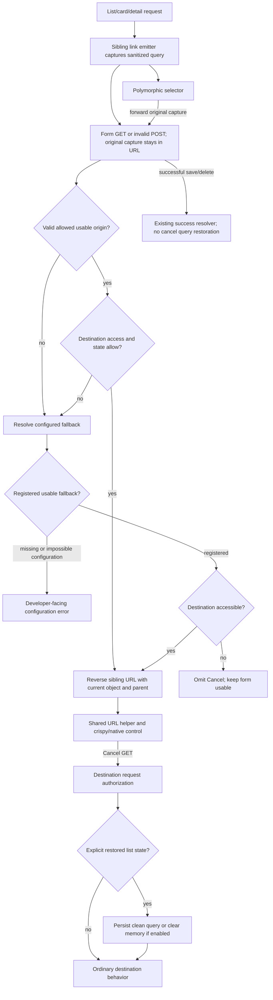

# Phase 06.7: Dynamic cancel navigation and origin query state - Research

**Researched:** 2026-11-03
**Domain:** Django sibling navigation, multivalue query transport, permission-aware form rendering
**Confidence:** MEDIUM overall; direct repository evidence and a passing source-tree baseline support the recommendations.

<user_constraints>
## User Constraints (from CONTEXT.md)

The following decision and discretion text is copied verbatim. Source:
[VERIFIED: .planning/phases/06.7-dynamic-cancel-navigation-and-origin-query-state/06.7-CONTEXT.md:20-95]

<!-- DATA_7c38e4a1_START -->
## Implementation Decisions

### Approved flows and defaults

- **D-01:** The five acceptance flows are List → Update → Cancel → original List; Detail → Update → Cancel →
  same Detail; List → Create → Cancel → original List; List → Delete → Cancel → original List; and
  Detail → Delete → Cancel → same Detail. Cancel does not submit, save or delete.
- **D-02:** Standard form views enable dynamic cancellation by default. Create and no-object custom forms accept
  registered, usable list/card origins. Update, delete and object-based custom forms also accept detail origins.
  Object-based detail destinations refer to the form's existing object, not a separately captured origin object.
- **D-03:** Keep `cv_cancel_key` as the static fallback, defaulting to `"list"`, including the existing list-to-card
  fallback. Explicit `cv_cancel_keys` lists select allowed keys, including custom keys; explicit
  `cv_cancel_keys=None` retains static cancellation. Unspecified defaults must be distinguishable from explicit
  static overrides. The representation of that distinction is a planning decision.
- **D-04:** Detail → Create → Cancel is excluded from origin restoration. If that entry path exists, Cancel uses
  its configured fallback; do not carry the previous object's identity to make this flow work.

### Query state and session memory

- **D-05:** Capture the originating view key and query state, preserving filters, sorting, pagination and repeated
  parameter values. Resolve destinations through allowed sibling views in the same ViewSet; do not accept
  arbitrary return URLs. Preserve existing nested ViewSet parent coordinates.
- **D-06:** Each form's captured destination is independent of later session changes in other tabs or parent
  contexts. Preserve explicitly unfiltered origins even if the session contains older filters. Remove internal
  navigation parameters from captured state so URLs do not grow recursively. Browser-only state is not captured.
- **D-07:** Returning via Cancel behaves like an ordinary list visit for session persistence. With persistence
  enabled, the restored state becomes the remembered state for subsequent bare-list visits. Returning to an
  explicitly unfiltered list clears remembered filter state. This does not change the independently captured
  destination of another open form or override an application's disabled-persistence setting.
- **D-08:** Preserve the original origin through invalid submissions for create, update, delete and both custom
  form variants, and through polymorphic type selection into the create form. Do not replace the original
  list/card origin with the intermediate selector page.

### Fallback validity and permission restrictions

- **D-09:** A configured fallback that does not exist is a configuration error, not a reason to silently hide or
  disable Cancel. Give clear guidance to configure an existing destination. The concrete discussed case is
  `cv_cancel_key="list"` with neither list nor card registered and no usable origin.
- **D-10:** For permission restrictions, try the allowed, usable, accessible origin first, then the accessible
  configured fallback. If neither is accessible, hide Cancel and keep the form usable. Do not disable the control
  or knowingly send the user to an inaccessible destination. Apply existing core/extension permission semantics;
  destination request authorization remains authoritative.
- **D-11:** Missing, malformed, disallowed or unusable request-supplied origin information falls back safely.
  Distinguish invalid input from an invalid developer-configured fallback (D-09), and from inaccessible but
  registered destinations (D-10).

### Rendering and custom-template migration

- **D-12:** Crispy cancel buttons, native cancel links, supported modal forms and migrated custom templates use
  one resolved destination and the same permission-aware omission behavior. Add a documented URL-level helper;
  returning a key alone cannot preserve query state or communicate the complete cancel outcome.
- **D-13:** Require immediate migration of custom cancel templates in this release. The old key-only pattern
  `` is unsupported as the cancel integration contract.
  Document replacement usage for query restoration and hiding when no accessible destination exists. The user
  rejected preserving the old pattern as a supported, reduced-function compatibility path.
- **D-14:** Document dynamic defaults, static overrides, fallback diagnostics, permission-aware hiding, query
  restoration and the new custom-template API. Record the behavior and migration changes under `### Breaking`
  in CHANGELOG.md and in docs/migrating-1.0.md. Update stock examples and affected tests to the new contract.

### Preservation and boundaries

- **D-15:** Save and successful deletion redirects retain their existing behavior; do not extend or change
  `cv_success_keys`. Preserve accepted form ownership, CSRF, escaping, action rendering, authorization,
  conditional/formset and modal contracts from prior phases.
- **D-16:** Do not add cross-ViewSet return navigation, history stacks, scroll restoration, unsaved-input
  restoration, new modal support, or new Cancel controls on protected-deletion pages that currently hide the form.

### Implementation latitude

The user did not select a transport encoding, helper name/signature, automatic-default representation, diagnostic
ID/timing, or test architecture. Research and planning should resolve these within the decisions above. Immediate
migration of the old template pattern does not independently authorize removal of the underlying key-resolution
method or unrelated APIs. No additional feature scope was delegated.

<!-- DATA_7c38e4a1_END -->

<!-- DATA_25b693fc_START -->
## Deferred Ideas

None newly queued. The approved exclusions above remain outside this phase; excluding them does not schedule
follow-up implementation. The earlier general cross-ViewSet/history and detail-to-create alternatives were rejected
for this phase in favor of the bounded sibling-view approach.

<!-- DATA_25b693fc_END -->
</user_constraints>

## Summary

Implement a cancel-specific URL resolver and per-form captured query state; keep the existing success-key resolver
independent. Today the cancel context simply reverses a selected key and ignores its user argument. The ordinary link
emitter carries only an origin key. Neither operation captures query state or makes the cancel destination permission-aware.
[VERIFIED: src/crud_views/lib/view/base.py:733-824]

Use the existing Django stack. Keep destination paths server-derived from the current ViewSet, current object and current
parent URL coordinates. Preserve an explicitly empty captured query separately from absent information. Consume that
distinction before list persistence restores a remembered query. The session store is ordinary shared list memory, not the
source of an open form's return destination. [VERIFIED: src/crud_views/lib/view/base.py:527-568]
[VERIFIED: src/crud_views/lib/views/mixins.py:357-399] [VERIFIED: src/crud_views/lib/session.py:33-80]

**Primary recommendation:** Add one cancel URL contract, one bounded structured transport, one explicit list-restoration
path, and focused integration tests that follow emitted links through Cancel. These are implementation recommendations
within D-01–D-16, not claims that the proposed APIs already exist.

## Architectural Responsibility Map

Recommended ownership, derived from D-05–D-15 and the source seams cited below:

| Capability | Primary tier | Secondary tier | Rationale |
|---|---|---|---|
| Capture origin key and query | Django server rendering sibling links | Browser carries URL | Capture the page's actual query, independent of mutable session memory |
| Validate and resolve cancel | Django view | Core/Guardian access hooks | Reverse only registered same-ViewSet routes with authoritative object/parent context |
| Render or omit control | Django form adapter and template helper | Existing browser navigation handler | All surfaces consume the same URL-or-no-destination result |
| Restore list state | Django list/filter view | Session storage | Explicit restored visits must precede bare-list restoration |
| Save/delete success | Existing Django success resolver | Existing modal redirect protocol | Maintain a separate path; never attach cancel query state |
| Polymorphic selector forwarding | Django selector redirect | Concrete create view | Preserve original capture rather than inventing a selector-page origin |

## Project Constraints (from AGENTS.md)

The following are actionable repository directives, retained as planning constraints.
[VERIFIED: AGENTS.md:15-47,89-107]

- Use multicore pytest for broad runs; bounded workers are appropriate in this shared workspace. Explain any serial
  isolation/debugging exception and do not interrupt a running verification merely to change worker count.
- Use existing pytest configuration and fixture naming conventions: `cv_<model>`,
  `user_<model>_<permission>`, `client_user_<model>_<permission>`.
- Preserve the `cv_` prefix on CrudView configuration attributes and `wf_` on workflow transition methods.
- Existing operation keys are verbatim `list`, `detail`, `create`, `update`, `delete`, `workflow`, `manage`.
  Existing mapping is verbatim “list/detail→view, create→add, update→change, delete→delete”.
- Use double quotes and a 120-character line limit. Retain hatchling and bump-my-version; no version bump is needed here.
- Pair every `### Breaking` changelog entry with migration guidance in the existing pre-1.0 migration document.
- Existing command interfaces are verbatim `task test`, `task format`, `task check`, `task build`, `task docs`;
  pre-commit runs `ruff-format`. Research neither installs dependencies nor changes production code.

Additional project constraints: public changes require documentation, and quality gates include pytest, vitest, strict
MkDocs and Ruff. The general unchanged-default rule is explicitly superseded for this phase by D-02/D-14, not for
unrelated markup. [VERIFIED: .planning/PROJECT.md:84-100]
[VERIFIED: .planning/phases/06.7-dynamic-cancel-navigation-and-origin-query-state/06.7-CONTEXT.md:13-16,76-86]

## Phase Requirements

No new phase requirement IDs have yet been assigned: roadmap wording is verbatim
“**Requirements**: Issue #302 acceptance criteria; requirement IDs to be assigned during planning.”
Use the locked decisions below to mint traceable requirements during planning; do not mislabel these decision IDs as
already-established requirement IDs. [VERIFIED: .planning/ROADMAP.md:775-806]

| Decision coverage | Planning obligation | Research support |
|---|---|---|
| D-01–D-04 | Dynamic defaults, explicit static/list choices, same-object detail, five acceptance flows | Defaults and resolver sections |
| D-05–D-08 | Query multiplicity, empty state, independent captures, session update, invalid POST and selector forwarding | Transport/session sections |
| D-09–D-11 | Configuration errors distinct from invalid input and inaccessible destinations | Three outcomes and Guardian adapter |
| D-12–D-14 | Unified URL API, omission, immediate template migration, paired release guidance | Rendering/migration sections |
| D-15–D-16 | Unchanged success, ownership/CSRF/escaping/modal behavior and exclusions | Preservation and test matrix |

## Standard Stack

Reuse the already-declared stack; no dependency additions or upgrades are recommended.

| Component | Declared requirement / observed runtime | Purpose and evidence |
|---|---|---|
| Django | Verbatim `"django (>=4.2.0)"`; observed 5.2.18 in the main cached test environment | QueryDict, URL reverse, forms, sessions, optional signing. [VERIFIED: pyproject.toml:25-35] [VERIFIED: local importlib.metadata probe, 2026-11-03] |
| Python | Verbatim `requires-python = ">=3.12"`; observed 3.12.3 | Existing runtime; no new language floor. [VERIFIED: pyproject.toml:25-25] [VERIFIED: local runtime probe, 2026-11-03] |
| Crispy integration | Verbatim `"django-crispy-forms (>=2.0)"`, `"crispy-bootstrap5 (>=2023.10)"`; observed 2.7 / 2026.9 | Retain existing library Button/FormActions adapters. [VERIFIED: pyproject.toml:33-34] [VERIFIED: local metadata probe, 2026-11-03] |
| Guardian / polymorphic | Verbatim `"django-guardian>=2.4"`, `"django-polymorphic (>=3.1.0)"`; observed 3.5.2 / 4.11.7 | Existing optional extension behavior. [VERIFIED: pyproject.toml:44-54] [VERIFIED: local metadata probe, 2026-11-03] |
| Test harness | Verbatim `"pytest"`, `"pytest-django"`, `"pytest-xdist"`; observed pytest 9.2.0 / xdist 3.8.0 | Existing integration tests and bounded parallelism. [VERIFIED: pyproject.toml:70-82] [VERIFIED: local metadata probe, 2026-11-03] |

**Installation:** None. These versions are observed installed versions, not claims about the latest registry releases.
Registry release dates and package-legitimacy installation gates are not applicable to a phase that installs nothing.

## Architecture Patterns

### System architecture diagram

Proposed data flow, derived from D-01–D-15:



### Component responsibilities and existing seams

All paths below identify source files read in this session, not proposed filesystem layouts.

| Existing component | Evidence | Planned responsibility |
|---|---|---|
| CrudView defaults, checks, key/link helpers | base.py:79-82,173-184,733-824 | Effective cancel-key defaults, structured capture, shared URL resolver; preserve success branch |
| URL reversal | base.py:527-568 | Keep parent kwargs and target object routing; do not accept a path from the payload |
| ViewSet lookup | viewset/__init__.py:339-352 | Retain verbatim `key == "list"` / `"card"` fallback |
| ListViewTableFilterMixin and SessionData | views/mixins.py:357-399; session.py:33-80 | Restore captured state before ordinary stored-query redirect; save sanitized query |
| CrispyFormMixin and CrispyDeleteForm | crispy/form.py:57-86,138-149 | Omit unavailable Cancel before constructing/rendering the action group |
| Custom-template tags | templatetags/crud_views.py:281-292 | Add cancel-specific URL tag without routing through generic action emission |
| Guardian parent/object/queryset mixins | guardian/lib/mixins.py:78-92,118-131,268-337 | Reuse target access policy and parent policy in a rendering adapter |
| Polymorphic selector | polymorphic/lib/create_select.py:68-72 | Forward capture while preserving selected content-type route arguments |

[VERIFIED: src/crud_views/lib/view/base.py:79-82,173-184,527-568,733-824]
[VERIFIED: src/crud_views/lib/viewset/__init__.py:339-352]
[VERIFIED: src/crud_views/lib/views/mixins.py:357-399]
[VERIFIED: src/crud_views/lib/session.py:33-80]
[VERIFIED: src/crud_views/lib/crispy/form.py:57-86,138-149]
[VERIFIED: src/crud_views/templatetags/crud_views.py:281-292]
[VERIFIED: src/crud_views_guardian/lib/mixins.py:78-92,118-131,268-337]
[VERIFIED: src/crud_views_polymorphic/lib/create_select.py:68-72]

### 1. Make automatic defaults distinct from explicit static cancellation

Current declarations are verbatim:
<!-- DATA_314a7b9e_START -->
```python
cv_success_key: str | None = "list"
cv_success_keys: list[str] | None = None
cv_cancel_key: str | None = "list"
cv_cancel_keys: list[str] | None = None
```
<!-- DATA_314a7b9e_END -->
[VERIFIED: src/crud_views/lib/view/base.py:79-82]

**Recommendation:** Use a private automatic-default sentinel plus an effective-keys resolver, rather than interpreting
every inherited None as automatic. Limit automatic activation to standard form families, including the selector; do not
make unrelated detail/list/action classes dynamic cancel owners. Resolve defaults lazily against the completed ViewSet
registry. No-object forms select available list/card; object forms additionally select available detail. Explicit lists
retain custom keys; explicit None and an empty explicit list stay static. Preserve ordinary Python MRO inheritance and
instance-level overrides without mutating shared class lists.

Do not derive defaults at class-registration time: the metaclass registers each view as its class is created, so sibling
registration can follow later. Existing checks validate explicit keys and existing link emission iterates cancel keys;
both must consume the new effective form without accidentally iterating a sentinel. Metadata serialization also exposes
the current attribute, so define its readable representation. [VERIFIED: src/crud_views/lib/view/meta.py:15-29]
[VERIFIED: src/crud_views/lib/view/base.py:173-184,474-477,518-525,790-806]

Proposed names such as `_AUTO_CANCEL_KEYS` and `cv_get_cancel_url()` in this document are **new design proposals**,
not existing symbols or user-selected names. The planner should settle exact names once and include their tests/docs.

### 2. Carry structured origin state separately from success

The current origin setting is verbatim
`origin_param: str = from_settings("CRUD_VIEWS_ORIGIN_PARAM", default="cv_from")`.
Keep that existing key channel for success compatibility.
[VERIFIED: src/crud_views/lib/settings.py:38-39]

**Recommended transport:** one additional cancel-state parameter, containing a versioned, JSON-serializable envelope
with origin key, sanitized encoded query, ViewSet identity and current parent coordinates. Use Django signing with a
dedicated salt, no compression and no arbitrary short expiration. It gives a bounded parser and detects tampering;
authorization must still be evaluated at resolution and at the destination. No captured object PK is needed: detail uses
the form object. Keep the URL path outside the payload entirely. Django supplies `signing.dumps()` and `signing.loads()`
with JSON serialization, salt and optional age checks; bad signatures raise `BadSignature`.
[CITED: https://docs.djangoproject.com/en/4.2/topics/signing/]

The recommendation is deliberately separate from a claim that signing is mandatory: strict unsigned structured data
could also satisfy the locked decisions, but signing makes cross-context tampering tests explicit without a new library.
Do not introduce server-side per-tab records, session token registries or history stacks.

Plan the following transport rules together:

- Derive or configure companion parameter names coherently with the existing origin setting, reserve them, and test
  renamed origin parameters. Do not scatter hard-coded parameter names.
- Capture a mutable copy of the originating QueryDict; strip **all** library navigation transport/restore keys, retaining
  application filter/order/page values, repeated keys and blank values. Serialize with QueryDict.urlencode().
- Preserve presence: an envelope carrying an empty query is valid and different from no envelope.
- Reject duplicate internal scalar fields, unknown envelope versions, wrong types, invalid signatures, wrong ViewSet or
  parent scope, and oversized/too-many-field payloads. Choose and document concrete limits in the plan, not an invented
  browser-wide URL limit. Catch narrowly scoped input-decoding errors, never all exceptions around permission hooks.
- Bind the signed origin key to the key channel used for cancellation. A malformed present envelope causes cancel
  fallback; it must not be partially trusted. A key-only legacy request can retain key-only resolution without claiming
  captured empty state. This does not retain the unsupported old custom-template integration.
- Generate new captures only when linking from a permitted origin into a cancel-capable target. Keep success-only link
  emission unchanged; no query transport is required when explicit static cancel is combined with dynamic success.
- Forward the original capture through the polymorphic selector; validate again for the concrete create target.
  Never call normal origin-capture emission on the selector as though it were the original list.

QueryDict.get()/items() use the last value; lists() and urlencode() preserve multiplicity. A local Django 5.2 probe
roundtripped repeated values and an empty value. [CITED: https://docs.djangoproject.com/en/4.2/ref/request-response/#querydict-objects]
[VERIFIED: local QueryDict/signing probe, 2026-11-03]

### 3. Model resolver outcomes explicitly

**Recommendation:** Internally distinguish a usable URL, no accessible destination, and a developer configuration error.
Expose a URL-or-None helper for templates. Evaluate an allowed and usable origin first, then the configured fallback.
Reject an origin needing an absent/unsaved object; an unsaved UUID-backed model may already have a PK, so preserve the
existing `state.adding` check. A Resource must not be mistaken for an unsaved Django object.
[VERIFIED: src/crud_views/lib/view/base.py:752-772]
[VERIFIED: tests/test1/test_cancel_origin.py:130-153]

A missing configured fallback is not permission denial. On actual fallback resolution, raise a clear configuration
exception naming the view/key and how to configure an existing destination. Add a startup diagnostic where safely
detectable for cancel-owning forms, using a new nonconflicting check ID selected after inspecting the checks. Do not
turn every detail-only/non-form ViewSet into an error. Preserve existing explicit-key check behavior; current identifiers
are verbatim `id="E252"` and `id="E253"`. [VERIFIED: src/crud_views/lib/view/base.py:173-184]

A registered fallback that is inaccessible yields omission, not a disabled button or exception. Do not silently try a
third unrelated destination. Do not interpret `cv_cancel_key=None` as a newly invented hide switch without checking
existing routing semantics; D-03's static switch is explicitly `cv_cancel_keys=None`.

### 4. Reuse permission policy without equating rendering with authorization

**Verified gap:** `get_cancel_button_context` accepts user/request but does not use them in its resolution; it always
returns a context. Generic action rendering evaluates permission and state, whereas the current cancel resolver does
neither. [VERIFIED: src/crud_views/lib/view/base.py:708-729,817-824]

**Recommendation:** A cancel-specific target-availability adapter should evaluate the target's existing access hook and
appropriate state hook using the target's correct object context. Object destinations use the form's authoritative saved
object; no-object destinations must not accidentally receive that child object as their action-state object. Nested
targets need the URL parent, not whichever parent currently appears in session data. Keep this a rendering predicate;
never dispatch the destination request or invoke a mutating action to determine access.

Guardian needs explicit integration, not just `user.has_perm`:

- Object views implement per-object grants and optional per-view global fallback in `cv_has_access`.
- Queryset/list views intentionally allow entry while filtering rows; an empty authorized queryset is not denied access.
- The parent mixin separately checks authentication, active status, the URL parent and the target's parent permission.
  Parent permission None skips only the permission check; parent existence and applicable state remain necessary.
- Reuse `_guardian_user_has_parent_perm` from the target class and existing parent-resolution machinery. Preserve
  anonymous behavior, inactive-actor denial, per-view global policy and state arguments. Add an extension-owned adapter
  rather than importing Guardian into core or duplicating its permission rules.
- A create page may be allowed by a different parent-create permission from the list fallback's parent permission.
  This is a discriminating test: an accessible current form does **not** prove Cancel's target is accessible.

[VERIFIED: src/crud_views_guardian/lib/mixins.py:45-92,118-131,268-337]
[VERIFIED: src/crud_views_guardian/lib/views.py:310-387]
[VERIFIED: src/crud_views/lib/view/base.py:353-388,913-930]

The generic action policy supports verbatim `"hide"` and `"disable"`; cancel must always omit an unavailable target,
even when normal action policy would disable it. The generic context URL tag already maps disabled actions to None,
but also uses generic action-link generation, so it is not the new cancel contract.
[VERIFIED: src/crud_views/lib/view/visibility.py:12-20]
[VERIFIED: src/crud_views/templatetags/crud_views.py:281-292]

### 5. Restore explicit empty state before session fallback

The stored key is verbatim `cv_session_key_querystring: str = "filter_query_string"`; current persistence saves a
nonempty raw query and redirects a bare request to the stored query. The existing reset operation is verbatim
`qs.get("reset_filter", ["false"])[0] == "true"`, and preserves selected ordering fields.
[VERIFIED: src/crud_views/lib/views/mixins.py:311-312,367-397]

**Recommendation:** Add a reserved explicit-restoration marker to returned list URLs, including empty restored queries.
Consume it before the existing bare-list restoration branch. Use a clean QueryDict/serialized query for the filter,
sorting, pagination and persistence consumers; navigation fields must not enter remembered state or future captures.
The marker need not alter the generic native reset protocol. A non-persisting list still renders the requested state,
but must not clear or write session memory.

| Request kind | Persistence enabled | Persistence disabled |
|---|---|---|
| Ordinary nonempty query | Existing save behavior, excluding internal transport | Render supplied state; no memory write |
| Ordinary bare list | Existing stored-state restoration | Render unfiltered state |
| Explicit restored nonempty query | Remember captured query, render it | Render captured query; no memory write |
| Explicit restored empty query | Delete/clear remembered query; render unfiltered | Render unfiltered; no memory write |
| Missing/malformed capture on form | Resolve configured fallback normally | Same fallback rule |

This table is the proposed implementation of D-06/D-07, not a description of current behavior.

Only the actual Cancel destination visit should update list memory. Rendering a form or building its cancel URL must not
write it. Tab A's return overwrites ordinary session memory, but Tab B's already-captured URL remains independent.
Use the SessionData context manager, which reassigns the serialized top-level session value; nested dict mutation alone
does not mark a Django session modified. [VERIFIED: src/crud_views/lib/session.py:62-80]
[CITED: https://docs.djangoproject.com/en/4.2/topics/http/sessions/#when-sessions-are-saved]

Do not broaden session identity to parent/tab as part of this phase. Current identity is verbatim
`key = f"{self.view.cv_viewset.name}-{self.view.cv_key}"` plus model app label.
[VERIFIED: src/crud_views/lib/session.py:42-60]

### 6. Integrate rendering, selectors and invalid POSTs without changing success

Stock create/update/custom/delete templates post to the full current URL. Keep those actions and CSRF ownership.
The selector currently reverses only the create route with selected content-type arguments and drops query state.
[VERIFIED: src/crud_views/templates/crud_views/view_create.content.html:5-10]
[VERIFIED: src/crud_views/templates/crud_views/view_update.content.html:5-10]
[VERIFIED: src/crud_views/templates/crud_views/view_custom_form.content.html:5-10]
[VERIFIED: src/crud_views/templates/crud_views/view_delete.content.html:15-22]
[VERIFIED: src/crud_views_polymorphic/lib/create_select.py:68-72]

The exact existing selector values are verbatim `"polymorphic_ctype_id"`, `"create"`; route kwargs must remain intact.
[VERIFIED: src/crud_views_polymorphic/lib/create_select.py:69-71]

**Recommendation:** Make the URL resolver the sole source for crispy button kwargs, native-link rendering and the
new template helper. Return no control when the resolver returns None. Update both ordinary and delete FormActions
construction; do not pass None as an arbitrary crispy field or leave a URL-less button visible. Preserve subclasses'
get-cancel-button customization where feasible and document any changed return contract. The low-level button leaf's
existing behavior for a standalone URL-less/disabled Button is a separate contract; do not globally hide all such buttons.

Existing low-level resolution deliberately falls back to a button if no usable anchor URL exists; its exact alternatives
are verbatim `"a"` and `"button"`. Therefore clearing the URL alone does not implement D-10.
[VERIFIED: src/crud_views/lib/view/button_data.py:353-357]
[VERIFIED: src/crud_views/lib/crispy/form.py:57-86,138-149]
[VERIFIED: src/crud_views/lib/crispy/actions.py:44-58]

Preserve modal fragment replacement behavior and the existing browser cancel handler. It performs navigation rather
than form submission; existing JS tests assert no submit occurs even for clicks on nested icon/label nodes.
[VERIFIED: src/crud_views/static/crud_views/js/viewset.js:37-44]
[VERIFIED: tests/js/viewset.test.js:145-162]

Do not alter `get_success_url`, `cv_get_success_key` or delete-success object handling to consume captured query state.
Keep success-only origin links, default static success, explicit dynamic success and modal success headers under
regression coverage. [VERIFIED: src/crud_views/lib/view/base.py:209-212,774-788]
[VERIFIED: tests/test1/test_success_origin.py:81-183]

### 7. Immediate custom-template migration

Current documentation explicitly recommends the old key-only recipe and states list state is lost. Its exact recipe is:
``.
Replace that recommendation immediately; do not describe it as supported but reduced-function behavior.
[VERIFIED: docs/reference/update_view.md:120-124] [VERIFIED: phase CONTEXT D-13/D-14, quoted above]

Recommended new public contract: `view.cv_get_cancel_url()` and ``, both **proposed names**.
The tag calls the view resolver with current request/object, returns None for inaccessible destinations and does not
swallow configuration exceptions. Custom templates render their control only when the returned URL is present.
Keeping the old underlying key method available does not preserve the old cancel-template contract.

Update create/update/delete/custom-form references, origin settings documentation, stock examples and executable
documentation tests together with changelog/migration guidance. Clarify that only Cancel restores query state; Save
continues its preexisting behavior. Hand the settled helper and omission contract to Phase 7's public-surface inventory.
This is the implementation of D-12–D-15, not an additional feature.

## Don't Hand-Roll

| Problem | Do not build | Use instead | Evidence |
|---|---|---|---|
| Multivalue query encoding | Dict flattening or string concatenation of user values | QueryDict copy/lists/urlencode | [CITED: https://docs.djangoproject.com/en/4.2/ref/request-response/#querydict-objects] |
| Payload integrity | Homemade HMAC/base64 protocol | Django signing JSON APIs, if following recommended signed design | [CITED: https://docs.djangoproject.com/en/4.2/topics/signing/] |
| Nested URLs | Captured arbitrary return path or manually assembled parent path | Existing sibling reversal with request kwargs | [VERIFIED: src/crud_views/lib/view/base.py:527-568] |
| Guardian policy | Independent core permission codename logic | Existing extension hooks plus a target rendering adapter | [VERIFIED: src/crud_views_guardian/lib/mixins.py:78-92,303-337] |
| Tab return storage | Last-origin session field / history stack | Per-form carried capture | D-05–D-07, quoted above |
| Form controls | Raw HTML/inline script replacing existing leaf | Existing Button adapter and shared omission decision | [VERIFIED: src/crud_views/lib/crispy/buttons.py:193-209] |

## Runtime State Inventory

This is an API/default behavior and template migration; the inventory does not imply permission to inspect deployed
services or secrets.

| Category | Items found / observation limits | Required action |
|---|---|---|
| Stored data | Existing session query strings under the unchanged list-session key; source-scoped observation only. [VERIFIED: src/crud_views/lib/views/mixins.py:367-397] | No bulk migration. Sanitize navigation fields on reads/writes; explicit restored empty clears only the applicable remembered query |
| Live service config | Deployed applications were not inspected; no observation of their overrides | Document new defaults and explicit static override; do not claim remote configuration is absent |
| OS-registered state | No observation of deployed OS registrations; phase changes no executable/service identity by design | No planned OS registration change |
| Secrets/env vars | Proposed signing reuses Django signing infrastructure; no secret value was read. [CITED: https://docs.djangoproject.com/en/4.2/topics/signing/] | No new secret or environment-variable migration |
| Built/installed artifacts | Cached nox environment imported an older library copy until PYTHONPATH selected working-tree source. [VERIFIED: local baseline failure and successful corrected replay, 2026-11-03] | Bind validation to source; deploy/rebuild through normal package process. Migrate copied cancel templates immediately |

## Common Pitfalls

1. **Automatic defaults break explicit None or incomplete registries.** Resolve the sentinel lazily and preserve explicit
   lists. Test subclass/mixin inheritance, instance overrides and list/card-only registries.
   [VERIFIED: src/crud_views/lib/view/meta.py:15-29] [VERIFIED: src/crud_views/lib/view/base.py:518-525,796-806]
2. **A bare URL revives old filters.** Explicitly empty capture must bypass stored-query redirect and clear remembered
   state only on the returned visit. [VERIFIED: src/crud_views/lib/views/mixins.py:390-397]
3. **Query corruption hides in tests.** Parse DOM attributes with lxml or HTML unescape before parsing URLs; current
   cancel/href helpers use regex and return escaped strings. Never assert only a byte string when the contract is
   repeated decoded parameter values. [VERIFIED: tests/test1/test_cancel_origin.py:21-29]
4. **Permission tests use overprivileged users.** Add change-without-view, denied detail with allowed list, both denied,
   Guardian object grant versus global grant and parent-create-versus-parent-view cases. Current cancel ignores user.
   [VERIFIED: src/crud_views/lib/view/base.py:817-824] [VERIFIED: src/crud_views_guardian/lib/mixins.py:288-337]
5. **URL-less controls remain visible.** Omit in the cancel form adapter, not by setting an empty URL on Button.
   [VERIFIED: src/crud_views/lib/view/button_data.py:353-357]
6. **Selector recaptures itself or drops state.** Forward the captured envelope, retaining content-type kwargs.
   [VERIFIED: src/crud_views_polymorphic/lib/create_select.py:68-72]
7. **Cancel changes successful writes.** Separate parsers/resolvers from success; rerun existing success and modal tests.
   [VERIFIED: src/crud_views/lib/view/base.py:209-212,774-788]
8. **A broad exception turns configuration bugs into hidden controls.** Catch input/registration cases deliberately;
   propagate unexpected custom-hook errors. D-09–D-11 require distinct outcomes, quoted above.

## Code Examples

These are framework primitives and **proposed integration syntax**, not existing new project APIs.

### Multivalue capture primitive

[CITED: https://docs.djangoproject.com/en/5.2/ref/request-response/#querydict-objects]

```python
clean = request.GET.copy()
for name in internal_navigation_names:  # proposed helper-owned reserved set
    clean.pop(name, None)
encoded_query = clean.urlencode()  # empty string is meaningful when the capture is present
```

Local standalone probe output, Django 5.2.18:
<!-- DATA_6f217ad0_START -->
```text
pairs: [('tag', ['one', 'two']), ('empty', ['']), ('sort', ['-name']), ('page', ['2'])]
roundtrip: tag=one&tag=two&empty=&sort=-name&page=2
explicit-empty: {'query': ''}
```
<!-- DATA_6f217ad0_END -->
[VERIFIED: local QueryDict/signing probe, 2026-11-03]
The probe uses synthetic query keys; they are not project enums or a proposed envelope schema.

### Custom-template replacement contract

Proposed tag name and local variables; D-12/D-13 authorize the contract, not these exact names:

```django



  <a href="{{ cancel_url }}">Cancel</a>

```

The executor should use the existing translated labels/theme styling and test autoescaping. Do not use mark_safe on
captured query content. Retain the existing underlying key API unless a separate approved reason justifies removal.

## State of the Art

| Existing local approach | Phase recommendation | Change authority |
|---|---|---|
| Static cancellation unless explicit keys | Automatic eligible defaults; explicit None remains static | D-02/D-03 |
| Origin key alone | Key plus independent captured query | D-05/D-06 |
| Generic key-to-action template recipe | Dedicated cancel URL helper and omission contract | D-12/D-13 |
| Shared session last query determines bare return | Explicit capture governs returned visit; session then remembers it | D-06/D-07 |

These are this release's changes, not claims about ecosystem chronology. Current Django QueryDict and signing APIs
are already available in the project's declared Django floor. [CITED: https://docs.djangoproject.com/en/4.2/ref/request-response/]
[CITED: https://docs.djangoproject.com/en/4.2/topics/signing/]

## Environment Availability

Observed in this workspace on 2026-11-03; no installation performed.
[VERIFIED: local runtime/importlib.metadata and executable probes, 2026-11-03]

| Dependency/environment | Available | Version | Planning use |
|---|---|---|---|
| Cached nox Django 5.2 | Yes | Python 3.12.3 / Django 5.2.18 | Main source-tree quick test command below |
| Cached nox Django 4.2 | Yes | Django 4.2.30 | Floor-compatible behavior replay |
| Cached crispy-floor Django 6.0 | Yes | Django 6.0.9 | 6.0 replay with existing exact golden exclusion where applicable |
| Main .venv | Yes | Django 6.1.2 | Tooling/supplementary evidence; not a substitute for the required 6.0 series |
| pytest / xdist | Yes | 9.2.0 / 3.8.0 in main cached environment | Bounded parallel runs |
| Node / vitest | Yes | 24.21.0 / installed 5.0.3 | Existing browser-handler unit tests; manifest requests a different vitest patch range |
| MkDocs | Yes | 1.6.1 | Strict docs build |
| Context7 MCP / ctx7 CLI | Not exposed / command unavailable | — | Official documentation via web tools, no installation |
| Project knowledge graph | Status reports absent | — | Read source directly; no graph-derived claims |

No external service is required for the proposed implementation. Browser acceptance has not been run by this research;
the planner must identify its execution harness rather than claiming an existing browser result.

## Validation Architecture

### Test framework and verified baseline

Existing pytest options are verbatim `addopts = "--strict-markers"`.
[VERIFIED: pyproject.toml:145-146]

**Quick existing regression command (executed successfully):**

```bash
PYTHONPATH=src .nox/tests-3-12-django-5-2/bin/python -m pytest tests/test1/test_cancel_origin.py tests/test1/test_success_origin.py tests/test1/test_filter.py -n 2 -q --disable-warnings --tb=short
```

Result: **95 passed in 11.34s**. This verifies the current baseline, not the new phase behaviors.
[VERIFIED: source-tree pytest probe, 2026-11-03]

The same command without PYTHONPATH initially produced **95 setup errors in 1.70s**, including:
<!-- DATA_036ec2bd_START -->
```text
AttributeError: module 'crud_views.lib.view.label_mode' has no attribute '_THEME_LABEL_MODE_DEFAULTS'
tests/test1/conftest.py:28
```
<!-- DATA_036ec2bd_END -->
[VERIFIED: initial cached-environment pytest probe, 2026-11-03]
Use source-bound commands; do not “fix” current source for stale installed-package failures.

### Requirement-to-test map

New requirement IDs are for the planner to assign. New test functions below are behavioral obligations, not claims they
already exist. Each quick command uses existing test files; add cases there or split new files deliberately.

| Decision coverage | Behavior to prove | Type | Runnable command suffix after the quick interpreter prefix | Existing file? |
|---|---|---|---|---|
| D-01–D-04 | Defaults versus None/list; five flows; custom forms; no-object detail rejection | Request/unit | `-m pytest tests/test1/test_cancel_origin.py -n 2 -q` | Yes; extend |
| D-05–D-07 | Repeated/blank/query characters, page/order/filter, empty capture, A/B tabs and parents, disabled persistence | Request/session | `-m pytest tests/test1/test_cancel_origin.py tests/test1/test_filter.py tests/test1/test_nested_viewset.py -n 2 -q` | Yes; new cases |
| D-08 | Invalid POST for all five form families and selector-to-create forwarding | Request | `-m pytest tests/test1/test_cancel_origin.py tests/test1/test_polymorphic.py tests/test1/test_modal.py -n 2 -q` | Yes; new cases |
| D-09–D-11 | Missing configured fallback, malformed origin, object unusability, access denial | Unit/request | `-m pytest tests/test1/test_cancel_origin.py tests/test1/test_guardian_parent_none.py tests/test1/test_guardian_policy.py -n 2 -q` | Yes; new cases |
| D-12/D-13 | Same URL and omission for crispy/button/link/helper/modal/custom template | Render/request | `-m pytest tests/test1/test_cancel_origin.py tests/test1/test_crispy_buttons.py tests/test1/test_modal.py -n 2 -q` | Yes; new recipe cases |
| D-14 | Immediate migration recipe executes; default/static guidance agrees with behavior | Docs/template | `-m pytest tests/test1/test_form_button_docs.py tests/test1/test_theme_form_requests.py -n 2 -q` | Yes; extend or create dedicated cancel docs test |
| D-15/D-16 | Success redirects unchanged; form ownership and blocked-delete boundaries intact | Regression | `-m pytest tests/test1/test_success_origin.py tests/test1/test_theme_form_ownership.py tests/test1/test_delete.py -n 2 -q` | Yes |

The measured quick three-file command is below 30 seconds. Other combinations are planned selections; their runtime
was not measured. [VERIFIED: local baseline result, 2026-11-03]

**Discriminating cases to include:**

- Follow actual generated list row/context/card links instead of constructing every origin query by hand.
- Capture A, change session to B, cancel A, then bare-list visit restores A; capture empty, store B, cancel empty,
  then bare-list visit stays empty. Keep another form's captured B destination unchanged.
- Test two parent URLs with the same session identity; replay a capture in the wrong parent/other ViewSet and reject it.
- Duplicate internal parameters, signature/version/type failures, recursive transport, percent/ampersand/Unicode/blank
  values and configured parameter renaming fall back without losing normal multivalue parameters.
- Registered-but-denied origin falls back; denied origin plus denied fallback omits Cancel; missing fallback raises.
  A custom state hook receives the correct target action object and is not invoked after denial.
- Same conditions with Guardian per-object grants, per-view global fallback, inactive/anonymous actor policies and
  distinct parent-create versus parent-read permission. Include empty authorized list as accessible.
- Invalid submissions retain original query through native and supported modal forms. Polymorphic type selection and
  invalid concrete create retain the original list/card capture and selected content-type argument.
- Cancel leaves DB rows unchanged, performs no POST and preserves one outer form/CSRF input. Protected-delete pages
  retain the existing absent-form behavior. Both permission-hidden and ordinary usable forms remain submit-capable.

These are proposed acceptance tests derived from D-01–D-16, not reported passing implementation results.

### Broader gates and sampling

Per implementation task, run the measured quick selection plus the task's directly affected tests. At each wave run
the combined phase files with bounded workers. Before phase verification, run the full suite on the supported cached
series, preserving known documented exclusions only where applicable:

```bash
PYTHONPATH=src .nox/tests-3-12-django-5-2/bin/python -m pytest tests -n 4 -q
PYTHONPATH=src .nox/tests-3-12-django-4-2/bin/python -m pytest tests -n 4 -q
PYTHONPATH=src .nox/crispy_floor-3-12-django-6-0/bin/python -m pytest tests -n 4 -q --deselect tests/test1/test_form_buttons_golden.py::test_filter_form_baseline
npm test -- tests/js/viewset.test.js tests/js/modal.test.js
npm test
PYTHONPATH=src .venv/bin/mkdocs build --strict
.venv/bin/ruff check src tests
.venv/bin/ruff format --check src tests
```

The exact existing exclusion is verbatim
`CRISPY_FLOOR_DESELECT = ["--deselect", "tests/test1/test_form_buttons_golden.py::test_filter_form_baseline"]`;
it concerns pack-wrapper whitespace, not permission/cancel behavior. Do not add new exclusions to obtain a green run.
[VERIFIED: noxfile.py:61-65]
The existing JS script is verbatim `"test": "vitest run"`. [VERIFIED: package.json:10-13]

Add bounded real-browser acceptance for clicked native and JS buttons, dirty invalid fields, supported modal invalid
replacement, keyboard focus and permission-hidden Cancel. Verify navigation destination and absence of write requests.
No new modal types or layout redesign. Existing JS simulation is useful regression evidence, not complete browser
acceptance. [VERIFIED: tests/js/viewset.test.js:145-162] [VERIFIED: phase CONTEXT D-12/D-15/D-16, quoted above]

### Wave 0 gaps

- New transport/parser and session-return cases must be added; current 95 tests exercise key-only cancellation.
  [VERIFIED: tests/test1/test_cancel_origin.py:1-3,46-115,410-470]
- Replace default-is-static assertions with explicit-None static tests plus automatic-default tests; do not erase static
  override coverage. [VERIFIED: tests/test1/test_cancel_origin.py:46-61]
- Add reusable DOM URL extraction with HTML entity decoding and absent-control assertions.
  [VERIFIED: tests/test1/test_cancel_origin.py:21-29]
- Build permission fixtures that isolate destination denial from current-form authorization; reuse existing models and
  Guardian permission helpers.
- No test framework installation required. Record exact source/dependency identity for the final verification.

## Security Domain

Security enforcement and Nyquist validation are explicitly enabled in project config.
[VERIFIED: .planning/config.json:19-53; quoted values: `"nyquist_validation": true`, `"security_enforcement": true`]

Use **ASVS 5.0.0** chapter labels, not the older template's V2 Authentication/V4 Access Control numbering.
The official project identifies 5.0.0 as stable, published 2025-05-30.
[CITED: https://asvs.owasp.org/]

| ASVS 5 category | Applies | Phase control |
|---|---|---|
| V2 Validation and Business Logic | Yes | Bound/schema-check origin data, distinguish empty/absent, reject context mismatch |
| V3 Web Frontend Security | Yes | Server-reversed destination only, autoescaped URL attributes, preserved CSRF and non-submit Cancel |
| V8 Authorization | Yes | Core/Guardian permission and parent/state policy; destination request gate remains authoritative |

Category names verified against official OWASP sources:
[CITED: https://github.com/OWASP/ASVS/blob/master/5.0/en/0x11-V2-Validation-and-Business-Logic.md]
[CITED: https://github.com/OWASP/ASVS/blob/master/5.0/en/0x12-V3-Web-Frontend-Security.md]
[CITED: https://github.com/OWASP/ASVS/blob/master/5.0/docs_en/OWASP_Application_Security_Verification_Standard_5.0.0_en.csv]

| Threat | STRIDE | Required mitigation/test |
|---|---|---|
| External URL or script scheme in origin | Tampering | Never accept path/scheme/host; only registered sibling key and reverse |
| Copied token changes parent/ViewSet | Tampering / information disclosure | Validate binding; reverse using current URL parent, never payload-supplied arbitrary kwargs |
| Hidden link bypass mistaken for authorization | Elevation of privilege | Direct destination authorization remains in place; test direct denied GET |
| Forged/malformed payload or oversized input | Tampering / denial of service | Bounded parse, exact types/version, narrow safe fallback, framework signing if selected |
| HTML injection through query characters | Tampering | Query encoding plus template autoescaping; inspect rendered DOM and decoded destination |
| Shared session overwrites another form's target | Tampering of navigation state | Per-form capture; session mutation occurs only on destination visit |

Controls above are recommendations implementing D-05–D-15, not an independent compliance certification.
Signing protects integrity, not confidentiality or authorization. Do not put secrets or object snapshots into the payload.
[CITED: https://docs.djangoproject.com/en/4.2/topics/signing/]

## Assumptions Log

No unverified compatibility or package-support claim is used as a locked decision. All proposed helper names, transport
shape and internal adapters are explicitly design recommendations within the delegated implementation latitude.
Deployed application templates/service configuration were not inspected; migration completeness must be established
by consumers, not inferred from repository searches.

## Open Questions

No product decision needs reopening. The planner must concretize these delegated implementation details:

1. Final sentinel/helper/parameter names, payload version/schema and size/field-count limits.
2. Diagnostic identifier and safe startup applicability, plus guaranteed runtime fallback diagnostics.
3. Extension adapter placement that composes Guardian parent/object/queryset policies without duplicating them.
4. Browser harness and final matrix source identities; this research ran only the bounded baseline and primitive probe.

## Sources

- Primary repository files: source ranges cited at each finding; context decisions copied verbatim above.
- Official Django 4.2 and 5.2 request/response documentation: QueryDict behavior.
- Official Django 4.2 signing and session documentation: structured signatures and persistence semantics.
- Official OWASP project and ASVS repository: current standard version and relevant category names.
- Approved issue #302 was read online; the local CONTEXT remains authoritative for subsequent D-07/D-09–D-14 decisions.
  [CITED: https://github.com/jacob-consulting/django-crud-views/issues/302]

## Metadata

**Confidence breakdown:** standard stack MEDIUM (existing declared/installed dependencies; no new package selection);
architecture MEDIUM (direct source inspection plus proposed integration); pitfalls MEDIUM (source-backed gaps and a
measured baseline, not full phase verification).

The research-plan seam selected Context7 for Django questions and websearch for ASVS. Context7 tools and ctx7 CLI
were unavailable, so official documentation was fetched through the available web tool. The confidence seam returned
MEDIUM for websearch with official cross-checking; digest cache writes were removed to honor phase-only ownership. Unknown provider
names returned LOW and were not used to inflate confidence. The graph status reported no graph. No agent skills were
configured. [VERIFIED: research-plan, classify-confidence, research-store, graphify status and agent-skills tool outputs,
2026-11-03]

**Research date:** 2026-11-03.
**Refresh trigger:** changed source, final transport choice, dependency/environment change or unresolved verification;
recheck external documentation at implementation time if materially delayed.
**Repository changes:** this research file only; no production edits, dependency installation, branch change or commit.

