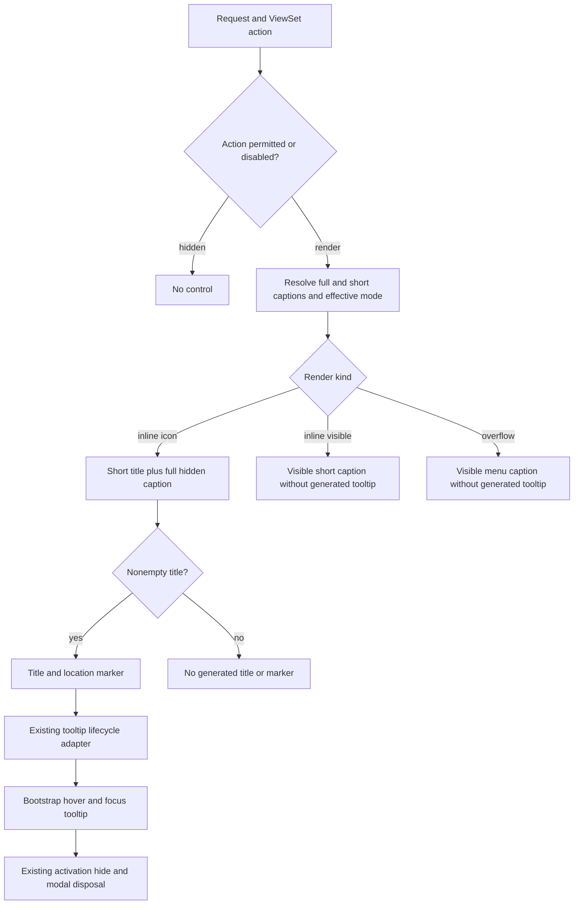

# Phase 06.8: Action tooltips: short captions and visible-label suppression (#304) - Research

**Researched:** 2026-11-03
**Domain:** Django action-caption projection, template migration, Bootstrap tooltip acceptance
**Confidence:** MEDIUM (official-documentation cross-check tier; product/browser acceptance is not yet executed)

<user_constraints>
## User Constraints (from CONTEXT.md)

The following is copied verbatim from the phase context. [VERIFIED: phase 06.8 CONTEXT.md, Implementation Decisions and Deferred Ideas; read this session]

<!-- DATA_R7k2tN8p_START -->
### Locked Decisions

### Caption contract — carried forward from issue #304

- **D-01:** Context/list icon-only action tooltips use the existing nonempty short caption, falling back to the
  full caption. Reuse the configured/translatable short caption; do not add an independent tooltip-caption API
  or setting, and do not rename actions (for example, Update does not become Edit).
- **D-02:** Keep the full visually hidden caption unchanged. Shortening tooltip text must not shorten the
  accessible label. Empty tooltip text emits neither a generated title nor a tooltip marker.
- **D-03:** Effective label/both modes and non-strict missing-icon fallbacks to visible text have no generated
  title or tooltip marker. Preserve existing effective-mode, empty-caption and strict-mode rules.
- **D-04:** Preserve card-caption precedence (explicit card label, short caption, full caption, key), resolved
  form-button captions and custom ContextButton labels. Do not indiscriminately strip application-supplied
  tooltip attributes from form buttons or custom templates.

### Reported list-action behavior — clarified during discussion

- **D-05:** The user's observed problem is that icon-only list actions show the long caption in both the stock
  Bootstrap example and another application/theme. The user clarified: "the list actions icon only show the
  long caption in both". The other application's identity and exact pages/actions were not supplied; do not
  infer that it is the Tabler companion.
- **D-06:** A separate defect involving visibly labelled inline actions has not been established. Preserve and
  verify their no-generated-tooltip behavior in mixed-mode rendered UI/DOM. Document the investigation outcome
  honestly; add regression coverage for a reproduced package defect. Do not describe an unobserved visible-label
  defect as fixed or block the confirmed short-caption improvement on an external application reproduction.

### Overflow menus — explicitly selected during discussion

- **D-07:** All visibly labelled overflow items omit automatic tooltips across context, list and card locations,
  regardless of the action's configured inline mode. Remove the existing native-title exception for context
  menu items. The user selected this recommendation over retaining that exception.
- **D-08:** Keep existing visible short menu captions and menu interaction behavior. Do not add a tooltip to the
  overflow toggle as part of this phase (issue #304 boundary).

### Theme adoption and acceptance — explicitly selected during discussion

- **D-09:** Require immediate migration of copied button/menu templates to the new tooltip contract. Do not
  provide a temporary supported legacy behavior path. Describe changed cv_title text and menu-title removal
  under Breaking in CHANGELOG.md, pair it with docs/migrating-1.0.md, and provide tested migration examples.
  This does not authorize removing the full-caption API or introducing new runtime diagnostics.
- **D-10:** Real-browser acceptance covers stock Bootstrap and migrated custom-template fixtures. Verify short
  icon tooltips, preserved full accessible labels, and absent generated tooltips on labelled actions and menu
  items. Verification of the affected external application is not required for phase completion.
- **D-11:** Preserve translations/lazy labels, escaping, permission filtering, disabled/active behavior, links,
  POST submission hooks and modal triggers. Retain tooltip hover/focus, initialization, hide and disposal
  contracts. Keep the established label-mode APIs and precedence from earlier phases.

### the agent's Discretion

The discussion selected observable behavior, migration policy and browser scope. Research and planning determine
implementation structure, fixture placement and focused regression coverage within those constraints. No explicit
"you decide" response was given. A data-resolution change and menu-leaf adjustment are existing integration
points, not an approved detailed implementation plan. No JavaScript change is expected solely to shorten captions;
if one becomes necessary, explain why and verify the affected adapter/lifecycle behavior.

Retain repository-required checks and multicore broad pytest runs. Preserve unrelated golden output and report
actual browser/runtime coverage limits. Informational property-detail tooltips, filter toggles, formset controls,
card-order controls, delays, placement and keyboard redesign remain outside this phase.

### Deferred Ideas (OUT OF SCOPE)

None — discussion stayed within phase scope. External application verification is not a promised follow-up.
<!-- DATA_R7k2tN8p_END -->
</user_constraints>

## Project Constraints (from AGENTS.md)

The user-supplied AGENTS.md instructions and the checkout's CLAUDE.md agree on these actionable constraints. No root AGENTS.md or project skill directories were found by the initial file/directory discovery; no configured researcher skills were returned. [VERIFIED: session instruction/file discovery and agent-skills query]

- Use existing ViewSet/CrudView integration; CrudView attributes retain the `cv_` prefix and workflow transition methods the `wf_` prefix.
- Preserve action keys `list`, `detail`, `create`, `update`, `delete`, `workflow`, `manage`; permission mapping remains list/detail→view, create→add, update→change, delete→delete.
- Reuse test fixtures named `cv_<model>`, `user_<model>_<permission>`, and `client_user_<model>_<permission>`.
- Prefer multicore pytest for broad runs; bounded workers are appropriate in the shared workspace. Explain any serial broad run and do not interrupt an existing run merely to change worker count.
- Python formatting: 120 columns, double quotes, Ruff. The commit hook runs ruff-format.
- Retain hatchling builds and bump-my-version version ownership; this phase needs no version bump.
- Every new Breaking entry before 1.0.0 must have paired migration guidance.
- Available project workflows are `task dev`, `task test`, `task format`, `task check`, `task build`, and `task docs`; research does not run setup or package installation.

These bullets transcribe repository/user directives, not newly inferred restrictions. [VERIFIED: CLAUDE.md, Development Commands / Testing / Conventions; user AGENTS.md instructions]
The project additionally requires broad pytest, Vitest, strict documentation build and Ruff checks before push, and unchanged unrelated golden output. [VERIFIED: .planning/PROJECT.md, Constraints]

## Summary

Use the existing short-caption resolution as the icon-mode title source and remove the context-only title emission from the menu leaf. The normalizer already distinguishes full and short captions, while the action leaf separately renders the full hidden caption. Cards already set their short-caption variable to their resolved card caption, and form buttons use a separate function. Consequently this can remain a narrowly scoped Python/template change with no new caption API, package, adapter or lifecycle mechanism. [VERIFIED: src/crud_views/lib/view/button_data.py:120-140,170-202,292-394; src/crud_views/templates/crud_views/tags/button/action.html:7-8; src/crud_views/templates/crud_views/tags/button/menu_item.html:7]

A source-bound, non-test probe executed during this research confirmed the current long icon titles, absent title data in visible modes, and context menu's native title. It did not run a browser or establish a visibly-labelled list-action defect. The context explicitly corrects the user report and removes external-application reproduction from the completion gate. [VERIFIED: session caption-projection/render probe; CONTEXT.md D-05/D-06/D-10]

**Primary recommendation:** Plan three bounded deliverables: caption/menu implementation with scoped regression/golden changes; executable copied-template migrations and reference documentation; real stock/custom-fixture browser acceptance plus inherited checks. This division is a planning recommendation within the locked scope.

## Architectural Responsibility Map

| Capability | Primary Tier | Secondary Tier | Rationale |
|---|---|---|---|
| Caption and effective-mode resolution | Django backend/presentation projection | Template leaf | Shared action normalization already owns it. [VERIFIED: src/crud_views/lib/view/button_data.py:110-202] |
| Hidden accessible caption and tooltip attributes | Django template rendering | Browser accessibility tree | Existing leaf separates hidden text from title attributes. [VERIFIED: src/crud_views/templates/crud_views/tags/button/action.html:7-8] |
| Overflow title suppression | Menu leaf | Action grouping | Menu always renders short text; its own leaf owns the title exception. [VERIFIED: src/crud_views/templates/crud_views/tags/button/menu_item.html:7-8; menu_item_label.html:1] |
| Tooltip initialization/hide/disposal | Browser adapter | Bootstrap | Existing adapter delegates to Bootstrap; lifecycle discovers marked elements. [VERIFIED: src/crud_views/static/crud_views/js/adapters.js:77-82; tooltip.js:27-66] |
| Permission filtering and POST/modal actions | Django action resolution | Browser activation hooks | Resolution precedes projection; leaf carries already-resolved hooks. [VERIFIED: src/crud_views/templatetags/crud_views.py:218-221; src/crud_views/templates/crud_views/tags/button/action.html:3-6] |
| Acceptance fixtures and copied templates | Test infrastructure | Real browser | Build on the owned loopback server and exact local asset validation, using stock and migrated fixture copies. Recommendation grounded in existing harness. [VERIFIED: tests/browser/cancel_navigation_server.py:13-39; tests/browser/cancel-navigation.cjs:26-63,91-107] |

<phase_requirements>
## Phase Requirements

The roadmap currently says `**Requirements**: TBD during planning from issue #304 acceptance criteria.` These are **proposed new IDs**, not existing mappings; the planner should add the selected IDs to REQUIREMENTS.md and roadmap traceability. [VERIFIED: .planning/ROADMAP.md:831]

| Proposed ID | Bounded behavior | Research support |
|---|---|---|
| TIP-01 | Context/list icon titles use nonempty short caption with full fallback; preserve full hidden caption and omit attributes for empty title | Normalizer and action-leaf findings; D-01/D-02 |
| TIP-02 | Effective visible modes and missing-icon visible fallbacks have no generated tooltips; all overflow locations suppress titles/markers | Mode resolution, menu-leaf findings; D-03/D-07/D-08 |
| TIP-03 | Preserve card/form/custom labels, translation/escaping, permissions, state, links, POST/modal and lifecycle | Preservation matrix and existing tests; D-04/D-11 |
| TIP-04 | Immediate copied-template migration, tested examples, changed public field semantics and paired Breaking/migration docs | Executable recipe pattern; D-09 |
| TIP-05 | Real stock and migrated-custom fixture browser evidence plus honest mixed-mode investigation outcome | Available browser/assets, proposed acceptance matrix; D-05/D-06/D-10 |

These definitions are planning proposals derived from the verbatim decisions above; no external requirements are introduced.
</phase_requirements>

## Standard Stack

Use existing dependencies and cached environments. No dependency installation, upgrade or registry version selection is required; the versions below are **observed local versions**, not claims about current registry releases. [VERIFIED: session environment probes; pyproject.toml dependency declarations; package.json]

| Component | Observed version | Use |
|---|---|---|
| Python / Django primary environment | 3.12.3 / 5.2.18 | Source-bound pytest and browser fixture server. [VERIFIED: session interpreter/importlib.metadata probe] |
| Additional available Django environments | 4.2.30; 6.0.9 | Matrix preservation; the latter has crispy floor dependencies. [VERIFIED: session environment probes] |
| pytest / pytest-django / pytest-xdist | 9.2.0 / 4.14.0 / 3.8.0 | Existing Django tests with bounded parallelism. [VERIFIED: session metadata probe] |
| Bootstrap / jQuery / Font Awesome fixture assets | 5.3.3 / 3.7.1 / 6.7.2 | Real stock rendering and hover/focus; exact local cached assets validate. Source URL excerpts: `bootstrap@5.3.3`, `jquery-3.7.1.js`, `font-awesome/6.7.2`. [VERIFIED: tests/test1/app/templates/app/base.html:14-30; session loadAssets probe] |
| Node / installed Vitest | 24.21.0 / 5.0.3 | Existing JS regression harness. Declared Vitest range is `"vitest": "^5.0.5"`, so installed and declared versions differ; report the actual version and do not silently install. [VERIFIED: session node/package metadata probe; package.json:19-23] |
| Cached Playwright / Chromium | 1.64.1 / 149.0.7827.55 | Browser acceptance; availability probe only, no browser launch this research. [VERIFIED: session package metadata and chrome --version probes] |
| Ruff / MkDocs | 0.17.3 / 1.6.1 | Available in the development venv for lint and documentation checks. [VERIFIED: session metadata probe] |

**Package Legitimacy Audit:** Not applicable: no external packages are proposed for installation. Do not conflate installed-version observations with package-legitimacy approval. If execution adds a dependency, perform the legitimacy gate then.

**Alternatives:** Do not add an independent tooltip setting, reimplement tooltip JS, or require a companion checkout. Those alternatives conflict with the locked scope. [VERIFIED: CONTEXT.md D-01/D-10/D-11]

## Architecture Patterns

### System Architecture Diagram

This is the recommended flow, preserving existing ownership except the two intentional tooltip changes. [VERIFIED: src/crud_views/templatetags/crud_views.py:218-221; src/crud_views/lib/view/button_data.py:110-202; tooltip.js:27-66]



### Exact source contracts

The following excerpts are verbatim values read from their definitions this session; recommendations and examples below use this vocabulary.

<!-- DATA_q3W9aL6x_START -->
- Modes: `LABEL = "label"`, `ICON = "icon"`, `BOTH = "both"`; default mapping `{"context": "icon", "list": "icon", "card": "both", "form": "label"}`. [VERIFIED: src/crud_views/lib/view/label_mode.py:12-25]
- Locations/kinds: `LOCATIONS = frozenset({"context", "list", "card", "form"})`; `KINDS = frozenset({"action", "menu-item"})`. [VERIFIED: src/crud_views/lib/view/button_data.py:19-21]
- Caption fields: `"cv_label"`, `"cv_short_label"`, `"cv_label_mode"`, `"cv_title"`, `"cv_icon"`, `"cv_location"`. [VERIFIED: src/crud_views/lib/view/button_data.py:23-44]
- Context/list full caption: `label = ctx.get("cv_action_label", "") or ""`.
- Context/list short fallback: `short_label = ctx.get("cv_action_short_label") or ctx.get("cv_action_label") or ""`.
- Card precedence: `ctx.get("cv_label") or ctx.get("cv_action_short_label") or ctx.get("cv_action_label") or ctx.get("cv_key")`, followed by `short_label = label`. [VERIFIED: src/crud_views/lib/view/button_data.py:133-140]
- Current title assignment: `if label_mode == "icon":` then `data["cv_title"] = label`. [VERIFIED: src/crud_views/lib/view/button_data.py:201-202]
- Template selection: `"action": f"{crud_views_settings.theme_path}/tags/button/action.html"` and `"menu-item": f"{crud_views_settings.theme_path}/tags/button/menu_item.html"`. [VERIFIED: src/crud_views/templatetags/crud_views.py:195-198]
- Generated tooltip attributes: `title="{{ cv_title }}" data-cv-tooltip="{{ cv_location }}"`. Hidden-caption output: `{{ cv_label }}`; menu-caption output: `{{ cv_short_label }}`. [VERIFIED: src/crud_views/templates/crud_views/tags/button/action.html:7-8; menu_item_label.html:1]
- The menu exception to remove: `title="{{ cv_title }}"`. [VERIFIED: src/crud_views/templates/crud_views/tags/button/menu_item.html:7]
<!-- DATA_q3W9aL6x_END -->

### Pattern 1: Change projection, preserve effective-mode decisions

Recommendation: replace the action normalizer's icon-mode title value with the already-resolved short caption. Because the card branch sets its short caption to its resolved caption, the same assignment preserves card precedence. Keep the form normalizer separate and unchanged. Update the comment that currently equates hidden text with title. [VERIFIED: src/crud_views/lib/view/button_data.py:133-140,170-173,201-202,390-391]

Do not move title assignment ahead of effective-mode resolution. Empty full captions currently force icon mode, and missing icons only fall back to visible text when a full label is available; missing-icon handling is limited to inline actions. Preserve that ordering, including the edge case of empty full caption with nonempty short caption. Do not introduce whitespace stripping or a new interpretation of empty captions. [VERIFIED: src/crud_views/lib/view/button_data.py:154-173]

### Pattern 2: Overflow rendering determines tooltip suppression

Recommendation: remove the menu leaf's native-title branch entirely. Do not rebuild caption resolution or remove the full-caption API. Leave the menu's visible short caption, icon-host behavior, disabled state, links, active state and POST/modal hooks intact. The flat data may still contain an icon-mode title; a visibly labelled menu leaf must not render it. This avoids an unnecessary additional public data-shape change. [VERIFIED: src/crud_views/templates/crud_views/tags/button/menu_item.html:1-8; menu_item_label.html:1; src/crud_views/lib/view/button_data.py:191-202]

### Pattern 3: Executable migration recipes

Use uniquely marked documentation fences and render the extracted text in tests, rather than duplicating a snippet only inside a test. The existing cancellation documentation tests extract a named fence and render against real response/view context. Add equivalent coverage for both migrated action and menu copies and load the same recipe text in custom browser fixtures. [VERIFIED: tests/test1/test_cancel_docs.py:20-26,30-50,108-118]

Describe the immediate contract: copied action leaves consume resolved title, retain full hidden label, and do not generate title/marker for visible modes; copied menus remove automatic title/marker irrespective of inline mode. Raw custom context-button templates have a different input shape from flat leaves, so recommend delegating through the existing button tag or explicitly normalizing before using a flat leaf. Do not show a raw-template recipe that assumes flat fields are already present. [VERIFIED: src/crud_views/templatetags/crud_views.py:190-221; CONTEXT.md D-09]

### Component responsibilities / recommended file placement

Existing file references below were opened this session. NEW names are proposals, not assertions that files already exist.

| Component | Plan ownership |
|---|---|
| `src/crud_views/lib/view/button_data.py` | Caption title assignment and explanatory comment; preserve form path |
| `src/crud_views/templates/crud_views/tags/button/menu_item.html` | Remove automatic menu title |
| Existing button-data, button-leaf, action-label-mode and action-menu tests | Update intentional old expectations and add targeted invariants |
| `tests/test1/test_action_tooltip_docs.py` (NEW proposal) | Execute documentation recipes and enforce paired migration |
| `tests/browser/action-tooltips.cjs`, `tests/browser/action_tooltips_server.py` (NEW proposals) | Stock/custom fixture acceptance using existing loopback and asset-loader patterns |
| Existing buttons/action_menus/javascript reference docs, migration and changelog | State changed title semantics, menu suppression, immediate copy migration |

## Don't Hand-Roll

| Problem | Use instead | Reason/source |
|---|---|---|
| Short caption selection | Existing resolved short-label variable | Preserves full fallback and card precedence. [VERIFIED: src/crud_views/lib/view/button_data.py:133-140] |
| Label-mode selection | Existing normalizer and default resolver | Preserves strict/non-strict and owner precedence. [VERIFIED: src/crud_views/lib/view/button_data.py:141-173; label_mode.py:22-25] |
| Tooltip lifecycle | Existing adapter and marker scanner | Already handles initial, modal and formset load, activation hide and modal unload. [VERIFIED: tooltip.js:27-66; adapters.js:77-82] |
| HTML escaping / translation | Django templates and existing caption templates | Autoescaping and lazy translation are framework-supported; avoid safe-string coercion or a new interpolation path. [CITED: https://docs.djangoproject.com/en/5.2/ref/templates/language/ ; https://docs.djangoproject.com/en/5.2/topics/i18n/translation/] |
| Browser assets and isolated fixture process | Existing local manifest loader / owned-server pattern | Validates content hashes/SRI, owns process cleanup and preserves Python environment identity. [VERIFIED: tests/browser/cancel-navigation.cjs:26-107] |

## Runtime State Inventory

Included because copied-template migration is explicitly required; this is not a database or service rename.

| Category | Items / evidence | Plan action |
|---|---|---|
| Stored data | No data-schema or record transformation is requested; observed caption projection is read/render only. External app databases were not audited. [VERIFIED: button_data.py:110-202; CONTEXT.md D-01–D-11] | No data migration; preserve existing request/database fixtures |
| Live service config | External application identity/configuration is not supplied and external acceptance is excluded. [VERIFIED: CONTEXT.md D-05/D-10] | No external service mutation or new prerequisite |
| OS-registered state | No OS registration is part of the scoped caption/template change; host registrations were not inspected. [VERIFIED: CONTEXT.md Phase Boundary] | Own and clean up only newly launched browser fixture processes |
| Secrets/env vars | No secret/env rename is required by the decisions. Browser runtime variables belong to the existing harness, not product config. [VERIFIED: CONTEXT.md D-01; tests/browser/cancel-navigation.cjs:116-120] | Reuse test configuration; do not change application settings/secrets |
| Build artifacts / installed packages | Cached nox interpreter initially imported an installed package; explicit source binding changed the import to the current checkout. [VERIFIED: session import probes] | Set source PYTHONPATH in every verification command; copied templates require documented code migration, not runtime compatibility shims |

## Common Pitfalls

1. **Shortening the accessible name.** The action leaf's hidden span consumes the full caption independently of title. Assert its exact text as well as browser accessible name; do not change it to short-label output. [VERIFIED: action.html:8; CONTEXT.md D-02]
2. **Claiming the unconfirmed visible-label defect was repaired.** Existing rendered mixed-mode tests already assert absent titles on labelled actions. The research probe agrees at projection level, but no visual baseline was executed. Record the browser outcome honestly. [VERIFIED: tests/test1/test_action_label_mode_render.py:117-148; session probe]
3. **Checking only hydrated `title`.** Bootstrap 5.3.3 moves title to `data-bs-original-title`; a missing title after initialization does not prove no tooltip. Capture raw response attributes, initialized instances and actual hover/focus output. Treat the Bootstrap storage attribute as diagnostic evidence, not a new package API. [CITED: https://raw.githubusercontent.com/twbs/bootstrap/v5.3.3/js/src/tooltip.js]
4. **Erasing app-owned form tooltip attributes.** Visible form modes preserve caller extras. The existing collision test explicitly expects `title="T"` and `data-cv-tooltip="x"`; leave that boundary intact. [VERIFIED: tests/test1/test_button_data.py:712-721]
5. **Overbroad snapshot regeneration.** The golden writer is enabled by `os.environ.get("CV_UPDATE_GOLDEN") == "1"` and writes `path.write_text(actual + "\n")`. Restrict changes to shorter context/list titles and menu title removal; preserve signed-navigation normalization and unrelated bytes. [VERIFIED: tests/test1/test_action_menus_golden.py:69-83]
6. **Missing old expectations beyond the issue list.** Also update active-menu and default-floor expectations: `assert detail.get("title")` and `assert a.get("title") == "Details"`. [VERIFIED: tests/test1/test_action_menus_context.py:42-55; tests/test1/test_button_leaves.py:532-537]
7. **Mistaking legacy-label compatibility for a supported old tooltip contract.** The legacy menu-copy test checks icon/label preservation and embeds native titles in its historical template. Preserve the relevant helper contract, but explicitly mark the old tooltip example unsupported and add a tested migrated copy. Do not remove the helper merely because tooltip migration is immediate. [VERIFIED: tests/test1/test_button_leaves.py:194-240; docs/reference/buttons.md:398-402; CONTEXT.md D-09]
8. **Using a fixture runner that adds an external application prerequisite.** The theme-adoption runner binds to a recorded companion source/runtime. Reuse the independent cancellation runner's local-assets and process patterns instead. [VERIFIED: tests/browser/theme-adoption.cjs:17-42; tests/browser/cancel-navigation.cjs:91-120]

## Code Examples

### Proposed minimal normalizer edit

The following is a recommendation, not implemented code. Its string values are quoted in the exact-source ledger above; it changes only the right-hand side of the inspected icon-mode assignment.

```python
if label_mode == "icon":
    data["cv_title"] = short_label
```

### Existing correct action-leaf attribute guard

Retain this verbatim guard in migrated flat action leaves. Retain the full hidden-label body from the stock leaf, together with its other structural/behavioral attributes. This is a focused excerpt, not a complete replacement template. [VERIFIED: src/crud_views/templates/crud_views/tags/button/action.html:7-8]

<!-- DATA_s8M2vR5b_START -->
```django
title="{{ cv_title }}" data-cv-tooltip="{{ cv_location }}"
```
<!-- DATA_s8M2vR5b_END -->

For copied menu leaves, the migration is deletion of the generated-title branch quoted above, with no replacement tooltip attributes. Test the complete migrated templates so preservation of hooks is reviewable. [VERIFIED: menu_item.html:1-8; CONTEXT.md D-07/D-09/D-11]

## State of the Art

| Existing behavior | Selected behavior | Compatibility treatment |
|---|---|---|
| Full title on context/list icon actions | Resolved short title with full fallback; full hidden caption unchanged | Changed public title value; Breaking and immediate copy migration |
| Native title on context overflow items when inline mode is icon | No automatic menu title at any action location | Remove old exception in leaf and docs |
| Visible modes already omit generated titles | Preserve and verify mixed-mode DOM/browser behavior | Do not claim a new visible-label fix without reproduction |

This table describes the requested transition, not an already shipped change. [VERIFIED: button_data.py:201-202; menu_item.html:7; tests/test1/test_action_label_mode_render.py:117-148; CONTEXT.md D-01–D-11]
The historical tooltip/label-mode specs are background; their full-title and context-menu defaults are superseded by this phase's decisions. [VERIFIED: CONTEXT.md Canonical References; issue #304 handoff read via gh]

## Environment Availability

Only probes and the small projection/menu render were executed. No pytest/Vitest suite, browser acceptance, installation or product edit occurred.

| Dependency | Availability / exact observation | Fallback or limit |
|---|---|---|
| Primary Django test interpreter | `.nox/tests-3-12-django-5-2/bin/python`: Python 3.12.3 / Django 5.2.18 | Explicit source binding required |
| Other cached matrix environments | `.nox/tests-3-12-django-4-2/bin/python`: Django 4.2.30; `.nox/crispy_floor-3-12-django-6-0/bin/python`: Django 6.0.9, crispy 2.0 / Bootstrap pack 2023.10 | Floor baseline exclusion must remain explicit; not full Python-matrix coverage |
| Development venv | `.venv/bin/python`: Django 6.1.2; Ruff 0.17.3 / MkDocs 1.6.1 | Use for documentation/lint; do not substitute its Django for declared 6.0 |
| Node/npm | 24.21.0 / 11.19.0 | Installed Vitest 5.0.3 differs from declared range; disclose |
| Playwright | `/home/alex/.npm/_npx/e41f203b7505f1fb/node_modules/playwright`, 1.64.1 | Reuse installed module without npx download |
| Browser executable | `/home/alex/.cache/ms-playwright/chromium-1228/chrome-linux64/chrome`, 149.0.7827.55 | Browser launch still must be verified |
| Local browser assets | `/home/alex/.cache/django-crud-views/cancel-assets-06.7`; existing loader returned 12 entries after SHA/SRI validation | Reuse exact assets; no CDN prerequisite needed |
| Documentation lookup | Context7 MCP and ctx7 CLI unavailable; direct official web lookup succeeded | Seam-selected docs provider fell back to official web sources |

All availability entries are session command observations, not inferred from previous acceptance records. Absolute cache paths are machine-local probe results, not portable product paths. [VERIFIED: session availability/import/loadAssets/version probes]
Missing dependency with no fallback: none identified by these probes. Phase-specific browser fixture/runner and migration tests are **new work**, not pre-existing assets. Launch/acceptance remains unverified.

## Validation Architecture

Validation is enabled: configuration contains `"nyquist_validation": true` and `"security_enforcement": true`. [VERIFIED: .planning/config.json, workflow object]

### Test Framework

| Property | Value |
|---|---|
| Python framework | Observed pytest 9.2.0, pytest-django 4.14.0, xdist 3.8.0 |
| Configuration | Project pytest option `addopts = "--strict-markers"`; test configuration function `def pytest_configure():` sets `CRUD_VIEWS_STRICT=True`. [VERIFIED: pyproject.toml:145-146; tests/test1/conftest.py:43-49] |
| JS framework | Installed Vitest 5.0.3; npm test script is `"test": "vitest run"`; jsdom harness uses existing tests. [VERIFIED: package.json:10-13; vitest.config.js; session probe] |
| Browser | Cached Playwright and real Chromium, with existing validated Bootstrap asset bytes |
| Executed in research | Metadata/import probes, asset-loader integrity probe, nine caption projections and one menu render only |

### Phase Requirements → Test Map

IDs here are the proposals above. Existing tests were inspected, not run. NEW entries are explicit planning tasks.

| Proposed ID | Cases | Test type | Runnable existing command / gap |
|---|---|---|---|
| TIP-01 | Short/full distinction; omitted, empty and None short caption; both captions empty; unchanged full hidden label; no mutation | Unit + rendered leaf | Focused Python command below; extend button-data and leaf tests |
| TIP-02 | Context/list effective label/both; non-strict icon fallback; menus in context/list/card across all inline modes; no toggle tooltip | Unit + request rendering | Same command plus action-menu context tests |
| TIP-03 | Explicit card caption and fallback chain; unchanged form title/custom extras; lazy active-language rendering; escaping in attribute and hidden span; hidden/disabled/active; POST/modal hooks | Regression + JS lifecycle | Preservation Python selection and JS command below |
| TIP-04 | Exact documented action and menu copies render new contract; visible and icon modes; raw custom-template delegation; paired Breaking link | Executable docs | NEW recipe tests; existing cancellation-doc test is the reference pattern |
| TIP-05 | Stock/custom real hover/focus; exact full accessible name; no tooltip instance/popover for visible modes/menus; modal replacement/activation lifecycle; honest investigation report | Browser | NEW tooltip-specific runner/server; no existing command proves this phase yet |

### Concrete commands grounded in this checkout

Run from repository root. These are **commands for execution**, not passing results from this research.

Source-bound fast selection (candidate task gate; actual timing is unmeasured):
```bash
PYTHONPATH="$PWD/src:$PWD" .nox/tests-3-12-django-5-2/bin/python -m pytest tests/test1/test_button_data.py tests/test1/test_button_leaves.py tests/test1/test_action_label_mode_render.py tests/test1/test_action_menus_context.py -n 4 -q
```

Existing preservation selection:
```bash
PYTHONPATH="$PWD/src:$PWD" .nox/tests-3-12-django-5-2/bin/python -m pytest tests/test1/test_action_menus_golden.py tests/test1/test_card_label_modes.py tests/test1/test_card_label_mode_render.py tests/test1/test_form_buttons_golden.py tests/test1/test_lazy_labels.py tests/test1/test_label_mode_docs.py -n 4 -q
npm test -- tests/js/tooltip.test.js tests/js/adapters.test.js
```

Broad source-bound gate and inherited checks:
```bash
PYTHONPATH="$PWD/src:$PWD" .nox/tests-3-12-django-5-2/bin/python -m pytest tests -n 4 -q
npm test
.venv/bin/ruff check
.venv/bin/ruff format --check
.venv/bin/mkdocs build --strict --site-dir /tmp/cv-068-docs
```

Available additional series and isolated example gate:
```bash
PYTHONPATH="$PWD/src:$PWD" .nox/tests-3-12-django-4-2/bin/python -m pytest tests -n 4 -q
PYTHONPATH="$PWD/src:$PWD" .nox/crispy_floor-3-12-django-6-0/bin/python -m pytest tests -n 4 -q --deselect tests/test1/test_form_buttons_golden.py::test_filter_form_baseline
PYTHONPATH="$PWD/src:$PWD/examples/bootstrap5" .nox/tests-3-12-django-5-2/bin/python -m pytest -c examples/bootstrap5/pytest.ini examples/bootstrap5 -n 4 -q
```

The exact floor exclusion is already declared as `CRISPY_FLOOR_DESELECT = ["--deselect", "tests/test1/test_form_buttons_golden.py::test_filter_form_baseline"]`; it reflects template-pack wrapper whitespace and preserves the separate form-control golden coverage. Do not expand it to hide new failures. [VERIFIED: noxfile.py:62-65]
The matrix declares `DJANGO_VERSIONS = ["4.2", "5.2", "6.0"]` and `python=["3.12", "3.13", "3.14", "3.15"]`; cached environments do not prove all combinations. [VERIFIED: noxfile.py:3-6]

For a small sub-30-second local candidate use the existing unit file only:
```bash
PYTHONPATH="$PWD/src:$PWD" .nox/tests-3-12-django-5-2/bin/python -m pytest tests/test1/test_button_data.py -q
```
Serial execution here is intentional for a small no-database unit selection where worker startup may dominate. No sub-30-second timing guarantee is asserted; measure and select an appropriate bounded subset during execution.

### Browser acceptance design

Recommendation: implement a dedicated tooltip runner/server with the same current-source assertion, disposable database, loopback ephemeral port, actual fixture login, local validated assets, cleanup-in-finally and evidence output patterns as the existing cancellation runner. Reuse the loader as-is or extract a small helper only if this does not introduce a broad unrelated harness refactor. Do not run the old cancellation suite and call it tooltip acceptance. [VERIFIED: tests/browser/cancel_navigation_server.py:13-39,88-101; tests/browser/cancel-navigation.cjs:26-107,116-153]

Required acceptance matrix:

- Stock and migrated custom action/menu templates both use the package normalizer; record template identity so a custom-fixture test cannot accidentally use stock leaves.
- Adjacent labelled and icon-only toolbar/list actions: raw response title/marker behavior, actual computed visibility, full accessible name, short hover and focus tooltip text.
- Non-strict missing-icon fallback: visible caption, no generated marker/title/instance.
- Context/list/card overflow: open the actual dropdown; all items remain visibly labelled without native title, marker or Bootstrap tooltip instance, across configured inline modes.
- Empty short caption fallback, both captions empty, configured custom short caption, translation and escaping: prioritize Python coverage and include representative browser specimens.
- Modal opening/replacement/reopen: retain short tooltip initialization, full name, click hide and disposal of removed instances; preserve real link/POST/modal behavior.
- App-owned visible form/custom tooltip attributes remain intact. No assertion globally bans all title attributes.
- Record observed mixed-mode outcome as not reproduced if that is what the browser shows. No external application verification or universal screen-reader certification is required.

This matrix implements D-01–D-11 rather than adding new product behavior. [VERIFIED: CONTEXT.md D-01–D-11]

### Sampling Rate

- Per implementation task: focused changed-behavior selection; add executed recipe tests when authored.
- Per integration wave: preservation selection and relevant JS tests.
- Final phase gate: available declared Django series, broad JS/docs/lint checks, dedicated stock/custom browser acceptance with recorded source/runtime identities.
- Do not repeat unchanged full suites unless new changes or failures justify it.

### Wave 0 Gaps

- NEW focused fallback/escaping/lazy-title assertions in existing Python modules.
- NEW executable action/menu migration recipes and tests.
- NEW dedicated tooltip browser fixture/runner, including tested migrated copies.
- NEW evidence report separating prior/source observations, executed browser findings and any infrastructure limits.
- No new framework/package installation is needed based on the probes.

## Security Domain

Security enforcement is enabled in the inspected configuration. This is a presentation change with preservation obligations, not an authentication redesign. The category names below deliberately use **ASVS 4.0.3** numbering to match the GSD table; the official ASVS overview now identifies 5.0.0 as stable, so do not label these old numbers as ASVS 5. [VERIFIED: .planning/config.json workflow; CITED: https://asvs.owasp.org/]

### Applicable ASVS Categories

| Category (4.0.3 vocabulary) | Applies | Standard control / phase treatment |
|---|---|---|
| V2 Authentication | Preservation only | Existing authenticated test clients and user fixtures; no new auth mechanism |
| V3 Session Management | Preservation only | Existing Django session/request behavior; no session or cancel changes |
| V4 Access Control | Yes, regression boundary | Keep server-side action filtering before projection; no unauthorized links or submit hooks |
| V5 Validation, Sanitization and Encoding | Yes, directly | Keep quoted autoescaped caption attributes/text, strict mode validation and safe template rendering |
| V6 Stored Cryptography | No new work | No cryptographic design or key change |

Applicability is a scoped engineering assessment based on the rendering pipeline and D-11; it is not an ASVS compliance certification. Server-side authorization and context-appropriate output encoding are grounded in the versioned standard. [VERIFIED: src/crud_views/templatetags/crud_views.py:218-221; src/crud_views/templates/crud_views/tags/button/action.html:1-8; CITED: https://raw.githubusercontent.com/OWASP/ASVS/v4.0.3/4.0/en/0x12-V4-Access-Control.md ; https://raw.githubusercontent.com/OWASP/ASVS/v4.0.3/4.0/en/0x13-V5-Validation-Sanitization-Encoding.md ; https://raw.githubusercontent.com/OWASP/ASVS/v4.0.3/4.0/en/0x14-V6-Cryptography.md]

### Threat patterns and regression checks

| Pattern | STRIDE | Mitigation |
|---|---|---|
| Caption breaks out of title attribute or inserts markup | Tampering | Exercise quotes, angle brackets and ampersands in short/full text; retain Django escaping; do not mark captions safe. [CITED: https://docs.djangoproject.com/en/5.2/ref/templates/language/] |
| Presentation change leaks an unauthorized action or attaches a submit hook to disabled control | Information disclosure / elevation of privilege | Keep resolution order and disabled data projection; retain permission/request tests. [VERIFIED: src/crud_views/templatetags/crud_views.py:218-221; button_data.py:128-131,177-200] |
| Browser acceptance silently exercises stale package or different asset bytes | Evidence integrity | Assert current package source path; validate local hashes/SRI and record actual runtime. [VERIFIED: tests/browser/cancel_navigation_server.py:34-35; tests/browser/cancel-navigation.cjs:26-63,123-137] |

## Assumptions Log

No unverified product/library claim is promoted to a locked decision. Proposed requirement IDs, new fixture filenames and task organization are explicitly recommendations for planning. Browser launch, acceptance and command timings remain unexecuted evidence gaps, not assumed passes.

| # | Claim requiring confirmation | Section | Risk |
|---|---|---|---|
| — | None; no additional product choice needed for planning | — | — |

## Open Questions

1. **Does mixed-mode browser rendering reveal a separate package visible-label issue?** Projection/source evidence does not establish one. Run the scoped stock/custom fixtures and report the observed outcome; do not block short-caption delivery on an external application.
2. **Exact new requirement IDs and test filenames?** Adopt or refine the proposed bounded IDs/placements while planning; no existing mappings are claimed.
3. **Installed JS test version mismatch?** Observed installed Vitest differs from package.json. Use and report the available runner for research/initial checks; any dependency reconciliation is separate explicit work, not an automatic install in this phase.
4. **Real-browser launch/visual evidence?** Executable and assets are present, but this research has not launched Chromium or rendered the browser matrix. The acceptance task must close that gap.

## Sources

### Primary code and decisions (read this session)

- Phase 06.8 CONTEXT.md and issue #304 (retrieved using `gh issue view 304 --repo jacob-consulting/django-crud-views`): governing scope and corrected report.
- REQUIREMENTS.md, current STATE.md fields, roadmap phase entry, PROJECT.md, CLAUDE.md; applicable prior phase context and historical tooltip specs: inherited constraints, not fresh passing results.
- Exact source/test citations throughout this document: normalizer, leaves, tag funnel, ContextButton custom labels, label modes, adapters/lifecycle, test modules, docs recipes and browser runners.
- Session executed probes: current source caption projection, menu render, versions/import identities, and local asset-loader integrity validation.

### Official documentation (MEDIUM tier)

- [Bootstrap tooltip documentation](https://getbootstrap.com/docs/5.3/components/tooltips/) and [versioned 5.3.3 source](https://raw.githubusercontent.com/twbs/bootstrap/v5.3.3/js/src/tooltip.js): hover/focus, title relocation, disposal.
- [Django template language](https://docs.djangoproject.com/en/5.2/ref/templates/language/) and [translations](https://docs.djangoproject.com/en/5.2/topics/i18n/translation/): escaping and lazy translation boundaries.
- [OWASP ASVS overview](https://asvs.owasp.org/) and versioned chapter links above: security scope/version clarity.

### Research process and limitations

Research-plan selected Context7 for library questions and websearch for ASVS; no Context7 tool or ctx7 CLI was available, so official web pages were fetched. Cross-checked websearch confidence returned MEDIUM; digests were stored using the returned research keys. Unknown codebase/provider IDs returned LOW from the seam, so they were not used to manufacture a HIGH overall rating. Local VERIFIED tags describe read/observed evidence, not claims that product tests passed. Graph status returned no graph. [VERIFIED: session research-plan/classify-confidence/research-store/graphify results]

## Metadata

| Area | Confidence | Reason |
|---|---|---|
| Standard stack | MEDIUM | Installed/runtime observations and official documentation; no new dependencies selected |
| Architecture | MEDIUM | Source projection and isolated render confirmed; browser matrix unexecuted |
| Pitfalls | MEDIUM | Existing assertions and docs expose intended old behavior; browser/source identity risks positively probed |

**Research date:** 2026-11-03
**Revalidate:** Before execution if checkout, local environments or assets change; otherwise within 30 days.
**Research boundaries:** Planning only. No product implementation, full test suite, package installation or external application mutation.

