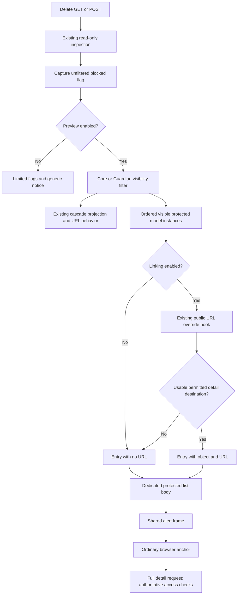

# Phase 06.9: Protected delete-preview object links - Research

**Researched:** 2026-11-04
**Domain:** Django deletion-preview presentation, destination authorization, template migration
**Confidence:** MEDIUM (provider classifier; implementation recommendations require the planned regressions)

<user_constraints>
## User Constraints (from CONTEXT.md)

The following decisions and implementation latitude are copied verbatim. [VERIFIED: .planning/phases/06.9-protected-delete-preview-object-links/06.9-CONTEXT.md]

<!-- DATA_6af2d819_START -->
## Implementation Decisions

### Copied-template compatibility — explicitly selected

- **D-01:** Change `protected_objects` from model instances to structured entries containing the object and an
  optional URL. Require immediate migration of copied templates; do not retain a supported legacy model-instance
  collection alongside a separate link-ready collection. The user selected this over additive compatibility.
- **D-02:** Document the changed context contract under Breaking in `CHANGELOG.md` and in
  `docs/migrating-1.0.md`. Provide a tested migration example and update the delete-view reference, existing copied
  delete-template recipes and relevant example guidance. Hand the settled context/template surface to Phase 7.

### Link behavior — explicitly selected

- **D-03:** Blocker names are ordinary links to full detail pages, matching cascade-preview navigation. Clicking
  a blocker in a delete-preview modal navigates to the full page too. Do not route these links through detail-view
  modal configuration or introduce modal replacement/stacking behavior.

### Theme customization and acceptance

- **D-04:** Browser acceptance covers stock Bootstrap and migrated custom-template fixtures. Verify the actual
  rendered links and full-page navigation, including links originating in a delete-preview modal, plus the
  documented migration example. Actual reference-theme or external-application verification is not required.
- **D-05:** Retain the shared alert frame and provide an independently overridable blocker-list body. This is the
  proposed customization direction presented with the accepted fixture-based verification scope. The user did
  not select a template filename, exact entry field names, or a new generic alert-item API.

### Carried-forward scope and preservation

- **D-06:** Apply visibility filtering before resolving blocker URLs. Hidden blockers retain the existing generic
  notice and cannot expose labels or URLs. Missing or inaccessible detail destinations render visible blockers
  as plain text. Disabled linking retains plain-text output; preview-disabled contexts retain their existing
  limited data exposure. Preserve visible-blocker order.
- **D-07:** Keep `has_protected_objects` independent of display filtering and preserve whole-form omission on
  blocked pages. Do not add new Cancel controls, change deletion execution, or change successful-delete redirects.
- **D-08:** Preserve core and Guardian permission semantics, translations, escaping, cascade previews and shared
  alert behavior. Cover permission and fallback cases with regressions; retain repository-required verification
  and multicore pytest for broad runs. Report actual runtime/browser coverage rather than implying unperformed
  assistive-technology or external-application acceptance.

### Implementation latitude and research obligations

The user selected observable navigation, migration policy and verification scope. Research/planning determines
entry field names, template location, helper composition and test organization within those decisions. No explicit
"you decide" response or additional feature scope was given.

The current `cv_get_related_object_url()` only finds a registered detail route and reverses it; it does not check
the destination's access policy. Permission to display a blocker is not proof that its detail destination is
accessible. Research must establish how to apply existing destination authorization for core and Guardian views,
including relevant parent/queryset restrictions, while preserving the public override hook and existing cascade
behavior. Do not describe the current helper as already permission-aware, or broaden this into an unrelated
routing/authorization redesign. The destination request remains authoritative.

The model-instance contract of `RelatedObjects.protected` and the filtering hook is distinct from the selected
template-context migration. D-01 does not independently authorize changing collector/provider/filter input types.
Use one consistent documented structured context contract rather than making its item type depend on the link flag.
No product code or tests were changed or run during discussion.

<!-- DATA_6af2d819_END -->

<!-- DATA_e931c6b8_START -->
## Deferred Ideas

None added to the backlog. Modal detail routing and actual reference-theme verification were alternatives not
selected for this phase; neither is a promised follow-up.

<!-- DATA_e931c6b8_END -->
</user_constraints>

## Summary

The presentation change is small; the authorization boundary deserves its own task. The current helper selects the
first matching model ViewSet with a detail route and reverses it. It never asks whether the actor may enter that
destination. In contrast, label filtering uses the source delete view's visibility policy. These are separate
decisions, especially when a Guardian delete view accepts global permissions but its detail destination is strict.
[VERIFIED: src/crud_views/lib/views/delete.py:186-204,235-287; src/crud_views_guardian/lib/views.py:44-61;
src/crud_views_guardian/lib/mixins.py:85-98]

Use ordered dictionaries with an object and optional URL only at the template-context boundary. The existing cascade
presentation already uses the exact keys `"obj"`, `"url"`, `"children"` in
`result.append({"obj": item, "url": url, "children": children})`; use its first two fields for protected entries.
Keep the provider and filtering APIs as model-instance collections. The existing alert body-template seam can render
the new list without changing the shared alert API. [VERIFIED: src/crud_views/lib/views/delete.py:214-232;
src/crud_views/lib/deletion.py:30-51; src/crud_views/templatetags/crud_views.py:457-471]

**Primary recommendation:** add a protected-only destination-availability adapter after the shared public URL hook,
leave cascade URL resolution behavior intact, and ship the structured context, independently overridable body,
migration recipe, and stock/custom browser acceptance together. This is a bounded design recommendation derived
from D-01–D-08 and the source above, not a claim that the adapter exists.

## Architectural Responsibility Map

Recommended ownership, grounded in current context assembly and alert/browser separation.
[VERIFIED: src/crud_views/lib/views/delete.py:264-287; src/crud_views/templatetags/crud_views.py:457-471;
src/crud_views/static/crud_views/js/modal.js:203-225]

| Capability | Primary tier | Secondary tier | Rationale |
|---|---|---|---|
| Blocked state and visibility | Django backend | ORM | Preserve unfiltered blocking, then filter model instances. |
| Candidate URL and destination availability | Django backend | Destination ViewSet/view + ORM | Evaluate the actual destination policy before emitting its URL. |
| Protected-entry projection | Django backend | Django templates | Give all enabled-preview contexts the same shape, even when links are disabled. |
| Shared alert frame and blocker list | Django server rendering | Theme templates | Frame retains styling/translation; a dedicated body owns list markup. |
| Detail-page navigation | Browser | Django detail request | Ordinary anchors produce a new page; the destination request enforces access again. |
| Copied-template migration | Documentation + executable fixtures | Browser | Run the published recipe, not an independently maintained approximation. |

## Project Constraints (from AGENTS.md)

These are actionable repository directives; AGENTS.md and CLAUDE.md were both read. Their relevant exact values are
quoted below. [VERIFIED: AGENTS.md:15-47,89-107]

- Prefer broad pytest with `"-n auto"` or bounded `"-n N"`; explain a serial run and do not interrupt an existing
  run only to change worker count.
- Preserve fixture naming: `"cv_<model>"`, `"user_<model>_<permission>"`,
  `"client_user_<model>_<permission>"`.
- New CrudView class attributes use `"cv_"`; workflow transition methods use `"wf_"`.
- View keys are `"list"`, `"detail"`, `"create"`, `"update"`, `"delete"`, `"workflow"`, `"manage"`.
  Preserve list/detail→view, create→add, update→change, delete→delete permission mappings.
- Use line length `120` and double quotes; build system is `"hatchling"`, version management is
  `"bump-my-version"`; do not introduce an unrelated version bump.
- Pair a `"### Breaking"` changelog entry with `"docs/migrating-1.0.md"` before 1.0.
- Existing commands are `task dev`, `task test`, `task format`, `task check`, `task build`, `task docs`,
  `task bump-patch`; the commit hook runs `"ruff-format"`.
- Preserve ViewSet registration, nested parent filtering, and extension-specific permission composition.
  [VERIFIED: AGENTS.md:49-87]

Additional project gates are multicore pytest, Vitest, strict MkDocs, Ruff lint and format checks; preserve unrelated
output and avoid downstream application names in implementation artifacts.
[VERIFIED: .planning/PROJECT.md, Constraints section]

## Phase Requirements

The roadmap currently says exactly `"**Requirements**: TBD"`; no new globally assigned IDs were supplied.
Do not reinterpret completed authorization/deletion requirements as new work. The following IDs are **proposed for
the planner to assign**, not existing requirements. [VERIFIED: .planning/ROADMAP.md:854-865]

| Proposed ID | Behavior | Research support |
|---|---|---|
| PDL-01 | Visible blockers link only to usable permitted detail destinations; otherwise remain text. | Protected-only authorization adapter; core/Guardian target matrix. |
| PDL-02 | Filter before URL work; retain hidden notice, preview-disabled exposure, ordering, unfiltered blocking and form omission. | Existing context pipeline and provider boundary. |
| PDL-03 | One structured protected context and independent blocker body within the shared alert. | Cascade field precedent; caller-context body template. |
| PDL-04 | Ordinary full-page links, including from delete modals; preserve cascade behavior and URL overrides. | Unchanged shared hook + protected-only validator; ordinary anchors. |
| PDL-05 | Immediate copied-template migration with executable recipe and paired documentation. | Existing recipe extraction tests; migration updates and example inventory. |
| PDL-06 | Core/Guardian, escaping, blocked-write and stock/custom browser acceptance with truthful runtime evidence. | Validation Architecture below. |

Preservation obligations include AUTH-01/03/05/06/07, DEL-02–06 and the relevant THEME/CAN contracts; their current
text already specifies POST-only deletion, filtered labels, per-view Guardian policy, database alignment and
unchanged blocked-page behavior. [VERIFIED: .planning/REQUIREMENTS.md:71-77,110-116,160-177]

## Standard Stack

Reuse the existing dependencies; **no new installation or upgrade is needed for this phase**. The table is an
inventory of available runtimes, not a recommendation to raise the package's supported floors. Declared constraints
include `"django (>=4.2.0)"`, `"django-guardian>=2.4"` and `requires-python = ">=3.12"`.
[VERIFIED: pyproject.toml:25-35,52-54]

| Component | Observed version | Purpose | Source |
|---|---|---|---|
| Django | 5.2.18; cached alternatives 4.2.30 and 6.0.9 | Views, URL resolving, ORM and templates | Interpreter imports on all three cached runtimes, 2026-11-04 |
| django-guardian | 3.5.2 | Existing target object/parent permission hooks | 5.2 runtime importlib.metadata probe |
| pytest / pytest-django / pytest-xdist | 9.2.0 / 4.14.0 / 3.8.0 | Existing request and multi-database regression infrastructure | Same runtime metadata probe |
| Node / Vitest | 24.21.0 / installed 5.0.3 | Existing JS preservation tests | node --version and installed package metadata |
| Playwright / Chromium | 1.64.1 / 149.0.7827.55 | Existing cached real-browser infrastructure | Cached metadata and successful launch/close probe |
| Bootstrap | Cached fixture assets 5.3.3 | Stock browser rendering | Existing asset manifest; all 12 assets validated by loadAssets() |

All observations in this table were tool-confirmed in this session. [VERIFIED: environment probes, 2026-11-04]
The source declares Vitest `"^5.0.5"`, while installed metadata reports 5.0.3; report this mismatch and use the
existing suite as observed, or reconcile the dev installation during execution without treating it as a new feature
dependency. [VERIFIED: package.json, devDependencies; environment metadata probe]

PyPI JSON lookups confirmed the installed Python package releases and publication timestamps: Django 5.2.18
(2026-10-06), django-guardian 3.5.2 (2026-10-20), pytest 9.2.0 (2026-10-27), pytest-django 4.14.0 (2026-08-10),
pytest-xdist 3.8.0 (2025-07-01). Latest Django reported by PyPI is 6.1.3; do not upgrade the supported-series
verification to it. [CITED: https://pypi.org/pypi/Django/5.2.18/json]
[CITED: https://pypi.org/pypi/django-guardian/3.5.2/json]
[CITED: https://pypi.org/pypi/pytest/9.2.0/json]
[CITED: https://pypi.org/pypi/pytest-django/4.14.0/json]
[CITED: https://pypi.org/pypi/pytest-xdist/3.8.0/json]
[CITED: https://pypi.org/pypi/Django/json]

### Package Legitimacy Audit

Not triggered: this plan uses existing declared dependencies and proposes no external package installation.
Registry queries above establish release existence/publication only; they are not a package-legitimacy verdict.

## Architecture Patterns

### Data flow

Recommended extension of the verified context pipeline; the diagram intentionally separates candidate routing,
destination checks, display filtering, and actual request authorization.
[VERIFIED: src/crud_views/lib/views/delete.py:186-204,264-287,299-310]



### 1. Change the context boundary, not inspection or filtering

Keep the existing order: inspection → unfiltered blocking flag → visibility filtering → URL/presentation.
The exact current assignments are `context["has_protected_objects"] = bool(related.protected)` and
`context["protected_objects"] = list(related.protected)`. Replace only the latter projection with ordered
object/URL entries; when linking is off the URL is None. Do not create a second legacy protected collection.
[VERIFIED: src/crud_views/lib/views/delete.py:269-287]

The provider still declares `protected: tuple[Model, ...] = ()`, and RelatedObjects still declares
`protected: list`. Core and Guardian filters iterate real models. Keep those types and public imports untouched;
existing filter tests that assert model instances remain correct.
[VERIFIED: src/crud_views/lib/deletion.py:30-51;
src/crud_views/lib/views/delete.py:235-262; src/crud_views_guardian/lib/views.py:53-61]

Do not use dictionaries keyed only by PK for the new presentation. Iterate the filtered list directly to retain
ordering and avoid collapsing distinct rows. The existing cascade cache uses object identity, exactly
`urls[id(obj)] = url`. Preserve its existing behavior.
[VERIFIED: src/crud_views/lib/views/delete.py:278-287]

### 2. Preserve the shared override hook; authorize protected destinations separately

**Recommended bounded composition:** leave the existing cascade call path and public
`cv_get_related_object_url(self, obj)` signature/return behavior intact. For protected entries only, call that hook
after filtering, then validate its returned destination through a private adapter. This avoids imposing new
permission or reverse-resolution rules on existing cascade/custom-URL consumers.
[VERIFIED: src/crud_views/lib/views/delete.py:186-204,280-287]

The default hook currently uses the first matching registry entry; its literal route key is `"detail"`, it returns
on `NoReverseMatch`, and it only derives the immediate parent's kwargs. Preserve that selection behavior rather
than scanning for another accessible ViewSet or expanding ambiguous/multi-parent routing in this phase. Missing
routes stay text. A hook override can supply a usable alternate detail URL.
[VERIFIED: src/crud_views/lib/views/delete.py:189-204]

**Private adapter responsibilities (implementation recommendation):**

1. Resolve the returned local URL to its actual callback and URL kwargs; do not authorize the first registry
   candidate while rendering an override URL to another destination. Restrict the new protected-link feature to
   identifiable registered object-detail destinations. Non-detail, external, malformed, or otherwise
   non-inspectable targets fall back to text. No outbound requests.
2. Bind a fresh destination instance with its actual init kwargs, actor, and resolved URL kwargs. Keep the source
   delete request/object/kwargs untouched. If constructing destination request metadata, use GET semantics,
   destination path/query/resolver_match, and no modal header from the source request.
3. Apply the destination's access/state policy using existing target hooks. A useful existing adapter is
   `target_class._cv_cancel_target_available(user, obj, destination_instance)`: its object-view branch checks
   access then state; Guardian's composition adds actor and parent policy. Pass the **destination-bound instance**,
   never the unrelated source delete view.
4. Independently verify that the destination's actual queryset contains this exact model/row under its route
   kwargs, including the parent restrictions and same database identity. The availability adapter alone does not
   inspect querysets. Do not force `.using(source_alias)` onto the destination queryset merely to make it succeed;
   different routed aliases can have colliding PKs.
5. Accept only the same object the destination route identifies. Honor its normal PK/slug lookup contract rather
   than assuming every overridden URL points to the supplied object's PK.
6. Return the original usable URL or no URL. Keep operational/configuration/custom-hook exceptions visible;
   handle only expected missing-route/row and access-denial conditions at their known operation boundaries.

Source basis: Django resolve exposes callback/args/kwargs, and class-based callback metadata includes the view
class/init kwargs. setup initializes a view without dispatch. Queryset membership and object lookup are separate
from route reversal. [CITED: https://docs.djangoproject.com/en/5.2/ref/urlresolvers/#resolve]
[CITED: https://docs.djangoproject.com/en/5.2/ref/class-based-views/base/]
[CITED: https://docs.djangoproject.com/en/5.2/ref/class-based-views/mixins-single-object/]

Local source basis: the common availability helper calls access/state; the Guardian helper checks parent and
object policy; the ViewSet queryset filters the entire configured parent chain from the bound view kwargs.
[VERIFIED: src/crud_views/lib/view/base.py:73-85,835-851;
src/crud_views_guardian/lib/mixins.py:248-269;
src/crud_views/lib/viewset/__init__.py:281-316]

**Important implementation boundary:** the named cancel adapter is private and designed around cancel rendering.
Using it for an object-detail target is a bounded reuse recommendation, not a verified universal authorization API.
Do not refactor all action/cancel routing to justify this phase. If reuse proves awkward, extract only a private
object-destination policy helper and replay cancel regressions; retain target overrides and one state evaluation.
Do not execute a destination's dispatch/get/render as a permission probe. Arbitrary application middleware,
dispatch or get_object overrides remain authoritative on the actual request; document that the preview is an
availability check, not a guarantee that every possible application request hook succeeds.
[VERIFIED: src/crud_views/lib/view/base.py:73-85,835-884;
src/crud_views_guardian/lib/mixins.py:74-98,248-269;
CITED: https://docs.djangoproject.com/en/5.2/ref/class-based-views/base/]

**Refutation check:** visibility alone fails when the destination uses a custom permission, disabled action,
restricted queryset, a denied parent, or stricter Guardian global fallback. Calling Guardian get_object and then the
availability helper would evaluate its state hook twice: get_object already calls cv_action_enabled. Test hook
counts and avoid this composition.
[VERIFIED: src/crud_views/lib/view/base.py:1084-1089;
src/crud_views_guardian/lib/mixins.py:74-98,248-269]

### 3. Specialized body inside the existing alert frame

Do not pass structured entries to cv_alert's items argument. alert_data currently executes exactly
`items = [conditional_escape(item) for item in items or ()]`; dictionaries would become escaped dictionary
representations. Instead, mirror the cascade's caller-context pattern: bind the list in template context and pass
only the specialized body_template to cv_alert. The tag renders the frame in the caller's context.
[VERIFIED: src/crud_views/lib/messages.py:20-53;
src/crud_views/templatetags/crud_views.py:457-471;
src/crud_views/templates/crud_views/snippets/delete/related_objects.html:17-19]

Keep existing translated headings and the generic hidden-only branch. The frame continues to own alert styling,
icon, role and dismissal; a new independently overridable body owns only the protected list. The planner chooses
one body filename and documents it consistently. No new generic alert-item API.
[VERIFIED: src/crud_views/templates/crud_views/snippets/delete/related_objects.html:4-9;
src/crud_views/templates/crud_views/tags/alert.html:1-6]

Force autoescaping within the new body so it retains the old protected-alert escaping guarantee even under an
outer autoescape-off template. alert_data previously escaped every model item independently of caller state;
copying the cascade body's bare variable output without this consideration would weaken protected labels.
Preserve Django's normal SafeString semantics rather than silently changing them.
[VERIFIED: src/crud_views/lib/messages.py:35-42]
[CITED: https://docs.djangoproject.com/en/5.2/ref/templates/language/#automatic-html-escaping]

### 4. Ordinary navigation from page or modal

Use a plain anchor with escaped href and object text. Do not send protected links through action-button rendering,
modal metadata, or a modal adapter. Existing cascade markup is exactly
`<a href="{{ node.url }}">{{ node.obj }}</a>`. The modal click handler only intercepts its modal trigger or
dismiss marker; ordinary anchors fall through to browser navigation.
[VERIFIED: src/crud_views/templates/crud_views/snippets/delete/related_objects_tree.html:6-9;
src/crud_views/static/crud_views/js/modal.js:203-225]

Test a detail destination that is itself configured as modal-capable: a protected anchor must still navigate to
the full page, including when clicked within a delete modal. This is D-03's deliberate behavior; no JS feature
change is expected. [VERIFIED: .planning/phases/06.9-protected-delete-preview-object-links/06.9-CONTEXT.md, D-03]

### Component responsibilities

These are proposed editing responsibilities, not a claim that new files already exist.

| Component | Planned responsibility |
|---|---|
| Existing DeleteView | Structured projection and narrowly scoped protected destination adapter. |
| Existing protected-alert caller + new blocker body | Preserve alert frame; render optional ordinary links. |
| Existing core/Guardian/delete-database tests | Change template-context expectations only; add destination availability cases. |
| Existing migration-doc tests | Execute updated published fences and prove shape/escaping/blocking/link behavior. |
| New bounded browser fixture/runner | Stock/custom page and modal navigation with exact recipe evidence. |
| Delete reference + migration guide + changelog + relevant example guidance | One public context/body/override contract; Phase 7 handoff. |

Relevant existing sources were opened: delete.py; related_objects.html; test_delete.py; test_guardian_delete.py;
test_delete_databases.py; test_delete_migration_docs.py; action_tooltips_server.py; action-tooltips.cjs;
docs/reference/delete_view.md; docs/migrating-1.0.md; examples/bootstrap5/library/views.py.
[VERIFIED: source reads in this session]

## Don't Hand-Roll

| Problem | Do not build | Reuse |
|---|---|---|
| Target permission rules | A second map of Guardian/global/parent grants | Target access/state hooks and its queryset. |
| URL lookup | String parsing of ViewSet URL layouts | Existing public hook plus Django URL resolution for protected targets. |
| HTML safety | mark_safe assembled links or custom escaping | Django templates with explicit autoescape-on body. |
| Alert variants | A new generic structured-item alert API | Existing body_template and caller context. |
| Browser acceptance infrastructure | New browser package/tool downloads | Existing cached Playwright/Chromium/assets and owned-server cleanup pattern. |

Recommendations are grounded in the source paths under Architecture Patterns and the verified environment audit;
they do not require new runtime APIs.

## Runtime State Inventory

This is a template-context migration, not a stored-data rename. Inventory is scoped to the proposed change;
external deployments were not inspected and no claim is made that their copied templates have migrated.
[VERIFIED: CONTEXT.md D-01/D-02; src/crud_views/lib/views/delete.py:264-287]

| Category | Items found / scope | Required action |
|---|---|---|
| Stored data | The changed collection is assembled per request; model/provider records remain unchanged. | No data migration in this design; retain database regressions. |
| Live service config | No service configuration change is proposed; external applications not audited. | Publish immediate copied-template migration; do not claim external acceptance. |
| OS-registered state | No OS names, registrations or daemon changes are proposed. | None for this phase; browser fixture owns its subprocess. |
| Secrets/env vars | No production secret or environment-key change is proposed. | Keep browser settings scoped to the harness invocation. |
| Build artifacts / installed packages | Browser fixture explicitly checks source imports; copied templates and built package templates must contain the new body. | Verify source-bound tests and distribution/template inclusion; no new dependency. |

Source-import check: `assert Path(crud_views.__file__).resolve().is_relative_to(ROOT / "src")`.
[VERIFIED: tests/browser/action_tooltips_server.py:50-51]
The supported wheel package roots include `"src/crud_views"`.
[VERIFIED: pyproject.toml:100-107]

## Common Pitfalls

1. **Visible does not mean reachable.** A label grant and destination policy can differ. Test a visible label
   with denied detail access, state, parent and queryset. Never hide the label merely because the URL is unavailable.
   [VERIFIED: src/crud_views_guardian/lib/views.py:53-61; src/crud_views_guardian/lib/mixins.py:85-98,248-269]

2. **Mutating the collector contract.** Updating filter/provider tests to expect dictionaries would hide an
   unauthorized API expansion. Change only assertions reading the template context.
   [VERIFIED: src/crud_views/lib/deletion.py:30-51; src/crud_views/lib/views/delete.py:259-278]

3. **Dictionary rendering through generic alerts.** Structured entries passed as alert items get stringified.
   Use caller context plus the dedicated body; retain autoescape protection.
   [VERIFIED: src/crud_views/lib/messages.py:35-50]

4. **Borrowing the delete view's parent kwargs.** Related blockers can belong to another ViewSet. Target
   queryset/Guardian checks must see the resolved target route's parent; test wrong/missing parent and parent
   permission disabled separately.
   [VERIFIED: src/crud_views/lib/viewset/__init__.py:291-306;
   src/crud_views_guardian/lib/mixins.py:248-269,348-381]

5. **Catching every exception as unavailable.** This masks broken application hooks and databases. Keep narrow
   expected-absence catches around the lookup producing absence; do not swallow custom errors.
   [VERIFIED: src/crud_views/lib/view/base.py:835-847; docs/reference/delete_view.md:254-259]

6. **Changing disabled-link context shape.** D-01 requires one item type. Disabled linking must emit structured
   entries with no URL, while preview-disabled requests still omit the detailed keys entirely.
   [VERIFIED: CONTEXT.md D-01 and implementation obligations; src/crud_views/lib/views/delete.py:272-287]

7. **Assuming the issue's demo exists.** The issue describes a separate examples branch. In this checkout the
   inspected library AuthorDeleteView enables `cv_show_related_objects = True`; its Book relationship uses
   CASCADE. Update relevant guidance there or in the delete reference, and use test-owned protected models for
   acceptance. Do not invent a Project/Task demo migration.
   [VERIFIED: examples/bootstrap5/library/views.py:100-105; examples/bootstrap5/library/models.py:28]
   [CITED: https://github.com/jacob-consulting/django-crud-views/issues/307]

## Code Examples

### Existing field precedent

Verbatim existing cascade projection; the proposed protected contract reuses obj/url and omits children.
[VERIFIED: src/crud_views/lib/views/delete.py:231-232]

<!-- DATA_98bfc021_START -->
```python
url = urls.get(id(item)) if item is not None else None
result.append({"obj": item, "url": url, "children": children})
```
<!-- DATA_98bfc021_END -->

### Proposed protected-list body

Implementation sketch, not an existing file. Its fields come from the verified precedent above; autoescape-on
is documented Django behavior. Bind items to the filtered structured protected collection at the caller, and invoke
cv_alert with the new body_template **without its items argument**.
[VERIFIED: src/crud_views/templatetags/crud_views.py:457-471]
[CITED: https://docs.djangoproject.com/en/5.2/ref/templates/language/#automatic-html-escaping]

```django

<ul>

    <li><a href="{{ node.url }}">{{ node.obj }}</a>{{ node.obj }}</li>

</ul>

```

### Existing target policy seam

Verbatim core object-target branch; this is evidence for reuse, not a complete protected-link implementation.
[VERIFIED: src/crud_views/lib/view/base.py:73-79]

<!-- DATA_b8a3c18e_START -->
```python
def _cancel_target_available(target, user, obj, rendering_view):
    """Evaluate the concrete destination's access and state hooks, including overrides."""
    target_obj = obj if target.cv_object else None
    if not target.cv_has_access(user, target_obj):
        return False
    if target.cv_object:
        return target._cv_action_enabled_for_rendering(user, target_obj, rendering_view)
```
<!-- DATA_b8a3c18e_END -->

## Documentation and Migration Inventory

- Update the delete reference's Linking Related Objects, Protected objects table, and filtering explanation.
  Clearly distinguish object visibility from destination availability and full-page navigation.
  [VERIFIED: docs/reference/delete_view.md:144-188,266-280]
- Update the existing migration prose and complete copied-content/snippet recipe in place. The current snippet
  literally passes `items=protected_objects`; leaving this recipe unchanged would teach the broken contract.
  Either include the new package body or publish a complete independent body with the caller. Ensure the exact
  documented fences execute.
  [VERIFIED: docs/migrating-1.0.md:803-828,968-1023;
  tests/test1/test_delete_migration_docs.py:29-42,408-434]
- Document template-context entries separately from unchanged RelatedObjects/filter inputs, and explain that
  applications reading context model fields must read through the entry's object.
  [VERIFIED: src/crud_views/lib/deletion.py:30-51; CONTEXT.md D-01]
- Pair Breaking and migration entries, mention optional protected links in example guidance that actually exists,
  and give Phase 7 the final context fields, body-template name and public-hook behavior.
  [VERIFIED: AGENTS.md:107; .planning/ROADMAP.md:854-886; CONTEXT.md D-02]

## State of the Art

This phase is an extension of repository contracts, not a framework migration.

| Baseline | Proposed phase behavior | Scope |
|---|---|---|
| Filtered protected model instances in template context | Ordered object/optional-URL entries | Immediate copied-template migration, D-01 |
| Generic escaped alert item list | Specialized escaped body inside same frame | D-05 |
| Public URL hook used for cascade display | Same hook also used for protected candidates, with protected target checks | Preserve cascade and overrides |
| Modal action routing available for configured buttons | Protected names remain ordinary full-page links | D-03 |

Baseline is verified in delete.py and alert_data; proposed behavior comes from the locked context.
[VERIFIED: src/crud_views/lib/views/delete.py:186-204,264-287;
src/crud_views/lib/messages.py:35-50; CONTEXT.md D-01/D-03/D-05]

## Assumptions Log

No training-only technical claim is used to lock a dependency or implementation decision.
The recommended new helper composition and body placement are explicitly proposals with source-backed rationale;
the planner must turn their bounded contracts into tests, not treat this research as execution evidence.

## Open Questions

1. **Exact private authorization composition:** reuse the object branch of the cancel adapter, or narrowly extract
   its shared policy. Prefer the former if target binding passes focused tests; preserve one state call and do not
   claim arbitrary middleware/custom-dispatch equivalence. No new public authorization API is required.
2. **Custom URL scope:** recommended protected behavior accepts inspectable local registered detail routes and
   falls back to text for other overrides. Existing cascade override behavior stays unchanged. State this boundary
   explicitly in the plan/docs so reviewers can assess it rather than implicitly trusting arbitrary URLs.
3. **Public names:** choose the body filename and use obj/url consistently across code, docs and tests. D-05
   explicitly leaves the filename open. New requirement IDs are still planner-owned.
4. **Verification timing:** no phase behavior tests or browser acceptance have run during research. Available
   runtimes and browser launch are established below; precise quick-test duration remains to be measured in Wave 0.

## Environment Availability

Tool checks were performed on 2026-11-04; browser launch is an availability probe only.
[VERIFIED: environment/version/import/asset/browser probes in this session]

| Dependency | Available | Version / observation | Execution instruction |
|---|---|---|---|
| Python | Yes | 3.12.3 | Use cached supported-series environments. |
| Django test environments | Yes | 4.2.30, 5.2.18, 6.0.9 | 6.0 is the existing crispy-floor environment. |
| Node | Yes | 24.21.0 | Meets declared `">=20"`; preserve suite commands. |
| uv / task | Yes | uv 0.12.19; task executable found | No project bootstrap needed for research. |
| Ruff / MkDocs | Executables present | Existing .venv tools; versions not probed | Run required checks during implementation. |
| Playwright / Chromium | Yes | 1.64.1 / 149.0.7827.55; launch/close succeeded | Reuse cached runtimes, no auto-download. |
| Fixture asset cache | Yes | Existing manifest validated, 12 assets | Supply the existing asset directory explicitly. |
| Context7 MCP / ctx7 CLI | Not available in this agent | No matching tools or executable | Official web documentation used. |
| Knowledge graph | Not available | graphify status returned exists=false | Source reads used. |

Observed cached locations (availability evidence, not claims about their creation scripts):
- Python 5.2 runtime: `.nox/tests-3-12-django-5-2/bin/python`.
- Python 4.2 runtime: `.nox/tests-3-12-django-4-2/bin/python`.
- Python 6.0 runtime: `.nox/crispy_floor-3-12-django-6-0/bin/python`.
- Playwright: `/home/alex/.npm/_npx/e41f203b7505f1fb/node_modules/playwright`.
- Chromium: `/home/alex/.cache/ms-playwright/chromium-1228/chrome-linux64/chrome`.
- Assets: `/home/alex/.cache/django-crud-views/cancel-assets-06.7`.

The existing runner reads `"CV_CANCEL_PYTHON"`, `"CV_CANCEL_PLAYWRIGHT"`, `"CV_CANCEL_CHROMIUM"` and
`"CV_CANCEL_ASSETS_DIR"`; preserve Python symlink identity so its venv still resolves.
[VERIFIED: tests/browser/action-tooltips.cjs:109-123;
tests/browser/cancel-navigation.cjs:56-83]

**Missing blockers:** none identified for the bounded implementation. Cached assets passed their integrity loader;
a real phase fixture still needs to be written and run. Python 3.13–3.15 and other browsers were not audited, so
do not claim those runtime combinations were verified.

## Validation Architecture

Enabled by the exact config values `"nyquist_validation": true` and `"security_enforcement": true`.
[VERIFIED: .planning/config.json:20-24,48-50]

### Test Framework

| Property | Value |
|---|---|
| Python framework | Existing pytest 9.2.0 + pytest-django 4.14.0 + pytest-xdist 3.8.0 |
| Existing setup | pytest_configure configures Django; default and shard are SQLite in-memory databases. |
| Quick command proposal | `PYTHONPATH=src .nox/tests-3-12-django-5-2/bin/python -m pytest tests/test1/test_delete.py tests/test1/test_guardian_delete.py -n 2 -k 'protected or related_objects_linking'` |
| Full Python command | `PYTHONPATH=src .nox/tests-3-12-django-5-2/bin/python -m pytest tests -n 4` |
| JS preservation | `npm test` and `npm run test:integration` |
| Docs/format gates | `.venv/bin/mkdocs build --strict`, `.venv/bin/ruff check`, `.venv/bin/ruff format --check` |

Existing framework declarations and DB values: `"--strict-markers"`, `"default"`, `"shard"`,
`"django.db.backends.sqlite3"`, `":memory:"`.
[VERIFIED: pyproject.toml:70-83,145-146; tests/test1/conftest.py:43-108]
Quick-command duration is unmeasured; narrow its selection in Wave 0 if it exceeds 30 seconds.
Broad runs use bounded workers because the workspace is shared.

### Phase Requirements → Test Map

IDs below are the proposed PDL identifiers, pending planner assignment. Commands select existing suites to extend;
they are not evidence that new requirements already pass.

| Proposed ID | Behavior | Test type | Command / selection | Existing support |
|---|---|---|---|---|
| PDL-01 | Destination access/state/queryset/parent, core and Guardian | Request + unit | pytest test_delete.py test_guardian_delete.py -k protected | Existing label tests; new target-policy cases needed |
| PDL-02 | Filter ordering, no hidden URL calls, independent flag and form omission | Request + spy | Same tests plus test_delete_inspection.py | Existing guard coverage; add URL-hook non-invocation |
| PDL-03 | Stable structured entries, independent body/frame, escaping | Template + context | pytest test_delete.py test_alerts.py | Existing frame and escaping tests; new shape/body cases |
| PDL-04 | Hook override, cascade unchanged, full-page modal exit | Regression + browser | pytest test_delete.py -k related_objects; new browser runner | Cascade tests exist; protected navigation fixture needed |
| PDL-05 | Actual copied recipe and paired migration | Documentation execution | pytest test_delete_migration_docs.py | Existing fence extractor and real request fixture |
| PDL-06 | Identity/alias and blocking preservation; measured acceptance | Integration + browser | pytest test_delete_databases.py test_delete_inspection.py test_guardian_delete.py | Existing multi-database tests plus new link-identity cases |

The existing cascade tests check both markup and dictionary context. Guardian tests currently assert model-instance
template entries, so those context assertions intentionally migrate. The multi-database test reads
`[str(obj) for obj in response.context["protected_objects"]]` and must likewise migrate, while provider/filter
assertions do not. [VERIFIED: tests/test1/test_delete.py:538-626;
tests/test1/test_guardian_delete.py:491-575; tests/test1/test_delete_databases.py:223-225]

### Required regression matrix

Recommended tests, each tied to the architectural boundaries above:

- Both flags on/off; protected-only and mixed cascade/protected previews; empty-visible list; stable order;
  hidden objects never passed to the URL hook; preview-disabled context has no detailed keys.
- Core global model visibility plus custom destination permission/access/state; target queryset exclusion;
  actual successful detail GET for emitted links; denied direct GET preservation.
- Guardian individual/group grants, inactive actor, active superuser, strict/global target modes independent
  of source delete mode; denied/missing parent; parent-permission None still resolves parent.
- Missing detail registration, missing/reversal-failing route, wrong-row override, wrong-parent override,
  uninspectable/non-detail URL fallback; custom URL hook shared by cascade/protected; one state evaluation.
- Same PK on two aliases: do not link to a different database row; no writes or deletion callbacks during preview;
  existing POST statuses and blocked form omission remain intact.
- Escaping of malicious labels and URL attributes, including outer autoescape-off; existing translations,
  generic hidden-only notice and shared alert frame survive.
- Browser: stock and exact copied-template fixture × full delete page and delete modal; click the real rendered
  anchor, assert top-level navigation and full detail content without a modal request. Include a modal-capable
  destination, a visible text fallback, and hidden-only/form-omission assertions.

### Browser fixture pattern

Reuse the bounded runner design, not another feature's scenario patches. The tooltip fixture executes exact docs
fences, hashes them, imports source code, owns its temporary DB/server and reports cleanup. Its runner validates
stock/custom scenarios, source identities, browser runtime and screenshots. Those mechanisms are reusable;
this phase needs its own protected objects and navigation assertions.
[VERIFIED: tests/browser/action_tooltips_server.py:50-82,235-294;
tests/browser/action-tooltips.cjs:24-68,97-124]

Keep custom body markup observably distinct and assert that it was used. Test a complete copied snippet and its
actual documented body, not merely a custom CSS class on the stock template. Browser evidence should include
fixture mode, relevant URLs/statuses, source/recipe identity, runtime, before/after DOM or screenshots and cleanup.
No external-theme or assistive-technology acceptance is required by D-04/D-08.

### Sampling Rate and Wave 0 Gaps

- Per task: targeted new cases plus touched existing tests; measure quick-suite runtime.
- Per wave: relevant core/Guardian/migration/database suites with bounded xdist workers.
- Phase gate: full Python suite; supported-series affected regressions on cached Django 4.2/5.2/6.0; JS, docs,
  lint/format; new stock/custom browser scenarios. Report exact versions actually run.
- Wave 0: destination-policy fixtures and URL registration isolation; exact docs recipe extraction for the new
  body; stock/custom protected browser fixture and runner; record the installed Vitest mismatch.
- No new test framework installation. Preserve existing registry/URL-cache cleanup and test-owned DB behavior.

## Security Domain

Use actual ASVS 5.0 category numbers rather than silently copying ASVS 4 numbering from a template.
ASVS 5.0 names authorization V8 and encoding/sanitization V1.
[CITED: https://raw.githubusercontent.com/OWASP/ASVS/v5.0.0/5.0/en/0x17-V8-Authorization.md]
[CITED: https://raw.githubusercontent.com/OWASP/ASVS/v5.0.0/5.0/en/0x10-V1-Encoding-and-Sanitization.md]

| Applicable category | Phase control |
|---|---|
| V8 Authorization | Filter before routing; destination-owned actor/object/parent/queryset checks; destination request remains authoritative. |
| V1 Encoding and Sanitization | Escaped ordinary anchors and labels, including copied templates and autoescape-off ancestors. |
| Authentication/session controls | Preserve existing Django/Guardian request handling; no new authentication/session feature. |
| Cryptography | No new cryptographic capability or secret format in this design. |

| Threat | STRIDE | Standard mitigation / planned evidence |
|---|---|---|
| Hidden blocker identity or URL disclosure | Information disclosure | URL hook receives visible rows only; generic hidden notice remains. |
| Detail link to a row outside target permissions/parent/queryset | Elevation of privilege | Target-owned gates plus row/route/alias identity; direct-request regression. |
| Dict/model or URL HTML injection | Tampering | Specialized Django body with escaping; malicious-string and copied-template tests. |
| Link rendering changes deletion eligibility | Tampering | Blocked flag stays based on unfiltered inspection; unchanged POST/no-form tests. |
| Modal header or source context leaks into target evaluation | Information disclosure | Fresh destination binding; normal-page browser navigation checks. |

These are bounded threat-model recommendations grounded in the source and OWASP references above, not a claim of
completed security verification.

## Sources

### Repository primary sources

All listed source areas were opened during this session (not inferred from string search):
- DeleteView routing, filtering, projection and blocked POST: delete.py, lines 186–310.
- RelatedObjects/provider model-instance contract: deletion.py, lines 30–51.
- Target access/state and parent lookup: view/base.py, lines 73–85, 835–884, 1050–1089.
- Guardian object/parent composition: guardian mixins.py, lines 24–98, 248–269, 348–381;
  guardian views.py, lines 44–75.
- Parent-scoped ORM filtering: viewset/__init__.py, lines 281–316.
- Alert normalization/frame/caller context: messages.py, lines 20–53; template tag lines 457–471;
  delete snippets and alert frame.
- Regression, migration and browser fixture sources cited inline.
- AGENTS.md/CLAUDE.md; current phase context; earlier 06.3/06.6/06.7/06.8 contexts; PROJECT/REQUIREMENTS/STATE/ROADMAP.

### Official external sources (MEDIUM provider classification)

- Django 5.2 base views: https://docs.djangoproject.com/en/5.2/ref/class-based-views/base/
- Django single-object lookup: https://docs.djangoproject.com/en/5.2/ref/class-based-views/mixins-single-object/
- Django URL resolution: https://docs.djangoproject.com/en/5.2/ref/urlresolvers/
- Django template escaping: https://docs.djangoproject.com/en/5.2/ref/templates/language/
- Django auth: https://docs.djangoproject.com/en/5.2/topics/auth/default/
- Guardian core and shortcuts: https://django-guardian.readthedocs.io/en/stable/api/core/
  and https://django-guardian.readthedocs.io/en/stable/api/shortcuts/
- Authoritative project issue: https://github.com/jacob-consulting/django-crud-views/issues/307
- OWASP ASVS 5.0 official category sources linked under Security Domain.
- PyPI release JSON for installed versions, linked under Standard Stack.

## Metadata

Research-plan selected Context7 for Django/Guardian, Jina for the issue, and web search for ASVS. This agent had no
Context7/Jina tools or ctx7 executable; official documents were fetched through the built-in web fallback.
The confidence seam returned MEDIUM for `--provider websearch --verified`; digests were cached with that tier.
No claim depends on a third-party summary or unverified package name.

| Area | Confidence | Limit |
|---|---|---|
| Existing stack and source boundaries | MEDIUM | Direct source/import/registry observations; no dependency change proposed. |
| Architecture recommendation | MEDIUM | Source-grounded bounded design; target binding/override cases still require execution tests. |
| Pitfalls and migration inventory | MEDIUM | Concrete source consumers and executable recipe patterns identified. |
| Environment | MEDIUM | Version/import/assets/browser launch verified; phase behavior not executed. |

**Research date:** 2026-11-04
**Review trigger:** changed source or dependencies; otherwise reassess within 30 days.
**Implementation status:** no product code, tests or branch changes made. No phase test result or browser acceptance
is claimed. A filesystem Write tool was unavailable in this runtime; the artifact was created using apply_patch.

