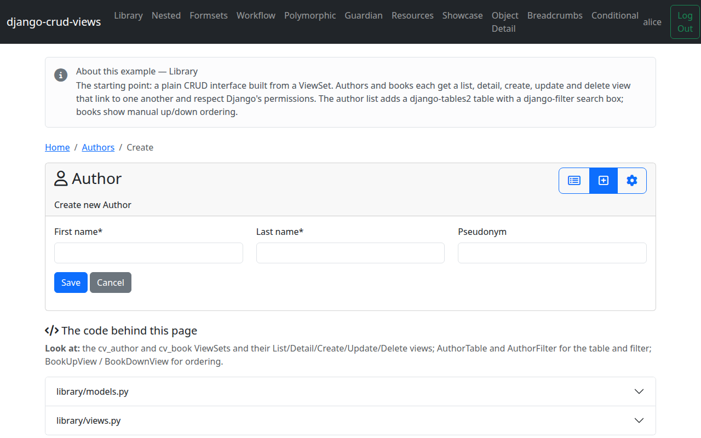
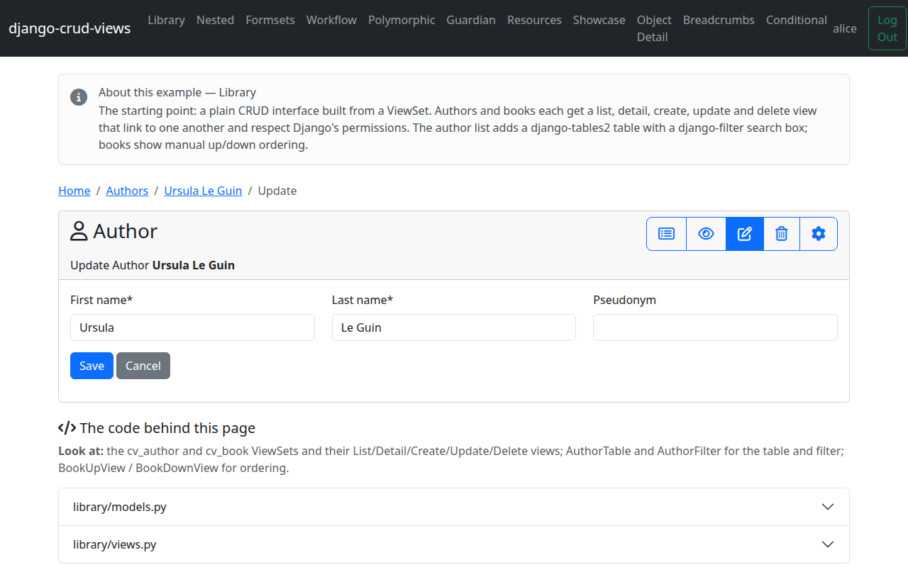
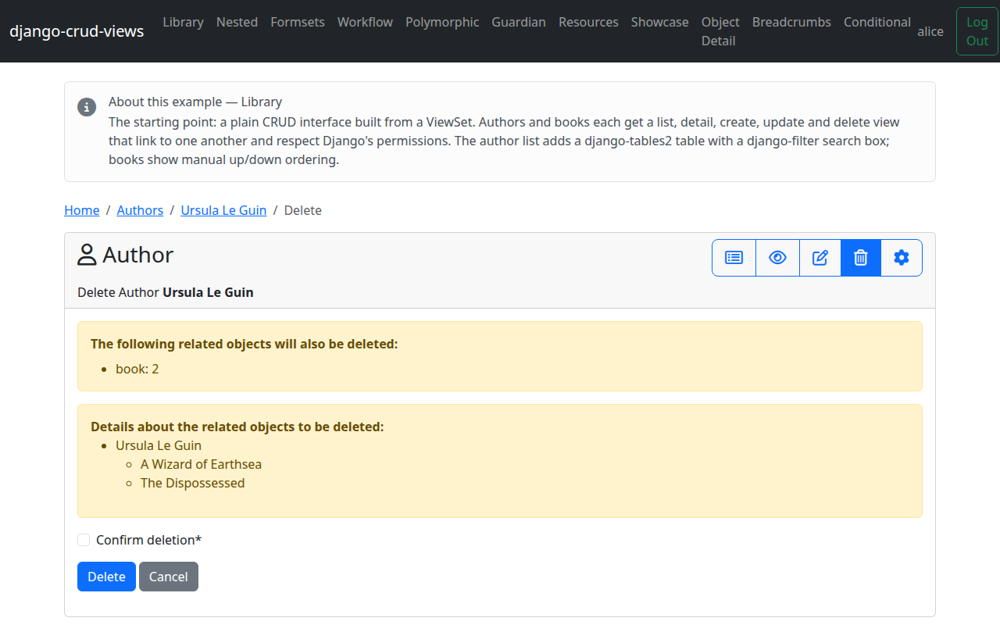

# Part 3 — Create, update, delete

With list and detail groundwork in place, let's add the write side: a shared
crispy form, and the create, update, and delete views that use it.

## The form

`CrispyModelForm` renders a `ModelForm` with django-crispy-forms, using a
layout you control via `get_layout_fields`. Here's `AuthorForm`:

<!-- cv-sync: library/views.py -->
```python
class AuthorForm(CrispyModelForm):
    class Meta:
        model = Author
        fields = ["first_name", "last_name", "pseudonym"]

    def get_layout_fields(self):
        return Row(Column4("first_name"), Column4("last_name"), Column4("pseudonym"))
```

The submit button reads "Save" (translated) by default; set `submit_label` on the form to
change it. `get_layout_fields` returns
a crispy `Layout` (or, as here, a single `Row`) built from `Column2` /
`Column4` / `Column6` — these aren't crud_views-specific widgets, just thin
`Column` subclasses that set a Bootstrap grid CSS class (`col-md-2`,
`col-md-4`, `col-md-6`), so three `Column4`s side by side fill the row.

## Create/Update views

Both views reuse `AuthorForm`. `AuthorCreateView`:

<!-- cv-sync: library/views.py -->
```python
class AuthorCreateView(BreadcrumbMixin, CrispyViewMixin, MessageMixin, CreateViewPermissionRequired):
    cv_viewset = cv_author
    form_class = AuthorForm
    cv_message_template_code = _("Created author “{{ object }}”")
```

And `AuthorUpdateView`:

<!-- cv-sync: library/views.py -->
```python
class AuthorUpdateView(BreadcrumbMixin, CrispyViewMixin, MessageMixin, UpdateViewPermissionRequired):
    cv_viewset = cv_author
    form_class = AuthorForm
    cv_message_template_code = _("Updated author “{{ object }}”")
```

Both inherit `BreadcrumbMixin` — that's the example project's breadcrumb
adoption point, covered in Part 6; ignore it until then. `CrispyViewMixin`
doesn't render the form itself — it passes the view into the form's kwargs so
`CrispyModelForm` can build its crispy helper and layout, and the actual
rendering happens through that helper in the templates. `MessageMixin` adds a
`messages.success` call on successful submit: `cv_message_template_code` is
an inline Django template string rendered with the object in context (hence
`{{ object }}`, not `{object}`) — `str(self.object)` is what ends up in the
message, so it reads "Created author “Ursula Le Guin”". Wrapping the string in
`_()` (`gettext_lazy`) makes it translatable like any other label. Its sibling
`cv_message_template` does the same job but points at a template snippet
file instead of an inline string.

The mixin only *queues* the message. Your base template decides where it
appears, with `` — see [Flash messages](../reference/messages.md).
If you see no confirmation after saving, that tag is what's missing.





## Delete view

Delete gets its own form class rather than `AuthorForm`:

<!-- cv-sync: library/views.py -->
```python
class AuthorDeleteView(BreadcrumbMixin, CrispyViewMixin, MessageMixin, DeleteViewPermissionRequired):
    cv_viewset = cv_author
    form_class = CrispyDeleteForm
    cv_message_template_code = _("Deleted author “{{ object }}”")
    # Books cascade; publishing Contracts protect their Author from deletion.
    # Authorized preview links open full detail pages, including from this modal.
    cv_show_related_objects = True
    cv_link_related_objects = True
    cv_modal = True
    cv_cancel_keys = ["list", "detail"]
```

`CrispyDeleteForm` is a confirmation form: a checkbox the user must tick
before the delete goes through, rendered with the same crispy styling as the
other forms. `cv_show_related_objects = True` additionally lists the objects
that will cascade-delete along with this author — useful here since deleting
an author can take their books with it, and you want the user to see that
before confirming. A publishing `Contract` instead protects its Author from
deletion; Part 6 adds this model and its detail view. `cv_link_related_objects`
links visible Books and eligible Contracts to their detail pages, while
`cv_modal` makes the Delete action open in a modal. Following a preview link
leaves the modal for a full detail page; visiting the delete URL directly
still renders the full-page preview.

After seeding the final example, sign in as `alice` (password `alice`), filter
the author list's last name by `Guin`, and open Ursula Le Guin's Delete action.
The `Earthsea publishing contract` link opens its detail page. Compare with
`bob` (password `bob`): he lacks Contract view permission, so he sees a generic
blocked notice without its name or link. A visible blocker with no eligible
detail destination, or with linking disabled, remains plain text. Deletion
stays blocked in every case; other seeded authors still demonstrate Book cascades.



Next: [Part 4 — The detail view](tutorial-4-detail.md)
