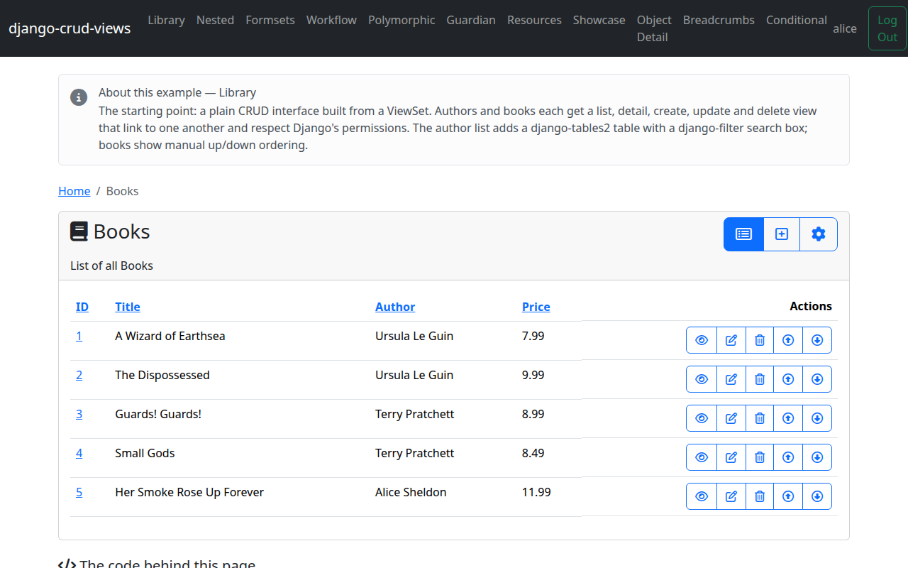

# Part 6 — A second model: ordering & breadcrumbs

Everything so far has been one model. This part adds `Book` — a second
`ViewSet`, nested under nothing but linked to `Author` via a plain foreign
key — and shows off two features that only make sense once there's more than
one view family in play: reorderable rows, and the breadcrumb trail that's
been quietly following us since Part 3.

## The model

Reordering needs the `ordered` extra:

```bash
pip install django-crud-views[ordered]
```

`Book` extends `OrderedModel` from django-ordered-model, and has a plain FK
to `Author`:

<!-- cv-sync: library/models.py -->
```python
class Book(OrderedModel):
    title = models.CharField(_("title"), max_length=100)
    price = models.DecimalField(_("price"), max_digits=10, decimal_places=2)
    author = models.ForeignKey(Author, on_delete=models.CASCADE, verbose_name=_("author"))

    class Meta(OrderedModel.Meta):
        verbose_name = _("book")
        verbose_name_plural = _("books")

    def __str__(self):
        return self.title
```

`OrderedModel` adds an `order` field and the `Meta` machinery that keeps it
consistent; subclassing `OrderedModel.Meta` is what inherits that behavior (the
translatable verbose names are the same as on `Author`). Nothing about the FK to `Author` is crud_views- or
ordering-specific — it's just how `Book` relates to its author.

Add `ordered_model` to `INSTALLED_APPS` and create the migration as usual.

## Views

`Book` gets its own `ViewSet`, the same way `Author` did in
[Part 1](tutorial-1-setup.md):

<!-- cv-sync: library/views.py -->
```python
cv_book = ViewSet(model=Book, name="book", icon_header="fa-solid fa-book")
```

!!! note "Top-level here, nested elsewhere"
    This `cv_book` is a top-level ViewSet, so only the Book permissions apply. Nested under a parent instead — a
    Book ViewSet with `parent=ParentViewSet(name="publisher")` — Book reads would also need Publisher `view` and
    Book editors Publisher `change`, checked before the Book's own permission. See the
    [executed nested example](../reference/nested.md#example-permissions-for-a-nested-book-viewset) and
    [Ancestor authorization](../reference/nested.md#ancestor-authorization).

`BookForm` follows the same crispy pattern as `AuthorForm`:

<!-- cv-sync: library/views.py -->
```python
class BookForm(CrispyModelForm):
    class Meta:
        model = Book
        fields = ["title", "author", "price"]

    def get_layout_fields(self):
        return Row(Column6("title"), Column4("author"), Column2("price"))
```

And `BookTable` follows the same table pattern as `AuthorTable` — `id` uses
`LinkDetailColumn` rather than `UUIDLinkDetailColumn`, since `Book` has a
plain integer primary key:

<!-- cv-sync: library/views.py -->
```python
class BookTable(Table):
    id = LinkDetailColumn()
    title = tables.Column()
    author = tables.Column()
    price = tables.Column()
```

`BookListView` adds `"up"` and `"down"` to `cv_list_actions`:

<!-- cv-sync: library/views.py -->
```python
class BookListView(BreadcrumbMixin, ListViewTableMixin, ListViewPermissionRequired):
    cv_viewset = cv_book
    table_class = BookTable
    cv_list_actions = ["detail", "update", "delete", "up", "down"]
```

That's what puts the up/down reorder arrows on each row. They call
`BookUpView` and `BookDownView`:

<!-- cv-sync: library/views.py -->
```python
class BookUpView(BreadcrumbMixin, MessageMixin, OrderedUpViewPermissionRequired):
    cv_viewset = cv_book
    cv_message_template_code = _("Moved book “{{ object }}” up")


class BookDownView(BreadcrumbMixin, MessageMixin, OrderedUpDownPermissionRequired):
    cv_viewset = cv_book
    cv_message_template_code = _("Moved book “{{ object }}” down")
```

`OrderedUpViewPermissionRequired` and `OrderedUpDownPermissionRequired` move
the instance one position up or down (both are action views, not pages —
they redirect back to the list) and require the `change` permission, same as
`UpdateViewPermissionRequired`. See [OrderedView](../reference/ordered_view.md)
for the plain (no-permission-check) variants and the default move messages.

## Breadcrumbs

Every view in this tutorial has inherited `BreadcrumbMixin` since Part 3,
with a promise to explain it "in Part 6". Here it is — it's the example
project's adoption point for `CrudViewBreadcrumbMixin`, defined once in
`project/views.py` and inherited by every view in every example app:

<!-- cv-sync: project/views.py -->
```python
class BreadcrumbMixin(CrudViewBreadcrumbMixin):
    """Project-wide breadcrumb adoption point: every example view inherits this first."""
```

`CrudViewBreadcrumbMixin` builds the trail from the ViewSet hierarchy —
list/detail container, current object, current action — and renders it via
the `` template tag, already wired into the example
project's base template. The leading item, "Home", comes from a project-wide
setting rather than the mixin itself:

```python
CRUD_VIEWS_BREADCRUMB_PREFIX = [{"title": "Home", "url_name": "home"}]
```

See [Breadcrumb](../reference/breadcrumb.md) for the full trail-building
rules — nested ViewSets, object labels, and hooking in more than one prefix
item.

## A protected publishing Contract

Books use `CASCADE`, so deleting an unprotected Author also deletes their books.
A publishing Contract demonstrates `PROTECT`: it prevents deletion while the
relationship exists. Add this model to `library/models.py`, using the existing
`from django.db import models` and `from django.utils.translation import gettext_lazy as _` imports:

<!-- cv-sync: library/models.py -->
```python
class Contract(models.Model):
    title = models.CharField(_("title"), max_length=150)
    author = models.ForeignKey(Author, on_delete=models.PROTECT, related_name="contracts", verbose_name=_("author"))

    class Meta:
        verbose_name = _("contract")
        verbose_name_plural = _("contracts")

    def __str__(self):
        return self.title
```

In `library/views.py`, extend the model import to `from library.models import Author, Book, Contract`.
The following uses `ViewSet` from `crud_views.lib.viewset`,
`ObjectDetailViewPermissionRequired` from `crud_views_object_detail.lib`, and
`BreadcrumbMixin` from `project.views`, as in the Author and Book views:

<!-- cv-sync: library/views.py -->
```python
cv_contract = ViewSet(model=Contract, name="contract", icon_header="fa-solid fa-file-contract")


class ContractDetailView(BreadcrumbMixin, ObjectDetailViewPermissionRequired):
    cv_viewset = cv_contract
    cv_property_display = [
        {"title": _("Contract"), "icon": "fas:file-contract", "properties": ["id", "title", "author"]},
    ]
```

This ViewSet only needs a detail view: the seed function supplies the Contract,
and permitted users can visit `/library/contract/<contract-pk>/detail/` independently.
AuthorDeleteView shows permitted protected labels as plain text without linking to this view. Create and apply
the migration, then run the seed command. In the bundled project, the migration
is already included:

```bash
python manage.py migrate
python manage.py seed
```

Sign in as `alice` / `alice`, filter Authors by last name `Guin`, and choose
Ursula's Delete action. Her `Earthsea publishing contract` blocks deletion and
appears as plain text in the modal. To compare the full-page
preview, open `/library/author/<author-pk>/delete/` directly with Ursula's ID.
Sign in as `bob` / `bob` to see the generic blocked notice without the Contract
label or URL. The [Part 5 seed](tutorial-5-filters-permissions.md#permissions-in-practice)
grants Alice only its view permission; both accounts keep their Author and Book
permissions. Other seeded authors remain cascade examples: Book links open full
detail pages, including from the delete modal.

The default display budget is 50 across protected and cascade entries, with
protected labels selected first. `cv_delete_preview_limit = None` shows every
visible entry and can produce long pages and more cascade-link work. Neither
policy limits complete inspection or visibility-filtering cost, nor changes
deletion protection. See [Part 3](tutorial-3-forms.md#delete-view) for configuration.

## Final urls

With all three ViewSets in place, `library/urls.py` is now genuinely two lines —
its final, verbatim form, referenced back in Part 1:

<!-- cv-sync: library/urls.py -->
```python
from library.views import cv_author, cv_book, cv_contract

urlpatterns = cv_author.urlpatterns + cv_book.urlpatterns + cv_contract.urlpatterns
```



That's the tutorial — a library app with full CRUD for Authors and Books,
plus a detail-only protected Contract example, filtering, permissions,
reordering, and breadcrumbs.
From here, the [reference section](../reference/index.md) documents every feature in
depth, the bundled project has 10 other example apps under
`examples/bootstrap5/` covering nested ViewSets, formsets, workflow
transitions, polymorphic models, Guardian per-object permissions, and more,
and the [FAQ](../faq.md) collects answers to the questions that come up once
you start customizing.
