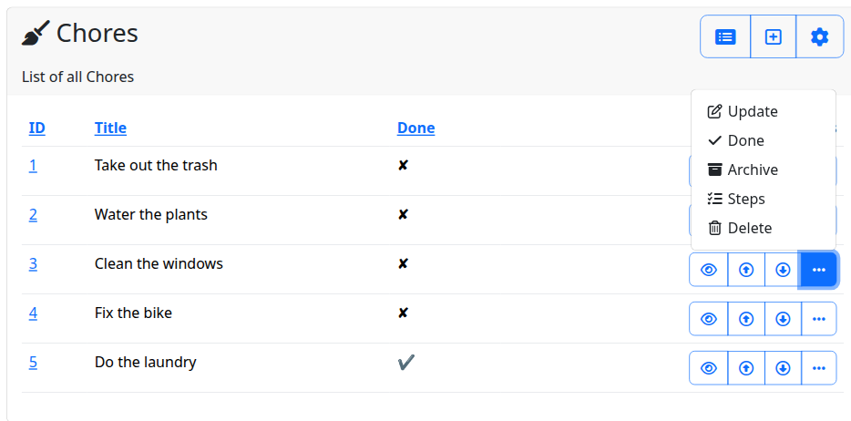

# Action menus

Views with many actions render one button per action. An **action menu** keeps the actions you name as buttons and
folds all others into one dropdown (`⋯`) at the end of the group. It works in three places: list rows, the context
toolbar and cards.

!!! example "Try it live"
    The [Action Menus example](https://django-crud-views-demo.onrender.com/action-menus/chore/) in the live demo
    folds chore actions into `⋯` menus on the list, the toolbar and the cards — log in as `alice` / `alice` and as
    `bob` / `bob` to compare what each of them sees. See [Live demo](../getting_started/demo.md) for data resets
    and wake-up time.

```
List row:   [👁]  [⋯]                  Context:  [✏](active) [⋯]
                  ├ ✏ Edit
                  ├ 🗑 Delete   (disabled)
                  └ ⧉ Copy
```



## Configuration

Each location has an **inline keys** list:

| Level | List rows | Context toolbar | Cards |
|---|---|---|---|
| Django settings | `CRUD_VIEWS_LIST_ACTIONS_INLINE` | `CRUD_VIEWS_CONTEXT_ACTIONS_INLINE` | `CRUD_VIEWS_CARD_ACTIONS_INLINE` |
| `ViewSet` | `list_actions_inline` | `context_actions_inline` | `card_actions_inline` |
| `CrudView` | `cv_list_actions_inline` | `cv_context_actions_inline` | `cv_card_actions_inline` (card views) |

- `None` (default): no menu, every action is a button — today's markup, unchanged.
- `[]`: every action goes into the menu.
- `["detail"]`: `detail` stays a button, the rest go into the menu.

```python
class AuthorListView(ListViewTableMixin, ListViewPermissionRequired):
    cv_viewset = cv_author
    cv_list_actions = ["detail", "update", "delete", "up", "down"]
    cv_list_actions_inline = ["detail", "up", "down"]  # update and delete go into the menu
```

Order: `CrudView` → `ViewSet` → setting; the first value that is not `None` wins, so `[]` on a view overrides a list
on its ViewSet. The getters `cv_get_list_actions_inline()`, `cv_get_context_actions_inline()` and
`cv_get_card_actions_inline()` return the result.

Actions added to a view later land in the menu automatically. Inline buttons keep their relative order, menu items
keep theirs. Cards match an inline key against `CardAction.key`, or `child_name` for child card actions. List rows
and the toolbar match the key as written in `cv_list_actions` / `cv_context_actions` (e.g. `"home"`, not its target
`"list"`).

### Resolved on the rendering view

The inline keys belong to the **container**, so they resolve on the view that renders the group: the list view for
its row actions and toolbar, the card view for its cards, the detail/update/… view for its own toolbar. This differs
from [hide or disable](inaccessible_actions.md), which resolves on each action's **target** view.

## Label mode

Toolbar and row buttons are icon-only by default. A **label mode map** names the action keys that show text instead,
or as well:

| Level | List rows | Context toolbar |
|---|---|---|
| Django settings | `CRUD_VIEWS_LIST_ACTIONS_LABEL_MODE` | `CRUD_VIEWS_CONTEXT_ACTIONS_LABEL_MODE` |
| `ViewSet` | `list_actions_label_mode` | `context_actions_label_mode` |
| `CrudView` | `cv_list_actions_label_mode` | `cv_context_actions_label_mode` |

Each is a dict of action key to `"label"` (text only), `"icon"` (icon with a visually hidden label and a tooltip) or
`"both"` (icon and text). Any key not named is `"icon"`, so an empty dict is today's markup — unless, in the context
toolbar, the view the button opens sets a [target-view default](#target-view-default).

```python
class AuthorListView(ListViewTableMixin, ListViewPermissionRequired):
    cv_viewset = cv_author
    cv_context_actions_label_mode = {"create": "both"}  # "Create" with its icon; the rest stay icon-only
```

Order: `CrudView` → `ViewSet` → setting; the first value that is not `None` wins, whole — the layers are not merged,
and `{}` on a view replaces whatever its ViewSet says. A context toolbar key can also
take its mode from its context button, [`ContextButton.label_mode`](context_buttons.md#contextbutton), and from the
view it opens (see [below](#target-view-default)): the view's own
map wins if it names the key, then the button's `label_mode`, then the map resolved as above if it names the key,
then the target view's `cv_context_action_label_mode`, then `"icon"`. Row actions never read
the button's `label_mode` or the target view's default. Keys are the configured keys,
as for the inline lists (`"home"`, not its target `"list"`). The getters `cv_get_list_actions_label_mode()` and
`cv_get_context_actions_label_mode()` return the resolved dict, `cv_get_action_label_mode(location, key)` the mode of
one key. Cards do not use the map: a card button's mode is `CardAction.label_mode`, see
[Card list view](card-list-view.md#label-mode).

### Target-view default

A toolbar button already takes its variant, icon and short label from the view it opens. A view can also say how it
looks in a toolbar, with `cv_context_action_label_mode` (`"label"`, `"icon"` or `"both"`; `None` by default):

```python
class ProjectUpdateView(UpdateViewPermissionRequired):
    cv_action_variant = "tertiary"
    cv_action_short_label_template_code = "Edit"
    cv_context_action_label_mode = "label"  # text in a toolbar, still icon-only in table rows


class ProjectCreateView(CreateViewPermissionRequired):
    cv_action_variant = "primary"
    cv_action_short_label_template_code = "New project"
    cv_context_action_label_mode = "both"  # icon + text in a toolbar
```

Set on base classes, this describes a project's toolbars without a map per ViewSet or a registered button per key.
It is the most generic level: a page's map, a button's `label_mode`, the ViewSet map and the setting all win over it
for a key they name. It applies to the context toolbar and `` only; table rows pointing at the
same view keep following the list maps. Every button that builds its data from the view it opens follows it, across
ViewSets too: `home`, `parent`, a `ChildContextButton` or a `SiblingContextButton`.

The two attributes differ by one letter and do different jobs:

| Attribute | Type | Set on | Meaning |
|---|---|---|---|
| `cv_context_actions_label_mode` | dict | the page showing the toolbar | "on my toolbar, key X looks like this" |
| `cv_context_action_label_mode` | str | the view the button opens | "wherever a toolbar points at me, I look like this" |

An invalid value fails `viewset.E210`.

### Rendering

A labelled button shows its short label (`"Create"`, not `"Create new author"`), has no `title` and no tooltip, and
the visible text is its only accessible name. A theme styles the modes apart with `context:primary:both` and the
like in the [class table](buttons.md#the-class-table). The map applies to inline buttons; an action folded into the
menu renders icon and short label in every mode.

An icon-only button needs an icon. A toolbar, row or card button whose mode is `"icon"` while its icon is empty would
render nothing visible, so it raises under [`CRUD_VIEWS_STRICT`](settings.md#basic-settings) (default `DEBUG`) and
otherwise renders as `"label"` with a logged warning. pytest-django runs tests with `DEBUG=False`: set
`CRUD_VIEWS_STRICT = True` in your test settings so such a button fails the tests. System check `viewset.W292` reports
the toolbar cases it can see at startup.

## What is never folded

- Context buttons with their own `template=` or `template_code=`: they render a whole button, which cannot become a
  dropdown item.
- The filter toggle of filtered list views (it has its own template).

`up` / `down` (ordered views) can be folded but are awkward in a menu — keep them inline.

POST-only actions (`ActionView`, `OrderedUpView` / `OrderedDownView`) work everywhere, inline and inside the menu: the
container renders a hidden `<form method="post" id="cv_form_…">` per action before the button group, and the button or
menu item carries `data-cv-action="submit-form"` and `data-cv-target` to submit it. Disabled actions get no form.

## Hide and disable

[Inaccessible actions](inaccessible_actions.md) are resolved first, for every action:

- Hidden actions appear nowhere. If every menu action is hidden, no toggle is rendered.
- Disabled actions inside the menu render as `<button type="button" class="dropdown-item" disabled>` with
  `data-cv-disabled="permission|state"` and no URL or JS hooks. If every menu action is disabled, the toggle is still
  rendered — showing them is the point of disable mode.

## Labels, icons and the active action

Menu items show the target view's icon (fixed width, `cv-icon-fw`) and a visible text label — the short action label
(`cv_action_short_label`), or `CardAction.label` on cards — in every [label mode](#label-mode). A context menu item
carries the full label as `title` only when its action is `icon`, so a labelled action has no tooltip inline or
folded. A context button's own `label_template` / `label_template_code` is also used as its menu item text.
`CardAction.variant`, `flex`, `label_mode` and the superseded alias `no_label` apply to inline card buttons only.

On the context toolbar the current page's action is highlighted: inline with `.active`, inside the menu with
`.active` and `aria-current="page"`.

## Menu icon

The toggle icon is the semantic icon `actions-menu` (default `fas:ellipsis`). Change it with
`CRUD_VIEWS_ICONS = {"actions-menu": "fas:bars"}`; see [Icons](icons.md).

With a [host-placed](icons.md#host-placement) icon library the toggle and the menu items carry the icon class
themselves and render no icon element: the toggle takes its location's `*:icon-host` class, every menu item the
`menu:icon-host` class (`"{name_class}"` by default; e.g. `"link-icon {name_class}"` for a base class).

## Templates

| Template | Renders |
|---|---|
| `crud_views/columns/actions.html` | list row container |
| `crud_views/tags/context_actions.html` | context toolbar container |
| `crud_views/tags/card.html` | card (`CardListView.cv_card_template`) |
| `crud_views/tags/actions_menu.html` | dropdown wrapper and item list |
| `crud_views/tags/actions_menu_toggle.html` | the toggle button only |
| `crud_views/tags/actions_menu_item.html` | one menu item (logic template) |
| `crud_views/tags/actions_menu_item_label.html` | legacy: icon and label from raw keys, kept for 0.30 overrides of `actions_menu_item.html` |
| `crud_views/tags/button/action.html` | leaf: one inline button |
| `crud_views/tags/button/menu_item.html` | leaf: one dropdown item |
| `crud_views/tags/button/menu_item_label.html` | leaf: icon and label of an item (`cv_icon`, `cv_short_label`) |
| `crud_views/tags/button/container.html` | leaf: the inline buttons and the menu of one location |

The logic templates and leaves are described in [Buttons](buttons.md#logic-templates-and-leaves).

Template variables of `actions_menu.html` / `actions_menu_toggle.html`: `cv_menu_items`, `cv_location`
(`"list"`, `"context"`, `"card"`), `cv_menu_icon`, and for the toggle `cv_menu_icon_class` / `cv_menu_icon_inline`
(the host class, and whether to render `` inside it). The classes come from the [button class table](buttons.md) with
`` and ``. A menu item
leaf gets the flat leaf contract (`cv_href`, `cv_key`, `cv_short_label`, `cv_icon`, `cv_disabled`, `cv_modal`,
`cv_active`, …), see [the leaf contract](buttons.md#the-leaf-contract).

For custom loops, the groups are available on the views: `cv_get_list_action_group(obj)`,
`cv_get_context_action_group(obj)`, `cv_get_card_action_group(obj)` return an `ActionGroup` (`inline`, `menu`,
`all`) or `None` when the menu is off.

### Example: a split-style toggle

Override `crud_views/tags/actions_menu_toggle.html` to show a caret instead of the icon. This suits only groups with
exactly one inline button — the caret reads as "options for the button on the left":

```django

<button type="button" class=" dropdown-toggle dropdown-toggle-split"
        data-bs-toggle="dropdown" aria-expanded="false" aria-label=""
        data-bs-popper-config='{"strategy":"fixed"}'>
    <span class=""></span>
</button>
```

### Overridden containers

The group is always an `ActionGroup` (`inline`, `menu`, `all`). A project that overrides `columns/actions.html`,
`context_actions.html` or `card.html` includes `crud_views/tags/button/container.html` (with `cv_buttons`, `cv_group`
and `cv_location`), or renders `group.inline` and `group.menu` itself. Overrides that predate the
menu keep their markup and do not get it.

## Bootstrap JavaScript and clipping

The menu is a Bootstrap 5 dropdown. The base template must load the Bootstrap **bundle** (`bootstrap.bundle.min.js`,
Popper included) — modals and the language selector already need it.

Row menus use Popper's fixed strategy (`data-bs-popper-config='{"strategy":"fixed"}'`), so they are not clipped by
a `.table-responsive` wrapper.

## System checks

| ID | Meaning |
|---|---|
| `crud_views.E105` | a `CRUD_VIEWS_*_ACTIONS_INLINE` setting is not `None` or a list of strings |
| `viewset.E208` | a `cv_*_actions_inline` attribute is not `None` or a list of strings |
| `viewset.W290` | a view's own `cv_*_actions_inline` names a key that is not among that location's actions (typo?) |
| `crud_views.E106` | a `CRUD_VIEWS_*_ACTIONS_LABEL_MODE` setting is not a dict of action key → `"label"` / `"icon"` / `"both"` |
| `viewset.E211` | a `cv_*_actions_label_mode` attribute is not `None` or such a dict (`cv_card_actions_label_mode` is the string-valued card attribute, `cv_context_action_label_mode` the string-valued target-view default) |
| `viewset.W291` | a view's own `cv_*_actions_label_mode` names a key that is not among that location's actions (typo?) |
| `viewset.W292` | a context toolbar key resolves to `"icon"` (target-view default included) while its target view has no `cv_icon_action` (keys folded into the menu, buttons with their own template or `get_context()` and unregistered targets are not checked; the render-time rule covers them) |

W290 and W291 check only values set on the view class. ViewSet and setting values are shared defaults and may name
keys some views lack.
