# Context Buttons

Context buttons are the action buttons rendered in the header area of a view — controlled by
the `cv_context_actions` attribute on each view class. They provide navigation between views
within and across viewsets.

!!! example "Try it live"
    The [Context Buttons example](https://django-crud-views-demo.onrender.com/context-buttons/ticket/) in the live
    demo shows whole-button templates and manual placement — open a ticket and log in as `alice` / `alice` and as
    `bob` / `bob` to compare what each of them sees. See [Live demo](../getting_started/demo.md) for data resets
    and wake-up time.

Every ViewSet has a `context_buttons` list that defines which buttons are available. The
default set is provided by `context_buttons_default()`:

- **`home`** — links to the list view of the current viewset
- **`parent`** — links up to the parent viewset's list view (only rendered when a parent exists)
- **`filter`** — toggles the filter form (only rendered when the view uses `ListViewTableFilterMixin`)

The `filter` button's label (default `Filter`) can be customized with `label_template` /
`label_template_code`, like any other button.

Views reference these buttons by key via `cv_context_actions`. Keys that don't match a context
button are resolved as sibling view keys (e.g. `"update"`, `"delete"`, `"create"`).

## ContextButton

The base class. Links to a sibling view within the same viewset.

```python
from crud_views.lib.view import ContextButton

ContextButton(
    key="my_button",  # action key referenced in cv_context_actions
    key_target="detail",  # target view key within the same viewset
    label_template=None,  # path to a Django template for the label
    label_template_code=None,  # inline Django template string for the label
    template=None,  # path to a Django template for the whole button
    template_code=None,  # inline Django template string for the whole button
    variant=None,  # primary, secondary, tertiary or danger; None: the target view's variant
    label_mode=None,  # label, icon or both; None: the view's label mode map
)
```

| Parameter             | Type          | Default  | Description                                      |
|-----------------------|---------------|----------|--------------------------------------------------|
| `key`                 | `str`         | required | Action key referenced in `cv_context_actions`    |
| `key_target`          | `str \| None` | `None`   | Target view key within the same viewset          |
| `label_template`      | `str \| None` | `None`   | Path to a Django template for the button label   |
| `label_template_code` | `str \| None` | `None`   | Inline Django template string for the label      |
| `template`            | `str \| None` | `None`   | Path to a Django template for the whole button   |
| `template_code`       | `str \| None` | `None`   | Inline Django template string for the whole button |
| `variant`             | `str \| None` | `None`   | Semantic variant; `None` uses the target view's `cv_action_variant`, see [Buttons](buttons.md#variants) |
| `label_mode`          | `str \| None` | `None`   | `"label"`, `"icon"` or `"both"` in the context toolbar; `None` follows the maps, the target view and the project floor, see [Context label-mode resolution](action_menus.md#context-label-mode-resolution) |

Access is checked via the target view's `cv_has_access(user, obj)`.

`label_mode` is the button's mode in the context toolbar of every view of the ViewSet, so a text-only button type
does not need its key in a map on every ViewSet. A view's own `cv_context_actions_label_mode` (the plural per-key dict
of the page showing the toolbar) that names the key still wins; below the maps, the target view's
`cv_context_action_label_mode` (the singular default string of the view a button opens) applies, so a button with no
`label_mode` of its own follows the view it opens (`parent`, child and sibling buttons too), and below that the
`"context"` entry of `CRUD_VIEWS_LABEL_MODE_DEFAULTS`; see
[Context label-mode resolution](action_menus.md#context-label-mode-resolution) for the full order. It applies to inline toolbar buttons and
`` (an action folded into the menu shows icon and label in every mode), not to row actions, which follow the list maps even when they resolve through the same
button. An invalid value fails `viewset.E210`.

When neither `template` nor `template_code` is set, the button uses the
`CRUD_VIEWS_CONTEXT_BUTTON_TEMPLATE` setting (default
`crud_views/tags/context_action.html`). Whichever template is used, it is only rendered
when the user may access the target and the action is enabled (`cv_access` is `True`,
`cv_action_enabled` is not `False`), so custom templates need no access check of their own —
except for targets that render inaccessible actions disabled, see
[Hide or disable inaccessible actions](inaccessible_actions.md#custom-button-templates). For placing buttons by hand in a custom layout, see
[Manual Placement (Template Tags)](#manual-placement-template-tags) below.

A custom `template` or `template_code` is rendered from the resolved action data, which carries `cv_label_mode` as
the view resolved it for the button's configured key (see [Action menus](action_menus.md#label-mode)); the template
decides what to do with it. One that resolves its classes with `` should
pass a mode as the third argument so a theme's per-mode classes reach it: `cv_label_mode` to follow the map, or a
literal `"icon"` for a button that is icon-only by construction. The bundled filter toggle
`crud_views/tags/context_action_filter.html` passes its resolved `cv_label_mode`, see
[The filter toggle](#the-filter-toggle). See [Buttons](buttons.md#the-class-table).

### The filter toggle

`FilterContextButton` (key `filter` in `context_buttons_default()`) shows and hides the filter panel of a list view
that uses `ListViewTableFilterMixin`. It follows the context label mode of its declared key like any other toolbar
button, through the steps of [Context label-mode resolution](action_menus.md#context-label-mode-resolution). It has no
target view, so it has no target-view default: the list view's own singular `cv_context_action_label_mode` does not
change it.

```python
# settings.py: icon and the visible label "Filter" on every filter toggle
CRUD_VIEWS_CONTEXT_ACTIONS_LABEL_MODE = {"filter": "both"}
```

```python
from crud_views.lib.view.buttons import FilterContextButton


class AuthorListView(ListViewTableMixin, ListViewTableFilterMixin, ListViewPermissionRequired):
    cv_viewset = cv_author
    filterset_class = AuthorFilter
    cv_context_buttons = [FilterContextButton(label_mode="label")]  # text only, on this page
```

A toggle registered under another key resolves that key: `FilterContextButton(key="search")`, named as `"search"` in
`cv_context_actions`, follows `{"search": "label"}` and ignores a `"filter"` entry. The setting map is project
configuration read at startup and replaced whole by a ViewSet or view map (see
[Label-mode configuration](settings.md#label-mode-configuration)). The `"context"` floor of
`CRUD_VIEWS_LABEL_MODE_DEFAULTS` is read on each render, so a project that already sets it to `"both"` or `"label"`
now changes the stock toggle too, unless an earlier step decides the key.

| Mode | Stock toggle |
|---|---|
| `"icon"` (package floor) | open/close icon, the label as visually hidden text, `title` and tooltip; unchanged markup |
| `"both"` | open/close icon and the visible label; no `title`, no tooltip |
| `"label"` | the visible label only: no icon spans, no host icon classes, no icon-swap attributes |

The label stays the same when the panel opens or closes; only the icon and `aria-expanded` change. The default label
`Filter` is translated; `label_template` / `label_template_code` replace it and receive the resolved `cv_label_mode`,
the same value the button template receives. The filter resolves this mode once before rendering its label template.
`variant` and the per-mode class keys (`context:<variant>:<mode>`) apply as for any context button.
In the icon-bearing modes the icons are placed on
the button when both resolve to [host classes](icons.md#host-placement), and render as two icon spans otherwise. A
whole-button `template` / `template_code` receives the resolved `cv_label_mode` and owns its markup, including
whether it renders icons; it keeps the IDs and ARIA attributes of
[the filter toggle contract](javascript.md#the-filter-toggle-contract). The toggle is
[never folded](action_menus.md#what-is-never-folded) into the `⋯` menu.

### Active state

Every context button's template context includes `cv_is_active` — `True` when the button
points at the view currently being displayed (matched by URL router name). The default button
template uses it to add the `active` CSS class, so a button highlights on its own page:

```django

```

This applies to all context button types except `FilterContextButton` (a filter toggle is not a
navigation target).

## ParentContextButton

Links up to the parent viewset's list view. Included by default via `context_buttons_default()`.
Returns an empty context (no button rendered) when the viewset has no parent.

```python
from crud_views.lib.view import ParentContextButton

ParentContextButton(key="parent", key_target="list")
```

## ChildContextButton

Links down to a child viewset — for example, a "Books" button on an author detail page that
navigates to the book list filtered by that author. This is the inverse of `ParentContextButton`.

```python
from crud_views.lib.view import ChildContextButton

ChildContextButton(
    key="books",  # action key referenced in cv_context_actions
    child_name="book",  # name of the child viewset
    child_key="list",  # target view key in the child viewset (default: "list")
    label_template_code="Books",  # optional: inline Django template string for the label
)
```

| Parameter             | Type          | Default  | Description                                      |
|-----------------------|---------------|----------|--------------------------------------------------|
| `key`                 | `str`         | required | Action key referenced in `cv_context_actions`    |
| `child_name`          | `str`         | required | Name of the child viewset to link to             |
| `child_key`           | `str`         | `"list"` | Target view key in the child viewset             |
| `label_template`      | `str \| None` | `None`   | Path to a Django template for the button label   |
| `label_template_code` | `str \| None` | `None`   | Inline Django template string for the label      |

The button requires `context.object` to build the child URL (the current object becomes the
parent PK in the child's URL). It returns an empty context when there is no object.

Access is checked via the child view's `cv_has_access(user, obj)`, where `obj` is the current
(parent) object. For Guardian-based views, this means object-level permissions on the parent
are checked automatically.

### Example

Given an Author → Book parent-child relationship:

```python
from crud_views.lib.viewset import ViewSet, ParentViewSet, context_buttons_default
from crud_views.lib.view import ChildContextButton
from crud_views.lib.views import DetailViewPermissionRequired

cv_author = ViewSet(
    model=Author,
    name="author",
    context_buttons=context_buttons_default()
    + [
        ChildContextButton(key="books", child_name="book", label_template_code="Books"),
    ],
)

cv_book = ViewSet(
    model=Book,
    name="book",
    parent=ParentViewSet(name="author"),
)


class AuthorDetailView(DetailViewPermissionRequired):
    cv_viewset = cv_author
    cv_context_actions = ["update", "delete", "books"]
```

The `"books"` action in `cv_context_actions` renders a button linking to `/author/<pk>/book/`.

## SiblingContextButton

Placed on a **child** view, links sideways to a **sibling** collection — another child of the
same parent — reusing the parent PK from the current URL. It is the composition of
`ParentContextButton` (resolve the parent) and `ChildContextButton` (hop to a named child):
use `ChildContextButton` on the *parent* view and `SiblingContextButton` on its *children*.

```python
from crud_views.lib.view import SiblingContextButton

SiblingContextButton(
    key="articles",  # action key referenced in cv_context_actions
    sibling_name="article",  # registry name of the sibling viewset (same parent)
    sibling_key="list",  # target view key in the sibling viewset (default: "list")
    label_template_code="Articles",
)
```

| Parameter             | Type          | Default  | Description                                       |
|-----------------------|---------------|----------|---------------------------------------------------|
| `key`                 | `str`         | required | Action key referenced in `cv_context_actions`     |
| `sibling_name`        | `str`         | required | Registry name of the sibling viewset (same parent)|
| `sibling_key`         | `str`         | `"list"` | Target view key in the sibling viewset            |
| `label_template`      | `str \| None` | `None`   | Path to a Django template for the button label    |
| `label_template_code` | `str \| None` | `None`   | Inline Django template string for the label       |

Renders nothing when the current view has **no parent**. The URL is built from the current
view's kwargs (the sibling shares the same parent chain), so no current object is required.
Access is checked via the sibling view's `cv_has_access(user, None)` — model-level on the
sibling collection; object-level/Guardian permissions keyed on the parent are not consulted.

### Example

Given `Author` with children `Book` and `Article`:

```python
from crud_views.lib.viewset import ViewSet, ParentViewSet, context_buttons_default
from crud_views.lib.view import SiblingContextButton
from crud_views.lib.views import ListViewPermissionRequired

cv_book = ViewSet(
    model=Book,
    name="book",
    parent=ParentViewSet(name="author"),
    context_buttons=context_buttons_default()
    + [
        SiblingContextButton(key="articles", sibling_name="article", label_template_code="Articles"),
    ],
)


class BookListView(ListViewPermissionRequired):
    cv_viewset = cv_book
    cv_context_actions = ["parent", "create", "articles"]
```

On `/author/<author_pk>/book/`, the `"articles"` button links to `/author/<author_pk>/article/`.

## How a context button is rendered

Whether a toolbar button shows an icon, a label or both, and where that label and icon come from, is decided per key
in `cv_context_actions`, in this order:

```mermaid
---
config:
  look: handDrawn
  theme: neutral
  flowchart:
    wrappingWidth: 400
---
flowchart TD
    KEY(["key in cv_context_actions"]) --> ISBTN{"a context button<br/>with this key?"}
    ISBTN -- "no" --> VIEW["target: the view registered<br/>under the key"]
    ISBTN -- "yes" --> BTN["target: key_target, or the parent /<br/>child / sibling ViewSet's view"]
    VIEW --> FOLD
    BTN --> OWN{"button has template<br/>or template_code?"}
    OWN -- "yes" --> CUSTOM(["the button's template renders it from the<br/>resolved data, cv_label_mode included,<br/>and owns the markup (e.g. the filter toggle)"])
    OWN -- "no" --> FOLD{"key folded into the ⋯ menu?<br/>(cv_context_actions_inline<br/>does not name it)"}
    FOLD -- "yes" --> MENU(["menu item: icon + short label,<br/>label mode is ignored"])
    FOLD -- "no" --> M1

    subgraph MODE ["1 · label mode"]
        M1{"the page's own<br/>cv_context_actions_label_mode"}
        M1 -- "no" --> M2{"ContextButton.label_mode"}
        M2 -- "no" --> M3{"ViewSet context_actions_label_mode,<br/>then setting<br/>CRUD_VIEWS_CONTEXT_ACTIONS_LABEL_MODE"}
        M3 -- "no" --> M4{"target view's<br/>cv_context_action_label_mode"}
        M4 -- "no" --> MICON["defaults map (default icon)"]
    end
    M1 -- "yes" --> L1
    M2 -- "yes" --> L1
    M3 -- "yes" --> L1
    M4 -- "yes" --> L1
    MICON --> L1

    subgraph LABEL ["2 · label"]
        L1{"ContextButton has label_template<br/>or label_template_code?"}
        L1 -- "yes" --> LBTN["label = short label =<br/>the rendered button label"]
        L1 -- "no" --> LVIEW["label: target view's cv_action_label_template[_code]<br/>short label: cv_action_short_label_template[_code],<br/>else the label"]
    end
    LBTN --> I1
    LVIEW --> I1

    subgraph ICON ["3 · icon"]
        I1{"Parent-, Child- or<br/>SiblingContextButton?"}
        I1 -- "yes" --> IVS["icon: icon_header of<br/>the target's ViewSet"]
        I1 -- "no" --> IVIEW["icon: target view's<br/>cv_icon_action"]
    end
    IVS --> C1
    IVIEW --> C1

    subgraph FIX ["4 · corrections"]
        C1{"label empty?"}
        C1 -- "yes" --> CFORCE["mode = icon"]
        C1 -- "no" --> C2
        CFORCE --> C2{"mode icon,<br/>but no icon?"}
        C2 -- "yes" --> C3{"CRUD_VIEWS_STRICT?"}
        C3 -- "yes" --> CERR(["ValueError"])
        C3 -- "no" --> CLABEL["mode = label,<br/>a warning is logged"]
    end
    C2 -- "no" --> OUT
    CLABEL --> OUT

    OUT{"final mode"}
    OUT -- "icon" --> RICON(["icon only; the full label is<br/>hidden text and the tooltip"])
    OUT -- "both" --> RBOTH(["icon + short label"])
    OUT -- "label" --> RLABEL(["short label, no icon"])

    classDef start fill:#1e293b,stroke:#1e293b,color:#fff,font-weight:bold
    classDef decision fill:#fef3c7,stroke:#d97706,color:#78350f
    classDef step fill:#e0f2fe,stroke:#0284c7,color:#0c4a6e
    classDef result fill:#dcfce7,stroke:#16a34a,color:#14532d,font-weight:bold
    classDef exit fill:#f1f5f9,stroke:#94a3b8,color:#475569,stroke-dasharray:4 3
    classDef error fill:#fee2e2,stroke:#dc2626,color:#7f1d1d,font-weight:bold
    class KEY start
    class ISBTN,OWN,FOLD,M1,M2,M3,M4,L1,I1,C1,C2,C3,OUT decision
    class VIEW,BTN,MICON,LBTN,LVIEW,IVS,IVIEW,CFORCE,CLABEL step
    class RICON,RBOTH,RLABEL result
    class CUSTOM,MENU exit
    class CERR error
    style MODE fill:#fafaf9,stroke:#a8a29e
    style LABEL fill:#fafaf9,stroke:#a8a29e
    style ICON fill:#fafaf9,stroke:#a8a29e
    style FIX fill:#fafaf9,stroke:#a8a29e
```



The label mode is taken from the first of the four places that names the key (`cv_get_action_label_mode()`). The
"defaults map" node is the `"context"` entry of `CRUD_VIEWS_LABEL_MODE_DEFAULTS`, the project floor, whose package
default is `"icon"`; [Context label-mode resolution](action_menus.md#context-label-mode-resolution) gives the
canonical order. In the diagram the plural `cv_context_actions_label_mode` is the per-key dict of the page showing the
toolbar, the singular `cv_context_action_label_mode` the default string of the view a button opens. The label and icon come from the button's `get_context()`, or from the target view's
`cv_get_dict()` for a plain view key; `cv_button_data()` applies the corrections, and the leaf
`crud_views/tags/button/action.html` renders the result. See [Action menus](action_menus.md#label-mode) for the
label-mode maps and [Buttons](buttons.md#the-leaf-contract) for the leaf. System check `viewset.W292` reports the
"icon mode but no icon" case at startup where it can be known statically.

## Customizing Default Buttons

Override the default buttons by passing a custom list to the ViewSet:

```python
from crud_views.lib.viewset import ViewSet, context_buttons_default
from crud_views.lib.view import ContextButton, ChildContextButton

# Add child buttons to the defaults
cv_author = ViewSet(
    model=Author,
    name="author",
    context_buttons=context_buttons_default()
    + [
        ChildContextButton(key="books", child_name="book"),
        ChildContextButton(key="articles", child_name="article", label_template_code="Articles"),
    ],
)

# Or replace defaults entirely
cv_author = ViewSet(
    model=Author,
    name="author",
    context_buttons=[
        ContextButton(key="home", key_target="list"),
        ChildContextButton(key="books", child_name="book"),
    ],
)
```

## View-level Context Buttons

By default, context buttons are defined on the **ViewSet** (`context_buttons`) and shared by
every view in it. To define a button on a **single view**, set `cv_context_buttons` on the
`CrudView` — a list of the same `ContextButton` types.

```python
from crud_views.lib.view import ChildContextButton
from crud_views.lib.views import DetailViewPermissionRequired


class BookDetailView(DetailViewPermissionRequired):
    cv_viewset = cv_book
    cv_context_actions = ["update", "delete", "reviews"]  # "reviews" listed -> it renders
    cv_context_buttons = [  # defines "reviews" for this view only
        ChildContextButton(key="reviews", child_name="review", label_template_code="Reviews"),
    ]
```

Two rules:

- **Rendering is unchanged:** a button appears only when its `key` is listed in
  `cv_context_actions`. `cv_context_buttons` only *defines* buttons; `cv_context_actions`
  controls what renders and in what order.
- **View overrides ViewSet:** if a view-level button has the same `key` as a ViewSet-level
  button, the view-level one wins for that view. Declare a same-key button in
  `cv_context_buttons` to customize a single view without touching the ViewSet.

## POST actions

Keys of POST-only views (`ActionView`, `OrderedUpView` / `OrderedDownView`) work in `cv_context_actions` like any
other key. The toolbar renders a hidden `<form method="post">` for each of them before the button group and a
`<button data-cv-action="submit-form">` that submits it, as list rows do. Disabled actions render no form.

```python
class ChoreDetailView(DetailViewPermissionRequired):
    cv_viewset = cv_chore
    cv_context_actions = ["home", "update", "done"]  # "done" is an ActionView: the button POSTs
```

When you place such a button yourself with ``, also render its form, outside any
`.btn-group`: ``.

## Target check (E255)

A button whose target view is not registered is skipped at render time, so a typo would only make
the button disappear. The `viewset.E255` system check catches this at startup for every button in
a ViewSet's `context_buttons` and a view's `cv_context_buttons`:

| Button | Must resolve |
|---|---|
| `ContextButton` | `key_target` is registered on its own ViewSet |
| `ParentContextButton` | the ViewSet has a parent, and `key_target` is registered on it |
| `ChildContextButton` | `child_name` is a child ViewSet of this one, and `child_key` is registered on it |
| `SiblingContextButton` | `sibling_name` is a registered ViewSet, and `sibling_key` is registered on it |

`list` also resolves when the target ViewSet registers only `card`.

Not checked:

- Buttons equal to an entry of `context_buttons_default()`. The default `home` and `parent`
  buttons are meant to vanish on a ViewSet without a list view or without a parent. A changed
  default, e.g. `home` with its own `label_template_code`, is checked like any other button.
- Button subclasses that override `get_context()`, such as `FilterContextButton`. A custom
  button type can override `cv_check_target(viewset)`, which returns a problem message or `None`.

## Manual Placement (Template Tags)

The `cv_context_actions` attribute renders the configured buttons automatically in the view
header. When you build a custom layout — a detail template, a dashboard tile, a card — you can
place a single button (or just its URL) anywhere using template tags. All of them resolve the
same context as the configured buttons, so access and the `cv_action_enabled` state are honored.

| Tag / filter                              | Returns                                              |
|-------------------------------------------|------------------------------------------------------|
| ``           | Rendered button markup, or **nothing** when no access |
| ``       | The target URL string, or `None` when no access      |
| `view\|cv_context_has_permission:"key"`   | `True`/`False` — may the user access the key?        |
| ``      | Hidden POST form for a POST-only key, else nothing   |

In every case the object defaults to the view's current object; pass a second argument to
target a different object, and unknown keys resolve to nothing/`None` rather than raising.

### `cv_context_url` — get the target URL only

Use `cv_context_url` when you write your own link/tile markup but still want the
permission-gated target URL. It returns the URL string, or `None` when the user lacks access
to the target **or** the action is disabled (`cv_action_enabled` is `False`) — the same
visibility rule as `cv_context_button`:

```django




    <a href="{{ edit_url }}" class="my-tile">Edit</a>

```

Target a different object by passing it as the second argument:

```django

```

!!! note "`None` means hidden"
    Because `cv_context_url` returns `None` for both "no access" and "action disabled" — also when the target view
    renders inaccessible actions disabled — gating your markup with `` makes the link disappear
    entirely. `cv_context_button` and the `` container hide inaccessible buttons, or render
    them disabled in disable mode (see [Hide or disable inaccessible actions](inaccessible_actions.md)).

### `cv_context_button` — render the full button

When you want the library to render the complete button markup (not just the URL), use
`cv_context_button`. It renders **nothing** when the user lacks access or the action is
disabled — or a disabled button when the target view uses `cv_inaccessible_actions = "disable"`:

```django



```

The button follows the view's [label mode](action_menus.md#label-mode) for that key, exactly as the toolbar would
render it.

### `cv_context_has_permission` — gate surrounding markup

To render wrappers, headings, or separators only when the user may access a key, use the
`cv_context_has_permission` filter:

```django



    <div class="toolbar"></div>

```

### Rendering a custom loop of buttons

For a loop over the view's resolved, access-filtered button contexts (e.g. to wrap each
button in your own markup) rather than one key at a time, see
[FAQ: I need to render a context button manually in a template](../faq.md#i-need-to-render-a-context-button-manually-in-a-template).

## Import Paths

```python
from crud_views.lib.view import ContextButton, ParentContextButton, ChildContextButton
from crud_views.lib.view.buttons import FilterContextButton  # not re-exported by crud_views.lib.view
from crud_views.lib.viewset import context_buttons_default
```

!!! tip "Many actions?"
    Fold the less common actions into a `⋯` dropdown: see [Action menus](action_menus.md).
