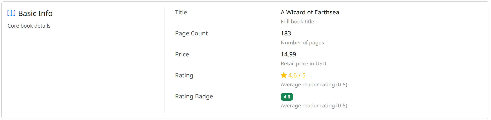
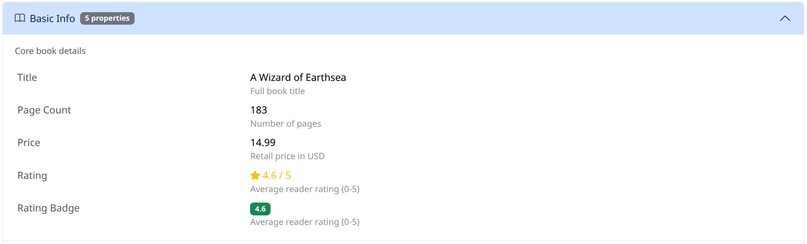
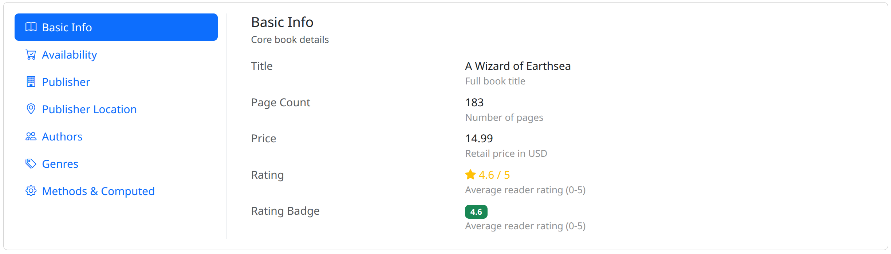
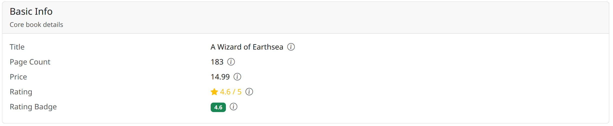
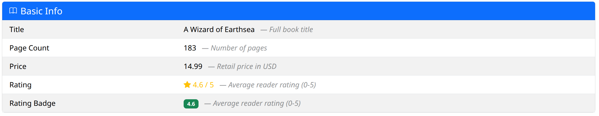
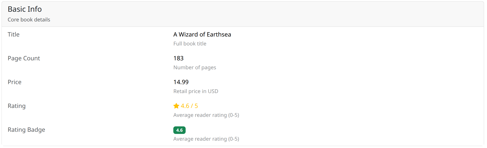
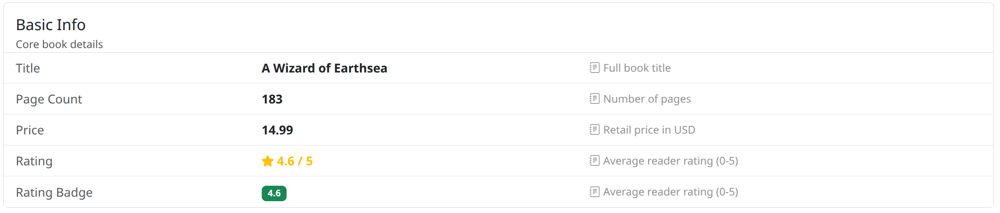

# Layout Packs

Seven layout packs are included:

| Pack | Setting value |
|------|---------------|
| Split card (default) | `"split-card"` |
| Accordion | `"accordion"` |
| Tabs (vertical) | `"tabs-vertical"` |
| Card rows | `"card-rows"` |
| Striped rows | `"striped-rows"` |
| Table inline | `"table-inline"` |
| List group (3-col) | `"list-group-3col"` |

!!! example "Try it live"
    The [Object Detail example](https://django-crud-views-demo.onrender.com/object-detail/product/) in the live demo shows this in
    action — log in as `alice` / `alice`. See [Live demo](../getting_started/demo.md) for data resets and wake-up time.

Set the layout in your Django settings:

```python
CRUD_VIEWS_OBJECT_DETAIL_TEMPLATE_PACK_LAYOUT = "accordion"
```

## Screenshots

### Split Card (default)

Group title on the left, properties on the right inside a card.



### Accordion

Each group is a collapsible accordion panel.



### Tabs (vertical)

Groups as vertical tabs with properties in the tab content area.



### Card Rows

Each group rendered as a standalone card with stacked property rows. A property's
`detail` text is shown as a tooltip on an info icon (hover or keyboard focus). The
tooltip is initialised by the bundled `crud_views/js/tooltip.js` (via ``) and
needs Bootstrap's JavaScript; without it the text remains available to screen readers.



### Striped Rows

Alternating row backgrounds for easy scanning.



### Table Inline

Classic table layout with label and value columns.



### List Group (3-col)

Three-column list group with label, value, and detail.



## Template projection and stable targets

An object template receives `groups` (resolved groups), `layout`, and `component`.
`component.id`, `component.tablist_id`, and `component.content_id` identify the root,
tablist and panel container. Iterate `component.groups`: each entry exposes `group`,
`control_id`, `panel_id`, and `selected` (true for the first entry only).
Pass the same entry as `presentation` and its enclosing `component` to `render_group`.
Group templates retain `group` and `layout`; property templates retain `prop`.
`render_property_value` supplies `prop`, `value`, and `od_settings` to the value template.
These are resolved data: a theme should not resolve model fields or badge callbacks again.

For supplied component token `C`, the base is `cvod-c{len(C)}-{C}`. Append `-root`,
`-tabs`, or `-content` for the three component IDs. A supplied group key `G` gives
`{base}-s{len(G)}-{G}-control` and `{base}-s{len(G)}-{G}-panel`. Without a group key,
use `-i{index}-control` / `-i{index}-panel`, with a zero-based index. Length prefixes
and distinct `s`/`i` markers prevent ambiguous token combinations. Titles never enter IDs.
For example, component `author-page` and group `bio` yield
`cvod-c11-author-page-s3-bio-panel`. Explicit group keys survive translation and reorder;
positional fallback survives only while order is unchanged. Omitted component identity
uses a fresh generated token (`g` plus a UUID hex value), unsuitable for stable selectors.
See [identity configuration](object_detail_configuration.md#component-and-group-identity).

### Collision detection boundary

Duplicate supplied identities raise `ImproperlyConfigured` within one shared outer
`Template.render` scope, including sibling includes and inheritance. The library's own
`render_object_detail` / `render_group` backend calls, and nested property/value rendering,
explicitly transport the private scope and therefore retain collision detection.
An application tag calling `render_to_string` with a fresh dict/Context **without that
transport** starts an independent boundary, even if its output is inserted into the same
page. Independent responses (including fetched modals) likewise cannot be checked against
an existing page. Assign distinct application namespaces to every component assembled
into that page. The private scope is not a public registry API; do not copy or transport it
yourself. A repeat render of the same template/context starts a new scope and retains the
same explicit IDs.

## Copied interactive templates

Replace both files in a copied layout together. The following reduced recipes retain
the stock Bootstrap behavior and use the existing stock property templates. Put each
fence at `crud_views_object_detail/layouts/<pack>/<part>.html` in your template directory.
Title buttons own `icon.host_class`; element libraries render `icon.inline_html` once.
Never derive panel selection from a `forloop` inside the separately rendered group.

Tabs require Bootstrap's JavaScript and `crud_views_object_detail/js/tabs.js`, registered
by the installed extension and emitted by ``. `cv.initObjectDetailTabs(root=document)`
initializes only `data-cv-od-tabs` tablists, both on DOM ready and on `cv:modal:loaded`.
`cv:modal:unload` disposes their Bootstrap instances before replacement. It is safe to
call the initializer again after custom insertion. ArrowUp/ArrowDown wrap and immediately
activate; Home/End activate the first/last tab. Bootstrap handles panel switching.
Custom bundles with explicit keys need the [filtered asset recipe](../migrating-1.0.md#filtered-object-detail-assets).

Stock panels deliberately retain `tabindex=0`, even when their content contains links:
Tab from the selected trigger reaches its panel as a reading/focus stop. The next Tab
reaches its first focusable descendant, or the next control after the component when
there is none. This is the stock recipe choice, not a universal theme requirement.
A theme may omit the panel stop when its leading meaningful content is focusable, but
must keep an accessible destination for plain text and test its own focus order.
Accordions remain initially collapsed; the tab `selected` flag does not open them.

### tabs-vertical object_detail

```django

<div id="{{ component.id }}">
  <div id="{{ component.tablist_id }}" class="nav flex-column nav-pills"
       role="tablist" aria-orientation="vertical" data-cv-od-tabs>
    
      
      <button type="button" role="tab" id="{{ entry.control_id }}"
              class="nav-link active {{ icon.host_class }}"
              data-bs-toggle="pill" data-bs-target="#{{ entry.panel_id }}"
              aria-controls="{{ entry.panel_id }}"
              aria-selected="truefalse"
              tabindex="0-1">
        {{ icon.inline_html }}{{ entry.group.title }}
      </button>
    
  </div>
  <div class="tab-content" id="{{ component.content_id }}">
    
      
    
  </div>
</div>
```

### tabs-vertical group

```django

<div class="tab-pane fade active show"
     id="{{ presentation.panel_id }}" role="tabpanel" tabindex="0"
     aria-labelledby="{{ presentation.control_id }}"aria-label="{{ group.title }}">
  {{ group.title }}
  <dl class="row">
    
  </dl>
</div>
```

### accordion object_detail

```django

<div class="accordion" id="{{ component.id }}">
  
    
  
</div>
```

### accordion group

```django

<div class="accordion-item">
  
    
    <button type="button" id="{{ presentation.control_id }}"
            class="accordion-button collapsed {{ icon.host_class }}"
            data-bs-toggle="collapse" data-bs-target="#{{ presentation.panel_id }}"
            aria-controls="{{ presentation.panel_id }}" aria-expanded="false">
      {{ icon.inline_html }}{{ group.title }}
    </button>
  
  <div class="accordion-collapse collapse" id="{{ presentation.panel_id }}"
       aria-labelledby="{{ presentation.control_id }}"
       data-bs-parent="#{{ component.id }}">
    <div class="accordion-body"><table><tbody>
      
    </tbody></table></div>
  </div>
</div>
```

## Minimal native layout

This noninteractive layout needs no Bootstrap. Set `cv_object_detail_layout = "native"`,
add these three layout templates and the value template, and use
`x("title", template="native-value.html")` for a plain text property. The group retains
resolved properties; the value template demonstrates `prop`, `value`, and `od_settings`.
Autoescaping stays on. For badges use the [native semantic badge template](object_detail_badges.md#native-semantic-badge-template)
instead: resolved badge rendering takes precedence over a property's `template=`.
This is not a native tabs implementation or a claim about a complete theme's accessibility.

### native object_detail

```django

<article id="{{ component.id }}">
  
    
  
</article>
```

### native group

```django

<section id="{{ presentation.panel_id }}">
  <h3>{{ group.title }}</h3>
  <dl></dl>
</section>
```

### native property

```django

<dt>{{ prop.label }}</dt><dd></dd>
```

### native value

```django
<span data-path="{{ prop.path }}" data-newline="{{ od_settings.property_text_newline }}">{{ value }}</span>
```
