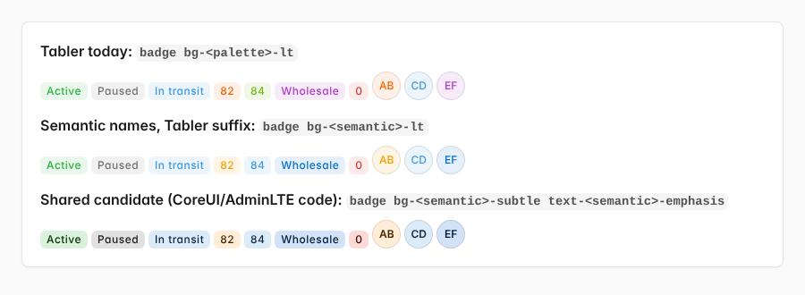
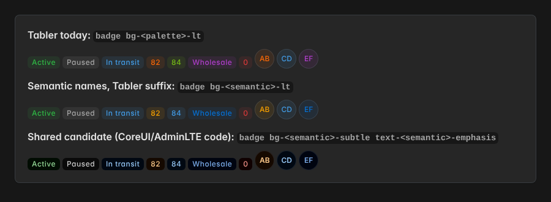

# Sharing the Acme Roasters demo and "Show code" across the theme repos: evaluation and design

**Date:** 2026-11-22
**Status:** evaluation complete, recommendation made. **No implementation authorized.** The maintainer decisions in
[section 12](#12-decisions-the-maintainer-has-to-make) are open; an implementation plan is written only after them.
**Scope:** the `example/` projects of django-crud-views-tabler, django-crud-views-coreui and
django-crud-views-adminlte. Nothing in `src/` of django-crud-views changes under the recommended option.
**Audience:** the maintainer, and an implementer who has not seen the discussion. Everything needed to take over is in
this file; section 14 says how to recompute every number in it.
**Review:** an independent reviewer checked the first draft (`75467ca`) claim by claim against the five checkouts.
Its corrections are applied here. What neither the author nor the reviewer could verify is listed in section 13.

Commits analysed (each repo's `main` on 2026-11-22):

| Short name | Repository | Commit |
|---|---|---|
| core | jacob-consulting/django-crud-views | `ee82aea` |
| ext | jacob-consulting/django-crud-views-extensions | `fd06c91` |
| T | jacob-consulting/django-crud-views-tabler | `307b9d5` |
| C | jacob-consulting/django-crud-views-coreui | `d67be0f` |
| A | jacob-consulting/django-crud-views-adminlte | `83cb1e8` |

## 1. The question

The three theme repos each carry the same demo project, Acme Roasters, in `example/`, and the same "Show code"
feature (a panel on every crud_views page that shows the app's source, and a `/theming/` page that lists the theme's
files). Evaluate ways to share (a) the app code and (b) the "Show code" feature.

Goals, as set by the maintainer:

- **G1** The projects must still be clonable and executable.
- **G2** They must stay easy to understand. A solution that is hard to explain is a no-go.
- **G3** A git submodule is acceptable if the bootstrap Taskfile handles it for users.

Added by this document, from the repos' own rules:

- **G4** One source of truth for whatever is shared: drift must be impossible or caught by a test.
- **G5** What exists today keeps working: the sdists ship `example/`, the nox matrices install the built package,
  T has CI and a public demo on Render.
- **G6** The project-wide Decision Rule in `CLAUDE.md` (developer maintainability is a hard constraint; prefer the
  simplest bounded solution; document unsupported cases).

During the evaluation the maintainer asked: *"what about adding a 4th repo based on bootstrap, just as the example
app in django-crud-views?"* That is option H5 in section 6, and it became the recommendation.

## 2. Summary

1. **The app code is already almost one code base.** Of 4,611 lines of app Python (T), 107 lines differ between the
   two most distant copies. They are colour names, CSS classes, mentions of the theme's name, one A-only tag
   library, five additive lines, the showcase app's coupling to the theme's crispy pack, and one behaviour drift
   (`Order.steps`). One copy (A's, the newest) passes the complete example test suites of T (280 tests) and C (263
   tests) unchanged. Sharing the app Python needs no abstraction layer.
2. **The tests of the four crud apps are nearly theme-neutral too:** 2,522 lines in T, 40 of them different in C.
   The theme-specific test code sits in `dashboard/tests.py` and in `config/`.
3. **Templates are where the themes really differ.** No app template is identical in all three repos. T's are
   written in Tabler's own components and differ from C's in every file.
4. **The decision has three independent parts**, which the options below keep apart: the *seam* (what is shared,
   what stays theme-owned), the *home* (where the shared code lives) and the *transport* (how it reaches a theme
   repo).
5. **Recommendation:** a fourth repository holds the Acme apps and the "Show code" app as one installable package,
   together with a stock-Bootstrap 5 project that makes it runnable and testable on its own (the maintainer's idea).
   The theme repos consume that package the way they consume django-crud-views: a sibling checkout for local
   development, a git install in nox, CI and Render. A theme's `example/` shrinks to what a theme integration
   consists of: settings, templates, CSS, and the theme's own tests.
6. **Honest costs:** a fourth skin to build and keep working, with a test suite of its own; app sources no longer
   sit in the theme repo's working tree; until two themes have switched there is one copy more, not fewer; T shares
   the Python but keeps every template; a theme-driven change to app code becomes a cross-repo change; a theme's
   first PyPI release then also needs the shared package on PyPI.

## 3. Findings

All paths are relative to a theme repo's root unless a repo is named. "T→C" means a diff from T's file to C's.

### 3.1 How a clone runs today

`task up` (Taskfile `install`: `uv sync --extra examples --extra test --extra dev`) only works **next to checkouts of
core and ext**, because `[tool.uv.sources]` in each `pyproject.toml` points at `../django-crud-views` and
`../django-crud-views-extensions` as editable path sources. The READMEs say so ("next to checkouts of ..."). A is
inconsistent: its sources point two levels up (`../../django-crud-views`), so in a flat directory of checkouts A's
`uv sync` fails.

nox, CI and Render cannot see sibling checkouts. They get the two upstream packages in two different ways:

- **core, from GitHub.** T and C install the floating branch: `CRUD_VIEWS = "django-crud-views[...] @
  git+https://github.com/jacob-consulting/django-crud-views@main"` in `noxfile.py`, passed in the same
  `session.install("--no-sources", ...)` call as `.[examples,test]`; T repeats the line in `requirements/demo.txt`.
  Only A pins a commit (`PIN = "75a4285..."` in `noxfile.py`).
- **ext, from PyPI,** through the `examples` extra (`django-crud-views-extensions (>=0.4.0)`).

So "clonable and executable" already means: three clones for local development, or a git install elsewhere. Any
option below is measured against this baseline, not against a self-contained repo.

Only T has `.github/workflows/`, `render.yaml` and `example/config/settings_demo.py` (C's spec lists them as a
follow-up). All three have `noxfile.py` with `examples` and `package` sessions, `scripts/check_dist.py` and
`scripts/check_release_floor.py`. None of the three has a release tag (`git ls-remote --tags origin` is empty for
each), and `check_release_floor.py` refuses a release until the core floor is `>=1.0.0rc1`. **A restructuring now
breaks no released artefact.**

### 3.2 Size and overlap of `example/`

153 distinct tracked paths across the three repos (T 139, C 131, A 133). 76 are byte-identical in all three.

| Category | Paths | Identical in all three | Lines (T) | Changed T→C | Changed C→A | Changed T→A |
|---|---:|---:|---:|---:|---:|---:|
| App Python (models, views, forms, seed, urls, admin, ...) | 61 | 46 | 4,611 | 61 | 56 | 107 |
| App migrations | 16 | 14 | 1,182 | 19 | 19 | 38 |
| App templates | 12 | 0 | 640 | 259 | 104 | 299 |
| App static | 3 | 1 | 57 | 13 | 9 | 11 |
| Tests | 18 | 3 | 3,981 | 628 | 563 | 1,024 |
| `config/` (settings, urls, "Show code", icons, nav) | 22 | 12 | 1,018 | 198 | 315 | 437 |
| Project templates and static | 21 | 0 | 344 | 311 | 278 | 324 |
| **Total** | **153** | **76** | **11,833** | **1,489** | **1,344** | **2,240** |

"Changed" counts differing lines (a file missing on one side counts in full). Apps: `catalog`, `dashboard`,
`roastery`, `sales`, `shipping`, `showcase`.

### 3.3 Every difference in the app Python, and why it exists

Fifteen of the 61 files differ somewhere (fourteen below, and the empty `dashboard/templatetags/__init__.py` that
exists in A only). This is the complete list.

| File | Difference | Kind |
|---|---|---|
| `catalog/seed.py` | 18 flavour-note colours: T `"red"`, `"lime"`, `"azure"`; C and A `"danger"`, `"success"`, `"info"` | colour vocabulary |
| `catalog/models.py` | `card_color`, `stock_color` values (same vocabulary split); help text "A Tabler colour name" / "A CoreUI theme colour name" / "A Bootstrap theme colour name" | colour vocabulary, theme name |
| `sales/models.py` | `AVATAR_COLORS`: T ten Tabler palette names, C and A six Bootstrap theme colours; `Order.steps` in T lacks the `done` key C and A have | colour vocabulary; **behaviour, by drift** |
| `showcase/models.py` | `stock_badge` values; docstring names the theme | colour vocabulary, theme name |
| `roastery/views.py`, `shipping/views.py`, `sales/views/addresses.py`, `sales/views/subscriptions.py` | badge markup: T `badge bg-{}-lt`, C and A `badge bg-{0}-subtle text-{0}-emphasis`, plus the colour names | CSS classes |
| `sales/views/customers.py` | the same badge split; avatar: T and C `avatar avatar-sm`, A `acme-avatar` (AdminLTE has no `.avatar`) | CSS classes |
| `sales/forms.py` | A replaces `<h3 class="card-title">` by `fs-6 fw-semibold mb-3` (AdminLTE floats `.card-title`, A's tracker A17) | CSS classes |
| `dashboard/views.py` | A adds three context values for its info boxes (5 lines) | additive |
| `showcase/views.py` | layout objects imported from `django_tabler.crispy.layout` / `django_coreui.crispy.layout` / `crispy_bootstrap5.bootstrap5`; A sets `form-range` and `form-control-color` on widgets and uses `Field("sku", disabled=True)` for `UneditableField` (15 lines) | **real theme coupling** |
| `showcase/management/commands/seed_demo_showcase.py` | help text names the theme | theme name |
| `dashboard/templatetags/acme.py` | exists only in A, 28 lines (`initials`, `avatar_color`, `icon_class`; T and C get the first two from their shell's tag library) | A only |

Migrations: `catalog/migrations/0003_flavornote_color_help_text.py` exists in C and A, `0004_..._bootstrap.py` in A
only. Both exist **only because the help text names the theme**. `catalog/migrations/0001_initial.py` line 98 still
says "A Tabler colour name" in all three repos.

Two conclusions:

- Of the 107 lines, 48 are not vocabulary: the A-only tag library (28), `showcase/views.py` (15) and
  `dashboard/views.py` (5). The one behaviour difference in the five non-showcase apps is `Order.steps`, and C's and
  A's version is a superset of T's.
- The showcase app is different in kind. Its purpose is to exercise the theme's crispy pack ("It imports layout
  objects from `django_tabler`'s crispy pack, which this form showcase exists to exercise", T
  `templates/project/code_panel.html`).

### 3.4 Spike: one copy of the app Python runs under all three themes' test suites

Done in scratch copies (`git archive HEAD` of T, C and A next to symlinks to core and ext); the repos were not
touched. Python files of the six apps were copied from one theme's example into another's, without tests, without
`showcase/views.py` and without A's `dashboard/templatetags/`. Then `cd example && uv run pytest -n auto`.

| Example project | App Python from | Files replaced | Result |
|---|---|---:|---|
| T | T (baseline) | 0 | 280 passed, 122 subtests passed |
| T | C | 11 | 280 passed, 122 subtests passed |
| T | A | 14 | 280 passed, 122 subtests passed |
| C | C (baseline) | 0 | 263 passed, 307 subtests passed |
| C | A | 8 | 263 passed, 307 subtests passed |

What this proves: A's app Python is functionally a drop-in for T and C. What it does not prove: that the pages look
right. T asserts four badge colour classes (`dashboard/tests.py` lines 760 and 778 to 779, `sales/tests/
test_orders.py` line 347), but all four come from theme class keys; **no T test asserts a colour class that app code
emits**. A's own suite was not run (its path sources need a different directory layout, see 3.1).

### 3.5 The Bootstrap 5.3 colour vocabulary works in all three CSS frameworks

C and A already use `bg-<colour>-subtle text-<colour>-emphasis` with `primary`, `success`, `info`, `warning`,
`danger`, `secondary`, `dark`. Tabler 1.6.1's stylesheet (`@tabler/core@1.6.1`, `dist/css/tabler.min.css`, fetched
from the npm registry) defines `.bg-success-subtle`, `.text-success-emphasis` and `.text-body-secondary`, and also
`.bg-success-lt`, `.bg-warning-lt`, `.bg-primary-lt`, `.bg-info-lt`, `.bg-danger-lt`, `.bg-secondary-lt`,
`.bg-dark-lt` next to its palette names (`.bg-green-lt`, `.bg-orange-lt`).

Rendered with that stylesheet (row 1: T today; row 2: semantic names with Tabler's `-lt`; row 3: the C and A markup):




Row 3 is readable in both modes. It is heavier than Tabler's own style and the palette shrinks from ten avatar
colours to six. Whether that is acceptable for the Tabler demo is a taste decision (D4 in section 12).

### 3.6 Templates

- Ten of the twelve app templates extend `cv_extends` or `crud_views/tags/card.html`, or are snippets. Only
  `dashboard/index.html` and `dashboard/user_list.html` extend the shell (`django_tabler/layouts/app.html`,
  `django_coreui/layouts/app.html`, A: `project/page.html`).
- **Those ten still depend on blocks that only the themes' pages define.** `sales/order_detail.html` and
  `shipping/shipment_detail.html` override `` to add the state badge. `page_title` exists in
  `crud_views_<theme>/page.html` of all three themes, not in core's templates and not in
  `django-crud-views/examples/bootstrap5/project/templates/project/crud_views.html`. Django ignores an override of
  a block the parent does not define, so the badge would silently disappear. The blocks the app templates override
  are `title`, `page_title`, `cv_context`, `cv_content`, `content`, `extra_js` (and the `card_*` blocks of
  `crud_views/tags/card.html`). A's `packing_slip.html` also overrides AdminLTE's `content_header`, to hide the
  page header in print.
- T's markup is Tabler's own (`row-deck row-cards`, `subheader`, `card-actions`, `datagrid`, `card-status-top`,
  `steps steps-counter`). **Every one of T's nine non-dashboard templates of the five apps differs from C's**, by 2
  to 52 changed lines.
- C and A are written in Bootstrap 5.3 utilities. Five of the twelve are byte-identical between C and A; five more
  differ in at most five lines (a comment, `border-top-3` against `border-3`, `avatar` against `acme-avatar`, the
  packing slip's print wrapper). No `data-bs-` or `data-coreui-` attribute occurs in them outside
  `dashboard/user_list.html`.
- Project templates (`templates/project/`, `templates/registration/`, the shell's `includes/`) and `acme.css` are
  the skin itself. None is identical in all three (`code_panel_shell.html` is identical in C and A, `favicon.svg`
  in T and C).

### 3.7 App static files

- `sales/static/sales/sales.js`: identical in all three.
- `dashboard/static/dashboard/revenue-chart.js`: differs in all three, and not by vocabulary. It reads the theme's
  CSS variables (`--tblr-*`, `--cui-*`, `--bs-*`), checks the dark-mode attribute (`data-bs-theme`,
  `data-coreui-theme`) and redraws on a `MutationObserver` (T, A) or on the shell's `ColorSchemeChange` event (C).
  The CSS variable prefix is not core's data prefix (`tblr` is not `bs`), so no existing hook removes this.
- `dashboard/static/dashboard/app.css`: T only (a fix for ApexCharts).

The dashboard's static files belong to the skin, like its two templates.

### 3.8 Tests

Tests live **inside the app directories** (`catalog/tests.py`, `sales/tests/test_orders.py`, ...) and in `config/`.
`example/pytest.ini` collects `tests.py` and `test_*.py`.

| Test group | Files | Lines (T) | Lines (A) | Changed T→C | Changed C→A | Changed T→A |
|---|---:|---:|---:|---:|---:|---:|
| `catalog`, `roastery`, `sales`, `shipping` | 11 | 2,522 | 2,582 | 40 | 75 | 96 |
| `dashboard/tests.py` | 1 | 932 | 1,191 | 344 | 294 | 495 |
| `showcase/tests.py` | 1 | 186 | 186 | 16 | 19 | 30 |
| `config/test_*.py` | 5 | 341 | 288 | 228 | 175 | 403 |

- The tests of the four crud apps differ by 1.6% between T and C. The differences are of one kind: where the theme
  puts things. Examples: `html.index('class="page-body')` (T) against `html.index("<main>")` (C);
  `cv-tabler-section-legend` against `cv-coreui-section-legend` against `class=""`.
- A already wraps this in a helper, `sales/tests/markup.py` (`header()`, `headings()`, `SUBTITLE`): a per-theme
  module that tells a test where the header is. That is a ready pattern for sharing tests.
- `dashboard/tests.py` mixes app behaviour, "Show code" tests and the theme's own integration tests
  (`test_no_tabler_left`, `test_every_page_uses_coreui_classes_only`, layout switch, navigation). Coverage has
  drifted: C and A have page sweeps (`test_every_page_renders`) T lacks.
- The `config/` difference is mostly three T-only files for the Render demo (`test_boot.py`, `test_demo.py`,
  `test_ratelimit.py`, 228 lines).
- Some tests read files by location: `catalog/tests.py` line 204 (T, C) opens `acme.css` through
  `Path(__file__).resolve().parents[1]`. Several guards scan `settings.BASE_DIR` for app code:
  `IconVocabularyTests.test_example_code_names_no_library` (all three), `OriginTests` (C, A), `CoreuiOriginTests`
  (A), `LayoutBoundaryTests` (T). They see nothing once the apps leave `example/`.

### 3.9 The "Show code" feature

Per repo: 361 (T), 361 (C), 380 (A) lines of Python, about 150 lines of templates, 38 lines of JavaScript.

| Piece | File | State |
|---|---|---|
| Collector (reads files, Pygments) | `config/showcode.py` | T and C differ in constants only; A replaces `collect_shell_files()` by `host_package()` |
| Views (`theming`, `code_panel`, `pygments_stylesheet`) | `config/views.py` | T and C differ in constants and prose; A's `theming` passes `host` where the others pass `shell_files` and `shell_lines` |
| Tags (`code_panel_url`, `code_panel`) | `config/templatetags/showcode.py` | identical |
| Routes | `config/urls.py` | identical |
| Panel shell | `templates/project/code_panel_shell.html` | one class differs |
| Panel content | `templates/project/code_panel.html` | icon tag, `data-*-toggle` prefix, header markup, the theme's name in the prose |
| Button and panel on crud pages | `templates/project/crud_views.html` | extends the theme's page; theme-owned |
| Theming page | `templates/project/theming.html` | theme markup and prose; theme-owned |
| Lazy loading | `static/acme/code-panel.js` | one event name differs |
| Panel CSS (`.code-block`, `.code-files`) | inside `static/acme/acme.css` | uses the theme's CSS variables (`--tblr-font-monospace`, `--cui-...`, `--bs-...`) |
| Tests | `dashboard/tests.py::ShowCodeTests` (16 tests in T) | in the 900 to 1,200 line file |

What varies between the themes:

1. Paths: `THEME_DIR` (`src/crud_views_<theme>`), `SHELL_DIR` (`src/django_<theme>`; A has no shell package and
   shows the installed `adminlte-django` version instead).
2. `THEME_SETTINGS`: the `settings.py` assignments shown on `/theming/` (T and C five names, A twelve).
3. `THEME_PACKAGES`: names whose appearance in app code would mean the app knows the theme.
4. `THEME_DOC_URL`, and the titles and prose in `GROUPS` (A's third group is "CSS", the others' "CSS and
   JavaScript").
5. The theme's display name in the panel ("not one line refers to Tabler or the theme").
6. The dark-mode attribute: `data-bs-theme` (T, A), `data-coreui-theme` (C).
7. The collapse event: `show.bs.collapse` (T, A), `show.coreui.collapse` (C); `data-bs-toggle` against
   `data-coreui-toggle`.
8. The icon tag: `` (T), `` (C), `` (A).
9. The CSS variables in the panel's CSS.

Items 6 and 7 are one fact, the theme's data-attribute prefix, and **core already exposes it** (unreleased, since
`95d40dd`, #395): `get_data_prefix()` in `src/crud_views/lib/data_prefix.py`, `` in
`src/crud_views/templatetags/crud_views.py`, and `data-data-prefix` on `#cv-config`
(`src/crud_views/templates/crud_views/tags/cv_config.html`, read in `static/crud_views/js/adapters.js`). Item 8 is
solved by `` with semantic names, as A does. Items 1 to 5 are about a dozen values. Item 9 stays with
the theme.

Four places in the collector are tied to the apps living in `example/` (`T/example/config/showcode.py`):

- `_example_app_dir`: an app counts if `Path(config.path).resolve().parent == EXAMPLE_DIR`.
- `_sources` (line 99): `path.relative_to(EXAMPLE_DIR.parent)` raises `ValueError` for a file outside the theme
  repo. The panel displays that path.
- `code_app_label` (line 122): `type(view).__module__.split(".")[0]` is the app label only while apps are top-level
  modules.
- `own_module_label` (line 128): builds the label of the page's own module from the module path. If it and the file
  labels disagree, the panel silently stops opening on the right file.

And one property of its settings excerpt: it reads `config/settings.py` with `ast` and shows whole top-level
assignments (`settings_excerpt`). A `settings.py` that star-imports a shared base would show nothing there. **This
is a reason to keep each theme's `settings.py` whole and local.**

Its security posture is stated in its docstring and worth keeping word for word: "The set of files is fixed here,
never taken from a request", and the app label is checked against the app registry.

Core's and ext's own examples have a different, simpler feature (`examples/bootstrap5/project/templatetags/
example_tags.py`, `snippet_panels`). It is out of scope here.

### 3.10 Drift that has already happened

- T's `Order.steps` lacks `done`; T's dashboard hard-codes `<span class="badge bg-blue-lt">` where C and A render
  `{{ order.state_badge }}`.
- T has no `catalog` migration `0003`; A has a `0004` the others lack (3.3).
- T's icon vocabulary has 31 keys, C's the same 31, A's 44.
- Bulk actions were planned and built per repo (T `superpowers/plans/2026-11-21-bulk-actions.md`, C the same file
  name, A inside its theme plan).
- The demo-deployment files exist in T only; `boot.py` is a third byte-identical copy of core's and ext's.

C's spec made the copy a conscious choice for that build: "Sharing code with the Tabler project (no common base
package). Copy now" (`superpowers/specs/2026-11-20-coreui-theme-design.md`, non-goals). C's copy is two days old
(first commit 2026-11-20), A's one day.

### 3.11 Packaging, CI and deployment facts that constrain the options

- The sdists ship `example/` (`[tool.hatch.build.targets.sdist] only-include`). `scripts/check_dist.py` checks the
  top-level entries of the sdist and the wheel's packages against an allowlist; it does not look inside `example/`.
- T's Render build is `pip install ".[examples]" -r requirements/demo.txt`, and `demo.yml` deploys an exact commit.
- A PyPI upload cannot carry a git URL in its metadata. That is why core's git URL sits in `noxfile.py` and
  `requirements/demo.txt`, next to the plain requirement in `pyproject.toml`.
- **`scripts/check_release_floor.py` (identical in T, C, A) matches by substring:** `GIT_SOURCE =
  "git+https://github.com/jacob-consulting/django-crud-views"`, tested with `GIT_SOURCE in path.read_text()` over
  `noxfile.py` and `requirements/demo.txt`. A git install line for any repository whose name starts with
  `django-crud-views` trips it, and `publish.yml` runs it first.
- **uv ignores a `[tool.uv.sources]` entry for a package that no dependency or extra names** (tested by the
  reviewer: `uv lock` resolved without it and the source was absent from `uv.lock`).
- **A's pinned core predates the data-prefix hook.** `PIN` is `75a4285` (#392); `data_prefix.py` arrived one commit
  later in `95d40dd` (#395).
- **hatchling and submodules (verified by experiment):** an sdist built from a checkout whose submodule is
  initialised contains the submodule's files. Built from a plain `git clone`, it is silently incomplete: no error,
  the files are just missing.
- **Render and submodules (not verified):** community posts say Render syncs top-level submodules automatically and
  does not recurse. No official documentation was found.
- Core 0.30.0 and ext 0.4.0 are on PyPI. The name `acme` is taken there (certbot's ACME library).

### 3.12 Precedents in these repos

- **Semantic names with a per-theme table:** `example/config/icons.py` (`ACME_ICONS`), introduced so that "the two
  Acme copies stay identical" (C's spec, goal 4).
- **App-declared class keys that a theme or project overrides:** `AppConfig.crud_views_button_class_defaults`,
  documented in core's `docs/reference/buttons.md` ("button classes = core defaults + installed-app defaults +
  theme registrations + `CRUD_VIEWS_BUTTON_CLASSES`"). Core's own workflow app declares its badges this way
  (`src/crud_views_workflow/apps.py`: `workflow:badge-success` and seven more). Lookup: `get_button_class()` and
  ``.
- **Vendoring by script with a parity test:** `scripts/vendor_templates.py`, `HAND_EDITED`, `test_pack_parity.py`
  for the crispy packs.
- **A git install of an unreleased dependency** next to a plain requirement: core (3.1).
- **Template shadowing as the theme mechanism:** a theme app listed before `crud_views`; a project's `DIRS` before
  app directories.
- **Read-only upstream checkouts with a tracker** in every theme repo's `CLAUDE.md`.

## 4. The decision has three parts

| Part | Question | Options |
|---|---|---|
| Seam | Which files are shared, which stay with the theme, and how does a theme's difference get in? | section 5 |
| Home | Where does the one copy live, and can it run there? | H1 to H5, section 6 |
| Transport | How does the shared code reach a theme repo's `example/`? | T0 to T6, section 7 |

The seam is the same for every home and every transport, and it is where a design would go wrong. Home and
transport are logistics.

## 5. The seam

### 5.1 Proposed split

| Area | Owner | Why |
|---|---|---|
| App Python of `catalog`, `dashboard`, `roastery`, `sales`, `shipping`, with migrations | **shared** | 3.3, 3.4 |
| `sales/static/sales/sales.js` | **shared** | 3.7: identical |
| The nine templates of those apps that do not extend a shell, written in Bootstrap 5.3 | **shared, as defaults** | 3.6: C and A nearly agree already |
| A theme's own version of one of those nine | **theme**, as an override in `example/templates/<app>/` | Django's `DIRS` wins over app directories; the mechanism the themes already rely on |
| `dashboard/index.html`, `dashboard/user_list.html`, `revenue-chart.js`, T's `app.css` | **project** (every theme, and the Bootstrap project), in `example/templates/dashboard/` and `example/static/dashboard/` | 3.6, 3.7: they extend the project's shell and read its CSS variables |
| "Show code" collector, views, routes, tags, script, default templates | **shared** | 3.9 |
| `showcase` app | **theme**, unchanged | 3.3: it exists to exercise that theme's crispy pack |
| `config/settings.py`, complete | **theme** | 3.9: the theming page shows it; it is the integration recipe |
| `config/icons.py`, navigation (`acme_nav.py`, `menu.py`), shell includes, `acme.css` (with the panel's CSS), login page | **theme** | they are the skin |
| Tests of app behaviour | **shared**, run where the shared code lives | 3.8: 1.6% theme-specific |
| Tests of a theme's markup, layout and navigation, and its page sweep | **theme**, in `example/tests/` | 3.8 |

**The page contract.** A project's `CRUD_VIEWS_EXTENDS` template must define the blocks `title`, `page_title`,
`cv_context`, `cv_content`, `content` and `extra_js` (3.6). All three theme pages do. The Bootstrap project's page
must too, which core's own example page does not. The shared code's tests assert that the state badge appears in
the order title, which fails if `page_title` is missing.

**Rules for shared code**, written into its `CLAUDE.md` and enforced by tests there:

1. It never names a theme, in code, help text or comments (ported from the guards in 3.8, which then scan the
   package instead of `settings.BASE_DIR`).
2. It emits only Bootstrap 5.3 classes and `acme-*` classes. A theme that needs something else overrides a template
   or styles `acme-*` in its `acme.css`.
3. It never imports the project package. Three places do today and are cut when the code moves:
   `dashboard/templatetags/acme.py` imports `config.icons` (A); `config/login_required.py` carries the literal
   `"config.login_required.LoginRequiredMiddleware"`; `config/templatetags/showcode.py` imports `config.showcode`.
   `FORMAT_MODULE_PATH = ["config.formats"]` in settings changes with them.
4. It imports no crispy template pack: not a theme's (`django_tabler.crispy`, `django_coreui.crispy`) and not
   `crispy_bootstrap5` either (5.4). Forms use Django's widgets and fields, `crispy_forms`, `crud_views.lib.crispy`
   and the widgets of django-crud-views-extensions.

One known reference stays: `dashboard/seed.py` has `OWNER_APPS = ["auth", "catalog", "sales", "roastery",
"showcase"]` and filters permissions by app label. A label with no installed app matches nothing, so it works with
and without a showcase app. It gets a comment.

### 5.2 Alternatives for the colour and badge differences

| | Approach | Judgment |
|---|---|---|
| a | Bootstrap 5.3 semantic colours and `bg-*-subtle text-*-emphasis` everywhere; `acme-avatar` for avatars | **Proposed as the start.** Zero new code. Proven by 3.4 and 3.5. Costs Tabler's ten-colour palette and its lighter badge style. |
| c | The shared apps declare class keys (`acme:badge-success`, ...) with Bootstrap defaults through `crud_views_button_class_defaults`; T's example overrides them in `CRUD_VIEWS_BUTTON_CLASSES`; app code calls `get_button_class("acme", ...)` | **The upgrade if D4 is "no".** A documented core mechanism that core's workflow app uses for exactly this (3.12). Keeps T's look. Costs one declaration table and an indirection at each of the six badge call sites, visible in "Show code". |
| b | Semantic tones in app code and a hand-written per-project table that maps tone to class | Rejected: it re-implements (c). |

### 5.3 Why not share more in the first step

- **Settings base module:** rejected. It breaks the theming page's excerpt (3.9) and hides the one file a reader of a
  theme repo most wants to read whole.
- **Showcase:** sharing it needs a seam for three layout objects plus widget attributes that differ in substance for
  A (the theme packs add `form-range` in `field.html`, stock crispy-bootstrap5 needs it on the widget). Fifteen
  differing lines do not pay for that. Documented as not shared; revisit if a fourth theme copies it.
- **Navigation data:** T and C define the menu in `acme_nav.py` (134 and 121 lines), A in `menu.py` for
  adminlte-django's own menu format. Two formats, three consumers. Left alone.
- **Deleting the themes' copies of the behaviour tests at once:** they pass against shared code (3.4), so they stay
  until the shared suite has run for a while (stage 5).

### 5.4 Forms, the crispy pack and its Python classes

Each theme keeps its crispy template pack and selects it in its own settings: `CRISPY_TEMPLATE_PACK` is
`"crispy_tabler"` (T), `"crispy_coreui"` (C), `"bootstrap5"` (A). The proposal does not touch the packs. The question
(raised by the maintainer) is the Python a pack brings with it, which shared form code cannot import.

What exists. T and C each ship nine classes under `src/django_<theme>/crispy/`; A ships none.

| Module | Classes | Why they exist |
|---|---|---|
| `layout.py` | `FloatingField`, `Switch`, `UneditableField` | `crispy_bootstrap5.bootstrap5.FloatingField` and `Switch` hard-code `bootstrap5/layout/...`; the subclasses set `template = "%s/layout/..."` so the pack is followed. `UneditableField` swaps a Bootstrap 2 class. |
| `widgets.py` | `RangeInput`, `ColorInput`, `PlaintextInput` | input types the pack's `field.html` recognises (`field\|is_range`, `field\|is_color`) and a display-only widget |
| `fields.py` | `RangeField`, `ColorField`, `PlaintextField` | form fields that use those widgets |

The two copies are the same code: `fields.py` is byte-identical in T and C, `layout.py` differs in one word of a
docstring, `widgets.py` in one template path (`crispy_tabler/widget/plaintext.html`).

Who uses them.

- **The five shared apps use none of them.** They instantiate Django's own classes (`forms.NumberInput`,
  `forms.CheckboxSelectMultiple`, `forms.ModelChoiceField`, ...), `crispy_forms.layout` (`Layout`, `Row`, `Div`,
  `HTML`), `crispy_forms.bootstrap.InlineCheckboxes` (its template is `%s/layout/...`, so it follows the pack),
  `crud_views.lib.crispy` (`Column2` to `Column12`, `CrispyModelForm`, ...) and, from
  django-crud-views-extensions, `DatePickerInput`, `TypeaheadField`, `TypeaheadSelect`. Those are the same classes
  under every theme.
- Three of their four form modules are byte-identical in all three repos today and render through three different
  packs. The fourth, `sales/forms.py`, differs in one heading class (3.3).
- **`showcase/views.py` is the only user**, and only of the three layout objects. This is why showcase stays with
  the theme (D3). A's version cannot use them at all: it takes `FloatingField` and `Switch` from
  `crispy_bootstrap5` and replaces `UneditableField` by `Field("sku", disabled=True)`.
- No example app uses the packs' widgets or fields. They appear only in the packs' own tests and docs.

What follows.

- Today there is no conflict: nothing that would be shared imports a theme's Python class.
- It is a standing limit, enforced by rule 4 of 5.1: **a shared Acme form cannot contain a switch, a floating
  label, or the packs' range, colour and plaintext widgets.** A page that needs one belongs in the theme's showcase.
- The stock objects are no way around it. `crispy_bootstrap5.bootstrap5.Switch` in shared code would render
  `bootstrap5/layout/switch.html` under every pack and bypass T's and C's own templates.
- If the limit ever hurts, the fix is upstream, not a seam in the demo: pack-neutral `FloatingField` and `Switch`
  (the `"%s/..."` template, which also resolves under the stock `bootstrap5` pack) in `crud_views.lib.crispy`. Core
  already depends on crispy-bootstrap5, and T and C would drop their two subclasses. That changes core's `src/`,
  so it is a separate issue and not part of this design. It would not cover range and colour inputs: stock
  crispy-bootstrap5's `field.html` does not add `form-range`, which is why A sets it on the widget.
- The maintainer proposed a seam in the demo after all, and it is better than the ones rejected in 5.3: see 5.5.

### 5.5 The adapter port (`acme_adapter`): the maintainer's proposal

**The proposal.** Every project (the three themes and the Bootstrap project) has a package
`example/acme_adapter/` with the modules `fields`, `widgets` and `layout`. A shared form takes every
theme-dependent class from there and nowhere else: `from acme_adapter.fields import DateField`. A theme's adapter
re-exports the theme's classes; the Bootstrap project's adapter maps the same names to Django, crispy-bootstrap5
and django-crud-views-extensions. The scenario behind it: each theme ships its own `DateField` and `DateTimeField`
in `django_<theme>`, each with a different JavaScript backend and its own assets.

**What the code says.**

- *The import works wherever `config` does.* `example/` is on the import path in every entry point: the Taskfile
  runs `uv run python example/manage.py`, `example/pytest.ini` has `pythonpath = .`, the nox `examples` session
  does `session.chdir("example")`, Render runs `cd example && ... gunicorn config.wsgi`. The sdist ships it with
  `example/`.
- *Spike, on the one case that exists today (the showcase, 5.4).* In scratch copies of T and C: an `acme_adapter`
  with `layout.py` (re-exporting the pack's `FloatingField`, `Switch`, `UneditableField`) and `widgets.py`
  (`RangeInput`, `ColorInput`); `showcase/views.py` switched to import from it and to use the two widgets. T's and
  C's `showcase/views.py` then differ only in a docstring's file reference and in the badge classes, the same
  vocabulary difference as everywhere else (3.3). The showcase tests (11) and the whole example suites (280 and
  263) pass in both. A was not run; its adapter would define `UneditableField` as `Field(name, disabled=True)` and
  give `RangeInput` and `ColorInput` the classes stock crispy-bootstrap5 does not add.
- *The date scenario is not in the code.* No theme ships a date field or widget. The five apps use the extension's
  `DatePickerInput()` in nine places, every time without an argument: six in a ModelForm's `Meta.widgets`, three as
  `forms.DateField(widget=DatePickerInput())`. No theme has a single CSS rule for that picker. The tests post dates
  as ISO strings (`"2026-11-04"`) and as `""`.
- *What a date widget has to do in this ecosystem,* read off the extension's
  `crud_views_widget_datetimepicker` (300 lines of Python, plus JavaScript): deliver its assets through core's
  asset registry and not through `Media`, because modal content is injected after the page loads; initialise on
  document ready, on `cv:modal:loaded` and on `cv:formset:row-added` (core also fires `cv:modal:unload`); keep
  "what the picker writes, the form accepts" in every locale (`formats.py`); vendoring command and system checks
  (`crud_views.E332`, `E333`, `W330`, `W331`).
- *Nothing would notice a picker that skips those hooks.* The demo's modal views are delete confirmations and no
  formset row has a date, and the theme repos have no JavaScript test tooling (core has vitest).

**Judgment.**

- **The seam is right.** It is a plain import: greppable, navigable in an editor, traceable. It is how Django's own
  reusable apps reach the project (`settings`, `ROOT_URLCONF`), and it is the icon table of `config/icons.py`
  (fixed keys, per-project values) applied to classes. It replaces rule 3 of 5.1 by "shared code reaches the
  project only through `acme_adapter`" and makes rule 4 livable.
- **It pays today, for the showcase.** With the port, the showcase's Python can be shared (D3 flips), and A's
  widget-attribute difference becomes A's adapter instead of an `if` in shared code. The showcase's template and
  tests stay per theme (3.6, 3.8).
- **For dates it answers a question the code has not asked.** The expensive decision is not the adapter. It is
  three date implementations, each repeating what the extension's app does, with no automated check of the
  JavaScript. That runs against the direction taken so far: one widget in the extensions repo, themed through
  `--cv-*` tokens (the typeahead). Nobody has yet tried the cheap thing for the date picker, which is to style it.

**What the proposal leaves open.** None of this is a reason against it; all of it has to be decided before code.

1. **The contract is implicit and has four implementations.** One written definition belongs in the shared
   package: the names, their constructor arguments and what they guarantee. A system check shipped by the shared
   package verifies at startup that `acme_adapter` exports them, so a missing name is a clear error and not an
   `ImportError` in a form module (the themes have such checks: `crud_views_coreui.E002`).
2. **Guarantees the code already relies on:** usable in a ModelForm; ISO input accepted, whatever the picker
   displays; no backend-specific constructor argument (a dict of xdsoft options cannot cross the port; today there
   is none).
3. **Widget level, not field level.** Six of the nine uses are `Meta.widgets` entries: Django builds the field
   from the model (label, `required`, help text, validators) and the form only swaps the widget. A port of fields
   forces `Meta.field_classes` on every ModelForm. `from acme_adapter.widgets import DateInput` leaves the forms
   as they are, and the extension shows that the format invariant can live in the widget. `fields` then holds only
   what really is a field (`RangeField`, `ColorField`).
4. **Forms only.** A model field from the adapter would put `acme_adapter.fields...` into shared migrations.
5. **Leaf widgets only.** `TypeaheadField` is a field, a widget, a lookup registry, signed tokens and an endpoint
   (`/_typeahead/`). A theme's own select cannot be swapped in through a re-export.
6. **The shared suite sees one adapter.** It runs against the Bootstrap project's. A theme's adapter is tested only
   in that theme. So the shared package ships a contract test (render, submit ISO, submit empty, initial value,
   ModelForm) that every repo runs against its own adapter, and "each behaviour test exists once" (stage 5) does
   not hold for forms that use the port.
7. **The demo's message changes.** The panel says "Plain django-crud-views: not one line refers to Tabler or the
   theme". A form that imports `acme_adapter` is not what a user would write: they import the theme's class
   directly. "Show code" has to show the adapter module with the app, and the sentence has to say so.
8. **The port is the intersection.** A shared form can use only what all four adapters export. Adding a name is a
   change in four repositories. What only one theme can do stays in that theme's own pages.

**Recommendation.** Adopt the port for what needs it today: `layout` (`FloatingField`, `Switch`, `UneditableField`)
and `widgets` (`RangeInput`, `ColorInput`), with points 1, 4, 6 and 7. Leave dates on the extension's picker; add
`DateInput` to the port when the first theme really ships one. If the port proves itself, it is the downstream
prototype of a core hook (a widget registry next to `register_icons` and `register_button_classes`), after which
app code would be plain django-crud-views again. That is D6.

## 6. Home: where the one copy lives

| | Home | Runs on its own | Judgment |
|---|---|---|---|
| H1 | One theme repo is canonical, the others take from it | yes | **Rejected.** Another theme's example would depend on a repo that ships a different theme. No theme is neutral: T is furthest from the other two. |
| H2 | `django-crud-views/examples/acme/` | only with a stock skin | **Rejected.** Acme needs django-crud-views-extensions (datetimepicker, typeahead). Core's `pyproject.toml` has no such dependency, and ext depends on core: core's example would depend on its own downstream. Core's sdist ships `examples/`, so it would grow by the whole demo. |
| H3 | `django-crud-views-extensions/examples/acme/` | only with a stock skin | **Rejected.** The dependency direction is right, the meaning is wrong: that repo is the incubator for `crud_views_widget_*` apps. |
| H4 | A fourth repo with only the shared package | no | **Rejected.** Code nobody can run where it lives: its tests could only run downstream, three times. |
| H5 | A fourth repo: the shared package **and** a stock-Bootstrap 5 project around it | yes | **Recommended** (the maintainer's proposal). |

### H5 in detail

A new public repository, working name `django-crud-views-acme` (D2). It holds the Acme apps and "Show code" as a
package, and an `example/` project that runs them on django-crud-views' stock Bootstrap 5 theme, the way
`django-crud-views/examples/bootstrap5` runs core's feature examples: a `base.html` that loads Bootstrap from the
CDN, a navigation, a sign-in page, `CRISPY_TEMPLATE_PACK = "bootstrap5"`. Unlike core's example page it defines the
page contract of 5.1.

What it buys:

- The shared code is developed and tested where it lives. A change to an app has one test run that matters first.
- No theme is special. The dependency chain reads in one direction: core, ext, acme, then a theme's example.
- It matches the vocabulary finding (3.5, 3.6): Bootstrap 5.3 is already the common denominator. A's example is
  nearly this project with AdminLTE's shell around it.
- django-crud-views gets a realistic whole-application demo on its stock theme. Core's own example is a set of
  feature mini-apps.

What it costs, judged hard:

- **It is new code, and a test suite.** A Bootstrap shell (base, navigation, sign-in, dashboard, users page), its
  CSS, and tests: 600 to 900 lines of templates, mostly adapted from A, 200 lines of settings. The tests are the
  larger part: A's tests of the four crud apps (2,582 lines), its "Show code" tests and its page sweep are ported,
  with a `markup.py` for the Bootstrap page. Without them H5 would be H4 with a nicer front page.
- **Part of the shared "Show code" app cannot be tested there.** The Bootstrap project has no theme package, so the
  theming page and the `shell_dir` and `host_package` branches run only in the theme repos. Their tests stay there.
- **Four skins to keep working instead of three.** Every new demo page needs a Bootstrap version first.
- **One more repository** with a Taskfile, noxfile, `CLAUDE.md`, linting, a release-floor guard of its own (it uses
  core hooks that are not on PyPI yet), and later CI.
- **Scope creep is the real risk:** its own docs site and its own Render demo. Neither is needed for the goal.
- It replaces about 5,700 duplicated lines per theme repo (app Python and migrations without `showcase`, and the
  shared part of "Show code"), and later about 2,500 lines of tests, but only once the themes switch.

H5 does not choose a transport. That is section 7.

## 7. Transport: how the shared code reaches a theme repo

Scores: `++` clearly good, `+` fine, `-` a cost, `--` a serious cost.

| | Transport | G1 clone and run | G2 easy to explain | G4 one source | G5 keeps CI, sdist, Render | Verdict |
|---|---|---|---|---|---|---|
| T0 | Keep three copies | ++ | ++ | -- | ++ | Rejected: 3.10 |
| T1 | Copy by script, parity test | ++ | + | - | ++ | Fallback |
| T2 | `git subtree` | ++ | - | - | ++ | Rejected |
| T3 | Git submodule | + | - | ++ | - | Viable, not recommended |
| T4 | Installed package, sibling checkout plus git install | + | + | ++ | + | **Recommended** |
| T5 | Monorepo of all themes | -- | + | ++ | -- | Rejected |
| T6 | Symlinks; copier or cookiecutter | -- | -- | + | -- | Rejected |

### T0. Keep three copies

Costs nothing today and needs no explanation. But 3.10 is the bill after two days: a feature built three times, a
behaviour difference in `Order.steps`, diverging migrations, diverging test coverage. It gets worse with every
feature. Rejected.

### T1. Copy by script, with a parity test (vendoring)

Each theme repo keeps real files in `example/`. A script copies them from a checkout of the home repo and writes a
manifest of hashes. A test fails when a copied file no longer matches its manifest hash. It is the crispy-pack method
(3.12) applied to the demo.

- For: nothing changes for a user, for CI, for the sdist, for the release-floor guard or for Render. A theme repo
  stays complete by itself. Tests can stay in the app directories. This is the lowest-risk option.
- Against: three copies stay in three histories, so every shared change is still three commits with large diffs.
  "Do not edit these files here" is a convention, held up only by the manifest test. An agent fixing a theme bug
  will edit the copy in place and then regenerate the manifest to make the test pass. Drift is detected, not
  prevented.
- Verdict: the fallback if the maintainer weighs a self-contained theme repo above a structural single source (D1).

### T2. `git subtree`

The same outcome as T1 (real files in each repo), with git's machinery in place of a 40-line script. The merge
commits, the `--prefix` and `--squash` rules and the behaviour on a local edit are harder to explain than "a script
copies the files". No advantage over T1 here. Rejected.

### T3. Git submodule

The home repo is mounted inside each theme repo, for example at `example/acme/`. G3 allows it.

- For: one source by construction. The mounted commit is a pin that lives in git, in one place per theme repo. Files
  are on disk under `example/`. No git URL in `noxfile.py`, so the release-floor guard is not involved.
- Against, each point checked against these repos:
  - A submodule mounts a whole repository. With H5 the mount contains the Bootstrap project as well, so the package
    is not importable from `example/` without a path entry or a path install of the mount. The second variant is T4
    with a submodule as the delivery vehicle.
  - An sdist built from a checkout without the submodule is silently incomplete (3.11). `check_dist.py` would need
    to look inside `example/` for a witness file, and every `actions/checkout` step needs `submodules: true`.
  - Render's behaviour is unverified (3.11).
  - GitHub's "Download ZIP" contains no submodule content.
  - Local work on all three themes means three working copies of the shared repo, one per mount, plus a fourth for
    its own development. "Which copy did I edit" is a new way to lose an afternoon, and the maintainer's present
    setup (one sibling checkout per upstream) does not have it.
  - It adds a second mechanism without retiring the first: core and ext remain sibling checkouts.
- Verdict: workable, and the maintainer said it is acceptable. Not recommended, because it is the more complicated
  of two options that both give one source.

### T4. Installed package: sibling checkout locally, git install elsewhere

The home repo builds a distribution with one import package. A theme repo consumes it the way it consumes core:
named as a requirement, a path source for local development, a git URL passed alongside in nox and Render.

```toml
# <theme>/pyproject.toml
[project.optional-dependencies]
examples = ["django-crud-views-acme", ...]        # named from the day of the switch, or uv ignores the source

[tool.uv.sources]
django-crud-views-acme = { path = "../django-crud-views-acme", editable = true }   # A: ../../
```

```python
# <theme>/noxfile.py, passed in the same session.install() as CRUD_VIEWS; the identical line in requirements/demo.txt
ACME = "django-crud-views-acme @ git+https://github.com/jacob-consulting/django-crud-views-acme@<commit>"
```

How this compares with what exists (3.1): it is core's pattern, not ext's (ext comes from PyPI). It differs from T's
and C's core line in one respect that matters: **it pins a commit, as only A does today.** A theme overrides the
shared pages, so a theme and the shared code must move together; a floating `@main` would break themes at a
distance.

- For:
  - **One more instance of a pattern the theme repos already document,** not a new mechanism. "The demo's apps come
    from a package, like django-crud-views itself" is one sentence.
  - One working copy of the shared code on the machine. An edit is live in all three demos at once, because the
    install is editable.
  - The boundary is structural: there is nothing in a theme repo to edit by mistake. It fits the rule the theme
    repos already have ("both checkouts are read-only for this repo: gaps are worked around here and logged").
  - The theme repo's `example/` becomes exactly what a theme integration consists of. "The app code never imports
    the theme" is then true by construction.
- Against:
  - **The app sources are not in the theme repo.** A reader of T on GitHub sees settings and templates, and has to
    follow a link for the models. The running demo's "Show code" panel covers the gap; a ZIP download does not.
  - **The theme's tests have to leave the app directories** (3.8), and "Show code" has four places to adapt (3.9).
    Both are spelled out in sections 8 and 10.
  - **`check_release_floor.py` blocks every theme release as soon as the acme git line exists** (3.11). It must
    match core's repository exactly. The guard's question, "do the tests run against code PyPI users cannot get",
    then has to be answered for acme too: see the next point.
  - **A theme's first PyPI release needs acme on PyPI,** because the published `examples` extra names it. The
    alternative is to keep it out of published metadata (a dependency group in place of the extra, which changes the
    Render build command). Either way it is work that T0 and T1 do not have.
  - A third sibling checkout for local development. A stranger's `task up` fails without it, as it already fails
    without the other two (3.1).
  - Local runs use the sibling's HEAD, nox uses the pin. "Green locally, red in the matrix" becomes possible for
    acme as it already is for core. `task test:matrix` is the guard, as today.
  - The pin lives in two files per theme repo and must be identical in both, or the resolver rejects the install.
  - The new repository must be public, or CI and Render cannot install from it.
- Verdict: recommended.

### T5. Monorepo of all themes

One repository, `themes/tabler`, `themes/coreui`, `themes/adminlte`, one `example/` with a settings module per
theme. It makes the problem disappear: one copy, atomic commits. It also ends "three projects that can each be
cloned", merges three histories, three release cycles and three support matrices (A needs Django 6.0 and
django-components with `APP_DIRS = False`), and puts the licence hygiene rules of C (no CoreUI PRO material) and T
(the paid Tabler archives) into one history. It contradicts G1 as stated. Rejected.

### T6. Symlinks, copier, cookiecutter

Symlinks to a sibling break in the sdist, in CI, on Render and on Windows. A copier or cookiecutter template turns
the canonical source into Jinja-templated Python that cannot run where it lives. Rejected.

## 8. "Show code": where it is shared

| | Option | Judgment |
|---|---|---|
| S1 | An app `showcode` in the shared package, configured by one settings dict | **Recommended.** Same home and transport as the apps: one mechanism for both questions. |
| S2 | A new opt-in app in core (`crud_views_showcode`) | Rejected for now. It would put a view that reads source files from disk into a library every user installs, and commit core to its API before 1.0, for a feature only demos need. Under the Decision Rule it can be proposed later, once S1 has proven itself and core's and ext's examples want it. |
| S3 | An app in django-crud-views-extensions | Rejected. Not a widget, and not an extension of crud_views. |
| S4 | Three copies made byte-identical, with a parity test | The T1 variant. Only if T1 is chosen for the apps. |

Shape of S1 (the plan fixes the names):

```python
# <theme>/example/config/settings.py
INSTALLED_APPS = [..., "acme_roasters.showcode", ...]
ACME_SHOWCODE = {
    "theme_name": "Tabler",                                       # the panel's prose; None: no theme sentence
    "theme_dir": BASE_DIR.parent / "src" / "crud_views_tabler",   # listed on /theming/; None: no theming page
    "shell_dir": BASE_DIR.parent / "src" / "django_tabler",       # counted, not shown; None for a third-party shell
    "host_package": None,                                         # A: ("adminlte-django", "django_adminlte4", url)
    "theme_packages": ("django_tabler", "crud_views_tabler"),     # names an app's code must not contain
    "settings": ("INSTALLED_APPS", "CRISPY_TEMPLATE_PACK", "CRUD_VIEWS_EXTENDS", ...),   # shown on /theming/
    "project_apps": ("showcase",),                                # project-local apps that also get a panel
    "docs_url": "https://django-crud-views-tabler.readthedocs.io/en/latest/theme_internals/",
}
```

How the four location-bound places of 3.9 change:

| Today | In the shared app |
|---|---|
| An app counts if its directory's parent is `EXAMPLE_DIR` | Every app config inside the shared package except `dashboard` and `showcode`, plus the labels in `project_apps` |
| App label from `type(view).__module__.split(".")[0]` | `apps.get_containing_app_config(type(view).__module__).label` |
| File label and own-module label built from module paths | Both built the same way: app label, then the path relative to the app's directory. They must match, and a test asserts that the panel opens on the page's own module |
| Displayed path relative to the theme repo root | Relative to the theme repo root for project files; for package files, relative to the package's parent (`acme_roasters/sales/views/customers.py`) |

And the rest:

- Templates shown for an app: for each template under the app's `templates/`, the project's override if there is
  one, otherwise the app's default. That is the file Django renders.
- Dark-mode selector, toggle attributes and the collapse event come from core's data prefix (3.9). The icon comes
  from `` with the semantic names `code` and `theming`, which T and C add to `ACME_ICONS`.
- The theming page takes the theme's shell files (`shell_dir`) or its host package (`host_package`), whichever is
  set. Its group titles and prose (`GROUPS` in `config/views.py`) move into the theme's own
  `showcode/theming.html`.
- The panel's CSS stays in each project's `acme.css` (3.9, item 9).
- The docstring's guarantee stays: the file set is fixed in code and settings, never taken from a request.

## 9. Recommendation

**H5 + T4 + S1**, with seam 5.1 and colour approach 5.2 (a).

A fourth repository holds a package (five apps and `showcode`) and a stock-Bootstrap project that runs and tests it.
The three theme repos depend on that package like they depend on core, keep `showcase`, `config/`, their templates
and their own tests, and override the app pages they restyle.

### 9.1 Target layout

```
django-crud-views-acme/                 # working name (D2); public
  pyproject.toml                        # dist django-crud-views-acme; wheel: src/acme_roasters
  src/acme_roasters/
    catalog/ dashboard/ roastery/ sales/ shipping/
      apps.py                           # name "acme_roasters.sales"; the app label stays "sales"
      models.py views*.py forms.py seed.py urls.py admin.py migrations/
      templates/<app>/*.html            # the pages in plain Bootstrap 5.3 (none for dashboard, see 5.1)
      static/sales/sales.js             # sales only
    dashboard/templatetags/acme.py      # initials, avatar_color: no import of the project
    showcode/                           # collector, views, urls, tags, code-panel.js, default templates
    login_required.py  formats/         # identical in all three config/ today
    urls.py                             # the app and showcode includes that config/urls.py repeats today
  example/                              # the stock-Bootstrap project: task up runs it
    manage.py  pytest.ini
    config/settings.py urls.py icons.py
    templates/project/base.html nav.html crud_views.html   registration/login.html
    templates/dashboard/index.html user_list.html          # extend project/base.html
    static/acme/acme.css favicon.svg   static/dashboard/revenue-chart.js
    tests/                              # behaviour tests of the apps and of showcode, markup.py, the rule guards
  Taskfile.yaml  noxfile.py  CLAUDE.md  README.md

django-crud-views-<theme>/example/      # after the switch
  manage.py  pytest.ini
  config/settings.py urls.py icons.py   # plus acme_nav.py or menu.py; T: settings_demo.py, boot.py, ratelimit.py
  showcase/                             # theme-owned, unchanged, with its tests
  templates/
    project/crud_views.html             # the theme's page plus the "Show code" button
    <shell>/includes/*.html             # branding
    registration/login.html
    dashboard/index.html user_list.html # the project's own: they extend the shell
    sales/ catalog/ ...                 # overrides, only for the pages this theme restyles
    showcode/theming.html               # the theme's own prose and markup
  static/acme/acme.css   static/dashboard/revenue-chart.js
  tests/                                # this theme's markup, layout, navigation, page sweep, theming page
```

Why a namespace and not top-level `sales`, `catalog`: an installed distribution that puts `sales`, `catalog`,
`dashboard` and `shipping` at the top of `site-packages` invites name clashes. Why `acme_roasters` and not `acme`:
`acme` is certbot's package on PyPI (3.11). Every `apps.py` sets only `name`, so the app label stays `sales`, and
permission names (`sales.add_order`), migration dependencies, content types and URL names do not change.

### 9.2 What the rename touches

Counted in A for the five shared apps (T and C are within one or two lines):

| What changes | Count |
|---|---:|
| Imports of another app by top-level name, in non-test Python (`from sales.models import ...`) | 17 lines in 11 files |
| The same in tests | 43 lines in 10 files |
| `roastery/migrations/0001_initial.py`: `import roastery.models` and seven `roastery.models.validate_score_step` | 8 lines |
| `include("<app>.urls")` in `config/urls.py`; `INSTALLED_APPS` entries | 5 and 5 |
| `import_module(f"{app}.seed")` in `seed_demo.py` (`SEED_APPS` holds labels) | 1 |
| `mock.patch("shipping.resources.fetch_shipments")` in `dashboard/tests.py` | 1 |
| The settings import and the middleware literal of `login_required`; `FORMAT_MODULE_PATH` | 3 |

What does not change: 15 permission strings, 12 migration dependency tuples, about 29 `to="app.model"` strings in
migrations, the typeahead lookup name `"sales.customers"`, `OWNER_APPS`, URL names, the `dashboard:` namespace.

### 9.3 What each theme keeps of the templates

| Theme | Overrides of the nine default pages | Reason |
|---|---|---|
| A | about one (`packing_slip.html`, for AdminLTE's `content_header`) | the defaults are derived from A |
| C | few; to be found in the browser (candidate: `product_card.html`, for `border-top-3`) | Bootstrap fork, same class names |
| T | **all nine** | Tabler's own components (3.6) |

Every theme also keeps its two dashboard templates and `revenue-chart.js`. For T, sharing covers the Python, the
migrations and "Show code". Its templates stay its own. Replacing them by the defaults would give up the Tabler look
and is not proposed.

### 9.4 What changes for each goal

- **G1:** a theme repo still clones and runs with `task up`, next to three sibling checkouts where it needs two
  today. The new repo clones and runs next to two. Optional and outside this design: once core 1.0 is on PyPI, a
  `uv sync --no-sources` path could give a stranger a run with no sibling at all.
- **G2:** one sentence per repo. Acme repo: "the demo's apps, and a plain Bootstrap project to run them". Theme repo:
  "`example/` is the skin; the apps come from django-crud-views-acme".
- **G4:** one copy of app code and of "Show code". A theme cannot drift: it has no copy. The rules of 5.1 are tests.
- **G5:** nox and Render gain one git line each, of the kind they have for core; `check_release_floor.py` changes
  (3.11); the sdists still ship `example/`, which is now the skin; `check_dist.py` does not change.

### 9.5 Where this recommendation is weakest

1. **It pays off late.** After stage 1 there are four copies. The first saving comes with the first theme's switch,
   the real saving with the second. If the work stops after stage 1, it made things worse.
2. **The fourth skin and its test suite are permanent work**, justified only because the alternative is shared code
   that cannot run where it lives.
3. **Behaviour tests exist four times until stage 5.** The themes keep their copies after the switch, on purpose.
4. **Default templates with overrides can drift**, the documented weakness of copied templates. An override keeps
   rendering when the default gains a field. T carries nine. Guard: each theme has a page sweep
   (`test_every_page_renders` in C and A; T gets one before its switch) and a test that every override under
   `example/templates/<app>/` still has a default to shadow (the two dashboard templates are exempt).
5. **Theme-driven app changes cross a repo boundary.** A's `revenue_title` context (3.3) is the example: a theme
   needs the app to expose one more value. Today that is a local edit. Afterwards it is a change in acme plus a pin
   bump. The evidence says it is rare (107 lines after three independent ports), but it is the standing cost of
   sharing.
6. **A reader of a theme repo no longer sees the app code there.** If the maintainer wants a theme repo to be a
   complete, readable application on GitHub, T1 is the honest answer, and its costs are named in section 7.
7. **Releases get a new precondition** (acme on PyPI, or out of the published extra).

## 10. Stages

Each stage ends in a state that works and can be stopped at. Sizes are relative.

| Stage | What | Size | Exit criterion |
|---|---|---|---|
| 0 | Decisions D1 to D5; create the public repository; write its `CLAUDE.md` with the rules of 5.1 | S | repository exists and is in the theme sessions' access scope |
| 1 | Build acme from A's example | L | see 10.1 |
| 2 | Switch A (closest to the defaults, no CI, no Render) | M | see 10.2 |
| 3 | Switch C | M | as stage 2; no `data-bs-` in any page (C's existing test) |
| 4 | Switch T: nine overrides, then nox, CI, `requirements/demo.txt`, Render | L | as stage 2; `uvx nox` green; a Render deploy from a branch serves the demo |
| 5 | Thin the tests: delete from the themes every behaviour test that acme now runs and that asserts no theme markup | M, optional | each behaviour test exists once |

### 10.1 Stage 1: the acme repository

Start from A's `example/` (the newest; already Bootstrap 5.3, ``, crispy `bootstrap5`).

1. Package layout `src/acme_roasters/` with the five apps, `showcode`, `login_required.py`, `formats/`, `urls.py`;
   the renames of 9.2.
2. Neutral wording. Edit the help text in `catalog/migrations/0001_initial.py` in place and drop `0003` and `0004`:
   a help text is not stored in the database, so no migration is needed for it.
3. Cut the three imports of the project package (5.1, rule 3).
4. `showcode` as specified in section 8.
5. The Bootstrap project: a page that fulfils the page contract; the two dashboard templates and
   `revenue-chart.js` on `--bs-*` variables; `acme.css` with `acme-avatar` (A's `acme.css` lines 161 to 172) and
   the panel's CSS; navigation; sign-in page. No theming page (`theme_dir` is `None`).
6. Tests in `example/tests/`: A's tests of `catalog`, `roastery`, `sales`, `shipping`; the behaviour and "Show
   code" parts of A's `dashboard/tests.py`; the page sweep (A's `config/test_pages.py`); `markup.py` for the
   Bootstrap page; the rule guards of 5.1.
7. `noxfile.py`: Python 3.12 to 3.15 × Django 4.2, 5.2, 6.0, 6.1 (6.0 because A runs it), core from git (the
   data-prefix hook is not on PyPI), ext from PyPI. A release-floor guard like the themes'.

Exit: `task up` serves every page; the suite and `manage.py check --fail-level WARNING` pass on the whole matrix.

### 10.2 Stages 2 to 4: switching a theme

Two changes per theme. The first only moves files and keeps the suite green after every step. The second is one
commit, because its steps do not pass the suite individually.

**Prepare (no dependency change):**

1. Move the tests out of the app directories into `example/tests/<app>/`. Fix tests that locate files through
   `Path(__file__)` (3.8).
2. Move the app templates from `example/<app>/templates/<app>/` to `example/templates/<app>/`, and the dashboard's
   static files to `example/static/dashboard/`.
3. T only: add a page sweep like C's `test_every_page_renders`.
4. A only: move `PIN` to a core commit that contains `95d40dd` (#395).
5. `scripts/check_release_floor.py`: match core's repository exactly, not by prefix.

**Switch (one commit):**

1. Name `django-crud-views-acme` in the `examples` extra; add the path source; add the pinned git line to
   `noxfile.py` (and `requirements/demo.txt` in T), identical in both.
2. `INSTALLED_APPS`: `acme_roasters.catalog`, `.dashboard`, `.roastery`, `.sales`, `.shipping`, `.showcode` in
   place of the local apps; `ACME_SHOWCODE`; the middleware path and `FORMAT_MODULE_PATH`; `config/urls.py`
   includes `acme_roasters.urls`.
3. Delete the five local app directories, `config/showcode.py`, `config/views.py`,
   `config/templatetags/showcode.py`, `config/login_required.py` and its test, `config/formats/`. Keep `showcase/`.
4. Delete the moved templates that equal acme's default. Keep the rest as overrides; keep the dashboard's two
   templates and its static files.
5. Tests: the imports of 9.2; the guards that scanned `settings.BASE_DIR` for app code go (acme runs them now); add
   the override guard of 9.5.
6. Run the example suite, the system check, the nox `examples` session, and a browser pass in light and dark mode
   over every page: the visual check that 3.4 could not make.
7. Update `README.md`, `docs/` (each has pages that name `example/` paths), `CLAUDE.md` and the tracker.

Existing local databases: the migration names that remain are unchanged, and the applied `0003` and `0004` rows of
C and A no longer match a file. `task reset` gives a clean state and is the documented way after the switch.

## 11. What a shared change looks like afterwards

| Change | Today | After |
|---|---|---|
| New behaviour in an app (bulk actions) | three plans, three implementations | one change in acme with its tests; a pin bump per theme; a theme that overrides the affected page updates its override |
| A theme needs one more context value | local edit | change in acme, pin bump in that theme |
| A theme restyles a page | local edit | local edit (an override) |
| A bug in "Show code" | fix three times | fix once, three pin bumps |

## 12. Decisions the maintainer has to make

| | Decision | Recommendation | If decided otherwise |
|---|---|---|---|
| D1 | Transport | T4, installed package with a pinned git install | T1 if the theme repos must stay self-contained; T3 if the pin must live in git |
| D2 | Repository, distribution and import name | `django-crud-views-acme`, import package `acme_roasters` | any name; `django-crud-views-bootstrap5` would wrongly suggest a theme package; `acme` is taken on PyPI |
| D3 | Is `showcase` shared? | No, theme-owned | sharing needs a seam for the crispy layout objects and widget attributes (5.3), or pack-neutral layout objects in core first (5.4) |
| D4 | May T's demo use Bootstrap's badge style and six avatar colours (3.5, row 3)? | Yes | 5.2 (c): app-declared class keys that T's example overrides |
| D5 | Does acme go to PyPI, and does it get its own public demo and docs site? | PyPI before the first theme release that names it; no demo, no docs site | without PyPI, the themes keep acme out of their published metadata (section 7, T4) |
| D6 | Adopt the adapter port `acme_adapter` (5.5)? | Yes, for `layout` and the range and colour widgets, which makes the showcase shareable and turns D3 into "shared"; dates stay on the extension's picker until a theme ships its own | without it, D3 stays "theme-owned" and the limit of 5.4 stands |
| D7 | Do the themes get their own date fields with their own JavaScript backends? | Not decided here, and not needed for sharing; first try styling the extension's picker | each theme then repeats the extension's app (5.5) |

## 13. Not verified, and unsupported cases

Not verified:

- **The look of any page after a switch.** 3.4 covers behaviour, 3.5 covers badges under Tabler in a static page.
  A browser pass per theme is part of every switch.
- **A's own example suite** against shared code, and A's adapter (5.5). It could not be installed in a flat checkout layout (3.1).
- **Render with a submodule** (3.11). Only relevant if D1 is T3.
- **That PyPI rejects a direct URL in an extra.** Stated from the packaging rules, not tried.
- **`acme-avatar` under T and C.** A defines it in `acme.css`; T and C need the same few rules.
- **Django 4.2 and 5.2 for A's deltas** (`dashboard/views.py` and the other A-only lines). A tests on Django 6.0
  and 6.1 only. Stage 1's matrix settles it.
- **Which of the nine defaults C overrides** (9.3).
- **Django's handling of applied migrations whose file is gone.** Expected to be ignored; not run. `task reset`
  avoids the question.
- **The size estimates** in section 6.

The spike of 3.4, the screenshots of 3.5 and the hatchling experiment were run once, by the author, and not
repeated by the reviewer.

Unsupported, on purpose:

- The showcase app is not shared (D3), unless the adapter port is adopted (D6).
- Shared forms cannot import a crispy pack's Python classes (5.4). With the port they reach them through
  `acme_adapter`; without it there is no switch, floating label, or range, colour and plaintext widget in a shared
  Acme form.
- The port, if adopted, carries leaf form classes only: no model fields, nothing with a server protocol such as
  the typeahead (5.5).
- No shared settings module and no shared navigation data (5.3).
- The theming page and the shell and host branches of `showcode` are not tested in the acme repository (section 6).
- Core's and ext's own examples do not use the shared `showcode`. Their `snippet_panels` stays.
- The demo-deployment helpers (`boot.py`, `ratelimit.py`, `settings_demo.py`), copied between core, ext and T, are
  not addressed.

## 14. How to recompute the evidence

With the five repositories checked out next to each other in `<dir>`:

```python
"""Three-way comparison of example/ in the three theme checkouts. Usage: python compare_examples.py <dir>"""

import difflib
import subprocess
import sys
from collections import defaultdict
from pathlib import Path

ROOT = Path(sys.argv[1])
REPOS = {"T": "django-crud-views-tabler", "C": "django-crud-views-coreui", "A": "django-crud-views-adminlte"}


def tracked(repo):
    out = subprocess.run(["git", "ls-files", "example"], cwd=ROOT / repo, capture_output=True, text=True, check=True)
    return {line for line in out.stdout.splitlines() if line}


def category(path):
    parts, name = path.split("/"), path.rsplit("/", 1)[-1]
    if "/migrations/" in path:
        return "1b app migrations"
    if "/tests/" in path or name.startswith("test") or name == "tests.py":
        return "4 tests"
    if parts[1] in ("config", "manage.py", "pytest.ini"):
        return "5 config"
    if parts[1] in ("templates", "static"):
        return "6 project templates/static"
    if path.endswith(".html"):
        return "2 app templates"
    return "3 app static" if "/static/" in path else "1a app python"


def changed(a, b):
    """Lines that differ between two files (a missing file counts in full)."""
    if a is None or b is None:
        return len(a or b or [])
    ops = difflib.SequenceMatcher(None, a, b, autojunk=False).get_opcodes()
    return sum(max(i2 - i1, j2 - j1) for tag, i1, i2, j1, j2 in ops if tag != "equal")


files = {key: tracked(repo) for key, repo in REPOS.items()}
rows = defaultdict(lambda: defaultdict(int))
for path in sorted(set().union(*files.values())):
    text = {}
    for key, repo in REPOS.items():
        file = ROOT / repo / path
        text[key] = file.read_text(encoding="utf-8", errors="replace").splitlines() if path in files[key] else None
    row = rows[category(path)]
    row["paths"] += 1
    row["identical"] += text["T"] is not None and text["T"] == text["C"] == text["A"]
    row["lines T"] += len(text["T"] or [])
    for pair in ("TC", "CA", "TA"):
        row[f"changed {pair}"] += changed(text[pair[0]], text[pair[1]])

columns = ["paths", "identical", "lines T", "changed TC", "changed CA", "changed TA"]
print(f"{'category':28}" + "".join(f"{c:>12}" for c in columns))
for name in sorted(rows):
    print(f"{name:28}" + "".join(f"{rows[name][c]:>12}" for c in columns))
print(f"{'total':28}" + "".join(f"{sum(r[c] for r in rows.values()):>12}" for c in columns))
```

The table of 3.8 is the same computation restricted to test files and grouped by the second path segment.

The differences of section 3.3, file by file:

```bash
diff -u django-crud-views-tabler/example/sales/models.py django-crud-views-coreui/example/sales/models.py
```

The spike of section 3.4, in a scratch directory with `git archive HEAD` copies of T, C and A and symlinks named
`django-crud-views` and `django-crud-views-extensions` beside them:

```bash
cd django-crud-views-tabler && uv sync --extra examples --extra test && cd example && uv run pytest -n auto
```

Then, for each `*.py` under A's `example/{catalog,dashboard,roastery,sales,shipping,showcase}` that is not a test,
not `showcase/views.py` and not under `dashboard/templatetags/`, copy it over the same path in T's copy and run the
suite again. The same for C.

The stylesheet check of section 3.5:

```bash
npm pack @tabler/core@1.6.1
```

Unpack `package/dist/css/tabler.min.css` from the archive and search it for `.bg-success-subtle`.

The hatchling experiment of section 3.11: a repository with `only-include = ["src", "example", "pyproject.toml"]`
and a submodule at `example/acme`; `uv build --sdist` once in that checkout and once in a plain `git clone` of it,
then compare `tar -tzf` of the two archives.

## 15. External sources

- Render and submodules, community reports only:
  [Git nested submodules not syncing](https://community.render.com/t/git-nested-submodules-not-syncing/7488),
  [feature request to disable submodule syncing](https://feedback.render.com/features/p/id-like-a-way-to-disable-git-submodules-from-being-syncd-optionally).
- hatchling file selection: [Build configuration](https://hatch.pypa.io/dev/config/build).
